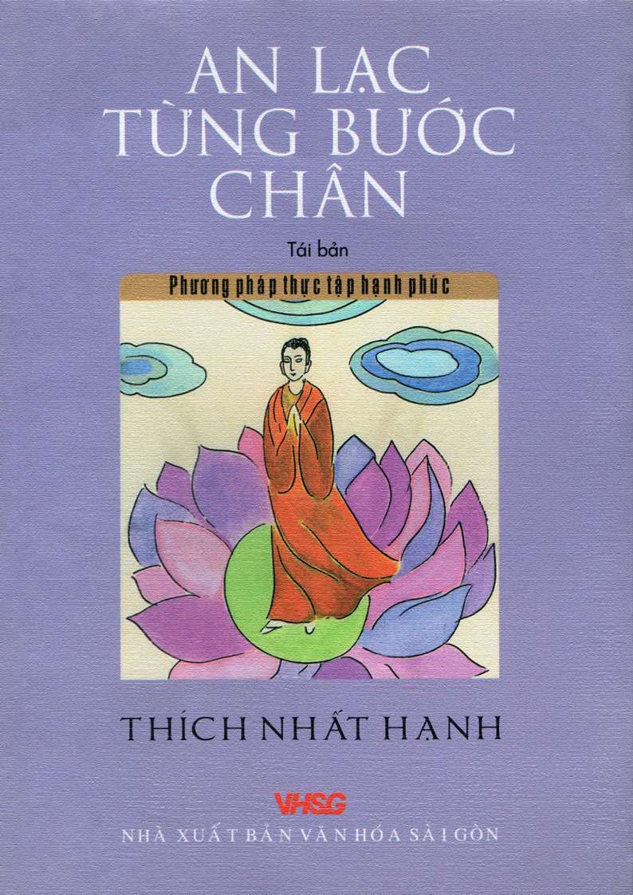

# AN LẠC TỪNG BƯỚC CHÂN
### *Peace Is Every Step: The Path of Mindfulness in Everyday Life*

**Tác giả:** Thiền sư Thích Nhất Hạnh  
**Thể loại:** Phật giáo ứng dụng, Tâm linh, Rèn luyện tâm hồn  

---

---

## MỤC LỤC CHI TIẾT

### Phần I: Hơi thở ý thức, hơi thở mầu nhiệm

- [Chương 01: Hai mươi bốn giờ tinh khôi](Phan_1_Chuong_01_Hai_muoi_bon_gio_tinh_khoi.md) (Trang 5)
- [Chương 02: Hoa Bồ Công Anh mỉm cười cho tôi](Phan_1_Chuong_02_Hoa_Bo_Cong_Anh_mim_cuoi_cho_toi.md) (Trang 6)
- [Chương 03: Hơi thở ý thức](Phan_1_Chuong_03_Hoi_tho_y_thuc.md) (Trang 7)
- [Chương 04: Hiện tại: giây phút nhiệm mầu](Phan_1_Chuong_04_Hien_tai_giay_phut_nhiem_mau.md) (Trang 8)
- [Chương 05: Bớt suy nghĩ lại](Phan_1_Chuong_05_Bot_suy_nghi_lai.md) (Trang 9)
- [Chương 06: Nuôi dưỡng chánh niệm trong từng phút giây](Phan_1_Chuong_06_Nuoi_duong_chanh_niem_trong_tung_phut_giay.md) (Trang 10)
- [Chương 07: Ngồi đâu cũng là ngồi thiền](Phan_1_Chuong_07_Ngoi_dau_cung_la_ngoi_thien.md) (Trang 12)
- [Chương 08: Thiền tọa](Phan_1_Chuong_08_Thien_toa.md) (Trang 13)
- [Chương 09: Chuông chánh niệm](Phan_1_Chuong_09_Chuong_chanh_niem.md) (Trang 14)
- [Chương 10: Chiếc bánh thời thơ ấu](Phan_1_Chuong_10_Chiec_banh_thoi_tho_au.md) (Trang 15)
- [Chương 11: Bí tích Thánh Thể](Phan_1_Chuong_11_Bi_tich_Thanh_The.md) (Trang 16)
- [Chương 12: Ăn cơm chánh niệm](Phan_1_Chuong_12_An_com_chanh_niem.md) (Trang 16)
- [Chương 13: Rửa chén](Phan_1_Chuong_13_Rua_chen.md) (Trang 18)
- [Chương 14: Thiền hành](Phan_1_Chuong_14_Thien_hanh.md) (Trang 19)
- [Chương 15: Thiền điện thoại](Phan_1_Chuong_15_Thien_dien_thoai.md) (Trang 21)
- [Chương 16: Thiền lái xe](Phan_1_Chuong_16_Thien_lai_xe.md) (Trang 22)
- [Chương 17: Quay về một mối](Phan_1_Chuong_17_Quay_ve_mot_moi.md) (Trang 25)
- [Chương 18: Cắt cỏ và thở](Phan_1_Chuong_18_Cat_co_va_tho.md) (Trang 26)
- [Chương 19: Vô nguyện](Phan_1_Chuong_19_Vo_nguyen.md) (Trang 26)
- [Chương 20: Đời sống là một tác phẩm nghệ thuật](Phan_1_Chuong_20_Doi_song_la_mot_tac_pham_nghe_thuat.md) (Trang 28)
- [Chương 21: Hy vọng trông chờ đôi khi là một trở ngại](Phan_1_Chuong_21_Hy_vong_trong_cho_doi_khi_la_mot_tro_ngai.md) (Trang 29)
- [Chương 22: Bông hoa và nụ cười ngài Ca Diếp](Phan_1_Chuong_22_Bong_hoa_va_nu_cuoi_ngai_Ca_Diep.md) (Trang 30)
- [Chương 23: Phòng thở](Phan_1_Chuong_23_Phong_tho.md) (Trang 32)
- [Chương 24: Cuộc hành trình vẫn tiếp tục](Phan_1_Chuong_24_Cuoc_hanh_trinh_van_tiep_tuc.md) (Trang 34)

### Phần II: Chuyển hóa và trị liệu

- [Chương 25: Dòng sông cảm thọ](Phan_2_Chuong_25_Dong_song_cam_tho.md) (Trang 35)
- [Chương 26: Không cắt bỏ](Phan_2_Chuong_26_Khong_cat_bo.md) (Trang 36)
- [Chương 27: Chuyển hóa những cảm thọ](Phan_2_Chuong_27_Chuyen_hoa_nhung_cam_tho.md) (Trang 36)
- [Chương 28: Ý thức về cái giận](Phan_2_Chuong_28_Y_thuc_ve_cai_gian.md) (Trang 39)
- [Chương 29: Đập gối để trút cái giận](Phan_2_Chuong_29_Dap_goi_de_trut_cai_gian.md) (Trang 40)
- [Chương 30: Đi thiền hành khi đang giận](Phan_2_Chuong_30_Di_thien_hanh_khi_dang_gian.md) (Trang 41)
- [Chương 31: Luộc khoai](Phan_2_Chuong_31_Luoc_khoai.md) (Trang 42)
- [Chương 32: Nguồn gốc của cái giận](Phan_2_Chuong_32_Nguon_goc_cua_cai_gian.md) (Trang 43)
- [Chương 33: Nội kết](Phan_2_Chuong_33_Noi_ket.md) (Trang 44)
- [Chương 34: Sống chung hòa hợp](Phan_2_Chuong_34_Song_chung_hoa_hop.md) (Trang 46)
- [Chương 35: Bàn tay của bạn](Phan_2_Chuong_35_Ban_tay_cua_ban.md) (Trang 46)
- [Chương 36: Cha mẹ](Phan_2_Chuong_36_Cha_me.md) (Trang 47)
- [Chương 37: Giữ gìn và nuôi dưỡng những hạt giống tốt](Phan_2_Chuong_37_Giu_gin_va_nuoi_duong_nhung_hat_giong_tot.md) (Trang 49)
- [Chương 38: Tiếp xúc với những gì mầu nhiệm](Phan_2_Chuong_38_Tiep_xuc_voi_nhung_gi_mau_nhiem.md) (Trang 51)
- [Chương 39: Trách móc không giúp được gì](Phan_2_Chuong_39_Trach_moc_khong_giup_duoc_gi.md) (Trang 52)
- [Chương 40: Hiểu và thương](Phan_2_Chuong_40_Hieu_va_thuong.md) (Trang 53)
- [Chương 41: Tình thương chân thật](Phan_2_Chuong_41_Tinh_thuong_chan_that.md) (Trang 53)
- [Chương 42: Từ bi quán](Phan_2_Chuong_42_Tu_bi_quan.md) (Trang 54)
- [Chương 43: Thiền ôm](Phan_2_Chuong_43_Thien_om.md) (Trang 56)
- [Chương 44: Đầu tư vào tăng thân](Phan_2_Chuong_44_Dau_tu_vao_tang_than.md) (Trang 57)
- [Chương 45: Cháu chắt là niềm vui của ông bà](Phan_2_Chuong_45_Chau_chat_la_niem_vui_cua_ong_ba.md) (Trang 58)
- [Chương 46: Tăng thân tu học](Phan_2_Chuong_46_Tang_than_tu_hoc.md) (Trang 58)
- [Chương 47: Đạo Phật đi vào cuộc đời](Phan_2_Chuong_47_Dao_Phat_di_vao_cuoc_doi.md) (Trang 59)

### Phần III: An lạc từng bước chân

- [Chương 48: Tương tức](Phan_3_Chuong_48_Tuong_tuc.md) (Trang 61)
- [Chương 49: Hoa và rác](Phan_3_Chuong_49_Hoa_va_rac.md) (Trang 62)
- [Chương 50: Vững chãi thảnh thơi](Phan_3_Chuong_50_Vung_chai_thanh_thoi.md) (Trang 63)
- [Chương 51: Tinh thần bất nhị](Phan_3_Chuong_51_Tinh_than_bat_nhi.md) (Trang 64)
- [Chương 52: Chữa trị những vết thương chiến tranh](Phan_3_Chuong_52_Chua_tri_nhung_vet_thuong_chien_tranh.md) (Trang 65)
- [Chương 53: Trái tim mặt trời](Phan_3_Chuong_53_Trai_tim_mat_troi.md) (Trang 67)
- [Chương 54: Nhìn sâu](Phan_3_Chuong_54_Nhin_sau.md) (Trang 67)
- [Chương 55: Nghệ thuật sống tỉnh thức](Phan_3_Chuong_55_Nghe_thuat_song_tinh_thuc.md) (Trang 68)
- [Chương 56: Nuôi dưỡng chánh niệm](Phan_3_Chuong_56_Nuoi_duong_chanh_niem.md) (Trang 70)
- [Chương 57: Bức thư tình](Phan_3_Chuong_57_Buc_thu_tinh.md) (Trang 71)
- [Chương 58: Bổn phận người công dân](Phan_3_Chuong_58_Bon_phan_nguoi_cong_dan.md) (Trang 72)
- [Chương 59: Bảo vệ thân tâm là giữ gìn sinh môi một cách rộng lớn](Phan_3_Chuong_59_Bao_ve_than_tam_la_giu_gin_sinh_moi_mot_cach_rong_lon.md) (Trang 73)
- [Chương 60: Nguồn gốc chiến tranh](Phan_3_Chuong_60_Nguon_goc_chien_tranh.md) (Trang 73)
- [Chương 61: Câu chuyện chiếc lá](Phan_3_Chuong_61_Cau_chuyen_chiec_la.md) (Trang 76)
- [Chương 62: Chúng ta cùng một nhân thể](Phan_3_Chuong_62_Chung_ta_cung_mot_nhan_the.md) (Trang 77)
- [Chương 63: Hòa giải](Phan_3_Chuong_63_Hoa_giai.md) (Trang 78)
- [Chương 64: Hãy gọi đúng tên tôi](Phan_3_Chuong_64_Hay_goi_dung_ten_toi.md) (Trang 79)
- [Chương 65: Khổ đau là chất liệu nuôi dưỡng tình thương](Phan_3_Chuong_65_Kho_dau_la_chat_lieu_nuoi_duong_tinh_thuong.md) (Trang 82)
- [Chương 66: Tình thương qua hành động](Phan_3_Chuong_66_Tinh_thuong_qua_hanh_dong.md) (Trang 83)
- [Chương 67: Mười bốn giới Tiếp Hiện](Phan_3_Chuong_67_Muoi_bon_gioi_Tiep_Hien.md) (Trang 83)
- [Chương 68: Câu chuyện của dòng sông](Phan_3_Chuong_68_Cau_chuyen_cua_dong_song.md) (Trang 86)
- [Chương 69: Xây dựng thế kỷ thứ hai mươi mốt](Phan_3_Chuong_69_Xay_dung_the_ky_thu_hai_muoi_mot.md) (Trang 88)

---

[Bắt đầu đọc: Chương 01 - Hai mươi bốn giờ tinh khôi >>](Phan_1_Chuong_01_Hai_muoi_bon_gio_tinh_khoi.md)
