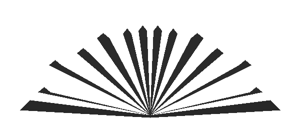

# SUY NGẪM

phê phán tinh thần cạnh tranh đến tàn nhẫn của Rockefeller và có thể ông cũng không hề để ý đến việc Henry Ford từng theo chủ nghĩa bài Do Thái.

Đối với Napoleon Hill, xã hội Mỹ và hệ thống tự do thương mại đang là hy vọng lớn nhất cho thế giới vì nó đang bước loạng choạng bên bờ vực của một tai họa lớn và thậm chí là với sự thiếu hoàn hảo rõ ràng của đất nước mình (điều ông nhìn thấy là sự nhạy cảm của nó với những âm mưu của Con Quỷ), không gì trên Trái đất này có thể so sánh với nó cả.

Với những người đã quyết định sẽ thành công trong cuộc sống, những người chống lại sự cám đỗ và yếu đuối của việc không tín ngưỡng và thay vào đó, họ sẽ đi tìm sự giúp đỡ của Chúa (được gọi bằng rất nhiều cái tên trong cuốn sách này) và không có giới hạn nào đành cho họ cả. Giới hạn là do con người tự tạo ra hoặc chính những thế lực tiêu cực của tội ác bên ngoài tạo ra và Con Quỷ chính là hiện thân của nó.

Vậy tôn giáo của Napoleon HIlI là gì? Thành thật mà nói thì với tôi, điều ấy chẳng có nhiều ý nghĩa. Càng bị ảnh hưởng bởi triết lý của Napoleon Hill và bị cuộc đời của ông mê hoặc, tôi càng không quan tâm đến việc ông từng tham gia nhà thờ nào chưa hay ông từng bao giờ đến bất cứ nhà thờ nào hay chưa. Với tôi, câu hỏi này quan trọng hơn: Ông dạy chúng ta điều gì về vai trò của niềm tin trong cuộc sống của chúng ta ngày nay?

Câu trả lời cho câu hỏi đó là quyền lựa chọn của bạn. Tôi nghĩ đó là vấn đề nền tảng ảnh hưởng tới mọi dòng ông viết trong cuốn sách này. Sau cùng, ông quyết định xây dựng cuốn sách này dưới một dạng một cuộc đối thoại tâm lý kinh điển và ông thiết lập nên một cuộc đấu nảy lửa với những nhân vật chống tôn giáo mạnh mẽ nhất trong tất cả các tài liệu từ trước tới giờ (từ Kinh Thánh, qua các tác phẩm của Milton và €. §. Lewis). Và tôi tiếp tục bị lựa chọn của Napoleon Hill làm cho mê hoặc bởi nó cho phép ông thể hiện theo một cách rất để đọc những lý thuyết và niềm tin về hành vi của con người được cất giữ rất sâu sắc trong ông. Nó là những bài học sâu sắc cho tất cả chúng ta.

Khi bạn tiếp tục hành trình cuộc sống của mình và gặp những trở ngại trên hành trình đó, có thể việc nhìn lại bảy nguyên tắc để Chiến thắng Con Quỷ trong bạn của Napoleon Hill có thể giúp bạn rất nhiều trong cuộc sống của mình.

® Mục tiêu xác định

® Làm chủ bản thân

® Học từ nghịch cảnh

® Kiểm soát ảnh hưởng của môi trường (sự kết giao)

® Thời gian (biến những thói quen tứ đuy tích cực chứ không phải tiêu cực trồ nên cỗ định và nuôi dưỡng sự khôn ngoan)

® Sự hòa hợp (hành động với mục tiêu xác định để trở thành ảnh hưởng chiếm tu thế trong môi trường vật chất, tinh thần và trí tuệ của mình)

® Cẩn trọng (xem xét thật kỹ càng về kế hoạch của mình trước khi hành động)

Khi xem lại bảy nguyên tắc này, bạn có thể nhận ra và tiết lộ xem điều gì đang khiến bạn không đạt được những thành công lớn nhất của bạn.

Tôi đã vô cùng may mắn khi được Quỹ Napoleon Hill tin tưởng và giao cho tôi bản thảo này một bản thảo bị cất giữ và khóa lại trong vòng hơn 70 năm (hoặc do vợ ông giấu đi hoặc do chính Con Quỷ giấu đi mất... tùy bạn lựa chọn). Người ta vẫn nói rằng khi học trò đã sẵn sàng thì người thẩy sẽ xuất hiện. Có thể Think and Grow Rich 13 nguyên tắc nghĩ giàu, làm giàu là thông điệp đúng đắn trong thời kỳ Đại suy thoái và Chiến thắng Con Quỷ trong bạn sẽ là thông điệp đúng đắn cho thời điểm hiện tại của chúng ta? Tôi tin tưởng rằng điều này xảy ra là do bàn tay của Chúa, chứ không phải do Con Quỷ. Tôi tin rằng Chiến thắng Con Quỷ trong bạn sẽ chưa được phát hành chừng nào Chúa cảm thấy chưa đến thời điểm thích hợp để phát ra thông điệp đó... cho chúng ta vào năm 2011. Rõ ràng là nó đã có tác động vô cùng lớn đến cuộc đời tôi và tôi hy vọng rằng bạn cũng sẽ tìm thấy giá trị của nó cho cuộc sống của chính mình.

Hy vọng những gì Napoleon HiÏl viết sẽ mang lại cho bạn hy vọng, lòng dũng cảm và quan trọng nhất là mục tiêu xác định cho cuộc đời mình... Chúc các bạn may mắn.

~ SHARON LECHTER CÓ RẤT NHIỀU người đã đóng góp công sức trong việc xuất bản cuốn sách Chiến thắng Con Quỷ trong bạn sau khi nó đã bị cất giấu trong vòng hơn 70 năm trời.

Quỹ Napoleon Hill xin gửi lời cảm ơn sâu sắc tới gia đình của Tiến sĩ Napoleon Hill những người đã lưu giữ gia tài của ông. Đặc biệt là với Tiến sĩ Charlie Johnson cháu của Napoleon Hill, anh đã bảo quản bản thảo gây tranh cãi này, nhận ra sức mạnh và sự xác đáng trong thông điệp của nó và gửi bản thảo tới Quỹ Napoleon Hill để nó có thể được xuất bản và phát hành.

Chúng tôi cũng xin bày tỏ lòng biết ơn tới Sharon Lechter và lòng đam mê với công việc gìn giữ và quảng bá cho gia tài của Napoleon HilI. Trong những bình luận xuyên suốt cuốn sách của bà, Sharon đã sử dụng tài năng và năng lực của mình để giúp độc giả đánh giá đúng và có được lợi ích từ thông điệp hợp thời này.

Sharon và chúng tôi cũng muốn cảm ơn những người hâm mộ Napoleon Hill trên khắp thế giới đã giúp chúng tôi lan tỏa sự thông thái của Napoleon HiII các thầy cô giáo và những người hướng dẫn, các điễn giả truyền cảm hứng và các giảng viên đại học, các nhà lãnh đạo kinh doanh thành công và các doanh nhân mới khởi nghiệp. Các bạn là những người thừa kế những công trình quan trọng của Napoleon Hill. Cũng chẳng có gì đáng ngạc nhiên khi Napoleon Hill thường được gọi bằng cái tên Người tạo nên Điều kỳ diệu hay Người tạo nên Các nhà Triệu phú trong suốt những năm ông làm diễn giả trên khắp thế giới.
