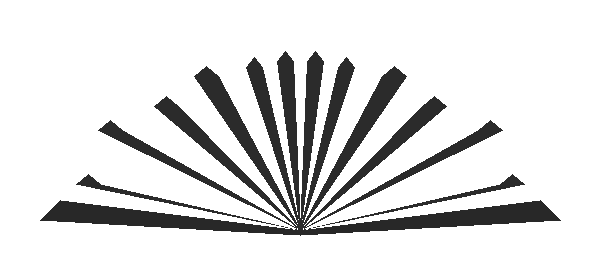

# SUY NGẪM

XUYÊN SUỐT NHỮNG TRANG VIẾT CỦA NAPOLEON HILL, có tồn tại một sự duy linh rất mạnh mẽ được thấm nhuần trong các phương pháp và đạo đức của ông. Tại nhiều phần của cuốn sách *Chiến thắng Con Quỷ trong bạn* này, nền tảng tôn giáo cho hệ thống niềm tin của ông có lẽ được thể hiện rõ ràng nhất.

Tuy nhiên, đối với Napoleon Hill, sự xuất hiện của những người xuất sắc trong các ngành công nghiệp và tài chính của thời đại cũng được tôn giáo công nhận theo một cách nào đó và giúp truyền cảm hứng đến tư duy và hành động của riêng ông và ông thuyết phục mọi người nhìn vào những con người này - và tất cả đều là đàn ông - như những hình mẫu về tư cách đạo đức và từ đó sinh ra thành công cá nhân cũng như những lợi ích chung.

Với Napoleon Hill, cuộc Đại Suy thoái là một thất bại về mặt đạo đức ở tầm vĩ mô. Ông sẽ nói gì về cuộc khủng hoảng hiện tại của chúng ta trên thị trường tài chính - hệ thống ngân hàng suýt sụp đổ vào năm 2008 và tình trạng suy thoái nghiêm trọng sau đó đã ảnh hưởng tới cuộc sống của tất cả mọi người sẽ cầm cuốn sách này lên vào năm 2011 và hơn thế nữa?

Các vị thần của Napoleon Hill gồm có Carnegie (tất nhiên rồi), Edison, Ford và Rockefeller. Mỗi ông trùm này sau đó đều được các nhà sử học, kinh tế học và những người chuyên viết tiểu sử phân tích đi phân tích lại và các sai sót cá nhân của họ cũng được đặt dưới ánh sáng soi xét của công chúng. Đối với Napoleon Hill, họ không chỉ là những nhân vật lịch sử mà họ còn là các lãnh đạo đương thời trên sân khấu của cả thế giới - giống như Adolf Hitler và Benito Mussolini, Franklin Roosevelt và Winston Churchill. Ông không hề phê phán tinh thần cạnh tranh đến tàn nhẫn của Rockefeller và có thể ông cũng không hề để ý đến việc Henry Ford từng theo chủ nghĩa bài Do Thái.

Đối với Napoleon Hill, xã hội Mỹ và hệ thống tự do thương mại đang là hy vọng lớn nhất cho thế giới vì nó đang bước loạng choạng bên bờ vực của một tai họa lớn - và thậm chí là với sự thiếu hoàn hảo rõ ràng của đất nước mình (điều ông nhìn thấy là sự nhạy cảm của nó với những âm mưu của Con Quỷ), không gì trên Trái đất này có thể so sánh với nó cả.

Với những người đã quyết định sẽ thành công trong cuộc sống, những người chống lại sự cám dỗ và yếu đuối của việc không tín ngưỡng và thay vào đó, họ sẽ đi tìm sự giúp đỡ của Chúa (được gọi bằng rất nhiều cái tên trong cuốn sách này) và không có giới hạn nào dành cho họ cả. Giới hạn là do con người tự tạo ra hoặc chính những thế lực tiêu cực của tội ác bên ngoài tạo ra và Con Quỷ chính là hiện thân của nó.

Vậy tôn giáo của Napoleon Hill là gì? Thành thật mà nói thì với tôi, điều ấy chẳng có nhiều ý nghĩa. Càng bị ảnh hưởng bởi triết lý của Napoleon Hill và bị cuộc đời của ông mê hoặc, tôi càng không quan tâm đến việc ông từng tham gia nhà thờ nào chưa hay ông từng bao giờ đến bất cứ nhà thờ nào hay chưa. Với tôi, câu hỏi này quan trọng hơn: Ông dạy chúng ta điều gì về vai trò của niềm tin trong cuộc sống của chúng ta ngày nay?

Câu trả lời cho câu hỏi đó là quyền lựa chọn của bạn. Tôi nghĩ đó là vấn đề nền tảng ảnh hưởng tới mọi dòng ông viết trong cuốn sách này. Sau cùng, ông quyết định xây dựng cuốn sách này dưới dạng một cuộc đối thoại tâm lý kinh điển và ông thiết lập nên một cuộc đấu nảy lửa với những nhân vật chống tôn giáo mạnh mẽ nhất trong tất cả các tài liệu từ trước tới giờ (từ Kinh Thánh, qua các tác phẩm của Milton và C. S. Lewis). Và tôi tiếp tục bị lựa chọn của Napoleon Hill làm cho mê hoặc bởi nó cho phép ông thể hiện - theo một cách rất dễ đọc - những lý thuyết và niềm tin về hành vi của con người được cất giữ rất sâu sắc trong ông. Nó là những bài học sâu sắc cho tất cả chúng ta.

Khi bạn tiếp tục hành trình cuộc sống của mình và gặp những trở ngại trên hành trình đó, có thể việc nhìn lại bảy nguyên tắc để *Chiến thắng Con Quỷ trong bạn* của Napoleon Hill có thể giúp bạn rất nhiều trong cuộc sống của mình.

* Mục tiêu xác định
* Làm chủ bản thân
* Học từ nghịch cảnh
* Kiểm soát ảnh hưởng của môi trường (sự kết giao)
* Thời gian (biến những thói quen tư duy tích cực chứ không phải tiêu cực trở nên cố định và nuôi dưỡng sự khôn ngoan)
* Sự hòa hợp (hành động với mục tiêu xác định để trở thành ảnh hưởng chiếm ưu thế trong môi trường vật chất, tinh thần và trí tuệ của mình)
* Cẩn trọng (xem xét thật kỹ càng về kế hoạch của mình trước khi hành động)

Khi xem lại bảy nguyên tắc này, bạn có thể nhận ra và tiết lộ xem điều gì đang khiến bạn không đạt được những thành công lớn nhất của bạn.

Tôi đã vô cùng may mắn khi được Quỹ Napoleon Hill tin tưởng và giao cho tôi bản thảo này - một bản thảo bị cất giữ và khóa lại trong vòng hơn 70 năm (hoặc do vợ ông giấu đi hoặc do chính Con Quỷ giấu đi mất... tùy bạn lựa chọn). Người ta vẫn nói rằng khi học trò đã sẵn sàng thì người thầy sẽ xuất hiện. Có thể *Think and Grow Rich - 13 nguyên tắc nghĩ giàu, làm giàu* là thông điệp đúng đắn trong thời kỳ Đại suy thoái và *Chiến thắng Con Quỷ trong bạn* sẽ là thông điệp đúng đắn cho thời điểm hiện tại của chúng ta? Tôi tin tưởng rằng điều này xảy ra là do bàn tay của Chúa, chứ không phải do Con Quỷ. Tôi tin rằng *Chiến thắng Con Quỷ trong bạn* sẽ chưa được phát hành chừng nào Chúa cảm thấy chưa đến thời điểm thích hợp để phát ra thông điệp đó... cho chúng ta vào năm 2011. Rõ ràng là nó đã có tác động vô cùng lớn đến cuộc đời tôi và tôi hy vọng rằng bạn cũng sẽ tìm thấy giá trị của nó cho cuộc sống của chính mình.

> *Hy vọng những gì Napoleon Hill viết sẽ mang lại cho bạn hy vọng, lòng dũng cảm và quan trọng nhất là mục tiêu xác định cho cuộc đời mình...*  
> *Chúc các bạn may mắn.*  
>  
> — **SHARON LECHTER**
