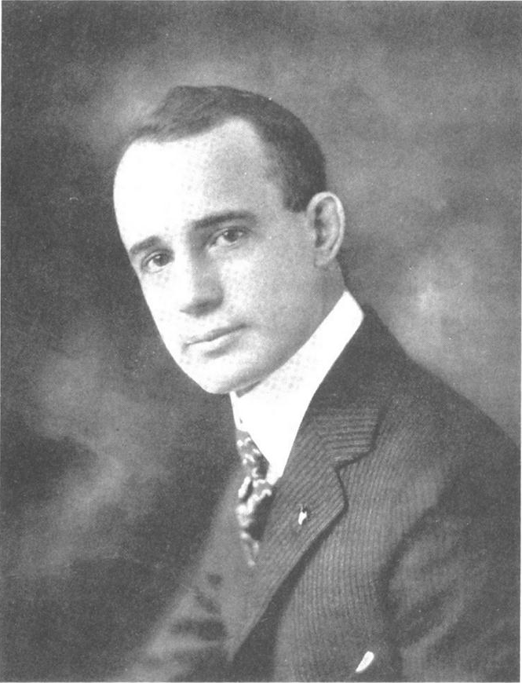

# LỜI CẢM ƠN

Chúng tôi cũng xin gửi lời cảm ơn đến toàn bộ nhân viên của Nhà xuất bản Sterling về những cống hiến và tài năng của họ, trong đó đặc biệt có Marcus Leaver, Jason Prince, Michael Fragnito và Kate Zimmermann. Riêng tư hơn, chúng tôi xin tỏ lòng biết ơn đến toàn bộ đội của mình ở Quỹ Napoleon Hill trước tiên vì những hướng dẫn và hỗ trợ không ngừng của họ... Robert T. Johnson Con, Michael Lechter, Annedia Sturgill, Phillip Lechter, Kevin Stock, Angela Totman và Kristin Thomas. Ngoài ra, chúng tôi cũng đánh giá cao sự động viên và giúp đỡ từ Steve Riggio, Greg Reid, Joe McNeely, Greg Tobin và Cevin Bryerman.

Thay mặt cho Napoleon Hill người đã bắt đầu cuộc hành trình của mình cách đây hơn một thế kỷ, người mà sự thông thái của ông đã mang đến hy vọng và lòng dũng cảm cho hàng triệu người trên khắp thế giới này, chúng tôi cảm ơn bạn!

---

## Về Tác Giả

### NAPOLEON HILL
*(1883 - 1970)*

DoN GREEN, Giám đốc điều hành Quỹ Napoleon Hill NAPOLEON HILL sinh năm 1883 tại một vùng rừng núi xa xôi hẻo lánh ở hạt Wise, bang Virginia. Ông sinh ra trong một gia đình nghèo khó và mồ côi mẹ từ năm ông mới 9 tuổi. Một năm sau, cha ông tái hôn và người mẹ kế trở thành nguồn cảm hứng cho cậu bé.

Với ảnh hưởng từ mẹ kế, Napoleon Hill đã trở thành phóng viên cho một tờ báo từ khi ông còn ở độ tuổi vị thành niên. Những bài viết của ông khiến Robert L. Taylor người từng là thống đốc của bang Tennesse và sau này trở thành Thượng nghị sĩ chú ý. Taylor có một tạp chí mang tên Tạp chí Bob Taylor và ông đã thuê chàng trai Napoleon Hill trẻ tuổi viết về những câu chuyện thành công. Lúc đó, Napoleon HilÌ mới vào học tại Trường Luật Georgetown.

Vào năm 1908, Napoleon Hill được giao nhiệm vụ phỏng vấn Andrew Carnegie và một cuộc phỏng vấn dự kiến kéo dài ba tiếng đã biến thành cuộc phỏng vấn kéo dài ba ngày. Khi Napoleon Hill thực hiện cuộc phỏng vấn, Carnegie đã cho ông ý tưởng về việc tổ chức nên triết lý về thành công cá nhân đầu tiên trên thế giới, dựa trên những nguyên tắc thành công.

Carnegie đã giới thiệu Napoleon Hill với những người khổng lồ của thời đại đó, bao gồm Henry Ford, Thomas A. Edison và John D. Rockefeller. Napoleon Hill đã dành 20 năm để phỏng vấn, nghiên cứu và viết về những con người thành công ấy.

Phải mất đến 20 năm sau khi Napoleon Hill phỏng vấn Carnegie, ông mới viết bộ sách bao gồm 8 tập mang tên Luật Thành công (Law of Success) vào năm 1928. Ông đã viết ra rất nhiều cuốn sách bán chạy trong suốt cuộc đời mình. Vào năm 1937, ông viết Tiínk and Grow Rich 13 nguyên tắc nghĩ giàu, làm giàu cuốn sách đã trở thành cuốn sách dạy về phát triển bản thân bán chạy nhất mọi thời đại và đến giờ, vẫn có hàng triệu bản của cuốn sách được bán ra trên toàn thế giới. Cũng chẳng có gì đáng ngạc nhiên khi Napoleon Hill thường được gọi bằng cái tên Người tạo nên Điều kỳ điệu hay Người tạo nên Các nhà Triệu phú.

---

### SHARON LECHTER

SHARON LECHTER

LÀ MỘT NGƯỜI ỦNG HỘ GIÁO DỤC SUỐT ĐỜI, Sharon Lechter là người sáng lập nên tổ chức Pay Your Family First một tổ chức giáo dục về tài chính. Sharon còn là phát ngôn viên của Trung tâm Đào tạo Bồi dưỡng Nghiệp vụ Quốc gia về kỹ năng sử dụng tiền. Vào năm 2008, Sharon được bổ nhiệm vào Hội đồng tư vấn Tài chính cho Tổng thống đầu tiên và bà đã phục vụ cho cả hai Tổng thống Mỹ là Bush và Obama.

Sharon là một doanh nhân, một tác giả, một nhà từ thiện, một nhà giáo dục, một diễn giả quốc tế, một kiểm toán viên có chứng chỉ và một người mẹ. Bà là người đi tiên phong trong việc phát triển các công nghệ, chương trình và sản phẩm mới để mang giáo dục đến cuộc sống của trẻ em theo các phương pháp đổi mới, kích thích và vui nhộn hơn. Trò chơi về kỹ năng sử dụng tiển của bà có tên gọi Thời kỳ Thịnh vượng cho Teen là một trò chơi thực tế về cuộc sống và tiền bạc đẩy sáng tạo và trải nghiệm. Nó đã được công nhận bởi rất nhiều giải thưởng danh giá, trong đó có Giải Vàng Lựa chọn của Mẹ (GOLD Mom§ Choice Award), Trò chơi của năm 2010 của Tạp chí Đứa trẻ Sáng tạo (Creative Child Magazine), Sản phẩm Nghỉ Lễ Tuyệt vời nhất của Tiến sĩ Đồ chơi (Dr. Toy Best Vacation Award) và được Bộ sưu tập Đồ chơi xếp hạng 5 sao. Sharon được công nhận là một chuyên gia về vấn đề giáo dục tài chính cho trẻ em, tài chính cá nhân và doanh nghiệp.

Sharon là tác giả của cuốn sách bán chạy Cách mỏ vàng ba bước chân (Three Feet from Gold) với sự hợp tác của Quỹ Napoleon Hill và Greg Reid. Sharon còn nổi tiếng khắp thế giới với tư cách là đồng tác giả của cuốn sách bán chạy số 1 của New York Times là Cha giàu, cha nghèo và 14 cuốn sách khác trong sê-ri Cha giàu.

---

### Hãy chia sẻ những câu chuyện về cách bạn đã chiến thắng Con Quỷ trong bạn như thế nào

Với tư cách là nhà từ thiện, Sharon cũng đóng cả hai vai trò tình nguyện viên lẫn mạnh thường quân. Sharon làm việc cho Ủy ban quốc gia của Tổ chức Những nữ Chủ tịch và Giúp đỡ Trẻ em một tổ chức tầm cỡ quốc gia được thành lập để ngăn cản và xử lý nạn bạo hành trẻ em. www.sharonlechter.com www.payyourfamilyfirst.com www.outwittingthedevil.com Hãy chia sẻ những câu chuyện về cách bạn đã chiến thắng Con Quỷ trong bạn như thế nào.

ằng cách ghé thăm website www.outwittingthedevil.com,

bạn có thể gia nhập cộng đồng của chúng tôi. Hãy chia sẻ

câu chuyện của chính bạn về cách bạn đã chiến thắng Con Quỷ như thế nào và bạn sẽ giúp đỡ những người khác nhận ra rằng họ cũng có thể làm được điều đó!

Nếu bạn vẫn đang chiến đấu với Con Quỷ, bạn có thể học hỏi được từ những thành viên khác trong cộng đồng xem họ đã đối mặt với Con Quỷ và đấu tranh với nó như thế nào, điều gì đã giúp họ kiên trì và họ đã đạt được thành công bằng cách nào.

Đó có thể là động lực giúp bạn đi đến thành công!

*Điểu gì mà tâm trí có thể nhận thức và tin tởng

thì tâm trí có thể hoàn thành.”

~ NAPOLEON HILL SHARON LECHTER

và

Quỹ NApoLEoN HILL

---

## Lời Khen Tặng Dành Cho CHIẾN THẮNG CON QUỶ TRONG BẠN

www.0tuttvittinethedeviÌ.com www.naphillLorg Lời khen tặng dành cho

“Mọi người thường bảo chúng ta phải phớt lờ đi sự tốn tại của những thứ tiêu cực mà chỉ tập trung vào những thứ tích cực mà thôi. Thực ra khi nhận ra cả hai thứ trên và học cách đối mặt với nó, bạn mới có được sức mạnh. Cuốn sách này đã kể ra một câu chuyện vĩ đại và dạy cho chúng ta những bài học tuyệt vời”

LARRY WINGET, tác giả sách bán chạy trên New York Times và Wall Street Journal Không nói, không khóc nữa và Bắt đầu sống (Shut up, Stop Whining & Get a Life)

“Tác phẩm bất hủ Thínk and Grow Rịch 13 nguyên tắc nghĩ giàu, làm giàu của Napoleon Hill đi trước thời đại đến cả 50 năm khi nó được viết ra. Tài sản mới được khám phá gần đây Chiến thắng Con Quỷ trong bạn lại bổ sung thêm những bằng chứng cho sự thông thái và gia tài của ông. Napoleon Hill đã hướng dẫn bạn phân biệt giữa đúng và sai, tốt nhất và tệ nhất, trái và phải như thể hiện giờ ông vẫn còn sống vậy. Cuốn sách này không phải là lựa chọn cho những người đang tìm kiếm sự sáng suốt của hôm nay có thể đẫn bạn đến thành công và đầy đủ của tương lai” JEFFREY, tác giả của cuốn sách Cuốn sách nhỏ về Nghệ thuật Bán hàng (The Little Red Book of Selling) và Cuốn sách vàng về thái độ CÓ (The Little Gold Book ofYES Attitude)

“Nếu bạn không lập trình cho bản thân mình, cuộc sống sẽ lập trình cho

bạn! Cuốn sách Chiến thẳng Con Quỷ trong bạn cung cấp cho bạn mật mã để đạt được những tiềm năng lớn nhất của mình!”

LES BROWN, tác giả truyền cảm hứng của Sống giấc mơ của mình

(Live Your Dream)

+Ắ “Napoleon Hill đã lấy một ý mà €. §. Lewis đã dùng trong cuốn Những lá thư của Screwtape (The Screwtape Letters), mở rộng nó và giới thiệu nó theo cách của riêng ông. Kết quả là tâm trí của Napoleon Hill một cuốn sách kỳ diệu hướng về tâm trí của ông và cách ông nhìn nhận xã hội như một chương trình mù quáng dẫn chúng ta đến thất bại. Chiến thắng Con Quỷ trong bạn có thể vẫn còn quá 'nóng' để xuất bản.”

TIẾN SĨ J. B. HILL, cháu trai của Napoleon Hill

“Cuốn sách là cái nhìn vĩ đại nhất về tâm trí của một nhà truyền cảm hứng huyển thoại Napoleon Hill”

GREG S. REID, đồng tác giả của Cách mỏ vàng ba bước chân

“Trong tâm trí của các độc giả hiện đại ngày nay, những bài học của Napoleon Hill thường được liên tưởng với thành công được hiểu là số tiến trong két của một người. Nhưng tôi phải nói sự thật rằng ông đã chia sẻ với cả thế giới sự thông thái của các nguyên tắc sống) bắt đầu với phần bên trong của một người, trạng thái bên trong ý thức của một người, mời gọi chúng ta thể hiện hết mọi khả năng chúng ta có không chỉ vì lợi ích của riêng chúng ta mà cho cả toàn nhân loại nữa”

MICHAEL BERNARD BECKWITH, tác giả của Tự đo về mặt Tĩnh thần: Phát huy hết tiêm năng trong tâm hỗn bạn (Spiritual Liberation: Fulfilling Your Souls Potential)

“Sự thông thái bất tử của Napoleon Hill được kết hợp với khả năng giao tiếp với các độc giả hiện đại của Sharon Lechter trong cuốn Chiến thẳng Con Quỷ trong bạn cuốn sách tiếp theo vô cùng sâu sắc và có thể thay đổi cuộc đời bạn sau Think and Grow Rich 13 nguyên tắc nghĩ giàu, làm giàu. Khi bạn đọc nó và rồi lại đọc lại nữa, bạn sẽ nhận ra rằng bạn nghĩ về điều gì, điều đó sẻ xảy đến!”

RITA DAVENPORIT, tác giả, điển giả và nhà văn khôi hài

“Think and Grow Rich 13 nguyên tắc nghĩ giàu, làm giàu đã hé mở những nguyên tắc cơ bản để thành công... Chiến thẳng Con Quỷ trong bạn sẽ tiết lộ những gì sẽ xuất hiện trên đường đi của bạn, làm sao để vượt qua những trở ngại ấy và đạt được thành công mà bạn xứng đáng có được”

JIM STOVALL, tác giả của cuốn sách bán chạy Món quà cuối cùng

(The Ultimate gift)

“Bạn cũng sẽ khám phá ra Con Quỷ mà Napoleon Hill phỏng vấn rất giống

Con Quỷ mà bạn có thể phải đối mặt trong cuộc sống và những trải nghiệm của mình”

MARK VICTOR HANSEN, nhà đồng sáng tạo nên series sách bán chạy

số 1 của New York Times Hạt giống tâm hồn

(Chicken soup for the soul)
