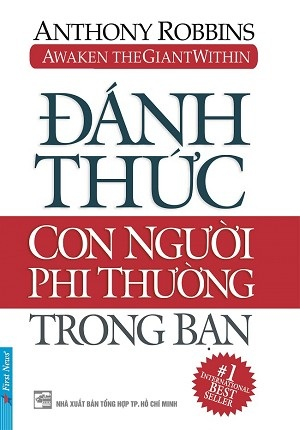

# ĐÁNH THỨC CON NGƯỜI PHI THƯỜNG TRONG BẠN

**Tác giả:** Anthony Robbins  
**Thể loại:** Kỹ năng sống, Phát triển bản thân, Tư duy thành công  
**Nguyên tác:** *Awaken the Giant Within*

---

## MỤC LỤC

- [Trang bìa & Thông tin xuất bản](00_Trang_bia.md)
- [Lời nói đầu (Dr. Frederick L. Covan)](00_Loi_noi_dau.md)

### PHẦN MỘT: GIẢI PHÓNG NGUỒN TIỀM NĂNG CỦA BẠN

- [Chương 1: Những ước mơ cho đời mình](01_Chuong_01_Nhung_uoc_mo_cho_doi_minh.md)
- [Chương 2: Những quyết định tạo sức mạnh](02_Chuong_02_Nhung_quyet_dinh_tao_suc_manh.md)
- [Chương 3: Những sức mạnh dệt nên cuộc đời](03_Chuong_03_Nhung_suc_manh_det_nen_cuoc_doi.md)
- [Chương 4: Những niềm tin của ta: Sức mạnh xây dựng và sức mạnh hủy hoại](04_Chuong_04_Nhung_niem_tin_cua_ta.md)
- [Chương 5: Thay đổi có thể xảy ra trong nháy mắt không?](05_Chuong_05_Thay_doi_co_the_xay_ra_trong_nhay_mat_khong.md)
- [Chương 6: Thay đổi một thói quen: Khoa điều khiển bằng liên tưởng](06_Chuong_06_Thay_doi_mot_thoi_quen.md)
- [Chương 7: Làm thế nào đạt điều bạn thực sự mong muốn](07_Chuong_07_Lam_the_nao_dat_dieu_ban_thuc_su_mong_muon.md)
- [Chương 8: Hỏi tức là trả lời](08_Chuong_08_Hoi_tuc_la_tra_loi.md)
- [Chương 9: Giỏi vận dụng ngôn từ sẽ đem đến thành công](09_Chuong_09_Gioi_van_dung_ngon_tu_se_dem_den_thanh_cong.md)
- [Chương 10: Sức mạnh của những ẩn dụ trong đời sống](10_Chuong_10_Suc_manh_cua_nhung_an_du_trong_doi_song.md)
- [Chương 11: Mười cảm xúc tạo sức mạnh](11_Chuong_11_Muoi_cam_xuc_tao_suc_manh.md)
- [Chương 12: Đam mê diệu kỳ: Xây dựng tương lai thôi thúc](12_Chuong_12_Dam_me_dieu_ky_xay_dung_tuong_lai_thoi_thuc.md)
- [Chương 13: Mười ngày thử thách tâm trí](13_Chuong_13_Muoi_ngay_thu_thach_tam_tri.md)

### PHẦN HAI: HỆ THỐNG CHỦ ĐẠO GIÚP LÀM CHỦ ĐỜI MÌNH

- [Chương 14: Ảnh hưởng tuyệt vời: Hệ thống chủ đạo của bạn](14_Chuong_14_Anh_huong_tuyet_voi_he_thong_chu_dao_cua_ban.md)
- [Chương 15: Các giá trị của cuộc đời: La bàn định hướng cho bạn](15_Chuong_15_Cac_gia_tri_cua_cuoc_doi_la_ban_dinh_huong_cho_ban.md)
- [Chương 16: Các nguyên tắc: Lý do bạn không hạnh phúc](16_Chuong_16_Cac_nguyen_tac_ly_do_ban_khong_hanh_phuc.md)
- [Chương 17: Những bài học của kinh nghiệm: Sợi chỉ dệt nên cuộc đời](17_Chuong_17_Nhung_bai_hoc_cua_kinh_nghiem.md)
- [Chương 18: Cá tính: Bí quyết để phát triển](18_Chuong_18_Ca_tinh_bi_quyet_de_phat_trien.md)

### PHẦN BA: BẢY NGÀY ĐỂ ĐỊNH HƯỚNG VẬN MỆNH CỦA BẠN

- [Chương 19: Vận mệnh cảm xúc: Thành công đích thực duy nhất](19_Chuong_19_Van_menh_cam_xuc.md)
- [Chương 20: Vận mệnh thân xác: Ngục tù đau khổ hay cung điện hạnh phúc](20_Chuong_20_Van_menh_than_xac.md)
- [Chương 21: Vận mệnh các mối quan hệ: Nơi để chia sẻ và quan tâm](21_Chuong_21_Van_menh_cac_moi_quan_he.md)
- [Chương 22: Số mệnh tài chánh: Phương pháp đơn giản để làm ra của cải](22_Chuong_22_So_menh_tai_chanh.md)
- [Chương 23: Sống trung thực: Qui luật cư xử của bạn](23_Chuong_23_Song_trung_thuc_qui_luat_cu_xu_cua_ban.md)
- [Chương 24: Làm chủ thời giờ và đời sống của bạn](24_Chuong_24_Lam_chu_thoi_gio_va_doi_song_cua_ban.md)
- [Chương 25: Nghỉ ngơi và giải trí: Ngay cả Thượng Đế cũng nghĩ một ngày!](25_Chuong_25_Nghi_ngoi_va_giai_tri.md)

### PHẦN BỐN: BÀI HỌC VỀ VẬN MỆNH

- [Chương 26: Thách đố tột đỉnh: Sức lực con người có thể đi đến đâu](26_Chuong_26_Thach_do_tot_dinh.md)

