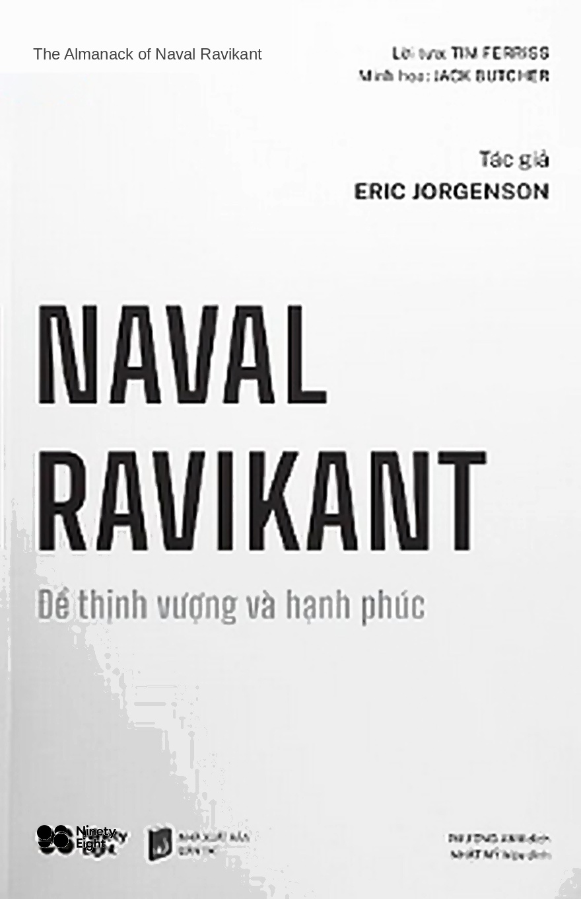

# NAVAL RAVIKANT – ĐỂ THỊNH VƯỢNG VÀ HẠNH PHÚC

### TÁC GIẢ: ERIC JORGENSON

---

### THÔNG TIN BẢN QUYỀN

**Copyright © 2020 Eric Jorgenson**  
*All rights reserved.*

**THE ALMANACK OF NAVAL RAVIKANT: A Guide to Wealth and Happiness**  
Cuốn sách này được xuất bản như một dịch vụ cộng đồng. Phiên bản điện tử (PDF và e-reader) được phát hành miễn phí trên trang web: ebook.nxbdantri.com.vn và Navalmanack.com.  
Naval không kiếm bất kỳ khoản tiền nào từ cuốn sách này. Các bài viết, podcast và các tài liệu khác của Naval có thể tìm thấy tại [Nav.al](https://nav.al) và trên Twitter [@Naval](https://twitter.com/naval).

**Bản dịch tiếng Việt:**  
- **Tác giả:** Eric Jorgenson  
- **Dịch giả:** Phương Anh  
- **Hiệu đính:** Nhật Mỹ  
- **Biên tập:** Vương Xuyên  
- **Cố vấn thiết kế:** Lê Dương  
- **Đơn vị phát hành:** Công ty TNHH C98 (Ninety Eight) giữ bản quyền xuất bản và phát hành ấn bản tiếng Việt trên toàn thế giới theo Hợp đồng chuyển giao bản quyền với Magrathea Inc. thông qua đại diện 2 Seas Literary Agency.

---

> **DÀNH CHO BỐ MẸ CỦA TÔI,**  
> **NHỮNG NGƯỜI ĐÃ CHO TÔI MỌI THỨ**  
> **VÀ DƯỜNG NHƯ LUÔN TÌM CÁCH**  
> **ĐỂ CHO ĐI NHIỀU HƠN.**

---

# MỤC LỤC

- [**LỜI NÓI ĐẦU**](01_loi_noi_dau.md) *(Trang 11)*
- [**CHÚ THÍCH QUAN TRỌNG VỀ CUỐN SÁCH (TUYÊN BỐ MIỄN TRỪ TRÁCH NHIỆM)**](02_chu_thich_quan_trong.md) *(Trang 13)*
- [**LỜI TỰA**](03_loi_tua.md) *(Trang 17)*
- [**CHÚ THÍCH CỦA ERIC (VỀ CUỐN SÁCH)**](04_chu_thich_cua_eric.md) *(Trang 21)*
- [**CÁC MỐC THỜI GIAN CỦA NAVAL RAVIKANT**](05_cac_moc_thoi_gian.md) *(Trang 25)*
- [**VÀ BÂY GIỜ, ĐÂY LÀ LỜI TỰ THUẬT CỦA NAVAL**](06_loi_tu_thuat_cua_naval.md) *(Trang 27)*

---

### [PHẦN I: THỊNH VƯỢNG](07_phan_1_xay_dung_su_thinh_vuong.md) *(Trang 31)*

#### [XÂY DỰNG SỰ THỊNH VƯỢNG](07_phan_1_xay_dung_su_thinh_vuong.md) *(Trang 33)*
- [Hiểu cách tạo nên sự thịnh vượng](07_phan_1_xay_dung_su_thinh_vuong.md#hiểu-cách-tạo-nên-sự-thịnh-vượng) *(Trang 34)*
- [Tìm kiếm và xây dựng kiến thức chuyên biệt](07_phan_1_xay_dung_su_thinh_vuong.md#tìm-kiếm-và-xây-dựng-kiến-thức-chuyên-biệt) *(Trang 45)*
- [Tham gia những cuộc chơi dài hạn với những người có tầm nhìn dài hạn](07_phan_1_xay_dung_su_thinh_vuong.md#tham-gia-những-cuộc-chơi-dài-hạn-với-những-người-có-tầm-nhìn-dài-hạn) *(Trang 52)*
- [Gánh vác trách nhiệm](07_phan_1_xay_dung_su_thinh_vuong.md#gánh-vác-trách-nhiệm) *(Trang 56)*
- [Xây dựng hoặc nắm giữ vốn chủ sở hữu trong một doanh nghiệp](07_phan_1_xay_dung_su_thinh_vuong.md#xây-dựng-hoặc-mua-vốn-chủ-sở-hữu-trong-một-doanh-nghiệp) *(Trang 59)*
- [Tìm một vị trí có đòn bẩy](07_phan_1_xay_dung_su_thinh_vuong.md#tìm-một-vị-trí-có-đòn-bẩy) *(Trang 61)*
- [Được trả công cho sự phán đoán của bạn](07_phan_1_xay_dung_su_thinh_vuong.md#được-trả-công-cho-sự-phán-đoán-của-bạn) *(Trang 74)*
- [Xác định ưu tiên và tập trung](07_phan_1_xay_dung_su_thinh_vuong.md#xác-định-ưu-tiên-và-tập-trung) *(Trang 77)*
- [Tìm công việc mang lại cảm giác làm như chơi](07_phan_1_xay_dung_su_thinh_vuong.md#tìm-công-việc-mang-lại-cảm-giác-làm-như-chơi) *(Trang 85)*
- [Làm thế nào để có được may mắn](07_phan_1_xay_dung_su_thinh_vuong.md#làm-thế-nào-để-có-được-may-mắn) *(Trang 92)*
- [Hãy kiên nhẫn](07_phan_1_xay_dung_su_thinh_vuong.md#hãy-kiên-nhẫn) *(Trang 97)*

#### [XÂY DỰNG KỸ NĂNG PHÁN ĐOÁN](08_phan_1_xay_dung_ky_nang_phan_doan.md) *(Trang 103)*
- [Kỹ năng phán đoán](08_phan_1_xay_dung_ky_nang_phan_doan.md#kỹ-năng-phán-đoán) *(Trang 104)*
- [Làm thế nào để tư duy mạch lạc](08_phan_1_xay_dung_ky_nang_phan_doan.md#làm-thế-nào-để-tư-duy-mạch-lạc) *(Trang 105)*
- [Tách bạch bản ngã của bạn để nhìn thấy thực tại](08_phan_1_xay_dung_ky_nang_phan_doan.md#tách-bạch-bản-ngã-của-bạn-để-nhìn-thấy-thực-tại) *(Trang 111)*
- [Học kỹ năng đưa ra quyết định](08_phan_1_xay_dung_ky_nang_phan_doan.md#học-kỹ-năng-đưa-ra-quyết-định) *(Trang 114)*
- [Thu thập những mô hình tư duy](08_phan_1_xay_dung_ky_nang_phan_doan.md#thu-thập-những-mô-hình-tư-duy) *(Trang 117)*
- [Học cách yêu việc đọc](08_phan_1_xay_dung_ky_nang_phan_doan.md#học-cách-yêu-việc-đọc) *(Trang 126)*

---

### [PHẦN II: HẠNH PHÚC](09_phan_2_hoc_ve_hanh_phuc.md) *(Trang 139)*

#### [HỌC VỀ HẠNH PHÚC](09_phan_2_hoc_ve_hanh_phuc.md) *(Trang 141)*
- [Hạnh phúc là thứ có thể học được](09_phan_2_hoc_ve_hanh_phuc.md#hạnh-phúc-là-thứ-có-thể-học-được) *(Trang 142)*
- [Hạnh phúc là một lựa chọn](09_phan_2_hoc_ve_hanh_phuc.md#hạnh-phúc-là-một-lựa-chọn) *(Trang 148)*
- [Hạnh phúc đòi hỏi sự hiện diện](09_phan_2_hoc_ve_hanh_phuc.md#hạnh-phúc-đòi-hỏi-sự-hiện-diện) *(Trang 149)*
- [Hạnh phúc đòi hỏi sự bình yên](09_phan_2_hoc_ve_hanh_phuc.md#hạnh-phúc-đòi-hỏi-sự-bình-yên) *(Trang 150)*
- [Mọi mong cầu đều là một sự bất hạnh được chọn lựa](09_phan_2_hoc_ve_hanh_phuc.md#mọi-mong-cầu-đều-là-một-sự-bất-hạnh-được-chọn-lựa) *(Trang 153)*
- [Thành công không tạo nên hạnh phúc](09_phan_2_hoc_ve_hanh_phuc.md#thành-công-không-tạo-nên-hạnh-phúc) *(Trang 155)*
- [Ghen tị là kẻ thù của hạnh phúc](09_phan_2_hoc_ve_hanh_phuc.md#ghen-tị-là-kẻ-thù-của-hạnh-phúc) *(Trang 159)*
- [Hạnh phúc được xây dựng từ các thói quen](09_phan_2_hoc_ve_hanh_phuc.md#hạnh-phúc-được-xây-dựng-từ-các-thói-quen) *(Trang 162)*
- [Tìm thấy hạnh phúc trong sự chấp nhận](09_phan_2_hoc_ve_hanh_phuc.md#tìm-thấy-hạnh-phúc-trong-sự-chấp-nhận) *(Trang 170)*

#### [CỨU RỖI BẢN THÂN](10_phan_2_cuu_roi_ban_than.md) *(Trang 175)*
- [Chọn là chính mình](10_phan_2_cuu_roi_ban_than.md#chọn-là-chính-mình) *(Trang 176)*
- [Chọn chăm sóc bản thân](10_phan_2_cuu_roi_ban_than.md#chọn-chăm-sóc-bản-thân) *(Trang 177)*
- [Thiền + Sức mạnh tinh thần](10_phan_2_cuu_roi_ban_than.md#thiền--sức-mạnh-tinh-thần) *(Trang 185)*
- [Chọn hoàn thiện bản thân](10_phan_2_cuu_roi_ban_than.md#chọn-hoàn-thiện-bản-thân) *(Trang 197)*
- [Chọn phát triển bản thân](10_phan_2_cuu_roi_ban_than.md#chọn-phát-triển-bản-thân) *(Trang 202)*
- [Chọn giải phóng bản thân](10_phan_2_cuu_roi_ban_than.md#chọn-giải-phóng-bản-thân) *(Trang 206)*

#### [TRIẾT LÝ](11_phan_2_triet_ly.md) *(Trang 213)*
- [Ý nghĩa của cuộc sống](11_phan_2_triet_ly.md#ý-nghĩa-của-cuộc-sống) *(Trang 214)*
- [Sống theo giá trị cá nhân](11_phan_2_triet_ly.md#sống-theo-giá-trị-cá-nhân) *(Trang 217)*
- [Phật giáo Duy lý](11_phan_2_triet_ly.md#phật-giáo-duy-lý) *(Trang 219)*
- [Hiện tại là tất cả những gì chúng ta có](11_phan_2_triet_ly.md#hiện-tại-là-tất-cả-những-gì-chúng-ta-có) *(Trang 222)*

---

### [PHỤ LỤC](12_phu_luc_tai_lieu_khuyen_doc.md) *(Trang 225)*

#### [TÀI LIỆU KHUYẾN ĐỌC CỦA NAVAL](12_phu_luc_tai_lieu_khuyen_doc.md) *(Trang 227)*
- [Sách](12_phu_luc_tai_lieu_khuyen_doc.md#sách) *(Trang 228)*
- [Một số gợi ý khác](12_phu_luc_tai_lieu_khuyen_doc.md#một-số-gợi-ý-khác) *(Trang 245)*

- [**CÁC BÀI VIẾT CỦA NAVAL**](13_cac_bai_viet_cua_naval.md) *(Trang 248)*
- [**TIẾP THEO VỀ NAVAL**](14_tiep_theo_ve_naval.md) *(Trang 251)*
- [**LỜI CẢM ƠN**](15_loi_cam_on.md) *(Trang 253)*
- [**NGUỒN THAM KHẢO**](16_nguon_tham_khao.md) *(Trang 257)*
- [**VỀ TÁC GIẢ**](17_ve_tac_gia.md) *(Trang 270)*
