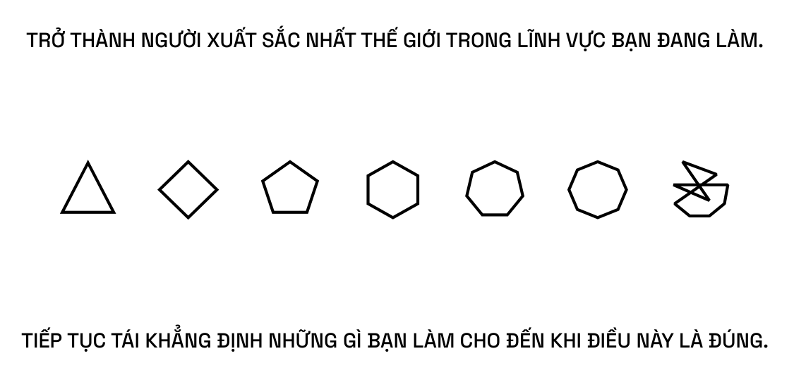
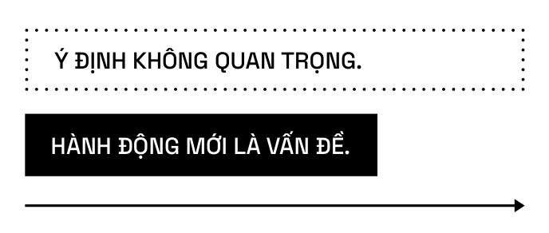
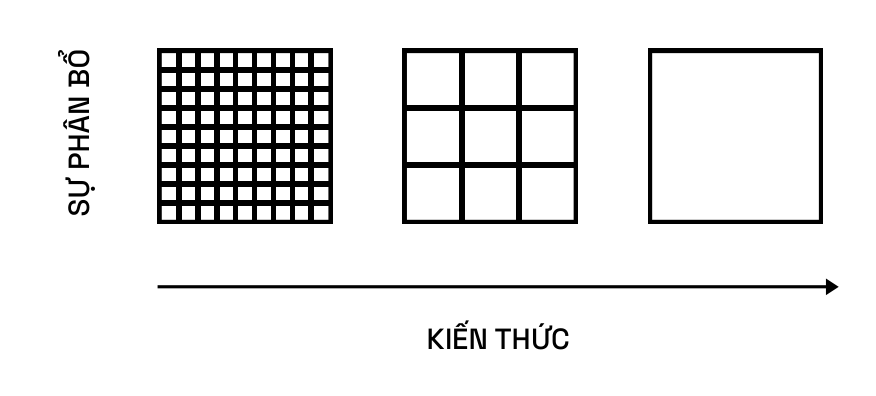
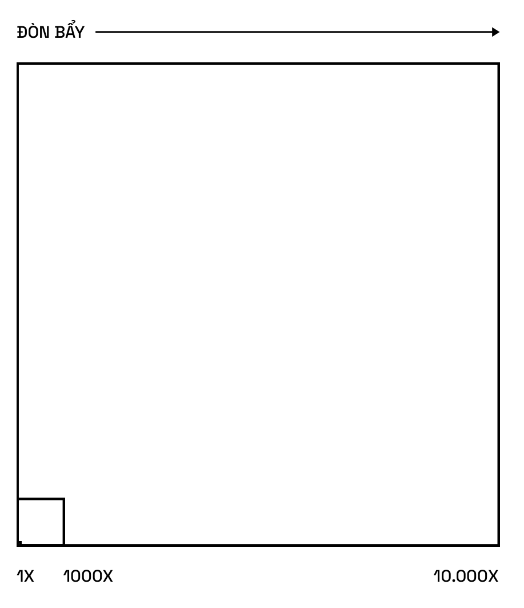
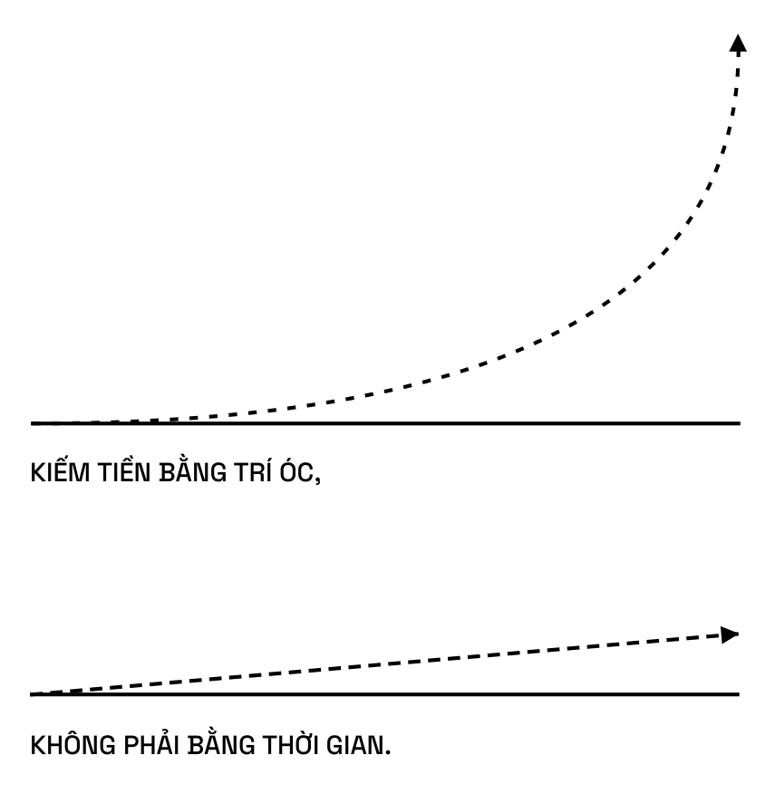
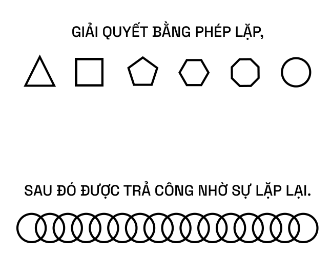
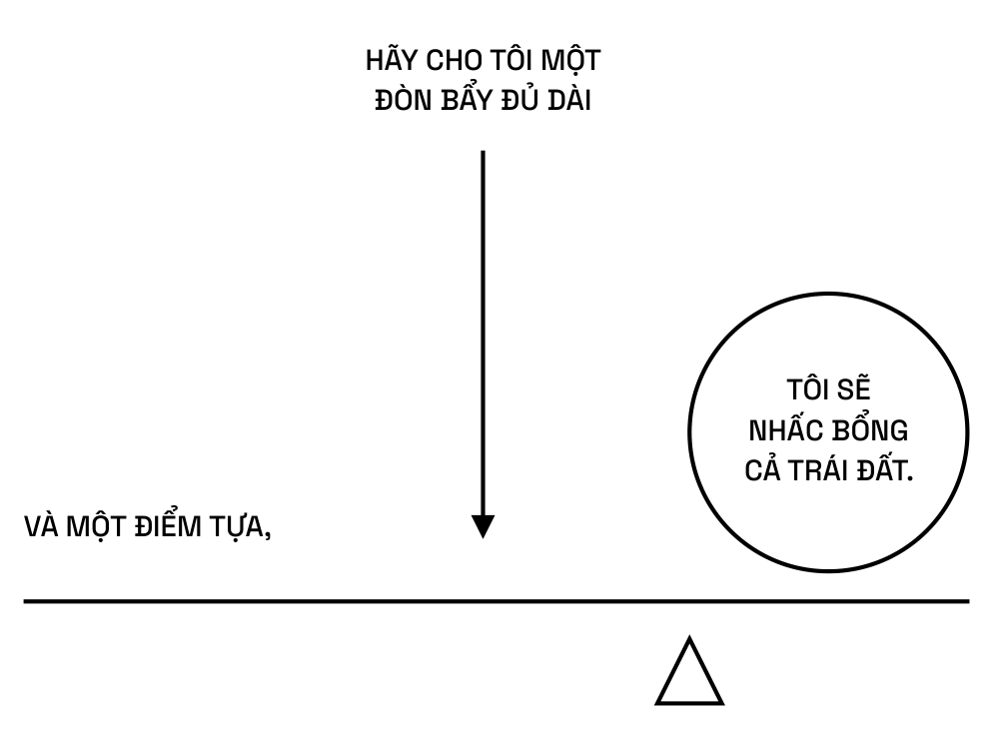

# PHẦN I THỊNH VƯỢNG

> Làm thế nào để trở nên giàu có mà không cần may mắn.

# XÂY DỰNG SỰ THỊNH VƯỢNG

> Kiếm tiền không phải là việc bạn làm – đó là kỹ năng bạn học được.

## HIỂU CÁCH TẠO NÊN SỰ THỊNH VƯỢNG

Tôi cảm thấy thích thú khi nghĩ rằng nếu tôi mất hết tiền và bạn thả tôi xuống một con phố ngẫu nhiên ở bất kỳ quốc gia nói tiếng Anh nào, thì trong vòng 5 hoặc 10 năm nữa, tôi sẽ giàu có trở lại. Vì đó chỉ là một bộ kỹ năng tôi đã xây dựng, điều bất kỳ ai cũng có thể phát triển được. [78]

Trở nên giàu có không phụ thuộc vào sự chăm chỉ trong công việc. Bạn có thể làm việc trong một nhà hàng tám mươi giờ mỗi tuần, nhưng bạn sẽ không thể giàu. Làm giàu là biết phải làm gì, với ai và khi nào. Quan trọng là sự hiểu biết chứ không phải cứ chăm chỉ là được. Đúng là làm việc chăm chỉ rất quan trọng và bạn không thể bỏ qua nó, nhưng nó phải được định hướng đúng cách.

Nếu bạn chưa biết mình nên làm gì, thì quan trọng nhất vẫn là tìm ra điều bạn muốn làm. Bạn không nên chăm chỉ cho đến khi thật sự biết mình nên làm gì.

Khi còn rất trẻ, khoảng 13 hay 14 tuổi, tôi tự đặt cho mình những nguyên tắc trong Tweetstorm (sau đây). Tôi đã giữ chúng trong đầu suốt ba mươi năm và sống cùng với chúng. Theo thời gian (không biết là đáng buồn hay may mắn), điều tôi thực sự giỏi là quan sát các doanh nghiệp và tìm ra đòn bẩy tối đa có thể tạo ra của cải và nắm bắt được chúng.

Đó chính xác là những gì tôi đã làm để tạo nên bộ Tweetstorm nổi tiếng của mình. Tất nhiên, mỗi một bài trong chuỗi Tweet này có thể được ước lượng thành cuộc trò chuyện trị giá một giờ đồng hồ. Tweetstorm dưới đây là một khởi đầu tốt. Tôi đã cố gắng viết nó thật súc tích và chứa đựng nhiều thông tin nhất có thể. Tôi cũng cố gắng để nó có thể tạo được sức ảnh hưởng lớn và có giá trị vượt thời gian. Nó chứa đựng đầy đủ thông tin và nguyên tắc, vì vậy nếu bạn chịu tiếp thu và làm việc chăm chỉ trong mười năm tới, bạn sẽ đạt được điều mình mong muốn. [77]

> ### 🧵 TWEETSTORM: Làm thế nào để trở nên giàu có (mà không cần may mắn)
>
> 1. **Tìm kiếm sự thịnh vượng, chứ không phải tiền bạc hay địa vị.** Thịnh vượng là sở hữu tài sản sinh lời trong khi bạn ngủ. Tiền là cách chúng ta chuyển giao thời gian và của cải. Địa vị là vị trí của bạn trong hệ thống phân cấp xã hội.
>
> 2. **Hiểu rằng việc tạo ra của cải có đạo đức là khả thi.** Nếu bạn thầm coi thường sự giàu có, nó sẽ lẩn tránh bạn.
>
> 3. **Đừng để ý đến những người đang chơi trò địa vị.** Họ đạt được địa vị bằng cách tấn công những người chơi trò tạo ra của cải.
>
> 4. **Bạn sẽ không giàu có nếu chỉ đi làm thuê.** Bạn phải có vốn chủ sở hữu – một phần của doanh nghiệp – để được tự do tài chính.
>
> 5. **Bạn sẽ giàu có bằng cách mang lại cho xã hội những gì họ muốn nhưng chưa biết làm thế nào.** Ở một quy mô lớn.
>
> 6. **Chọn lĩnh vực mà bạn có thể tham gia trò chơi dài hạn cùng với những người có định hướng dài hạn.**
>
> 7. **Internet đã mở rộng các cơ hội việc làm tiềm năng ở quy mô vô cùng lớn.** Hầu hết chúng ta vẫn chưa nhận ra điều đó.
>
> 8. **Tham gia các cuộc chơi có tính lặp lại.** Mọi lợi ích ta nhận được trong cuộc đời, dù là tài sản, những mối quan hệ, hay kiến thức, đều đến dưới dạng lãi kép.
>
> 9. **Chọn những đối tác kinh doanh thông minh, nhiều năng lượng và quan trọng hơn cả là chính trực.**
>
> 10. **Đừng hợp tác với những người hay chỉ trích và bi quan.** Niềm tin của họ sẽ gây ảnh hưởng đến kết quả.
>
> 11. **Học cách bán hàng. Học cách tạo dựng.** Nếu thành thục cả hai, bạn sẽ trở thành người không ai có thể cản bước.
>
> 12. **Trang bị cho bản thân kiến thức chuyên biệt, tính trách nhiệm và đòn bẩy.**
>
> 13. **Kiến thức chuyên biệt là kiến thức bạn sẽ không được dạy.** Nếu xã hội có thể dạy bạn, nó cũng có thể dạy người khác và thay thế bạn.
>
> 14. **Kiến thức chuyên biệt được tìm thấy bằng cách theo đuổi sự tò mò và niềm đam mê chân thực của bạn** thay vì bất cứ thứ gì đang thịnh hành hiện nay.
>
> 15. **Đối với bạn, việc xây dựng kiến thức chuyên biệt sẽ có cảm giác như đang giải trí**, nhưng đối với người khác đó lại là công việc cần phải làm.
>
> 16. **Kiến thức chuyên biệt được truyền dạy thông qua học nghề**, không phải thông qua trường học.
>
> 17. **Kiến thức chuyên biệt thường mang tính kỹ thuật hoặc sáng tạo cao.** Bạn không thể thuê và cũng không thể tự động hoá nó.
>
> 18. **Gánh vác trách nhiệm và chấp nhận rủi ro kinh doanh trên danh nghĩa của chính bạn.** Xã hội sẽ đền đáp cho bạn bằng trách nhiệm, vốn chủ sở hữu và đòn bẩy.
>
> 19. *“Hãy cho tôi một đòn bẩy đủ dài và một điểm tựa, tôi sẽ nhấc bổng cả Trái đất.”* — **Archimedes**
>
> 20. **Thành công lớn đòi hỏi đòn bẩy.** Đòn bẩy kinh doanh đến từ vốn, con người và sản phẩm không có chi phí sao chép cận biên (mã lập trình, phương tiện truyền thông).
>
> 21. **Vốn có nghĩa là tiền.** Để huy động tiền, hãy ứng dụng kiến thức chuyên biệt của bạn kèm theo trách nhiệm giải trình và đưa ra phán đoán tốt dựa trên đó.
>
> 22. **Nhân công có nghĩa là những người làm việc cho bạn.** Đó là hình thức đòn bẩy lâu đời nhất và gây nhiều tranh cãi nhất. Đòn bẩy nhân công sẽ làm hài lòng bố mẹ bạn, nhưng đừng lãng phí cuộc đời để theo đuổi nó.
>
> 23. **Vốn và nhân công là đòn bẩy cần sự cho phép.** Mọi người đều chạy theo vốn, nhưng phải có ai đó cung cấp vốn cho bạn. Mọi người đều cố gắng làm chủ, nhưng phải có ai đó đi theo bạn.
>
> 24. **Mã lập trình và phương tiện truyền thông là đòn bẩy không cần sự cho phép.** Chúng là đòn bẩy đằng sau những người giàu mới nổi. Bạn có thể tạo ra phần mềm và phương tiện truyền thông làm việc cho bạn trong khi bạn ngủ.
>
> 25. **Có sẵn một đội quân máy móc miễn phí** – chúng được đưa vào các trung tâm dữ liệu để tối ưu không gian và hiệu suất toả nhiệt. Hãy sử dụng chúng!
>
> 26. **Nếu bạn không thể lập trình, hãy viết sách hoặc blog, quay video và làm podcast.**
>
> 27. **Đòn bẩy sẽ nhân lên sức mạnh cho phán đoán của bạn.**
>
> 28. **Khả năng phán đoán đòi hỏi kinh nghiệm** nhưng có thể được xây dựng nhanh hơn bằng cách học hỏi các kỹ năng cơ bản.
>
> 29. **Không có kỹ năng nào gọi là “kinh doanh”.** Hãy tránh xa các tạp chí kinh doanh và các lớp học kinh doanh.
>
> 30. **Nghiên cứu kinh tế vi mô, lý thuyết trò chơi, tâm lý học, cách thuyết phục, đạo đức, toán học và máy tính.**
>
> 31. **Đọc nhanh hơn nghe. Làm nhanh hơn nhìn ngắm.**
>
> 32. **Bạn nên quá bận rộn để “đi cà phê” nhưng vẫn duy trì được một lịch trình không rối bời.**
>
> 33. **Đặt ra mức lương theo giờ bạn mong muốn và cố gắng thực hiện nó.** Nếu khắc phục một vấn đề giúp bạn tiết kiệm ít hơn mức lương theo giờ, hãy phớt lờ nó. Nếu chi phí thuê ngoài một công việc tốn ít hơn mức lương theo giờ, hãy thuê ngoài.
>
> 34. **Làm việc cật lực nhất có thể.** Kể cả khi người bạn làm việc cùng và công việc bạn đang thực hiện quan trọng hơn là sự chăm chỉ của bạn.
>
> 35. **Trở thành người xuất sắc nhất thế giới trong lĩnh vực bạn đang làm.** Tiếp tục tái khẳng định những gì bạn làm cho đến khi điều này là đúng.
>
> 36. **Không có cơ chế làm giàu nhanh chóng.** Nếu có, đó chỉ là cách người khác đang lợi dụng bạn để làm giàu cho họ.
>
> 37. **Áp dụng kiến thức chuyên biệt, cùng với đòn bẩy**, và cuối cùng bạn sẽ nhận được những gì bạn xứng đáng.
>
> 38. **Khi bạn thực sự trở nên giàu có, bạn sẽ nhận ra đó không phải là điều bạn tìm kiếm ngay từ đầu.** Nhưng đó lại là một câu chuyện khác. [11]
>
> ---
>
> 💡 **Tóm tắt cốt lõi:** *Sản phẩm hoá Bản thân bạn (Productize Yourself).*

**Phần tóm tắt của ông nói rằng: “Sản phẩm hoá Bản thân** **bạn” – điều đó nghĩa là gì?**

“Sản phẩm hoá” và “Bản thân bạn”. “Bản thân bạn” có tính độc đáo. “Sản phẩm hoá” có tính đòn bẩy. “Bản thân bạn” có tính trách nhiệm. “Sản phẩm hoá” có kiến ​thức chuyên biệt. “Bản thân bạn” cũng có kiến ​thức chuyên biệt trong đó. Vì vậy, với tất cả những mảnh ghép, bạn có thể tóm gọn chúng thành hai cụm trên.

Nếu bạn đang hướng tới mục tiêu dài hạn là trở nên giàu có, bạn nên tự hỏi bản thân: “Điều này có thực sự phù hợp với tôi không? Tôi có đang được là chính mình không?”. Và sau đó, “Tôi có đang sản phẩm hoá nó không? Tôi có đang nhân rộng nó không? Tôi có đang mở rộng quy mô bằng nhân công, bằng vốn, bằng mã lập trình hay bằng phương tiện truyền thông?”. Những câu hỏi này vô cùng dễ áp dụng và ghi nhớ. [78]

Mặt khác, điều này cũng thật khó. Đây là lý do tại sao tôi nói phải mất nhiều thập kỷ – không phải để thực hiện mà phần lớn là để khám phá ra những khả năng đặc biệt nhất của bạn. [10]

**Sự khác biệt giữa của cải và tiền bạc là gì?**

Tiền là cách chúng ta chuyển giao của cải. Tiền là tín dụng xã hội. Đó là khả năng có được các khoản tín dụng và khoản ghi nợ thời gian của người khác.

Nếu tôi hoàn thành tốt công việc của mình, nếu tôi tạo ra giá trị cho xã hội, xã hội sẽ nói: “Ồ, cảm ơn bạn. Chúng tôi nợ bạn trong tương lai vì điều mà bạn đã làm trong quá khứ. Đây là giấy vay nợ không chính thức (IOU). Hãy gọi đó là tiền”. [78]

Của cải là thứ bạn muốn. Của cải là tài sản kiếm được trong khi bạn ngủ. Của cải là nhà máy, máy móc – đang tạo ra mọi thứ. Của cải là chương trình máy tính chạy vào ban đêm, phục vụ những khách hàng khác. Của cải thậm chí là tiền trong ngân hàng đang được tái đầu tư vào các tài sản khác và vào các doanh nghiệp khác.

Ngay cả một ngôi nhà cũng là một dạng của cải, bởi vì bạn có thể cho thuê nó, mặc dù đó là cách sử dụng đất đai có hiệu suất thấp hơn các doanh nghiệp thương mại.

Như vậy, định nghĩa của tôi về của cải sẽ thiên nhiều hơn về những doanh nghiệp và tài sản giúp bạn kiếm ra tiền khi bạn đang ngủ. [78]

> Công nghệ dân chủ hóa tiêu dùng nhưng cũng đồng thời củng cố sản xuất. Người xuất sắc nhất thế giới trong mọi lĩnh vực sẽ làm điều đó cho mọi người.

Xã hội sẽ trả tiền cho bạn để tạo ra những thứ mà xã hội muốn nhưng chưa biết làm thế nào, bởi vì nếu xã hội làm được thì đã không cần đến bạn. Những thứ đó chắc hẳn sẽ được sản xuất hàng loạt.

Hầu hết mọi thứ trong nhà của bạn, tại nơi làm việc và trên đường phố đã từng là công nghệ ở một thời điểm nào đó. Đã có lúc dầu mỏ là công nghệ giúp J.D. Rockefeller trở nên giàu có. Đã có thời điểm ô tô là công nghệ giúp Henry Ford trở nên giàu có.

Vì vậy, công nghệ là tập hợp những thứ, như Alan Kay đã nói, vẫn chưa đi vào hoạt động [chỉnh sửa: Danny Hillis]. Khi một cái gì đó thực sự đi vào hoạt động, nó không còn là công nghệ nữa. Xã hội luôn đòi hỏi những điều mới mẻ. Và nếu bạn muốn trở nên giàu có, trong bạn phải chứa đựng ham muốn tìm ra một điều gì đó trong khả năng của bạn để cống hiến cho xã hội – điều mà xã hội chưa có nhưng sẽ cần trong tương lai.

Sau đó, bạn phải tìm cách mở rộng quy mô vì nếu bạn chỉ tạo ra một cái là không đủ. Bạn phải tạo ra hàng nghìn, hàng trăm nghìn, hàng triệu hoặc hàng tỷ cái như vậy để mỗi người đều có thể sở hữu một cái. Steve Jobs (và tất nhiên là cả đội ngũ của ông) đã nhận ra rằng xã hội sẽ muốn có điện thoại thông minh. Một chiếc máy tính có thể bỏ túi với tất cả tính năng của một chiếc điện thoại nhân lên một trăm lần và dễ dàng sử dụng. Vì vậy, họ đã tìm ra cách tạo ra nó, rồi lại nghĩ cách mở rộng quy mô. [78]

## TÌM KIẾM VÀ XÂY DỰNG KIẾN THỨC CHUYÊN BIỆT

Các kỹ năng bán hàng là một dạng kiến thức chuyên biệt.

Có một thứ được gọi là “thiên phú” trong bán hàng. Bạn sử dụng các kỹ năng này trong mọi lúc tại các công ty khởi nghiệp và quỹ đầu tư mạo hiểm. Khi bạn gặp một người có tư chất thiên phú về bán hàng, bạn thấy họ thật tuyệt vời. Họ thực sự giỏi những gì họ làm. Đó được gọi là một dạng kiến ​thức chuyên biệt.

Rõ ràng họ đã học những kiến thức ấy ở đâu đó, nhưng không phải trên giảng đường. Có lẽ họ học được trong khoảng thời gian còn cắp sách tới trường hoặc trong cách họ thuyết phục cha mẹ. Trong vài trường hợp, có lẽ những kiến thức ấy đã có sẵn trong gen di truyền của họ.

Tuy nhiên, bạn có thể tự cải thiện kỹ năng bán hàng. Bạn có thể đọc Robert Cialdini, bạn có thể tham dự hội thảo đào tạo bán hàng hay bán hàng tận nhà. Quá trình này khó khăn nhưng cũng sẽ giúp bạn nâng cao kỹ năng bán hàng nhanh chóng.

> Kiến thức chuyên biệt không thể được dạy, nhưng chúng ta có thể học được nó.

Khi nói về kiến ​thức chuyên biệt, ý của tôi là tìm ra những điều bạn từng làm được mà không phải tốn chút công sức nào khi còn là một đứa trẻ hay thiếu niên. Điều chỉ có bạn không coi là kỹ năng còn những người xung quanh thì có. Mẹ của bạn hoặc người bạn thân nhất lớn lên cùng bạn sẽ nhìn thấy và coi đó là một biệt tài.

Một số ví dụ về kiến thức chuyên biệt có thể là:

→Kỹ năng bán hàng

→Năng khiếu âm nhạc, có khả năng chơi bất kỳ nhạc cụ nào

→Dễ dàng mê mệt với điều gì đó: bạn chìm đắm trong một vài thứ và có thể ghi nhớ chúng rất nhanh.

→Đam mê khoa học viễn tưởng: bạn mê đọc sách khoa học viễn tưởng, điều đó cho thấy bạn có khả năng xử lý, tiếp thu đa dạng kiến thức trong một khoảng thời gian ngắn.

→Chơi rất nhiều trò chơi, bạn có thể nắm bắt được nguyên lý trò chơi khá tốt.

→Tám chuyện, điều tra mạng lưới quan hệ của người khác. Điều đó có thể biến bạn thành một nhà báo rất thú vị.

Kiến thức chuyên biệt là sự hòa trộn độc đáo và kỳ diệu của những đặc điểm tiêu biểu nhất từ DNA, quá trình nuôi nấng, dạy dỗ và phản ứng của bạn với nó. Nó gần như ăn sâu vào tính cách và bản ngã của bạn. Tiếp đó, bạn có thể rèn luyện và hoàn thiện kiến thức chuyên biệt của mình.

> Không một ai có thể cạnh tranh với bạn trong việc là chính mình.  
> Phần lớn cuộc đời bạn là để tìm ra người và việc cần đến bạn nhất.

Ví dụ, tôi thích đọc sách và tôi yêu công nghệ. Tôi học rất nhanh và cũng nhanh chán. Nếu tôi phải gắn bó với một công việc buộc tôi phải nghiên cứu cùng một chủ đề trong suốt hai mươi năm, công việc đó sẽ không có kết quả. Tôi đang làm việc trong lĩnh vực đầu tư mạo hiểm, công việc này đòi hỏi tôi phải bắt kịp tốc độ rất, rất nhanh của các công nghệ mới (và khi làm công việc này, tôi được đáp ứng mong muốn bởi vì ngay lúc tôi thấy chán thì lại có một công nghệ mới ra đời). Điều này hoàn toàn phù hợp với kiến ​thức chuyên biệt và các kỹ năng của tôi. [10]

Tôi muốn trở thành một nhà khoa học. Đó là khởi nguồn của rất nhiều hệ thống phân cấp đạo đức trong tôi. Với tôi, nhà khoa học là những người đứng đầu chuỗi sản xuất của nhân loại. Tôi nghĩ rằng các nhà khoa học đã cống hiến và tạo ra những bước đột phá lớn, trên thực tế họ đóng góp cho xã hội loài người nhiều hơn bất kỳ tầng lớp nào khác. Không phải tôi có ý xem nhẹ nghệ thuật, chính trị, kỹ thuật hay kinh doanh, nhưng nếu không có khoa học, chúng ta vẫn phải vật lộn trong bụi bẩn, chiến đấu bằng gậy và cố gắng nhóm lửa.

> Xã hội, kinh doanh và tiền bạc là hạ nguồn của công nghệ, mà công nghệ chính là hạ nguồn của khoa học. Khoa học ứng dụng là động cơ của nhân loại.  
> **Hệ quả:** Các nhà khoa học ứng dụng là những người quyền lực nhất trên thế giới. Điều này sẽ trở nên rõ ràng hơn trong những năm tới.

Toàn bộ hệ thống giá trị của tôi được phát triển và xây dựng xoay quanh các nhà khoa học và tôi muốn trở thành một nhà khoa học vĩ đại. Tuy nhiên khi thực sự nhìn lại những gì tôi đặc biệt xuất sắc và những gì tôi đã dành thời gian để làm, chúng đều lần lượt là kiếm tiền, mày mò công nghệ, kinh doanh, giải thích và trò chuyện với mọi người.

Tôi có một số kỹ năng bán hàng, đó là một dạng kiến ​thức chuyên biệt. Tôi có một số kỹ năng phân tích về cách kiếm tiền. Tôi có khả năng thu thập dữ liệu, say mê những con số và có thể phân tích chúng chi tiết – đây cũng là một dạng kiến thức chuyên biệt tôi có. Tôi cũng thích mày mò công nghệ. Và tất cả những thứ này đối với tôi giống như trò chơi giải trí, nhưng lại là công việc đối với những người khác.

Một vài người sẽ cảm thấy vô cùng khó khăn khi làm những điều này, họ nói rằng: “Chà, làm thế nào để tôi có thể diễn đạt mọi thứ một cách gãy gọn và bán được ý tưởng?”. Ừ thì, nếu bạn chưa giỏi hoặc không thực sự yêu thích, đó có thể không phải là thứ dành cho bạn – hãy tập trung vào điều bạn thật sự yêu thích.

Người đầu tiên nhận ra kiến thức chuyên biệt của tôi là mẹ. Như một người đứng ngoài cuộc, tiếng nói của bà ấy vọng ra từ căn bếp, lúc đó tôi mới khoảng 15, 16 tuổi. Khi tôi đang kể với một người bạn rằng mình muốn trở thành nhà vật lý thiên văn, mẹ tôi liền nói: “Không, con sẽ làm kinh doanh”. Lúc đó tôi như kiểu: “Cái gì cơ, mẹ đang bảo rằng tôi sẽ làm kinh doanh ư? Tôi nhất định sẽ trở thành một nhà vật lý thiên văn. Mẹ chả biết gì cả”. Nhưng rõ ràng là bà biết chính xác mình đã nói những gì. [78]

Kiến thức chuyên biệt đa phần được tìm thấy bằng cách theo đuổi năng khiếu bẩm sinh, sự tò mò chân thật và niềm đam mê của bạn. Chứ không phải bằng cách đến trường để học những nghề đang “hot” nhất, hay đào sâu bất kỳ lĩnh vực nào mà các nhà đầu tư cho là tiềm năng nhất.

Nhiều khi, kiến ​thức chuyên biệt lại nằm ở phần rìa của vùng kiến thức. Đó cũng là những thứ chỉ mới được tìm ra hoặc rất khó để tìm ra. Nếu không tập trung 100% vào nó thì người khác – người thật sự tập trung 100%, sẽ vượt qua bạn. Và họ không chỉ vượt qua mà sẽ vượt xa bạn. Bởi vì giờ đây chúng ta đang hoạt động trong lĩnh vực của các ý tưởng, nơi lãi kép và đòn bẩy thực sự được áp dụng. [78]

> Internet đã mở rộng các cơ hội việc làm tiềm năng với quy mô vô cùng lớn. Hầu hết chúng ta vẫn chưa nhận ra điều đó.

Bạn truy cập Internet và có thể tìm thấy khách hàng của mình. Bạn có thể xây dựng một doanh nghiệp, tạo ra một sản phẩm, xây dựng của cải và làm cho mọi người hạnh phúc chỉ bằng cách thể hiện bản thân một cách độc đáo trên Internet. [78]

Internet tạo điều kiện cho mọi ngách đam mê, sở thích, miễn sao bạn là người giỏi nhất trong lĩnh vực đó để mở rộng quy mô. Và có một tin tuyệt vời là, vì mỗi chúng ta đều khác nhau nên ai cũng sẽ giỏi nhất ở một lĩnh vực – đó là làm chính mình.

Tôi có một dòng Tweet đáng đọc khác nhưng không nằm trong Tweetstorm “Làm thế nào để trở nên giàu có”, nó đơn giản là “Thoát khỏi sự cạnh tranh nhờ tính nguyên bản”. Về cơ bản, bạn cạnh tranh với người khác vì bạn đang sao chép họ. Bởi vì bạn đang cố gắng làm điều tương tự họ. Nhưng mỗi con người là khác nhau. Đừng sao chép. [78]

Nếu bạn đang xây dựng và tiếp thị thứ được gọi là phần “ngoại lệ” của con người bạn, chỉ riêng bạn có, thì không ai có thể cạnh tranh với bạn. Ai sẽ cạnh tranh với Joe Rogan hoặc Scott Adams? Điều đó là không thể. Liệu có ai khác xuất hiện và viết truyện Dilbert1 hay hơn không? Không. Có ai đó sẽ cạnh tranh với Bill Watterson và tạo ra một Calvin và Hobbes tốt hơn không? Không. Họ là nguyên bản. [78]

> Những công việc tốt nhất không thể được chỉ thị hay cấp bằng. Chúng là biểu hiện sáng tạo của những con người luôn học hỏi trong thị trường tự do.

Kỹ năng quan trọng nhất để giàu có là trở thành một người không ngừng học hỏi. Bạn phải biết cách học bất cứ điều gì bạn muốn. Mô hình kiếm tiền cũ là đi học trong bốn năm, lấy bằng cấp và làm việc như một chuyên gia trong ba mươi năm. Nhưng hiện nay, mọi thứ thay đổi nhanh chóng. Giờ đây, bạn phải bắt kịp một nghề mới trong vòng chín tháng, và nó sẽ lỗi thời sau bốn năm. Nhưng trong vòng ba năm làm việc hiệu quả đó, bạn có thể trở nên rất giàu có.

Ngày nay, trở thành chuyên gia trong một lĩnh vực hoàn toàn mới trong vòng chín đến mười hai tháng quan trọng hơn nhiều so với nghiên cứu một thứ đã “đúng” trong thời gian dài trước đó. Khi thực sự đào sâu kiến thức nền tảng, bạn sẽ không còn sợ bất kỳ cuốn sách nào. Nếu bạn đến thư viện và có một cuốn sách mà bạn không thể hiểu được, bạn phải nghiên cứu, nghiền ngẫm và tự hỏi bản thân: “Tôi cần có những kiến thức nền tảng gì để đọc cuốn sách này?”. Kiến thức nền tảng là điều cực kỳ quan trọng. [74]

Trong cuộc sống, có hiểu biết cơ bản về số học và tính toán quan trọng hơn nhiều so với làm giải tích. Tương tự, có thể truyền tải ý muốn của bản thân bằng những từ vựng tiếng Anh thông thường còn quan trọng hơn nhiều so với việc có thể viết thơ, có một kho từ vựng rộng lớn hoặc nói bảy thứ ngôn ngữ nước ngoài khác nhau.

Có khả năng thuyết phục quan trọng hơn nhiều so với việc trở thành một chuyên gia digital marketing hoặc chuyên viên tối ưu lượng nhấp chuột. Kiến thức nền tảng là chìa khóa. Đạt điểm 9/10 hoặc 10/10 về kiến thức nền tảng sẽ hữu ích hơn nhiều so với việc cố gắng đào sâu tất cả mọi thứ. Bạn cần phải hiểu sâu về một thứ gì đó, vì nếu không bạn sẽ “rộng một dặm, sâu một tấc”1 và không đạt được bất kỳ điều gì mình muốn trong cuộc sống này. Bạn chỉ có thể thành thạo một hoặc hai thứ. Chúng thường sẽ là những gì bạn say mê. [74]

## THAM GIA NHỮNG CUỘC CHƠI DÀI HẠN VỚI NHỮNG NGƯỜI CÓ TẦM NHÌN DÀI HẠN

**Ông nói rằng: “Mọi lợi ích ta nhận được trong cuộc đời, dù** **là tài sản, những mối quan hệ, hay kiến thức, đều đến dưới** **dạng lãi kép”. Vậy làm thế nào để một người biết liệu họ có** **đang kiếm được lãi kép hay không?**

Lãi kép là một khái niệm rất có sức nặng. Lãi kép không chỉ áp dụng cho việc tích lũy vốn. Tích lũy vốn chỉ mới là khởi đầu của lãi kép.

Khái niệm tích lũy trong các mối quan hệ kinh doanh là rất quan trọng. Thử nhìn vào một số chức vị đứng đầu trong xã hội, chẳng hạn như tại sao ai đó lại là giám đốc điều hành của một công ty đại chúng hay quản lý hàng tỷ đô la. Đó là vì mọi người tin tưởng họ. Họ nhận được sự tin tưởng nhờ các mối quan hệ họ đã xây dựng và các công việc họ đã làm được tích lũy theo thời gian. Họ gắn bó với doanh nghiệp và cố gắng chứng tỏ (một cách rõ ràng và trách nhiệm) rằng mình là người có tính chính trực cao.

THAM GIA NHỮNG CUỘC CHƠI DÀI HẠN

Lãi kép cũng có thể áp dụng với danh tiếng. Nếu danh tiếng của bạn tốt và bạn tiếp tục xây dựng nó trong nhiều thập kỷ, mọi người sẽ chú ý. Theo đúng nghĩa đen, danh tiếng của bạn cuối cùng sẽ có giá trị hàng nghìn, hàng vạn lần so với một người khác, người rất tài năng nhưng không duy trì được lãi kép của danh tiếng.

Điều này cũng đúng khi bạn làm việc với từng cá nhân. Nếu đã làm việc với ai đó trong năm hoặc mười năm và vẫn thích làm việc với họ, rõ ràng là bạn tin tưởng họ và tự nhiên những khuyết điểm nhỏ cũng biến mất. Tất cả những cuộc đàm phán kinh doanh sẽ diễn ra vô cùng đơn giản vì các bạn tin tưởng lẫn nhau và biết chắc nó sẽ thành công.

Ví dụ, có một nhà đầu tư thiên thần ở Thung Lũng Silicon tên là Elad Gil, người tôi cực kỳ thích giao dịch cùng.

Tôi thích làm việc với Elad vì biết rằng khi thương vụ hoàn thành, anh ấy sẽ không ngần ngại tìm cách đem lại cho tôi một phần lợi ích nào đó. Nếu dư ra một vài đồng ở đâu đó, anh ấy luôn làm tròn số tiền để có lợi cho tôi. Nếu phát sinh một vài chi phí phải trả, anh ấy sẽ tự lấy tiền túi và không hề đề cập vấn đề đó với tôi. Vì anh ấy biết nhìn xa trông rộng khi đối xử cực kỳ tử tế với tôi, nên tôi cũng thường chia sẻ các thương vụ với anh – tôi cố gắng đưa anh vào các thương vụ của mình. Sau đó, tôi cũng cố gắng hết sức để trả ơn anh ấy. Lãi kép trong những mối quan hệ này là cực kỳ quý giá. [10]

> Ý định không quan trọng. Hành động mới là vấn đề. Đó là lý do tại sao việc trở nên có đạo đức thật khó khăn.

Khi bạn tìm thấy đúng điều để làm và đúng người để hợp tác, hãy đầu tư vào đó thật sự nghiêm túc. Gắn bó với nó trong nhiều thập kỷ chính là cách giúp bạn kiếm được lợi ích lớn trong các mối quan hệ và tiền bạc của mình. Vì vậy, lãi kép rất quan trọng. [10]

> 99% nỗ lực đều là phí phạm.

Hiển nhiên không có gì hoàn toàn lãng phí vì tất cả đều là những trải nghiệm học hỏi. Bạn có thể học hỏi từ bất cứ điều gì. Nhưng ví dụ, khi bạn quay lại trường, 99% số bài thi học kỳ bạn đã trải qua, những quyển sách bạn đọc, những bài tập bạn làm và những điều bạn học được, chúng không thực sự được áp dụng. Bạn có thể đã đọc những cuốn sách địa lý và lịch sử mà không bao giờ sử dụng lại. Bạn có thể đã từng học một ngôn ngữ mà giờ đây không còn dùng tới nữa. Bạn có thể đã từng nghiên cứu một nhánh toán học mà giờ đây bạn hoàn toàn quên mất.

Rõ ràng chúng đều là những trải nghiệm học hỏi. Bạn đã thực sự học. Bạn học được giá trị của sự chăm chỉ, bạn học được một vài thứ in sâu vào tâm trí và có thể đóng góp phần nào vào công việc bạn đang làm. Nhưng ít nhất khi nghĩ đến mục tiêu và định hướng trong cuộc sống, chỉ có 1% nỗ lực bạn bỏ ra thực sự được đền đáp.

Một ví dụ khác là tất cả những người bạn đã hẹn hò cho đến khi gặp được chồng hoặc vợ của mình. Đó là sự lãng phí thời gian xét theo khía cạnh mục tiêu. Không phải là lãng phí theo luật số mũ, không phải là lãng phí theo khía cạnh học tập, nhưng đó chắc chắn là lãng phí theo khía cạnh mục tiêu.

Tôi nói điều này không phải để đưa ra một nhận xét bâng quơ nào đó về việc 99% cuộc đời của bạn đã bị lãng phí và chỉ 1% là hữu ích. Tôi nói điều này vì bạn nên suy nghĩ thấu đáo và nhận ra rằng, trong hầu hết mọi khía cạnh (các mối quan hệ, công việc, thậm chí cả trong học tập), điều bạn đang cố gắng làm là tìm ra thứ bạn có thể dốc toàn lực để kiếm được lãi kép.

Khi đang hẹn hò, ngay khi bạn biết mối quan hệ này sẽ không dẫn đến hôn nhân, có lẽ bạn nên bỏ qua nó. Khi đang học một thứ gì đó, chẳng hạn như lớp địa lý hoặc lịch sử và bạn nhận ra rằng mình sẽ không bao giờ sử dụng thông tin đó, hãy bỏ học. Thật là lãng phí thời gian. Và cũng là lãng phí năng lượng não bộ.

Tôi không nói rằng đừng làm những thứ thuộc nhóm 99%, bởi vì rất khó để xác định nhóm 1% là gì. Điều tôi đang muốn đề cập là khi bạn tìm thấy 1% – thứ bạn có thể áp dụng nguyên tắc không lãng phí và đầu tư cả cuộc đời vào đó, đồng thời nó thực sự có ý nghĩa đối với bạn – hãy dốc toàn lực và quên những thứ không liên quan đi. [10]

## GÁNH VÁC TRÁCH NHIỆM

> Gánh vác trách nhiệm và chấp nhận rủi ro kinh doanh trên danh nghĩa của chính bạn. Xã hội sẽ đền đáp cho bạn bằng trách nhiệm, vốn chủ sở hữu và đòn bẩy.

Để làm giàu, bạn cần có đòn bẩy. Đòn bẩy đến từ nhân công, đến từ vốn, hoặc nó có thể đến thông qua mã lập trình hoặc phương tiện truyền thông. Nhưng hầu hết những thứ này, như nhân công và vốn, mọi người phải cung cấp cho bạn. Đối với nhân công, ai đó phải đi theo bạn. Để có vốn, ai đó phải đưa cho bạn tiền, tài sản quản lý hoặc máy móc.

Cho nên để có được những điều này, bạn phải xây dựng chữ tín và làm điều đó dưới danh nghĩa của chính mình càng nhiều càng tốt, điều này rất rủi ro. Bởi thế việc chịu trách nhiệm cũng có hai mặt. Một mặt, nó cho phép bạn được tín nhiệm khi mọi thứ diễn ra tốt đẹp. Mặt khác, bạn phải chịu gánh nặng thất bại khi mọi thứ trở nên tồi tệ. [78]

Làm rõ trách nhiệm thực sự rất quan trọng. Không có trách nhiệm, bạn không có động lực. Không có trách nhiệm, bạn không thể xây dựng chữ tín. Nhưng nếu bạn chấp nhận rủi ro, bạn có nguy cơ thất bại. Bạn có nguy cơ bị chế nhạo. Bạn có nguy cơ thất bại trên danh nghĩa của chính mình.

May mắn thay, xã hội hiện đại đã không còn nhà tù dành cho những con nợ và mọi người không bị bỏ tù hoặc xử tử vì làm mất tiền của người khác, nhưng chúng ta vẫn bị xã hội lập trình rằng không được thất bại trước công chúng dưới danh nghĩa cá nhân. Song, những người dám nhận thất bại công khai hoá ra lại có được rất nhiều quyền lực.

Để tôi kể cho bạn câu chuyện của cá nhân tôi. Cho đến khoảng năm 2013, 2014, nhân cách công khai của tôi hoàn toàn xoay quanh các công ty khởi nghiệp và đầu tư. Chỉ khoảng năm 2014, 2015, tôi mới bắt đầu nói về triết học, tâm lý học, và cả những thứ rộng hơn. Nó khiến tôi hơi lo lắng vì tôi đang làm việc đó bằng tên của chính mình. Chắc chắn đã có nhiều người trong ngành gửi tin nhắn cho tôi qua kênh liên lạc riêng tư rằng: “Anh đang làm gì vậy? Anh đang tự kết thúc sự nghiệp của mình sao. Điều này thật ngu ngốc.”

Tôi chỉ cứ tiếp tục với điều đó. Tôi đã mạo hiểm. Tương tự với crypto. Ngay từ sớm, tôi đã mạo hiểm. Khi đưa tên tuổi của mình ra ngoài, bạn có thể gặp rủi ro với một số thứ nhất định. Bạn cũng có thể gặt hái phần thưởng. Bạn cũng có thể nhận về những lợi ích. [78] Ngày xưa, thuyền trưởng được kỳ vọng chìm theo con tàu. Nếu con tàu đang chìm, thì theo nghĩa đen, người cuối cùng xuống tàu là thuyền trưởng. Trên thực tế, trách nhiệm sẽ đi kèm với rủi ro, nhưng chúng ta đang nói về bối cảnh kinh doanh.

Rủi ro ở đây là bạn có thể trở thành người cuối cùng được hoàn vốn. Bạn sẽ là người cuối cùng được trả tiền cho thời gian của mình. Thời gian bạn bỏ ra, số vốn bạn đầu tư vào công ty, những thứ này đều có rủi ro. [78]

Một điều tôi nhận thấy trong xã hội hiện đại là các rủi ro tiềm ẩn không lớn. Ngay cả việc phá sản cũng là để xóa sạch những khoản nợ trong một điều kiện tốt. Tôi là người nắm rõ nhất về Thung lũng Silicon, nhưng nói chung, mọi người sẽ tha thứ cho thất bại miễn là bạn trung thực và nỗ lực với sự chính trực cao.

Thực sự không có nhiều điều phải lo lắng về thất bại, và vì vậy mọi người nên chịu trách nhiệm nhiều hơn cho những gì họ đang làm. [78]

## XÂY DỰNG HOẶC MUA VỐN CHỦ SỞ HỮU TRONG MỘT DOANH NGHIỆP

> Nếu không sở hữu một phần của doanh nghiệp, bạn sẽ không có cách nào đạt được tự do tài chính.

**Tại sao nắm giữ vốn chủ sở hữu trong một doanh nghiệp lại** **vô cùng quan trọng?**

Vì đây là tư duy làm chủ so với làm công ăn lương. Nếu có thể kiếm được tiền từ việc cho thuê thời gian của mình, kể cả là luật sư hay bác sĩ, bạn sẽ kiếm được một khoản tiền nhất định, nhưng sẽ không đạt được tự do tài chính. Bạn sẽ không có nguồn thu nhập thụ động – tài sản sinh ra khi bạn ngủ. [10] Đây là một trong những yếu tố quan trọng nhất. Mọi người thường nghĩ bạn có thể tạo ra sự giàu có – kiếm tiền nhờ công việc. Tuy nhiên, điều này có thể sẽ vô nghĩa vì rất nhiều lý do.

Không có quyền sở hữu, đầu vào của bạn sẽ phụ thuộc rất chặt chẽ với đầu ra. Hầu hết các công việc làm công ăn lương, bất kể là các công việc lương cao như luật sư hay bác sĩ, bạn vẫn đang làm việc và được trả lương theo giờ.

Không có quyền sở hữu, khi bạn đang ngủ, bạn sẽ không kiếm được tiền. Khi bạn nghỉ hưu, bạn không kiếm được tiền. Khi bạn đi du lịch, bạn không kiếm được tiền. Và bạn không thể kiếm tiền một cách phi tuyến tính.

Nếu bạn đang nghĩ đến những vị bác sĩ giàu có (ý tôi là thực sự giàu có), thì đó là vì họ đang vận hành một doanh nghiệp của chính họ. Họ mở một phòng khám tư nhân. Phòng khám tư đó có thương hiệu và thương hiệu thu hút mọi người. Hoặc họ tạo ra một loại thiết bị y tế, phương thức phẫu thuật hay quy trình có sở hữu trí tuệ. [10]

Về bản chất, bạn đang làm việc cho người khác và người đó đang chịu rủi ro và trách nhiệm, đồng thời họ có sở hữu trí tuệ và cả thương hiệu. Họ sẽ không thể trả cho bạn đủ nhiều. Họ sẽ trả cho bạn mức tối thiểu mà họ phải trả để bạn giúp họ hoàn thành công việc. Có thể đó là mức lương tối thiểu khá cao, nhưng bạn sẽ không thể thực sự giàu có khi nghỉ hưu mà vẫn phải tiếp tục kiếm tiền. [78]

Nắm giữ vốn chủ sở hữu trong một công ty về cơ bản có nghĩa là bạn sở hữu tiềm năng tăng trưởng giá trị của công ty ấy. Khi bạn sở hữu khoản nợ, bạn sở hữu dòng doanh thu được đảm bảo và bạn cũng phải chịu rủi ro thua lỗ. Tuy vậy, bạn vẫn nên có vốn chủ sở hữu. Nếu bạn không có được những điều trên, cơ hội kiếm tiền của bạn sẽ rất hạn chế.

Bạn phải làm việc cho đến khi nắm giữ vốn chủ sở hữu trong một doanh nghiệp. Bạn có thể nắm giữ vốn chủ sở hữu với tư cách là một cổ đông nhỏ khi mua cổ phiếu. Bạn cũng có thể sở hữu nó với tư cách là chủ sở hữu khi thành lập công ty do bạn làm chủ. Quyền sở hữu thực sự quan trọng. [10]

Tất cả những người thực sự kiếm được tiền tại một thời điểm nào đó đều sở hữu một phần của sản phẩm, doanh nghiệp hoặc tài sản sở hữu trí tuệ (IP). Nếu bạn làm việc trong các công ty công nghệ, đó sẽ là một cơ hội giúp bạn kiếm tiền. Nhưng thông thường, của cải thực sự chỉ được tạo ra bằng cách thành lập công ty hoặc đầu tư. Trong một công ty đầu tư, họ mua cổ phần. Đó là những con đường dẫn đến sự giàu có. Giàu có không đến từ số giờ làm việc của bạn. [78]

## TÌM MỘT VỊ TRÍ CÓ ĐÒN BẨY

Chúng ta đang sống trong thời đại có vô số cơ hội đòn bẩy, và phần thưởng kinh tế cho những người thật sự ham muốn tìm hiểu tri thức chưa bao giờ lớn đến vậy. [11] Theo đuổi sự tò mò tri thức chân chính sẽ tạo dựng nền tảng tốt hơn cho sự nghiệp của bạn thay vì chạy theo bất cứ thứ gì đang kiếm ra tiền ngay lúc này. [11]

Kiến thức chỉ bạn hoặc chỉ một nhóm nhỏ người biết sẽ xuất phát từ đam mê và sở thích của bạn, thật kỳ lạ. Nếu bạn có các sở thích xoay quanh sự tò mò về tri thức, bạn sẽ dễ dàng phát triển những đam mê đó. [1]

> Nếu một thứ giúp bạn giải trí ngay lúc này nhưng lại làm bạn chán ngấy vào lúc khác, thì đó chỉ là một sự phân tâm. Hãy tiếp tục tìm kiếm.

Tôi chỉ muốn làm mọi thứ vì chính giá trị của chúng. Đó là một trong những định nghĩa mang tính nghệ thuật. Cho dù đó là kinh doanh, tập luyện thể thao, tình yêu, tình bạn hay bất cứ điều gì, tôi cho rằng ý nghĩa của cuộc sống là làm mọi thứ vì giá trị mà chúng đem lại. Thú vị là, khi bạn làm mọi thứ vì giá trị đích thực, bạn sẽ tạo ra tác phẩm xuất sắc nhất. Ngay cả khi bạn chỉ đang cố gắng kiếm tiền, bạn thực sự sẽ là người thành công nhất.

Năm tôi tạo ra nhiều tài sản nhất cho bản thân thực ra lại là năm tôi làm việc ít chăm chỉ nhất và ít quan tâm nhất đến tương lai. Tôi chỉ làm những điều mình cảm thấy thích. Tôi cũng nói với mọi người rằng: “Tôi đã nghỉ hưu, tôi không làm việc nữa”. Sau đó, tôi đầu tư thời gian vào những dự án có giá trị cao nhất tại thời điểm đó. Bằng cách làm mọi thứ vì chính giá trị của chúng, tôi đã làm chúng một cách xuất sắc nhất. [74]

Bạn càng ít mong muốn điều gì, bạn càng ít nghĩ về nó, và càng ít ám ảnh về nó, thì bạn càng làm điều đó một cách tự nhiên hơn. Bạn sẽ càng làm điều đó cho chính mình. Bạn sẽ làm điều đó theo cách bạn giỏi nhất và kiên trì với nó. Những người xung quanh bạn sẽ thấy chất lượng công việc của bạn cao hơn. [1]

Theo đuổi óc tò mò tri thức của bạn thay vì bất cứ thứ gì đang thịnh hành. Nếu sự tò mò ấy dẫn bạn đến nơi xã hội dần muốn tiến đến, bạn sẽ được đền đáp xứng đáng. [3] Bạn nên sở hữu những kỹ năng mà xã hội hiện tại chưa biết cách đào tạo người khác làm. Nếu ai đó có thể đào tạo những kỹ năng đó cho người khác, họ sẽ thay thế bạn. Nếu họ có thể thay thế bạn, họ không phải trả lương cao cho bạn. Bạn nên biết cách sở hữu những kỹ năng người khác chưa biết vào đúng thời điểm những kỹ năng đó là vô cùng cần thiết. [1]

> Nếu họ có thể đào tạo bạn làm một việc, thì cuối cùng họ sẽ có thể đào tạo một chiếc máy tính làm điều đó.

Bạn được xã hội khen thưởng khi bạn mang đến những gì họ muốn mà không biết cách đạt được. Nhiều người nghĩ rằng bạn có thể đến trường và học cách kiếm tiền, nhưng thực tế là không có kỹ năng nào gọi là “kinh doanh”. [1]

Hãy suy nghĩ về sản phẩm hoặc dịch vụ mà xã hội cần nhưng chưa biết làm thế nào để có được. Bạn sẽ muốn trở thành người cung cấp và phân phối sản phẩm, dịch vụ đó trên quy mô lớn. Đó mới thực sự là thách thức trong việc kiếm tiền.

> Hiện nay, thách thức đặt ra là làm thế nào để giỏi ở bất cứ lĩnh vực nào dù “nó” là gì. Nó sẽ chuyển dịch từ thế hệ này sang thế hệ khác, nhưng phần lớn đều sẽ xoay quanh lĩnh vực công nghệ.

Bạn đang chờ đợi đến “thời” của mình, đó là khi một ngành nghề/lĩnh vực mới xuất hiện trên thế giới, họ cần một bộ kỹ năng và bạn là người duy nhất có trình độ trong lĩnh vực đó. Khi ấy, bạn bắt đầu xây dựng thương hiệu của mình trên Twitter, YouTube, và bằng cách làm những việc không công. Bạn tạo dựng tên tuổi cho chính mình và buộc phải chấp nhận một số rủi ro đi kèm. Khi cơ hội đến, hãy khai thác đòn bẩy thật triệt để – tối đa nhất có thể. [1]

Có ba phân loại tổng quát cho đòn bẩy:

**Nhân công là một hình thức đòn bẩy** – những người làm việc cho bạn. Đây là hình thức đòn bẩy cũ kĩ nhất và thực sự không phải là một hình thức tuyệt vời trong thế giới hiện đại. [1] Tôi cho rằng đây là hình thức đòn bẩy tệ nhất mà bạn có thể sử dụng. Quản lý người khác là vô cùng phức tạp. Nó đòi hỏi những kỹ năng lãnh đạo cực kỳ xuất sắc. Ranh giới giữa việc bạn có thoát khỏi một cuộc binh biến hay sẽ bị xé xác bởi đám đông bạo loạn là rất mong manh. [78]

**Tiền là một hình thức đòn bẩy tốt.** Nghĩa là mỗi khi bạn đưa ra một quyết định, bạn sẽ nhân nó lên bằng tiền. [1] Vốn là một dạng đòn bẩy phức tạp hơn. Nó hiện đại hơn và là hình thức đòn bẩy người ta đã sử dụng để trở nên giàu có một cách đáng kinh ngạc trong thế kỷ trước. Nó có lẽ là hình thức đòn bẩy thống trị ở thế kỷ vừa qua.

Bạn sẽ thấy điều này nếu tìm hiểu những người giàu có nhất. Chính là các chủ ngân hàng, chính trị gia tham nhũng in tiền, cơ bản họ là những người luân chuyển một lượng tiền lớn. Nếu bạn nhìn vào các công ty hàng đầu, ngoài các công ty công nghệ, thì trong rất nhiều công ty lớn lâu đời, vị trí giám đốc điều hành thực chất là công việc liên quan đến tài chính.

Vốn có khả năng tăng trưởng quy mô cao. Nếu quản lý tốt, bạn có thể dễ dàng quản lý ngày càng nhiều vốn hơn, thay vì quản lý ngày càng nhiều nhân sự. [78] Hình thức đòn bẩy cuối cùng là hoàn toàn mới – hình thức dân chủ nhất. Đó là **“những sản phẩm không có chi phí sao chép** **cận biên”**. Chúng gồm có sách, phương tiện truyền thông, phim ảnh, và mã lập trình. Mã lập trình có lẽ là dạng đòn bẩy không cần sự cho phép. Tất cả những gì bạn cần là một chiếc máy tính – bạn không cần sự cho phép của bất kỳ ai. [1]

> Hãy quên đi mối tương quan giữa giàu và nghèo, lao động tri thức và lao động chân tay. Bây giờ là mối tương quan giữa có đòn bẩy và không có đòn bẩy.

Hình thức đòn bẩy thú vị và quan trọng nhất là ý tưởng về các sản phẩm không có chi phí cận biên khi nhân rộng. Đây là hình thức đòn bẩy mới. Nó chỉ mới được phát minh trong vài trăm năm qua. Nó bắt đầu với báo in. Nó đã tăng tốc với các phương tiện phát sóng, và giờ đây nó thực sự bùng nổ nhờ Internet và mã lập trình. Ngày nay, bạn có thể nhân rộng nỗ lực của mình mà không cần đến sự tham gia và tiền bạc của người khác.

Cuốn sách này là một dạng đòn bẩy. Nếu là trước đây rất lâu, có lẽ tôi sẽ phải ngồi trong giảng đường và giảng bài cho từng người. Tôi có thể chỉ tiếp cận được vài trăm người, và đó chắc hẳn là điều đã xảy ra. [78]

Hình thức đòn bẩy mới nhất này là nơi tất cả những vận may mới và tất cả những tỷ phú mới được tạo ra. Đối với thế hệ trước, sự giàu có được tạo ra nhờ vốn. Những người làm nên sự giàu có chính là những Warren Buffett của thế giới.

Nhưng sự giàu có của thế hệ mới đều được tạo ra thông qua mã lập trình hoặc phương tiện truyền thông. Joe Rogan kiếm được 50 đến 100 triệu đô la mỗi năm từ podcast của mình. Rồi chúng ta có PewDiePie. Tôi không biết anh ấy đang kiếm được bao nhiêu tiền, nhưng mức độ phủ sóng của anh ấy còn lớn hơn cả một hãng tin tức. Và tất nhiên, còn cả Jeff Bezos, Mark Zuckerberg, Larry Page, Sergey Brin, Bill Gates và Steve Jobs. Sự giàu có của họ đều dựa trên đòn bẩy mã lập trình. [78]

Điều thú vị nhất cần nhớ về các hình thức đòn bẩy mới là chúng không cần sự cho phép. Bạn không cần sự cho phép của ai để sử dụng chúng hoặc thành công. Đối với đòn bẩy nhân công, ai đó phải quyết định đi theo bạn. Đối với đòn bẩy vốn, ai đó phải đưa tiền cho bạn để đầu tư hoặc chuyển đổi thành sản phẩm.

Lập trình, viết sách, thu podcast, viết Tweet, You-Tubing (làm video trên YouTube) – những việc này không cần sự cho phép. Bạn không cần sự cho phép của bất kỳ ai để làm chúng, và đó là lý do tại sao chúng rất bình đẳng. Chúng là những công cụ điều chỉnh cân bằng đòn bẩy tuyệt vời. [78] Ví dụ, mọi nhà phát triển phần mềm vĩ đại giờ đây đều có một đội quân người máy làm việc cho anh ta vào ban đêm khi người đó đang ngủ, sau khi họ đã lập trình, chúng sẽ hoạt động chăm chỉ. [78]

> Bạn sẽ không bao giờ trở nên giàu có khi cho thuê thời gian của mình.

Bất cứ khi nào có thể, hãy tối ưu hóa sự tự do thay vì mức lương. Nếu bạn có sự tự do và chịu trách nhiệm cho kết quả của mình, thay vì công sức bỏ ra – thì đó chính là giấc mơ. [10]

Con người tiến hóa trong những xã hội không có đòn bẩy. Nếu tôi đang bổ củi hoặc gánh nước cho bạn, bạn biết rằng tám giờ bỏ ra sẽ tương đương với tám giờ kết quả. Giờ đây chúng ta đã phát minh ra đòn bẩy – thông qua vốn, sự hợp tác, công nghệ, năng suất, tất cả những phương tiện này. Chúng ta đang sống trong thời đại của đòn bẩy. Là một người lao động, bạn nên tận dụng đòn bẩy tối đa để tạo ra sức ảnh hưởng mạnh mẽ mà không cần tốn nhiều thời gian hoặc công sức.

Người lao động có đòn bẩy có thể sản xuất vượt trội hơn người lao động không có đòn bẩy theo hệ số một nghìn hoặc mười nghìn. Với một người lao động có đòn bẩy, sự phán đoán của họ quan trọng hơn nhiều so với lượng thời gian họ bỏ ra hoặc mức độ chăm chỉ.

> Hãy quên lập trình viên 10x đi. Lập trình viên 1000x thực sự tồn tại, chúng ta chỉ không hoàn toàn nhận thức được điều đó. Hãy xem @ID_AA_Carmack, @notch, Satoshi Nakomoto,...

Ví dụ, một kỹ sư phần mềm giỏi chỉ cần viết đúng một đoạn mã và tạo ra một ứng dụng phù hợp, theo đúng nghĩa đen, là đã có thể tạo ra giá trị tương đương nửa tỷ đô la cho một công ty. Trong khi đó, nếu mười kỹ sư làm việc chăm chỉ gấp mười lần nhưng lại chọn sai mô hình, sai sản phẩm, lập trình sai cách hoặc tích hợp sai vòng lặp lan truyền1, thì về cơ bản họ đã lãng phí thời gian của mình. Đầu vào không tương ứng với đầu ra, đặc biệt là đối với những người lao động sử dụng đòn bẩy.

Điều bạn mong muốn trong cuộc sống là được kiểm soát thời gian của mình. Bạn nên làm một công việc có đòn bẩy, nơi bạn kiểm soát thời gian của chính mình và được đánh giá dựa trên kết quả. Nếu bạn làm được điều gì đó đáng kinh ngạc để thúc đẩy công việc kinh doanh, họ phải trả tiền cho bạn. Đặc biệt là nếu họ không biết bạn đã làm điều đó như thế nào vì đó là đam mê của bạn từ khi mới chào đời hoặc đó là kỹ năng hoặc năng khiếu bẩm sinh, họ sẽ phải tiếp tục trả tiền cho bạn để làm điều đó.

Nếu bạn có kiến ​thức chuyên biệt, bạn có trách nhiệm và bạn có đòn bẩy; họ phải trả cho bạn những gì bạn xứng đáng. Nếu họ trả cho bạn tương xứng với giá trị của bạn, bạn có thể lấy lại thời gian của mình – như thế bạn có thể làm việc vô cùng hiệu quả. Bạn không đi họp chỉ để họp, bạn không cố gây ấn tượng với người khác, bạn không viết ra điều gì đó để ra vẻ bạn đã làm việc. Tất cả những gì bạn nên quan tâm là bản chất của công việc đó.

Khi tập trung vào công việc thực sự, bạn sẽ làm việc năng suất hơn, hiệu quả hơn rất nhiều. Bạn làm việc khi bạn cảm thấy thích – khi bạn tràn đầy năng lượng và không cần phải cố gắng vật lộn khi đang ở mức năng lượng thấp. Bạn sẽ lấy lại được thời gian của mình.

> Một tuần làm việc bốn mươi giờ là di sản của thời kỳ cách mạng công nghiệp. Những người lao động tri thức hoạt động giống như các vận động viên – tập luyện và chạy nước rút, sau đó nghỉ ngơi và đánh giá lại.

Bán hàng là một ví dụ – đặc biệt là bán hàng ở phân khúc cao cấp. Nếu bạn là người môi giới bất động sản, đó hiển nhiên không phải là một công việc tuyệt vời. Thị trường rất cạnh tranh. Nhưng nếu bạn là nhà môi giới bất động sản hàng đầu, bạn biết cách quảng bá bản thân và biết cách rao bán nhà hiệu quả, bạn có thể bán được căn biệt thự trị giá 5 triệu đô la chỉ với một phần mười thời gian, trong khi đó người khác đang phải vật lộn để bán một căn hộ hoặc chung cư trị giá 100.000 đô la. Môi giới bất động sản là nghề có đầu vào và đầu ra không tương quan với nhau.

Hãy tạo dựng và bán những sản phẩm như mô tả trên. Và về cơ bản, còn gì hơn nữa? Đó là bạn không nhất thiết phải đóng vai trò hỗ trợ như một nhân viên dịch vụ khách hàng. Thật không may, trong ngành dịch vụ khách hàng, đầu vào và đầu ra có quan hệ tương đối gắn bó với nhau, số giờ bạn bỏ rất quan trọng. [10]

Các công cụ và đòn bẩy tạo ra sự không tương quan giữa đầu vào và đầu ra. Yếu tố sáng tạo trong một ngành nghề càng cao, càng có nhiều khả năng đầu ra và đầu vào sẽ không tương quan. Nếu bạn đang cân nhắc những ngành nghề mà đầu vào và đầu ra của bạn có mối liên hệ chặt chẽ với nhau, sẽ rất khó để tạo ra của cải và làm giàu cho chính bạn trong quá trình đó. [78]

> Nếu bạn muốn trở thành một phần của một công ty công nghệ tuyệt vời, bạn cần có khả năng BÁN HÀNG hoặc TẠO DỰNG. Nếu bạn không làm được một trong hai, hãy học chúng.

Học cách bán hàng, học cách tạo dựng. Nếu bạn làm được cả hai, không điều gì có thể cản bước chân bạn.

Đây là hai phạm trù rất rộng. Một là xây dựng sản phẩm. Điều này thật khó và đa dạng. Nó có thể bao gồm thiết kế, nó có thể bao gồm phát triển, nó có thể bao gồm sản xuất, thương mại và nó thậm chí là thiết kế và vận hành một dịch vụ. Nó có rất, rất nhiều định nghĩa khác nhau.

Nhưng mọi ngành công nghiệp đều có một định nghĩa riêng về người tạo dựng. Trong ngành công nghệ của chúng tôi, đó là giám đốc công nghệ (CTO), là lập trình viên, là kỹ sư phần mềm hoặc kỹ sư phần cứng. Nhưng ngay cả trong lĩnh vực kinh doanh giặt là, đó có thể là người xây dựng dịch vụ giặt là, người đảm bảo tàu chạy đúng giờ, người đảm bảo tất cả quần áo sẽ được giao đúng nơi, đúng lúc,...

Một mặt khác là kinh doanh. Một lần nữa, kinh doanh cũng có định nghĩa rất rộng. Kinh doanh không nhất thiết chỉ có nghĩa là bán sản phẩm cho một đối tượng khách hàng cụ thể, riêng biệt, nó có thể là tiếp thị, có thể là giao tiếp, có thể là tuyển dụng, có thể là gọi vốn, có thể là truyền cảm hứng cho mọi người, có thể là quan hệ công chúng (PR). Đó là một phạm trù rất rộng. [78]

> Kiếm tiền bằng trí óc, không phải bằng thời gian.

Hãy nói thêm về kinh doanh bất động sản. Cấp độ thấp nhất trong lĩnh vực này là lao động xây sửa một ngôi nhà. Có thể bạn được trả 10 hoặc 20 đô la một giờ. Bạn phải đến nhà người khác, sếp yêu cầu bạn có mặt ở đó lúc 8 giờ sáng và sửa chữa phần nhà mình phụ trách. Ở đây, bạn không có đòn bẩy. Bạn phải chịu trách nhiệm cho một số đầu việc, nhưng đó không hoàn toàn là trách nhiệm của bạn với khách hàng mà là trách nhiệm với sếp của bạn. Bạn không có một chút kiến thức chuyên biệt nào, vì những gì bạn đang làm là công việc lao động chân tay mà nhiều người có thể làm được. Bạn sẽ không được trả lương cao. Bạn chỉ đang nhận được mức lương tối thiểu cộng thêm một chút nhờ kỹ năng và thời gian của bạn.

Cấp độ tiếp theo là làm việc với vai trò là một nhà thầu xây dựng cho chủ sở hữu. Họ được trả 50.000 đô la để thực hiện toàn bộ dự án, sau đó họ trả cho người lao động 15 đô la một giờ và giữ phần chênh lệch.

Nhà thầu rõ ràng là vị trí tốt hơn. Nhưng làm thế nào để chúng ta đo lường nó? Làm thế nào để chúng ta biết nó tốt hơn? Chà, chúng ta biết điều đó tốt hơn vì người này có một số trách nhiệm. Họ chịu trách nhiệm về kết quả, họ phải thức trắng đêm nếu mọi việc không suôn sẻ. Các nhà thầu có đòn bẩy thông qua những người lao động làm việc cho họ. Họ cũng có kiến ​ thức chuyên biệt nhiều hơn một chút: làm thế nào để tổ chức một đội nhóm, đảm bảo họ có mặt đúng giờ và biết cách xử lý các vấn đề liên quan tới quy định của thành phố.

Cấp độ tiếp theo là chủ đầu tư. Chủ đầu tư là người sẽ mua bất động sản, thuê một loạt các nhà thầu và biến nó thành một thứ gì đó có giá trị cao hơn. Họ có thể phải vay tiền để mua nhà hoặc tìm đến các nhà đầu tư để huy động vốn. Họ mua một ngôi nhà cũ, phá bỏ nó, xây dựng lại và bán nó. Thay vì được trả 50.000 đô la như nhà thầu, hoặc 15 đô la một giờ như người lao động, chủ đầu tư có thể kiếm được 1 triệu đô la hoặc nửa triệu đô la lợi nhuận khi họ bán căn nhà với giá cao hơn giá mua, bao gồm cả chi phí xây dựng. Nhưng bây giờ, hãy lưu ý yêu cầu của một chủ đầu tư: mức độ trách nhiệm rất cao.

Chủ đầu tư sẽ chấp nhận nhiều rủi ro hơn, nhiều trách nhiệm hơn, có nhiều đòn bẩy hơn và cần có nhiều kiến ​thức chuyên biệt hơn. Họ cần hiểu cách huy động vốn, các quy định của thành phố, thị trường bất động sản đang hướng tới đâu và liệu họ có nên chấp nhận rủi ro hay không. Ở vị trí này, họ sẽ phải đối diện với nhiều thử thách và khó khăn hơn.

Cấp độ tiếp theo có thể là người quản lý tiền trong một quỹ đầu tư bất động sản. Họ có đòn bẩy vốn khổng lồ. Họ đang giao dịch với rất nhiều nhà phát triển và họ cũng đang mua một lượng lớn nhà ở có sẵn. [74]

Một cấp độ cao hơn nữa có thể là một người nào đó, người sẽ nói rằng: “Thực ra, tôi muốn tận dụng tối đa đòn bẩy trong thị trường này và mang đến lượng kiến ​thức chuyên biệt tối đa”. Người đó sẽ nói: “Chà, tôi hiểu về bất động sản và tôi hiểu mọi thứ, từ việc xây dựng nhà ở cơ bản, đến xây dựng bất động sản và bán chúng, đến cách thị trường bất động sản vận hành và phát triển, đồng thời tôi cũng hiểu về kinh doanh công nghệ. Tôi hiểu cách tuyển dụng các chuyên viên thiết kế, cách lập trình và cách xây dựng một sản phẩm tốt, đồng thời tôi hiểu cách huy động vốn từ các nhà đầu tư mạo hiểm, cách hoàn trả lại tiền và cách thức hoạt động của tất cả những thứ đó”.

Rõ ràng, không một cá nhân riêng lẻ nào có thể biết tất cả những điều này. Bạn có thể tập hợp một đội ngũ với những kỹ năng khác nhau, nhưng tổ hợp đó nhất định phải có kiến ​thức chuyên biệt về công nghệ và bất động sản. Họ sẽ mang trách nhiệm vô cùng lớn vì tên tuổi của công ty giờ đây gắn liền với tất cả mọi thứ, dù là rủi ro cao hay phần thưởng xứng đáng, và mọi người sẽ cống hiến cuộc đời vào đó và chấp nhận rủi ro đáng kể. Tổ hợp đó sẽ có đòn bẩy mã lập trình từ các lập trình viên, có vốn từ các chủ đầu tư và vốn riêng của người sáng lập. Và sẽ có cả những lao động chất lượng cao nhất mà bạn có thể tìm thấy, chính là các kỹ sư, chuyên viên thiết kế và tiếp thị đang làm việc trong công ty.

Sau đó, bạn có thể khép lại hành trình này với một công ty như Trulia, Redfin hoặc Zillow, và khi đó lợi nhuận có thể lên tới hàng tỷ đô la hoặc hàng trăm triệu đô la. [78]

Mỗi cấp độ có đòn bẩy ngày càng tăng, trách nhiệm ngày càng cao, kiến thức ngày càng chuyên biệt. Bạn đang sử dụng đòn bẩy từ tiền bạc, kết hợp với đòn bẩy từ lao động. Khi bổ sung đòn bẩy từ mã lập trình vào sự kết hợp của đòn bẩy tiền bạc và lao động, bạn có thể tạo ra thứ gì đó càng vĩ đại hơn và càng tiến gần hơn đến việc sở hữu tất cả các lợi ích chứ không chỉ dừng lại ở việc được trả lương.

Bạn bắt đầu như một nhân viên làm công ăn lương. Nhưng bạn muốn nỗ lực hết mình để có đòn bẩy cao hơn, nhiều kiến thức chuyên biệt và trách nhiệm hơn. Sự kết hợp của những điều đó trong một thời gian dài cùng với sự kì diệu của lãi kép sẽ khiến bạn trở nên giàu có. [74]

Một điều bạn phải tránh là nguy cơ bị hủy hoại.

Tránh bị hủy hoại nghĩa là đừng để bị đi tù. Vì vậy, đừng làm điều gì bất hợp pháp. Không một lợi ích nào xứng đáng để bạn phải mặc bộ áo liền quần màu cam1. Tránh xa rủi ro thiệt hại toàn diện. Tránh bị hủy hoại cũng có nghĩa là bạn cần tránh xa những thứ có thể gây nguy hiểm cho thể chất hoặc làm tổn thương cơ thể. Bạn phải chăm lo cho sức khỏe của mình.

Tránh xa những thứ có thể khiến bạn mất hết vốn liếng, mất hết tiền tiết kiệm. Đừng đánh cược mọi thứ trong một lần. Thay vào đó, hãy lý trí chọn lựa những khoản đặt cược lạc quan với tiềm năng lợi ích lớn. [78]

## ĐƯỢC TRẢ CÔNG CHO SỰ PHÁN ĐOÁN CỦA BẠN

Lựa chọn những công việc, nghề nghiệp, lĩnh vực, hoặc giao dịch mà bạn sẵn sàng tiếp nhận từ người chủ của mình sẽ cho bạn nhiều thời gian rảnh hơn. Sau đó, bạn sẽ không phải lo lắng nhiều về vấn đề quản lý thời gian. Tôi muốn được trả tiền cho chính phán đoán của mình, chứ không phải bất cứ công việc nào khác. Tôi muốn có một người máy, nguồn vốn hoặc máy tính để thực hiện công việc, nhưng tôi muốn được trả công cho phán đoán của mình. [1]

Tôi nghĩ mỗi con người nên khao khát sự hiểu biết tường tận về một số lĩnh vực nhất định và được trả tiền cho kiến thức độc đáo đó. Chúng ta càng có nhiều đòn bẩy trong hoạt động kinh doanh của mình thì càng tốt, cho dù đó là thông qua người máy, máy tính hay bất kỳ thứ gì thuộc về bạn. Sau đó, chúng ta có thể làm chủ thời gian của chính mình vì chúng ta được đánh giá dựa trên kết quả đầu ra chứ không phải đầu vào.

Hãy tưởng tượng một người nào đó xuất hiện và có khả năng phán đoán tốt hơn một chút. Họ phán đoán đúng 85% trong mọi trường hợp thay vì 75%. Bạn sẽ trả cho họ 50 triệu đô la, 100 triệu đô la, 200 triệu đô la, hoặc bất cứ giá nào, bởi vì 10% khả năng phán đoán tốt hơn khi lái một con tàu trị giá 100 tỷ đô la là rất có giá trị. Các CEO được trả lương cao vì lực đòn bẩy của họ. Những khác biệt nhỏ trong phán đoán và năng lực thực sự có khả năng khuếch đại. [2]

Những phán đoán đã được kiểm chứng – mức độ tin cậy xoay quanh phán đoán – cực kỳ quan trọng. Warren Buffett chiến thắng vì ông ấy được tín nhiệm. Ông ấy rất có trách nhiệm. Ông ấy đúng hết lần này đến lần khác trước công chúng. Ông ấy tạo dựng được danh tiếng về tính chính trực rất cao, vì vậy bạn có thể tin tưởng ông ấy. Mọi người sẽ bỏ đòn bẩy vô tận cho Warren Buffett vì sự phán đoán của ông. Không ai hỏi ông ấy làm việc chăm chỉ như thế nào. Không ai hỏi ông ấy khi nào thức dậy hay khi nào đi ngủ. Họ sẽ phản ứng kiểu như thế này: “Warren, hãy cứ làm việc của ông đi.”

Những phán đoán, đặc biệt là đã được kiểm chứng, cùng với tinh thần trách nhiệm cao và một bản thành tích rõ ràng – là rất quan trọng. [78]

> Chúng ta lãng phí thời gian vào những công việc bận rộn và suy nghĩ ngắn hạn. Warren Buffett dành một năm để đưa ra quyết định và một ngày để hành động. Hành động đó kéo dài tới hàng thập kỷ.

Chỉ từ việc trở nên tốt hơn một chút, chẳng hạn như chạy một phần tư dặm nhanh hơn một phần giây, một số người được trả nhiều tiền hơn – thậm chí con số chênh lệch lên tới hàng trăm lần. Đòn bẩy còn làm cho những khác biệt đó càng lớn hơn. Đạt đến đỉnh cao trong lĩnh vực của bạn là điều cực kỳ quan trọng trong thời đại đòn bẩy. [2]

## XÁC ĐỊNH ƯU TIÊN VÀ TẬP TRUNG

Tôi đã gặp rất nhiều xui xẻo trên suốt hành trình. Khoản tiền nhỏ lần đầu tiên kiếm được đã ngay lập tức bị tôi đánh mất trên thị trường chứng khoán. Số tiền thứ hai tôi kiếm được – hoặc lẽ ra phải kiếm được – về cơ bản đã bị các đối tác kinh doanh của tôi lừa mất. Chỉ đến lần thứ ba mới có một chút khởi sắc.

Ngay cả sau này, đây vẫn là cuộc đấu tranh chậm rãi và đều đặn. Trong suốt cuộc đời mình, tôi chưa bao giờ kiếm được số tiền khổng lồ chỉ trong một lần, mà luôn là những khoản nhỏ tích góp lại. Tôi có thiên hướng tạo lập tài sản một cách nhất quán bằng cách thành lập các doanh nghiệp, kiến tạo cơ hội và các khoản đầu tư. Những gì tôi làm chưa từng là công việc “được ăn cả”. Tài sản của cá nhân tôi cũng không được tạo ra chỉ trong một năm duy nhất. Đó là sự tích lũy từng chút, từng chút một: tôi có thể làm nhiều thứ hơn, nhiều khoản đầu tư hơn, nhiều doanh nghiệp hơn, nhiều lựa chọn hơn.

Nhờ có Internet mà cơ hội kiến tiền cũng rộng mở hơn. Tôi thật sự có quá nhiều cách để kiếm tiền. Chỉ là tôi không có đủ thời gian. Nói đúng hơn là cơ hội của tôi nhiều như nước chảy còn thời gian thì liên tục cạn kiệt. Có nhiều cách để tạo ra của cải, tạo ra sản phẩm, tạo ra doanh nghiệp và được xã hội trả tiền như một hệ quả kèm theo. Chỉ là tôi không thể làm được tất cả mọi thứ. [78]

> Định giá thời gian của bạn bằng mức lương theo giờ, và đừng đắn đo khi chi tiêu để tiết kiệm thời gian với mức phí đó. Bạn sẽ không bao giờ đáng giá hơn những gì bạn nghĩ mình xứng đáng.

Sẽ không ai coi trọng bạn hơn chính bản thân. Bạn chỉ cần đặt ra một mức lương cá nhân theo giờ rất cao và phải kiên trì theo đuổi theo nó. Ngay từ khi còn trẻ, tôi đã quyết định rằng mình đáng giá hơn rất nhiều so với đánh giá của thị trường và bắt đầu đối xử với bản thân theo cách đó.

Luôn đặt thời gian cho mọi quyết định của bạn. Việc này sẽ tốn bao nhiêu thời gian? Bạn sẽ mất một giờ đi khắp thị trấn để làm gì đó. Nếu bạn đánh giá bản thân ở mức 100 đô la cho một giờ, vậy về cơ bản bạn đang ném 100 đô la ra khỏi túi. Bạn sẽ làm điều đó chứ? [78]

Hãy tiến nhanh đến phiên bản giàu có của bạn và chọn một vài mức lương theo giờ ở tầm trung. Đối với tôi, dù bạn có tin hay không, lúc trước bạn có thể thuê tôi… Điều rõ ràng là giờ đây bạn không thể, nhưng hãy quay lại lúc bạn có thể thuê tôi… việc tôi đánh giá bản thân đã đúng cách đây một, thậm chí hai thập kỷ, trước khi tôi thực sự kiếm được tiền. Tôi thường nhắc đi nhắc lại với bản thân rằng mức lương theo giờ của mình là 5.000 đô la mỗi giờ. Nhưng ngày hôm nay, khi thực sự nhìn lại, mức lương đó chỉ khoảng 1.000 đô la một giờ mà thôi.

Tất nhiên, sau đó tôi vẫn tiếp tục làm những điều ngu ngốc như tranh cãi với thợ điện hoặc trả lại chiếc loa bị hỏng, lẽ ra tôi không nên làm thế, nhưng tôi đã ít làm những điều tương tự hơn bất kỳ người bạn nào của mình. Tôi sẽ ném những thứ bị hỏng vào đống rác hoặc đưa nó cho tổ chức Cứu Thế Quân1 thay vì cố gắng hoàn trả, hoặc đưa chúng cho người khác thay vì cố gắng sửa chữa.

Tôi thường tranh luận với những người bạn gái của mình, và thậm chí là vợ tôi, rằng “Tôi không làm điều đó. Đó không phải là vấn đề mà tôi phải giải quyết”. Tôi vẫn tranh luận điều này với mẹ tôi mỗi khi bà giao cho tôi những việc nhỏ nhặt. Chỉ là tôi không làm điều đó. Tôi sẽ thuê một trợ lý. Tôi sẽ làm vậy ngay cả khi không có tiền. [78]

Một cách nghĩ khác là nếu bạn có thể thuê ngoài hoặc không làm việc gì đó với chi phí thấp hơn mức lương theo giờ của bạn, hãy thuê ngoài hoặc đừng làm việc đó. Nếu bạn có thể thuê người khác làm việc đó với mức lương thấp hơn mức lương theo giờ của bạn, hãy thuê họ. Điều này thậm chí bao gồm cả những việc như nấu ăn. Có thể bạn sẽ muốn tự nấu những bữa ăn lành mạnh và tốt cho sức khỏe tại nhà, nhưng nếu có thể thuê người nấu hộ, hãy làm vậy thay vì tự nấu. [78]

Hãy tự đặt cho mình một mức lương theo giờ thật cao, mức lương bạn khao khát có được và kiên trì theo đuổi nó. Mức lương đó có thể cao đến mức vô lý. Nếu không, con số bạn đưa ra vẫn chưa đủ cao. Dù bạn chọn mức lương nào, lời khuyên của tôi là hãy cứ nâng nó lên.

Như đã nói, đối với bản thân tôi, ngay cả trước khi có tiền, tôi đã đặt cho mình mức lương 5.000 đô la mỗi giờ trong một thời gian rất dài. Và nếu bạn ước tính mức lương hàng năm, kết quả sẽ là vài triệu đô la mỗi năm.

Trớ trêu thay, tôi thực sự nghĩ rằng mình đã vượt qua mức lương trên. Tôi không phải người làm việc chăm chỉ nhất – thực ra tôi là người khá lười biếng. Tôi làm việc vô cùng theo cảm hứng, năng lượng làm việc của tôi chỉ thật sự bùng nổ khi có một động lực thúc đẩy nào đó. Nhưng nếu thực sự nhìn vào số tiền kiếm được trên mỗi giờ thực tế tôi đã bỏ ra, có lẽ con số đó còn cao hơn một chút. [78]

**Ông có thể giải thích cụ thể hơn về phát biểu này của mình** **không: “Nếu bạn thầm coi thường sự giàu có, nó sẽ lẩn tránh** **bạn”?**

Nếu rơi vào tư duy so sánh, bạn sẽ luôn căm ghét những người làm tốt hơn mình, bạn sẽ luôn ghen tị hay đố kị. Những người này sẽ cảm nhận được những cảm xúc đó khi bạn cố gắng hợp tác kinh doanh với họ. Khi thử hợp tác với ai đó, nếu bạn có bất kỳ suy nghĩ xấu hoặc phán xét nào về họ, họ sẽ cảm nhận được. Con người được kết nối để cảm nhận những gì người khác cảm thấy từ sâu thẳm bên trong. Bạn phải thoát ra khỏi tư duy so sánh. [10]

Theo nghĩa đen, bài trừ sự giàu có sẽ ngăn cản bạn trở nên giàu có, bởi khi không có suy nghĩ đúng đắn về nó, bạn sẽ không có tư duy đúng và không đối xử với mọi người ở mức độ phù hợp. Hãy lạc quan, hãy tích cực. Điều này khá quan trọng. Về lâu dài, những người lạc quan thực sự làm tốt hơn. [10]

> Trong thế giới kinh doanh, rất nhiều người tham gia trò chơi có tổng bằng không và chỉ một số ít chơi trò có tổng dương đang tìm kiếm lẫn nhau trong đám đông.

Có hai trò chơi lớn mọi người thường tham gia trong đời. Một là trò chơi tiền bạc. Bởi tiền, tuy không giải quyết được mọi vấn đề của bạn, nhưng sẽ giải quyết được tất cả những vấn đề liên quan đến tiền bạc. Mọi người đều nhận ra điều đó, vậy nên họ muốn kiếm tiền.

Nhưng đồng thời, trong thâm tâm, nhiều người trong số họ tin rằng mình không thể kiếm tiền. Họ không muốn bất kỳ sự tạo dựng của cải nào xảy đến. Do đó, họ chỉ trích toàn bộ doanh nghiệp bằng cách nói rằng: “Chà, kiếm tiền là xấu xa. Bạn không nên làm điều đó”.

Nhưng thực chất họ đang chơi một trò chơi khác: trò chơi địa vị. Họ đang cố tỏ ra bản thân có địa vị cao trong mắt những người đang theo dõi bằng cách nói: “Chà, tôi không cần tiền. Chúng tôi không muốn tiền”. Địa vị là thứ hạng của bạn trong hệ thống phân cấp xã hội. [78]

> Tạo dựng của cải là trò chơi có tổng dương mới xuất hiện trong quá trình tiến hóa. Địa vị là trò chơi có tổng bằng không cũ kỹ. Những người chỉ trích trò chơi tạo dựng của cải thường chỉ đang tìm kiếm địa vị.

Địa vị là trò chơi có tổng bằng không. Đó là một trò chơi rất cũ kỹ. Chúng ta đã chơi nó từ thời bộ lạc loài khỉ. Nó có thứ bậc. Ai là số một? Ai là số hai? Ai là số ba? Và để số ba di chuyển lên số hai, số hai phải di chuyển ra khỏi vị trí đó. Vì vậy, địa vị là trò chơi có tổng bằng không.

Chính trị là một ví dụ về trò chơi địa vị. Ngay cả thể thao cũng là một dạng trò chơi như vậy. Để bạn trở thành người chiến thắng, phải có kẻ thua cuộc. Tôi không thực sự ưa thích những trò chơi địa vị này. Chúng đóng vai trò quan trọng trong xã hội, giúp chúng ta xác định ai đang nắm quyền. Nhưng về cơ bản, bạn chơi trò này vì đó là một loại tội ác cần phải chấp nhận. [78]

Vấn đề là, để giành chiến thắng trong trò chơi địa vị, bạn phải hạ bệ người khác. Đó là lý do tại sao bạn nên tránh những trò chơi địa vị trong cuộc sống – chúng khiến bạn trở thành người giận dữ, hiếu chiến. Bạn luôn đấu tranh để hạ thấp người khác, để nâng cao bản thân và những người bạn thích.

Trò chơi địa vị sẽ luôn tồn tại. Không có cách nào để thay đổi, nhưng hãy hiểu rằng trong phần lớn các trường hợp, khi bạn cố gắng tạo ra của cải và bị người khác tấn công, thực chất họ chỉ đang cố gắng nâng cao địa vị của chính họ bằng chi phí của bạn. Họ đang chơi một trò chơi khác. Và đó là trò chơi tồi tệ hơn. Đó là trò chơi có tổng bằng không thay vì trò chơi có tổng dương. [78]

> Chơi những trò chơi ngốc nghếch, chiến thắng những giải thưởng ngốc nghếch.

**Điều quan trọng nhất cần làm với những người trẻ mới khởi** **nghiệp là gì?**

Dành nhiều thời gian hơn để đưa ra các quyết định lớn. Về cơ bản, có ba quyết định thực sự quan trọng bạn cần đưa ra trong giai đoạn tuổi trẻ của mình: bạn sống ở đâu, bạn ở cùng ai và bạn làm công việc gì.

Chúng ta thường quyết định rất nhanh xem có nên tiến tới một mối quan hệ hay không. Chúng ta dành quá nhiều thời gian cho một công việc, nhưng lại dành quá ít thời gian để quyết định xem sẽ thực sự nên làm công việc nào. Chọn thành phố nào để sống gần như có thể quyết định hoàn toàn quỹ đạo cuộc đời bạn, nhưng chúng ta lại dành rất ít thời gian để cố gắng tìm ra thành phố mà chúng ta sẽ sống.

> Lời khuyên dành cho một kỹ sư trẻ đang cân nhắc chuyển đến San Francisco: “Bạn muốn bỏ lại bạn bè, hay trở thành người bị bỏ lại?”

Nếu bạn dự định sống ở một thành phố trong mười năm, nếu bạn dự định làm một công việc trong năm năm, nếu bạn đang ở trong một mối quan hệ đã kéo dài một thập kỷ, bạn nên dành từ một đến hai năm để quyết định những điều này. Đây là những quyết định có tính chi phối cao. Ba quyết định đó thực sự quan trọng.

Bạn phải nói không với mọi thứ và giải phóng thời gian của mình để có thể giải quyết những vấn đề quan trọng. Ba quyết định đó có lẽ là ba quyết định quan trọng nhất. [1] **Đâu sẽ là một hoặc hai điều mà ông sẽ làm để được ở bên** **cạnh những người thành công?**

Hãy tìm ra việc bạn giỏi và bắt đầu giúp đỡ người khác làm điều đó. Cho đi tài năng của bạn. Hãy trả ơn bằng cách cho đi. Karma1 xảy ra bởi con người đều nhất quán. Trong một khoảng thời gian đủ dài, bạn sẽ thu hút những gì bạn dự định. Nhưng đừng cân đo đong đếm – sự kiên nhẫn sẽ cạn kiệt nếu bạn cứ tính toán. [7]

> Một ông chủ cũ đã từng cảnh báo tôi: “Bạn sẽ không bao giờ giàu có chỉ vì bạn thông minh, và người ta sẽ luôn đề nghị bạn làm một công việc chỉ vừa đủ tốt”.

**Ông đã đưa ra quyết định khởi nghiệp công ty đầu tiên của** **mình như thế nào?**

Lúc đó tôi đang làm việc tại @Home Network, một công ty công nghệ. Tôi nói với mọi người xung quanh – sếp, đồng nghiệp, bạn bè rằng: “Ở Thung lũng Silicon, ai cũng đang thành lập công ty. Có vẻ họ sẽ làm được. Tôi dự định sẽ thành lập một công ty. Tôi chỉ tạm thời ở đây thôi. Tôi là một doanh nhân”.

…Tôi thực sự không có ý tự đánh lừa mình với điều đó. Đây không phải dự tính có chủ đích.

Tôi chỉ đang trút bầu tâm sự, lớn tiếng giãi bày, và cực kỳ thành thật. Nhưng tôi đã không thực sự thành lập công ty. Lúc đó là năm 1996, khi việc tuyên bố thành lập công ty còn đáng sợ và khó khăn hơn nhiều. Dĩ nhiên, mọi người bắt đầu nói: “Anh còn làm gì ở đây? Tôi tưởng anh sẽ rời đi để thành lập công ty chứ?”, và “Chà, anh vẫn ở đây sao…”. Tôi thực sự cảm thấy xấu hổ về việc thành lập công ty của riêng mình. [5]

Đúng là, tôi biết một số người không nhất thiết phải trở thành doanh nhân, nhưng về lâu dài, từ đâu mà chúng ta nghĩ rằng để mọi người làm việc cho ai đó là điều đúng đắn? Đây thực sự là mô hình phân chia cấp bậc. [14]

## TÌM CÔNG VIỆC MANG LẠI CẢM GIÁC LÀM NHƯ CHƠI

Con người tiến hóa thành thợ săn và người hái lượm, nơi tất cả chúng ta đều làm việc cho chính mình. Chỉ khi bắt đầu phát triển nông nghiệp, chúng ta mới trở nên phân cấp hơn. Cuộc cách mạng công nghiệp và sự xuất hiện của các nhà máy khiến chúng ta cực kỳ phân cấp bởi mỗi cá nhân không nhất thiết phải sở hữu hoặc xây dựng cả một nhà máy. Nhưng giờ đây, nhờ có Internet, chúng ta đang quay trở lại thời đại mà ngày càng nhiều người có thể làm việc cho chính họ. Tôi thà là một doanh nhân thất bại hơn còn hơn là một người chưa bao giờ thử. Bởi ngay cả một doanh nhân thất bại cũng có những kỹ năng để tự mình làm nên chuyện. [14]

> Có gần 7 tỷ1 người trên hành tinh này. Một ngày nào đó, tôi hy vọng rằng sẽ có gần 7 tỷ công ty.

Tôi đã học cách kiếm tiền vì đó là điều thiết yếu. Khi nó không còn là điều thiết yếu nữa, tôi sẽ ngừng quan tâm đến nó. Ít nhất đối với tôi, công việc là một phương tiện để đạt được mục đích. Kiếm tiền là một phương tiện để đạt được mục đích. Tôi quan tâm đến giải quyết vấn đề nhiều hơn là kiếm tiền.

Bất kỳ mục tiêu cuối cùng nào cũng sẽ dẫn đến một mục tiêu khác, rồi mục tiêu khác nữa. Trong cuộc sống, chúng ta chỉ đang chơi các trò chơi. Khi lớn lên, bạn chơi trò trường học hoặc chơi trò xã hội. Sau đó, bạn chơi trò tiền bạc, và rồi bạn chơi trò địa vị. Những trò chơi này có tầm nhìn dài hơn và ngày càng có định hướng tồn tại lâu dài hơn.

Tại một thời điểm nào đó, ít ra là tôi tin tất cả chúng chỉ là trò chơi. Những trò chơi mà một khi bạn hiểu thấu, kết quả sẽ không còn quan trọng nữa.

Sau đó, bạn cảm thấy mệt mỏi với các trò chơi. Tôi phải nói rằng mình đang ở giai đoạn cảm thấy mệt mỏi với chúng. Tôi không nghĩ mình sẽ có bất kỳ mục tiêu hay mục đích cuối cùng nào. Tôi chỉ đang sống một cuộc đời như tôi muốn. Tôi thật sự chỉ đang sống theo từng khoảnh khắc.

Tôi muốn thoát ra khỏi guồng quay khoái lạc. [1]

Điều bạn thực sự muốn là sự tự do. Bạn muốn thoát khỏi các vấn đề tiền bạc của mình, phải không? Tôi nghĩ điều đó ổn thôi. Một khi có thể giải quyết vấn đề tiền bạc của mình, hoặc bằng cách hạ thấp lối sống hoặc kiếm đủ tiền, bạn sẽ nghỉ hưu. Không phải nghỉ hưu ở tuổi sáu mươi lăm, ngồi trong viện dưỡng lão để nhận tiền hưu trí – đó lại là một định nghĩa khác.

**Định nghĩa của ông về nghỉ hưu là gì?**

Nghỉ hưu là khi bạn ngừng hy sinh ngày hôm nay cho một ngày mai trong trí tưởng tượng. Khi ngày hôm nay kết thúc một cách thật trọn vẹn, thì bạn đã thực sự nghỉ hưu.

**Làm thế nào để ông tới được đó?**

Chà, có một cách là tiết kiệm thật nhiều tiền sao cho thu nhập thụ động của bạn (không cần bạn động tay) bù đắp được mức chi tiêu của bạn.

Cách thứ hai, bạn chỉ cần giảm mức chi tiêu của mình xuống bằng không: bạn trở thành một thầy tu.

Cách thứ ba, làm điều bạn yêu thích. Bạn thích nó rất nhiều, đến nỗi tiền bạc không còn quan trọng với bạn. Vậy nên, có rất nhiều cách để nghỉ hưu.

Để thoát khỏi cái bẫy cạnh tranh, hãy trở nên thành thật và tìm ra thứ bạn có thể làm tốt hơn bất kỳ ai. Bạn biết cách làm điều đó tốt hơn bởi vì bạn yêu thích nó, và không ai có thể cạnh tranh với bạn. Nếu bạn thích làm điều đó, hãy chân thật và tìm cách kết nối điều đó với những gì xã hội thực sự mong muốn. Áp dụng một số đòn bẩy và đặt tên tuổi của bạn vào. Bạn phải đối mặt với rủi ro, nhưng bạn sẽ đạt được phần thưởng, có quyền sở hữu và sự công bằng trong những gì bạn đang làm, và chỉ cần bắt tay vào làm. [77]

**Động lực kiếm tiền của ông có giảm đi sau khi trở nên tự do** **tài chính không?**

Có và không. Điều này sẽ xảy ra khi sự tuyệt vọng biến mất.

Nhưng bất cứ thứ gì, dù là tạo ra doanh nghiệp hoặc kiếm tiền, giờ đây đều mang tính “nghệ thuật” nhiều hơn. [74]

> Dù trong lĩnh vực thương mại, khoa học hay chính trị – lịch sử đều sẽ lưu danh các nghệ sĩ.

Nghệ thuật là sự sáng tạo. Nghệ thuật là bất cứ điều gì được thực hiện vì giá trị của chính nó. Đâu là những việc được làm vì giá trị của chính nó và không có mục đích đằng sau? Yêu ai đó, tạo ra thứ gì đó, chơi đùa. Đối với tôi, thành lập doanh nghiệp cũng giống như chơi một trò chơi. Tôi tạo ra doanh nghiệp vì nó thú vị, vì tôi say mê sản phẩm. [77]

Tôi có thể tạo một doanh nghiệp mới trong vòng ba tháng: huy động vốn, tập hợp một đội nhóm và ra mắt công ty. Đó là niềm vui với tôi. Thật tuyệt khi thấy những gì tôi có thể kết hợp lại với nhau. Điều này khiến việc kiếm tiền gần như chỉ là một hiệu ứng phụ. Tạo ra doanh nghiệp là trò chơi tôi đã thành thục. Chỉ là động lực của tôi đã chuyển từ định hướng mục tiêu sang định hướng nghệ thuật. Trớ trêu thay, tôi nghĩ hiện giờ mình làm điều đó tốt hơn nhiều. [74]

Ngay cả khi đầu tư, tôi làm vì thích những người trong dự án, tôi thích gặp gỡ với họ, tôi học hỏi từ họ, tôi thấy sản phẩm thực sự thú vị. Những ngày này, tôi sẽ bỏ qua các khoản đầu tư lớn vì tôi không thấy sản phẩm nào thú vị.

Đây không phải là những thứ được ăn cả ngã về không. Bạn có thể bắt đầu tiến dần đến mục tiêu kiếm tiền trong cuộc đời mình. Đó cũng là một mục tiêu. Khi còn trẻ, tôi từng khao khát kiếm tiền đến mức sẽ làm bất cứ điều gì. Nếu bạn xuất hiện và nói: “Này, tôi có một doanh nghiệp vận chuyển nước thải bằng xe tải, anh có muốn tham gia vào lĩnh vực đó không?”, tôi sẽ nói: “Tuyệt quá, tôi muốn kiếm tiền!”. Cảm ơn Chúa, không ai cho tôi cơ hội đó. Tôi rất vui vì mình đã đi theo con đường công nghệ và khoa học mà tôi thực lòng yêu thích. Tôi đã có cơ hội để kết hợp nghề nghiệp và sở thích của mình.

Tôi luôn ở trong trạng thái “làm việc”. Điều này đối với những người khác có thể là công việc, nhưng đối với tôi lại giống như đang vui chơi. Và đó là lúc tôi biết rằng không ai có thể cạnh tranh với mình trong lĩnh vực này. Bởi vì tôi chỉ đang vui chơi, suốt mười sáu tiếng mỗi ngày. Nếu những người khác muốn cạnh tranh với tôi, họ sẽ phải làm việc và họ sẽ thua bởi vì họ không thể làm việc mười sáu tiếng mỗi ngày, suốt bảy ngày trong tuần. [77]

**Con số nào từng khiến ông nghĩ rằng mình đang ổn định về** **tài chính?**

Tiền không phải là gốc rễ của mọi tội lỗi, tiền bạc không có gì là xấu. Nhưng ham muốn tiền bạc là xấu. Ham muốn tiền bạc không phải là xấu về mặt xã hội. Điều này không xấu theo nghĩa “bạn là người xấu chỉ vì bạn ham tiền”. Nhưng ham muốn này có hại cho bạn.

Ham muốn tiền bạc có hại cho chúng ta bởi nó là hố sâu không đáy. Nó sẽ luôn chiếm giữ tâm trí bạn. Nếu bạn yêu tiền và bạn kiếm được tiền thì sẽ không bao giờ là đủ. Khao khát này không bao giờ dừng lại ở một con số nào đó. Thật sai lầm khi nghĩ rằng nó sẽ dừng lại ở một con số.

Hình phạt cho việc ham muốn tiền bạc sẽ đến cùng lúc với số tiền bạn kiếm được. Khi bạn kiếm được tiền, bạn chỉ muốn nhiều hơn nữa, bạn trở nên hoang tưởng và sợ mất đi những gì mình đang có. Không có bữa trưa nào miễn phí cả.

Bạn kiếm tiền để giải quyết các vấn đề liên quan đến tiền bạc và vật chất của bản thân. Tôi nghĩ cách tốt nhất để tránh xa ham muốn tiền bạc là không nâng cấp lối sống của bạn khi kiếm được tiền. Rất dễ dàng để tiếp tục nâng cấp lối sống khi bạn kiếm được tiền. Nhưng nếu bạn có thể giữ nguyên lối sống của mình và hy vọng kiếm được số tiền khổng lồ trong một lần chứ không phải là kiếm từng chút một, bạn sẽ không có thời gian để nâng cấp lối sống. Bạn có thể tiến xa hơn và thực sự tự do về tài chính.

Một lời khuyên hữu ích khác là: tôi coi trọng tự do hơn mọi thứ khác. Tất cả các loại tự do: tự do làm những gì tôi muốn, tự do thoát khỏi những điều tôi không muốn làm, tự do khỏi cảm xúc của chính mình hoặc những thứ có thể xáo trộn sự bình yên của tôi. Đối với tôi, tự do là giá trị số một.

Trong phạm vi tiền bạc có thể mua được tự do, điều đó thật tuyệt vời. Nhưng ở mức độ nào đó, nó khiến tôi ít tự do hơn **‒** điều chắc chắn sẽ xảy ra một lúc nào đó. Vậy nên, tôi không thích nó nữa. [74]

> Những người chiến thắng trong bất kỳ trò chơi nào đều là những người nghiện quá mức, đến nỗi họ vẫn tiếp tục chơi ngay cả khi lợi ích cận biên từ việc chiến thắng đã giảm xuống.

**Tôi có thực sự cần thành lập một công ty để thành công không?**

Lớp người thành công nhất và liên tục ở Thung lũng Silicon là những nhà đầu tư mạo hiểm (vì họ đa dạng hóa và kiểm soát những gì từng là nguồn lực khan hiếm), hoặc là những người rất giỏi trong việc xác định các công ty vừa đạt được sự phù hợp giữa sản phẩm/thị trường (product/market fit). Những người như vậy có nền tảng, kiến ​thức chuyên môn và nguồn tham chiếu khiến các công ty khác thực sự muốn giúp họ mở rộng quy mô. Sau đó, họ sẽ tham gia các công ty mới nhất như Dropbox hoặc Airbnb,...

**Ý ông là những người đã từng ở Google, sau đó gia nhập** **Facebook khi công ty có 100 nhân viên, và tiếp đến gia nhập** **Stripe khi công ty có 100 nhân viên?**

Khi Zuckerberg mới bắt đầu mở rộng quy mô công ty của mình và cảm thấy hoảng sợ, anh ấy đã nói: “Tôi không biết làm điều này như thế nào”. Rồi anh ấy gọi cho Jim Breyer1. Jim Breyer đáp rằng: “Ồ, tôi có một người đứng đầu bộ phận sản phẩm rất xuất sắc ở một công ty khác, anh sẽ cần người này đấy”. Những người như vậy thường là những người giỏi nhất và đã dự tính rủi ro trong một thời gian dài, họ còn tốt hơn cả bản thân những nhà đầu tư mạo hiểm. [30]

Một số người thành công nhất tôi từng gặp ở Thung lũng Silicon đã có những đột phá vượt bậc trong giai đoạn đầu sự nghiệp. Họ được thăng chức lên phó chủ tịch, giám đốc, giám đốc điều hành hoặc thành lập một công ty hoạt động khá tốt từ rất sớm. Nếu bạn không được thăng tiến qua các cấp bậc thì cuộc sống sau này sẽ khó bắt kịp hơn nhiều. Chọn làm việc cho một công ty nhỏ vào giai đoạn đầu sẽ có lợi hơn, bởi có ít quy trình ngăn cản việc thăng tiến sớm của bạn. [76]

Đối với những người mới bắt đầu sự nghiệp (thậm chí có thể muộn hơn), điều quan trọng duy nhất đối với một công ty là mạng lưới cựu nhân sự mà bạn sẽ xây dựng. Hãy nghĩ xem bạn sẽ làm việc với ai và những người đó sẽ làm gì tiếp theo. [76]

## LÀM THẾ NÀO ĐỂ CÓ ĐƯỢC MAY MẮN

**Tại sao ông nói rằng: “Hãy làm giàu không cần may mắn”?**

Trong 1.000 vũ trụ song song, bạn sẽ muốn trở nên giàu có ở 999 vũ trụ. Bạn sẽ không chỉ muốn giàu có ở 50 vũ trụ, nơi bạn gặp may mắn, vì vậy chúng ta cần loại trừ yếu tố may mắn khỏi việc này.

**Nhưng gặp may mắn cũng giúp ích, phải không?**

Mới đây, người đồng sáng lập Babak Nivi và tôi đã nói chuyện trên Twitter về cách một người có thể gặp may mắn, và thực sự có bốn loại may mắn mà chúng tôi đề cập.

Loại đầu tiên là may mắn đơn thuần, khi một người gặp may vì có sự kiện gì đó hoàn toàn nằm ngoài tầm kiểm soát của họ xảy ra. Điều này bao gồm vận may, số phận,...

Tiếp theo là may mắn nhờ sự kiên trì, chăm chỉ, cố gắng và hành động. Đó là khi bạn chạy xung quanh để tạo ra cơ hội. Bạn tạo ra nhiều năng lượng và làm rất nhiều việc để khuấy động mọi thứ. Điều này gần giống như trộn một chiếc đĩa petri1 hay trộn cả đống thuốc thử vào với nhau để xem kết quả là gì. Bạn chỉ đang tạo ra đủ sức mạnh, sự cố gắng và năng lượng để may mắn tìm đến bạn.

Cách thứ ba là bạn phải rất giỏi trong việc phát hiện vận may. Nếu thành thạo một lĩnh vực, bạn sẽ thấy khi một may mắn bất ngờ xảy đến, những người không hiểu rõ lĩnh vực đó sẽ không thể nhận ra. Vì vậy, bạn trở nên nhạy cảm với may mắn.

Loại may mắn cuối cùng là loại kỳ lạ và khó xảy ra nhất, đó là khi bạn xây dựng một tính cách độc đáo, một thương hiệu độc đáo, một tư duy độc đáo, khiến may mắn tự tìm đến.

Ví dụ: Giả sử bạn là người giỏi nhất thế giới trong bộ môn lặn biển sâu. Bạn được biết đến với những chuyến lặn không ai dám thử. Nhờ may mắn đơn thuần, ai đó đã tìm thấy một con tàu kho báu bị chìm ngoài khơi nhưng không thể đến được. Lúc này, vận may của họ đã trở thành vận may của bạn, bởi vì họ sẽ đến gặp bạn để nhờ lấy kho báu và bạn sẽ được trả tiền cho điều đó.

Đây là một ví dụ cực đoan, nhưng nó cho thấy một người đã gặp may mắn đơn thuần như thế nào khi tìm thấy kho báu. Nhưng việc người ta đến nhờ bạn lấy kho báu và chia cho bạn một nửa không phải là may mắn đơn thuần. Bạn đã tạo ra may mắn cho chính mình. Bạn tự đặt mình vào vị trí có thể tận dụng may mắn hoặc thu hút vận may khi không ai khác tạo ra cơ hội cho chính họ. Để làm giàu không cần gặp may mắn, chúng ta cần hành động theo quy luật. Chúng ta không nên để mọi thứ phụ thuộc vào sự may rủi. [78]

> Các cách để có được may mắn: •	 Hy vọng may mắn tìm thấy bạn. •	 Xông xáo cho đến khi bạn va phải nó. •	 Chuẩn bị tinh thần và nhạy bén với những cơ hội mà người khác bỏ lỡ. •	 Trở thành người giỏi nhất trong lĩnh vực bạn đang làm. Tinh chỉnh những gì bạn làm cho đến khi điều này trở thành sự thật. Cơ hội sẽ tìm đến bạn. May mắn trở thành định mệnh của bạn.

Khi mọi thứ trở nên quá chắc chắn, nó không còn là may mắn nữa. Định nghĩa may mắn bắt đầu chuyển dần sang định mệnh. Tóm lại loại thứ tư là: xây dựng tính cách của bạn theo một con đường nhất định, sau đó tính cách sẽ trở thành số phận.

Một trong những điều tôi cho là quan trọng để kiếm tiền là có được danh tiếng khiến mọi người thực hiện các thương vụ thông qua bạn. Hãy nhớ đến ví dụ về việc trở thành một thợ lặn cừ khôi, những người săn kho báu sẽ đến và trao cho bạn một phần kho báu vì kỹ năng lặn của bạn.

Nếu bạn là một nhà môi giới giao dịch đáng tin cậy, chính trực, và có tư duy dài hạn, khi người khác muốn thực hiện các giao dịch nhưng không biết làm thế nào để thực hiện chúng một cách an toàn với người lạ, họ sẽ tiếp cận bạn theo đúng nghĩa đen và đưa cho bạn một phần giá trị giao dịch chỉ vì sự chính trực và danh tiếng mà bạn đã tạo dựng.

Warren Buffett nhận được các giao dịch mua công ty, mua chứng quyền, cứu trợ tài chính ngân hàng và làm những việc mà người khác không thể làm được nhờ vào danh tiếng của ông. Tất nhiên, ông ấy có trách nhiệm về những giao dịch đó, và ông có cả một thương hiệu mạnh mẽ ở phía sau.

Tính cách và danh tiếng của bản thân là những thứ bạn có thể xây dựng, điều này cho phép bạn tận dụng những cơ hội mà người khác có thể cho là may mắn, nhưng bạn biết không phải là như vậy. [78] Người đồng sáng lập Nivi của tôi nói rằng: “Trong cuộc chơi dài hạn, mọi người đang làm giàu cho nhau. Và trong cuộc chơi ngắn hạn, mọi người đều đang làm giàu cho chính mình”.

Tôi nghĩ rằng đó là một công thức tuyệt vời. Trong cuộc chơi dài hạn, có tổng dương. Tất cả chúng ta đang nướng một chiếc bánh cùng nhau. Chúng ta cố gắng làm cho nó lớn nhất có thể. Và trong một trò chơi ngắn hạn, chúng ta đang chia nhỏ chiếc bánh đó. [78]

**Việc tạo dựng mạng lưới quan hệ (networking) quan trọng** **như thế nào?**

Tôi nghĩ việc tạo dựng mạng lưới quan hệ trong kinh doanh hoàn toàn là sự lãng phí thời gian. Tôi biết có nhiều người và công ty đang phổ biến khái niệm này vì nó phục vụ tốt cho họ và mô hình kinh doanh của họ. Nhưng trên thực tế, nếu bạn đang xây dựng một thứ gì đó thú vị, sẽ luôn có nhiều người muốn biết đến bạn hơn. Cố gắng xây dựng các mối quan hệ kinh doanh tốt trước khi tiến hành kinh doanh hoàn toàn là sự lãng phí thời gian. Tôi có một triết lý thoải mái hơn nhiều: “Hãy là người tạo ra một thứ gì đó thú vị mà mọi người đều muốn. Thể hiện tay nghề của bạn, thực hành tay nghề của bạn và những người phù hợp rốt cuộc sẽ tìm đến bạn”. [14] **Và khi ông gặp một người, làm thế nào để xác định rằng** **ông có thể tin tưởng người đó? Ông sẽ chú ý đến những dấu** **hiệu nào?**

Nếu ai đó nói nhiều về mức độ trung thực của họ, thì có lẽ họ không trung thực. Đó chỉ là một chỉ dẫn nhỏ tôi đã học được. Khi ai đó dành quá nhiều thời gian để nói về giá trị của bản thân hoặc tự đề cao bản thân, thì họ có lẽ đang che đậy điều gì đó. [4]

> Cá mập ăn uống thịnh soạn nhưng sống cuộc đời bị vây quanh bởi những con cá mập khác.

Trong cuộc sống của tôi, có rất nhiều người cực kỳ thành công, rất đáng ngưỡng mộ (như thể mọi người đều muốn trở thành bạn của họ) và vô cùng thông minh. Tuy nhiên, tôi đã thấy họ làm một hoặc hai điều không tốt đối với người khác. Lần đầu tiên, tôi sẽ nói: “Này, tôi không nghĩ bạn nên làm điều này với người khác. Không phải vì bạn sẽ không thoát khỏi sự trừng phạt. Bạn sẽ không bị trừng phạt đâu, nhưng đến cuối cùng người tổn thương vẫn sẽ là bạn”.

Ý tôi không phải là những gì liên quan đến vũ trụ hay nghiệp báo, nhưng tôi tin rằng sâu thẳm bên trong, chúng ta đều biết mình là ai. Bạn không thể che giấu bất cứ điều gì xuất phát từ chính bạn. Những thất bại sẽ hằn sâu trong tâm hồn, và bạn nhận thức rõ chúng. Nếu có quá nhiều thiếu sót trong đạo đức, bạn sẽ không tôn trọng chính mình. Cái kết tồi tệ nhất trên thế giới này là không có lòng tự trọng. Nếu bạn không yêu chính mình, ai sẽ yêu bạn?

Tôi nghĩ bạn phải rất cẩn trọng khi làm những việc bản thân không cảm thấy tự hào, bởi vì chúng sẽ gây tổn hại cho bạn. Lần đầu tiên ai đó hành xử theo cách này, tôi sẽ cảnh báo họ. Dù sao thì chẳng có ai thay đổi cả. Sau đó, tôi sẽ giữ khoảng cách với họ. Tôi sẽ tự động đẩy họ ra khỏi cuộc sống của tôi. Tôi chỉ có một chấp niệm trong đầu: “Bạn muốn đến gần tôi bao nhiêu, thì giá trị của bạn phải cao bấy nhiêu”. [4]

## HÃY KIÊN NHẪN

Một điều mà sau này tôi nhận ra trong cuộc sống: nhìn chung (ít nhất là trong lĩnh vực kinh doanh công nghệ ở Thung lũng Silicon), những người tuyệt vời sẽ có một cái kết tuyệt vời. Bạn chỉ cần kiên nhẫn. Với mỗi người tôi gặp khi mới khởi nghiệp cách đây hai mươi năm, tôi đều nhìn họ và nghĩ, “Người này thật giỏi – họ vừa thông minh vừa tận tâm”. Tất cả họ – hầu như không có ngoại lệ – đều cực kỳ thành công. Bạn chỉ cần cho họ một khoảng thời gian đủ dài. Điều này không bao giờ xảy ra trong khoảng thời gian mà bạn muốn, hoặc họ muốn, nhưng nó vẫn xảy ra. [4]

> Hãy áp dụng kiến ​thức chuyên biệt với đòn bẩy, cuối cùng bạn sẽ nhận được những gì xứng đáng.

Mọi thứ đều cần thời gian – ngay cả khi bạn đã chuẩn bị đầy đủ các yếu tố cần thiết, bạn vẫn phải dành ra một khoảng thời gian vô định. Nếu đong đếm từng ngày, bạn sẽ mất hết kiên nhẫn trước khi thành công thực sự đến.

Mọi người đều muốn làm giàu ngay lập tức, nhưng thế giới này là một nơi năng suất, cái gọi là “ngay lập tức” không tồn tại. Bạn phải dành thời gian. Bạn phải dành nhiều giờ làm việc, vậy nên tôi nghĩ bạn phải đặt bản thân vào vị trí có kiến ​thức chuyên biệt, có trách nhiệm, có đòn bẩy, với bộ kỹ năng chân thực đang có, để trở thành người giỏi nhất thế giới trong lĩnh vực bạn làm.

Bạn phải tận hưởng điều này và tiếp tục làm, tiếp tục làm rồi tiếp tục làm. Đừng để ý hay đong đếm, bởi nếu làm thế, bạn sẽ tiêu tốn hết thời gian. [78]

Có một lời khuyên tồi nhưng lại rất phổ biến mà tôi thường nghe được là: “Bạn còn quá trẻ”. Hầu hết lịch sử được thiết lập bởi những người trẻ tuổi. Họ chỉ được công nhận khi già đi.

Cách duy nhất để thực sự học được điều gì đó là thực hành. Đúng là, hãy lắng nghe chỉ dẫn. Nhưng đừng chờ đợi. [3]

> Mọi người nhất quán một cách kỳ lạ. Nghiệp báo chỉ là khi bạn lặp đi lặp lại những khuôn mẫu, ưu điểm và khuyết điểm của bản thân cho đến khi nhận được những gì bạn xứng đáng.  
> Luôn trả ơn bằng cách cho đi. Và đừng tính toán.

Tôi không có ý nói điều này dễ dàng. Nó không hề dễ. Thực sự rất khó khăn. Đó là điều khó khăn nhất bạn sẽ làm. Nhưng nó cũng rất đáng giá. Hãy nhìn những đứa trẻ sinh ra đã giàu có – chúng không tìm thấy ý nghĩa trong cuộc sống của mình.

Bản lý lịch thực sự của bạn chỉ là danh mục tất cả những đau khổ bạn đã trải qua. Nếu tôi yêu cầu bạn tự mô tả cuộc sống thật của bản thân ở những giờ phút cuối đời, bạn sẽ nhìn lại cuộc đời từ những điều thú vị mình đã làm, và tất cả những gì bạn thấy sẽ chỉ xoay quanh những hy sinh và khó khăn bạn đã trải qua.

Tuy nhiên, bất cứ điều gì bạn được ban cho đều không quan trọng. Bạn có tứ chi, não bộ, đầu óc, làn da – tất cả đều là hiển nhiên. Dù sao bạn cũng phải làm những việc khó khăn để tạo ra ý nghĩa cuộc sống của riêng mình. Kiếm tiền là một sự lựa chọn sáng suốt. Hãy chiến đấu. Điều này thật sự khó khăn. Tôi sẽ không nói nó dễ dàng. Nó thực sự khó khăn, nhưng các công cụ đều có sẵn. Tất cả đều có sẵn ngoài kia. [77] Trong thế giới vật chất, tiền sẽ mua cho bạn tự do. Tiền sẽ không làm bạn hạnh phúc, không giải quyết các vấn đề sức khỏe, không làm cho gia đình bạn tuyệt vời, không khiến cho thân hình bạn cân đối, không giúp bạn bình tĩnh. Nhưng tiền giải quyết được rất nhiều vấn đề bên ngoài. Kiếm tiền là một bước đi sáng suốt để giải quyết những vấn đề đó. [10]

Điều mà việc kiếm tiền làm được cho bạn chính là giải quyết các vấn đề liên quan đến tiền bạc. Tiền sẽ loại bỏ một loạt những thứ có thể cản trở bạn hạnh phúc, nhưng nó sẽ không làm cho bạn hạnh phúc. Tôi biết nhiều người rất giàu có nhưng không hề hạnh phúc.

Trong phần lớn các trường hợp, con người mà bạn buộc phải trở thành để kiếm tiền sẽ luôn lo lắng và căng thẳng cao độ, làm việc chăm chỉ và cạnh tranh. Khi bạn đã làm điều đó trong hai mươi, ba mươi, bốn mươi, năm mươi năm và đột nhiên kiếm được tiền, bạn sẽ không thể dừng lại. Bạn đã huấn luyện bản thân trở thành người lo lắng cao độ. Sau đó, bạn phải học cách để trở nên hạnh phúc. [11]

Hãy khiến bạn trở nên giàu có trước. Tôi rất thực tế về điều này, bởi bạn biết đấy, Đức Phật vốn là một hoàng tử. Ngài xuất thân là một người rất giàu có, rồi Ngài đi vào rừng.

Từ những ngày xa xưa, nếu bạn muốn có được sự bình yên trong lòng, bạn nên trở thành thầy tu. Bạn sẽ từ bỏ mọi thứ: tình dục, con cái, tiền bạc, chính trị, khoa học, công nghệ, mọi thứ, và bạn sẽ đi vào rừng một mình. Bạn phải từ bỏ mọi thứ để có được sự tự do từ bên trong.

Ngày nay, với phát minh tuyệt vời được gọi là tiền, bạn có thể cất giữ nó trong tài khoản ngân hàng. Bạn có thể làm việc cực chăm chỉ, tạo ra những điều tuyệt vời cho xã hội, và rồi xã hội sẽ trả tiền cho bạn vì những thứ họ muốn nhưng không biết cách để có được.

Bạn có thể tiết kiệm tiền, bạn có thể sống dưới mức thu nhập của bản thân một chút, và bạn có thể tìm thấy cho mình sự tự do nhất định.

Điều đó sẽ cho bạn thời gian cũng như năng lượng để theo đuổi bình yên và hạnh phúc bên trong mình. Tôi tin rằng giải pháp để mọi người hạnh phúc là đưa cho họ những gì họ muốn.

Hãy khiến cho tất cả mọi người giàu có.

Hãy khiến cho tất cả mọi người cân đối và khỏe mạnh.

Sau đó, hãy khiến cho tất cả mọi người hạnh phúc. [77]

> Thật ngạc nhiên khi có nhiều người nhầm lẫn giữa sự giàu có và trí tuệ.

---

**Chú thích:**

**(1)* *Dilbert: tên tập truyện tranh châm biếm của tác giả Scott Adams (ND).**

**(1)* *Rộng một dặm, sâu một tấc: ý chỉ những người hạn hẹp hay thiếu kiến thức* *chuyên sâu về một lĩnh vực.**

**(1)* *Vòng lặp lan truyền (viral loop): cơ chế thúc đẩy việc giới thiệu liên tục về một sản* *phẩm/dịch vụ để đạt sự tăng trưởng liên tục. Khi một sản phẩm/dịch vụ có giá trị,* *khách hàng sẵn sàng chia sẻ nó với bạn bè và các mối quan hệ của họ, những người* *này lại tiếp tục làm điều tương tự.**

**(1)* *Bộ áo liền quần màu cam: ám chỉ quần áo tù nhân ở Mỹ.**

**(1)* *Cứu thế Quân: còn gọi là Đạo quân Cứu thế, một tổ chức xã hội với các hoạt động* *từ thiện được tổ chức giống mô hình quân đội.**

**1**Karma (nghiệp/nghiệp báo): ý chỉ mỗi hành động đều có hậu quả và chúng ta phải* *chịu trách nhiệm về các hành động của chính mình, trong quá khứ và hiện tại.**

**(1)* *Tính đến năm 2023, dân số thế giới đã hơn 8 tỷ người.**

**(1)* *Jim Breyer: nhà đầu tư mạo hiểm kiêm người sáng lập Accel Partners.**

**(1)* *Đĩa petri: một loại đĩa bằng thủy tinh hoặc chất dẻo dạng hình trụ có nắp đậy mà* *các nhà sinh vật học sử dụng để nuôi cấy tế bào hay những cây rêu nhỏ.**
