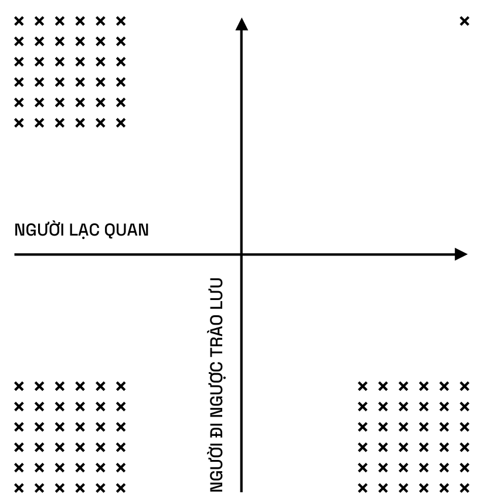
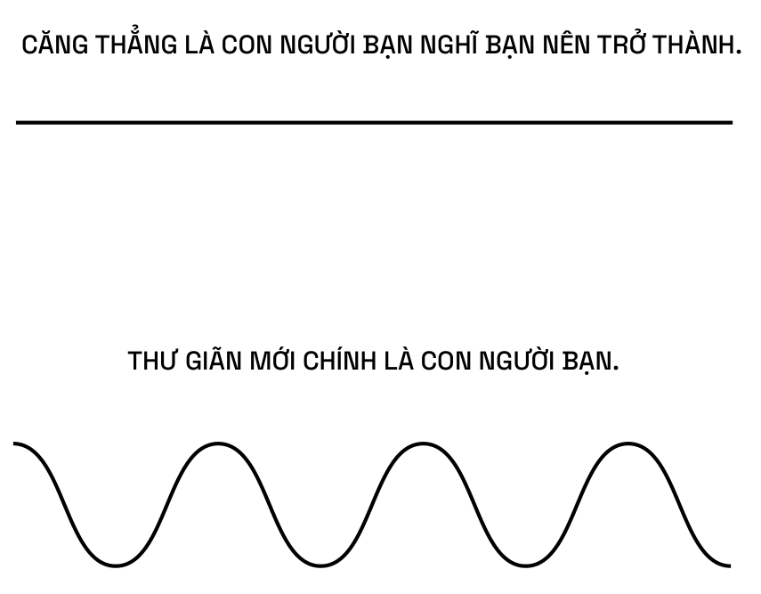

# XÂY DỰNG KỸ NĂNG PHÁN ĐOÁN

> Không có con đường tắt nào dẫn tới sự thông minh.

## KỸ NĂNG PHÁN ĐOÁN

Nếu bạn muốn kiếm được nhiều tiền nhất có thể, nếu bạn muốn giàu có đến hết đời một cách thật chắc chắn và đoán trước được, hãy luôn đón đầu các xu hướng và nghiên cứu công nghệ, thiết kế và nghệ thuật – trở nên xuất sắc ở một lĩnh vực nào đó. [1]

> Bạn sẽ không trở nên giàu có bằng cách dùng thời gian để tiết kiệm tiền.  
> Bạn sẽ trở nên giàu có bằng cách tiết kiệm thời gian để kiếm tiền.

Làm việc chăm chỉ đang được đề cao quá mức. Trong nền kinh tế hiện đại, chuyện bạn làm việc chăm chỉ như thế nào không còn quá quan trọng.

**Vậy điều gì bị đánh giá thấp?**

Kỹ năng phán đoán. Kỹ năng phán đoán đang bị đánh giá thấp. [1]

**Ông có thể định nghĩa kỹ năng phán đoán không?**

Định nghĩa của tôi về sự thông thái là khả năng nhận biết hậu quả dài hạn từ những hành động của bạn. Sự thông thái ứng dụng vào các vấn đề bên ngoài được gọi là kỹ năng phán đoán. Chúng có liên hệ chặt chẽ với nhau; biết được hậu quả dài hạn của hành động và từ đó đưa ra quyết định đúng đắn để tận dụng những hậu quả này. [78]

> Trong thời đại đòn bẩy, một quyết định đúng đắn có thể giúp bạn thắng cả cuộc chơi.  
> Thiếu đi sự cần cù, bạn sẽ không phát triển được cả kỹ năng phán đoán lẫn đòn bẩy.

Bạn phải đầu tư cả thời gian, nhưng kỹ năng phán đoán vẫn đóng vai trò thiết yếu hơn. Hướng đi mà bạn nhắm đến có vai trò cốt lõi hơn so với tốc độ di chuyển, đặc biệt là với đòn bẩy. Lựa chọn phương hướng cho mỗi quyết định của bạn quan trọng hơn nhiều so với việc bạn đã bỏ ra bao nhiêu sức lực. Hãy cứ chọn đúng phương hướng để bước đi và thực sự bắt đầu thôi. [1]

## LÀM THẾ NÀO ĐỂ TƯ DUY MẠCH LẠC

> “Người tư duy mạch lạc” là một lời khen ngợi hay hơn “thông minh”.

Kiến thức thực sự là giá trị nội tại và nó được xây dựng từ những điều cơ bản nhất. Lấy ví dụ về toán học, bạn không thể hiểu lượng giác mà không biết gì về số học và hình học. Về cơ bản, nếu ai đó đang dùng rất nhiều từ bóng bẩy và rất nhiều khái niệm đao to búa lớn, họ có thể chẳng biết gì về những thứ họ đang nói. Tôi nghĩ người thông minh nhất là người có thể giải thích mọi thứ cho một đứa trẻ. Nếu bạn không thể giải thích một điều nào đó cho một đứa trẻ thì bạn đang không hề biết gì về điều đó. Đó là câu nói thông dụng và nó thực sự rất đúng.

Richard Feynman đã rất nổi tiếng khi thực hiện điều này trong cuốn sách “Six Easy Pieces” (tạm dịch: Sáu Mảnh ghép Dễ dàng), đây là một trong những bài giảng vật lý thời kỳ đầu của ông. Về cơ bản, ông đã giải thích về toán học trong ba trang giấy. Bắt đầu từ dãy số – việc đếm và sau đó tiến thẳng lên toán trình độ tiền giải tích. Ông chỉ xây dựng nó từ một chuỗi logic liên tục. Ông không hề dựa vào bất kỳ định nghĩa nào.

Người tư duy thông minh là người tư duy mạch lạc. Họ hiểu những điều cơ bản ở mức rất, rất căn bản. Tôi thà hiểu sâu về những điều cơ bản hơn là nhớ tất cả các khái niệm phức tạp nhưng lại không thể xâu chuỗi chúng lại với nhau và không thể tiếp tục suy luận từ những điều cơ bản đó. Nếu bạn không thể suy luận tiếp từ những điều cơ bản thì khi cần đến chúng, bạn sẽ mất phương hướng. Thực chất, lúc ấy bạn chỉ đang ghi nhớ mà thôi. [4]

Các khái niệm nâng cao trong một lĩnh vực ít khi được chứng minh. Chúng ta thường sử dụng chúng để ám chỉ những kiến ​ thức nội bộ, nhưng tốt hơn hết chúng ta vẫn nên nắm vững những điều cơ bản. [11]

> Người tư duy mạch lạc là người tin vào phán đoán của chính mình.

**Một phần của việc đưa ra quyết định hiệu quả là đối mặt với** **thực tại. Vậy làm thế nào ông chắc chắn rằng mình đang đối** **mặt với thực tại khi đưa ra quyết định?**

Bằng cách quên đi ý thức mạnh mẽ về bản thân hoặc sự phán xét, hay thậm chí là sự hiện diện của tâm trí. “Tâm trí loài khỉ” sẽ luôn dùng thứ cảm xúc quen thuộc để phản ứng lại với những gì nó mường tượng về thế giới này. Những mong muốn đó sẽ che mờ thực tại của bạn. Điều này thường xuyên xảy ra khi mọi người kết hợp chính trị và kinh doanh.

Điều đầu tiên làm mờ mắt chúng ta, khiến chúng ta không thể nhìn thấy thực tại chính là những quan niệm và định kiến của chúng ta về mọi thứ.

Khoảnh khắc đau khổ có thể được định nghĩa là “thời điểm bạn nhìn thấy mọi thứ đúng như bản chất của chúng”. Suốt thời gian qua, bạn tin rằng công việc kinh doanh của mình đang hoạt động tốt và thật sự rất tốt, bạn bỏ qua những dấu hiệu cho thấy nó đang hoạt động bất ổn. Sau đó, khi công việc kinh doanh thất bại, bạn lại thấy đau khổ chỉ vì đã trì hoãn thực tế. Bạn đã che giấu thực tại với chính mình.

Tin tốt là, khoảnh khắc đau khổ – khi bạn đang đau đớn – chính là khoảnh khắc của sự thật. Đó là thời điểm bạn buộc phải chấp nhận thực tại theo đúng bản chất của nó. Tiếp theo đó, bạn có thể tạo ra thay đổi có ý nghĩa và tiến bộ. Bạn chỉ có thể tiến bộ khi bắt đầu với sự thật.

Cái khó ở đây là việc nhìn ra sự thật. Để nhìn thấy sự thật, bạn phải loại bỏ cái tôi, bởi cái tôi của bạn không hề muốn đối mặt với sự thật. Bạn càng có thể thu nhỏ cái tôi bao nhiêu, bạn càng có thể giảm thiểu khả năng cảm xúc của mình bị chi phối bởi các môi trường ngoại cảnh. Bạn càng ít khao khát về điều mà mình mong muốn, bạn sẽ càng dễ dàng nhìn thấy được thực tại.

> Điều chúng ta mong muốn trở thành sự thật sẽ là thứ che mờ nhận thức của chúng ta về thực tại. Đau khổ là khoảnh khắc chúng ta không còn có thể chối bỏ được thực tại.

Thử tưởng tượng một người bạn đang phải trải qua khó khăn như chia tay, mất việc, kinh doanh thất bại hoặc một vấn đề sức khỏe và chúng ta đang khuyên nhủ anh ấy. Khi chúng ta khuyên nhủ, câu trả lời thường khá hiển nhiên. Câu trả lời ngay lập tức nảy ra chỉ trong một phút và chúng ta nói với họ chính xác rằng: “Ôi cô gái đó ư, hãy quên cô ấy đi, dù sao cô ấy cũng không phải là một cô gái tốt cho anh đâu. Anh sẽ hạnh phúc hơn. Tin tôi đi. Anh sẽ tìm thấy ai đó thôi”.

Bạn biết câu trả lời chính xác là gì, nhưng người bạn của bạn lại không thể nhìn thấy, bởi họ đang ở trong những giây phút chịu đựng và đau đớn. Họ vẫn ước rằng thực tế sẽ khác đi. Vấn đề không nằm ở thực tế. Vấn đề là mong muốn của họ đang xung đột với thực tế và ngăn cản họ nhìn ra sự thật, cho dù bạn có nói thế nào đi chăng nữa. Điều tương tự như vậy cũng sẽ xảy ra khi tôi đưa ra quyết định.

Khi càng khao khát điều gì đó diễn ra theo cách mình muốn, tôi càng ít có khả năng nhìn thấy sự thật. Đặc biệt là trong kinh doanh, nếu có điều gì đó không thuận lợi, tôi sẽ cố gắng thừa nhận điều đó công khai, trước mặt những người đồng sáng lập, bạn bè và đồng nghiệp của mình. Như vậy, tôi sẽ không phải giấu giếm nó với bất kỳ ai khác. Nếu tôi không giấu giếm nó với bất kỳ ai, tôi sẽ không tự huyễn hoặc mình về những gì đang thực sự diễn ra. [4]

> Những gì bạn cảm thấy sẽ không cho bạn biết sự thật – nó chỉ đơn thuần cho bạn biết những điều bạn ước tính về sự thật.

Điều thực sự quan trọng lúc này là bạn cần có một khoảng không gian trống. Nếu không có nổi một hoặc hai ngày không phải họp hành và bận rộn trong tuần, bạn sẽ không thể suy nghĩ thấu đáo.

Bạn sẽ không thể có những ý tưởng hay ho cho doanh nghiệp của mình. Bạn sẽ không thể đưa ra những phán đoán tốt. Tôi cũng khuyến khích bạn nên dành ít nhất một ngày trong tuần (tốt nhất là hai ngày, vì nếu bạn dành ra hai ngày, rốt cuộc bạn cũng chỉ còn một ngày) để có thời gian suy nghĩ.

Chỉ sau khi cảm thấy buồn chán, bạn mới có thể nghĩ ra những ý tưởng tuyệt vời. Điều này không bao giờ xảy ra khi bạn đang căng thẳng, bận rộn, đang chạy loanh quanh hoặc vội vã. Hãy dành ra thời gian. [7]

> Những người rất thông minh thường trông kỳ lạ vì họ nhất quyết suy nghĩ mọi thứ theo cách riêng của mình.  
> Người đi ngược trào lưu không phải là người luôn luôn phản đối – đó chỉ là một người tuân thủ mọi thứ theo cách khác. Một người đi ngược trào lưu sẽ có suy nghĩ độc lập từ những điều cơ bản và chống lại sức ép phải đi theo đám đông.  
> Rất dễ để hoài nghi. Rất dễ để bắt chước. Những người luôn lạc quan và đối lập với quần chúng là giống loài hiếm hoi nhất.

## TÁCH BẠCH BẢN NGÃ CỦA BẠN ĐỂ NHÌN THẤY THỰC TẠI

Cái tôi của chúng ta được hình thành trong những năm tháng định hình – hai thập kỷ đầu tiên. Chúng được tạo dựng bởi môi trường, cha mẹ của chúng ta, và cả xã hội nữa. Tiếp theo, chúng ta dành trọn phần đời còn lại để cố gắng làm cho bản ngã của mình hạnh phúc. Chúng ta hiểu mọi điều mới mẻ thông qua bản ngã: “Làm thế nào để tôi thay đổi thế giới bên ngoài, để khiến nó giống như ý muốn của tôi?” [8]

> “Căng thẳng là con người bạn nghĩ mình nên trở thành. Thư giãn mới chính là con người bạn.”  
> *— Lời của Đức Phật*

Bạn hoàn toàn cần đến những thói quen để làm được việc. Bạn không thể giải quyết mọi vấn đề trong cuộc sống như thể đây là lần đầu tiên nó xuất hiện trước mắt. Chúng ta tích góp dần dần tất cả những thói quen. Chúng ta gói ghém chúng lại thành bản ngã, cái tôi, bản thân chúng ta và rồi chúng ta gắn liền với chúng. “Tôi là Naval. Đây là con người tôi”.

Điều thực sự quan trọng là bạn có thể tự giải thoát cho chính bản thân, có thể tách bạch các thói quen của mình và nói: “Được rồi, đây có lẽ là thói quen mà tôi đã hình thành khi còn là một đứa trẻ mới chập chững biết đi, khi cố gắng thu hút sự chú ý của cha mẹ. Bây giờ tôi đã cải thiện và củng cố thói quen đó, và tôi gọi đó là một phần bản ngã của mình. Liệu thói quen này còn có ích với tôi nữa không? Nó có làm tôi cảm thấy hạnh phúc hơn không? Có làm tôi trở nên khỏe mạnh hơn không? Thói quen ấy có thể giúp tôi hoàn thành tất cả các mục tiêu mà tôi đã đề ra hay không?

Tôi thường có ít thói quen hơn hầu hết mọi người. Tôi không thích việc lên kế hoạch cho một ngày. Trong phạm vi những thói quen của mình, tôi sẽ cố gắng thực hiện chúng một cách có chủ ý thay vì làm chúng như những việc ngẫu nhiên trong quá khứ. [4]

> Bất kỳ niềm tin nào bạn từng chiêm nghiệm và tiếp nhận (ví dụ: Đảng Dân chủ, Công giáo, Người Mỹ) đều đáng ngờ và nên được đánh giá lại từ những nguyên tắc cơ bản.

Tôi cố gắng không giữ trong mình quá nhiều điều đã được quyết định từ trước. Tôi nghĩ rằng việc tạo ra những bản ngã và nhãn mác sẽ kìm kẹp bạn và khiến bạn không thể nhìn thấy được sự thật.

> Thành thật mà nói, hãy phát ngôn mà không cần bản ngã.

Tôi từng tự nhận mình là người theo chủ nghĩa tự do, nhưng sau đó tôi thấy mình đang bảo vệ những quan điểm mà tôi còn chưa thực sự suy nghĩ thấu đáo về chúng, chỉ vì chúng là một phần tiêu chuẩn của chủ nghĩa tự do. Nếu tất cả niềm tin của bạn xếp thành những gói nhỏ gọn gàng, bạn cần phải có sự hoài nghi.

Tôi không còn muốn tự xác định bản ngã ở hầu hết mọi phân cấp nữa, điều này giúp tôi tránh khỏi việc có quá nhiều niềm tin ổn định. [4]

> Mỗi chúng ta đều có cho mình một niềm tin trái ngược mà xã hội bác bỏ. Nhưng bản ngã và cộng đồng càng bác bỏ bao nhiêu, niềm tin ấy càng có khả năng trở thành sự thật bấy nhiêu.

Có tới hai bài học hấp dẫn về sự đau khổ dài hạn. Một điều sẽ giúp bạn chấp nhận thế giới theo bản chất của nó. Điều còn lại có thể khiến cái tôi của bạn thay đổi theo một cách cực kỳ khó nhằn.

Giả sử bạn là một vận động viên rất cạnh tranh, rồi bạn bị chấn thương nặng, giống như Lý Tiểu Long (Bruce Lee). Bạn phải chấp nhận rằng vận động viên không hoàn toàn là danh tính của mình và bạn có thể tạo lập một danh tính mới như là một triết gia. [8]

> Facebook tái thiết kế. Twitter tái thiết kế. Tính cách, sự nghiệp và đội nhóm cũng cần tái thiết kế. Không có giải pháp nào là vĩnh viễn trong một thế giới đầy năng động.

## HỌC KỸ NĂNG ĐƯA RA QUYẾT ĐỊNH

Những đức tính tốt đẹp từ xa xưa đều là sự tự suy luận và chiêm nghiệm về việc ra quyết định để giúp con người tối ưu hóa trong thời gian ngắn thay vì trong thời gian dài. [11]

> Các kết luận để phục vụ lợi ích của cá nhân cần có thang tiêu chuẩn cao hơn.

Tôi đã thực sự tự xem xét rất nhiều mục tiêu của mình trong vài năm tới để chúng không bị ràng buộc bởi bất kỳ phản ứng nào đã được học trước hoặc những phản ứng theo thói quen, nhờ vậy tôi có thể đưa ra quyết định rõ ràng hơn vào thời điểm đó mà không cần dựa vào trí nhớ hoặc các suy luận và phán đoán có sẵn. [4]

> Hầu như tất cả thành kiến đều là những suy nghiệm giúp tiết kiệm thời gian. Đối với các quyết định quan trọng, hãy loại bỏ ký ức và bản ngã, chỉ tập trung vào vấn đề.

Sự trung thực triệt để chỉ có nghĩa là tôi muốn được tự do. Một phần của việc được tự do nghĩa là tôi có thể nói những gì tôi nghĩ và nghĩ những gì tôi nói. Hai điều này vô cùng phù hợp và thống nhất với nhau. Nhà vật lý lý thuyết Richard Feynman có một câu nói rất nổi tiếng: “Bạn không nên lừa dối bất kỳ ai, bạn mới chính là người dễ bị lừa nhất”. Khoảnh khắc bạn nói với ai đó một điều không trung thực, bạn đã tự lừa dối chính mình. Sau đó, bạn sẽ bắt đầu tin vào lời nói dối của chính mình, điều này khiến bạn xa rời thực tại và đưa bạn vào con đường sai lầm.

> “Tôi chưa bao giờ hỏi liệu ‘Tôi có thích điều này’ hoặc ‘Tôi không thích điều này’. Tôi sẽ nghĩ ‘Đây là bản chất của vấn đề’ hoặc ‘Đây không phải là bản chất của vấn đề’.”  
> *— Richard Feynman*

Đối với tôi, trung thực là vô cùng quan trọng. Tôi không cố gắng để làm những điều tiêu cực hay xấu xa. Thay vào đó, tôi sẽ kết hợp sự trung thực triệt để cùng một quy tắc cũ của Warren Buffett, khen ngợi cụ thể, phê bình đại khái. Tôi sẽ cố gắng tuân theo quy tắc này. Tuy rằng không phải lúc nào cũng vậy, nhưng tôi nghĩ mình sẽ làm nó đủ nhiều để tạo ra khác biệt nào đó trong cuộc đời.

Nếu bạn phê bình ai đó, đừng phê bình con người họ – hãy phê bình cách tiếp cận tổng thể hoặc phê bình một nhóm các hoạt động. Nếu bạn phải khen ngợi ai đó, hãy cố gắng tìm ra tấm gương sáng nhất cho điều bạn đang khen ngợi và khen ngợi một cách cụ thể. Như vậy, cái tôi và bản ngã, điều tất cả chúng ta đều có sẽ không phản lại bạn. Chúng sẽ hỗ trợ bạn. [4]

**Ông có lời khuyên nào để phát triển sự trung thực theo bản** **năng không?**

Hãy nói với mọi người. Bắt đầu ngay bây giờ. Không cần phải quá thẳng thắn. Sự lôi cuốn nằm ở khả năng truyền tải sự tự tin và tình yêu cùng một lúc. Bạn luôn có thể vừa thành thật và vừa tích cực. [71]

**Là nhà đầu tư và giám đốc điều hành của AngelList, ông** **được trả tiền để đúng khi người khác sai. Liệu ông có quy** **trình nào để đưa ra quyết định không?**

Chắc chắn rồi. Việc đưa ra quyết định quan trọng hơn tất cả. Trên thực tế, một người đưa ra quyết định đúng 80% các trường hợp thay vì 70% sẽ được định giá và trả thù lao trên thị trường cao gấp hàng trăm lần.

Tôi nghĩ mọi người đang gặp khó khăn trong việc hiểu nền tảng thực sự của đòn bẩy. Nếu tôi quản lý 1 tỷ đô la và tôi có 10% chính xác hơn người khác, quá trình đưa ra quyết định sẽ được tạo nên dựa trên phán đoán trị giá 100 triệu đô la. Với công nghệ hiện đại, lực lượng lao động và nguồn vốn lớn, các quyết định của chúng ta ngày càng được tạo đòn bẩy nhiều hơn.

Nếu có thể đưa ra quyết định chính xác và lý trí hơn, bạn sẽ nhận được những lợi ích phi tuyến tính trong cuộc sống. Tôi yêu thích trang blog Farnam Street vì nó thực sự tập trung giúp bạn trở thành người chính xác hơn và có thể đưa ra quyết định tổng thể tốt hơn. Kỹ năng đưa ra quyết định quan trọng hơn tất cả. [4]

> Bạn càng biết nhiều, bạn càng ít đa dạng hoá.

## THU THẬP NHỮNG MÔ HÌNH TƯ DUY

Trong quá trình đưa ra quyết định, bộ não là một cỗ máy dự đoán trí nhớ.

Một cách tồi tệ để dự đoán dựa trên trí nhớ là: “X đã xảy ra trong quá khứ, do đó X sẽ xảy ra trong tương lai”. Dự đoán này quá dựa dẫm vào hoàn cảnh cụ thể. Điều bạn cần là các nguyên tắc, các mô hình tư duy.

Các mô hình tư duy tốt nhất tôi biết bắt nguồn từ thuyết tiến hóa, lý thuyết trò chơi và Charlie Munger. Charlie Munger là cộng sự của Warren Buffett. Ông là một nhà đầu tư xuất sắc. Ông có hàng loạt các mô hình tư duy tuyệt vời. Tác giả, nhà giao dịch Nassim Taleb cũng có những mô hình tư duy xuất sắc. Benjamin Franklin cũng có những mô hình tư duy tuyệt vời. Tôi lấp đầy trí óc của mình bằng các mô hình tư duy. [4]

Tôi sử dụng Tweet của mình và Tweet của người khác như những câu châm ngôn để cô đọng những gì mình đã học được và gợi nhớ chúng. Không gian não bộ là hữu hạn – bạn có các tế bào thần kinh hữu hạn – vì vậy bạn gần như có thể coi các dòng Tweet như những con trỏ, địa chỉ, hoặc như những ký tự đặc biệt để ghi nhớ các nguyên tắc sâu xa, nơi bạn có kinh nghiệm nền tảng để sao lưu.

Nếu bạn không có cho mình kinh nghiệm nền tảng, các dòng Tweet chỉ đơn thuần là một tập hợp các câu trích dẫn. Chúng thật tuyệt vời, chúng sẽ truyền cảm hứng cho bạn trong chốc lát, có thể bạn sẽ tạo ra được một tấm áp phích đẹp từ chúng. Nhưng sau đó bạn sẽ quên và bỏ qua chúng. Các mô hình tư duy mới chính là cách thức thuận tiện để bạn nhớ lại những kiến thức mình đã học được. [78]

**SỰ TIẾN HOÁ**

Tôi nghĩ rằng rất nhiều xã hội hiện đại có thể được giải thích thông qua sự tiến hóa. Một giả thuyết cho rằng nền văn minh tồn tại để trả lời cho câu hỏi ai sẽ được giao phối. Nếu bạn nhìn xung quanh, từ góc độ chọn lọc giới tính thuần túy, tinh trùng luôn dồi dào còn trứng lại khan hiếm. Đây thực sự là vấn đề phân bổ.

Theo nghĩa đen, tất cả nhiệm vụ của đàn ông và phụ nữ đều có thể bắt nguồn từ những người đang cố gắng giải quyết vấn đề này.

Sự tiến hóa, nhiệt động lực học, lý thuyết thông tin và sự phức tạp có khả năng giải thích và dự đoán nhiều khía cạnh của cuộc sống. [11]

**SỰ ĐẢO NGƯỢC**

Tôi không tin mình có khả năng đoán trước điều gì sẽ hiệu quả. Thay vào đó, tôi sẽ cố gắng loại bỏ những thứ không hiệu quả.

Với tôi, thành công chỉ đơn giản là không mắc sai lầm. Thành công không nằm ở việc đưa ra phán đoán đúng, mà là tránh được những phán đoán sai. [4]

**KHOA HỌC PHỨC HỢP**

Tôi thực sự say mê khoa học phức hợp từ giữa những năm 90. Càng dấn thân tìm hiểu, tôi càng hiểu rõ giới hạn kiến ​thức cũng như giới hạn trong khả năng dự đoán của chúng ta. Với tôi, phức hợp vô cùng hữu ích. Nhờ có phức hợp, tôi đã phát triển một hệ thống có thể hoạt động bất chấp sự thiếu hiểu biết. Tôi tin rằng chúng ta căn bản là những người không biết gì và thực sự rất tệ trong việc dự đoán tương lai. [4]

**KINH TẾ HỌC**

Kinh tế học vi mô và lý thuyết trò chơi là những cơ sở nền tảng. Tôi không nghĩ bạn có thể thành công trong kinh doanh hoặc thậm chí tìm ra hướng đi trong xã hội tư bản hiện đại của chúng ta nếu không có hiểu biết kỹ lưỡng về cung và cầu, nhân công và vốn, lý thuyết trò chơi và những thứ tương tự. [4]

> Hãy phớt lờ những sự nhiễu loạn. Thị trường sẽ đưa ra quyết định.

**VẤN ĐỀ ÔNG CHỦ – NGƯỜI ĐẠI DIỆN** **(PRINCIPAL-AGENT PROBLEM)**

Đối với tôi, ông chủ – người đại diện là vấn đề cơ bản nhất trong kinh tế học vi mô. Nếu không hiểu được vấn đề này, bạn sẽ không biết cách xác định hướng đi trong thế giới của mình. Điều này thực sự rất quan trọng nếu bạn đang muốn xây dựng một công ty thành công, hoặc thành công trong các giao dịch.

Đây là một khái niệm vô cùng đơn giản. Julius Caesar từng có một câu nói nổi tiếng: “Nếu bạn muốn làm điều gì đó, hãy tự làm. Và nếu bạn không làm được, hãy chuyển giao nó cho một người khác.” Ý của ông ấy là, nếu bạn muốn làm đúng, bạn phải tự mình đi và làm điều đó. Khi bạn là người uỷ thác, bạn chính là ông chủ – bạn phải tự chăm lo và bạn sẽ làm một công việc tuyệt vời. Nhưng khi bạn là người đại diện và đang làm việc thay cho người khác, có thể bạn đang làm một công việc tồi tệ. Đơn giản là bạn không hề quan tâm tới điều đó. Bạn đang làm việc để tối ưu cho chính mình nhiều hơn là cho tài sản của người uỷ thác.

Một công ty càng nhỏ, mọi người sẽ càng cảm thấy mình giống ông chủ. Khi bạn càng cảm thấy mình ít giống người đại diện, công việc của bạn càng tốt đẹp. Bạn càng thắt chặt mối liên kết giữa tiền lương của ai đó và giá trị chính xác mà họ tạo ra bao nhiêu thì càng biến họ thành ông chủ bấy nhiêu và càng ít biến họ thành người đại diện. [12]

Tôi nghĩ ở cấp độ căn bản cốt lõi, chúng ta có thể hiểu được điều này. Chúng ta bị thu hút bởi việc làm chủ, và tất cả chúng ta đều đang gắn bó với chủ sở hữu, nhưng các phương tiện truyền thông và xã hội hiện đại lại đang dành quá nhiều thời gian để tẩy não và khiến chúng ta tin rằng chúng ta cần đến một người đại diện, người đại diện là thực sự cần thiết, người đại diện chính là người có kiến thức. [12] **LÃI KÉP [1]**

Lãi kép – bạn nên tìm hiểu nó trong bối cảnh tài chính. Nếu chưa biết đến lãi kép, hãy mở một cuốn giáo trình kinh tế vi mô. Thật sự rất đáng để đọc một cuốn giáo trình kinh tế vi mô từ đầu đến cuối.

Đây là một ví dụ cụ thể về lãi kép – giả sử bạn đang kiếm được 10% mỗi năm trên 1 đô la. Năm đầu tiên, bạn kiếm được 10% và cuối cùng bạn có 1,10 đô la. Năm tiếp theo, bạn dừng lại ở 1,21 đô la và năm tiếp theo là 1,33 đô la. Số tiền tiếp tục được cộng dồn. Nếu bạn đang tích lũy ở mức 30% mỗi năm trong thời hạn ba mươi năm, bạn không chỉ sẽ kiếm được số tiền gấp 10 hay 20 lần số tiền ban đầu – bạn sẽ kiếm được gấp nghìn lần số đó. [10]

Trong lĩnh vực trí tuệ, lãi kép đang thống trị. Khi nhìn vào một doanh nghiệp có 100 người dùng đang phát triển với lãi kép 20% mỗi tháng, bạn sẽ thấy doanh nghiệp đó cực kỳ, cực kỳ nhanh chóng tích lũy lên tới hàng triệu người dùng. Đôi khi, ngay cả đội ngũ sáng lập của những công ty này cũng sẽ ngạc nhiên về sự phát triển rộng lớn của quy mô kinh doanh. [10]

**TOÁN HỌC CƠ BẢN**

Tôi nghĩ toán học cơ bản đang bị đánh giá thấp. Nếu bạn đang định kiếm tiền, nếu bạn đang định đầu tư tiền, kiến thức toán học cơ bản của bạn phải thực sự tốt. Bạn không cần phải biết hình học, lượng giác, giải tích hoặc bất kỳ thứ gì phức tạp nếu bạn mới bắt đầu kinh doanh. Nhưng bạn cần phải biết số học, xác suất thống kê. Đây là những điều cực kỳ quan trọng. Hãy mở một cuốn sách toán cơ bản và đảm bảo rằng bạn thực sự giỏi các phép nhân, chia, lũy kế, xác suất và thống kê.

**THIÊN NGA ĐEN (BLACK SWANS)**

Có một nhánh mới trong xác suất thống kê, nó xoay quanh các sự kiện có rủi ro đuôi1. “Thiên nga đen” là những việc có xác suất xảy ra cực kỳ thấp. Một lần nữa, tôi phải dẫn chiếu tới Nassim Taleb, người mà tôi nghĩ là một trong những nhà khoa học - triết học vĩ đại nhất trong thời đại chúng ta. Ông ấy đã làm rất nhiều công việc tiên phong cho vấn đề này.

**GIẢI TÍCH**

Giải tích rất hữu ích trong việc mô tả và giúp chúng ta hiểu tốc độ thay đổi và cách thức hoạt động của thế giới tự nhiên. Tuy nhiên, điều quan trọng hơn cả là nắm bắt được các nguyên tắc cơ bản của giải tích – khi đo lường sự thay đổi trong các sự kiện nhỏ tức thời hoặc liên tục. Khả năng giải các phương trình tích phân hay vi phân khi được yêu cầu không quá quan trọng, vì trong thế giới kinh doanh thực tế, bạn ít khi cần phải áp dụng những kỹ năng này.

**TÍNH KHẢ PHỦ CHỨNG (FALSIFIABILITY)**

Một nguyên tắc ít được hiểu rõ nhưng lại vô cùng quan trọng đối với bất kỳ ai khẳng định họ đứng trên lập trường “khoa học” – tính khả phủ chứng. Nếu một học thuyết không đưa ra những dự đoán có khả năng sai, thì nó không thể được xem là khoa học. Để bạn tin điều gì đó là đúng, nó cần phải có khả năng đưa ra dự đoán và cũng có thể bị phủ định. [11] Theo quan điểm của tôi, điều này chính xác với kinh tế vĩ mô, nó đã trở nên suy yếu vì không đưa ra những dự đoán có thể bị phủ định (một đặc điểm quan trọng của khoa học). Bạn sẽ không bao giờ gặp một phản ví dụ khi nghiên cứu nền kinh tế. Bạn không thể lấy nền kinh tế của Hoa Kỳ và tiến hành hai thí nghiệm khác nhau cùng một lúc. [4]

**NẾU BẠN KHÔNG THỂ ĐƯA RA QUYẾT ĐỊNH, CÂU TRẢ LỜI** **SẼ LÀ KHÔNG**

Nếu tôi đối mặt với một lựa chọn khó khăn, như là:

→Tôi có nên lấy người này không?

→Tôi có nên nhận công việc này không?

→Tôi có nên mua ngôi nhà này không?

→Tôi có nên chuyển đến thành phố này không?

→Tôi có nên kinh doanh cùng người này không?

Nếu bạn không thể đưa ra quyết định, câu trả lời sẽ là không. Lý do là xã hội hiện đại có rất nhiều lựa chọn. Có đến hàng tấn lựa chọn. Chúng ta đang sống trên một hành tinh có 7 tỷ người và chúng ta được kết nối với mọi người trên Internet. Có hàng trăm nghìn nghề nghiệp dành cho bạn. Thật sự có rất nhiều lựa chọn dành cho bạn.

Về mặt sinh học, chúng ta không được tạo ra để nhận biết sự đa dạng của các lựa chọn. Theo lịch sử, chúng ta đều tiến hóa trong những bộ lạc chỉ gồm 150 người. Khi một người mới xuất hiện, họ có thể trở thành lựa chọn duy nhất cho bạn trong việc tìm kiếm một người bạn đời.

Khi lựa chọn một thứ, bạn sẽ bị giữ chân ở đó trong thời gian dài. Bắt đầu kinh doanh có thể mất mười năm. Bắt đầu một mối quan hệ có thể kéo dài năm năm hoặc hơn. Bạn chuyển đến sống ở một thành phố trong mười đến hai mươi năm. Đây đều là những quyết định vô cùng dài hạn. Quan trọng nhất là chúng ta chỉ nói “đồng ý” khi chúng ta đã khá chắc chắn. Bạn sẽ không bao giờ chắc chắn tuyệt đối, nhưng bạn sẽ cực kỳ chắc chắn.

Nếu bạn thấy mình đang tạo ra một danh sách các lựa chọn có và không, ưu điểm và nhược điểm, kiểm tra và cân bằng, tại sao điều này tốt hay xấu,… trước khi một quyết định, hãy quên nó đi. Nếu bạn không thể đưa ra quyết định, câu trả lời sẽ là không. [10]

**CHẠY LÊN DỐC**

> Suy nghiệm đơn giản: Nếu bạn đang do dự trước một quyết định khó khăn, hãy lựa chọn con đường có thể khó khăn hơn trong thời gian ngắn.

Nếu bạn có hai lựa chọn và chúng tương đối ngang bằng, hãy chọn con đường khó khăn và đau đớn hơn trong thời gian ngắn.

Điều thực sự đang diễn ra là một trong những con đường này đòi hỏi bạn phải đau đớn trong thời gian ngắn. Lựa chọn còn lại dẫn đến một nỗi đau xa hơn trong tương lai. Và những gì bộ não của bạn đang làm là cố gắng xoa dịu nỗi đau ngắn hạn bằng cách né tránh xung đột.

Hiển nhiên, nếu cả hai lựa chọn tương đương nhau và một bên là gặp khó khăn trong thời gian ngắn, con đường đó sẽ có lợi ích lâu dài kèm theo. Với quy luật lãi kép, lợi ích lâu dài sẽ là điều bạn hướng tới. Bộ não của bạn đang đánh giá quá cao bên có hạnh phúc ngắn hạn và cố gắng né tránh bên có nỗi đau ngắn hạn.

Vì vậy, bạn phải loại bỏ xu hướng này (đó là một xu hướng mạnh mẽ trong tiềm thức) bằng cách dựa dẫm vào nỗi đau. Như bạn đã biết, hầu hết thành tựu trong cuộc sống đều đến từ sự chịu đựng trong thời gian ngắn để đạt được những phần thưởng lâu dài.

Tập luyện với tôi không phải là niềm vui. Tôi chịu đau đớn trong ngắn hạn, tôi cảm nhận được từng nỗi đau. Nhưng về lâu dài, tôi sẽ trở nên tốt hơn vì có cơ bắp hay khoẻ mạnh hơn.

Nếu tôi đang đọc một cuốn sách và cảm thấy bối rối, điều đó cũng giống như khi tập thể lực và cơ bắp bị đau hoặc mệt mỏi, chỉ khác là bây giờ bộ não của tôi đang bị quá tải. Về lâu dài, tôi sẽ ngày càng thông minh vì tôi đang tiếp thu các khái niệm mới khi làm việc ở ngưỡng giới hạn hoặc ở bên rìa khả năng của mình.

Vì vậy, nhìn chung là bạn nên dựa vào những điều đau đớn trong thời gian ngắn, nhưng có lợi ích lâu dài.

**Theo ông, những cách hữu hiệu nhất để xây dựng các mô** **hình tư duy mới là gì?**

Hãy đọc thật nhiều – cứ đọc thôi. [2]

> Đọc về khoa học, toán học và triết học một giờ mỗi ngày có thể đưa bạn đến nấc thang cao nhất của nhân loại trong vòng bảy năm.

## HỌC CÁCH YÊU VIỆC ĐỌC

*(Các đề xuất cụ thể về sách, trang blog, và nhiều vấn đề khác* *nằm ở phần “Tài liệu khuyến đọc của Naval”).*

Chính tình yêu đích thực dành cho việc đọc sách, khi được nuôi dưỡng, sẽ trở thành một siêu năng lực. Chúng ta đang sống trong thời đại của Alexandria, khi mọi cuốn sách và mọi mảnh kiến ​thức từng được viết ra chỉ cách bạn một đầu ngón tay. Phương tiện học tập thì phong phú – nhưng chính mong muốn học hỏi thì lại khan hiếm. [3]

> Việc đọc là mối tình đầu của tôi.

Tôi nhớ ngôi nhà của ông bà tôi ở Ấn Độ. Khi ấy, tôi là đứa trẻ ngồi trên sàn nhà đọc tất cả Tạp chí Reader’s Digest của ông tôi, đó là tất cả những gì mà ông phải đọc. Ngày nay, tất nhiên có cả một bữa tiệc thông tin ngoài kia – bất kỳ ai cũng có thể đọc bất cứ điều gì vào bất cứ lúc nào. Ngày xưa điều này hạn chế hơn rất nhiều. Tôi sẽ đọc truyện tranh, sách truyện, bất cứ thứ gì tôi có trong tay.

Tôi nghĩ tôi luôn thích đọc sách vì tôi là một người hướng nội tách biệt xã hội. Tôi đã lạc lối trong thế giới của ngôn từ và ý tưởng từ thuở nhỏ. Tôi nghĩ một phần cũng đến từ may mắn vì khi còn bé, không ai ép buộc tôi phải đọc một nội dung hay thể loại sách nào nhất định.

Tôi nghĩ các bậc cha mẹ và giáo viên thường hay nói rằng: “Ồ, con nên đọc cái này, nhưng đừng đọc cái kia”. Tôi đã đọc rất nhiều thứ (mà theo tiêu chuẩn ngày nay) có thể được xem là những món ăn tinh thần không có giá trị dinh dưỡng. [4]

> Hãy cứ đọc những gì bạn yêu thích cho đến khi bạn thật sự yêu thích việc đọc.

Hãy đọc hết những gì bạn đang đọc chỉ đơn giản vì bạn thực sự say mê chúng. Bạn không cần bất kỳ lý do nào khác. Không có nhiệm vụ nào ở đây cần bạn phải hoàn thành. Hãy cứ đọc chỉ vì bạn thích thôi.

Những ngày này, tôi thấy mình đọc lại nhiều (hoặc nhiều hơn) là đọc những điều mới nào đó. Một bài Tweet từ tài khoản @illacertus cho biết: “Tôi không muốn đọc tất cả mọi thứ. Tôi chỉ muốn đọc đi đọc lại 100 cuốn sách tuyệt vời”. Tôi nghĩ quan điểm đó chứa đựng rất nhiều lớp nghĩa. Quan trọng hơn hết là phải xác định được đâu sẽ là những cuốn sách tuyệt vời dành cho bạn, bởi vì những cuốn sách khác nhau phù hợp với những người khác nhau. Để sau đó, bạn có thể thực sự hấp thụ chúng.

> Đọc sách không phải là một cuộc đua – sách càng hay càng nên được tiếp thu chậm rãi hơn.

Tôi không biết các bạn thế nào, nhưng tôi lại có khả năng tập trung rất kém. Tôi đọc lướt. Tôi đọc nhanh. Tôi nhảy từ cuốn này qua cuốn khác. Tôi không thể kể cho bạn những đoạn cụ thể hoặc trích dẫn từ sách. Ở một cấp độ sâu xa nào đó, bạn tiếp thu chúng và chúng sẽ trở thành những sợi chỉ trong tấm thảm tâm hồn của bạn. Chúng như thể được dệt vào đó.

Tôi chắc rằng bạn đã từng có cảm giác này khi cầm một cuốn sách lên và bắt đầu đọc, bạn nghĩ: “Điều này thú vị đấy. Điều này hay đấy”. Bạn đang có cảm giác “deja vu”1 và cảm giác đó ngày càng tăng. Rồi khi đọc được một nửa, bạn nhận ra: “Mình đã đọc cuốn sách này trước đây”. Điều đó hoàn toàn ổn. Nó có nghĩa là bạn đã sẵn sàng để đọc lại. [4]

> Tôi không thực sự đọc nhiều sách. Tôi chọn ra rất nhiều cuốn sách và chỉ đọc qua một số cuốn có thể giúp tôi tạo dựng nền tảng kiến thức.

Tôi thực sự không đọc nhiều sách như những gì mọi người nghĩ. Tôi có thể đọc một đến hai giờ một ngày. Điều đó đưa tôi vào nhóm 0,00001% dẫn đầu. Tôi nghĩ rằng chỉ riêng điều đó thôi đã là một lời giải đáp cho bất kỳ thành công vật chất nào mà tôi có được trong đời và bất kỳ tài trí nào mà tôi sở hữu. Con người không đọc sách một giờ mỗi ngày. Tôi nghĩ con người thực sự chỉ đọc một phút mỗi ngày hoặc ít hơn. Vì vậy, khiến cho việc đọc trở thành thói quen là điều tối quan trọng.

Những gì bạn đọc hầu như không quan trọng. Cuối cùng bạn cũng sẽ đọc đủ mọi thứ (sở thích sẽ dẫn bạn đến đó) và điều này giúp cải thiện cuộc sống của bạn đáng kể. Cũng giống như bài tập thể lực tốt nhất cho bạn là bài tập bạn đủ hào hứng để thực hiện hằng ngày. Tôi muốn nói rằng dù là sách, blog, Tweet hoặc bất cứ thứ gì chứa thông tin và kiến thức – điều tốt nhất vẫn luôn là những điều bạn hào hứng muốn đọc. [4]

> “Miễn là tôi đang có một cuốn sách trong tay, tôi không cảm thấy mình đang lãng phí thời gian.”  
> *— Charlie Munger*

Não bộ mỗi người sẽ hoạt động theo cách khác nhau. Một số người thích ghi chú. Trên thực tế, ghi chú của tôi là Twitter. Tôi cứ đọc và đọc. Nếu có một số kiến thức mang tính “Ồ, ra là thế” hoặc một khái niệm cơ bản nào đó, Twitter sẽ buộc tôi phải chắt lọc chúng thành một vài ký tự. Sau đó, tôi cố gắng biến các ý tưởng đó thành những câu ngạn ngữ súc tích. Để rồi, tôi bị công kích bởi những người lạ, họ chỉ ra đủ các trường hợp ngoại lệ cụ thể và chặn họng tôi. Tiếp đó, tôi tự hỏi: “Tại sao mình lại làm điều này nữa nhỉ?”. [4]

> Chỉ ra những ngoại lệ cụ thể ám chỉ rằng hoặc người đó không thông minh, hoặc bạn không thông minh.

**Khi mới cầm một cuốn sách trên tay, ông có đọc lướt qua để** **tìm điều gì đó thú vị không? Điều gì thôi thúc ông bắt đầu** **đọc nó? Hay ông chỉ lật đến một trang ngẫu nhiên và bắt** **đầu đọc? Quy trình đọc của ông là gì?**

Tôi sẽ đọc từ đầu, nhưng tôi đọc khá nhanh. Nếu như cuốn sách đó không thú vị, tôi sẽ bắt đầu lật trang, đọc lướt hoặc tăng tốc độ đọc. Nếu nó không thu hút sự chú ý của tôi trong chương đầu tiên theo chiều hướng có ý nghĩa và tích cực, tôi sẽ bỏ dở cuốn sách đó hoặc bỏ qua một vài chương sau đó.

Tôi không muốn sự thoả mãn bị trì hoãn trong khi có vô số cuốn sách ngoài kia để đọc. Thật sự có rất nhiều cuốn sách tuyệt vời ngoài kia.

> Tính số lượng sách đọc xong là một thước đo phù phiếm. Khi bạn hiểu biết nhiều hơn, bạn sẽ càng bỏ dở thêm nhiều cuốn sách. Hãy tập trung vào các khái niệm mới kết hợp với khả năng dự đoán.

Nói chung, tôi sẽ lướt qua. Tôi sẽ tăng tốc độ đọc. Tôi sẽ cố gắng tìm ra phần thu hút sự chú ý của tôi. Hầu hết các cuốn sách đều có ý chính (tất nhiên, tôi đang nói về sách phi hư cấu, không phải sách hư cấu). Nếu một cuốn sách có ý chính, chúng sẽ chỉ ra điều đó, đưa cho bạn hết ví dụ này đến ví dụ khác, sau đó áp dụng điều đó để giải thích mọi thứ trên đời.

Một khi tôi cảm thấy như đã nắm được ý chính, tôi có thể thoải mái đặt cuốn sách xuống. Có rất nhiều cuốn sách như vậy, tôi thường gọi chúng là sách ngụy khoa học bán chạy nhất. Mọi người sẽ kiểu: “Ồ, bạn đã đọc cuốn sách này chưa?”. Tôi luôn trả lời là đọc rồi, nhưng thực chất những gì tôi đọc có thể chỉ là hai chương trong đó.

> Nếu họ viết một cuốn sách để kiếm tiền, đừng đọc nó.

**Đâu là những hành động thực tiễn ông đã áp dụng để tiếp** **thu/tổ chức thông tin từ việc đọc sách?**

Hãy giải thích những gì bạn học được cho một ai đó. Việc giảng dạy sẽ kích thích sự học hỏi.

> Đây không phải là vấn đề giữa “có học thức” với “không có học thức”. Đây là vấn đề giữa “yêu thích việc đọc và “không yêu thích việc đọc”.

**Theo ông, tôi có thể làm gì trong 60 ngày tới để trở thành** **một người tư duy mạch lạc và độc lập hơn?**

Đọc các tác phẩm vĩ đại trong toán học, khoa học, triết học. Bỏ qua những người cùng thời và tin tức. Tránh định danh bản thân dựa trên đám đông. Đặt sự thật lên trên chấp thuận xã hội. [11]

> Hãy học logic và toán học, một khi bạn thành thạo chúng, bạn sẽ không e sợ bất kỳ cuốn sách nào.

Không một cuốn sách nào trong thư viện có thể làm bạn sợ hãi. Cho dù đó là sách toán, vật lý, kỹ thuật điện, xã hội học hay kinh tế học. Bạn có thể lấy xuống bất kỳ cuốn sách nào để đọc. Sẽ có một số cuốn quá khó với bạn. Không sao cả – hãy cứ đọc. Sau đó quay lại và đọc đi đọc lại chúng.

Khi bạn đang đọc sách và cảm thấy bối rối, sự bối rối đó cũng tương tự như cơn đau bạn gặp phải trong phòng tập thể hình.

Nhưng lúc này, bạn đang xây dựng cơ bắp tinh thần thay vì cơ bắp thể chất. Hãy học cách học và đọc sách.

Vấn đề của câu nói “Chỉ cần đọc thôi” là ở ngoài kia có rất nhiều nội dung vớ vẩn, nhảm nhí. Có nhiều loại tác giả cũng như nhiều thể loại người khác nhau. Nhiều trong số họ sẽ viết những cuốn sách không có giá trị.

Một số người tôi biết trong đời có khả năng đọc rất tốt nhưng lại không thông minh lắm. Lý do là vì họ có khả năng đọc rất tốt nhưng lại đọc sai nội dung, sai thứ tự. Họ đọc hàng tá những điều sai lầm hoặc chỉ là những sự thật mơ hồ, và những điều đó đã hình thành nền tảng cho thế giới quan của họ. Sau đó, khi những điều mới xuất hiện, họ lại đánh giá ý tưởng mới dựa trên nền tảng họ đã xây dựng. Nền tảng của bạn là điều thật sự quan trọng.

> Bởi vì hầu hết mọi người đều sợ hãi toán học và không thể tự phê bình nó nên họ đánh giá quá cao các ý kiến ​được bổ trợ bởi toán học/ngụy khoa học.

Khi bàn về việc đọc, hãy đảm bảo nền tảng của bạn phải có chất lượng cực kỳ cao.

Cách tốt nhất để có nền tảng chất lượng cao (bạn có thể không thích câu trả lời này), là dựa vào khoa học và dựa vào những điều căn bản. Nhìn chung, có rất ít điều bạn có thể đọc mà mọi người không phản đối. Rất ít người không đồng ý 2+2=4, phải không? Đó là kiến ​thức cực kỳ đáng tin cậy. Toán học là một nền tảng vững chắc.

Tương tự như vậy, các môn khoa học cứng (hard science) là một nền tảng vững chắc. Kinh tế vi mô là một nền tảng vững chắc. Khoảnh khắc bạn bắt đầu lang thang bên ngoài những nền tảng vững chắc này, bạn sẽ gặp rắc rối vì bây giờ bạn không biết điều gì đúng và điều gì sai. Tôi sẽ tập trung hết mức có thể để có được những nền tảng vững chắc.

Thực sự giỏi số học và hình học sẽ tốt hơn là đi sâu vào toán học cao cấp. Tôi sẽ đọc kinh tế vi mô suốt cả ngày – Kinh tế vi mô 101.

Có một cách khác để làm điều này là đọc bản gốc và đọc tác phẩm kinh điển. Nếu bạn quan tâm đến sự tiến hóa, hãy đọc Charles Darwin. Đừng bắt đầu với Richard Dawkins (mặc dù tôi nghĩ ông ấy rất tuyệt). Hãy đọc sách của ông ấy sau; hãy đọc Darwin trước.

Nếu bạn muốn học kinh tế vĩ mô, trước tiên hãy đọc Adam Smith, đọc von Mises hoặc Hayek. Bắt đầu với các triết gia sơ khởi của nền kinh tế. Nếu bạn thích những ý tưởng cộng sản hoặc xã hội chủ nghĩa (cá nhân tôi thì không), hãy bắt đầu bằng cách đọc Karl Marx. Đừng đọc những diễn giải hiện nay của ai đó về cách mọi thứ được thực hiện và vận hành.

Nếu bạn bắt đầu lấy những tài liệu gốc làm nền tảng, bạn sẽ có đủ thế giới quan và sự hiểu biết để không phải sợ bất kỳ cuốn sách nào. Sau đó, bạn cứ thế tiếp thu. Nếu bạn là một cỗ máy học hỏi không ngừng, bạn sẽ không bao giờ khan hiếm lựa chọn về cách kiếm tiền. Bạn luôn có thể thấy những gì sắp xảy ra trong xã hội, giá trị là gì, nhu cầu ở đâu và bạn có thể học cách bắt kịp tốc độ. [74]

> Để tư duy rõ ràng, hãy hiểu những điều căn bản. Nếu bạn đang ghi nhớ các khái niệm nâng cao mà không thể tái áp dụng chúng khi cần, bạn sẽ lạc lối.

Hiện nay chúng ta đang ở thời đại của Twitter và Facebook. Chúng ta đang nhận được những thông tin ngắn gọn, súc tích, những thứ thực sự khó tiếp thu. Sách vô cùng khó đọc với con người hiện đại vì chúng ta đã được huấn luyện. Chúng ta có hai phần được huấn luyện trái ngược nhau:

Một mặt, khả năng tập trung của chúng ta đã giảm xuống đáng kể vì luôn tiếp xúc với quá nhiều thông tin. Chúng ta luôn muốn bỏ qua, tóm tắt và đi thẳng vào vấn đề.

> Twitter khiến tôi trở thành người đọc kém hơn, nhưng lại trở thành người viết tốt hơn nhiều.

Mặt khác, chúng ta cũng được dạy từ khi còn nhỏ là cần hoàn thành những cuốn sách của mình. Sách là thứ thiêng liêng – khi bạn đến trường và được giao nhiệm vụ đọc một cuốn sách, bạn phải đọc hết cuốn sách đó. Lâu dần, chúng ta quên mất cách đọc sách. Tất cả mọi người tôi biết đều đang bị mắc kẹt trong một vài cuốn sách.

Tôi chắc rằng bạn cũng đang mắc kẹt ở đâu đó ngay bây giờ – có thể là trang 332, bạn không thể đọc tiếp nữa, nhưng bạn biết mình nên hoàn thành cuốn sách. Vậy thì bạn sẽ làm gì? Bạn từ bỏ đọc sách trong một thời gian.

Đối với tôi, từ bỏ đọc sách là một bi kịch. Tôi lớn lên nhờ những cuốn sách, sau đó tôi chuyển sang viết blog, rồi chuyển sang Twitter và Facebook, và tôi nhận ra rằng mình thực sự không học được gì cả. Tôi chỉ đang “ăn” một ít dopamine suốt cả ngày. Tôi đã nhận được sự bùng nổ dopamine chỉ từ 140 ký tự. Tôi sẽ Tweet, sau đó tìm xem ai đã đăng lại Tweet của mình. Đó là một điều thú vị và tuyệt vời, nhưng cũng chỉ là một trò chơi mà thôi.

Tôi nhận ra mình phải quay lại với việc đọc sách. [6]

Tôi biết đó là một vấn đề rất khó vì bộ não của tôi giờ đây đã được huấn luyện để dành thời gian cho Facebook, Twitter và những mảnh thông tin ngắn gọn khác.

Tôi đã nghĩ ra một mẹo này, tôi bắt đầu coi sách như những bài đăng trên blog có thể đọc một lần và rời đi, hoặc như những bài Tweet hoặc bài đăng ngắn. Tôi cảm thấy không có nghĩa vụ phải hoàn thành bất kỳ cuốn sách nào. Bây giờ, khi ai đó đề cập một cuốn sách với tôi, tôi sẽ mua nó. Ở bất kỳ thời điểm nào, tôi đều đang đọc đâu đó từ mười đến hai mươi cuốn sách. Tôi chỉ đọc lướt qua chúng.

Nếu cuốn sách trở nên hơi nhàm chán, tôi sẽ bỏ qua nó. Đôi khi, tôi bắt đầu đọc một cuốn sách từ đoạn giữa vì nó thu hút sự chú ý của tôi. Tôi sẽ tiếp tục từ đó, và tôi cảm thấy không có nghĩa vụ phải hoàn thành cuốn sách. Vậy là bỗng dưng, sách trở lại thư viện đọc của tôi. Điều đó thật tuyệt vời, vì tất cả sự thông thái từ xa xưa đều được chứa đựng bên trong những cuốn sách. [6]

Khi giải quyết các vấn đề: vấn đề càng cũ, giải pháp càng cũ.

Nếu bạn đang cố gắng học cách lái ô tô hoặc lái máy bay, bạn nên đọc thứ gì đó được viết ở thời hiện đại vì vấn đề này được tạo ra ở thời hiện đại và giải pháp tốt nhất cũng sẽ nằm ở thời hiện đại.

Nếu bạn đang nói về một vấn đề cũ như làm thế nào để cơ thể khỏe mạnh, làm thế nào để giữ bình tĩnh và thanh thản, hệ thống giá trị nào tốt, làm thế nào để xây dựng gia đình và những vấn đề tương tự, các giải pháp cũ có lẽ sẽ tốt hơn.

Bất kỳ cuốn sách nào tồn tại hai nghìn năm cũng đã được chắt lọc qua nhiều người. Các nguyên tắc chung có nhiều khả năng đúng hơn. Tôi cũng muốn đọc lại những thể loại sách này. [6]

> Bạn có nhớ những bài hát mà mình không thể loại ra khỏi đầu? Suy nghĩ cũng hoạt động tương tự như vậy. Hãy cẩn thận với những gì bạn đọc.

Một tâm trí bình tĩnh, một cơ thể khỏe mạnh và một ngôi nhà tràn ngập yêu thương.

Những thứ này không thể mua được.

Chúng phải được kiếm về.

---

**Chú thích:**

**(1)* *Rủi ro đuôi (tail events): một dạng rủi ro của danh mục đầu tư, có xác suất xảy ra* *nhỏ nhưng ảnh hưởng lớn đến lợi nhuận.**

**(1)* *Deja vu: hiện tượng xảy ra khi bạn cảm thấy một sự kiện, nhân vật hay nơi chốn* *nào đó rất quen thuộc, tới từng chi tiết; mặc dù rõ ràng là bạn mới tiếp xúc với đối* *tượng đó lần đầu tiên.**
