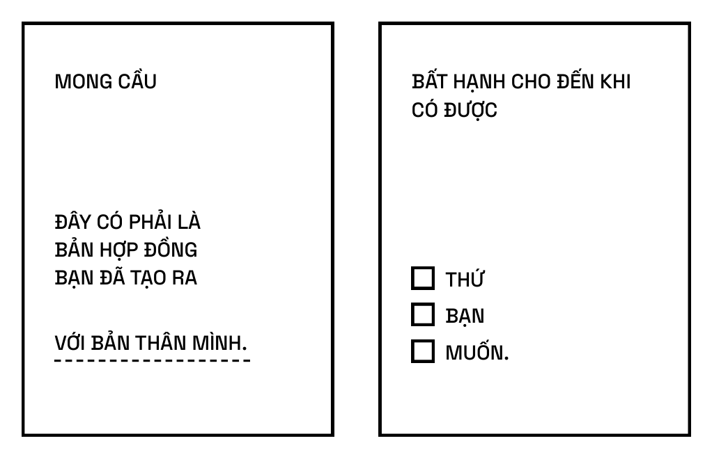
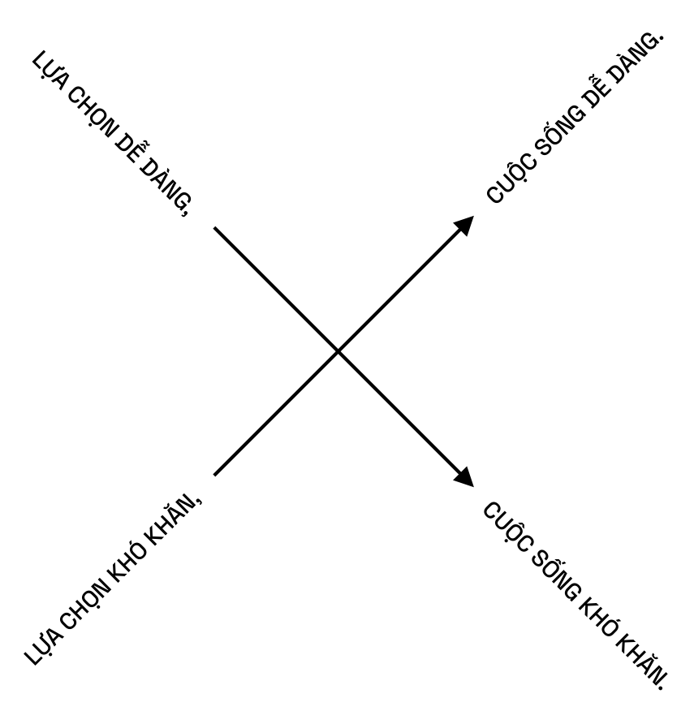

# PHẦN II HẠNH PHÚC

> Ba mục tiêu lớn trong cuộc đời là tiền bạc, sức khỏe và hạnh phúc. Ta theo đuổi chúng theo thứ tự đó, nhưng tầm quan trọng của chúng thì theo thứ tự ngược lại.

# HỌC VỀ HẠNH PHÚC

> Đừng quá coi trọng bản thân. Bạn chỉ là một con khỉ có kế hoạch.

## HẠNH PHÚC LÀ THỨ CÓ THỂ HỌC ĐƯỢC

Mười năm trước, nếu bạn hỏi tôi như thế nào là hạnh phúc, tôi sẽ bỏ qua câu hỏi đó. Tôi không hề muốn nói về nó.

Nếu chấm điểm hạnh phúc trên thang điểm từ 1 đến 10, thì tôi được 3 trên 10, hoặc sẽ được 4 trên 10 vào những ngày tôi cảm thấy tuyệt vời nhất. Nhưng tôi không coi hạnh phúc là điều quá quan trọng.

Hôm nay, tôi đang hạnh phúc 9 trên 10. Và đúng vậy, tiền sẽ đem lại hạnh phúc, nhưng chỉ là một phần rất nhỏ. Sau nhiều năm, tôi đã học và hiểu được rằng hạnh phúc của bản thân là điều quan trọng nhất, tôi đã trau dồi nó bằng rất nhiều phương pháp. [10]

> Hạnh phúc không phải là thứ bạn được thừa hưởng hay thậm chí chọn lựa mà là một kỹ năng mềm có thể tự học, giống như thể hình hoặc dinh dưỡng.

Tôi nghĩ, giống như những câu hỏi kinh điển, hạnh phúc là điều gì đó phức tạp. Khi còn là một đứa trẻ, bạn hay hỏi mẹ: “Điều gì sẽ xảy ra khi chúng ta chết? Ông già Noel có thật không? Chúa có thực sự tồn tại? Con có nên hạnh phúc không? Con nên kết hôn với ai?” Những câu hỏi kiểu như vậy. Sẽ không có câu trả lời vì sẽ không có đáp án nào đúng với tất cả mọi người. Những kiểu câu hỏi này cuối cùng rồi cũng có câu trả lời, nhưng đó là câu trả lời riêng cho từng người.

Câu trả lời phù hợp với tôi sẽ là vô nghĩa với bạn và ngược lại. Ý nghĩa của hạnh phúc với mỗi người là khác nhau. Theo tôi, điều quan trọng nhất vẫn là khám phá được những định nghĩa này thực sự là gì.

Đối với vài người tôi biết, hạnh phúc là trạng thái dòng chảy. Với một vài người khác, đó là sự thoả mãn. Với một vài người khác nữa, đó là cảm giác hài lòng. Định nghĩa về hạnh phúc tiếp tục được phát triển. Câu trả lời tôi đưa cho bạn một năm trước có thể khác với những gì tôi nói với bạn bây giờ.

Ở thời điểm hiện tại, tôi tin hạnh phúc thực sự là một trạng thái mặc định. Hạnh phúc hiện diện khi bạn loại bỏ được cảm giác thiếu vắng điều gì đó trong cuộc sống của mình.

Chúng ta là những cỗ máy sinh tồn, tái tạo và có óc phán đoán cao. Chúng ta thường loanh quanh, luẩn quẩn với suy nghĩ “Tôi cần cái này” hay “Tôi cần cái kia”, chúng ta mắc kẹt trong cái bẫy của sự ham muốn. Hạnh phúc là trạng thái không khao khát bất kỳ thứ gì. Khi không còn khao khát, tâm trí bạn sẽ dừng lại, không còn lục tìm trong quá khứ hoặc lên kế hoạch cho tương lai để nuối tiếc hay hy vọng.

Trong sự thiếu vắng đó, tại một khoảnh khắc, bạn sẽ tìm thấy sự tĩnh lặng bên trong mình. Khi có sự tĩnh lặng bên trong, bạn sẽ cảm thấy mãn nguyện và hạnh phúc. Thoải mái đi, nếu như bạn không đồng tình với tôi. Bởi vì mỗi người sẽ có một quan điểm khác nhau.

Mọi người thường lầm tưởng hạnh phúc chỉ đơn thuần là những suy nghĩ và hành động tích cực. Khi càng đọc nhiều, càng học hỏi nhiều và càng trải nghiệm nhiều (tôi tự kiểm chứng điều này), tôi nhận ra mọi suy nghĩ tích cực về cơ bản đều chứa đựng bên trong nó một suy nghĩ tiêu cực. Đó là sự tương phản với điều gì đó tiêu cực. Đạo Đức Kinh (Tao Te Ching) đã đề cập vấn đề này rõ ràng hơn bao giờ hết, nhưng tất cả mọi thứ đều có tính hai mặt và phân cực. Nếu tôi nói tôi hạnh phúc, điều đó cũng đồng nghĩa với việc ở một thời điểm nào đó tôi đã từng không hạnh phúc. Nếu tôi nói anh ấy hấp dẫn, nghĩa là một ai đó khác sẽ không hấp dẫn. Thậm chí bên trong mọi suy nghĩ tích cực đều có mầm mống của một suy nghĩ tiêu cực và ngược lại, đó là lý do tại sao rất nhiều điều tuyệt vời trong cuộc sống lại đến từ đau khổ. Bạn phải nhìn nhận điều tiêu cực trước khi có thể khao khát và đánh giá cao điều tích cực.

Đối với tôi, hạnh phúc không chỉ đơn thuần là những suy nghĩ lạc quan. Cũng không chỉ là tránh né những suy nghĩ tiêu cực. Hạnh phúc là sự vắng mặt của những ham muốn, đặc biệt là thiếu vắng ham muốn đối với những yếu tố ngoại cảnh. Càng có ít ham muốn, tôi càng dễ dàng chấp nhận mọi thứ, tâm trí của tôi càng ít chuyển động, bởi vì tâm trí chúng ta sẽ luôn chuyển động về tương lai hoặc quá khứ. Càng sống ở hiện tại, tôi sẽ càng hạnh phúc và trọn vẹn hơn. Nếu tôi liên tục bám vào một thứ cảm giác, nếu tôi nói “Ồ, tôi đang cảm thấy hạnh phúc”, và tôi muốn hạnh phúc mãi, thì tôi sẽ đánh mất hạnh phúc đó. Rồi tự dưng, tâm trí tôi lại chuyển động. Nó cố gắng tìm ra một thứ để bám vào. Nó đang cố gắng tạo ra một trạng thái vĩnh viễn một trạng thái tạm thời. Hạnh phúc đối với tôi là không có khổ đau, không có ham muốn, không suy nghĩ quá nhiều về tương lai hay quá khứ, thật sự nắm trọn giây phút hiện tại, những gì đang diễn ra trong thực tế và cách vận hành của chúng. [4]

> Nếu bạn muốn có sự yên bình trong cuộc sống, bạn phải vượt lên trên điều thiện và điều ác.

Thiên nhiên không có khái niệm về hạnh phúc hay bất hạnh. Thiên nhiên tuân theo các quy luật toán học không thể bị phá vỡ và một chuỗi nhân quả từ vụ nổ Big Bang cho đến nay. Tất cả mọi thứ đều hoàn hảo đúng theo cách riêng của nó. Chúng ta không vui hay không hạnh phúc là bởi tâm trí riêng biệt của mỗi chúng ta, và mọi thứ hoàn hảo hay không hoàn hảo là do những gì chúng ta mong cầu. [4]

Thế giới chỉ phản ánh cảm xúc của chính bạn. Hiện thực là trung lập. Hiện thực không có phán xét. Đối với một cái cây, sẽ không có khái niệm đúng hay sai, tốt hay xấu. Bạn được sinh ra, bạn có đầy đủ các trải nghiệm và kích thích giác quan (ánh sáng, màu sắc và âm thanh), và rồi bạn chết đi. Bạn chọn diễn giải chúng như thế nào là tùy thuộc vào bạn – bạn có quyền lựa chọn đó.

Đây là điều tôi muốn ám chỉ khi nói rằng hạnh phúc là một lựa chọn. Nếu bạn tin vào điều ấy, hãy bắt đầu trau dồi hạnh phúc. [77]

> Không yếu tố ngoại cảnh nào có thể ảnh hưởng đến cảm xúc của bạn nhiều như chính bản thân thứ cảm xúc ấy.

Tôi cũng bắt đầu tin vào sự vô nghĩa tuyệt đối của bản ngã, và tôi nghĩ niềm tin này vô cùng hữu ích. Ví dụ, nếu bạn nghĩ rằng bạn là nhân vật quan trọng nhất vũ trụ, bạn sẽ phải bẻ cong toàn bộ vũ trụ theo ý muốn của mình. Nếu bạn quan trọng nhất trong vũ trụ, hà cớ gì nó lại không thể khớp với những mong muốn của bạn. Nếu vũ trụ đang không tuân theo mong muốn của bạn, chắc chắn có điều gì đó không đúng.

Tuy nhiên, nếu bạn chỉ coi mình là một con vi khuẩn hoặc một con amip – hay xem tất cả các thành tựu của mình đều là viết trên mặt nước hoặc xây lâu đài trên cát, thì bạn sẽ không có kỳ vọng về một cuộc sống “thực sự” nên trông thế nào. Cuộc sống chỉ đơn giản là chính nó. Khi bạn chấp nhận điều đó, bạn không có lý do gì để cảm thấy hạnh phúc hay bất hạnh. Tất cả những điều này đều vô nghĩa.

> Hạnh phúc là những gì hiện diện khi bạn loại bỏ cảm giác thiếu thốn trong cuộc sống của mình.

Những gì sót lại trong trạng thái trung lập không hoàn toàn có tính trung lập. Tôi nghĩ mọi người thường tin rằng tính trung lập là sự tồn tại vô nghĩa. Điều này hoàn toàn không đúng, vì đây là cách sống của những đứa trẻ. Hãy nhìn nhận mọi thứ thật khách quan, nếu bạn quan sát những đứa trẻ, nhìn chung chúng khá hạnh phúc vì chúng thực sự đắm chìm vào môi trường sống và khoảnh khắc hiện tại, mà không hề có chút đắn đo về việc mọi thứ nên diễn ra như thế nào để có thể đáp ứng được sở thích hay mong muốn cá nhân của chúng. Tôi nghĩ rằng trạng thái trung lập thực sự là một trạng thái hoàn hảo. Con người có thể thật sự rất hạnh phúc miễn là họ không quá bận tâm tới những gì diễn ra trong đầu mình. [4]

Cuộc sống của chúng ta như ánh sáng lấp lánh của đom đóm trong đêm. Bạn chỉ là một sự thoáng qua tại nơi đây. Bạn phải tận dụng tối đa từng phút giây, không có nghĩa là bạn phải đuổi theo một mong ước ngu ngốc suốt cả đời. Điều đó nghĩa là mỗi giây bạn sống trên hành tinh này đều vô cùng quý giá và trách nhiệm của bạn là đảm bảo rằng mình đang vô cùng hạnh phúc và thể hiện mọi thứ theo cách tốt nhất có thể. [9]

> Chúng ta nghĩ bản thân mình cố định và thế giới thì dễ uốn nắn, nhưng thực ra chính chúng ta mới là người dễ uốn nắn và thế giới phần lớn là cố định.

**Liệu thiền có thể giúp ông chấp nhận hiện thực không?**

À có chứ, nhưng thật ngạc nhiên là rất ít [cười]. Bạn có thể là một người hành thiền lâu năm, nhưng nếu ai đó nói điều gì sai trái theo một cách sai trái, bạn sẽ quay về với bản ngã của mình. Điều này gần giống như bạn đang nâng quả tạ một pound1, nhưng ai đó lại thả một quả tạ khổng lồ với một chồng bánh tạ lên đầu bạn.

Thiền tất nhiên là tốt hơn so với không làm gì cả. Nhưng khi đau khổ về tinh thần thực sự xảy ra, thiền chưa bao giờ là dễ dàng. [8] Hạnh phúc chỉ đến như một tác dụng phụ của sự bình yên. Phần lớn hạnh phúc sẽ đến từ sự chấp nhận, không phải từ việc thay đổi môi trường bên ngoài của bạn. [8]

> Một người lý trí có thể tìm thấy bình yên bằng cách nuôi dưỡng sự bàng quan với những thứ nằm ngoài tầm kiểm soát của họ.

Tôi đã hạ thấp bản ngã của mình.

Tôi đã giảm thiểu sự luyên thuyên trong tâm trí.

Tôi không bận tâm đến những thứ không thực sự quan trọng.

Tôi không tham gia vào chính trị.

Tôi không giao lưu với những người không hạnh phúc.

Tôi thực sự coi trọng thời gian của mình trên Trái đất.

Tôi đọc triết học.

Tôi thiền.

Tôi giao lưu với những người hạnh phúc.

Và điều đó đã thật sự có tác dụng.

Bạn có thể cải thiện tần số hạnh phúc của bản thân một cách chậm rãi nhưng đều đặn và có phương pháp, tương tự như cách bạn cải thiện thể lực của mình vậy. [10]

## HẠNH PHÚC LÀ MỘT LỰA CHỌN

> Hạnh phúc, tình yêu và đam mê,… không phải là những thứ bạn có thể tìm thấy – chúng là những lựa chọn mà bạn tự quyết định.

Hạnh phúc là một lựa chọn bạn đưa ra và là một kỹ năng bạn phát triển.

Tâm trí cũng dễ uốn nắn như cơ thể. Chúng ta dành rất nhiều thời gian và nỗ lực để cố gắng thay đổi thế giới bên ngoài, những người khác và cơ thể của chính mình – tất cả mọi thứ, trong khi lại chấp nhận bản thân theo cách mà chúng ta đã được lập trình từ khi còn nhỏ.

Chúng ta chấp nhận tiếng nói trong đầu là cội nguồn của mọi sự thật. Nhưng thực chất tất cả đều có thể thay đổi, mỗi ngày lại là một ngày mới. Ký ức và bản ngã là gánh nặng từ quá khứ ngăn cản chúng ta sống tự do trong hiện tại. [3]

## HẠNH PHÚC ĐÒI HỎI SỰ HIỆN DIỆN

Tại bất kỳ thời điểm nào, khi bạn đi dạo trên phố, chỉ có một phần rất nhỏ của não bộ đang tập trung vào hiện tại. Phần còn lại là hoạch định tương lai hoặc nuối tiếc quá khứ. Điều này khiến bạn không thể có được những trải nghiệm đáng kinh ngạc. Điều này đã cản trở bạn nhìn thấy vẻ đẹp đang hiện diện ở khắp mọi nơi trong cuộc sống và biết ơn nơi bạn đang sống. Bạn thực sự có thể phá hủy hạnh phúc của mình nếu như dành toàn bộ thời gian chỉ để sống trong ảo tưởng về tương lai. [4]

> Chúng ta khao khát những trải nghiệm khiến chúng ta sống trong hiện tại, nhưng chính những khoảnh khắc đó lại khiến chúng ta xa rời hiện tại.

Tôi chỉ là không tin vào bất cứ điều gì trong quá khứ của tôi. Bất kể điều gì. Không ký ức. Không hối tiếc. Không một ai. Không chuyến đi. Không gì cả. Rất nhiều bất hạnh của chúng ta đến từ việc so sánh những thứ trong quá khứ với hiện tại. [4]

> Sự tò mò về những thói hư tật xấu lôi kéo chúng ta về phía tương lai. Loại bỏ những thói hư tật xấu sẽ khiến cho việc hiện diện ở thực tại dễ dàng hơn.

Tôi đã đọc được một định nghĩa rất hay: “Giác ngộ là khoảng không giữa những suy nghĩ của bạn”. Điều này có nghĩa là sự giác ngộ không phải là điều bạn đạt được sau ba mươi năm ngồi trên đỉnh núi. Đó là điều bạn có thể có được trong từng khoảnh khắc, và bạn có thể giác ngộ đến 1% mỗi ngày. [5]

> Điều gì sẽ xảy ra nếu như cuộc sống này chính là thiên đường mà chúng ta được hứa hẹn, và chúng ta chỉ đang phung phí nó?

## HẠNH PHÚC ĐÒI HỎI SỰ BÌNH YÊN

**Liệu hạnh phúc và mục đích sống có liên hệ với nhau?**

Hạnh phúc là một từ đã bị lạm dụng nhiều đến mức tôi không còn chắc chắn nó có nghĩa là gì nữa. Đối với tôi thời gian này, hạnh phúc thiên về bình yên nhiều hơn là niềm vui. Tôi không nghĩ rằng sự bình yên và mục đích sống sẽ song hành với nhau.

Nếu đó là mục đích nội tại của bạn, là điều bạn muốn làm nhất, chắc chắn bạn sẽ rất hạnh phúc khi thực hiện nó. Nhưng nếu đó là mục đích bị áp đặt bởi ngoại cảnh, như “Xã hội muốn tôi làm việc X”, “Tôi là con trai đầu lòng của người con trai cả trong gia đình này, vì vậy tôi nên làm việc Y”, hoặc “Tôi phải gánh một món nợ”, tôi không nghĩ nó sẽ làm bạn hạnh phúc.

Tôi nghĩ rằng rất nhiều người trong chúng ta có cảm giác lo lắng lan toả này ở mức độ nhẹ. Nếu để ý đến tâm trí của mình, bạn sẽ thấy đôi lúc bạn chỉ đang quanh quẩn làm việc của mình và bắt đầu cảm thấy không ổn, rồi bạn cảm thấy tâm trí cứ đang huyên thuyên, huyên thuyên về điều gì đó. Bạn không thể ngồi yên. Có một thứ được gọi là “điều tiếp theo” trong tâm trí khiến bạn tuy đang ngồi một chỗ nhưng phải suy nghĩ xem mình nên ở đâu tiếp theo.

Sẽ luôn luôn là điều tiếp theo, rồi điều tiếp theo, điều tiếp theo sau đó, rồi điều tiếp theo sau đó, chính những điều ấy tạo ra sự lo lắng lan toả này.

Cảm giác ấy rõ ràng nhất khi bạn chỉ ngồi xuống và cố gắng không làm gì, không một điều gì. Ý của tôi là thực sự không làm gì cả, không đọc sách, không nghe nhạc, chỉ cần ngồi xuống và không làm gì. Bạn không thể làm được điều đó, bởi vì sự lo lắng luôn cố gắng bắt bạn đứng dậy và đi, đứng dậy và đi, đứng dậy và đi. Tôi nghĩ điều quan trọng chính là nhận thức được sự lo lắng đang khiến bạn không hạnh phúc. Lo lắng chỉ là một loạt các suy nghĩ liên tục.

Cách tôi đối phó với lo lắng là: Tôi không cố gắng chống lại nó, tôi chỉ nhận ra mình đang lo lắng vì những suy nghĩ này. Tôi cố gắng tìm hiểu xem, “Liệu tôi có muốn suy nghĩ ngay lúc này, hay tôi muốn có sự bình yên?” Bởi vì chừng nào tôi còn những suy nghĩ này, tôi không thể bình yên.

Bạn sẽ thấy khi tôi nói đến hạnh phúc, ý của tôi là bình yên. Khi nhiều người khác nói về hạnh phúc, ý của họ là niềm hân hoan hay vui sướng, nhưng tôi sẽ chọn bình yên. [2]

> Một người hạnh phúc không phải là người lúc nào cũng vui vẻ.  
> Đó là người không cần phải cố gắng để diễn giải mọi vấn đề sao cho không đánh mất sự bình yên bẩm sinh bên trong mình.

## MỌI MONG CẦU ĐỀU LÀ MỘT SỰ BẤT HẠNH ĐƯỢC CHỌN LỰA

Tôi nghĩ sai lầm phổ biến nhất của nhân loại là tin rằng bạn sẽ trở nên hạnh phúc nhờ một số điều kiện ngoại cảnh. Điều này không mới và không phải do tôi đúc kết. Nó xuất phát từ trí tuệ nền tảng của Phật giáo. Kể cả bản thân tôi, tôi mới chỉ giác ngộ được điều này ở mức độ cơ bản.

Chúng tôi mua một chiếc ô tô mới. Bây giờ, tôi đang đợi chiếc xe mới đó đến. Tất nhiên rồi, mỗi tối, tôi đều lên các diễn đàn đọc về xe hơi. Tại sao lại thế nhỉ? Thật ngớ ngẩn. Chiếc ô tô này thật ngớ ngẩn. Nó không thể làm thay đổi cuộc sống của tôi. Tôi biết ngay khi nó đến, tôi sẽ không còn quan tâm đến nó nữa. Vấn đề là, tôi nghiện sự mong cầu. Tôi nghiện cái ý tưởng rằng thứ bên ngoài này sẽ mang lại cho tôi một loại hạnh phúc và niềm vui nào đó. Và điều này hoàn toàn là ảo tưởng.

Việc tìm kiếm bất cứ điều gì bên ngoài bản thân bạn là một ảo tưởng căn bản. Ý của tôi không phải là bạn nên ngắt kết nối với cuộc sống bên ngoài. Bạn vẫn cần phải làm thế. Bạn là một sinh vật sống. Có những thứ bạn buộc phải làm với bên ngoài. Bạn sẽ dần đảo ngược “sự hỗn loạn trong hệ thống” (entropy) ở mức cục bộ. Đó là lý do tại sao bạn ở đây.

Bạn được an bài để làm một điều gì đó. Bạn không được an bài chỉ để nằm dài trên bãi cát và thiền cả ngày dài. Bạn nên tự hiện thực hoá lý tưởng của bản thân. Bạn cần làm những gì bạn được an bài để làm.

Suy nghĩ rằng thay đổi thứ gì đó ở thế giới bên ngoài sẽ mang đến cho bạn sự bình yên, niềm vui vĩnh viễn và niềm hạnh phúc mà bạn xứng đáng được hưởng, là một ảo tưởng căn bản mà tất cả chúng ta đều đang phải hứng chịu, bao gồm cả tôi. Một sai lầm cứ lặp đi lặp lại là nghĩ rằng: “Ồ, tôi sẽ hạnh phúc khi có được thứ đó”, dù thứ đó là gì đi chăng nữa. Đây là sai lầm căn bản mà chúng ta đều mắc phải, 24/7, suốt cả ngày dài. [4]

> Ảo tưởng căn bản: Có một thứ gì đó ngoài kia sẽ làm bạn hạnh phúc và thỏa mãn bạn mãi mãi.

Sự mong cầu là một bản hợp đồng bạn tạo ra với chính bản thân để được hạnh phúc cho đến khi có được thứ bạn muốn. Tôi nghĩ hầu hết chúng ta không nhận ra điều đó là gì. Tôi nghĩ chúng ta mong cầu rất nhiều điều trong một ngày và sau đó lại tự hỏi tại sao chúng ta không hạnh phúc. Tôi luôn muốn nhận thức được điều này, bởi vì sau đó tôi có thể lựa chọn mong cầu của mình thật thận trọng. Tôi cố gắng để không có nhiều hơn một mong cầu lớn tại bất kỳ thời điểm nào trong đời. Tôi cũng nhìn nhận được nó là tâm điểm của sự đau khổ trong tôi, khiến tôi không hạnh phúc. [5]

> Sự mong cầu là một bản hợp đồng bạn tạo ra với chính bản thân để được hạnh phúc cho đến khi có được thứ bạn muốn.

Gần đây tôi đã học được một điều: Việc hoàn thiện mong cầu của bạn quan trọng hơn rất nhiều so với việc cố gắng làm điều bạn không có 100% sự mong cầu. [1]

Khi bạn còn trẻ và khỏe, bạn có thể làm được nhiều việc hơn, bạn sẽ phải gánh vác nhiều mong cầu hơn. Bạn không hề nhận ra điều này đang từ từ phá huỷ hạnh phúc của bạn. Tôi nhận thấy những người trẻ tuổi hơn thì kém hạnh phúc hơn nhưng lại khỏe mạnh hơn. Những người lớn tuổi thì ngược lại.

Khi bạn còn trẻ, bạn có thời gian. Bạn có sức khoẻ, nhưng bạn không có tiền. Khi bạn ở tuổi trung niên, bạn có tiền và bạn có sức khoẻ, nhưng bạn không có thời gian. Khi bạn già đi, bạn có tiền và thời gian, nhưng bạn không có sức khoẻ. Vì vậy, cố gắng có cả ba điều cùng lúc là một sự đặt cược.

Khi thời gian trôi qua, mọi người sẽ nhận ra họ có đủ tiền bạc, nhưng họ đã đánh mất thời gian và cả sức khoẻ của mình. [8]

## THÀNH CÔNG KHÔNG TẠO NÊN HẠNH PHÚC

> Hạnh phúc là cảm thấy hài lòng với những gì bạn có.  
> Thành công đến từ sự không hài lòng. Hãy lựa chọn.

**Khổng Tử nói rằng bạn có hai cuộc đời, và cuộc đời thứ hai** **bắt đầu khi bạn nhận ra bạn chỉ có duy nhất một cuộc đời.** **Từ khi nào và làm thế nào cuộc đời thứ hai của ông thực sự** **bắt đầu?**

Đây là câu hỏi sâu sắc. Nhiều người khi đến một độ tuổi nhất định sẽ gặp phải tình trạng sau: Họ sống cả đời theo một cách nhất định và đạt được cột mốc nào đó, rồi bị buộc phải thay đổi. Tôi chắc chắn mình cũng từng trải qua giai đoạn như vậy.

Trong suốt cuộc đời, tôi đã đấu tranh rất nhiều để đạt những thành công nhất định về cả vật chất lẫn xã hội. Khi có được những thứ đó (hoặc ít nhất là khi tôi cảm thấy chúng không còn quan trọng nữa), tôi nhận ra những người xung quanh tôi, những người cũng đạt được thành công tương tự và đang trên đà thành công hơn nữa, dường như đều không hạnh phúc đến vậy. Trong trường hợp của tôi, chắc chắn tình trạng thích ứng khoái lạc đã xảy ra: Tôi nhanh chóng làm quen với mọi thứ.

Điều này dẫn tôi đến một kết luận, nghe khá nhàm chán: Hạnh phúc xuất phát từ nội tại. Kết luận này vẽ ra cho tôi một hướng đi: Kết nối nhiều hơn với đứa trẻ bên trong mình và chấp nhận rằng mọi thành công đích thực bắt nguồn từ nội tại và rất ít liên hệ với các điều kiện ngoại cảnh.

Thế nhưng mọi người đều phải ra ngoài làm việc, giao lưu. Chúng ta vốn đã được cài đặt về mặt sinh học như vậy. Sẽ quá dễ dàng khi nói rằng: “Bạn chỉ cần tắt cơ chế ấy đi”. Chính kinh nghiệm sống sẽ mang bạn trở lại với con đường nội tại. [7]

> Vấn đề khi giỏi một trò chơi, đặc biệt với trò chơi có phần thưởng lớn, là bạn vẫn sẽ bị cuốn vào trò chơi đó trong một thời gian dài mà đáng lẽ ra bạn phải tiến lên một cấp độ cao hơn.  
> Động lực sinh tồn và nhân rộng đã đẩy chúng ta vào những guồng quay. Sự thích ứng khoái lạc giữ chân chúng ta ở đó. Bí quyết là hãy biết khi nào nên nhảy ra ngoài vui chơi thay vì làm việc.

**Ông cho rằng ai sẽ là người thành công?**

Hầu hết mọi người đều cho rằng một ai đó được coi là thành công khi họ chiến thắng một trò chơi, bất kể là họ đang tham gia trò chơi nào. Nếu bạn là một vận động viên, bạn sẽ luôn nghĩ tới vận động viên hàng đầu. Nếu bạn ở lĩnh vực kinh doanh, bạn có thể sẽ nghĩ tới Elon Musk.

Một vài năm trước, nếu được hỏi câu hỏi này, tôi sẽ trả lời là Steve Jobs vì ông ấy là một trong những nhân tố quan trọng trên hành trình tạo ra một thứ đã làm thay đổi cuộc sống của toàn nhân loại. Tôi nghĩ rằng Marc Andreessen cũng thành công, không chỉ vì gần đây ông ấy xuất hiện với vai trò một nhà đầu tư mạo hiểm, mà còn vì thành quả đáng kinh ngạc ông đạt được với Netscape. Satoshi Nakamoto cũng là một người thành công, ông đã tạo ra Bitcoin, đây là một sáng tạo công nghệ đáng kinh ngạc có hệ quả vang vọng tới nhiều thập kỷ sắp tới. Và tất nhiên là Elon Musk, bởi ông ấy đã thay đổi quan điểm của mọi người về những gì khả dĩ với công nghệ hiện đại và tinh thần khởi nghiệp. Tôi đánh giá những nhà sáng tạo và thương mại hoá sản phẩm này là những người thành công.

Theo tôi, những người chiến thắng thực sự là những người đã hoàn toàn bước ra khỏi trò chơi, những người thậm chí không tham gia chơi, những người đã vượt lên trên trò chơi. Đó là những người có nội tâm, tự kiểm soát và nhận thức về bản thân, họ không cần bất cứ điều gì từ những người khác. Tôi biết một vài kiểu người như vậy trong cuộc đời mình. Jerzy Gregorek – tôi coi ông ấy là một người thành công vì ông ấy không cần bất kỳ thứ gì từ bất cứ người nào. Ông ấy ở trong trạng thái bình yên, ông ấy khỏe mạnh, và dẫu cho ông ấy có kiếm được nhiều hay ít tiền hơn so với người kề cạnh thì trạng thái tinh thần của ông ấy cũng chẳng hề hấn gì.

Về lịch sử, tôi sẽ nói đó là Đức Phật hay Krishnamurti huyền thoại, những người có các tác phẩm tôi yêu thích. Họ đều thành công theo nghĩa họ đã hoàn toàn bước ra khỏi trò chơi. Thắng hay thua đã không còn quan trọng với họ.

Tôi đã đọc được một câu từ Blaise Pascal, đại để thế này: “Tất cả mọi rắc rối của con người phát sinh chỉ bởi vì chúng ta không thể ngồi im lặng một mình trong phòng”. Nếu bạn có thể chỉ ngồi 30 phút và cảm thấy hạnh phúc, bạn đã thành công rồi. Đó là một nơi chốn quyền năng, nhưng rất ít người trong số chúng ta đến được đó. [6]

Tôi nghĩ hạnh phúc là một đặc tính hiển hiện từ sự bình yên. Nếu bạn bình yên từ trong ra ngoài, điều này sau cùng sẽ dẫn tới hạnh phúc. Nhưng trạng thái bình yên là một thứ rất khó để đạt được. Nói một cách mỉa mai thì hầu hết chúng ta đang cố gắng tìm kiếm sự bình yên thông qua chiến tranh. Khi bạn thành lập một doanh nghiệp, theo một cách nào đó, bạn đang khơi mào một cuộc chiến. Khi bạn đấu tranh với bạn cùng phòng xem ai sẽ là người rửa bát đĩa, bạn đang tham gia vào một cuộc chiến. Bạn đang đấu tranh để có được cảm giác an toàn và bình yên trong tương lai.

Trên thực tế, bình yên không phải là một sự bảo đảm. Nó luôn chảy trôi. Nó luôn thay đổi. Bạn cần học bộ kỹ năng cốt lõi về việc thả trôi theo cuộc sống và chấp nhận nó trong hầu hết các tình huống. [8]

> Bạn có thể đạt được hầu hết mọi thứ bạn mong muốn trong đời, miễn đó chỉ là một thứ và bạn mong muốn nó nhiều hơn tất cả những thứ khác.

Dựa theo trải nghiệm cá nhân của tôi, nơi chốn mà tôi mong muốn đến nhất là nơi có sự bình yên.

Bình yên là hạnh phúc ở trạng thái tĩnh và hạnh phúc là bình yên ở trạng thái động. Bạn có thể chuyển đổi bình yên sang hạnh phúc bất cứ khi nào bạn muốn. Nhưng bình yên lại là điều bạn mong muốn hầu hết mọi lúc. Nếu bạn là một người bình yên, bất cứ thứ gì bạn làm đều là một hoạt động hạnh phúc.

Ngày nay, chúng ta nghĩ rằng cách để có được bình yên là giải quyết tất cả các vấn đề xuất phát từ ngoại cảnh. Nhưng sẽ có vô số những vấn đề ngoại cảnh. Cách duy nhất để thực sự có được bình yên nội tại là từ bỏ ý niệm về những vấn đề. [77]

## GHEN TỊ LÀ KẺ THÙ CỦA HẠNH PHÚC

Tôi không nghĩ cuộc sống khó khăn. Tôi nghĩ chính chúng ta đang làm cho nó trở nên khó khăn. Một trong những điều tôi đang cố gắng loại bỏ là từ “nên/cần”. Bất cứ khi nào từ “nên/cần” vang lên ngày càng nhiều trong đầu, đó dấu hiệu của tội lỗi hoặc một quy luật bất thành văn nào đó của xã hội. Làm một thứ gì đó chỉ vì bạn “nên/cần” về căn bản có nghĩa là bạn không thực sự muốn làm nó. Điều này chỉ làm cho bạn cảm thấy khổ sở, vì thế tôi đang cố gắng loại bỏ càng nhiều từ “nên/cần” nhất có thể khỏi cuộc sống của mình. [1]

> Kẻ thù của sự bình yên trong tâm trí là những kỳ vọng được nhồi nhét vào đầu bạn, đến từ xã hội và những người khác.

Ngoài xã hội, chúng ta được khuyên: “Hãy tập thể dục đi. Hãy trông thật xinh đẹp vào”. Đó là một trò chơi cạnh tranh có nhiều người tham gia. Những người khác có thể nhìn thấy liệu tôi có đang làm tốt việc của mình hay không. Chúng ta được khuyên: “Hãy đi kiếm tiền đi. Hãy mua một ngôi nhà thật to vào”.

Một lần nữa, đây vẫn là một trò chơi cạnh tranh với nhiều người tham gia. Việc rèn luyện bản thân để thực sự hạnh phúc hoàn toàn nằm ở nội tại. Không có bất kỳ sự phát triển và công nhận nào tới từ bên ngoài. Bạn chỉ cạnh tranh với chính bạn – đây là trò chơi dành cho một người.

Chúng ta giống như những chú ong, chú kiến. Chúng ta là những thực thể xã hội, chúng ta được lập trình và thúc đẩy từ bên ngoài. Chúng ta không còn biết cách chơi hay chiến thắng trong trò chơi chỉ có một người nữa. Chúng ta chỉ thực sự cạnh tranh ở những trò chơi có nhiều người tham gia.

Cuộc sống này thực chất là trò chơi dành cho một người. Khi sinh ra bạn đã một mình. Và rồi cũng sẽ chết đi một mình. Mọi quan điểm của bạn đều là của riêng bạn. Mọi ký ức của bạn đều là của riêng bạn. Kể cả khi bạn đã sống qua ba thế hệ, cũng sẽ chẳng có ai bận tâm. Trước khi bạn xuất hiện, chẳng có ai bận tâm. Con người đều là những người chơi đơn độc.

> Một trong những lý do khiến việc duy trì yoga và thiền rất khó là bởi chúng đều không chứa đựng giá trị bên ngoài. Chúng chỉ đơn thuần là những trò chơi cho một người.

**Buffett có một ví dụ rất tuyệt vời, ông ấy hỏi rằng liệu bạn** **sẽ muốn trở thành người tình tuyệt vời nhất thế gian nhưng** **lại là người tồi tệ nhất, hay trở thành người tình tồi tệ nhất** **nhưng lại là người giỏi nhất? [đã được diễn đạt lại] tham** **khảo thẻ điểm nội tâm và thẻ điểm bên ngoài****1****.**

Chính xác là vậy. Tất cả các đánh giá đều nên đến từ nội tại.

Đối với tôi, ghen tị là một cảm xúc rất khó vượt qua. Khi còn trẻ tôi có rất nhiều sự đố kị. Dần dần tôi đã học cách loại bỏ nó. Thi thoảng nó vẫn xuất hiện bất ngờ. Nó thực sự là một cảm xúc độc hại bởi vì cuối cùng, lòng đố kị không mang lại lợi ích gì cho bạn. Bạn không cảm thấy hạnh phúc hơn và người mà bạn cảm thấy ghen tị vẫn cứ thành công, vô cùng xinh đẹp hoặc cứ là họ thôi.

Rồi đến một ngày, tôi nhận ra trong những người tôi cảm thấy ghen tị, tôi không thể chỉ lựa chọn ghen tị với từng khía cạnh nhỏ trong cuộc sống của họ. Tôi không thể nói tôi muốn thể hình của anh ấy, tôi muốn tiền bạc của cô ấy, tôi muốn tính cách của ông ấy. Trên thực tế, bản thân bạn phải trở thành người đó. Bạn có muốn thực sự trở thành người đó với tất cả phản ứng, mong cầu, gia đình hay mức độ hạnh phúc, quan điểm của họ về cuộc sống và nhận thức về bản thân? Nếu bạn không sẵn lòng thực hiện một cuộc hoán đổi toàn diện, 24/7 với con người đó, thì không có lý nào lại phải ghen tị.

*(1)* *Thuật ngữ được phát minh bởi Warren Buffett: Thẻ điểm nội tâm là thước đo giá* *trị bản thân, mục tiêu sống, quá trình phát triển, thành quả, vật chất, hạnh phúc –* *của riêng một người đối với bản thân họ. Thẻ điểm bên ngoài, trái ngược thay, lại là* *một tấm thước đo dựa trên các chuẩn mực của xã hội.*

Khi nhận ra được điều ấy, sự ghen tị dần phai mờ vì tôi không muốn trở thành một người nào khác. Tôi hoàn toàn hạnh phúc với việc là chính mình. Nhân tiện, điều đó cũng nằm trong tầm kiểm soát của tôi. Hạnh phúc khi là chính mình. Chỉ có điều, sẽ không có phần thưởng xã hội nào cho điều đó. [4]

## HẠNH PHÚC ĐƯỢC XÂY DỰNG TỪ CÁC THÓI QUEN

Khám phá đáng kinh ngạc nhất của tôi trong vòng năm năm vừa qua chính là sự bình yên và hạnh phúc đều là các kỹ năng. Đó không phải những thứ bẩm sinh. Đúng là, vẫn có một vài phạm vi thuộc tính di truyền. Phần lớn điều này phụ thuộc vào môi trường sống của bạn, nhưng bạn có thể buông bỏ những ràng buộc này và tự thiết lập lại bản thân.

Bạn có thể gia tăng hạnh phúc của mình theo thời gian, bắt đầu bằng việc tin tưởng bản thân mình có thể làm được.

Đây là một kỹ năng. Cũng giống như hấp thụ chất dinh dưỡng là một kỹ năng, ăn kiêng là một kỹ năng, luyện tập là một kỹ năng, kiếm tiền là một kỹ năng, hẹn hò là một kỹ năng, có các mối quan hệ tốt là một kỹ năng, thậm chí yêu cũng là một kỹ năng. Hãy bắt đầu bằng việc nhìn nhận chúng là các kỹ năng bạn có thể học được. Khi bạn để tâm và tập trung vào chúng, thế giới sẽ trở thành một nơi tốt đẹp hơn.

> Khi làm việc, hãy ở xung quanh những người thành công hơn bạn.  
> Khi vui chơi, hãy ở xung quanh những người hạnh phúc hơn bạn.

**Loại kỹ năng nào là hạnh phúc?**

Tất cả đều sẽ là quá trình liên tục thử và mắc sai lầm. Rồi bạn sẽ nhìn ra đâu là thứ thật sự hiệu quả. Bạn có thể thử ngồi thiền. Điều đó có hiệu quả với bạn không? Liệu đó là thiền theo kiểu Tantra hay theo kiểu Vipassana? Liệu một chuyến tu dưỡng kéo dài mười ngày hay hai mươi phút là đủ?

Được rồi. Không có thứ nào là hiệu quả cả. Nhưng nếu tôi thử yoga thì sao? Nếu tôi lướt ván diều thì sao? Nếu tôi đua xe thì sao? Thế còn nấu ăn? Điều đó có làm tôi tĩnh tâm không? Trên thực tế bạn phải thử tất cả những điều này cho đến khi bạn tìm thấy thứ thực sự hiệu quả với bạn.

Khi nói tới phương thuốc cho tâm trí, giả dược có hiệu quả 100%. Khi nói tới tâm trí, bạn sẽ muốn có xu hướng tích cực chứ không phải hoài nghi trong niềm tin. Nếu điều này hoàn toàn đến từ nội tại, bạn nên có một tư duy tích cực.

Ví dụ, tôi đọc cuốn sách *Sức mạnh của Hiện tại (The Power of* *Now)* của tác giả Eckhart Tolle, đó là một lời giới thiệu tuyệt vời về trạng thái có mặt ở hiện tại, dành cho những người không theo tín ngưỡng nào cả. Ông ấy chỉ ra cho bạn rằng điều quan trọng duy nhất là có mặt ở hiện tại, hãy nhấn mạnh điều này hết lần này đến lần khác cho đến khi bạn thực sự hiểu.

Ông ấy cũng viết về bài tập rèn luyện năng lượng cơ thể. Bạn nằm xuống và cảm nhận năng lượng chuyển động trong cơ thể. Khi đọc về điều này, phiên bản cũ của tôi sẽ đặt cuốn sách xuống và nói: “Chà, thật vô nghĩa.” Nhưng phiên bản mới của tôi sẽ nói: “Chà, nếu tôi có niềm tin, có thể nó sẽ hiệu quả”. Tôi tiếp tục đi sâu vào điều đó với một tư duy tích cực. Tôi sẽ nằm xuống và cố gắng thiền. Bạn biết gì không? Điều đó thực sự rất tuyệt.

**Làm thế nào để một người xây dựng kỹ năng hạnh phúc?**

Bạn có thể xây dựng các thói quen tốt. Không sử dụng đồ uống có cồn sẽ giữ cho tâm trạng của bạn ổn định hơn. Không ăn đường sẽ giữ cho tâm trạng của bạn ổn định hơn. Không vào Facebook, Snapchat, hay Twitter sẽ giữ cho tâm trạng của bạn ổn định hơn. Chơi trò chơi điện tử sẽ khiến bạn hạnh phúc hơn trong thời gian ngắn, và tôi đã từng là một “game thủ” hừng hực đam mê, nhưng về lâu dài nó có thể huỷ hoại hạnh phúc của bạn. Bạn vừa được tiếp thêm dopamine nhưng cũng bị rút bớt dopamine1 khỏi cơ thể bằng những điều nhỏ nhặt không thể kiểm soát này. Caffeine cũng là thứ bạn đánh đổi lợi ích dài hạn vì lợi ích ngắn hạn.

Về cơ bản, bạn hãy thay thế những thói quen xấu thiếu suy nghĩ bằng những thói quen tốt và đặt ra cam kết trở thành một người hạnh phúc hơn. Suy cho cùng, bạn là sự kết hợp từ những thói quen của mình và những người bạn dành phần lớn thời gian ở bên .

Khi còn là những đứa trẻ, chúng ta có rất ít thói quen. Theo thời gian, chúng ta bắt đầu học những thứ chúng ta không nên làm.

Chúng ta dần có ý thức về bản thân. Chúng ta bắt đầu hình thành những sở thích và thói quen cho mình.

Có nhiều khác biệt giữa những người hạnh phúc hơn khi về già và những người không được như vậy. Điều này có thể được giải thích bằng những thói quen họ nuôi dưỡng. Liệu chúng có phải những thói quen gia tăng hạnh phúc dài hạn thay vì hạnh phúc ngắn hạn? Bạn có ở xung quanh những người tích cực và lạc quan? Những mối quan hệ đó liệu có thoải mái không? Bạn có ngưỡng mộ và tôn trọng họ, không hề đố kị với họ không?

Có một lý thuyết gọi là “Lý thuyết năm con tinh tinh”, bạn có thể dự đoán hành vi của một con tinh tinh thông qua năm con tinh tinh mà nó ở cùng nhiều nhất. Tôi nghĩ điều này cũng áp dụng với con người. Có thể sẽ không chính xác khi nói bạn nên chọn bạn mà chơi một cách thật thận trọng. Nhưng bạn cũng không nên chọn một cách tình cờ, chỉ dựa vào ai là người hàng xóm kế bên, hay ai là người ngẫu nhiên làm việc với bạn. Những người hạnh phúc và lạc quan nhất sẽ lựa chọn năm con tinh tinh phù hợp. [8]

Quy tắc đầu tiên để xử lý xung đột là: Đừng giao thiệp với những người bạn thường hay vướng phải xung đột. Tôi không hề có hứng thú với những thứ không bền vững hoặc thậm chí khó duy trì, bao gồm cả những mối quan hệ phức tạp. [5]

> Nếu bạn cảm thấy không thể làm việc cùng một ai đó cả đời, đừng làm việc với họ dù chỉ một ngày.

Tôi có một người bạn Ba Tư tên là Behzad. Anh ấy yêu đời, và anh ấy không có thời gian cho những người không hạnh phúc.

Nếu bạn hỏi Behzad bí quyết của anh ấy là gì? Anh ấy sẽ chỉ ngước mắt lên và trả lời, “Đừng hỏi tại sao và hãy bắt đầu nói ‘Quào’”. Thế giới là một nơi thật tuyệt vời. Là con người, chúng ta thường coi mọi thứ như điều hiển nhiên. Giống như những gì bạn và tôi đang làm ngay bây giờ. Chúng ta đang ngồi trong nhà, mặc quần áo, ăn uống đầy đủ, và giao tiếp với nhau xuyên không gian và thời gian. Ngay lúc này, chúng ta đáng lẽ ra phải là hai chú khỉ đang ngồi trong rừng và ngắm mặt trời lặn, rồi tự hỏi bản thân chúng ta sẽ ngủ ở đâu đây.

Khi chúng ta có được điều gì đó, chúng ta nghĩ thế giới nợ chúng ta điều đó. Nếu bạn đang sống trong hiện tại, bạn sẽ nhận ra xung quanh ta có biết bao món quà và sự đủ đầy. Đó là tất cả những gì bạn cần nhìn thấy. Tôi đang ở đây, và tôi có sẵn tất cả những điều tuyệt diệu này để sử dụng. [8]

Một mẹo quan trọng để cảm thấy hạnh phúc là nhận ra hạnh phúc là kỹ năng bạn có thể phát triển, là quyết định bạn có thể lựa chọn. Bạn chọn hạnh phúc, và sau đó bạn thực sự hạnh phúc. Việc này giống như phát triển cơ bắp, giống như giảm cân, giống như học giải tích và cũng giống như đạt được thành công trong công việc.

Bạn quyết định đây là việc quan trọng với bạn. Bạn ưu tiên nó trên tất cả những thứ khác. Bạn đọc mọi thứ về chủ đề này. [7]

**CÁC THÓI QUEN HẠNH PHÚC**

Tôi có một loạt các mẹo mà tôi đã thử để hạnh phúc hơn ở hiện tại. Ban đầu, chúng khá ngu ngốc và khó thực hiện, đồng thời cần rất nhiều sự chú tâm, nhưng giờ đây, một vài mẹo đã trở thành thói quen. Bằng cách thực hiện chúng nhất quán và đều đặn, tôi đã thành công trong việc gia tăng mức độ hạnh phúc.

Hiển nhiên mẹo đầu tiên chính là thiền – thiền tuệ. Hãy hướng tới mục đích cụ thể của việc thiền, đó là thử và hiểu cách thức hoạt động của tâm trí. [7]

Hãy thực sự tỉnh thức trong từng khoảnh khắc. Nếu tôi phát hiện mình đang đánh giá một người, tôi có thể ngăn bản thân lại và nói: “Làm thế nào để diễn giải điều này theo cách tích cực nhất?”. Tôi từng cảm thấy khó chịu về nhiều thứ. Giờ đây, tôi luôn tìm kiếm mặt tích cực của vấn đề. Cần phải nỗ lực để thực hiện điều này. Tôi từng mất một vài giây để nghĩ ra được một điều tích cực. Giờ đây, tôi có thể làm điều đó chỉ trong vòng dưới một giây. [7]

Tôi cố gắng đón lấy thật nhiều ánh nắng mặt trời. Nhìn lên trời và mỉm cười. [7]

Mỗi khi bạn nhận ra mình đang mong cầu điều gì đó, hãy nói: “Liệu điều này có quan trọng đến mức tôi sẽ không hạnh phúc nếu nó không diễn ra theo ý tôi?” Rồi bạn sẽ nhận ra, phần lớn mọi thứ đều không phải như thế.

Tôi nghĩ việc từ bỏ caffeine làm cho tôi hạnh phúc hơn và giúp tôi trở thành một người ổn định hơn. [7]

Tôi nghĩ việc tập luyện hàng ngày cũng làm cho tôi hạnh phúc hơn. Nếu bạn có được sự bình yên từ cơ thể, thì việc có được sự bình yên trong tâm trí sẽ dễ dàng hơn. [7]

Bạn đánh giá càng nhiều, bạn càng chia tách bản thân. Bạn sẽ cảm thấy ổn trong phút chốc, bạn tự tin vào bản thân và tưởng mình đang tốt đẹp hơn người khác. Nhưng sau đó, bạn sẽ cảm thấy cô độc. Tiếp đến, bạn nhìn thấy sự tiêu cực ở khắp mọi nơi. Thế giới sẽ phản chiếu lại chính những cảm xúc của bạn. [77] Hãy nói với bạn bè, bạn là người hạnh phúc. Sau đó, bạn sẽ buộc phải tuân thủ điều đó. Bạn sẽ có một thiên kiến nhất quán. Bạn phải sống với ý niệm rằng bạn là một người hạnh phúc. Bạn bè sẽ kỳ vọng bạn là một người hạnh phúc. [5]

Hãy giành lại thời gian và trở nên hạnh phúc bằng cách giảm thiểu việc sử dụng ba ứng dụng trên điện thoại thông minh: gọi điện, lịch, và báo thức. [11]

Bạn càng có nhiều bí mật, bạn càng ít hạnh phúc. [11]

Bạn đang muộn phiền ư? Hãy áp dụng thiền, âm nhạc và tập luyện để điều chỉnh tâm trạng. Sau đó hãy chọn một phương thức mới để duy trì năng lượng cảm xúc cho đến hết ngày. [11]

Sự thích ứng khoái lạc có tác dụng mạnh mẽ lên những thứ nhân tạo (như xe cộ, nhà cửa, quần áo, tiền bạc) nhiều hơn là những thứ tự nhiên (như thức ăn, tình dục, tập luyện). [11]

Sẽ không có ngoại lệ nào ở đây – tất cả các hoạt động liên quan tới màn hình đều dẫn đến sự kém hạnh phúc, tất cả các hoạt động không sử dụng màn hình đều mang đến hạnh phúc nhiều hơn. [11]

Có một thước đo cá nhân: Bao nhiêu thời gian trong ngày được sử dụng để làm những điều bắt buộc thay vì những điều bản thân hứng thú? [11]

Tin tức sẽ khiến bạn lo lắng và tức giận. Nhưng các xu hướng khoa học, kinh tế, giáo dục và xung đột đằng sau nó lại là tích cực. Hãy giữ cho mình lạc quan. [11] Địa vị chính trị, học thuật và xã hội đều là các trò chơi có tổng bằng không. Các trò chơi có tổng dương tạo ra những con người tích cực. [11]

Cách gia tăng hoóc-môn serotonin trong não bộ không cần dùng thuốc: ánh nắng mặt trời, tập thể dục, suy nghĩ tích cực, và tryptophan. [11]

**THAY ĐỔI CÁC THÓI QUEN:**

Hãy chọn một thứ. Hãy nuôi dưỡng một mong cầu. Hãy mường tượng về nó.

Hãy lên kế hoạch cho một lộ trình bền vững.

Hãy xác định nhu cầu, tác nhân, và phương án thay thế.

Hãy nói với bạn bè.

Hãy theo dõi chi tiết.

Tính kỷ luật cá nhân là cầu nối dẫn tới một nhận thức mới về bản thân.

Hãy nung nấu một nhận thức mới về bản thân. Chính là con người bạn – ngay lúc này. [11]

> Trước tiên, bạn biết về điều đó. Sau đó, bạn hiểu về điều đó. Tiếp theo, bạn có thể giải thích điều đó. Tiếp theo nữa, bạn có thể cảm nhận điều đó. Cuối cùng, bạn trở thành điều đó.

## TÌM THẤY HẠNH PHÚC TRONG SỰ CHẤP NHẬN

Ở bất kỳ tình huống nào trong đời, bạn luôn luôn có ba lựa chọn: thay đổi, chấp nhận, hoặc buông bỏ.

Nếu bạn muốn thay đổi một điều, đó là mong cầu. Điều này sẽ khiến bạn đau khổ cho đến khi bạn thành công. Vì vậy, đừng chọn quá nhiều mong cầu. Tại mỗi thời điểm, hãy chỉ lựa chọn một mong cầu lớn nhất để bản thân có mục đích và động lực.

**Tại sao không phải là hai điều?**

Bạn sẽ bị sao nhãng.

Một điều đã là khó khăn rồi. Trạng thái bình yên đến từ việc tâm trí không còn những suy nghĩ. Rất nhiều điều sẽ trở nên sáng tỏ khi bạn có mặt ở hiện tại. Thực sự khó khăn để có mặt ở hiện tại nếu bạn đang suy nghĩ: “Tôi cần làm việc này. Tôi muốn cái kia. Việc này phải thay đổi”. [8]

Bạn luôn có ba phương án: bạn có thể thay đổi một điều, chấp nhận, hoặc là buông bỏ. Một phương án tồi chính là chỉ ngồi im và hy vọng rằng bạn sẽ thay đổi được điều đó nhưng thực tế lại không làm gì, hay mong cầu rằng bạn sẽ buông bỏ nhưng thực tế lại không buông bỏ và cũng không chấp nhận điều đó. Sự vật lộn hay ác cảm đó là nguồn cơn cho hầu hết những đau khổ của chúng ta. Có lẽ điều tôi nói với bản thân trong đầu nhiều nhất chỉ là một từ: “chấp nhận”. [5]

**Đối với ông, sự chấp nhận là như thế nào?**

Đó là việc vẫn cảm thấy ổn cho dù kết quả có ra sao.

Đó là trở nên cân bằng và ổn định. Đó là lùi lại và nhìn vào bức tranh tổng thể.

Chúng ta không phải lúc nào cũng có được thứ chúng ta muốn, nhưng đôi khi những gì đang diễn ra đã là tốt nhất rồi. Bạn càng sớm chấp nhận nó là hiện thực, bạn càng sớm thích ứng với nó.

Đạt tới sự chấp nhận là điều cực kỳ khó khăn. Có một vài mẹo tôi đã thử, nhưng tôi phải nói rằng chúng không hoàn toàn thành công.

Mẹo thứ nhất là lùi lại và nhìn về những điều đau khổ trong đời mà trước đây tôi đã trải qua. Viết chúng ra giấy. “Lần gần nhất bạn chia tay với một ai đó, lần gần nhất bạn kinh doanh thất bại, lần gần nhất bạn gặp một vấn đề sức khỏe, điều gì đã xảy ra?” Tôi có thể nhìn thấy rõ sự phát triển và cải thiện của chính những điều này sau nhiều năm.

Có một mẹo khác mà tôi đã từng áp dụng cho những khó chịu nhỏ nhặt. Khi chúng xảy ra, một phần trong tôi sẽ ngay lập tức có những phản ứng tiêu cực. Nhưng tôi đã học cách tự hỏi bản thân: “Điều tích cực trong tình huống này là gì?”.

“Được rồi, tôi có thể sẽ bị muộn họp. Nhưng lợi ích có được từ điều này là gì? Tôi có thời gian thư giãn và ngắm nhìn chim chóc. Tôi sẽ tiết kiệm được kha khá thời gian”. Hầu như sẽ luôn có điều gì đó tích cực.

Ngay cả khi bạn không thể nghĩ ra điều gì tích cực, bạn có thể nói: “Chắc là vũ trụ đang dạy tôi một điều gì đó. Ngay lúc này tôi cần phải lắng nghe và học hỏi”.

Lấy một ví dụ đơn giản nhất: Tôi đang ở một sự kiện và ai đó đã lấp đầy hòm thư của tôi bằng một loạt ảnh họ chụp.

Một ý nghĩ phán xét ngay lập tức xuất hiện: “Thôi nào, anh không thể chỉ chọn một vài tấm đẹp nhất sao? Ai lại gửi hàng trăm tấm ảnh thế này?”. Nhưng sau đó tôi lập tức tự vấn: “Điều tích cực là gì?”. Điều tích cực là tôi được sử dụng sự phán xét của mình trong việc chọn lựa ra năm tấm ảnh yêu thích nhất.

Trong năm vừa qua, bằng việc thực hành đầy đủ các mẹo này, từ việc tốn vài giây để nghĩ ra một câu trả lời, tôi đã có thể làm điều đó gần như ngay lập tức. Đó là một thói quen mà bạn có thể rèn luyện bản thân làm theo. [8]

**Làm thế nào để ông chấp nhận những điều ông không thể** **thay đổi?**

Về cơ bản, điều này có thể được tóm gọn trong một mẹo lớn: Chấp nhận và đón nhận cái chết.

Cái chết là điều trọng đại nhất sẽ xảy đến với bạn. Nhìn vào cái chết và thừa nhận nó thay vì trốn chạy sẽ đem đến ý nghĩa lớn lao cho cuộc sống. Chúng ta dành quá nhiều thời gian trong đời cố gắng trốn tránh cái chết. Rất nhiều thứ chúng ta đang đấu tranh để đạt được cũng không khác gì tìm kiếm sự bất tử.

Nếu bạn có tín ngưỡng và tin vào kiếp sau, bạn sẽ được lo lắng, chăm sóc. Nếu bạn không theo tín ngưỡng nào, có lẽ bạn sẽ có con. Nếu bạn là một nghệ sĩ, một hoạ sĩ, hay một doanh nhân, bạn sẽ mong muốn để lại di sản cho đời sau.

Sau đây là một lời khuyên cực kỳ hữu ích: Sẽ chẳng có di sản nào cả. Chẳng có gì để để lại. Chúng ta rồi sẽ đều ra đi. Con cái chúng ta cũng sẽ ra đi. Tác phẩm của chúng ta sẽ trở thành cát bụi. Nền văn minh của chúng ta sẽ trở thành cát bụi. Hành tinh của chúng ta sẽ trở thành cát bụi. Hệ Mặt trời của chúng ta cũng sẽ trở thành cát bụi. Trong cả một bức tranh tổng thể, vũ trụ đã ở đó 10 tỷ năm. Nó sẽ ở đó trong 10 tỷ năm nữa.

Cuộc đời bạn chỉ là một tia sáng như đom đóm trong đêm. Bạn ở đây trong một khoảng thời gian vô cùng ngắn ngủi. Nếu có thể hoàn toàn thừa nhận sự vô ích của những gì bạn đang làm, bạn sẽ có được hạnh phúc và bình yên bởi bạn nhận ra đây đơn giản chỉ là một trò chơi. Nhưng đây là trò chơi vui vẻ. Điều quan trọng là trải nghiệm của bạn ở cuộc đời này. Vậy thì tại sao không trải nghiệm nó theo hướng tích cực nhất.

Bất kỳ lúc nào bạn không vui vẻ hay không thực sự hạnh phúc, bạn đang không giúp đỡ được ai điều gì. Cũng không phải là nỗi bất hạnh của bạn sẽ giúp ai đó tốt hơn. Tất cả những gì bạn đang làm là lãng phí quỹ thời gian vô cùng ít ỏi và quý báu mà bạn có trên Trái đất này. Xếp cái chết ở vị trí hàng đầu và không chối bỏ nó là điều vô cùng quan trọng.

Bất kỳ lúc nào tôi rơi vào trận chiến bản ngã, tôi sẽ nghĩ tới việc toàn bộ các nền văn minh đã xuất hiện và biến mất. Hãy lấy những người ở nền văn minh Sumer làm ví dụ. Tôi chắc chắn rằng họ đóng vai trò quan trọng và đã làm được nhiều điều vĩ đại, nhưng hãy kể tên cho tôi một người Sumer nào đó. Hãy nói cho tôi bất cứ điều gì thú vị hay quan trọng những người Sumer đã làm mà vẫn còn tồn tại. Không gì cả.

Vì vậy, có lẽ ở thời điểm mười nghìn năm sau hay một trăm nghìn năm sau, mọi người sẽ nói rằng: “Ồ đúng rồi, người Mỹ. Tôi có nghe đến người Mỹ”. [8] Một ngày nào đó bạn sẽ chết đi, không còn gì là quan trọng nữa. Vì vậy, hãy tận hưởng cuộc sống này. Hãy làm những điều tích cực. Hãy thể hiện tình yêu. Hãy làm ai đó hạnh phúc. Cười thêm một chút. Trân trọng từng khoảnh khắc. Và làm công việc của mình. [8]

---

**Chú thích:**

**(1)* *Pound: đơn vị đo khối lượng truyền thống của Đế quốc Anh, Hoa Kỳ và một số* *quốc gia khác. Hiện nay giá trị được quốc tế công nhận chính xác là: 1 pound =* *0,45359237 kg.**

**(1)* *Dopamine: một loại chất dẫn truyền thần kinh do cơ thể tạo ra nhằm mục đích* *truyền thông tin giữa các tế bào thần kinh.**
