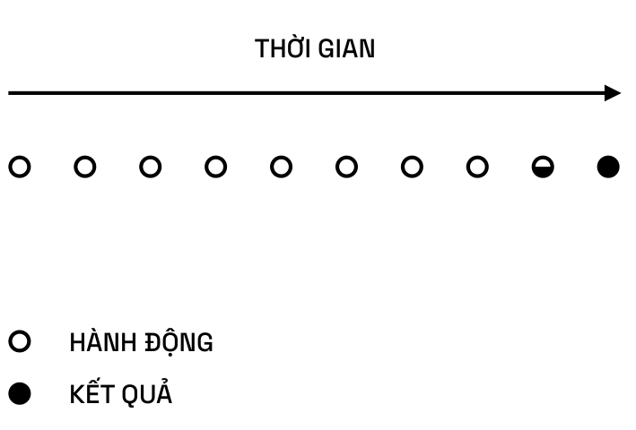

# CỨU RỖI BẢN THÂN

> Bác sĩ sẽ không giúp bạn khỏe mạnh. Chuyên gia dinh dưỡng sẽ không giúp bạn thon gọn. Giáo viên sẽ không giúp bạn thông minh hơn. Quân sư sẽ không giúp bạn bình tĩnh. Cố vấn sẽ không giúp bạn giàu có. Huấn luyện viên sẽ không giúp bạn có thân hình cân đối.  
> Sau cùng, bạn phải tự mình gánh vác trách nhiệm.  
> **Hãy tự cứu rỗi bản thân.**

## CHỌN LÀ CHÍNH MÌNH

Đây là những việc mà nhiều người trong chúng ta đang làm hiện nay – tự chỉ trích bản thân và viết ra những ghi chú cẩu thả kiểu như: “Tôi phải làm cái này, và tôi cần làm cái kia, và tôi cần làm,…”. Không, bạn không cần phải làm điều gì cả.

Tất cả những gì bạn cần làm là làm những điều bạn muốn. Nếu bạn ngừng cố gắng tìm cách làm mọi thứ theo mong muốn của những người khác, thì bạn sẽ nghe được tiếng nói vang vọng trong đầu về cách bạn muốn làm mọi thứ. Sau đó, bạn sẽ được là chính mình.

> Tôi chưa bao giờ gặp được vị cố vấn vĩ đại của mình. Tôi đã cực kỳ mong muốn trở thành ông ấy. Nhưng lời khuyên của ông ấy thì ngược lại: Hãy là chính mình, với những xúc cảm đam mê mãnh liệt.

Không ai trên thế gian này có thể đánh bại bạn trong việc là chính bạn. Bạn sẽ không bao giờ có thể trở thành tôi tốt hơn tôi. Tôi sẽ không bao giờ có thể trở thành bạn tốt hơn bạn. Chắc chắn rồi, hãy lắng nghe và tiếp thu, nhưng đừng cố gắng bắt chước. Bắt chước là chuyện vặt vãnh của kẻ ngu ngốc. Thay vào đó, mỗi người đều có năng lực độc đáo ở một khía cạnh nào đó. Họ có một vài kiến thức chuyên biệt, năng lực, và khát khao mà không ai trên thế gian này có, chỉ thuần túy xuất phát từ những tổ hợp giữa bộ DNA và sự phát triển của con người.

> Những tổ hợp giữa DNA và kinh nghiệm của con người thực sự đáng kinh ngạc. Bạn sẽ không bao giờ gặp được hai con người bất kỳ có thể thay thế cho nhau.

Mục tiêu của bạn trong cuộc đời là tìm ra công việc kinh doanh, dự án, lĩnh vực nghệ thuật hay những người mà bạn cần nhất. Có thứ gì đó ở ngoài kia chỉ dành riêng cho bạn. Những điều bạn không muốn làm là lập những danh sách và mô hình ra quyết định dựa trên những gì người khác đang làm. Bạn sẽ không bao giờ có thể trở thành họ. Bạn sẽ không bao giờ có thể xuất sắc trong việc trở thành một ai đó khác. [4]

> Để đóng góp điều gì đó thực sự độc đáo, bạn phải si mê điều đó đến mức vô lý.

## CHỌN CHĂM SÓC BẢN THÂN

Ưu tiên số một của tôi trong cuộc đời, trên cả hạnh phúc, gia đình và công việc, chính là sức khoẻ của bản thân. Trước hết là sức khoẻ thể chất. Thứ hai là sức khoẻ tinh thần. Thứ ba là sức khoẻ tâm linh. Tiếp đến là sức khoẻ của gia đình. Tiếp nữa là sự bình yên của gia đình. Sau tất cả những thứ đó, tôi có thể bước ra ngoài và thực hiện bất cứ điều gì tôi cần phải làm với phần còn lại của thế giới. [4]

> Không gì có thể khiến bạn coi trọng những khía cạnh khác trong cuộc sống hơn một vấn đề về sức khoẻ.

**Điều gì ở thế giới hiện đại khiến chúng ta xa rời cách sống** **vốn dĩ của con người?**

Có rất nhiều, rất nhiều thứ.

Có những thứ thuộc phương diện thể chất. Chúng ta ăn theo những chế độ mà chúng ta vốn dĩ không tiến hoá để ăn như vậy. Một chế độ ăn phù hợp lẽ ra nên gần giống như chế độ Paleo (chế độ ăn thời kỳ đồ đá), hầu như chúng ta chỉ ăn rau củ, thêm một chút thịt và quả mọng.

Về tập luyện, chúng ta có lẽ được sinh ra để vui chơi thay vì chạy trong một guồng quay. Chúng ta được tiến hoá để sử dụng toàn bộ năm giác quan một cách bình đẳng thay vì ưu ái vùng vỏ não thị giác. Trong xã hội hiện đại, hầu hết mọi yếu tố đầu vào và sự giao tiếp của chúng ta là trực quan. Chúng ta có lẽ không được sinh ra để đi giày. Có rất nhiều vấn đề về lưng và bàn chân xuất phát từ đôi giày. Chúng ta có lẽ không được sinh ra để mặc quần áo, giữ ấm suốt cả ngày. Chúng ta đáng lẽ được sinh ra để tiếp xúc với cái lạnh, vì điều này kích hoạt hệ thống miễn dịch.

Chúng ta không tiến hoá để sống trong môi trường hoàn toàn vô trùng và sạch sẽ. Môi trường như vậy dẫn đến những dị ứng và một hệ thống miễn dịch không được rèn luyện. Điều này được biết đến với cái tên giả thuyết vệ sinh. Chúng ta tiến hoá để sống theo những nhóm nhỏ và ở xung quanh thật nhiều gia đình. Tôi có một khoảng thời gian sinh sống và lớn lên tại Ấn Độ, và ở đây mọi người đều có mối quan hệ với bạn. Sẽ có một người anh chị em họ, một người dì, hay một người bác luôn xuất hiện trước mặt bạn, do đó rất khó có khả năng bạn mắc chứng trầm cảm, bởi vì bạn không bao giờ phải ở một mình. (Tôi không đề cập tới những người bị trầm cảm do yếu tố hoá học trong cơ thể. Tôi đang bàn nhiều hơn về sự lo lắng hiện sinh và những bất ổn mà các thanh thiếu niên dường như phải trải qua). Nhưng mặt khác, bạn sẽ không có sự riêng tư, vì thế bạn không cảm thấy được tự do. Đây là một sự đánh đổi.

Chúng ta không được sinh ra để cứ năm phút lại kiểm tra điện thoại một lần. Sự thay đổi tâm trạng liên tục của việc có một biểu tượng “thích” và sau đó là một bình luận giận dữ khiến chúng ta trở thành những sinh vật lo âu. Chúng ta tiến hoá vì sự khan hiếm nhưng lại sống trong sự dồi dào. Bạn luôn đấu tranh liên tục để nói không khi bộ gen của bạn muốn nói có. Nói có với đường. Nói có với việc ở lại trong một mối quan hệ. Nói có với đồ uống có cồn. Nói có với thuốc phiện. Cứ thế nói có, nói có và nói có. Cơ thể chúng ta không biết cách từ chối. [8]

> Khi tất cả mọi người đều bị ốm, chúng ta không còn coi đó là một bệnh dịch.

**CHẾ ĐỘ ĂN**

> Ngoài toán học, vật lý và hoá học, không có nhiều ngành “khoa học được công nhận”. Chúng ta vẫn còn đang tranh cãi về vấn đề như thế nào là một chế độ ăn tối ưu.

**Ông nghĩ sao về chế độ ăn Keto?**

Chế độ này dường như thực sự khó để thực hiện theo. Việc bộ não và cơ thể có một cơ chế dự phòng là có lý. Ví dụ, vào Kỷ Băng Hà, con người tiến hoá mà không cần có thực vật. Đồng thời, chúng ta đã và đang ăn thực vật trong hàng nghìn năm… Tôi không nghĩ thực vật là không tốt, nhưng một chế độ ăn gần giống với chế độ Paleo sẽ vẫn chính xác hơn.

Tôi cho rằng sự tương hỗ giữa đường và chất béo thực sự rất thú vị. Chất béo là thứ khiến bạn hoàn toàn thoả mãn. Thực phẩm béo ngậy làm bạn no. Cách dễ dàng nhất để cảm thấy no là áp dụng chế độ ăn Keto, với chế độ này lúc nào bạn cũng sẽ được ăn rất nhiều thịt heo xông khói. Sau đó, bạn sẽ cảm thấy phát ngán và không còn muốn ngó ngàng đến chất béo một chút nào.

Đường khiến bạn đói bụng. Đường phát tín hiệu cho cơ thể bạn rằng: “Có tồn tại một nguồn thực phẩm đáng kinh ngạc mà chúng ta không được tiến hoá để ăn nó”, vì thế bạn vội vã nạp đường. Vấn đề ở đây là tác động của đường chiếm ưu thế hơn tác động của chất béo. Nếu bạn ăn một bữa béo ngậy và kèm thêm một chút đường, đường sẽ mang lại cảm giác đói bụng và chất béo sẽ cung cấp calo, thế là bạn sẽ chỉ cảm thấy thèm ăn. Đó là lý do tại sao tất cả đồ tráng miệng đều là sự kết hợp của rất nhiều chất béo và tinh bột.

Trong tự nhiên, việc tìm thấy tinh bột và chất béo cùng một chỗ là cực kỳ hiếm. Tôi có thể tìm thấy tinh bột và chất béo ở chung với nhau trong dừa, xoài, có thể là chuối, nhưng chúng đơn thuần là các loại trái cây nhiệt đới. Sự kết hợp giữa đường và chất béo thực sự mang tính chết người. Bạn cần phải cảnh giác với điều này trong chế độ ăn của bạn.

Tôi không phải là một chuyên gia, và vấn đề là như trong chính trị, mọi người đều nghĩ họ là chuyên gia về chế độ ăn uống và dinh dưỡng. Bản ngã của họ được gói ghém trong đó bởi vì những gì họ đã và đang ăn, hoặc những gì họ nghĩ họ nên ăn đương nhiên là chính xác. Mỗi người đều sẽ có một chút tín ngưỡng – đây là một chủ đề khó nhằn để đem ra bàn luận. Vậy nên tôi chỉ có thể nói hãy từ chối tất cả những chế độ ăn có sự kết hợp giữa tinh bột và đường. [2]

> Chất béo trong chế độ ăn đem lại cảm giác no. Đường trong chế độ ăn dẫn đến đói bụng. Tác động của đường chiếm ưu thế. Hãy kiểm soát sự thèm ăn sao cho phù hợp.

Hầu hết những người có thân hình cân đối và khỏe mạnh đều tập trung nhiều vào việc ăn gì hơn là ăn bao nhiêu. Kiểm soát chất lượng dễ dàng hơn (và dẫn tới) kiểm soát số lượng. [11]

Trớ trêu thay, việc nhịn ăn (từ chế độ ít tinh bột/paleo) lại dễ dàng hơn việc kiểm soát khẩu phần ăn. Một khi cơ thể phát hiện ra thức ăn, nó sẽ chẳng quan tâm tới bộ não nữa. [11]

Tôi có một thắc mắc về bánh mì của nhà Wonder Bread là làm thế nào mà nó có thể duy trì độ mềm ở nhiệt độ thường trong vòng nhiều tháng. Nếu vi khuẩn không ăn nó, liệu bạn có nên ăn không? [11]

Đã qua 5000 năm và chúng ta vẫn đang tranh cãi thịt hay thực vật là độc hại. Bỏ qua các yếu tố cực đoan và bất kỳ thực phẩm nào được phát minh trong vài trăm năm trở lại đây. [11]

Khi nói tới y học và dinh dưỡng, hãy bớt trước khi thêm. [11]

Huấn luyện viên gửi cho tôi những tấm ảnh bữa ăn của anh ấy, và điều này nhắc nhở tôi rằng chúng ta đều là những người nghiện hương vị đồ ăn. [11]

> Chế độ ăn kiêng đơn giản nhất thế giới: Thực phẩm được chế biến càng nhiều, bạn càng không nên ăn nó.

**TẬP LUYỆN**

> Tập luyện càng chăm chỉ, một ngày trôi qua càng dễ dàng.

**Đâu là thói quen có tác động tích cực nhất đến cuộc sống** **của ông?**

Tập luyện hằng ngày vào buổi sáng. Đây là yếu tố thay đổi hoàn toàn cuộc chơi. Luyện tập giúp tôi cảm thấy khoẻ mạnh, trẻ trung hơn. Điều này giúp tôi không ra ngoài vào tối muộn. Nó xuất phát từ một điều đơn giản, khi mọi người nói: “Tôi không có thời gian”. Về cơ bản, bất cứ khi nào bạn đề xuất những thói quen bạn nghĩ là tốt cho người khác, họ sẽ có lý do thoái thác. Thường thấy nhất là “Tôi không có thời gian”. Đó là cách nói khác của “Điều này không nằm trong sự ưu tiên của tôi”. Thực ra, điều bạn cần làm là nhìn nhận xem đây có phải ưu tiên của bạn hay không. Nếu một thứ gì đó là ưu tiên số một, bạn sẽ thực hiện nó. Đó là cách cuộc sống vận hành. Nếu bạn có một chiếc giỏ mơ hồ gồm 10 đến 15 ưu tiên khác nhau, rốt cuộc bạn sẽ không làm được điều gì trong đó.

Tôi đã quyết định ưu tiên số một trong đời mình, trên cả hạnh phúc của tôi, trên cả gia đình tôi, trên cả công việc chính là sức khoẻ của bản thân. Bắt đầu với sức khỏe thể chất. [4] Bởi vì sức khỏe thể chất là ưu tiên hàng đầu của tôi, nên tôi không bao giờ có thể nói tôi không có thời gian. Tôi thường tập thể dục vào buổi sáng và chẳng cần biết buổi tập sẽ kéo dài trong bao lâu. Tôi sẽ không thể bắt đầu ngày mới nếu tôi không tập luyện. Tôi không quan tâm liệu thế giới có đang sụp đổ hay tan rã, nó có thể đợi tôi thêm 30 phút nữa cho đến khi tôi tập xong.

Tần suất tập luyện hằng ngày của tôi khá nhiều. Sẽ có vài ngày tôi nghỉ tập vì một vài lý do như đi du lịch, bị chấn thương, bị ốm hay vì một lý do nào đó. Hằng năm, số ngày nghỉ của tôi chỉ đếm trên đầu ngón tay. [4]

> Một tháng tập yoga đều đặn khiến tôi cảm thấy bản thân trẻ ra đến 10 tuổi. Duy trì sự dẻo dai đem lại sự trẻ trung.

Cách bạn thiết lập thói quen không quan trọng. Hãy cứ làm một điều gì đó hàng ngày, không quan trọng là điều gì. Mọi người thường bị ám ảnh với việc thói quen đó nên là tập tạ, chơi tennis, tập pilates, dùng phương pháp luyện tập cường độ cao theo chu kỳ “cơ thể hạnh phúc”, hay bất cứ điều gì. Họ đang không thực sự hiểu vấn đề. Mấu chốt ở đây là phải làm điều gì đó hằng ngày. Không quan trọng điều đó là gì. Bài tập tốt nhất dành cho bạn chính là bài tập mà bạn đủ hứng khởi để thực hiện nó mỗi ngày. [4]

> Với các buổi họp có thể đi lại: •	 Bộ não hoạt động tốt hơn •	 Được tập thể dục và tiếp xúc ánh nắng mặt trời •	 Ngắn hơn, và ít sự đùa cợt •	 Nhiều hội thoại hơn, ít độc thoại hơn •	 Không cần trình chiếu •	 Kết thúc dễ dàng nhờ đi bộ về

Vẫn theo quy luật ấy, nếu sẵn sàng hy sinh lợi ích ngắn hạn, bạn sẽ có lợi ích dài hạn. Huấn luyện viên thể lực của tôi – Jerzy Gregorek là một người vô cùng thông thái và xuất chúng. Anh ấy luôn nói: “Lựa chọn dễ dàng, cuộc sống khó khăn. Lựa chọn khó khăn, cuộc sống dễ dàng”.

Cơ bản, nếu bạn đưa ra những lựa chọn khó khăn ngay bây giờ trong việc ăn uống, bạn sẽ không ăn tất cả những thực phẩm không có giá trị dinh dưỡng bạn từng muốn ăn, theo đó bạn cũng sẽ khó khăn khi quyết định tập luyện. Nhờ thế cuộc sống về lâu dài của bạn sẽ dễ dàng hơn rất nhiều. Bạn sẽ không bị ốm. Bạn sẽ không làm hại sức khoẻ. Điều tương tự cũng đúng với những giá trị khác, chẳng hạn như tích lũy tiền bạc cho những ngày khó khăn hay cách bạn đối mặt với các mối quan hệ của mình. **Nếu bạn đưa ra lựa chọn dễ dàng ngay bây giờ,** **cả cuộc đời bạn sẽ vì thế mà khó khăn hơn rất nhiều**. [4]

THIỀN LÀ

SỰ NHỊN ĂN GIÁN ĐOẠN

DÀNH CHO TÂM TRÍ.

## THIỀN + SỨC MẠNH TINH THẦN

> Cảm xúc là tiến hoá sinh học của chúng ta để dự đoán tác động tương lai của một sự kiện hiện tại. Trong bối cảnh hiện đại, cảm xúc thường được phóng đại hoặc sai lệch.

**Tại sao thiền lại có sức mạnh đến vậy?**

Hơi thở của bạn là một trong số ít những nơi mà hệ thống thần kinh tự chủ giao thoa với hệ thống thần kinh giao cảm. Hơi thở diễn ra tự nhiên không chủ tâm, nhưng bạn có thể kiểm soát nó.

Tôi nghĩ rằng rất nhiều phương pháp thực hành thiền chú trọng vào hơi thở vì nó là cánh cửa dẫn đến hệ thống thần kinh tự chủ. Có rất nhiều câu chuyện trong các tài liệu y khoa và tâm linh về những người đạt đến cấp độ kiểm soát được những chức năng tự động của cơ thể.

Tâm trí của bạn là một thứ mạnh mẽ như vậy. Có gì bất thường khi não trước gửi tín hiệu đến não sau và não sau định tuyến các nguồn lực đến toàn bộ cơ thể?

Bạn có thể làm điều đó chỉ bằng cách thở. Hơi thở thư giãn báo hiệu cơ thể bạn đang an toàn. Khi đó, não trước của bạn không cần nhiều nguồn lực như bình thường. Giờ đây, năng lượng thừa có thể được gửi tới não sau và nó sẽ định tuyến lại nguồn lực đó đến các phần còn lại của cơ thể.

Tôi không muốn nói bạn có thể chiến thắng mọi bệnh tật chỉ vì bạn có thể kích hoạt não sau. Nhưng bạn đang tiêu tốn hầu hết mức năng lượng thông thường cần dùng đến để chăm sóc môi trường bên ngoài cho hệ miễn dịch.

Tôi cực kỳ khuyến khích bạn nên nghe podcast của Tim Ferriss cùng với Wim Hof. Ông ấy là một điều kỳ diệu có thật. Biệt danh của Wim là Người Băng. Ông ấy giữ kỷ lục thế giới vì có thời gian tắm và bơi trong nước đá lâu nhất. Ông ấy truyền cho tôi rất nhiều cảm hứng, không chỉ vì ông ấy có khả năng thực hiện các hoạt động vượt trội về thể chất, mà còn vì ông ấy thực hiện nó vô cùng tử tế và hạnh phúc đến kinh ngạc, dù cho điều đó không hề dễ dàng hoàn thành.

Wim ủng hộ việc tiếp xúc với cái lạnh, bởi ông ấy tin rằng con người đang quá tách biệt với môi trường sống của mình. Chúng ta liên tục được mặc quần áo, được ăn và được sưởi ấm. Cơ thể chúng ta mất đi mối liên hệ với cái lạnh. Cái lạnh có vai trò quan trọng vì nó có thể kích hoạt hệ thống miễn dịch.

Vì thế, ông ấy ủng hộ việc tắm nước đá trong một khoảng thời gian dài. Được sinh ra ở tiểu lục địa Ấn Độ, tôi phản đối quyết liệt ý tưởng tắm trong nước đá. Nhưng Wim đã truyền cảm hứng cho tôi thử tắm nước lạnh. Và tôi đã làm vậy bằng cách sử dụng phương pháp thở của Wim Hof. Phương pháp này liên quan đến sự tăng thông khí để có thêm oxy vào máu, từ đó tăng nhiệt độ cốt lõi của cơ thể. Sau đó, bạn có thể bước vào giai đoạn tắm lạnh.

Tôi đã học được một bài học cực kỳ quan trọng: Hầu hết đau khổ của chúng ta bắt nguồn từ sự né tránh. Hầu hết sự đau đớn từ tắm lạnh là do chúng ta hay rón rén thò đầu ngón chân vào trước. Một khi bạn đã nhảy vào làn nước lạnh, bạn đã thực sự ở trong đó. Đây không còn là nỗi đau nữa. Đây chỉ đơn thuần là cái lạnh. Cơ thể bạn nói lạnh khác với tâm trí bạn nói lạnh. Hãy thừa nhận rằng cơ thể bạn nói lạnh. Hãy thực sự nhận thức được điều đó. Hãy đối mặt với nó, chấp nhận nó, nhưng đừng dằn vặt tâm trí vì nó. Tắm nước lạnh trong hai phút sẽ không thể giết chết bạn.

Tắm nước lạnh mỗi sáng giúp bạn nhớ lại bài học này. Giờ đây, tôi đã có ít nhu cầu tắm nước nóng hơn. [2]

> Thiền là sự nhịn ăn gián đoạn dành cho tâm trí.  
> Quá nhiều đường sẽ dẫn đến một cơ thể nặng nề, và quá nhiều sự phân tâm sẽ dẫn đến một tâm trí nặng nề.  
> Soi chiếu lại bản thân, viết nhật ký, thiền là những khoảng thời gian bạn được ở một mình và không bị phân tâm bởi bất kỳ điều gì. Lúc này, bạn sẽ từ từ giải quyết các vấn đề tồn đọng, được chuyển từ trạng thái béo phì về tinh thần sang trạng thái cân đối.

**Hiện tại ông có đang thực hành thiền không?**

Tôi cho rằng thực hành thiền cũng giống như ăn kiêng, mọi người cần tuân theo một phác đồ. Mọi người đều nói họ sẽ thực hiện nó, nhưng chẳng ai thực sự làm. Theo tôi, nhóm người thật sự thực hành thiền thường xuyên khá là hiếm. Tôi đã biết và thử ít nhất bốn hình thức thiền khác nhau.

Hình thức tôi thấy hiệu quả nhất là Nhận thức Không đánh giá (Nonjudgmental Awareness), còn gọi là Nhận thức Không lựa chọn (Choiceless Awareness). Khi bạn làm việc hằng ngày (hy vọng là gần gũi với thiên nhiên) và không nói chuyện với ai khác, bạn thực hành chấp nhận từng khoảnh khắc bạn đang hiện diện và không phán xét. Bạn sẽ không có suy nghĩ rằng: “Ồ, có một gã vô gia cư ở đằng kia, tốt nhất là mình nên băng qua đường”, hay nhìn ai đó đang đi ngang qua và bình luận: “Anh ta thật béo, tất nhiên mình có ngoại hình đẹp hơn anh ta”.

Nếu tôi nhìn thấy một người có mái tóc xấu, trước tiên tôi sẽ nghĩ rằng: “Haha, tóc anh ta xấu quá”. Chà, tại sao tôi lại cười nhạo anh ấy để khiến mình cảm thấy tốt đẹp hơn về bản thân? Và tại sao tôi lại cố gắng khiến tôi cảm thấy tốt đẹp hơn về mái tóc của chính mình? Bởi vì tôi đang rụng tóc, và tôi sợ tôi sẽ không còn tóc nữa. Tôi nhận ra 90% những suy nghĩ của tôi đều dựa trên nỗi sợ, 10% còn lại có lẽ dựa trên sự mong cầu.

Bạn sẽ không đưa ra bất kỳ quyết định nào. Bạn sẽ không phán xét bất kỳ điều gì. Bạn chỉ đơn giản là chấp nhận mọi thứ. Nếu tôi làm được như vậy trong 10 hoặc 15 phút trong khi đi dạo loanh quanh, tôi sẽ cảm thấy bình yên và thực sự biết ơn. Nhận thức Không đánh giá thật sự hiệu quả với tôi. [6]

Bạn cũng có thể thực hiện Thiền siêu việt (Transcendental meditation), với hình thức này bạn sẽ sử dụng việc tụng niệm lặp đi lặp lại để tạo ra một tiếng ồn trắng trong đầu nhằm chôn vùi đi những suy nghĩ của mình. Hoặc bạn cũng có thể có được nhận thức rất sâu sắc và vô cùng tỉnh táo về những suy nghĩ của mình khi chúng xảy ra. Khi dõi theo suy nghĩ của mình, bạn sẽ nhận ra có bao nhiêu trong số đó là dựa trên nỗi sợ. Khoảnh khắc bạn thừa nhận một nỗi sợ mà không cố gắng gạt nó đi, chỉ một lúc sau đó thôi, tâm trí bạn sẽ thật sự tĩnh lặng.

Khi tâm trí tĩnh lặng, bạn sẽ dừng việc coi mọi thứ xung quanh bạn là điều hiển nhiên. Bạn bắt đầu chú ý tới những chi tiết. Bạn thấy rằng: “Ồ, tôi đang sống ở một nơi tuyệt đẹp. Thật tuyệt vời khi có quần áo để mặc và tôi có thể đi đến Starbucks để uống cà phê bất cứ lúc nào. Hãy nhìn những con người ngoài kia – trong đầu mỗi người đều đang diễn ra một cuộc sống giá trị và trọn vẹn”.

Trạng thái này sẽ đưa chúng ta thoát ra khỏi câu chuyện mà chúng ta liên tục nói với bản thân. Nếu bạn ngừng nói chuyện với chính mình trong chỉ 10 phút, nếu bạn ngừng ám ảnh về câu chuyện của chính mình, bạn sẽ nhận ra chúng ta đang ở rất cao bên trên tháp nhu cầu Maslow và cuộc sống của bạn khá tốt đẹp. [6]

> Mẹo thực tế: Khi nằm trên giường, hãy thiền. Dù đó là thiền sâu hay là ngủ. Với bất kỳ phương thức nào, bạn cũng đã giành chiến thắng.

Một phương pháp khác là chỉ ngồi và nhắm mắt lại trong vòng ít nhất một giờ đồng hồ một ngày. Bạn đầu hàng trước bất cứ điều gì xảy ra, đừng tạo ra bất cứ nỗ lực nào bằng bất cứ cách nào. Bạn không nỗ lực vì bất cứ thứ gì, bạn không nỗ lực chống lại thứ gì. Nếu có suy nghĩ nào chạy qua tâm trí bạn, bạn hãy cứ để suy nghĩ đó trôi qua.

Trong suốt cuộc đời, sẽ có rất nhiều điều xảy đến với bạn. Một vài điều tốt, một vài điều xấu, hầu hết trong số đó bạn đã xử lý và giải quyết xong, chỉ có một số ít bạn vẫn còn mắc kẹt. Theo thời gian, sẽ càng có nhiều thứ mắc kẹt lại, và chúng giống như những con hàu bám chặt lấy bạn.

Bạn đánh mất những xúc cảm thời thơ ấu của mình, những thứ như là sự ngạc nhiên, sự hiện diện và hạnh phúc. Bạn đánh mất hạnh phúc trong chính nội tại của mình vì đã xây dựng cái tôi của mình từ những đau đớn, lỗi lầm, nỗi sợ và mong cầu chưa được giải quyết – chúng dính chặt vào bạn như những con hàu.

Làm thế nào để gỡ bỏ những con hàu này xuống? Trong thiền, chỉ đơn giản là bạn ngồi ở đó và không kháng cự lại tâm trí của mình. Những thứ kia sẽ bắt đầu trỗi dậy. Điều này giống như một hòm thư khổng lồ chứa toàn những bức thư chưa được trả lời, bạn quay ngược về thời thơ ấu. Chúng sẽ lần lượt xuất hiện, và bạn sẽ buộc phải đương đầu với chúng.

Bạn sẽ buộc phải xử lý chúng. Nhưng không cần làm gì cả, hãy chỉ quan sát chúng. Giờ đây bạn là một người trưởng thành có khoảng cách, thời gian và không gian nhất định với các sự kiện trong quá khứ, và bạn có thể xử lý chúng. Bạn có thể đánh giá chúng khách quan hơn rất nhiều.

Dần dần, bạn có thể giải quyết được rất nhiều điều còn tồn đọng bám rễ sâu trong tâm trí. Một khi chúng đã được xử lý, sẽ có một ngày khi ngồi thiền, bạn đạt tới trạng thái “hòm thư tinh thần rỗng”. Khi bạn mở “hòm thư” tinh thần và không có bức thư nào cả, đó thật sự là một cảm giác vô cùng tuyệt vời.

Đó là trạng thái vui vẻ, hạnh phúc và cả bình yên nữa. Một khi bạn đạt tới trạng thái này, bạn sẽ không muốn đánh mất nó. Nếu bạn có thể dành ra một giờ rảnh rỗi mỗi sáng chỉ để ngồi và nhắm mắt lại trong tâm thế thật hạnh phúc, thì điều này vô cùng quý giá và nó sẽ thay đổi cuộc đời bạn.

Tôi khuyên bạn nên thực hành thiền một giờ đồng hồ mỗi sáng, vì thời gian ngắn là không đủ để đi sâu vào bên trong. Và nếu bạn nếu muốn thử thực hành thiền, hãy làm điều này ngay khi bạn thức giấc trong vòng 60 ngày liên tục. Sau khoảng 60 ngày, bạn sẽ mệt mỏi với việc lắng nghe chính tâm trí của mình. Bạn sẽ xử lý được rất nhiều vấn đề, hoặc bạn đã nghe quá đủ những nỗi sợ hãi và vấn đề để nhìn thấu chúng.

Thiền không khó. Tất cả những gì bạn phải làm là ngồi đó và không làm gì. Chỉ ngồi xuống thôi. Hãy nhắm mắt lại và nói: “Tôi sẽ cho phép bản thân được nghỉ ngơi một tiếng. Đây sẽ là một tiếng xa rời cuộc sống. Đây sẽ là một tiếng mà tôi không làm bất cứ điều gì”.

“Nếu những suy nghĩ phải đến, chúng sẽ phải đến. Tôi sẽ không chống lại chúng. Tôi sẽ không giữ lấy chúng. Tôi sẽ không nghĩ thêm về chúng. Tôi sẽ không chối bỏ chúng. Tôi sẽ chỉ ngồi đây trong một tiếng và nhắm mắt, không làm gì cả.” Điều này khó đến thế nào? Tại sao bạn không thể không làm gì trong vòng một giờ đồng hồ? Điều gì đã khiến bạn cảm thấy khó khăn trong việc cho phép bản thân mình nghỉ ngơi một tiếng? [74]

**Đã có khoảnh khắc nào ông nhận thấy có thể kiểm soát cách** **mình suy diễn về mọi thứ chưa? Tôi nghĩ có một vấn đề mọi** **người gặp phải là không nhận ra rằng họ có thể kiểm soát** **cách suy diễn và phản ứng với một tình huống.**

Tôi cho rằng mọi người đều biết điều đó là có thể. Osho có một bài giảng tuyệt vời với tựa đề “The Attraction for Drugs Is Spiritual” (tạm dịch: Sự hấp dẫn của chất gây nghiện là tính tâm linh). Osho bàn về việc tại sao mọi người sử dụng chất gây nghiện (mọi thứ từ đồ uống có cồn đến chất thức thần1 đến cần sa). Họ làm vậy để kiểm soát trạng thái tinh thần. Họ làm vậy để kiểm soát cách họ phản ứng. Một vài người uống rượu vì điều này giúp họ không cần bận tâm quá nhiều, hay hút cần sa vì họ có thể ở trong trạng thái không tỉnh táo, hay dùng chất thức thần để cảm thấy hiện diện hoặc kết nối với thiên nhiên. Sự hấp dẫn của chất gây nghiện chính là tính tâm linh.

Mọi xã hội đều làm điều này ở một mức độ nào đó. Con người theo đuổi sự hồi hộp trong các môn thể thao hành động hoặc trạng thái dòng chảy hay cực khoái – bất kỳ trạng thái nào con người cố gắng đạt được đều là để thoát ra khỏi chính tâm trí của mình. Họ cố gắng thoát ra khỏi tiếng nói trong đầu họ – một ý thức của bản ngã đã phát triển quá mức.

Chí ít thì tôi đã không còn muốn ý thức của bản ngã tiếp tục phát triển và mạnh lên khi tôi già đi. Tôi muốn nó yếu đi và im lặng để tôi có thể hiện diện nhiều hơn ở thực tại mỗi ngày, chấp nhận tự nhiên và thế giới theo đúng bản chất của nó, và trân trọng nó nhiều như những đứa trẻ. [4]

Điều đầu tiên tôi nhận ra là bạn có thể quan sát được trạng thái tinh thần. Thiền không có nghĩa là đột nhiên có được sức mạnh siêu việt để kiểm soát trạng thái bên trong. Lợi thế của thiền là nhận ra tâm trí của bạn đang mất kiểm soát như thế nào. Nó giống như một con khỉ đang ném phân, chạy quanh phòng, tạo ra rắc rối, la hét và đập phá mọi thứ. Nó hoàn toàn mất kiểm soát. Nó là một người điên mất kiểm soát.

Bạn phải nhìn vào sinh vật điên loạn này ở trạng thái hoạt động, trước khi bạn cảm thấy ghét bỏ nó và bắt đầu tách biệt bản thân khỏi nó. Sự tách biệt này chính là tự do. Bạn nhận ra: “Ồ, tôi không muốn trở thành con người này. Tại sao tôi lại mất kiểm soát đến vậy?”. Riêng việc ý thức được điều này đã có thể giúp bạn bình tĩnh. [4]

> Thiền Minh Sát (Insight Meditation) cho phép não bộ của bạn vận hành trong chế độ sửa lỗi cho đến khi bạn nhận ra rằng mình chỉ là một chương trình con trong một chương trình đồ sộ hơn.

Tôi cố gắng chú tâm nhiều hơn đến độc thoại nội tâm của mình. Việc này không phải lúc nào cũng hiệu quả. Giống như lập trình máy tính, tôi đang cố gắng vận hành bộ não ở “chế độ phát hiện lỗi” càng nhiều càng tốt. Khi tôi đang nói chuyện với ai đó, hoặc khi tôi đang tham gia vào một hoạt động nhóm, điều này gần như là không thể bởi vì bộ não có quá nhiều thứ phải xử lý. Nếu tôi ở một mình, chẳng hạn như sáng nay, tôi đang đánh răng và bắt đầu nghĩ đến một chiếc podcast. Tôi bắt đầu trải qua một ảo mộng nho nhỏ, ở đó tôi tưởng tượng Shane hỏi tôi một loạt câu hỏi và tôi đang trả lời chúng trong tưởng tượng. Sau đó, tôi nhận ra mình đang làm gì. Tôi đặt bộ não của mình ở chế độ phát hiện lỗi và chỉ nhìn từng hướng dẫn nhỏ trôi qua.

Tôi tự nhủ: “Tại sao tôi lại lập kế hoạch cho một tương lai tưởng tượng? Tại sao tôi không thể đứng đây và chỉ đánh răng thôi?”. Đó là ý thức về việc bộ não của tôi đang hoạt động trong tương lai và lên kế hoạch cho một số tình huống giả tưởng ngoài bản ngã. Tôi cảm thấy: “Chà, liệu tôi có thực sự bận tâm nếu tôi tự làm mình xấu hổ không? Ai thèm quan tâm cơ chứ? Dù sao thì tôi cũng sẽ chết. Tất cả sẽ trở về con số không, tôi sẽ không nhớ bất cứ điều gì. Vì vậy điều này là vô nghĩa.”

Sau đó, tôi sẽ tạm ngưng tâm trí của mình lại và quay về việc đánh răng. Tôi nhận thấy bàn chải đánh răng tốt như thế nào và nó đem lại cho tôi cảm giác tuyệt vời ra sao. Sau đó, vào giây phút tiếp theo, tôi bắt đầu nghĩ về một điều gì đó khác. Tôi phải nhìn bộ não của mình và hỏi: “Tôi có thực sự cần giải quyết vấn đề này ngay bây giờ không?”.

Có tới 95% những gì bộ não của tôi đột nhiên vận hành và cố gắng thực hiện là những điều mà tôi không cần phải làm ở thời điểm đó. Nếu bộ não giống như cơ bắp, tốt hơn hết là tôi nên cho nó nghỉ ngơi, trong trạng thái yên tĩnh. Khi một vấn đề cụ thể phát sinh, tôi sẽ thực sự đắm mình trong đó.

Ngay lúc này khi chúng ta đang nói chuyện, tôi thà nhập tâm hoàn toàn vào cuộc hội thoại và tập trung 100% vào nó thay vì nghĩ ngợi rằng: “Ồ, khi tôi đánh răng, tôi đã đánh răng đúng cách chưa nhỉ?”.

Khả năng tập trung đơn lẻ có liên quan đến nguy cơ mất đi nhận thức về bản thân, sự hiện diện, hạnh phúc và (trớ trêu thay) là cả tính hiệu quả. [4]

**Có vẻ như ông đang đưa bản thân ra khỏi một khuôn mẫu** **nhất định và theo dõi mọi thứ từ một góc nhìn khác mặc dù** **ông vẫn đang ở trong chính tâm trí của mình.**

Khi Phật tử bàn về ý thức so với bản ngã, họ đang nói về cách nghĩ của bạn đối với bộ não, hay ý thức của bạn, như một cơ chế nhiều lớp. Có một lớp nền lõi, một hệ điều hành cấp hạt nhân đang chạy. Sau đó, có các ứng dụng chạy nền bên trên. (Tôi thích nghĩ về điều này theo ngôn từ của máy tính và chuyên gia công nghệ).

Tôi đang quay trở lại với mức ý thức cơ bản của mình về hệ điều hành, luôn giữ bình tĩnh, luôn trong trạng thái bình yên và nhìn chung là hạnh phúc và hài lòng. Tôi đang cố gắng duy trì trạng thái có ý thức và không kích hoạt tâm trí loài khỉ, thứ vốn luôn lo lắng, sợ hãi và bồn chồn. Tôi chỉ kích hoạt nó khi cần, dù cho nó phục vụ một mục đích đáng kinh ngạc. Khi tôi cần đến thứ tâm trí này, tôi muốn chỉ tập trung vào nó. Nếu tôi vận hành tâm trí loài khỉ 24/7, tôi sẽ lãng phí năng lượng và tâm trí của khỉ sẽ trở thành tôi. Bản ngã của tôi – đâu chỉ có tâm trí loài khỉ.

Và một điều nữa là: tâm linh, tôn giáo, Phật giáo hay bất cứ điều gì bạn theo đuổi sẽ dần dần dạy bạn rằng bạn không chỉ là tâm trí của bạn. Bạn không chỉ là thói quen của bạn. Bạn không chỉ là sở thích của bạn. Bạn là một mức độ ý thức. Bạn là một cơ thể. Là con người hiện đại, chúng ta không sống đủ lâu trong cơ thể mình. Chúng ta không sống đủ lâu trong ý thức của mình. Chúng ta sống quá nhiều trong cuộc độc thoại nội tâm trong đầu mình. Tất cả những điều đó vốn được lập trình sẵn bên trong bạn bởi xã hội và môi trường khi bạn còn trẻ.

Về cơ bản, bạn là một chuỗi DNA phản ứng với các tác động của môi trường khi bạn còn trẻ. Bạn đã ghi lại những trải nghiệm tốt và xấu, và bạn sử dụng chúng để vội vàng phán xét mọi thứ chống lại bạn. Sau đó, bạn đang sử dụng những trải nghiệm này để không ngừng thử nghiệm, dự đoán và thay đổi tương lai.

Khi già đi, bạn sẽ tích lũy được rất rất nhiều sở thích. Những phản ứng theo thói quen này sau cùng sẽ trở thành các đoàn tàu chở hàng mất phanh kiểm soát tâm trạng của bạn. Chúng ta nên kiểm soát tâm trạng mình. Tại sao chúng ta lại không học cách kiểm soát tâm trạng của mình? Sẽ thật tài tình biết bao nếu bạn có thể nói: “Ngay bây giờ tôi muốn ở trong trạng thái tò mò” và sau đó bạn có thể thật sự đưa mình vào trạng thái ấy. Hoặc bạn sẽ nói: “Tôi muốn ở trong trạng thái tang gia. Tôi đang tiếc thương và đau buồn cho người thân yêu. Tôi thực sự muốn cảm thấy điều đó. Tôi không hề muốn bị phân tâm vì vấn đề về lập trình máy tính cần phải giải quyết vào ngày mai”.

Bản thân tâm trí là một dạng cơ bắp – có thể được rèn luyện và kiểm soát. Tâm trí đã được xã hội điều kiện hóa một cách ngẫu nhiên để nằm ngoài tầm kiểm soát của chúng ta. Nếu bạn nhìn vào tâm trí của mình với ý thức và mục đích (một công việc mà bạn làm 24/7), tôi nghĩ bạn có thể giải nén tâm trí, cảm xúc, suy nghĩ và phản ứng của chính mình. Sau đó, bạn có thể bắt đầu tái thiết lập cấu hình. Bạn có thể bắt đầu viết lại chương trình này theo những gì bạn muốn. [4]

> **Thiền là gạt đi tiếng nói của xã hội và lắng nghe bản thân mình.**  
> Nó chỉ thực sự “hiệu quả” khi được thực hiện đúng bản chất:  
> • Leo núi là thiền đi.  
> • Viết nhật ký là thiền viết.  
> • Cầu nguyện là thiền biết ơn.  
> • Tắm là thiền ngẫu nhiên.  
> • Ngồi tĩnh lặng là thiền trực tiếp.

## CHỌN HOÀN THIỆN BẢN THÂN

> Siêu năng lực vĩ đại nhất là năng lực thay đổi bản thân.

**Sai lầm lớn nhất ông từng mắc phải trong đời là gì, và làm** **thế nào để ông hồi phục?**

Tôi đã mắc cùng một loại lỗi mà tôi sẽ tóm tắt chúng theo cùng một cách. Những sai lầm ấy chỉ thật sự hiển hiện rõ trong sự nhận thức muộn màng thông qua một bài tập, đó là tự vấn bản thân: Khi bạn 30 tuổi, bạn sẽ đưa ra lời khuyên gì cho bản thân mình ở tuổi 20? Và khi bạn 40 tuổi, bạn sẽ đưa ra lời khuyên nào cho bản thân mình ở tuổi 30? (Giả dụ nếu bạn trẻ hơn, bạn có thể làm điều đó 5 năm một lần). Hãy ngồi xuống và nói: “Được rồi, vào năm 2007, tôi đã làm gì? Tôi đã cảm thấy thế nào? Vào năm 2008, tôi đã làm gì? Tôi đã cảm thấy thế nào? Vào năm 2009, tôi đã làm gì? Tôi đã cảm thấy thế nào?”.

Cuộc sống sẽ vận hành theo cách của riêng nó. Sẽ có một số điều tốt và một số điều xấu. Phần lớn sẽ tùy thuộc vào cách bạn trải nghiệm cuộc sống. Bạn được sinh ra, bạn có một tập hợp các xúc cảm, và sau đó bạn chết đi. Cách bạn chọn để thể hiện những trải nghiệm đó là tùy thuộc vào bạn, và mỗi người sẽ có cách diễn giải khác nhau.

Tôi thực sự ước mình vẫn hành động như vậy, nhưng với ít cảm xúc hơn và ít tức giận hơn. Một ví dụ tiêu biểu nhất là khi còn trẻ, tôi đã thành lập một công ty. Công ty này hoạt động tốt nhưng tôi thì không, nên tôi đã đâm đơn kiện một số người liên quan. Cuối cùng, mọi chuyện vẫn ổn, kết quả vẫn tốt đẹp, nhưng xuyên suốt cả quá trình là sự lo lắng và tức giận.

Giờ đây, tôi sẽ không lo lắng và không tức giận nữa. Tôi chỉ bước đến gần mọi người và nói rằng: “Hãy nhìn xem, đây là những gì đã xảy ra. Đây là những gì tôi sẽ làm. Đây là cách tôi sẽ làm điều đó. Đây là những gì công bằng. Đây là những gì không công bằng”.

Tôi nhận ra sự tức giận và cảm xúc là hậu quả cực kỳ to lớn và không cần thiết. Hiện tại, tôi đang cố gắng học hỏi từ điều đó và làm những điều mà tôi nghĩ là đúng đắn nhưng không tức giận với một tầm nhìn dài hạn. Nếu bạn có một tầm nhìn dài hạn và có thể loại bỏ cảm xúc ra khỏi nó, tôi sẽ không còn coi những điều đó là sai lầm nữa. [4]

Một lần nữa, thói quen là tất cả những gì thuộc về bản chất của chúng ta. Chúng ta được rèn luyện bằng các thói quen từ khi còn nhỏ, bao gồm cả việc tập ngồi bô, khi nào nên khóc và khi nào không nên khóc, cách cười và khi nào không nên cười. Những điều này trở thành thói quen – hành vi mà chúng ta học hỏi và tích hợp vào chính mình.

Khi lớn hơn, chúng ta là tập hợp của hàng ngàn thói quen liên tục chảy trôi trong tiềm thức. Chúng ta có thêm một chút trí tuệ trong vùng vỏ não mới để giải quyết những vấn đề mới. Bạn trở thành thói quen của chính bạn.

Tôi thực sự giác ngộ điều này khi huấn luyện viên giao cho tôi một lịch trình tập luyện hằng ngày. Trước đây, tôi chưa bao giờ luyện tập mỗi ngày. Đây là một bài tập nhẹ, không gây áp lực quá lớn lên cơ thể, nhưng tôi thực hiện bài tập này hàng ngày. Tôi nhận ra sự chuyển hóa đáng kinh ngạc và bất ngờ mà nó đã đem đến cho tôi, cả về thể chất lẫn tinh thần.

> Để đạt được sự bình yên trong tâm trí, trước hết bạn phải đạt được sự bình yên trong cơ thể.

Điều này đã giúp tôi nhận ra được sức mạnh của thói quen. Tôi bắt đầu nhận ra tất cả đều là do thói quen. Tại bất kỳ thời điểm nào, tôi cố gắng hình thành một thói quen tốt hoặc loại bỏ một thói quen xấu trước đó. Điều này cần thời gian.

Nếu ai đó nói: “Tôi muốn có thân hình cân đối, khỏe mạnh. Tôi đang béo và thân hình tôi không được cân đối”. Thực ra, không điều gì có thể đem đến hiệu quả cho bạn trong vòng ba tháng mà lại bền vững. Đây sẽ là một hành trình kéo dài ít nhất mười năm. Sáu tháng một lần (tùy thuộc vào tốc độ của bạn), bạn sẽ từ bỏ được những thói quen xấu và hình thành những thói quen tốt. [6]

Một trong những điều Krishnamurti đã đề cập là trạng thái cách mạng của nội tâm. Bạn phải luôn sẵn sàng cho một sự thay đổi hoàn toàn từ bên trong. Bất cứ khi nào chúng ta nói chúng ta sẽ cố gắng làm điều gì đó hoặc cố gắng hình thành một thói quen, chúng ta đều không đủ can đảm.

Chúng ta chỉ đang nói với chính mình: “Tôi sẽ câu giờ cho mình thêm một chút”. Thực tế là khi cảm xúc của muốn chúng ta làm điều gì đó, chúng ta sẽ cứ thế làm điều đó. Nếu bạn muốn tiếp cận một cô gái xinh đẹp, nếu bạn muốn đi uống nước, nếu bạn thực sự khao khát điều gì đó, bạn cứ thế mà làm thôi.

Khi bạn nói: “Tôi sẽ làm điều này” và “Tôi sẽ làm điều kia”, thực chất là bạn đang trì hoãn. Bạn đang tự cho mình một lối thoát. Ít nhất là nếu bạn nhận thức được về bản thân, bạn có thể nghĩ rằng: “Tôi nói tôi muốn làm điều này, nhưng tôi không thực sự có ý như vậy, vì nếu tôi thực sự muốn làm điều đó, tôi sẽ cứ thế làm mà không cần phải nói gì”.

Hãy cam kết với thật nhiều người. Ví dụ, nếu bạn muốn bỏ hút thuốc, tất cả những gì bạn phải làm là đến gặp những người bạn biết và nói: “Tôi sẽ bỏ hút thuốc. Tôi thực sự sẽ làm được. Tôi hứa với bạn”.

Đó là tất cả những gì bạn cần làm. Cứ thế mà làm thôi, phải không? Nhưng hầu hết chúng ta sẽ nói chưa sẵn sàng. Chúng ta biết chúng ta chẳng hề muốn cam kết với người khác. Điều quan trọng là bạn phải thành thật với chính bản thân mình và thừa nhận: “Được rồi, tôi chưa sẵn sàng bỏ thuốc. Tôi cực kỳ thích hút thuốc, rất khó để tôi bỏ thuốc.”

Biết là vậy, nhưng thay vào đó, hãy thử nói: “Tôi sẽ đặt mục tiêu bỏ thuốc hợp lý hơn cho bản thân, tôi sẽ cắt giảm xuống số lượng thuốc nhất định. Tôi có thể cam kết điều đó với người khác. Tôi sẽ làm việc đó trong ba hoặc sáu tháng. Sau khi hoàn thành được điều này, tôi mới thực hiện bước tiếp theo thay vì chỉ ngồi dằn vặt bản thân”.

Khi bạn thực sự muốn thay đổi, bạn cứ thế thay đổi thôi. Nhưng hầu hết chúng ta không thực sự muốn thay đổi – chúng ta chưa muốn trải qua nỗi đau. Ít nhất hãy thừa nhận điều này, ý thức được nó và tạo một thay đổi nhỏ hơn trong tầm khả năng của bạn. [6]

> Hành động không chần chừ, kiên nhẫn với kết quả.

Bất cứ điều gì bạn cần phải làm, hãy hoàn thành nó ngay. Tại sao phải chờ đợi? Bạn không còn trẻ nữa. Cuộc sống của bạn đang trôi đi. Bạn sẽ không muốn dành cả đời chỉ để xếp hàng. Bạn sẽ không muốn dành cả đời chỉ để đi đi lại lại. Và chắc hẳn, bạn cũng không muốn dành toàn bộ thời gian của mình chỉ để làm những việc mà cuối cùng thì chúng cũng không phải sứ mệnh của bạn.

Khi làm một điều gì, bạn nên thực hiện chúng nhanh nhất có thể đồng thời thực hiện chúng thật tốt với toàn bộ sự tập trung của mình. Nhưng sau đó, hãy thật kiên nhẫn với kết quả vì bạn đang đối mặt với nhiều con người và hệ thống phức tạp.

Phải mất một thời gian dài để thị trường chấp nhận sản phẩm. Cần có thời gian để mọi người cảm thấy thoải mái khi làm việc với nhau. Cần có thời gian để những sản phẩm tuyệt vời xuất hiện khi bạn cứ hoàn thiện và cải thiện liên tục. Hành động không chần chừ, kiên nhẫn với kết quả. Như Nivi đã nói, cảm hứng vốn không bền lâu. Khi bạn có cảm hứng, hãy hành động ngay lúc đó và tại nơi đó. [78]

## CHỌN PHÁT TRIỂN BẢN THÂN

Tôi không tin vào những mục tiêu cụ thể. Scott Adams có câu nói nổi tiếng: “Thiết lập hệ thống, không phải mục tiêu”. Sử dụng phán đoán của bạn để tìm ra những môi trường bạn có thể phát triển, sau đó tính toán theo những số liệu thống kê và tạo ra môi trường mà ở đó bạn sẽ thành công.

> Môi trường hiện tại lập trình bộ não, nhưng bộ não thông minh có thể chọn môi trường sắp tới dành cho nó.

Tôi sẽ không trở thành người thành công nhất hành tinh, và tôi cũng không muốn như vậy. Tôi chỉ muốn trở thành phiên bản thành công nhất của bản thân với ít nỗ lực nhất có thể. Tôi muốn sống theo cách mà nếu cuộc đời tôi diễn ra 1.000 lần thì Naval thành công 999 lần. Ông ấy không phải là một tỷ phú, nhưng lần nào ông ấy cũng làm khá tốt. Ông ấy có thể không thành công mọi mặt, nhưng ông ấy thiết lập các hệ thống để thất bại ít nhất. [4]

Hãy nhớ xuất phát điểm của tôi là một đứa trẻ nghèo tại Ấn Độ, phải không? Nếu tôi làm được thì ai cũng làm được, theo một cách tương tự. Rõ ràng là tôi có đầy đủ tứ chi, khả năng trí tuệ và học thức. Sẽ có một số điều kiện tiên quyết mà bạn không thể có được. Nhưng nếu bạn đang đọc cuốn sách này, bạn sẽ có những phương tiện cần thiết để tùy ý sử dụng – một cơ thể và một tâm trí đang hoạt động. [78]

> Nếu có điều gì bạn muốn làm sau này, hãy làm ngay bây giờ. Không có khái niệm “sau này”.

**Ông đã học các bộ môn mới như thế nào?**

Hầu hết, tôi chỉ xoay quanh những điều căn bản. Ngay cả khi học vật lý hay khoa học, tôi vẫn học những điều cơ bản. Tôi đọc các khái niệm cho vui. Tôi có xu hướng làm những điều liên quan đến số học hơn là giải tích. Tôi không phải là một nhà vật lý vĩ đại vào thời điểm này. Có thể là ở kiếp sau hoặc con tôi sẽ làm được, nhưng với tôi thì đã quá muộn. Tôi phải bám sát với những gì tôi thực sự thích.

Đối với tôi, khoa học là nghiên cứu về sự thật. Nó là thứ kỷ luật đúng đắn duy nhất bởi vì nó đưa ra những dự đoán có thể được chứng minh là sai. Nó thực sự thay đổi thế giới. Khoa học ứng dụng trở thành công nghệ, và công nghệ là thứ phân biệt chúng ta với động vật và cho phép chúng ta có những thứ như điện thoại di động, nhà ở, ô tô, nhiệt và điện.

Đối với tôi, khoa học là nghiên cứu về sự thật, còn toán học là ngôn ngữ của khoa học và tự nhiên.

Tôi không theo một tôn giáo nào cả, nhưng tôi có một chút tâm linh. Đối với tôi, việc nghiên cứu các quy luật của vũ trụ là điều sùng đạo mà tôi có thể làm. Giống như sự thích thú của người khác khi ở thánh địa Mecca hoặc Medina, tôi kính phục và cảm thấy mình thật nhỏ bé khi nghiên cứu về khoa học. Đối với tôi, khoa học là vô song và tôi muốn ở lại với những điều cơ bản hơn. Đây là vẻ đẹp của việc đọc. [4] **Ông có đồng tình với quan điểm “Nếu bạn đọc những gì** **người khác đang đọc, bạn sẽ nghĩ theo cách mà họ đang** **nghĩ không?**

Tôi tin rằng đa phần những gì mọi người đọc gần đây đều được thiết kế để phù hợp với quan điểm chung của xã hội. [4]

Tôi biết có những người đã đọc như một con vẹt hàng trăm cuốn sách về thuyết tiến hóa nhưng chưa bao giờ đọc Darwin. Hãy nghĩ về số lượng nhà kinh tế học vĩ mô ở ngoài kia. Tôi nghĩ rằng hầu hết họ đã đọc rất nhiều luận thuyết về kinh tế học nhưng chưa từng đọc cuốn nào của Adam Smith.

Ở một mức độ nào đó, bạn đang đọc để được xã hội chấp thuận. Bạn đang đọc để phù hợp với những con khỉ khác. Bạn đang thích ứng để hòa nhập với bầy đàn. Đó không phải là nơi thu được những lợi ích trong cuộc sống. Những lợi ích trong cuộc sống đang nằm bên ngoài bầy đàn.

Sự chấp thuận của xã hội nằm bên trong bầy đàn. Nếu bạn muốn được xã hội chấp thuận, bạn nhất định phải đọc những gì bầy đàn đang đọc. Nếu không, bạn sẽ cần là người đi ngược trào lưu để có thể nói: “Không. Tôi sẽ chỉ làm thứ của riêng tôi. Bất kể kết quả về mặt xã hội ra sao, tôi sẽ học bất cứ điều gì tôi cho là thú vị”.

**Ông có nghĩ rằng sẽ xuất hiện thứ gọi là nỗi sợ mất mát** **không? Bởi vì khi rẽ sang một lối đi khác, ông sẽ không biết** **liệu mình đang rẽ sang lối đi tích cực hay tiêu cực?**

Chắc chắn là có. Tôi nghĩ đó là lý do tại sao những người thông minh nhất và thành công nhất mà tôi biết có khởi đầu thất bại. Nếu bạn coi mình là người thất bại, là người bị xã hội ruồng bỏ và không có vai trò gì, bạn sẽ làm việc của riêng mình và nhiều khả năng bạn sẽ tìm thấy con đường chiến thắng. Sẽ có ích khi bắt đầu nói: “Tôi sẽ không bao giờ nổi tiếng. Tôi sẽ không bao giờ được chấp nhận. Tôi đã là một người thua cuộc. Tôi sẽ không có được tất cả những gì những đứa trẻ khác có. Tôi chỉ cần hạnh phúc khi được là chính mình.”

> Để cải thiện bản thân mà không cần tính kỷ luật tự giác, hãy nâng cấp nhận thức của bạn về bản thân.

Mọi người đều có được động lực từ một điều gì đó, tuỳ thuộc xem thứ đó là gì. Ngay cả những người chúng ta nghĩ là không có chút động lực nào, đột nhiên lại có động lực khi họ chơi điện tử. Tôi nghĩ rằng động lực là thứ có tính tương đối, vì vậy bạn chỉ cần tìm ra thứ bạn yêu thích. [1]

> Mài giũa và khổ luyện, cần cù và trải qua đau đớn, đối mặt với thử thách lớn. Tất cả đều là một phần của quá trình trở thành người thành công bất ngờ sau một đêm.

**Nếu ông có thể truyền lại cho con mình một hoặc hai nguyên** **tắc, chúng sẽ là những nguyên tắc gì?**

Điều số một: hãy đọc. Hãy đọc mọi thứ bạn có thể. Không chỉ những thứ được xã hội đánh giá hay, hoặc thậm chí là những cuốn sách tôi bảo bạn đọc. Hãy đọc vì chính bản chất của cuốn sách đó. Vun đắp một tình yêu cho việc đọc. Ngay cả khi bạn đọc tiểu thuyết lãng mạn, sách bìa mềm hay truyện tranh. Không có cuốn sách nào là đồ bỏ đi. Hãy đọc tất cả chúng.

Cuối cùng, bạn sẽ tự mình tìm ra được cuốn sách bạn nên và muốn đọc.

Liên quan đến kỹ năng đọc là các kỹ năng toán học và thuyết phục. Cả hai kỹ năng này đều giúp bạn xác định phương hướng trong thế giới thực.

Sở hữu kỹ năng thuyết phục rất quan trọng vì nếu bạn có thể tạo ra sức ảnh hưởng, bạn có thể làm được rất nhiều việc. Tôi nghĩ rằng khả năng thuyết phục là một kỹ năng thực tế. Vì vậy, bạn có thể học được và không quá khó để làm điều đó.

Toán học thực sự có ích trong việc giải quyết tất cả những điều phức tạp và khó khăn trong cuộc sống. Nếu bạn muốn kiếm tiền, nếu bạn muốn làm khoa học, nếu bạn muốn hiểu lý thuyết trò chơi, chính trị, kinh tế, đầu tư hay máy tính, tất cả những điều này đều lấy toán học làm cốt lõi. Đó là một ngôn ngữ nền tảng của tự nhiên.

Thiên nhiên nói chuyện bằng ngôn ngữ toán học. Toán học là việc chúng ta áp dụng kỹ thuật đảo ngược vào ngôn ngữ của tự nhiên, và chúng ta mới chỉ chạm vào bề nổi. Tin tốt là bạn không cần phải biết quá nhiều về toán học. Bạn chỉ cần nắm được thống kê cơ bản, số học,... Bạn nên hiểu về xác suất và thống kê toàn diện từ trước ra sau, và từ trong ra ngoài. [8]

## CHỌN GIẢI PHÓNG BẢN THÂN

> Điều khó khăn nhất không phải là làm điều bạn muốn – đó là biết thứ bạn muốn làm.

Hãy ý thức được không có “người trưởng thành”. Mọi người vẽ vời ra điều đó trong quá trình phát triển. Bạn phải tìm ra con đường của riêng bạn, nắm lấy, chọn lựa và loại bỏ khi bạn thấy phù hợp. Hãy tự mình khám phá, và bắt tay vào làm. [71]

**Các giá trị của ông đã thay đổi như thế nào?**

Khi tôi còn trẻ, tôi thực sự rất coi trọng tự do. Tự do là một trong những giá trị cốt lõi của tôi. Trớ trêu thay, tự do vẫn còn giữ vai trò đó. Nó có thể là một trong ba giá trị hàng đầu của tôi, nhưng giờ đây tôi đã có một định nghĩa khác về tự do.

Định nghĩa trước đây của tôi về tự do là “tự do để làm”. Tự do làm bất cứ điều gì tôi muốn. Tự do làm bất cứ điều gì tôi thích, bất cứ khi nào. Bây giờ, sự tự do tôi đang tìm kiếm là sự tự do bên trong. Đó là “tự do khỏi”. Tự do khỏi việc phản ứng. Tự do khỏi cảm giác tức giận. Tự do khỏi trạng thái buồn. Tự do khỏi tình trạng bị buộc phải làm mọi việc. Ở bên trong lẫn bên ngoài, tôi đều đang tìm kiếm “tự do khỏi một điều gì,” trong khi trước đây tôi đã tìm kiếm “tự do để làm một điều gì”. [4]

> Lời khuyên dành cho tôi khi còn trẻ: “Hãy là chính mình.”  
> Cảm thấy bị kiềm hãm nghĩa là đang ở trong những mối quan hệ và công việc tồi tệ nhiều năm thay vì vài phút.

**TỰ DO KHỎI NHỮNG KỲ VỌNG**

Tôi hoàn toàn không đo lường hiệu quả của mình. Tôi không tin vào sự tự đo lường bản thân. Tôi cảm thấy như đây là một hình thức kỷ luật tự giác, tự trừng phạt và tự mâu thuẫn. [1] Nếu bạn làm tổn thương người khác vì họ kỳ vọng vào bạn, đó là vấn đề của họ. Nếu họ có những hứa hẹn với bạn, đó là vấn đề của bạn. Nhưng, nếu họ kỳ vọng vào bạn, đó lại hoàn toàn là vấn đề của họ. Bạn không hề liên quan. Họ sẽ có rất nhiều kỳ vọng trong cuộc đời. Bạn hãy vượt qua và thoát khỏi những kỳ vọng của họ càng sớm càng tốt. [1]

> Dũng khí không phải là lao thẳng vào chốt đặt súng máy. Dũng khí là không bận tâm đến việc người khác nghĩ gì.

Bất cứ ai biết tôi trong một thời gian dài đều hiểu rõ đặc điểm nổi bật của tôi là tổ hợp của sự cực kỳ thiếu kiên nhẫn và tính cố chấp. Tôi không thích chờ đợi. Tôi ghét phải lãng phí thời gian. Tôi nổi tiếng là người rất thô lỗ trong các bữa tiệc, sự kiện, bữa tối, những nơi mà ngay khi tôi nhận ra rằng chúng thật lãng phí thời gian, tôi sẽ rời đi ngay lập tức.

Hãy coi trọng thời gian. Đó là tất cả những gì bạn có. Thời gian quan trọng hơn tiền bạc. Thời gian quan trọng hơn bạn bè của bạn. Thời gian quan trọng hơn bất cứ thứ gì. Thời gian là tất cả những gì bạn có. Đừng lãng phí thời gian của mình.

Điều này không có nghĩa là bạn không thể cho phép bản thân mình thư giãn. Miễn là bạn đang làm những gì bạn muốn, bạn sẽ không lãng phí thời gian. Nhưng nếu bạn không dành thời gian để làm những gì bạn muốn, không kiếm được tiền và không học hỏi – vậy thì bạn đang làm cái quái gì vậy?

Đừng dành thời gian của bạn để làm cho người khác hạnh phúc. Hạnh phúc hay không là vấn đề của cá nhân họ, không phải là vấn đề của bạn. Nếu bạn hạnh phúc, người khác cũng sẽ hạnh phúc. Nếu bạn hạnh phúc, người khác sẽ hỏi bạn làm thế nào để trở nên hạnh phúc, và họ có thể học hỏi từ điều đó, nhưng bạn không có trách nhiệm phải làm cho người khác hạnh phúc. [10]

**TỰ DO KHỎI SỰ TỨC GIẬN**

Tức giận là gì? Tức giận là báo hiệu mạnh mẽ nhất cho đối phương biết bạn có thể trở nên bạo lực. Tức giận là tiền thân của bạo lực.

Hãy quan sát khi bạn tức giận – tức giận là sự mất kiểm soát đối với tình huống. Tức giận là một hợp đồng bạn lập ra với chính mình để rơi vào tình trạng hỗn loạn về thể chất, tinh thần và cảm xúc cho đến khi thực tế thay đổi. [1]

> Tức giận là hình phạt của chính nó. Khi một người tức giận cố gắng dìm đầu bạn xuống nước thì họ cũng đang đồng thời chìm xuống.

**TỰ DO KHỎI VIỆC ĐI LÀM THUÊ**

Những người sống dưới mức thu nhập của họ được hưởng sự tự do mà những người đang hối hả nâng cao lối sống không thể hiểu được. [11]

Một khi đã thực sự kiểm soát được số phận của chính mình, dù tốt hay xấu, bạn sẽ không cần bất kỳ ai khác bảo bạn phải làm gì. [11]

> Trải nghiệm sự tự do có thể biến bạn thành người không thể đi làm thuê được nữa.

**TỰ DO KHỎI SUY NGHĨ MẤT KIỂM SOÁT**

Có một thói quen tôi đang thực hiện là cố gắng tắt đi “tâm trí loài khỉ” của mình. Khi còn nhỏ, chúng ta là những phiến đá trống trơn. Chúng ta sống rất nhiều trong khoảnh khắc đó. Về cơ bản, chúng ta chỉ phản ứng với môi trường thông qua bản năng. Chúng ta sống trong cái mà tôi gọi là “thế giới thực”. Tuổi dậy thì là giai đoạn bắt đầu của sự ham muốn – lần đầu tiên bạn thực sự, thực sự muốn một thứ gì đó và bạn bắt đầu lên kế hoạch dài hạn. Bạn bắt đầu suy nghĩ rất nhiều, xây dựng một bản ngã và cái tôi để đạt được điều mình muốn.

Nếu bạn đi xuống phố và có một nghìn người ở đó, thì cả nghìn người đó đều đang tự nói chuyện với chính họ trong đầu ở mọi lúc. Họ liên tục phán xét mọi thứ họ nhìn thấy. Họ đang chiếu lại những đoạn phim về những điều đã xảy ra với họ ngày hôm qua. Họ đang sống trong thế giới ảo mộng về những gì sẽ xảy ra vào ngày mai. Họ đang bị kéo ra khỏi thực tại. Điều đó có thể tốt khi bạn lập kế hoạch dài hạn. Nó có thể tốt khi bạn giải quyết vấn đề. Điều ấy tốt cho chúng ta với tư cách là những cỗ máy sinh tồn và nhân rộng.

Nhưng theo tôi việc đối thoại với chính mình thực sự ảnh hưởng xấu tới hạnh phúc của bạn. Tâm trí nên là một người hầu và một công cụ, không phải một người chủ. Tâm trí loài khỉ của tôi không nên kiểm soát và lèo lái tôi 24/7.

Tôi muốn phá bỏ thói quen suy nghĩ mất kiểm soát, và điều này không hề dễ dàng. [4]

> Một tâm trí bận rộn sẽ khiến thời gian trôi qua nhanh hơn.

Không có điểm kết cho sự tự nhận thức và khám phá bản thân. Đây là một quá trình kéo dài cả đời mà bạn hy vọng sẽ ngày càng trở nên tốt hơn. Không có câu trả lời nào có ý nghĩa, và không ai có thể giải quyết triệt để trừ khi bạn là một trong những nhân vật đã được giác ngộ. Có thể một số người trong chúng ta sẽ đến được đó, nhưng không phải tôi vì tôi đã tham gia vào một “cuộc đua chuột”1 kéo dài bất tận. Tôi có lẽ là một con chuột thi thoảng có thể ngắm nhìn mây trời.

Tôi cho rằng chỉ cần ý thức được việc bạn là một con chuột đang ở trong cuộc đua dài bất tận thì hầu hết chúng ta đã đi đến điểm xa nhất có thể rồi. [8]

> **Cuộc đấu tranh thời hiện đại:**  
> Những cá thể đơn lẻ triệu tập sức mạnh ý chí phi thường, nhịn ăn, thiền định và tập luyện,…  
> Chống lại đội quân của các nhà khoa học và nhà thống kê, những kẻ đang vũ khí hóa nguồn thức ăn dồi dào, màn hình, thuốc men thành thức ăn có hại cho sức khoẻ, tin tức giật gân, nội dung khiêu dâm bất tận, hằng hà sa số trò chơi điện tử và vô số loại thuốc gây nghiện.

---

**Chú thích:**

**(1)* *Chất thức thần (Psychedelics): tên gọi chỉ những chất gây ảo giác.**

**(1)* *Nguyên văn “the rat race”: thuật ngữ diễn tả cuộc chạy đua dài bất tận của con* *người để theo đuổi những thứ vô nghĩa trong cuộc đời.**
