# PHỤ LỤC

> Sự phổ cập công nghệ cho phép bất kỳ ai cũng có thể trở thành nhà sáng tạo, doanh nhân, nhà khoa học. Tương lai sẽ trở nên tươi sáng hơn.  
> Theo thống kê, nhiều khả năng sẽ có vô số nền văn minh tiên tiến của người ngoài hành tinh ngoài kia. Hy vọng rằng họ sẽ là những nhà môi trường học tốt bụng và cảm thấy chúng ta dễ thương.

# TÀI LIỆU KHUYẾN ĐỌC CỦA NAVAL

> “Thật ra tôi đọc sách không phải để tự hoàn thiện bản thân. Tôi đọc vì sở thích và tò mò. Cuốn sách hay nhất chính là cuốn mà bạn sẽ đọc ngấu nghiến.”

## SÁCH

*(Vì có rất nhiều đường dẫn (link) trong phần này, bạn có thể sẽ* *thích bản điện tử hơn. Truy cập trang web Navalmanack.com* *để dễ dàng xem bản điện tử của chương này.)*

> Hãy đọc đủ nhiều và bạn sẽ trở thành một người sành sỏi. Sau đó, bạn tự nhiên sẽ bị thu hút bởi các lý thuyết, khái niệm, sách phi hư cấu.

**SÁCH PHI HƯ CẤU**

***The Beginning of Infinity: Explanations That Transform the*** ***World*** (Sự khởi đầu của Vô tận: Những lý giải làm thay đổi thế giới) của David Deutsch

Đây không phải một cuốn sách dễ đọc, nhưng nó đã giúp tôi trở nên thông minh hơn. [79]

***Sapiens: A Brief History of Humankind*** (Sapiens: Lược sử về loài người) của

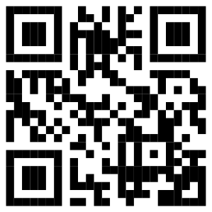

Yuval Noah Harari

Tiến trình lịch sử của loài người. Những quan sát, khuôn mẫu và mô hình tư duy sẽ khiến bạn nhìn lịch sử và những người xung quanh bằng một cách khác. [1]

Sapiens là cuốn sách hay nhất trong thập kỷ vừa qua mà tôi đã đọc. Tác giả đã dành cả thập kỷ để viết cuốn này. Có rất nhiều quan điểm, ý tưởng tuyệt vời đầy ắp trong từng trang sách. [1] ***The Rational Optimist: How Prosperity*** ***Evolves*** (Người Lạc quan Duy lý: Cách sự

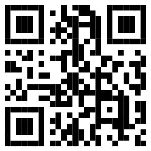

Thịnh vượng Phát triển) của Matt Ridley

Đây là một cuốn sách xuất sắc và mang đến những kiến thức sáng suốt nhất mà tôi đã đọc trong nhiều năm. Trong bảng xếp hạng 20 cuốn sách yêu thích của tôi, có 4 cuốn là do ông viết. [11]

Mọi thông tin trong cuốn sách đều được viết bởi Matt Ridley. Ông là một nhà khoa học, một người lạc quan và một nhà tư duy cấp tiến. Ông là một tác giả tôi yêu thích. Tôi đã đọc và không ngừng đọc lại tất cả các tác phẩm của ông.

→Genome: The Autobiography of a Species in 23 Chapters (Bộ gen: Cuốn tự truyện của một loài trong 23 chương)

→The Red Queen: Sex and the Evolution of Human Nature (Nữ hoàng Đỏ: Tình dục và sự tiến hóa của bản chất con người)

→The Origins of Virtue: Human Instincts and the Evolution of Cooperation (Nguồn gốc của Đức hạnh: Bản năng của con người và tiến hóa của sự hợp tác)

→The Evolution of Everything: How New Ideas Emerge (Sự Tiến hoá của Vạn vật: Cách một ý tưởng mới ra đời)

***Skin in the Game*** (Dấn thân vào cuộc chơi) của Nassim Taleb

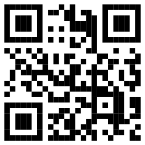

Là cuốn sách hay nhất tôi đã đọc trong năm 2018, vì vậy tôi cực kỳ khuyên bạn nên đọc cuốn sách này. Cuốn sách chứa đựng nhiều quan điểm tuyệt vời. Rất nhiều mô hình và tư duy hay. Tác giả có bày tỏ thái độ khi nêu các quan điểm, nhưng vì ông ấy là người vô cùng lỗi lạc, vậy nên điều này là bình thường. Vì thế hãy bỏ qua những điều đó và tập trung học hỏi những khái niệm. Đây là một trong những cuốn sách kinh doanh hay nhất tôi từng đọc. Và thật may, cuốn sách này không đội lốt một cuốn sách kinh doanh. [10]

***The Bed of Procrustes: Philosophical and Practical*** ***Aphorisms*** (Chiếc giường của Procrustes: Những câu châm ngôn triết học và thực tiễn) của Nassim Taleb

Đây là bộ sưu tập trí tuệ cổ xưa của ông. Ông cũng nổi tiếng với *The Black Swan: The Impact of the Highly Improbable* (Thiên nga Đen: Xác suất cực nhỏ, tác động cực lớn), *Antifragile:* *Things That Gain from Disorder* (Khả năng Cải thiện Nghịch cảnh: Hưởng lợi từ hỗn loạn), và *Fooled by Randomness: The* *Hidden Role of Chance in Life and in the Markets* (Trò đùa của sự ngẫu nhiên: Giải mã bí ẩn xung quanh những điều tình cờ). Tất cả các cuốn sách này đều rất đáng đọc. [7]

***Six Easy Pieces: Essentials of Physics*** ***Explained by Its Most Brilliant Teacher***

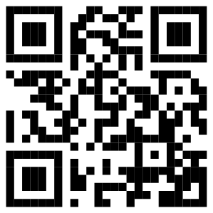

(Sáu Mảnh ghép Dễ dàng: Những khái niệm cơ bản của vật lý qua Lời giải thích của một nhà giáo lỗi lạc) của Richard Feynman

Tôi sẽ tặng cho các con tôi một bản sao của *Six Easy Pieces* (Sáu Mảnh ghép Dễ dàng) và cuốn *Six-Not-So-Easy Pieces:* *Einstein’s Relativity, Symmetry, and Space-Time* (Sáu Mảnh ghép Không dễ dàng: Tính tương đối, Tính đối xứng và Thời gian – Không gian của Einstein). Richard Feynman là một nhà vật lý nổi tiếng. Tôi yêu thích cả phong thái cũng như sự hiểu biết của ông ấy về vật lý.

Tôi cũng đang đọc *Perfectly Reasonable Deviations from the* *Beaten Track* (Những sự chệch hướng hoàn toàn hợp lý ra khỏi lối mòn phổ biến) của ông và đang đọc lại *Genius: The Life and* *Science of Richard Feynman* (Thiên tài: Cuộc đời và Khoa học của Richard Feynman) – một cuốn tự truyện về ông. [8]

***Thing Explainer: Complicated Stuff in*** ***Simple Words*** (Giải thích Vạn vật: Điều

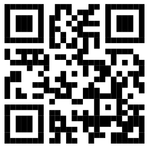

phức tạp qua ngôn từ giản đơn) của Randall Munroe

Một cuốn sách tuyệt vời của Randall Munroe (tác giả của *xkcd*, một trang web hoạt họa mang tính khoa học). Trong cuốn sách này, tác giả giải thích các khái niệm rất phức tạp, từ biến đổi khí hậu đến các hệ thống vật lý cho đến tàu ngầm trong khi chỉ sử dụng hàng nghìn từ phổ biến nhất trong tiếng Anh. Ông ấy gọi chiếc tên lửa phản lực Saturn Five (Sao Thổ V) là “Up Goer Five” (“Thứ đi lên trên V”). Bạn không thể định nghĩa tên lửa là tàu vũ trụ hay tên lửa, nó có tính tự tham chiếu. Ông ấy nói “Thứ đi lên trên”. Khi nói như vậy, trẻ em sẽ hiểu được ngay. [4]

***Thinking*** ***Physics:*** ***Understandable*** ***Practical Reality*** (Tư duy Vật lý: Hiểu

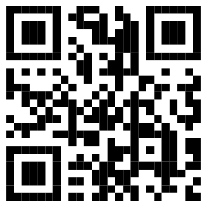

về hiện thực thực tiễn) của Lewis Carroll Epstein

Còn có một cuốn sách vĩ đại khác mang tên *Thinking Physics* (Tư duy Vật lý). Tôi đọc cuốn sách này gần như mọi lúc. Tôi thật sự rất ấn tượng với mặt sau của cuốn sách, nó có một thông điệp nhỏ vô cùng thú vị: “Cuốn sách duy nhất được dùng cho cả bậc phổ thông và bậc đại học”. Điều này là sự thật. Cuốn sách gồm có tất cả những câu đố vật lý đơn giản mà bạn có thể giải thích cho mọi người, từ đứa trẻ 12 tuổi đến sinh viên đại học 25 tuổi ngành vật lý. Tất cả đều chứa những hiểu biết sâu sắc mang tính nền tảng về vật lý. Tất cả chúng đều đánh đố, nhưng bất kỳ ai cũng có thể tìm ra câu trả lời thông qua suy luận logic thuần túy. [4]

***The Lessons of History*** (Những bài học của lịch sử) của Will và Ariel Durant

Đây là một cuốn sách tuyệt vời, tôi thực sự thích nó. Cuốn sách tóm tắt một số chủ đề quan trọng trong lịch sử vô cùng sắc bén. Cuốn này khác hoàn toàn với hầu hết tất cả các cuốn sách lịch sử khác, vô cùng nhỏ gọn nhưng bao quát rất nhiều kiến thức nền tảng. [7]

***The Sovereign Individual: Mastering the Transition to the*** ***Information Age*** (Cá nhân có Chủ quyền: Làm chủ quá trình chuyển đổi sang thời đại thông tin) của James Dale Davidson và Lord William Rees-Mogg

Đây là cuốn sách hay nhất tôi đã đọc sau cuốn *Sapiens* (dẫu cho nó ít được biết đến).

***Poor Charlie’s Almanack: The Wit and*** ***Wisdom of Charles T. Munger*** (Sổ tay

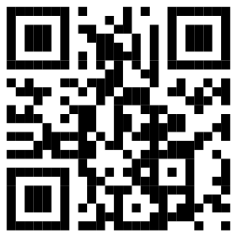

niên giám của Charlie Nghèo khó: Sự lanh lợi và trí tuệ của Charles T. Munger) của Charlie Munger (biên tập bởi Peter Kaufman)

Cuốn sách này mang danh là một cuốn sách kinh doanh, nhưng thực tế nó chỉ là lời khuyên của Charlie Munger (thuộc công ty Berkshire Hathaway) về việc làm thế nào vượt qua chính mình để sống một cuộc đời thành công và có đạo đức. [7] [80]

***Reality Is Not What It Seems: The Journey to Quantum*** ***Gravity*** (Thực tế sẽ không giống như vẻ ngoài của nó: Hành trình tới lực hấp dẫn lượng tử) của Carlo Rovelli

Đây là cuốn sách hay nhất mà tôi đã đọc được năm ngoái. Vật lý, thơ, triết học, và lịch sử đã được đóng gói trong một hình thức có thể dễ dàng tiếp cận được.

***Seven Brief Lessons on Physics*** (Bảy bài học ngắn về Vật lý) của Carlo Rovelli

Tôi đã đọc cuốn sách này ít nhất hai lần.

Đối với lý thuyết trò chơi, ngoài việc tham gia những trò chơi chiến thuật, bạn có thể đọc thử cuốn *The Compleat Strategyst:* *Being a Primer on the Theory of Games of Strategy* (Những Chiến lược gia Hoàn Hảo: Cuốn sách vỡ lòng về lý thuyết trò chơi) của J.D. Williams và *The Evolution of Cooperation* (Sự tiến hoá của Sự hợp tác) của Robert Axelrod. [11]

**TRIẾT HỌC VÀ TÂM LINH**

Mọi cuốn sách của Jed McKenna

Jed tuôn ra sự thật căn bản. Phong cách viết này có thể gây khó chịu, nhưng không phải ai cũng có thể sánh được với những cống hiến cho lẽ phải của ông. [79]

*Theory of Everything (The Enlightened Perspective) –* *Dreamstate Trilogy* (Lý thuyết Vạn vật (Góc nhìn Khai sáng) – Bộ ba cuốn về Trạng thái nằm mơ)

*Jed McKenna's Notebook* (Sổ tay của Jed McKenna)

*Jed Talks #1* và *#2 (*Bài nói số 1 và số 2 của Jed)

Mọi cuốn của Kapil Gupta, Bác sĩ Y khoa

Kapil gần đây đã trở thành cố vấn và huấn luyện viên cá nhân của tôi, và điều này đến từ một người không tin vào huấn luyện viên. [79]

*A Master’s Secret Whispers: For those who abhor noise and* *seek The Truth… about life and living* (Lời Thì thầm Bí mật của chuyên gia: Cho những ai ghét tiếng ồn và tìm kiếm sự thật… về cuộc đời và sự sống)

*Direct Truth: Uncompromising, non-prescriptive Truths to the* *enduring questions of life* (Sự thật Trực diện: Những sự thật không khoan nhượng và không có tính chỉ định những câu hỏi kinh điển về cuộc sống)

*Atmamun: The Path to achieving the bliss of the Himalayan* *Swamis. And the freedom of a living God* (Atmamun: Con đường đạt tới sự hạnh phúc từ những người thầy giảng đạo Himalaya. Và sự tự do của một vị Chúa đang sống)

***The Book of Life*** (Cuốn sách về cuộc đời) của Jiddu Krishnamurti

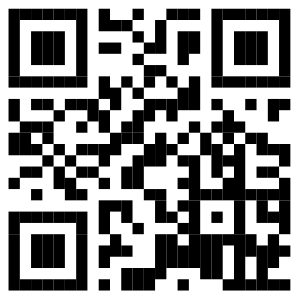

Krishnamurti là một người ít được biết đến, ông là một triết gia Ấn Độ sống vào thời điểm chuyển giao cuối thế kỷ trước và là người có tầm ảnh hưởng cực kỳ lớn đối với tôi. Ông ấy là một người không khoan nhượng, rất thẳng thắn, một người về cơ bản sẽ bảo bạn phải nhìn vào tâm trí của chính mình mọi lúc. Tôi đã chịu ảnh hưởng lớn từ ông ấy. Có lẽ cuốn sách hay nhất của ông là *The Book of Life* (Cuốn sách về cuộc đời) – trích đoạn từ nhiều bài phát biểu và những cuốn sách của ông được thêu dệt lại với nhau.

Tôi sẽ đưa cho các con mình một cuốn *The Book of Life* và bảo lũ trẻ hãy để dành cuốn sách cho đến khi trưởng thành hơn. Bởi vì khi chúng còn nhỏ, cuốn sách này sẽ chẳng có ý nghĩa gì cả. [8]

***Total Freedom: The Essential Krishnamurti*** (Tự Do Tuyệt Đối: Những chắt lọc thiết yếu từ Krishnamurti) bởi Jiddu Krishnamurti

Tôi thích cuốn này vì nó dành cho những người tiến bộ. Những hướng dẫn đến từ một người theo chủ nghĩa duy lý về sự nguy hiểm của tâm trí con người. Một cuốn sách “tâm linh” mà tôi sẽ tiếp tục đọc lại. [1]

***Siddhartha*** của Herman Hesse

Tôi thích cuốn sách này vì nó giống như một cuốn sách kinh điển về triết học, một khởi đầu hoàn hảo cho những người mới bắt đầu. Tôi đã tặng nó cho rất nhiều người, nhiều hơn bất kỳ cuốn sách nào khác. [1]

> Tôi thường đọc lại một cái gì đó của Krishnamurti hoặc Osho. Đây là những triết gia yêu thích của tôi. [4]

[Cập nhật: Hiện giờ tôi bổ sung thêm Jed McKenna, Kapil Gupta, Vashistha Yoga, và Schopenhauer vào danh sách này.]

***The Book of Secrets: 112 Meditations*** ***to Discover the Mystery Within*** (Cuốn

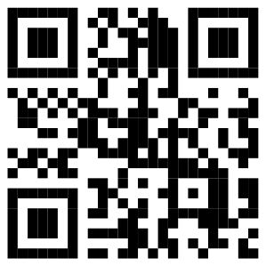

sách của những Bí mật: 112 kiểu thiền khám phá bí ẩn bên trong) của Osho

Hầu hết kỹ thuật thiền là các phương pháp hướng đến sự tập trung. Có rất nhiều kỹ thuật thiền khác nhau. Nếu bạn mong muốn tìm hiểu khái quát về tất cả các kỹ thuật thiền, thì đây là cuốn sách bạn có thể tìm đọc. Tôi biết gần đây Osho có một vài điều tiếng, nhưng ông ấy là một người khá thông minh. Tác phẩm là bản dịch của một cuốn sách tiếng Phạn cổ với 112 cách thiền khác nhau. Bạn có thể thử từng phương pháp và xem đâu phương pháp nào phù hợp với bạn. [74]

*The Great Challenge: Exploring the World Within* (Thử thách Vĩ đại: Khám phá Thế giới bên trong) của Osho

*The Way to Love: The Last Meditations of Anthony de Mello* (Con đường tới Tình yêu: Những phương pháp thiền cuối cùng của Anthony de Mello) của Anthony de Mello

*The Untethered Soul: The Journey Beyond Yourself* (Cởi trói Linh hồn: Hành trình vượt qua giới hạn của chính mình) của Michael Singer ***Meditations*** (Thiền định) của Marcus Aurelius

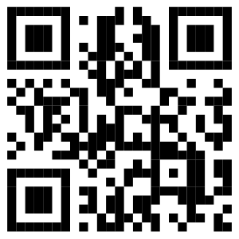

Marcus Aurelius đã thay đổi hoàn toàn cuộc sống của tôi. Đây là một cuốn nhật ký của vị hoàng đế thời kỳ La Mã. Ông là người quyền lực nhất trên Trái đất vào thời kỳ đó. Ông đã viết nhật ký và chưa từng nghĩ nó sẽ được xuất bản. Khi bạn đọc cuốn sách, bạn sẽ nhận thấy ông ấy cũng có những vấn đề và những cuộc đấu tranh tinh thần giống như bao người khác, Marcus cũng đang cố gắng để có thể trở thành một người tốt hơn. Ngay tại thời điểm đó, bạn sẽ biết thành công và quyền lực sẽ không giúp ích được gì cho đứa trẻ bên trong bạn – bạn vẫn phải nỗ lực để hiểu được nó. [6]

***Love Yourself Like Your Life Depends on It*** (Hãy yêu thương bản thân mình như thể cuộc sống của bạn phụ thuộc hết vào tình yêu này) của Kamal Ravikant

Tôi thực sự đã và đang đọc cuốn sách của anh trai tôi, L*ove* *Yourself Like Your Life Depends on It*. Tôi nghĩ nó đã được viết rất ngắn gọn súc tích (Rõ ràng đây là một lời quảng cáo cho anh trai tôi.)

Anh ấy là một triết gia trong gia đình – Tôi chỉ là kẻ nghiệp dư. Anh ấy có cả một danh sách các cuốn sách tuyệt vời:

> Có lần tôi hỏi một nhà sư rằng ông ấy đã tìm thấy sự bình yên chưa.  
> “Tôi sẽ nói ‘có’”, ông ấy trả lời. “Với tất cả những gì đã xảy ra, tôi sẽ trả lời là ‘có’.” [7]

***The Tao of Seneca: Practical Letters from a Stoic Master*** (Đạo của Seneca: Những Bức thư đạo đức từ một vị thầy của chủ nghĩa khắc kỷ)

Đây là cuốn sách nói được nghe nhiều nhất. Và cũng là cuốn sách nói có tầm quan trọng nhất mà tôi từng nghe.

***How to Change Your Mind*** (Làm thế nào để thay đổi tâm trí) của Michael Pollan

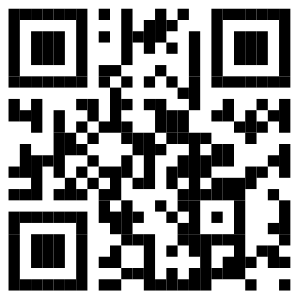

*How to Change Your Mind* là một cuốn sách hay mà Michael đã viết gần đây. Và tôi cho rằng đây là một cuốn sách xuất sắc mà mọi người nên đọc.

Cuốn sách thảo luận về chất thức thần. Chất thức thần có thể được coi là một loại mã gian lận (cheat code) trong việc tự quan sát bản thân. Tôi không khuyến nghị sử dụng chất gây nghiện, bạn có thể làm tất cả điều đó thông qua thực hành thiền. Nếu bạn muốn tăng tốc, chất thức thần sẽ có ích. [74]

***Striking Thoughts: Bruce Lee’s Wisdom for Daily Living*** (Những suy nghĩ đáng chú ý: Sự thông thái của Lý Tiểu Long trong cuộc sống hàng ngày) của Lý Tiểu Long (Bruce Lee) Thật khó tin là Lý Tiểu Long đã viết ra một vài triết lý tuyệt vời, và cuốn *Striking Thoughts* là bản tóm tắt những triết lý ấy.

***The Prophet*** (Nhà tiên tri) của Kahlil Gibran

Cuốn sách này giống như một cuốn sách tôn giáo đầy chất thơ thời hiện đại. Nó xứng đáng được đứng cùng với Bhagavad Gita (Chí Tôn Ca), the Tao Te Ching (Đạo Đức Kinh), the Bible(Kinh thánh) và the Qur'an (Kinh Coran). Cuốn sách mang đến cảm giác của sự sùng đạo và chân lý. Trên thực tế, đây lại là một cuốn sách rất dễ tiếp cận, đẹp đẽ, phi giáo phái và phi đảng phái. Tôi rất yêu thích cuốn sách này.

Ông ấy có năng khiếu miêu tả một cách thật thơ mộng trẻ em là như thế nào, những con người yêu nhau là như thế nào, hôn nhân nên như thế nào, bạn nên đối xử với kẻ thù và bạn bè của mình ra sao, làm cách nào để bạn làm việc với tiền, những gì bạn nghĩ mỗi lần phải giết hại một thứ gì đó để có đồ ăn. Giống như những cuốn sách tôn giáo vĩ đại khác, tôi cảm thấy tác phẩm này đã đưa ra một câu trả lời rất sâu sắc, rất triết lý nhưng rất đúng đắn về cách tiếp cận những vấn đề lớn trong cuộc sống. Tôi sẽ giới thiệu *The Prophet* cho tất cả mọi người, cho dù bạn có theo tôn giáo hay không. Dù bạn là người theo đạo Cơ đốc, đạo Hindu, Do Thái Giáo hay người vô thần, tôi nghĩ đây là một cuốn sách tuyệt vời rất đáng để đọc. [7]

**KHOA HỌC VIỄN TƯỞNG**

> Tôi bắt đầu với truyện tranh và sách khoa học viễn tưởng. Sau đó, tôi đam mê lịch sử và tin tức. Tiếp theo là tâm lý học, khoa học thường thức và công nghệ.

***Ficciones*** (Truyện Hư Cấu) của Jorge Luis Borges

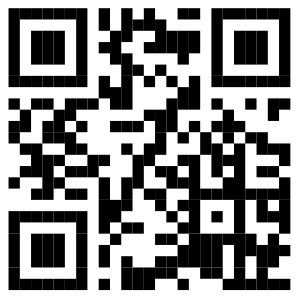

Tôi yêu Jorge Luis Borges – một tác giả người Argentina. Tuyển tập truyện ngắn *Ficciones*, hay *Labyrinths* của ông thật tuyệt vời. Borges có lẽ vẫn là tác giả có tầm ảnh hưởng nhất mà tôi từng đọc, một người không chỉ đơn thuần viết về triết học mà còn kèm theo cả khoa học viễn tưởng. [1]

***Stories of Your Life and Others*** (Những câu chuyện của cuộc đời bạn và họ) của

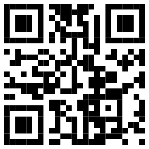

Ted Chiang

Có lẽ ở thời điểm hiện tại truyện ngắn khoa học viễn tưởng yêu thích nhất của tôi là “Understand” (Hiểu) của Ted Chiang. Cuốn sách nằm trong bộ sưu tập có tên *Stories of Your Life and Others*. “Story of Your Life” đã được dựng thành phim có tên *Arrival* (Cuộc đổ bộ). [1]

***Exhalation: Stories*** (Hãy thở ra: Những câu chuyện) của Ted Chiang

Cuốn sách này suy tưởng về những điều kỳ diệu của nhiệt động lực học từ nhà văn viết truyện ngắn khoa học viễn tưởng hay nhất trong thời đại chúng ta.

***The Lifecycle of Software Objects*** (Vòng đời của Đối tượng mô phỏng từ Phần mềm) của Ted Chiang

Một kiệt tác khoa học viễn tưởng nữa của Ted Chiang.

***Snow Crash*** (Tàn Tuyết) của Neal Stephenson

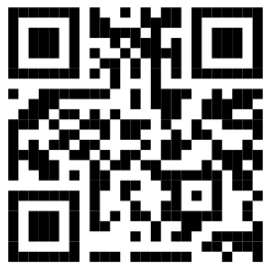

*Snow Crash* (Tàn Tuyết) là một cuốn sách cực kỳ tuyệt vời. Bạn sẽ không thể tìm thấy một cuốn sách nào tương tự như cuốn này. *Snow Crash* (Tàn Tuyết) thuộc một liên minh của riêng nó. Stephenson cũng là tác giả của cuốn *The Diamond* *Age* (Kỷ nguyên Kim cương).

**“The Last Question”** (Câu hỏi Cuối cùng), một truyện ngắn của Isaac Asimov

Tôi luôn luôn trích dẫn mọi điều trong cuốn “The Last Question”. Tôi say mê nó như một đứa trẻ.

**Ông đang đọc lại những cuốn sách nào?**

Đây là một câu hỏi hay. Trong khi chúng ta đang nói chuyện, tôi thường sẽ mở ứng dụng Kindle của mình lên. Thông thường, tôi luôn đọc lại một số cuốn sách về khoa học.

Tôi đang đọc một cuốn sách về lý thuyết bắt chước của René Girard. Đây giống như một cuốn sách tổng quan hơn, bởi vì tôi không thể đọc hết các bài viết hiện thời của ông ấy. Tôi đang đọc *Tools of Titans* (Công cụ của Những người khổng lồ), một cuốn sách của Tim Ferriss, viết về những gì ông ấy học được từ rất nhiều nhân vật xuất sắc.

Tôi cũng đang đọc một cuốn sách tên là *Thermoinfocomplexity*. Cuốn sách này vốn được viết bởi một người bạn của tôi, Behzad Mohit. Tôi cũng vừa đọc xong cuốn *Pre-Suasion: A Revolution* *Way to Influence and Persuade* (Pre-Suasion: Con đường dẫn tới tầm ảnh hưởng và khả năng thuyết phục), hay tôi nên nói là mình vừa đọc lướt xong cuốn *Pre-Suasion* của Robert Cialdini. Tôi không nghĩ mình cần phải đọc hết toàn bộ cuốn sách để hiểu rõ tất cả các vấn đề, nhưng sẽ rất tốt khi đọc về những gì tôi đang làm. Đây thực sự là một cuốn sách lịch sử khá tuyệt vời. Tôi hiện đang đọc cuốn *The Story of Philosophy: The Lives* *and Opinions of the Great Philosophers* (Câu chuyện về triết học: Cuộc đời và quan điểm của các triết gia vĩ đại), cũng của Will Durant.

Tôi đang có một đứa con nhỏ, vì thế mà tôi có rất nhiều sách dành cho thiếu nhi. Tôi thường sử dụng chúng như tài liệu tham khảo nhiều hơn là với mục đích khác. Gần đây tôi cũng có đọc một số tác phẩm của Emerson và Chesterfield. Tôi cũng có một cuốn của Leo Tolstoy ở đây.

Alan Watts. Scott Adams. Gần đây tôi đã đọc lại cuốn *God’s* *Debris* (Mảnh vụn của Chúa). Một người bạn của tôi đang đọc lại *Đạo Đức Kinh*, nên tôi cũng đọc lại cuốn đó. Thực sự có rất nhiều cuốn sách. Ý của tôi là, tôi có thể tiếp tục kể tên nhiều cuốn sách khác. Trong đó có cả cuốn sách của Nietzsche. Có cuốn *The Undercover Economist* (Nhà kinh tế ngầm) [Tim Harford]. Cuốn sách của Richard Bach *[Illusions: The* *Adventures of a Reluctant Messiah]* ([Ảo tưởng: Cuộc phiêu lưu của một đấng cứu thế bất đắc dĩ]). Còn có một số cuốn sách của Jed McKenna nữa.

Có một ít cuốn của Dale Carnegie. *The Three-Body Problem* (Tam Thể) [Cixin Liu]. *Man’s Search for Meaning* (Đi tìm Lẽ sống [Viktor E. Frankl]). *Sex at Dawn* (Tình dục thuở hồng hoang) [Christopher Ryan]. Có rất nhiều cuốn sách khác nữa.

Nhân tiện, tôi đã tự bỏ qua hai phần ba số sách khi tôi kể với mọi người là đang đọc sách gì. Lý do là vì chúng hơi đáng xấu hổ. Chúng không giống như những cuốn sách hay đáng để đọc. Những cuốn sách này nghe có vẻ tầm thường hoặc ngớ ngẩn. Nhưng ai sẽ quan tâm chứ? Tôi không cần phải nói với mọi người tất cả những gì tôi đọc. Tôi đọc tất cả những thứ người khác cho là rác rưởi hoặc thậm chí đáng chê trách. Tôi đọc tất cả những thứ tôi không đồng tình vì chúng quá phức tạp hay có tác động lớn đến tâm trí của chúng ta. [4]

> Tôi luôn tiêu tiền cho những cuốn sách. Tôi chưa bao giờ coi đó là chi phí. Đó là một khoản đầu tư. [4]

**BLOG**

*(Vì có rất nhiều đường dẫn (link) trong phần này, bạn có thể* *thích bản điện tử hơn. Hãy truy cập Navalmanack.com để* *thuận tiện đọc bản điện tử của chương này.)*

Một số trang blog tuyệt vời:

@KevinSimler – Melting Asphalt, https://meltingasphalt.com/

@farnamstreet – Farnam Street, A Signal in a World Full of Noise, https://fs.blog/

@benthompson – Stratchery, https://stratechery.com/

@baconmeteor – Idle Words, https://idlewords.com/ [4] **“The Munger Operating System: How to Live a Life That** **Really Works”** (Hệ điều hành Munger: Làm thế nào để sống một cuộc đời thực sự hiệu quả) của @FarnamStreet

Những quy tắc sống và nhờ đó trở nên thịnh vượng.

**“The Day You Became a Better Writer”** (Ngày bạn trở thành một người viết tốt hơn) của Scott Adams

Mặc dù tôi đã trở thành một nhà văn vô cùng xuất chúng và tôi đã viết rất nhiều từ khi còn trẻ, nhưng tôi vẫn tạo một trang blog và để nó làm nền khi viết một điều gì đó quan trọng. Blog thật sự rất có ích. Tôi sử dụng blog để làm khuôn mẫu căn bản để có thể viết tốt. Hãy nghĩ về tiêu đề, “Ngày bạn trở thành một người viết tốt hơn.” Đây là một tiêu đề thực sự ấn tượng. Qua một trang blog nhỏ, ông ấy đã dạy bạn về tầm quan trọng của sự ngạc nhiên, tầm quan trọng của tiêu đề, tầm quan trọng của việc ngắn gọn và trực diện, không sử dụng một số tính từ và trạng từ, sử dụng thể chủ động chứ không phải thể bị động,... Chỉ với blog này, bạn có thể thay đổi phong cách viết của mình mãi mãi nếu bạn chịu đặt cái tôi xuống và tiếp thu nó đúng cách. [6]

Bạn muốn trở thành một người thông minh hơn chỉ trong 10 phút? Hãy đọc bài này: “Crony Beliefs” (Niềm tin Thân hữu) của Kevin Simler.

Bài viết hay nhất tôi từng đọc về “Career Decisions” (Những quyết định sự nghiệp) (ở Thung lũng Silicon/mảng công nghệ) của @eladgil

Sapiens của Harari dưới dạng bài giảng/khoá học trên YouTube Tất cả các trường kinh doanh đều nên có một khóa học về Aggregation Theory (Lý thuyết Kết tụ). Hoặc hãy học nó từ chính bậc thầy @benthompson, nhà phân tích giỏi nhất trong lĩnh vực công nghệ.

Một tác phẩm tuyệt vời: “Quantum physics is not ‘weird.’ You're weird.” (Vật lý lượng tử không ‘kỳ quặc’. Chính bạn mới kỳ quặc) – “Think Like Reality” (Tư duy giống Thực tại) của Eliezer Yudkowsky

Một bài viết nhất định phải đọc: “Lazy Leadership” (Lãnh đạo Lười nhác) của @Awilkinson

Với người có thể đạt được thành công bằng chính sức mình, trí tuệ của họ sẽ là vô hạn. Mọi thứ trên trang của @EdLatimore đều đáng đọc đối với những người nỗ lực hơn người: https://edlatimore.com/

> Nếu bạn lựa chọn ăn, đầu tư và suy nghĩ theo những gì "tin tức" khuyến khích, bạn sẽ kết thúc trong tình trạng thiếu chất dinh dưỡng, tài chính thua lỗ và suy thoái về đạo đức.

## MỘT SỐ GỢI Ý KHÁC

Các tài khoản Twitter dưới đây: @AmuseChimp (tài khoản Twitter yêu thích nhất của tôi từ trước đến nay) @mmay3r @nntaleb Art De Vany (trên Facebook) Thiên tài ở đây, chỉ là được phân bổ không đều. [4]

Bài viết nhất định phải đọc. (Chuỗi bài Twitter về “intellectual compounding” (tích luỹ trí tuệ) của @zaoyang. [11]

Trên thực tế, có một vài tiểu thuyết đồ họa thực sự đặc sắc. Nếu bạn thoải mái với yếu tố hoạt hình của nó, thì các cuốn như *Transmetropolitan* (Xuyên Đô thị) [Warren Ellis], *The* *Boys* (Những chàng trai) [Garth Ennis], *Planetary* (Hành tinh) [Warren Ellis], và *The Sandman* (Người Cát) [Neil Gaiman],… tôi đánh giá chúng thuộc nhóm những tác phẩm nghệ thuật đẹp nhất của thời đại chúng ta. Tôi cũng lớn lên là một cậu bé đọc truyện tranh, vì vậy rất có thể tôi sẽ thiên vị thể loại tiểu thuyết đó. [1]

***Rick and Morty*** (Rick và Morty) (chương trình truyền hình + truyện tranh)

Rick và Morty là chương trình truyền hình hay nhất (tất nhiên là theo quan điểm của tôi). Hãy xem tập đầu tiên – đó là tất cả những gì bạn cần. Chương trình này chính là giao thoa của hai cuốn truyện khoa học viễn tưởng *Back to the Future* (Trở về Tương lai) và *The Hitchhiker’s Guide to the Galaxy* (Hướng dẫn của Hitchhiker đi tới dải Ngân hà).

Truyện tranh *Rick và Morty* (của Zac Gorman) cũng tài tình như chương trình truyền hình vậy.

**“You and Your Research”** (Bạn và Nghiên cứu của bạn) của Richard Hamming

Đây là một bài luận hay, tôi cực kỳ khuyến khích bạn đọc nó. Trông có vẻ như nó được viết cho những đối tượng làm trong mảng nghiên cứu khoa học, nhưng tôi nghĩ nó có thể áp dụng cho số đông. Đây là bài luận của một người kỳ cựu bàn về cách làm việc hiệu quả. Nó khiến tôi nhớ đến những gì Richard Feynman từng nói, mặc dù tôi nghĩ Hamming đã diễn đạt nó hùng hồn hơn hầu hết những tài liệu khác tôi từng đọc. [74]
