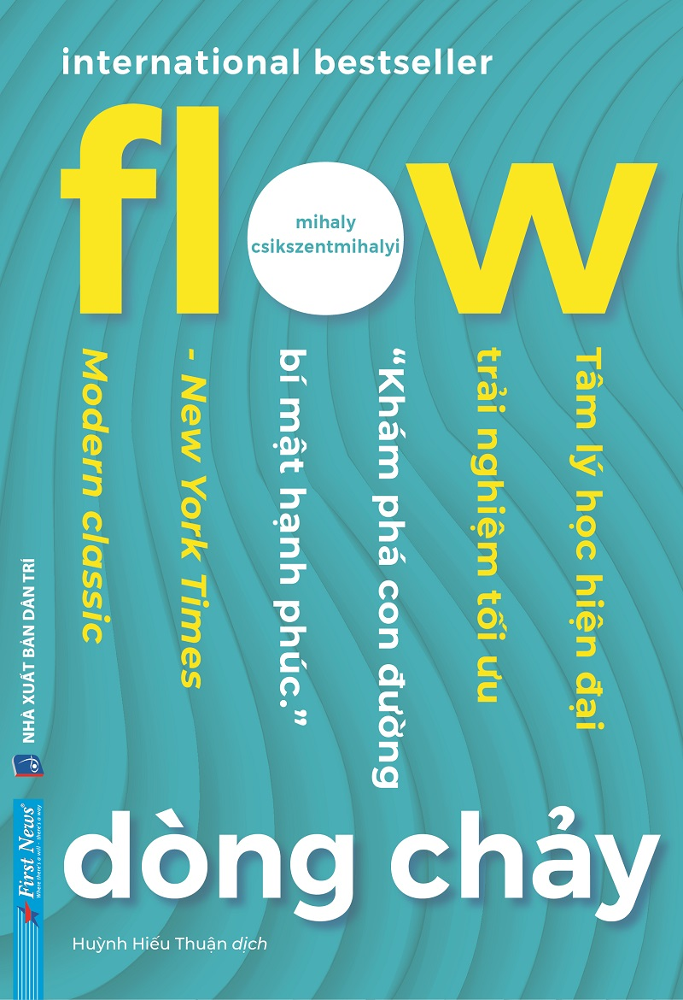

# DÒNG CHẢY (FLOW)
### Tâm lý học về trải nghiệm tối ưu

- **Tác giả:** Mihaly Csikszentmihalyi  
- **Dịch giả:** Nhiều dịch giả  
- **Tên nguyên tác:** *Flow: The Psychology of Optimal Experience*  
- **Thể loại:** Tâm lý học tích cực & Trải nghiệm tối ưu  

---

## Danh sách các phần và chương sách

- [Trang bìa và Mục lục](00_muc_luc.md)
1. [Lời nói đầu](01_loi_noi_dau.md)
2. [Chương 1: Hạnh phúc được xem xét lại](02_chuong_01.md)
3. [Chương 2: Giải phẫu học về ý thức](03_chuong_02.md)
4. [Chương 3: Sự thưởng thức và chất lượng cuộc sống](04_chuong_03.md)
5. [Chương 4: Những điều kiện của trạng thái dòng chảy](05_chuong_04.md)
6. [Chương 5: Cơ thể trong dòng chảy](06_chuong_05.md)
7. [Chương 6: Dòng chảy của suy nghĩ](07_chuong_06.md)
8. [Chương 7: Làm việc như dòng chảy](08_chuong_07.md)
9. [Chương 8: Thưởng thức sự cô độc và mối quan hệ với người khác](09_chuong_08.md)
10. [Chương 9: Đánh lừa sự hỗn loạn](10_chuong_09.md)
11. [Chương 10: Tạo ra ý nghĩa](11_chuong_10.md)
12. [Những bổ sung](12_nhung_bo_sung.md)
13. [Nguồn tham khảo](13_nguon_tham_khao.md)
14. [Chú thích](14_chu_thich.md)

---
*Tài liệu được chuyển đổi từ file gốc `raw/FlowDongChay.pdf` sang Markdown đầy đủ nội dung, giữ nguyên cấu trúc, định dạng in đậm, in nghiêng, chú thích và hình ảnh minh họa.*
