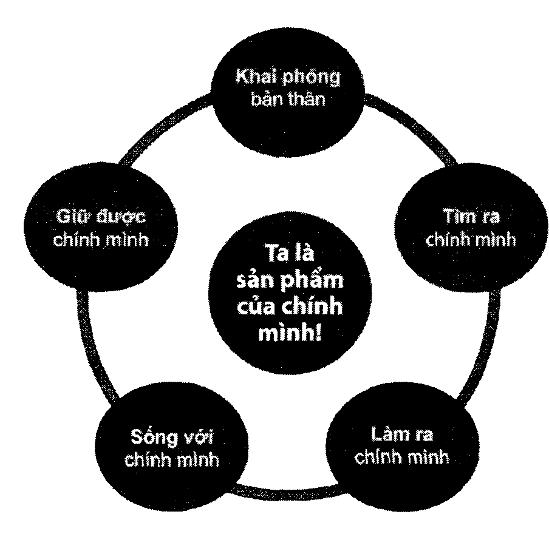

# Phần 1: Làm người

## 1. Thế nào là con người? Làm người là... làm gì?

Tại sao cần phải bàn về “làm người”? Chẳng phải ai sinh ra trên cõi đời này cũng mặc nhiên là người rồi sao?

Đó là câu hỏi mà tôi thường xuyên nhận được khi bàn về đề tài này. Mỗi lần như vậy, tôi lại nhớ tới câu chuyện của chị bán nước mía đầu hẻm. Một lần nọ, chị kể với tôi:

“Bác ơi, hôm qua con bé nhà em tự dưng nó hỏi: Má ơi, “người” là gì mà sao lúc nào ba má với cô giáo cũng nói mong con học giỏi để lớn lên “thành người” hết vậu má? Bộ con chưa phải là người hả má? Em kêu nó màu đi hỏi ba màu đi, bu học hết lớp 12 rồi nên biết người “nguyên con” luôn, còn má thì mới học hết lớp 9 thôi, nên hông chừng là má mới thành có... “nửa người” à! Nó hỏi ba, bn nó la “không thành người thì chẳng lẽ thành ma hả con?”, rồi kêu nó đi hỏi cô giáo, gì cô giáo học đại học nên chắc là biết rõ hơn. Vào lớp, nó hỏi cô giáo, cô chẳng những không chỉ mà còn nại nó: “Học hết cơm hết gạo rồi mà không biết thành người là thành gì? Hỏi nữa là cô trừ điểm đó!”

Thật tội nghiệp cho đứa trẻ, nhưng cũng có thể thông cảm cho những người lớn trong câu chuyện này. Bởi câu hỏi mà đứa trẻ đặt ra là một câu hỏi vô cùng hóc búa mà biết bao triết gia, biết bao nhà tư tưởng đã tham gia bàn luận và kiến giải từ biết bao thế kỷ nay nhưng vẫn chưa thống nhất được câu trả lời thuyết phục cho toàn bộ nhân loại.

Chính vì vậy, tôi cũng không có ý định trình bày một định nghĩa “con người” thật hoàn hảo trong cuốn sách này. Và tôi tin rằng dù có tìm thấy khái niệm hoàn hảo đó hay không thì cũng không quan trọng, bởi chỉ riêng việc đặt ra câu hỏi “Thế nào là con người?” và luôn suy ngẫm, chiêm nghiệm về nó trong hành trình cuộc sống và trên đường đời cũng đã giúp chúng ta trở nên “người” hơn.

Theo Plato - một triết gia vĩ đại thời cổ đại thì: “Con người là mội sinh vật luôn đi tìm ú nghĩa” (của cuộc sống, của mọi thứ...). Thật vậy, có lẽ không có sinh vật nào lại luôn trăn trở về sự tồn tại của bản thân mình hay về ý nghĩa của mọi thứ, của mọi hành động như con người. Chỉ có con người mới luôn tự vấn “Sống để làm gì?”, “Học để làm gì?”, “Làm để làm gì?” “Ý nghĩa của đời ta nằm ở nơi đâu?”... Aristotle, một triết gia vĩ đại khác, cũng từng nói: “Con người là tuột con vật có mục đích sống. Cuộc đời của anh ta chỉ có ý nghĩa khi luôn hướng tới nà nỗ lực cho mục đích sống của mình”.

Như vậy, có thể hiểu điều giúp cho con người trở nên khác biệt chính là lẽ sống - là thứ mà anh ta luôn muốn hướng tới, là thứ mà thiếu nó thì anh ta chỉ là một sinh vật vô hồn trong hình hài của giống người.

Có một “lẽ” khác mà chỉ con người mới hiểu và mới chiến đấu vì nó, đó là “lẽ phải”. Tôi rất tâm đắc với câu nói của nhân vật Nguyễn Trãi trong vở kịch Bí mật Lệ Chí Viên: “Con thú có thể cắn chết con người, nhưng vẫn là cơn thú. Con người mang trong mình lẽ phải có thể bị sát hại pì lẽ phải, nhưng bảo vệ lẽ phải mãi mãi vẫn là thiên chức con người”.

Câu chuyện về cái chết của triết gia vĩ đại thời Hy Lạp cổ đại Socrates cũng là mình chứng cụ thể nhất cho câu nói này. Ông đã bị chính quyền Athens buộc tội gieo rắc sự nghi ngờ các thần linh và làm băng hoại tư tưởng của thanh niên do dám truyền bá về các vị thần mới ngoài hệ thống các vị thần được chính quyền Athens thừa nhận. Ông bị tuyên án phải tự tử bằng thuốc độc, và chỉ có thể thoát án nếu chịu thừa nhận tội trạng của mình.

Socrates đã lựa chọn cái chết, vì với ông sự thật và lẽ phải còn quan trọng hơn sự sống. Trong một bức tranh vẽ lại cảnh tượng trước lúc Socrates qua đời, người ta thấy ông một tay chỉ thẳng lên trời như lời tuyên thệ trung thành với lý tưởng bảo vệ lẽ phải của mình, một tay với lấy chén thuốc độc như sự sẵn sàng đón nhận cái chết. Trong lời tự biện hộ cho mình trước khi chết, ông nói:

“Dù ở thế giới này hay thế giới bên kia, tôi nẫn sẽ Hiếp tục tìm hiểu ai là người thông thái thực sự, ni là kẻ thông thái giả hiệu, mỉ thì không. Ở thế giới bên kia, người ta không xử tử một người chỉ tì anh ta dám đặt rm những câu hỏi. Vì thế, thưa các bị quan tòn, tôi sẽ đón nhận cái chết cới một thái độ hân hoan, và chắc chắn một điều rằng, sẽ không một điều xấu xa nào có thể xây ra pới một con người tử tế, khi còn sống cũng như khi chết đi. Giờ khởi hành đã điểm, và chúng ta sẽ đi cơn đường của mình - tôi đi về cái chết, các vị đi nề cái sống. Đường nào tốt hơn thì chỉ có Chúa mới biết”.

Thái độ bình thản và không một chút lưỡng lự của Socrates trong việc lựa chọn lẽ phải hay là cái chết khiến tôi ngẫm nghĩ: “Quả thật, có những thứ thường được cho là trên hết - như cái chết. Nhưng với những con người mang trong mình lẽ phải, cái “trên hết” của họ thật đặc biệt”,

Chẳng hạn, từ nhỏ tôi đã được nghe và được dạy rằng, “tổ quốc là trên hết”, “đồng bào là trên hết”, nhưng rồi tôi lại tự nghĩ “đồng loại” lớn hơn “đồng bào” chứ! Nếu làm lợi cho đồng bào mình, quê hương mình, nhưng lại làm hại đồng loại của mình thì điều này khó có thể chấp nhận được. Trong lịch sử đã có bao kẻ nhân danh sự vĩ đại của của dân tộc mình, đồng bào mình mà sẵn sàng làm hại đồng loại như Hitler, Pol Pot...

Nhưng hình như đồng loại cũng chưa phải là trên hết?

Đó là câu chuyện trong bộ phim Aoatar của đạo diễn lừng danh James Cameron - một bộ phim đã đi vào lịch sử điện ảnh thế giới như một trong những siêu phẩm điện ảnh thành công nhất về cả doanh thu lẫn nghệ thuật và công nghệ làm phim. Bộ phim là một câu chuyện diễn Ta ở thời tương lai, với nhân vật chính là một cựu quân nhân được cử đi tham gia đội quân chinh phục một hành tỉnh trù phú có tên Pandora. Trong quá trình làm gián điệp để thu thập thông tin về hành tính này, anh đã nhận ra tính phi nghĩa của chiến dịch xâm lăng đó và anh đã sát cánh cùng những cư dân của hành tỉnh Pandora để chống lại người trái đất và bảo vệ những giá trị văn hóa, lịch sử, tỉnh thần thiêng liêng của hành tỉnh xinh đẹp này.

Câu chuyện của bộ phim Ao4tar có vẻ hơi trái với một câu nói quen thuộc chúng ta thường nghe là: “Đến cả thú vật cũng không ăn thịt đồng loại của mình!. Nhưng người anh hùng được khán giả khắp thế giới yêu mến trong bộ phim này, với “tiếng gọi” của lẽ phải, của lương tri, đã cầm súng chống lại đồng loại của mình. Ví dụ này cho thấy không có giới hạn cho lẽ phải. Nó có thể vượt lên trên cả tình đồng loại và là điều mà một con người đúng nghĩa sẽ không ngừng sống và chiến đấu vì nó.

Qua đó cho thấy rằng, với con người đúng nghĩa, trên đời này không có gì là “trên hết ngoại trừ lương tri và phẩm giá của mình. Nói cách khác, với con người thực sự, thế giới vĩ đại nhất chính là “con người bên trong” của họ và họ sẽ luôn hành động theo “tiếng gọi lương trí từ bên trong” của mình.

Eon người tự da / tự trị

Trong những xã hội xưa, nhất là xã hội Á Đông, quan niệm về việc sống có lẽ sống và lẽ phải thường chỉ dừng lại ở việc nên sống sao cho hướng thiện, vô hại (không làm hại đến người khác), hữu ích (cho càng nhiều người càng tốt) thì trong xã hội văn minh, người ta thường dùng khái niệm “con người tự do” / “con người tự trị để khái quát đầy đủ hơn câu chuyện làm người. Và đó cũng là cách hiểu mà khái niệm “làm người” mà chương sách này muốn hướng đến. Nói cách khác, câu hỏi “Thế nào là con người?” cần được hiểu đầy đủ là “Thế nào là con người tự do / tự trị?”

Có nhiều cách hiểu liên quan đến khái niệm này, nhưng theo cách hiểu của tôi, con người “tự tr{ / “tự do” là con người sở hữu hai thứ: (1) Tự trọng và (2) Tôn trọng.

“Tự trọng” nghĩa là biết coi trọng mình, nhưng không phải theo nghĩa vị kỷ (chỉ biết đến danh lợi của bản thân mình) mà là co; trọng phẩm giá / đạo đức của mình. Một người có tự trọng hay không cũng thường được thể hiện qua câu trả lời hay qua hành xử của anh ta cho những câu hỏi như: “Điều gì khiến tôi sợ hãi / xấu hổ?”, “Điều gì khiến tôi tự hào / hạnh phúc?”...

Người tự trọng tất nhiên sẽ biết sợ sự trừng phạt của nhà nước (sợ pháp lý) nếu làm trái pháp luật và sợ điều tiếng dư luận của xã hội (sợ đạo lý) nếu làm trái với luân thường lẽ phải. Nhưng đó vẫn chưa phải là điều đáng sợ nhất với họ. Điều đáng sợ nhất đối với một người tự trọng là sự giày vò bản thân khi làm những chuyện đi ngược lại lương tri của chính mình, phản bội lại lẽ sống, giá trị sống, nguyên tắc sống mà mình theo đuổi và có cảm giác đánh mất chính mình. Nói cách khác, đối với người có tự trọng, có đạo đức, “tòa án lương tâm” còn đáng sợ hơn cả “tòn án nhà nước” hay “tòn án dư luận”.

Người tự trọng thường đối diện với lương tri và phẩm giá của bản thân, đối diện với “con người bên trong” của mình để hành động hơn là đối diện với sự răn đe của luật pháp hay sự phán xét của dư luận bên ngoài. Do đó, họ sẽ khó có thể làm việc xấu, việc sai, ngay cả khi việc xấu, việc sai đó rất có lợi cho mình và nếu có làm thì cũng không sao cả, vì việc xấu, việc sai đó đã trở nên phổ biến và bình thường với mọi người.

Chẳng hạn, một người chăm chỉ thì khi làm ở một công ty mà ở đó mọi người đều làm việc chăm chỉ thì anh ta cũng sẽ làm việc chăm chỉ, còn khi đi đến một công ty mà ở đó hầu hết mọi người đều... làm biếng thì anh ta vẫn sẽ làm việc chăm chỉ, làm việc hết mình. Anh ta làm việc không phải vì sự sợ hãi cái nhìn của sếp hay sự đánh giá của đồng nghiệp, mà vì con người anh ta vốn dĩ là như thế, anh ta không muốn sống khác đi, dù là ở đâu. Ngày nay, giới trẻ thường dùng câu nói “Hãy là chính mình!” như một câu châm ngôn thời thượng để cổ vũ cho sự tự do, thoải mái làm những điều mình thích. Nhưng không phải ai cũng hiểu và thực hiện phương châm “Hãy là chính mình!” một cách sâu sắc như anh nhân viên trong ví dụ trên.

Hay như một ví dụ khác: “Tôi từ chối nhận phong bì vì tự tôi cảm thấu khó chấp nhận được điều đó, dù rằng lôi đang rất cần tiền và nếu tôi có nhận phong bì thì cũng không sao, tì ở đâu ai cũng nhận phong bì cả”. Người tự trọng làm vậy vì phẩm giá của họ và vì lương tâm chức nghiệp của họ, chứ không vì tác động từ bên ngoài như dư luận hay luật pháp hay tiếng tăm. Nếu không được sống đúng với con người của mình, họ sẽ xin nghỉ việc và tìm một nơi khác, chứ không chấp nhận sự thỏa hiệp đến mức phản bội chính mình để rồi mình không còn là mình nữa.

Người tự trọng có hạnh phúc, có tự hào khi được sự ghi nhận, mến trọng hay ngưỡng mộ của người khác dành cho mình không? Câu trả lời đương nhiên là “Có, rất hạnh phúc, rất tự hà”. Nhưng đó chưa phải là hạnh phúc lớn nhất. Niềm hạnh phúc lớn nhất với họ là niềm tự hào sâu kín và riêng tư từ bên trong con người của họ về những việc mà họ làm, về những điều mà họ theo đuổi. Chính vì được dẫn dắt bởi nội tại của bản thân hơn là bị chỉ phối từ bên ngoài, người tự trọng thường rất tự do và tự trị khi hành động. Nói cách khác, người tự trọng / tự trị thường không muốn làm điều xấu, ngay cả khi không ai có thể biết niệc họ làm; Họ sẵn lòng làm điều tốt ngau cả khi không có ai biết đến; Họ sẵn lòng làm điều đúng mà không hề để ý đến chuyên có ai ghí nhận việc mình làm hau không. Nêu tình cờ có ai đó biết và ghi nhận thì cũng vui, nhưng nếu không có ai biết đến và cũng không có ai ghi nhận điều tốt mà mình làm thì cũng không sao cả, vì phần thưởng lớn nhất đối với người tự do / tự trị / tự trọng là “được sống đúng tới con người của mình”, tất nhiên đó là con người phẩm giá, con người lương tri mà mình đã chọn. Tỷ phú Warren Buffet - một trong những người giàu nhất thế giới và cũng là người làm từ thiện thuộc loại nhiều nhất thế giới - có một nguyên tắc: không cho phép dùng tên ông để đặt cho bắt kỳ một công trình nào do ông hiến tặng tiền bạc để xây dựng, và hàng năm ông vẫn cho đi một số tiền lớn trong gia sản của mình đến các quỹ từ thiện. Năm 2014, ông bị rớt một bậc trong danh sách những người giàu nhất thế giới của Forbes sau khi đóng góp 2,8 tỷ USD cho quỹ Bill & Merlinda Gates, nhưng có lẽ ngôi vị “người giàu nhất hành tỉnh” đó có lẽ cũng không phải là chuyện khiến ông bận tâm cho lắm. Bởi điều ông quan tâm hơn chắc hẳn là suy nghĩ xem là nên dùng số tiền từ thiện của mình vào việc gì cho hữu ích nhất, và đặc biệt hơn là, một mạnh thường quân đích thực làm từ thiện chắc hẳn không phải vì hành động đó sẽ được ca ngợi hay được người ta mang ơn, mà vì niềm hạnh phúc lớn lao khi được san sẻ bớt nỗi bất hạnh của đồng loại hay thúc đẩy sự phát triển của con người.

Không phải chỉ những con người vĩ đại mới có hạnh phúc bên trong, mà ta có thể bắt gặp điều này ở những con người nhỏ bé trong những hành động tưởng chừng như rất bình thường trong cuộc sống hàng ngày.

Chẳng hạn, có hai chị em, cô chị 18 tuổi và cậu em 10 tuổi. Hai chị em được một người cho hai cái bánh rất ngon, một cái lớn và một cái nhỏ. Cô chị rất thương em và luôn muốn dành những gì tốt đẹp nhất cho em mình. Nhưng cô chị biết rằng, nếu được chọn trước thì thế nào cậu em sẽ chọn cái bánh lớn, như thế cô sẽ biến em mình thành một người tham lam. Thêm nữa, cô chị cũng rất muốn nhường cái bánh lớn nhưng lại không muốn cậu em e ngại vì được chị nhường. Với nhận thức và suy nghĩ như vậy, cô chị đã lén lấy cái bánh nhỏ để ăn và để lại cái bánh lớn cho cậu em. Khi thấy cậu em ăn cái bánh lớn một cách ngon lành và không hề biết gì về suy nghĩ và hành xử của chị mình, cô chị thầm hạnh phúc và rất tự hào vì đã làm được điều gì đó rất hay ho cho cậu em thân yêu của mình. Niềm tự hào sâu kín này, hạnh phúc riêng tư này chắc hẳn còn lớn hơn cả hạnh phúc nếu như cậu em biết rằng cô đã nhường cho cậu và cảm ơn cô vì điều đó.

Ngược với con người #z do là con người nô lệ (nô lệ cho người khác, cho tiền bạc, cho quyền lực, cho danh vọng...), và ngược với con người ‡ Hị / nội trị là con người bị trị / ngoại trị (bị trị / ngoại trị bởi người khác, bởi tiền bạc, bởi quyền lực, bởi danh vọng...)

Khi được dẫn dắt bởi “cơn người ở bên trong” (lương tri, lương tâm, đạo đức, phẩm giá, phẩm hạnh, giá trị, nhân cách, lẽ sống, lẽ phải...), ta sẽ trở nên hướng thiện và hướng thượng hơn, và đặc biệt là mọi hành vi của ta sẽ không bị phụ thuộc bởi ngoại cảnh. Nói cách khác, ta có khả năng “tự trị” / “nội trỹ“ bởi lương tri và phẩm giá bên trong con người mình, hơn là “bị trị” / “ngoại trị“ bởi ai đó hay bởi tiền tài, địa vị, danh vọng hay bởi cái gì khác bên ngoài con người mình. Và vì thế, ta là con người tự do, tự do với những chỉ phối từ bên ngoài trong những hành vi của mình.

Ranh mi của tự do

Tuy nhiên, hành động của con người tự do thì không chỉ dựa trên sự “tự trọng” đối với chính mình, mà còn cần có cả sự “tôn trọng” đối với người khác, vì nếu không tôn trọng sự tự do của người khác thì rất khó yêu cầu người khác tôn trọng sự tự do của cá nhân mình.

John Stuart MiIL, tác giả của tác phẩm kinh điển On Libertu (Bàn bề tự do, bản dịch tiếng Việt của học giả, dịch giả Nguyễn Văn Trọng) cho rằng, mỗi người đều có quyền tự do mưu cầu hạnh phúc riêng của mình, “#ong chừng mực ta không mưu toan xâm phạm đến hạnh phúc của người khác hoặc ngăn trở những nỗ lực của người khác đại được hạnh phúc của họ”.

Có nghĩa là, một người được tự do hoàn toàn đối nới mọi thứ liên quan đến nnh ta, nhưng anh ta sẽ phải giao nộp một phần tự do của cá nhân mình nếu như sự tự do đó làm phương hại đến người khác. Chẳng hạn, hút thuốc là quyền của mỗi người, nhưng anh ta không được phép hút thuốc ở những nơi công cộng bởi nó sẽ làm ảnh hưởng đến sức khỏe của những người xung quanh.

Và đồng thời, cũng như không ai có quyền hạn chế tự do của người khác với lý do là nó sẽ giúp cho người đó trở nên hạnh phúc hơn. Quay trở lại ví dụ trên, chúng ta chỉ có thể cấm một người hút thuốc lá khi nó làm phương hại sức khỏe người xung quanh, chứ không có quyền bắt anh ta không được hút thuốc với lý do điều đó sẽ làm anh ta khỏe hơn, Hay một nhà cằm quyền không được phép áp đặt người dân của mình phải theo đuổi tư tưởng hay đức tin này và cắm đoán họ không được đi theo một tư tưởng hay đức tin khác với lý do chỉ có tư tưởng hay đức tin đó mới khiến cho họ trở nên hạnh phúc. Bởi lẽ, hiểu thế nào là hạnh phúc là phạm trù thuộc tự do tuyệt đối của mỗi người.

Đầu năm 2015, một sự kiện khủng bố nhằm vào tòa soạn tạp chí Charlie Hebdo ở thủ đô Paris của nước Pháp đã làm rúng động cả thế giới, và theo sau đó là một cuộc tranh luận sâu rộng chưa từng có về giới hạn của tự do và đâu là ranh giới giữa tự do và trách nhiệm.

Charlic Hebdo là một tờ tuần báo trào phúng của nước Pháp, thường đăng các biếm họa, bản tin, bút chiến, và truyện cười. Từ lâu, tờ báo này đã trở thành mục tiêu nhắm đến của nhiều phần tử cực đoan trên khắp thế giới vì những nội dung mà nó đăng tải. Chẳng hạn năm 2006, tờ này từng đăng 12 bức biếm họa nhà tiên trị Mohammed - vị thánh của những người theo đạo Hồi. Rồi năm 2013, tạp chí này lại tiếp tục chọn nhà tiên tri Mohammed là nhân vật để châm biếm trong những mẩu truyện tranh của mình. Và ngày 7/1/2015, một nhóm khủng bố đã xông vào tòa soạn này và bắn chết 12 người, trong đó có tổng biên tập và nhiều biên tập viên khác của tờ báo.

Sau vụ thảm sát đẫm máu này, một làn sóng tuần hành ủng hộ lẫn phản đối Charlic Hebdo đã nổ ra trên khắp thế giới. Hàng triệu người thuộc mọi sắc dân, trong đó có cả những người Hồi giáo, đã giơ cao những tấm áp phích với dòng chữ tiếng Pháp “Je suis Charlie” (Tôi là Charlie) để ủng hộ quyền tự do ngôn luận, tự do báo chí mà nước Pháp là tác giả, và phản đối chủ nghĩa khủng bố. Nhưng đồng thời, cũng có cả những cuộc biểu tình phản đối việc tờ báo này đăng các biếm họa về Mohammed. Hay có tới 42% số người được hỏi ở Pháp cho rằng các bức biếm họa về nhà tiên tr Mohammed, như những hình ảnh mà tạp chí Charliec Hebdo đăng tải, là xúc phạm tới người Hồi giáo và không nên được xuất bản công khai.

Hai làn sóng trái ngược nhau này khiến người tự hỏi mình: Tôi nên là Charlie (ủng hộ), hay tôi không nên là Charlie (không ủng hộ)?

Cá nhân tôi khẳng định, “Tôi là Charle”, vì như Voltaire, một đại văn hào và là một triết gia vĩ đại người Pháp đã nói: “Tôi không đồng ý tới quan điểm của bạn, nhưng tôi sẵn sàng chết để bảo vệ quyền được nói của bạn”. Nói cách khác, tôi ủng hộ Charlie bởi vì tôi ủng hộ quyền tự do cá nhân của Charlie, mà cụ thể ở đây là quyền tự do ngôn luận, quyền tự do báo chí, quyền tự do biểu đạt ý kiến của cá nhân - vốn là một trong những giá trị căn bản của một nền cộng hòa và một xã hội văn mình. Tôi ủng hộ Charhe còn vì tôi ngưỡng mộ sự dũng cảm và Hình thần dẫn thân của họ. Sự dũng cảm và tinh thần dấn thân này của Charhe đã góp phần giúp thế giới quan tâm hơn và hiểu hơn về quyền tự do nói chung và quyền tự do ngôn luận, tự do báo chí nói riêng. Và một lý do nữa khiến tôi ủng hộ Charlie bởi đó cũng là cách tôi bày tỏ sự phản đối của mình đối với cách hành xử vừa man rỢợ, vừa “vô pháp, vô thiên” của những kẻ khủng bố đã làm hại Charlie.

Nhưng song song đó, tôi cũng khẳng định: “Tôi không là Charlie”. Tôi không ủng hộ Charlie, bởi vì tôi không thích thể hiện quyền tự do ngôn luận của mình bằng cách xúc phạm đức tín tôn giáo của người khác, do tôi tôn trọng quyền tự do tín ngưỡng của họ. Ngoài ra, tôi thấu rằng tôi phải “oâng theo xã hội”, phải “giao nộp một phần tự do cá nhân của mình” nếu hành vi của tôi có ảnh hưởng đến người khác (theo cách nói của John Stuart MũI]).

Vì vậy, làm thế nào để cân bằng giữa hai cán cân tự trọng và tôn trọng? Nên coi trọng bản thân mình đến mức nào để không là một con người tự do hoang dã? Nên giao nộp tự do của mình đến mức nào để không đánh mất bản thân mình? Đâu là ranh giới giữa kiểm soát xã hội và quyền tự do cá nhân? Đâu là ranh giới giữa tự do cá nhân và trách nhiệm xã hội?... Đó là những câu hỏi không dễ trả lời, nhưng là những câu hỏi mà con người phải luôn luôn tìm cách giải quyết trên hành trình hướng tới tự trị / tự do của mình.

phân thắng và chân ga

Như vậy, nếu ví von cuộc đời của con người như một cỗ xe thì lẽ sống, lẽ phải, giá trị sống, nguyên tắc sống, lương tri, lương tâm, phẩm giá... (tức là “con người bên trong” của mình, là sự “tự trọng” và “tôn trọng” nói trên của mình) sẽ vừa là “chân ga”, vừa là “chân thắng” (cái phanh) của chiếc xe đó.

Chính cái “chân ga” này sẽ giúp cho “chiếc xe cuộc đời” có thể vượt qua được bao đèo cao, là động lực không bao giờ cạn giúp ta được mục đích mà mình theo đuổi, và cũng chính “chân thắng” này đã ngăn “chiếc xe cuộc đời” không rơi xuống vực sâu, không cho phép ta làm những điều rất không nên làm, giúp ta giữ được mình.

Không chỉ là động lực mạnh mẽ nhất giúp ta bền bỉ theo đuổi những mục tiêu, “chân ga” bên trong con người mình (lương tri, phẩm giá) còn thúc đẩy ta phải hành động, phải làm những việc mà ta không muốn làm. Chẳng hạn như khi chứng kiến một cô gái đi xe Honda SH gặp nạn (trong vụ bị bọn cướp chặt tay để cướp xe ở cầu Phú Mỹ, Sài Gòn) thì hẳn là anh xe ôm cũng muốn chạy thật nhanh để tránh rước họa vào thân, nhưng “con người bên trong” của anh trỗi dậy và buộc anh phải quay xe lại và tri hô lên để mọi người cùng cứu cô gái và sau đó cứu được.

Không chỉ là lực cản mạnh mẽ nhất giúp ta ngăn chặn được những hướng đi lầm lạc, “chân thắng” bên trong con người mình (lương trị, phẩm giá) còn ngăn chặn ta, không cho ta làm những việc mà ta rất muốn làm.

Chẳng hạn, khi vào nhà của người thân, ta thấy rất nhiều tiền để lung tung khắp nơi, mà người thân thì lại ở trên lầu. Lúc đó ta lại đang rất kẹt tiền, nếu có lấy một xấp bỏ vào túi thì cũng khá dễ dàng và cũng không ai biết. Nhưng ta lại không lấy, vì con người bên trong của ta đã ngăn ta lại, không cho ta làm điều đó, cho dù ta đang rất thiếu thốn về tiền bạc.

Khi “mình” (phẩm giá bên trong) chiến thắng được “#“ (bản năng sẵn có) một cách ngoạn mục trong những hoàn cảnh “ngặt nghèo” như vậy thì “#z” sẽ rất tự hào về “mình”, còn ngược lại thì “chính ta” sẽ khinh bì “chính mình”. Và nếu ta không có “con người bên trong”, mà chỉ có “con người bản năng”, có nghĩa là ta không có “chân thắng”, thì không có gì mà ta không dám làm (vì hành động chủ yếu theo bản năng), khi đó ta sẽ tự hỏi, ta có còn là “con người” không, nhân tính của ta sẽ ra sao?

Và trong vô số cái không hay cần phải có “chân thắng” để ngăn ta lại thì có một cái mà rất đáng để ta lưu tâm, đó chính là “nguyên tắc vàng” của Không Tử “Kỷ sở bắt dục vật thì ư nhân” (Điều gì mình không muốn thì đừng làm cho người khác). Và trong rất nhiều thứ tử tế cần có “chân ga” để ta có thể dần thân thì có thêm một điều cũng rất đáng để ta lưu tâm, đó chính là “nguyên tắc vàng” của Đức Giáo hoàng Francis: “Hãy làm cho người khác những gì bạn muốn họ làm cho mình”.

Ở khía cạnh xã hội, nhất là người trẻ, hầu hết đều xem việc trở thành một người thành công / thành đạt là mục tiêu của cuộc đời mình. Đó là một mục tiêu hết sức chính đáng và nó sẽ là một “chân ga” thúc đẩy họ tìm kiếm con đường để đạt được mục tiêu đó. Tuy nhiên, chọn con đường nào và làm sao để tiền nhanh trên con đường ấy mà không bị “lạc tay lái” (đến mức trái với đạo sống của bản thân và đánh mất mình, phản bội chính mình, đến mức trái với cả pháp lý của nhà nước lẫn đạo lý của xã hội) thì lại hoàn toàn là do “chân thắng” - tức những giá trị văn hóa, đạo đức - mà họ đã lựa chọn cho cuộc đời mình.

## 2. Để làm được “người”, cần có những năng lực nào?

Có thể thấy rằng, nếu hiểu “con người” theo nghĩa “con người tự do” như trên thì không phải ai sinh ra cũng có sẵn “năng lực làm người”. Vậy, “năng lực làm người” cụ thể là những năng lực gì? Thật khó để đưa ra một câu trả lời xác đáng. Trong phạm vi cuốn sách này, tôi muốn bàn về hai loại năng lực tạm gọi tên là “năng lực khai phóng” và “năng lực khai tâm”.

Trước hết, hãy nói về năng lực khai phóng (khai mình và giải phóng) bản thân. Vậy “khai minh” là gì? Hiểu một cách nôm na, “minh” là sáng và “khai” là mở, nên “khai minh” có nghĩa là mở toang con người tăm tối, con người vô minh, giáo điều, ấu trĩ của mình ra để đưa ánh sáng của chân lý, sự thật và tự do vào. Lâu nay chúng ta thường quen dùng từ “khai sáng”, nhưng về mặt ngữ nghĩa thì từ “khai minh” sẽ chính xác hơn. Triết gia Immanuel Kant từng định nghĩa một cách ngắn gọn về hai chữ “khai minh” như sau: “Khai mình là việc con người đi ra khỏi sự không trưởng thành do chính mình tự chuốc lấu” (cách dịch của học giả, dịch giá Bùi Văn Nam Sơn). Như vậy, con người cần phải thoát khỏi tình trạng “không trưởng thành” do chính mình tự gây ra cho bản thân, bắt đầu bằng việc tư duy lại, nhận thức lại những quan niệm của bản thân về những vấn đề quan trọng nhất trong cuộc đời.

Còn khai tâm, nói đơn giản, đó chính là ta có một trái tim “có hồn”, một trái tim biết rung lên trước cái hay cái đẹp (nhất là cái đẹp vô hình, cái đẹp không nhìn thấy, không sờ thấy, mà chỉ có thể cảm thấy), biết thổn thức trước những nỗi đau, biết phẫn nộ trước cái sai, cái xấu và cái ác. Một người mà không còn xúc cảm, không còn tin vào điều gì, nhất là những điều tốt đẹp trong cuộc đời này, cũng như không còn biết đau chung nỗi đau của con người thì về cơ bản, người đó đã “chết lâm sàng” hay có vấn đề về “nhân tính/.

Hhai phóng: BỂ có mộit cái đầu sáng!

Hãy cùng bàn thêm về hai loại năng lực đặc biệt này của con người thông qua vài mẩu chuyện nhỏ dưới đây!

Ví dụ, hai gia đình nọ có hai cậu con trai ngang tuổi nhau, học cùng lớp, cùng trường, cả hai gia đình này đều rất giàu có và cùng ở trong một khu biệt thự sang trọng. Cậu con trai của gia đình A mỗi khi ra đường, nếu đi xe hơi thì ít ra phải là Lexus, nếu đi xe máy thì tệ lắm phải là SH, và mỗi lần sinh nhật thì phải tổ chức ở Hong Kong, Singapore, hoặc tệ lắm thì cũng phải ở một khách sạn 5 sao nào đó... Có như vậy thì cậu cảm thấy xứng tầm, xứng đáng với đẳng cấp của mình, và cậu ấy rất hạnh phúc, rất tự hào về cái “đẳng cấp” này. Tuy nhiên, cậu con trai của gia đình B (nhà B thậm chí còn giàu hơn cả nhà A) thì lại sống khá giản dị và hòa đồng, cậu hầu như không bận tâm đến chuyện đi xe gì hay tổ chức sinh nhật của mình ở đâu. Vậy cậu con trai nhà B có niềm tự hào hay niềm kiêu hãnh của mình không? Chắc là có! Niềm kiêu hãnh hay niềm tự hào đó là gì thì chưa cần biết, nhưng chắc chắn là nó không nằm ở nhà to hay xế xịn.

Điều gì làm nên sự khác biệt trong cách hành xử của hai cậu con trai nhà giàu nói trên?

Đó chính sự khác biệt trong Ạunn niệm về điều gì làm nên giá trị của con người, điều gì là thứ đáng để tự hào của hai cậu bé và của hai gia đình mà các cậu bé đang sống. Nếu quan niệm rằng giá trị của một con người được đo bằng những của cải mà người đó sở hữu, lẽ đương nhiên là người ta sẽ ước muốn những thứ xa xỉ như vậy và tìm mọi cách để có được nó. Trái lại, nếu tin rằng giá trị của con người nằm ở những thứ khác thì cho dù được bao phủ bởi của cải, người ta cũng không màng đến việc dùng chúng để “tô điểm” cho bản thân mình.

Nên sự khác biệt trong tư tưởng có thể dẫn đến sự khác biệt về số phận (như người ta vẫn thường nói “Tư tưởng quyết định số phận”) là vậy! Bởi lẽ, theo cách hiểu của tôi, íư tưởng chính là hệ thống các quan niệm nền tảng làm cơ sở cho việc hình thành các ước muốn, cũng như các nguyên tắc và cách thức nhằm đạt được những ước muốn đó. Hệ thống các quan niệm nền tảng này cũng có thể gọi là “hệ điều hành” hay “hệ giá trị” hay “ý thức hệ” của mỗi người.

Những quan niệm nền tảng này thường là lời đáp cho những câu hỏi: Thế nào là con người? Thế nào là công dân? Thế nào là “đúng việc” trong công việc, nghề nghiệp hay sự nghiệp của mình?.. Hay các câu hỏi bồ sung như: Thế nào là thành công? Thế nào là hạnh phúc? Sống để làm gì? Ý nghĩa của đời tôi nằm ở nơi đâu? Điều gì thật sự đáng tự hào?...

Do đó, cái mà chúng ta cần quan tâm không phải là ha; đối ước muốn của con người mà là khai thông quan niệm của họ / của mình. Khi quan niệm, ý niệm, tâm niệm thay đổi thì ước muốn cũng thay đổi, kéo theo nguyên tắc và cách thức đạt được ước muốn cũng sẽ thay đổi tương ứng. Nếu ta có những quan niệm đúng đắn (gần với chân lý và tự do) về những vấn đề hệ trọng trong đời, và cả đời này sẽ sống đúng với những quan niệm đó thì ta sẽ có cuộc đời mong muốn, còn nếu ta mang trong mình những quan niệm sai lằm, lệch lạc (mà mãi đến cuối đời mới nhận ra là sai lầm, lệch lạc; hay thậm chí đến khi chết vẫn chưa nhận ra là sai làm, lệch lạc) thì hậu quả sẽ ra sao, cuộc đời ta sẽ ra sao?

Nói cách khác, không phải thay đổi ước muốn (“tôi không nên ước muốn có nhiều của củi nữa”) mà thay đổi quan niệm / tâm niệm (“điều gì khiến tôi thực sự tự do và hạnh phúc”) mới là thứ thực sự thay đổi gốc rễ số phận một con người.

Chẳng hạn như với cậu bé thích xài sang trong câu chuyện trên, mọi nỗ lực thay đổi ước muốn của cậu như “con mặc áo này đi, sao phải mặc áo hiệu đó”, “sao con xài xa xỉ quá vậy, tiết kiệm bớt đi” sẽ là vô vọng (bởi bắt một ai đó từ bỏ điều khiến họ hạnh phúc thật là khó). Nhưng nếu cậu có thể hiểu được: Thế nào là con người? Thế nào tự do, tự trị? Thế nào là thành công? Thế nào là hạnh phúc? Sống để làm gì? Ý nghĩa cuộc đời mình nằm ở nơi đâu?... thì tự cậu sẽ “cải biến” mình và biết lựa chọn điều gì cho mình.

Chính là những quan niệm / tâm niệm về những vấn đề trọng yếu nói trên sẽ quyết định con người ta được dẫn dắt đến gần hơn hay là bị đấy lùi xa khỏi cái đích khai phóng (khai minh và giải phóng bản thân ra khỏi những giáo điều, ấu trĩ, u mê, vô minh để đến gần với chân lý và tự do).

Với cái đầu được khai minh, khai phóng (cái đầu “sáng”), con người sẽ có khả năng minh định được ai là ai, cái gì là cái gì, mình là ai.

Minh định (“minh” là “sáng” và “định” là “phân”) có nghĩa là có khả năng phân biệt một cách sáng suốt được “ai là ai”, có khả năng nhìn nhận được sự khác biệt giữa người này với người khác. Chẳng hạn, nếu nhìn vào giới có học thì sẽ mình định được ä¡ là trí thức, ai là trí ngủ, si là trí dỏm, ai là trí gian và øi là trí nôi nhìn vào giới làm ăn thì sẽ minh định được a¡ là doanh nhân, at là trọc phú, ai là con buôn; nhìn vào giới ca hát thì sẽ mình định được ai là nghệ sĩ bà ai là thợ hát; nhìn vào báo giới thì mình định được ai là nhà ăn và ai là bồi bút...

Trong những xã hội mà kim tiền lên ngôi, vàng thau đều khó phân, các thang giá trị bị đảo lộn, việc minh định được “cái gì là cái gì” (đâu là phải - trái, đúng - sai, lẽ sống - lẽ chết, chân - giả, thiện - ác, chính - tà, tốt - xấu, hay - dở, nên không nên, đáng trọng - đáng khinh...) quả thật không dễ chút nào! Vậy làm sao để có thể minh định được “đúng - sai”? Dựa vào đâu để mà xác định là “đúng”, dựa vào đâu để xác định là “sai”?

Mỗi người có thể có một “hệ quy chiếu” (chính là tư tưởng, hệ thống quan niệm, “hệ điều hành”) riêng để dựa vào đó mà “vạch lần ranh” cho mình. Tuy nhiên, có một hệ quy chiếu chung để minh định được đúng - sai, phải - trái, đó là, người ta thường sẽ dựa vào sự phù hợp với bồn cái “đạo” sau đây:

- “Đạo luật” (hiến pháp của nhân dân, pháp luật của nhà nước, luật pháp quốc tế)

- “Đạo lý” (của gia đình, của tổ chức, của địa phương, của dân tộc, của thế giới tiền bộ)

- “Đạo thiêng” (nếu theo một tôn giáo nào đó, như đạo Phật, đạo Hồi, đạo Thiên Chúa...)

- “Đạo sống” (của bản thân - chính là “con người bên trong” của mình)

Nếu việc gì, điều gì phù hợp với cả bốn cái đạo này thì thường được xem là “đúng//“tốt, nhưng nếu chỉ cần vi phạm một trong bốn cái đạo này thường bị xem là “sai”/“xấu”.

“Thường” là vậy, chứ không phải “luôn luôn”, bởi vì cũng có những trường hợp người ta không dựa vào cả bốn cái “đạo”, mà chỉ dựa vào một hay hai cái trong bốn cái “đạo” này để xác định “đúng - sai” hay để hành động mà thôi.

Câu chuyện về phong trào đấu tranh chống phân biệt chủng tộc trên xe buýt của nước Mỹ là một ví dụ tiêu biểu. Ở thành phố Montgomery, tiểu bang Alabama của Mỹ vào năm 1955, sẽ là phạm tội hình sự nếu như một người da đen từ chối nhường chỗ cho một người da trắng khi được đề nghị. Thế nhưng, vào một ngày no, một phụ nữ da đen tên là Rosa Parks đã nhất quyết không nhường chỗ cho một người đàn ông da trắng bước lên xe buýt và chấp nhận bị cảnh sát áp tải đi sau đó. Hành động thách thức của Rosa

Parks đã làm dấy lên phong trào tẩy chay hệ thống xe buýt Montgomery và mở màn cho một phong trào rộng lớn hơn là tranh đấu nhân quyền cho người da màu tại Hoa Kỳ. Và lãnh tụ của những phong trào đó, bằng phương thức đấu tranh bất bạo động, không ai khác chính là vị mục sư vĩ đại Martin Luther King, jr.

Thông thường thì “đạo luật” sẽ đi từ “đạo lý” và hai cái này thường không mâu thuẫn nhau. Nhưng trong câu chuyện trên cho thấy, đạo luật và đạo lý (hay nói cách khác, pháp lý và đạo lý) lại không khớp nhau và thậm chí lại trái nghịch nhau, vì pháp lý đã không xuất phát từ đạo lý.

Với những người làm cách mạng, họ thường chỉ quan tâm đến đạo sống mà họ theo đuổi chứ không quan tâm đến pháp lý hay đạo lý, vì họ không công nhận cái pháp lý hay đạo lý đó và họ muốn làm cách mạng để thay đổi nó. Đó cũng là lý do vì sao mà những người cách mạng lại sẵn sàng vi phạm pháp lý và chấp nhận tù đày, thậm chí hy sinh cả tính mạng hay chấp nhận bị bôi nhọ danh dự trong xã hội để đấu tranh cho đạo lý và đạo sống tốt đẹp mà họ tin theo.

“Đạo lý” của xã hội rất đa dạng, có thể là đạo lý của làng, đạo lý của nước, đạo lý của thế giới tiến bộ, và đạo lý của các “xã hội” này có khi lại rất mâu thuẫn nhau. Vậy mình phải minh định được đâu là “đúng - sai”, “tốt - xấu” để chọn cho mình cách hành động phù hợp.

Và đôi khi, “đạo sống” của bản thân cũng không trùng với “đạo lý” của xã hội, không trùng với những cái mà xã hội xem là “bình thường”. Chẳng hạn, ở một số xã hội thì việc ăn thịt chó được cho là bình thường, nhưng đối với một số người thì ăn thịt chó là hành động không thể chấp nhận được, vì chó được xem là “bạn” của con người, nên con người không thể ăn thịt “bạn” của mình được!

Ngoài ra, có những người chọn đạo lý của thế giới tiền bộ làm “đạo sống” cho mình, nhưng họ lại sống trong những xã hội mà “luân thường đạo lý” của xã hội đó lại khá xa với các chuẩn giá trị của thế giới văn minh, tiến bộ. Trong trường hợp này thì chắc chắn sẽ xảy ra mâu thuẫn giữa “đạo lý” của xã hội và “đạo sống” của bản thân. Khi đó, chắc hẳn là người đó sẽ chọn hành động theo đạo sống của bản thân, theo lẽ sống, giá trị sống, nguyên tắc sống... của chính mình.

Ngược lại, có những người sống lâu trong những xã hội mà “luân thường đạo lý” của xã hội đó lại khá xa lạ với các chuẩn giá trị của thế giới văn minh, và “đạo lý” của xã hội đó đã ngắm sâu vào mình và trở thành “đạo sống” của mình lúc nào không hay. Chuyện gì sẽ xảy ra khi người đó được chuyển đến sống trong thế giới văn minh, tiền bộ? Chắc hẳn để có thể tồn tại một cách bình thường thì người đó sẽ phải khai phóng bản thân để minh định được “đúng - sai” và điều chỉnh “đạo sống” của mình.

Nhiều người thường cho rằng chỉ cần sống với “đạo sống” của mình là đủ, mà không cần phải nghĩ nhiều đến ba cái đạo kia. Thực ra, những người suy nghĩ sâu xa thường sẽ biết cách xác lập và hình thành “đạo sống” của bản thân sao cho “đạo sống” này vừa “đúng” và “tốt” với mình, vừa không trái với “đạo luật” của nhà nước, không trái “đạo lý” của xã hội (nhất là xã hội văn minh, tiến bộ), và cũng không trái với giáo lý và đức tin tôn giáo mà họ đã chọn (vì khi đó Phật hay Chúa hay Thánh cũng đã ở trong lòng họ, và giáo lý cũng là một phần hiển nhiên trong nguyên tắc sống của họ). Khi đó họ chỉ cần “sống đúng với con người của mình” là đủ.

Nếu như việc minh định được “ai là ai” và “cái gì là cái gì" như đã phân tích ở trên là điều rất khó, thì việc minh định được “mình là ai” có lẽ là điều còn khó khăn hơn nữa với bất cứ ai.

Vì ong tất cả những ngộ nhận của con người thì ngộ nhận bề bản thân mình là đáng sợ nhất. Ngộ nhận về sự hiểu biết của mình, ngộ nhận về tài năng của mình, ngộ nhận về văn hóa của mình, ngộ nhận về đóng góp của mình, ngộ nhận về uy tín và phẩm giá của mình... Và trong tắt cả các ngộ nhận bề bản thân thì có lẽ ngộ nhận về phẩm giá và ngộ nhận bề sự hiểu biết của mình là nguy hại nhất.

Do vậy, minh định được “mình là ai”, “đâu là mình”, hiểu biết của mình ra sao, mình giỏi cái gì và giỏi cỡ nào, mình đóng góp được gì... là một phần trọng yếu trong năng lực “khai phóng” của mỗi người.

Hhai tâm: ĐỂ cú trái im nóng

Năm 2009, giáo sư Robert Sapolsky là nhân vật được đại học Stanford mời phát biểu trong buổi lễ tốt nghiệp của sinh viên trường này. Bài phát biểu của khách mời trong lễ tốt nghiệp của đại học Stanford luôn là tâm điểm chú ý của cộng đồng đại học thế giới, nhất là giới trẻ, chứ không chỉ của riêng sinh viên trường này, vì nó thường chứa đựng những thông điệp, những tư tưởng hết sức độc đáo. Chẳng hạn năm 2005, bài phát biểu của Steve Jobs tại lễ tốt nghiệp trường này với thông điệp “Hãy khát khao, hấu dắn thân!” đã làm trẻ khắp thế giới “dậy sóng”. So với Steve

Jobs, giáo sư Robert Sapolsky ít nổi tiếng hơn với đại chúng, nhưng trong giới thần kinh học, ông là cái tên hàng đầu. Bài phát biểu của ông năm đó có chủ đề “Thứ riêng có của giống người” (The uniqueness of humans), và nó cũng đã khiến không ít người phải suy ngẫm.

Bài phát biểu có đoạn:

“Chúng ta là người không phải bởi oì tế bào não bộ của chúng ta khác biệt, thực ra thì cấu trúc căn bản của bộ não chúng ta cũng giống như của một con ruồi mà thôi... Chúng tq độc đo... không phải bởi tì chúng ta là sinh bật duu nhất có sức mạnh giết chóc, kể cả là giết chóc có tổ chức. Một nhóm tỉnh tỉnh cũng có khả năng tụ lại cùng nhau, tổ chức tuần tra ở biên giới lãnh địa của chúng và nếu phát hiện thấu một con ở nhóm khác xâm nhập thì chúng sẽ giết nemy kể xâm nhập đó...”

Robert Sapolsky còn nói rằng, điều khiến loài người chúng ta trở nên độc đáo không phải là khả năng “ăn quả nhớ kẻ trồng cây” (ai cho ta cái gì thì ta cho lại cái ấy), hay “kỷ sở bất dục, vật thi ư nhân” (cái gì ta không muốn thì cũng đừng làm cho người khác); vì loài vật cũng có tập quán “có qua có lại” đó. Mà con người độc đáo vì chúng ta có thể không trả đũa lại người khác ngay cả khi họ làm điều tồi tệ pới mình (biết tha thứ). Con người cũng không phải là sinh vật duy nhất biết đồng cảm với đồng loại của mình. Điều độc đáo của con người, thứ riêng có của giống người là chứng ta có khả năng đồng cảm với cả những giống loài khác, biết rung cảm trước những giá trị vô hình, chẳng hạn như có thể rơi nước mắt trước một bức tranh.

“Và điều quan trọng nhất khiến chúng ta là con người, là khả năng khiến những điều tưởng chừng như không thể thành những điều có thể nhất... Có một vị nữ tu nọ tên là Helen Prejean, cù bà đã dành cả đời mình để xoa dịu về tình thần cho những phạm nhân đang chờ Hử hình ở một nhà tù bang Louisiana. Ở đó có những phạm nhân là những sinh vật đáng sợ nhất, đáng lên án nhất trên trái đắt này, bà người ta thường hỏi bà: “Tại sao sơ lại dành thời gian cho những hạng người như vậu?”. Bà thường trả lời một cách rất đơn giản rằng: “Hành động nào càng không thể tha thứ được, chúng ta lại càng phải tha thứ. Người nào càng đáng chết, chúng ta lại càng phải tìm cách để yêu thương họ”. Câu trả lời ấy đã khiến tôi kinh ngạc tì một thứ năng lực tuyệt vời đến mức không thể tín được của giống người”.

Như vậy, bài phát biểu của giáo sư Robert Sapolsky đã nhắc đến một “năng lực làm người” quan trọng khác là năng lực khai tâm. Nói đơn giản, năng lực làm người, ngoài cái đầu “khai phóng”, còn cần có một trái tìm “có hồn”, một trái Hìm biết rung lên trước cái đẹp (không chỉ là cái đẹp hữu hình, mà đặc biệt là cái đẹp vô hình, cái đẹp không nhìn thấu bà không sờ thấu), một trái tim biết thốn thức trước những nổi đau, một trái tìm biết biết phẫn nộ trước cái sai, cái xấu bà cái ác, một trái tìm tràn đầu tình thương vêu nà giàu lòng trắc ẩn. Một người mà không còn xúc cảm, không còn tin vào điều gì, nhất là những điều tốt đẹp trong cuộc đời này nữa, cũng như không còn biết đau chung nỗi đau của người khác thì về cơ bản, người đó đã “chết lâm sàng”.

Năm 2011, cả đất nước Trung Quốc và nhiều người trên khắp thế giới đã rúng động trước câu chuyện một bé gái ba tuổi bị một xe tải cán rồi bỏ chạy, một xe tải thứ hai cán tiếp vào người em và lại bỏ chạy. Sau đó, trong bảy phút em nằm giấy giụa trên vũng máu, 18 người qua đường nhìn em rồi bỏ đi mà không một chút thương cảm, cứ thờ ơ như không hay biết chuyện gì. Chỉ tới khi người thứ 19, một bà nhặt ve chai xuất hiện, em mới được đưa vào bệnh viện nhưng đã không qua khỏi. Toàn bộ sự việc này đã được một camera đường phố ghi lại. Và việc này đã làm rúng động xã hội và báo động đỏ về vấn đề nhân tâm và nhân tính trong xã hội Trung Quốc ngày nay.

Nhưng đó vẫn chưa phải là giới hạn tận cùng của sự vô cảm của con người trong câu chuyện này.

“Bà Muội, người có cử chỉ cao quý đã bị báo chí "săn lùng" ráo riết. Ai cũng hỏi tại sao bà làm thế trong khi bà không thể hiểu nổi tại sao họ lại hỏi thế. Những người hàng xóm đặt nghị ngờ, thậm chí là giễu cợt. - "Bà làm thế để nổi Hồng à?", "Bà kiếm được bao nhiêu trong uụ này?". Những câu hỏi chế giễu ấu đeo bám bà hàng ngày. Người ta cười khẩu cới bà ở bất cứ góc phố nào bà đi qua.

“Việc tôi làm là hết sức bình thường. Tôi thấu cháu bé nằm ngũ ra như thế nên kéo lên. Ai ngã tôi cũng đến nâng dậy cả” - bà bàu tỏ khi được phỏng ấn. Câu trả lời đơn giản đó như chưa làm các phóng viên hài lòng. Điện thoại của bà liên tục reo và các phóng viên quây lấy căn phòng trọ nhỏ bé của bà để phỏng nấn, khiến người chủ nhà đe dọa sẽ cắt hợp đồng thuê nhà...”

(Trích bài báo “Nỗi đau tận cùng về sự vô cảm” của tác giả Khải Nguyên, đăng trên báo Phụ nữ ngùu nay số ra ngày 21/10/2011)

Có lẽ chưa bao giờ mà sự vô cảm lại tràn lan, còn sự rung cảm lại trở thành một thứ “dị thường” đến thế trong xã hội hiện nay. Chuyện một cô gái bị đánh đập ngay giữa phố đông người nhưng chẳng ai quan tâm đến, chuyện mọi người thản nhiên lao vào “nhặt của rơi” khi xe chở hàng bị đổ ra đường... đã trở thành “chuyện thường ngày ở huyện” trên mặt báo.

Rồi đính điểm là năm 2014, vụ án thẩm mỹ viện Cát Tường ở Hà Nội làm chết và ném xác khách hàng xuống sông để phi tang đã làm cả xã hội Việt Nam bàng hoàng vì sự táng tận lương tâm đến cùng cực của nó. Nhưng có một chỉ tiết khiến tôi suy nghĩ mãi, đó là trên hành trình tìm kiếm thi thể của nạn nhân, chỉ trong khoảng một cây số trên sông Hồng và trong thời gian một vài tuần, người ta đã tìm thấy nhiều thi thể khác không rõ danh tính. Mỗi khi có tin tìm được một thi thể nghĩ là của nạn nhân như vậy, dư luận lại đổ xô vào theo dõi, bàn luận, rồi lại thở dài thất vọng khi biết đó không phải là nạn nhân của vụ Cát Tường. Tôi thường tự hỏi người ta sẽ làm gì với những thi thể chưa rõ danh tính đó, liệu có ai sẽ tiếp tục điều tra xem chuyện gì đã xảy ra với họ, hay họ sẽ lại bị lãng quên vì không phải là nạn nhân của vụ án nổi tiếng, không phải là đối tượng đang được chú ý. Lẽ nào chúng ta chỉ biết đồng cảm với những gì được đưa vào tâm điểm truyền thông, còn những gì “ngoài tầm chú ý” thì mặc kệ? Phải chăng đó cũng là một dạng vô cảm khác?

Albert Einstein, một nhà bác học vĩ đại, cũng là một hiền triết, từng nói: “Thế giới trở nên nguụ hiểm, không phải bởi những kẻ sâu ra tội ác, mà là tì những người chỉ đứng nhìn mà không làm gì cá. Nói một cách cụ thể hơn, trong bất kỳ một xã hội nào, những người tử tế luôn nhiều hơn những kẻ ba trợn, nhưng nếu những người tử tế chỉ đứng nhìn mà không làm gì cả thì những kẻ ba trợn thiểu số đó sẽ quậy tan nát cái xã hội này. Do đó, thế giới này, xã hội này trở nên nguy hiểm chính là vì những người tử tế chỉ đứng nhìn và không làm gì cả.

Vì vậy, nếu con người chỉ sống vô hại (không làm gì xấu cho ai là được!) thì có khi vẫn chưa thực sự là “vô hại”, bởi điều đó rất gần với “vô hồn”, “vô tâm” và “vô cảm”, thậm chí cả “vô minh” nữa. Hơn thế nữa, chúng ta có thể vô tình tiếp tay cho cái ác tràn lan bởi sự vô tâm, vô cảm đó của chính mình mà không hề hay biết.

Như vậy, có thể nói một cách hình tượng rằng để có thể “làm người” đúng nghĩa, mỗi cá nhân cần có một cái đầu sáng để mính định và một trái tim đóng để rung cảm. Và tất nhiên, chúng sẽ “sáng” và “nóng” hơn khi được cắt giữ trong một cơ thể khỏe mạnh. Nhưng đáng tiếc là số đông loài người thường chỉ quan tâm đến việc “trang hoàng” cho sức vóc bên ngoài hay cho cái “túi vật chất” của mình mà dễ bỏ quên hai cái “túi” rất quan trọng là “túi văn hóa” (gồm hai ngăn là đầu “minh định” + Hìm “có hồn”) và “túi chuyên môn” (gồm hai ngăn là đều “chuyên gia” + tìm “yêu nghề”). Nếu hai “túi” này nghèo nàn, thì đù có muốn làm người, e cũng không được, vì khi thiếu năng lực làm người, con người khó mà đạt được sự thăng hoa, viên mãn trên hành trình sống và làm việc của chính mình. Thêm nữa, nếu không có hai cái “túi” này mà kiếm được nhiều tiền, nhiều quyền hay nhiều danh thì chắc chắn là bằng con đường “tà đạo”.

Có người hỏi rằng: Sao tôi thấy có khối người “đầu tối, tm nguội” mà họ vẫn cứ sống... nhơn nhơn, thậm chí là giàu có và đầy tự hào về bản thân mình đấy thôi? Đó là một thắc mắc rất phổ biến, ngay cả triết gia Socrates thời xưa cũng từng bị phản biện như vậy.

Chuyện kể rằng:

Triết gia Socrates đã tìm ra một nguyên lý tuyệt đối tối cao cho đức hạnh như sau:

Ăn ở đạo đức còn hơn là phạm tội. Khi đã phạm tội thì thà bị xử còn hơn lần trốn.

Các ngụu biện gia bác lại rằng: Người ta thấu rất nhiều kẻ phạm tội vẫn sống giàu có sung sướng ngoài vòng pháp luật.

Socrates bàn: Người có bệnh được bắt trúng bệnh có sướng hơn không ?

Trả lời: Có!

Socrates: Người có bệnh được uống thuốc đắng để chữa trị có tốt hơn không?

Trả lời : Cói

Socrates: Kẻ có tội cũng giống người có bệnh vậu, nó được bắt đúng tội, được trừng trị đúng tội, sẽ tốt hơn. Còn bảo nó giàu, nhưng lương tâm cắn rứt làm sao mà hạnh phúc?!

Khổ một cái, nếu một người không có lương tâm, không có “con người bên trong” thì lấy gì mà cắn rứt (như dân gian vẫn thường đùa: lương tâm nó bị... rựng hết răng rồi, nên không cắn hay không rứt gì được); Nếu một người mà “bên trong” không có “fí lòng” nào cả thì làm gì có chuyện “thẹn với lòng” mình. Hoặc có lương tâm, có “tí lòng" nhưng lại không mình định được ø là ai, cái £ì là cối gì và mình là ai thì có khi làm sai cũng không biết là sai (thậm chí còn tưởng là đúng), nói chỉ là cắn rứt lương tâm. Nên cũng chẳng có gì là lạ khi dù có gây họa cho mình và cho người thì có khi những người này vẫn bình thường, thậm chí có khi còn vui vẻ, thoải mái hay tự hào nữa.

Cuộc sống luôn tồn tại những mâu thuẫn và giằng xé lạ lùng như vậy. Chính vì vậy mà nó đòi hỏi con người phải thường xuyên dùng đến cái đầu khai phóng, trái tìm có hồn, phải dùng đến cái đầu sán€ và trái tìm nóng, cũng như phẩm chất tự trị của mình để giải quyết những vấn đề của mình, mà không hẳn là lúc nào cũng giải quyết được. Nhưng đó chính là công việc của “nghề làm người”, bởi như Pascal từng nói: “Cơn người là một câu sậy, nhưng là câu sậu biết suy nghĩ”. Chính khả năng mình định và trái tim rung cảm là thứ làm nên sức mạnh thượng đẳng của con người, của giống người, là thứ mà nếu không có nó thì con người sẽ chẳng khác gì so với những loài sinh vật khác.

## 3. Làm thế nào để có được “năng lực làm người”?

Vậy, làm thế nào để có được “năng lực làm người”, hay nói cách khác, là lắp đầy cái “túi văn hóa” của mình?

Rất nhiều nhà tư tưởng đã đồng tình rằng, biết tự vấn và hoài nghi không ngừng nghỉ về sự hiểu biết của mình có thể giúp con người khai phóng bản thân. Chẳng hạn như Karl Marx, khi được con gái hỏi câu châm ngôn ưa thích nhất của ông là gì, đã trả lời: “Hãp biết hoài nghị bồ mọi thứ”.

Bởi vì nếu không liên tục “phản tỉnh chính mình” hay “phản tư bản thân” thì nhiều người trong chúng ta - kể cả những người được cho là có tri thức hay có ảnh hưởng nhất định trong xã hội cũng sẽ dễ trở thành người ấu trĩ trong một số vấn đề (kể cả những vấn đề thuộc chuyên môn hay sở trường của mình), mà nói nôm na bằng ngôn ngữ bình dân là: đốt mà không hề biết là mình đốt.

Có thể tạm chia những người có ảnh hưởng trong xã hội ngày nay thành năm nhóm sau đây: có quyền, có tiền, có tiếng, có bằng, tù có chữ.

Một biểu hiện của bệnh ấu trĩ ở những cười có quyền là việc họ thường xuyên đưa ra những quyết sách tôi nhưng bản thân họ lại không nhận ra được điều đó. Một nhà lãnh đạo giỏi có thể không cần phải biết tất cả mọi thứ, giỏi tất cả mọi việc, nhưng sẽ biết ai là người mình nên lắng nghe và biết cái gì là thứ mà mình nên theo đuổi, sẽ có khả năng múnh định được đâu là quân tử và đâu là ngụy quân tử, đâu là thực tài và đâu là ngụy tài. Nhà lãnh đạo ấu trĩ thường không có khả năng này, bởi họ đã mất đi khả năng minh định ai là ai, cái gì là cất gì oà mình là ai.

Những người có tiền lại ảnh hưởng đến xã hội thông qua cách họ kiếm tiền và xài tiền. Lâu nay, xã hội vẫn thường hay lên án đồng tiền, điều này không ổn. Bởi lẽ, đồng tiền là vật trung tính, nó không tốt, cũng chẳng xấu, mà xấu hay tốt là do cách người ta kiếm tiền và xài tiền. Kiếm tiền bằng cách này là tốt, còn kiếm tiền bằng cách kia là xấu; xài tiền vào việc này là tốt, còn xài tiền vào việc kia là xấu. Người có tiền ấu trĩ thường là những người kiếm tiền bằng những cách không chính đáng nhưng lại rất tự hào về điều đó, và/hoặc dùng tiền họ kiếm được để cổ xúy cho những cái không hay ho gì nhưng lại rất kiêu hãnh về nó.

Tương tự như vậy, những người có tiếng ấu trĩ không tự ý thức được cái “tiếng” mà mình có được là theo kiểu nào (danh tiếng hay tai tiếng), và mình sẽ dùng nó như thế nào. Nên mới có chuyện một cô người mẫu rất tự hào vì mình đã trở nên nổi tiếng nhờ việc khoe thân khắp các trang mạng, hay rất nhiều người mang danh là “nghệ sĩ nhưng công chúng hiếm khi thấy họ khoe những tác phẩm nghệ thuật hay sáng tạo nghệ thuật mà chủ yếu là khoe nhà, khoe xe, khoe áo quần. Thực ra khoe không phải là xấu, nếu mình thích khoe thì cứ tự do khoe thôi. Nhưng một người mang danh “nghệ sĩ mà lại toàn khoe những thứ phi nghệ thuật hay ít văn hóa thì liệu có phải là “nghệ sĩ không? Hay có những người tối ngày khoe sản phẩm, tác phẩm “nghệ thuật nhưng hầu như những thứ đó lại không có nghệ thuật gì mấy, do bởi cũng chưa hiểu thực sự thế nào là... nghệ thuật.

Những người có bằng thường cũng được cộng đồng vị nể và những hành xử của họ thường được xem là chuẩn mực để người khác hướng theo. Thế cho nên, cái tai hại mà sự ấu trĩ của họ gây ra là nó khiến cho những người xung quanh họ mất đi niềm tin vào những giá trị chuẩn mực, nhất là chuẩn mực nghề nghiệp. (Theo kiểu “Ôi trời, đến tiền sĩ mà còn hành xử như thế thì mình làm vậy cũng có gì đâu mà ngại!”).

Có một nghịch lý là sự ấu trĩ của một người có thể gia tăng tỷ lệ thuận với số bằng cấp mà họ sở hữu, nhất là khi cái bằng đó không phải là kết quả của một quá trình học tập để có cái “ti găn hóa” (đầu sáng + tim nóng) và “Hi chuyên môn” (đầu chuyên gia + tìm yêu nghề) mà chỉ là một vật trang sức để làm bản thân họ thêm lắp lánh. Bởi lẽ, cái bằng đó có thể khiến cho họ ngộ nhận rằng mình cũng hơn người hoặc cũng chẳng kém ai mà quên đi rằng vẫn còn quá nhiều điều cần phải học hỏi để nâng cao nhận thức và hiểu biết của mình.

Những người có chữ (hay còn gọi là “tình hoa”) là một trường hợp đặc biệt. Bởi họ luôn được xem là “đôi mắt” hay “tầm nhìn” của xã hội, cho dù họ có thể không có quyền hay có tiền... Là “nh hoa, “trí thức” nên tất nhiên họ sẽ không có những cái ấu trĩ bình thường của những người bình thường.

Nhưng điều đó không có nghĩa là họ không có “điểm mù”. Liệu họ có thực hiện được trách nhiệm xã hội của người hiểu biết là chia sẻ “cái đúng” và giúp cho mọi người nhận ra “cái đúng”, nhất là cái đúng trong ngành nghề, lĩnh vực của mình? Liệu họ có thoát ra được những giới hạn của thời đại mình đang sống để có được một viễn kiến xa hơn, rộng hơn, vượt ra khỏi thời đại của mình? Liệu họ có hướng xã hội của mình đi vào một thời đại mới tốt đẹp hơn bằng chính tằm nhìn, trí tuệ đó của mình, hay vẫn chỉ loay hoay với những thị phi trong chính thời đại của mình?

Nói tóm lại, ai trong chúng ta cũng có thể mắc phải căn bệnh ấu trĩ. Bởi như Einstein từng nói: “Có hai thứ được coi là bô tận: Vũ trụ bà sự ngu đốt của con người”. Và ông còn nói thêm rằng: “Về phần uũ trụ thì tôi không chắc lắm”. Chính và Vậy, việc giữ cho mình một tâm thế luôn hoài nghi về sự hiểu biết của bản thân, luôn phản tư và phản tỉnh chính mình (như triết gia Socrates từng nói là “Tôi chỉ biết một điều là tôi không biết gì cả” hay như cổ nhân nói “Tôi biết rõ là tôi không biết cái gì” - như thế mới thực sự là người hiểu biết) sẽ giúp chúng ta không bị lún sâu vào cái dốt mênh mông ấy.

Tuy nhiên, không phải ai trong chúng ta cũng có được sự thông thái về bản thân đó như các bậc hiền triết. Vì vậy, trong tiến trình khai minh của xã hội thường có sự hiện diện của những nhà văn hóa lớn ở vai trò người dẫn dắt.

Nhưng không ít người, dù ngậm ngùi, cũng phải đồng tình với nhận xét của nhà giáo Trần Hữu Dũng (Hoa Kỳ) trong một bài viết trên số báo Xuân 2011 của Thời báo Kinh tế Sài Gờn rằng Việt Nam đang ở trong “Thời vắng những nhà văn hóa lớn”:

“Một nhà văn hóa lớn cống hiến cho xã hội một hệ tư tưởng, nhất là trong lĩnh uực xã hội nà nhân văn, có khả năng khuấu động những trao đổi, đóng góp của những người khác trong lĩnh uực đó, bà qua đó, làm giàu cho sinh hoạt tư tưởng của xã hội...

Có người sẽ hỏi: Tại sao chúng ta cần những nhà băn hóa lớn? Chúng ta có rất nhiều nhà khoa học, giáo sư, kỹ sư mọi ngành cần thiết cho sự phát triển của đất nước (và chúng ta không bao giờ thiếu những nhà thơ, nhà văn!).

Như vậu không đủ sao? Tôi nghĩ là không đủ. Đúng là chúng ta cần phát triển kinh tế, cần cơm ăn áo mặc, cần một đời sống năn hóa không đến nỗi nghèo nàn... Nhưng chúng ta cũng cần những tình hon uượt Hội. Dù bầu trời đã lấp lánh muôn sao, chúng ta nẫn cần những ngôi sao thật sáng. Đó là những ngôi sao chỉ đường, bởi lẽ một xã hội phải biết hướng tiến cho ăn hóa của xã hội ấu.”

Tuy nhiên, điều đó không có nghĩa là mọi thứ sẽ vô vọng nếu ta không may sinh ra trong một thời đại, một xã hội thiếu vắng sự dẫn đường. Trái lại, nếu mọi thứ càng tệ hại, càng đi xuống thì càng có nhiều thứ cần làm và mỗi người càng phải dấn thân, càng phải làm điều gì đó. Vì nếu cá nhân nào cũng trông mong có ai khác sẽ làm điều đó thay mình thì rốt cuộc sẽ chẳng có “ai” xuất hiện cả. Nhưng hành động của một người, dù nhỏ nhoi, có thể sẽ là nguồn cảm hứng để một người khác hành động và cứ như thế, sẽ tiếp nối nhau tạo ra những thay đổi lớn dần.

Có một lần tôi đi xem kịch, màn 1 kết thúc, cô MƠG nói xin quý vị khán giả một tràng pháo tay. Cả khán phòng đầy ắp khán giả nhưng chỉ lác đác, lẹt đẹt có mấy cái vỗ tay. Tôi hỏi anh bạn ngồi bên cạnh, kịch có hay không anh? Anh trả lời một hơi: - Hay quá, không ngờ kịch lại hay như ậu. Nhiều năm nau tôi không đi xem kịch, bữa nay Vì người ta lặng bé nên đi thử, không ngờ kịch hay như thế. Lần sau, nếu không mi tặng bé thì cũng sẽ mua vé để đi coi. Nhưng lúc nấu tôi thấu anh không vỗ tau, tôi hỏi. Và anh ấy trả lời một cách rất tự nhiên rằng, đã có người khác vỗ rồi, nên mình không vỗ cũng được.

Vậy là rõ rồi, anh ấy và hầu hết mọi người trong khán phòng đều không vỗ tay, không hắn vì họ không thích vở kịch. Họ không vỗ tay là vì ai cũng nghĩ rằng, “đã có người khác vỗ rồi, nên mình không vỗ cũng được”. Và vì ai cũng nghĩ như vậy nên rốt cuộc chẳng mấy ai vỗ tay.

Có mấy điều suy nghĩ từ câu chuyện này:

Một là, về khán giả của vở kịch. Chuyện gì sẽ đến khi mà hầu hết khán giả tiết kiệm một tràng vỗ tay để cổ vũ và tán thưởng, dù các nghệ sĩ rất xứng đáng được như vậy? Điều đó có thể khiến cho người nghệ sĩ biểu diễn mất dần cảm hứng, và những tiết mục càng về sau của họ sẽ không còn xuất sắc như lúc đầu nữa. Và người thiệt thòi chính là khán giả chứ không phải ai khác. Trái lại, nếu mỗi người đều có ý thức vỗ tay thì sẽ tạo nên những tràng pháo tay vang dội, khiến cho người nghệ sĩ cảm thấy mình được trân trọng, phần biểu diễn của họ sẽ càng trở nên thăng hoa hơn và khán giả sẽ được thưởng thức nghệ thuật đích thực.

Hai là, về phương diện xã hội, nếu như ai cũng thoái thác trách nhiệm của mình, ai cũng ÿ lại người khác như vậy thì xã hội sẽ ra sao?

Ba là, về phương diện cá nhân, nếu mình thấy vở kịch hay thì cứ vỗ tay, còn ai có vỗ tay hay không là chuyện của họ, mình không bận tâm lắm, đó mới là cách nghĩ và cách hành xử của con người tự do và tự trị. Nói cách khác, con người tự do / tự trị sẽ hành động theo “tiếng gọi bên trong” của mình, họ sẽ không hành xử theo kiểu bầu đàn (mọi người sao thì mình vậy, luôn giống mọi người), họ sẽ không hành động theo kiểu khuôn mẫu (hồi trước sao thì bây giờ sẽ như vậy), họ sẽ không hành xử theo kiểu luôn khác (tôi phải luôn khác biệt với mọi người), và họ cũng không ý lại cho người khác (nếu đó là trách nhiệm cá nhân của mình thì mình sẽ làm, không cần biết là người khác có làm hay không).

Tôi cho rằng, mỗi người chỉ có một cuộc đời, do đó phải biết rõ là ta sẽ dùng đời mình vào việc gì và việc đó có đáng để dùng không. Khi mọi thứ hỗn loạn mà ta có thể minh định mọi chuyện và dùng cuộc đời vào những việc mà mình tin là đúng và tốt thì điều đó lại càng có nghĩa hơn. Người ta chỉ vô vọng khi chẳng biết làm gì cả hay khi đặt ra cho mình quá nhiều điều to tát nhưng lại không làm được. Cho dù không thể tạo ra ngay những thay đổi lớn, nhưng nếu có thể học tập mẹ Teresa “Nếu không làm được việc lớn thì sẽ làm việc nhỏ với tình yêu lớn, làm những việc tầm thường với tắm lòng phi thường” thì ai cũng có thể tạo ra những bước tiến nhất định cho bản thân mình và cho xã hội.

Hãy để tôi kết lại phần này bằng một câu chuyện có tên là “Những con sao biển”. Chuyện kể như sau:

Một sớm tình mơ, một người đàn ông chạu bộ dọc bãi biển. Ở phía xn, ông thấu một cậu bé có vẻ bận rộn. Cậu chạy lăng xăng, cúi nhặt những vật gì đó rồi quăng nó xuống biển. Thoại đầu, ông tưởng cậu đang chơi trò chơi ném đá. Nhưng khi tiến lại gần, ông nhận ra những "biên đá" đó thì ra là những con sao biển bị mắc cạn trên bãi. Và bị cứu Hình nhỏ này đang cô gắng đưa chúng trở lại với biển, chạu đua nới Mặt trời mà chỉ vài giờ nữa thôi sẽ trở nên gay gắt và không tài nào chịu đựng nổi. Vừa thả những con sao biển xuống nước, cậu uừa nói: “VỀ nhà ngaụ nhé, bố mẹ màu đang đợi đầy!”

Người đàn ông thầm nghĩ: những cố gắng của cậu bé rồi sẽ chỉ là công cốc thôi. Làm sao có thể đưa hàng vạn con sao biển bề "nhà" của chúng được? Ông goi to: "Này nhóc, làm thế làm gì? Làm sao em cứu được tất cả những con sao biển?"

Cậu bé lại cúi xuống, nhặt một con sao biển bà hết tả lời: "Nhưng cháu có thể cứu được con này mà. Nó sẽ được bỀ nhà!" Cậu bé uung tuy quặng con bật bé nhỏ xuống biển. Rồi lại lập tức cúi xuống với một con khác...

Câu trả lời của cậu bé khiến ông như bừng tỉnh! Rõ ràng cậu bé không quan tâm đến việc có bô số những con sao biển trên cát. Cậu chỉ nhìn thấu những sự sống mà cậu đang nắm tong lau. Người đàn ông thằm nghĩ: Cái mà cậu bé nhìn thấu, đù chỉ là một con số nhỏ nhoi nhưng đầu ý nghĩa. Còn ông thì chỉ nhìn thấu một cơn số quá khổng lồ đến mức vô vọng.

Thế là ông cúi xuống nhặt một con sao biển lên và đưa nó về nhà.

Và khi thấy hai chú cháu làm như vậu, rất nhiều người khác trên bãi biển cũng nhặt những con sao biển để đưa chúng "bề nhà".

Chẳng bao lâu sau, hàng vạn con sao biển trên bãi biển hôm đó đã được "oề nhà"...

Một câu chuyện giản dị nhưng thông điệp của nó không hề đơn giản. Đôi khi nhìn vào xã hội rộng lớn, chúng ta cũng có cảm giác tuyệt vọng giống như người đàn ông trên bãi biển. Có quá nhiều vấn đề, làm sao giải quyết được hết? Làm sao có thể cứu giúp tất cả những người đói nghèo trên thế giới? Làm sao để xã hội không còn những điều bất công? Làm sao để giải quyết được sự hủ bại về văn hóa của cả xã hội... Câu hỏi nào cũng quá lớn lao mà chúng ta thì nhỏ bé. Nhưng hãy nhớ đến câu nói của cậu bé nhặt sao biển: “Nhưng cháu có thể cứu được cơn này mài”.

Hành động nào cũng có giá trị của riêng nó. Và nhiều hành động nhỏ sẽ làm nên hành động lớn. Một con én thì không làm nên mùa xuân, nhưng lại có thể báo hiệu mùa xuân đến. Khi có nhiều con én như thế, đó là lúc mùa xuân đang đến thật gần!

Đó là chưa kể đến một cách hiểu rất hay nữa mà Giáo sư Cao Huy Thuần từng chia sẻ: “piệc của én là đưa thoi, còn mùa xuân có đến hau không, én không đặt nấn đề”. Đối với một con người tự do và tự trị thì tự họ họ luôn hành động theo lương trị và phẩm giá của họ, họ cảm thấy nên làm, cần làm và phải làm thì họ sẽ làm thôi (tất nhiên là làm trong khả năng của họ), và khi họ hành động như một con người tự do thì khi đó họ cũng thật sự là một công dân có trách nhiệm với cộng đồng, với xã hội của mình.

Vì thế, ta hãy bắt đầu từ chính mình và bắt đầu với những con “sao biển” ở quanh ta. Hãy nghĩ rằng: Thay đổi đến từ TÔI!

## 4. “Ta là sản phẩm của chính mình”

Việc quyết định mình là ai và mình sẽ dùng cuộc đời vào việc gì hoàn toàn là tự do lựa chọn của riêng mỗi người, nhất là khi đã trưởng thành. Để dễ hình dung hơn, từ những nghiên cứu và trải nghiệm của bản thân, tôi đã đúc kết thành một mô hình “Ta là sản phẩm của chính mình” (còn gọi là mô hình “quản trị cuộc đời”, và đây cũng là hành trình của “con người tự do / tự trị) gồm năm cấu phần như sau:

*Hình: Mô hình "Ta là sản phẩm của chính mình" (Mô hình quản trị cuộc đời)*

### (i) Khai phóng bản thân

“Khai phóng”, hiểu một cách đơn giản nhất, là “khai minh và giải phóng bản thân để trở thành một con người tự do”. Ở đây, “giải phóng bản thân” và “tự do” không phải chỉ mang ý nghĩa là thoát ra khỏi một ách áp bức, một chế độ bạo quyền như cách chúng ta thường hiểu khi nhắc đến những từ ngữ này, mà là giải phóng bản thân khỏi những yếu tố nô lệ / bị trị / ngoại trị (bởi tiền bạc, quyền lực, danh vọng, sự sợ hãi...), và bắt đầu hành trình trở thành một con người tự do / tự trị / nội trị.

Tất nhiên, để đi đến cái đích đó, ta phải bắt đầu từ việc khai minh bản thân. Như đã giải thích ở phần trên, “khai” tức là “mở”, còn “minh” tức là “sáng”. Khai minh, nói nôm na là mở con người tăm tối của mình ra để đưa ánh sáng vào, bao gồm cả ánh sáng trí tuệ và ánh sáng tâm hồn, ánh sáng của chân lý và tự do. Nói một cách rõ hơn, khai minh tức là hành trình nhận chân ra con người của mình và thấu hiểu nhân tình thế thái, rồi dân dắt bản thân thoát khỏi sự vô minh, u mê, giáo điều, ấu trĩ để có một cái đầu minh định và trái tìm có hồn.

Và hành trình khai minh thường bắt đầu bằng sự tự ý thức rằng mình luôn có thể đã, đang hay sẽ mắc phải căn bệnh “ấu trĩ” với rất nhiều “điểm mù” về bản thân, về người khác và về mọi thứ, cũng như rèn luyện thói quen phản tỉnh (tự xét lại những tư tưởng và hành vi của mình, tự tra vấn bản thân để hiểu đúng về mình). Điều này nghe thì có vẻ đơn giản, nhưng không phải ai cũng làm được. Và có vẻ như khi càng bị bao vây bởi quyền lực, tiền bạc, danh vọng, sự sợ hãi... thì điều đó lại càng khó hơn.

Hẳn nhiều người trong chúng ta cũng đã biết đến câu chuyện “Bộ quần áo mới của hoàng đế” của nhà văn Andersen (Đan Mạch). Chuyện kể đại ý như sau:

“Ngày xưa, có một vị hoàng đế nọ rất quyền lực và giàu sang, Ông ta có một sở thích đặc biệt là luôn muốn mình là người đầu tiên sở hữu những bộ quần áo đẹp nhất, mới nhất trong thiên hạ. Một lần nọ, có hai người tự xưng là thợ dệt lìm đến và tâu với tua rằng họ có thể dệt được một bộ quần áo may bằng một chất liệu kỳ lạ: chỉ có những người tài năng bà làm giệc tốt thì mới có thể nhìn thấu nó, còn những kể bất tài bà ngu xuẩn thì không.

Hoàng đế rất nóng lòng muốn thử nên sai hai thợ dệt đưa ngay bộ quần áo mới cho mình mặc. Nhưng bộ quần áo cứ vô hình trước mắt ông, ngay cả khi hai thợ dệt báo là đã mặc xong quần áo mới cho hoàng đế. Hoàng đế thấu... kỳ kỳ, nhưng ông nghĩ thầm: “Bây giờ mà mình bảo mình không thấu gì thì chúng nó biết mình đốt”, nên cũng bấm bụng khen... đẹp.

Mặc xong, hoàng đế bèn gọi tổ tướng sang xem. Tổ tướng nhìn “bộ quần áo đặc biệt” cà than thầm: “Trời ơi, mình chẳng trông thấu gì cải Nhưng giờ mà nói thật thì hóa ra là... mình dốt”, nên ông ra sức tán tụng bộ quần áo mới của hoàng đế. Để chắc ăn, hoàng đế cờn gọi thêm vài bị quan trong triều nữa đến xem, ai cũng trầm trồ khen ngợi. Hoàng đế đắc ú lắm, nên diện bộ quần áo ấu ngày càng thường xuyên hơn.

Mũi cho đến một hôm, khi hoàng đề đang diện “bộ quần áo đặc biệt” đi dạo quanh thành, một đứa trẻ bỗng thốt lên: “A, hoàng đế cửi truồng!”

Andersen chỉ kể đến đây, ông không cho biết hoàng đế phản ứng thế nào với câu nói đó. Nhưng tôi đồ rằng có ba kịch bản sau:

Kịch bản 1: Hoàng đế cho rằng đứa trẻ cố tình sỉ nhục mình. Ông tức giận, và ra lệnh... tru di cửu tộc của đứa trẻ vì tội “khi quân phạm thượng.

Kịch bản 2: Hoàng để biết rằng đứa trẻ nói sự thật. Tuy nhiên, nếu bây giờ thừa nhận sự thật đó thì quá mất mặt. Ông bèn ban hành lệnh yêu cầu tất cả thành viên của vương quốc đều phải khen bộ quần áo đẹp, ai dám nói khác đi sẽ bị trừng trị.

Kịch bản 3: Hoàng đế về nhà thay quần áo mới.

Trong ba kịch bản trên, có thể gọi kịch bản 1 là kịch bản “ấu #7” (đốt mà không biết mình dốt), kịch bản 2 là kịch bản “đối trá” (biết sự thật là gì, nhưng cố tình che đậy nó đi), còn kịch bản 3 là kịch bản “có hậu” (nhận ra cái dốt của mình và mạnh dạn thay đổi).

Đối với con người tự do / tự trị thì có lẽ không có cảm giác nào đớn dau hơn là mình (con người lương trí bên trong) cảm thấu ta (hành oi thực tế bên ngoài) đáng bị khinh bí, bị coi thường; và trên đời này cũng khó có hạnh phúc nào lớn hơn là khi mình được tự hào tỀ tu, hạnh phúc tì “trong” và “ngoài” hòa quyện.

Câu chuyện khai phóng của mỗi người, mỗi tổ chức cũng như của xã hội đã bắt đầu chưa và còn bao xa nữa thì đến nơi, điều đó tùy thuộc vào việc chúng ta lựa chọn “kịch bản” nào cho mình và trong ba kịch bản nói trên, đâu là “con người mình” và với “con người mình” được thể hiện qua hành vi thực tế như vậy thì ta đáng bị khinh bỉ bởi chính mình hay chính mình sẽ được tự hào về ta!?

(it) Tìm ra chính mình

Khi đã khai phóng được bản thân, con người sẽ tìm ra chính mình ở hai khía cạnh quan trọng nhất: cơn người văn hón nà con người chuyên môn của mình.

Ở khía cạnh con người văn hóa, đó là việc tìm ra được đâu là lương tri và phẩm giá của mình, đâu là lẽ sống và giá trị sống của mình; đâu là những giá trị làm nên chính mình, là những thứ mà vì nó hay để bảo vệ nó, mình sẵn lòng hy sinh mọi thứ khác; đâu là “chân ga” (để giúp mình vượt qua bao đèo cao) và đâu là “chân thắng” (để giúp mình không rơi xuống vực sâu).

Ở khía cạnh con người chuyên môn (hay con người công việc, nghề nghiệp, sự nghiệp), đó là việc tìm ra mình thực sự thích cái gì, mình giỏi cái gì, hiểu được mình giỏi đến đến mức độ nào để đặt mình vào một công việc phù hợp nhất với “cái chất” con người mình. Khi làm công việc mà mình giỏi nhất, mê nhất và phù hợp với “cái chất” con người của mình nhất thì khi đó con người chuyên môn cũng nằm trong con người văn hóa, và khi đó làm việc cũng là làm người, khi đó mình làm việc nhưng cũng là sống với con người của mình.

Trong phần này, tôi muốn bàn nhiều hơn về việc tìm ra chính mình trong công việc, nghề nghiệp, chuyên môn, không chỉ bởi vì khía cạnh này chưa được đề cập nhiều như khía cạnh còn lại (khía cạnh con người văn hóa, con người tự do / tự trì) ong chương này, mà còn bởi vì theo quan sát của tôi, có không ít người cho đến cuối cuộc đời vẫn còn loay hoay không biết nên dùng cuộc đời của mình vào việc gì, hay vẫn thấy có cái gì đó còn “thiêu thiếu” trong việc mình làm mà không biết là... thiếu cái gì.

Người ta thường cho rằng đó là do thiếu các hoạt động định hướng nghề nghiệp dành cho giới trẻ. Nhưng tôi thấy lý do đó không còn đúng trong thời đại thông tin ngày nay. Hàng năm, cứ đến mùa tuyển sinh đại học, hàng loạt các chương trình tư vấn nghề nghiệp lại được tổ chức, và việc tìm hiểu tính chất của một ngành nghề nào đó bây giờ cũng đã trở nên dễ dàng hơn rất nhiều nhờ có Internet và nhiều phương tiện truyền thông khác. Theo tôi, lý do chính là vì chứng ta đang... làm ngược.

Lẽ ra, cái ta phải chọn trước hết là chọn lẽ sống, giá trị sống của mình (tức là chọn cuộc đời để sống, mình phải biết rõ là mình muốn trở thành một con người như thế nào và sống một cuộc đời ra sao); và khi ta đã biết mình sống để làm gì và muốn dùng cuộc đời của mình cho mục đích gì rồi, ta mới chọn công việc, nghề nghiệp, sự nghiệp phù hợp với cuộc đời đó. Đằng này, ta lại nỗ lực đi “chọn nghề” trong khi vẫn còn hết sức mù mờ về “chọn đời”, “chọn người”, để rồi khi nhận ra rằng ta không tìm thấy con người mình trong cái nghề đó thì bắt đầu mất phương hướng và chán nản. Ngoài ra, cần phải “chọn nghề” trước rỒi mới “chọn trường” sau, chứ không phải cứ theo trào lưu rồi chọn những trường mà được mọi người cho là “ngon” để học bốn năm ra trường và đi làm rồi mới chợt nhận ra rằng nghề này không hợp với mình...

Như vậy, lý tưởng nhất là, sẽ chọn người, chọn đời, rồi mới chọn nghề và chọn nghề rồi mới chọn trường; chứ không nên làm ngược lại là, chọn trường rồi mới chọn nghề và chọn nghề rồi mới chợn đời, chọn người. Dù những lựa chọn này có thể thay đổi không ít lần trong đời.

Điều đó cũng giống như sự lúng túng của cô bé Alice trong tác phẩm Cuộc phiêu lưu của Alice nào xứ sở thần tiên của văn hào Lewis Carroll. Trong tác phẩm, có một đoạn hội thoại giữa Alice và một con mèo biết nói khi cô bé lạc vào xứ sở này như sau:

Alice hỏi con mèo: Tớ đi đường nào bây giờ?

Con mèo trả lời: Điều đó từu thuộc vào việc cậu muốn đến đâu chứ?

Alice đáp lại: Tớ thật sự chẳng quan tâm lắm về cái nơi mà mình muốn đến.

Con mèo: Thế thì cậu cũng không cần quan tâm là nên đi đường nào! Một khi cậu đã không quan tâm đến cái nơi mà mình tới thì đi đường nào mà chẳng được!

Quả thật, chẳng phải con mèo chịu thua trong việc chỉ đường cho Alice, mà ngay cả những người thông thái nhất cũng đành lắc đầu khi phải chỉ đường cho một người không hề biết rõ đích đến của mình là nơi đâu. Tương tự vậy, nếu không biết rõ đích đến của đời mình, thì việc chọn nghề nào cũng sẽ trở nên vô nghĩa với người chọn. Khi ấy, chuyện chọn sai, chọn nhầm, chọn ẩu và không tìm ra được chính mình trong công việc âu cũng chẳng phải là chuyện đáng ngạc nhiên lắm.

Nếu như “tìm ra chính mình” ở khía cạnh con người văn hóa là tìm ra “co: người bên trong” của mình, con người lương tri, con người phẩm giá của mình, là tìm ra lẽ sống và giá trị sống của đời mình, thì “tìm ra chính mình” ở khía cạnh con người công việc chính là trả lời được câu hỏi: Rốt cuộc là mình thật sự mê việc gì, ghét việc gì, giỏi việc gì và giỏi cỡ nào?

Vậy làm sao để tìm ra chính mình?

Đây là một câu hỏi làm khốn khổ không biết bao nhiêu người, nhất là các bạn trẻ. Có rất nhiều cách để tìm ra chính mình (nhất là tìm ra “con người công việc” của mình). Chẳng hạn:

- Hỏi những người uyên bác nhất mà mình biết và họ cũng hiểu phần nào về mình xem họ nhận xét về mình ra sao.

Tất nhiên, không dễ gì để cho người khác nói cho mình nghe nhận xét thực của họ về mình, về tố chất và tiềm năng của mình, về cái hay, cái dở của mình. Và những gì họ nói không hẳn là cái gì cũng đúng, nhưng cho dù đúng hay không thì cũng cho mình có thêm góc nhìn về mình, từ đó giúp mình hiểu mình hơn. - Tự đánh giá lại quá khứ học hành, công việc và cuộc sống của mình xem rốt cuộc là mình mê gì, ghét gì, giỏi gì và giỏi cố nào. - áDám đặt ra mục tiêu cao hơn sức mình để dần thân nhằm biết mình là ai.

Và có một cách nữa, là hãy thử chiêm nghiệm mình thông qua câu chuyện sau. Đây là một câu chuyện “cây nhà lá vườn” mà tôi đã “sáng tác” và chia sẻ trên nhiều diễn đàn trong suốt hơn chục năm nay:

Hãy thử tưởng tượng bạn đang làm việc cho một công tụ. Bạn xứng đáng với mức lương 10 triệu, nhưng công tụ của bạn chí trả cho bạn mức lương 5 triệu. Trong tình huống đó, nếu không thích thì bạn sẽ không nhận làm và như vậu không có gì phải bàn tiếp. Nhưng nếu bạn bẫn nhận làm thì bạn sẽ làm việc theo kiểu... mấu triệu?

Đáp án a: kiểu 5 triệu

Đáp án b: kiểu 10 triệu

Đáp án c: kiểu 15 triệu

Đáp án d: kiểu 2,5 triệu

Đáp án e: kiểu 1,5 triệu

Bạn sẽ chọn đáp án nào?

Lẽ thường tình, bạn sẽ phải tính toán thiệt hơn, được mất rồi mới chọn!

Nếu bạn chọn đáp án a - làm theo kiểu 5 triệu - thì bạn được gì và mất gì? Nếu làm theo kiểu này thì bạn không mất tiền, vì họ trả 5 triệu thì bạn làm theo kiểu 5 triệu, như vậy là “fair” (công bằng). Tuy nhiên, khi làm theo kiểu 5 triệu thì có thể không mất tiền, nhưng lại “mất mình” (mắt uy tín và mất phẩm giá của mình). Vì trong môi trường làm việc hiện nay thường là trả lương kín, nên người khác sẽ không biết bạn nhận lương bao nhiêu, nhưng họ vẫn thấy bạn làm việc không hết mình (chỉ làm việc theo kiểu “nửa mình”) và họ sẽ nghĩ về bạn không hay (bị mất uy tín, mất danh dự).

Ta vẫn thường nói với nhau rằng, mình làm ra tiền, chứ không để tiền làm ra mình. Nhưng khi người ta trả mình 10 triệu thì mình làm theo kiểu 10 triệu, khi người ta trả mình 5 triệu thì mình lại làm theo kiểu 5 triệu. Vậy thì mình làm ra tiền hay tiền làm ra mình đây? Vậy thì mình có còn là mình nữa không hay là mình đã đánh mất mình, đã sống trái với con người của mình rồi?

Nếu bạn chọn đáp án b - làm theo kiểu 10 triệu thì được gì và mất gì? Nếu làm theo kiểu này thì bạn sẽ bị mất tiền, vì họ trả 5 triệu mà bạn lại làm tới tận 10 triệu, như vậy là thiệt mất 5 triệu. Tuy nhiên, khi làm theo kiểu 10 triệu này thì có thể bị mất tiền, nhưng lại không “mất mình” (giữ được uy tín với mọi người và đặc biệt là giữ được phẩm giá của mình, sống đúng với con người của mình). Vậy người khôn ngoan sẽ chọn làm theo kiểu 5 triệu hay 10 triệu? Nhiều người sẽ có câu trả lời ngay rằng, người khôn ngoan sẽ làm theo kiểu 10 triệu. Đúng vậy. Nhưng thật khó tin là có cả những người dù khả năng của họ là 10 triệu, được trả 5 triệu, nhưng khi đi làm thì họ sẽ không làm theo kiểu 5 triệu, cũng không làm theo kiểu 10 triệu, mà sẽ làm theo kiểu 15 triệu. Vì sao vậy? Vì họ hiểu rằng, “Cách tốt nhất để biết mình là ai, đó là hãy quên mình đi khi làm điều gì đó hau khi phục nụ người khác” (Mahatma Gandhi). Với những người này, họ hiểu rằng, khi làm theo kiểu 10 triệu thì chỉ bị mắt tiền chứ không bị “mất mình” (vì vẫn sống đúng với con người của mình và không mắt uy tín với người khác), nhưng lại bị mất một thứ cũng hệ trọng không kém (đặc biệt là với những người chưa tìm ra chính mình), đó là mắt đi một cơ hội để biết mình là ai. Do vậy, dù khả năng ở mức 10 triệu và chỉ được trả có 5 triệu, nhưng họ vẫn làm theo kiểu 15 triệu. Vì họ luôn xem sự quên mình trong công việc là “cách tốt nhất để biết mình là ai”. Tuy “mắt tiền” nhưng có khi lại “được mình” (tìm ra chính mình), điều này là vô giá, nhất là với những người trẻ.

Đừng nghĩ rằng họ không phải là người khôn ngoan. (Vì người khôn ngoan thường được cho là khi làm gì họ cũng thường nghĩ cho mình). Trong trường hợp này, những người làm theo kiểu 15 triệu cũng vì bản thân họ trước hết chứ không hẳn chỉ là vì công ty. Chẳng hạn, họ xem đó là cách để họ đạt được “thành tựu” mà họ đặt ra cho mình trước 30 tuổi là phải biết mình là ai, mình mê gì, ghét gì, mình giỏi gì, giỏi cỡ nào. Nhưng với sự ích kỷ này của họ thì công ty lại được hưởng lợi. Một sự ích kỷ thiệt là dễ thương!

Trên thực tế, cũng có những người, dù khả năng của họ là 10 triệu, công ty trả cho họ 5 triệu, nhưng khi làm thì họ sẽ không làm theo kiểu 10 triệu, không làm theo kiểu 5 triệu, cũng không làm theo kiểu 15 triệu, mà họ sẽ làm theo kiểu 2,5 triệu thôi, làm theo kiểu xìu xìu, ên ển.

Chưa hết, cũng có một loại người nữa, dù khả năng của họ là 10 triệu, công ty trả cho họ 5 triệu, nhưng khi làm thì họ sẽ không làm theo kiểu 10 triệu, không làm theo kiểu 5 triệu, không làm theo kiểu 15 triệu, cũng không làm theo kiểu

2,5 triệu, mà họ làm theo kiểu 1,5 triệu, nhưng lúc nào cũng “biểu diễn” cho cấp trên và mọi người thấy là họ đang làm theo kiểu 15 triệu.

Tôi thường nói vui rằng: Nếu làm theo kiểu 15 triệu là làm “quên mình”, làm theo kiểu 10 triệu là làm “hết mình”, thì làm theo kiểu 5 triệu là làm “nửa mình”, làm theo kiểu 2,5 triệu là “mất mình” và làm theo kiểu 1,5 triệu là “bán mình”. Nói ngắn gọn hơn, làm theo kiểu 15 triệu là “đam mê” hoặc “dấn thân”, làm theo kiểu 10 triệu là “trách nhiệm”, còn làm theo kiểu 5 triệu, 2,5 triệu và 1,5 triệu là “đối phó”. Và một trong những biểu hiện rõ nhất cho sự đam mê hay dấn thân, đó là, mình sẵn sàng dốc lòng để làm những điều mà ngay cả khi không được trả tiền để làm điều đó. Còn nếu được trả tiền cho những đam mê hay dần thân của mình thì còn gì bằng!

Có thể thấy, trong xã hội có đủ năm loại người với năm thái độ làm việc tiêu biểu này. Những người làm theo kiểu 5 triệu, 2,5 triệu và 1,5 triệu sẽ nghĩ gì về những người làm theo kiểu 10 triệu và 15 triệu? ĐỒ điên! Ngui Không hiểu nổi!... Còn những người làm theo kiểu 10 triệu và 15 triệu sẽ nghĩ gì về những người làm theo kiểu 5 triệu, 2,5 triệu và 1,5 triệu? Có lẽ họ sẽ không nghĩ gì nhiều, không coi thường, cũng không thương hại, có lẽ họ chỉ thầm tự hào về mình thôi. Bởi lẽ, có khi ngày trước mình cũng thế. Mình chỉ may mắn là nhận ra một số điều sớm hơn những người kia một chút, và nhờ đó, thái độ sống và thái độ làm của mình cũng khác đi.

Sở dĩ những người làm theo kiểu 5 triệu, 2,5 triệu và 1,5 triệu thường chửi những người làm theo kiểu 10 triệu và 15 triệu là “ngu”, là “điên”... do họ không thể hiểu nổi trong đầu những người này nghĩ cái gì và vì sao lại hành động như thế. Như người ta thường nói, “chim sẻ thì không thể hiểu được bụng của đại bàng”. Bởi vì, “chim sẻ” đã bao giờ làm “đại bàng” đâu mà hiểu được đại bàng nghĩ gì! Nhưng “đại bàng” (hàm ý là một tầm vóc về văn hóa cao hơn) thì lại hoàn toàn có thể hiểu được bụng của “chim sẻ”, vì trước khi trở thành “đại bàng” thì đã từng là “chim sẻ”, và thậm chí trước khi thành “chim sẻ” thì đã từng là “ruồi muỗi” (xuất thân nghèo hèn chẳng hạn), nhờ cố gắng phi thường mới có thể thành được “chim sẻ” (như số đông mọi người) và sau đó thành “đại bàng” (có tầm vóc văn hóa cao hơn), khi đó, không chỉ hiểu được “chim sẻ” mà có khi còn nhìn thấu được nhân gian.

Ai cũng biết, nếu muốn thành công lớn và bền thì phải được làm những điều mà mình thực sự đam mê (do what you love). Nhưng tôi không biết mình mê cái gì thì làm sao? Nếu muốn tìm ra “what you love” (đam mê của mình) thì trước hết cần phải “love you do” (dấn thân cho những gì mà mình làm).

Và ở đây, ta cũng có thể nói thêm một thông điệp quan trọng bậc nhất mà huyền thoại công nghệ Steve Jobs đã từng chia sẻ trong buổi lễ tốt nghiệp trang trọng của Đại học Stanford (Mỹ) năm 2005: 6tzu Hungru! Stauy Foolish! (Hãy cứ khát khao! Hãy cứ dại khờ!). “Hãy cứ khát khao” thì có vẻ dễ hiểu và dễ hình dung, nhưng “hãy cứ dại khờ” thì quả là không dễ hiểu chút nào.

Nói rõ ràng ra hơn, chỉ khi ta “ngu ngu“ một tí để dấn thân, để đam mê, để quên mình cho những việc mà mình làm, cho những mục tiêu ý nghĩa hay những lý tưởng cao cả thì mới có cơ hội tìm ra mình và đạt tới những thành tựu to lớn, và ngược lại, nếu ta cứ quá toan tính thiệt hơn với những thứ nhỏ lẻ, những điều lợi thiệt trước mắt thì khó mà tựu thành được điều gì đáng kể.

Và trong năm loại người nói trên, ai sẽ thành công trong công việc? Muốn biết ai sẽ thành công thì cần phải biết làm sao để thành công trong công việc? Có một “công thức” thành công mà tôi hay chia sẻ vui như vầy:

Thành công = Mau mắn.

Nhưng “may mắn” bằng cái gì?

Mau mắn = Chuẩn bị tốt + Cơ hội đến

Tại sao cơ hội đến với ta và với mọi người, nhưng người khác thì nắm được cơ hội, còn mình thì không? Bởi lẽ, người ta đã chuẩn bị cho cái ngày này lâu lắm rồi, khoảng 2 năm, 5 năm, 10 năm, 20 năm nay rồi, còn mình, nếu giờ mới bắt đầu chuẩn bị thì nhanh lắm cũng phải mất 2 năm, 5 năm, 10 năm hay 20 năm nữa mới có thể nắm được cơ hội.

Tại sao cơ hội đến với người ta quá nhiều, còn mình thì bói một cơ hội cũng không có? Cụ thể, trong năm loại người với năm thái độ làm việc nói trên (15 triệu, 10 triệu, 5 triệu, 2,5 triệu và 1,5 triệu) thì cơ hội sẽ đến với ai nhiều nhất? Chắc hẳn, những cơ hột tốt nhất sẽ đến với loại người làm theo kiểu 15 triệu, những cơ hội nào người 15 triệu chê thì sẽ lọt vào tay của những người làm việc theo kiểu 10 triệu, còn đến những người làm việc theo kiểu 5 triệu, 2,5 triệu và 1,5 triệu thì chắc không còn “bánh” nữa, nên chỉ còn cách đi “lượm lá” thôi, vì sống kiểu đó, làm kiểu vậy thì rất khó để có cơ hội nào đáng giá và tử tế dành cho mình.

Tất nhiên sẽ có người nói rằng, thời buổi bây giờ có những môi trường mà ở đó làm đối phó cũng vẫn có thể có nhiều cơ hội và cũng thành công, thậm chí ở những môi trường đó, nếu làm theo kiểu đam mê hay trách nhiệm sẽ không có đắt sống... Vậy môi trường đó là môi trường nào và sự thành công ở đó hiểu theo nghĩa nào? Không cần nói ra thì ai cũng có thể đoán được môi trường làm việc kiểu đó là môi trường nào và thành công được nói đến là thành công gì! Bởi ai cũng hiểu rằng, nếu không có “Híi băn hón”, cũng chẳng có “túi chuyên môn” và không có thái độ làm việc tốt mà vẫn có được chức to, tiền nhiều thì cơn đường đó chỉ có thể là “tà đạo” (làm lợi cho mình bằng cách làm hại người khác).

Hay nhiều người cũng sẽ than, tôi cũng có muốn “mất mình” hay “bán mình” đâu, nhưng ở trong môi trường đó thì phải vậy thôi! Vậy thôi, có nghĩa là có tiền, có quyền, có danh..., có đủ mọi thứ nhưng lại không “có mình”, tức là mình không còn là mình nữa, mình đã phản bội mình rồi, mình đã đánh mất mình rồi.

Nếu còn thiếu “túi văn hóa” và “túi chuyên môn”, chỉ cần cố gắng thực học và khổ học (sự học khai phóng) thì mấy túi rồi cũng sẽ sớm có; nếu còn chưa “tìm ra chính mình” thì cứ sống dấn thân, làm quên mình thì sớm muộn cũng sẽ tìm ra “mình”. Và khi đã có năng lực và đã tìm ra mình, ở Việt Nam hiện có khoảng 600.000 doanh nghiệp, còn thế giới có hơn 200 quốc gia, chẳng lẽ không có nơi nào khác tử tế để làm, chẳng lẽ không có chỗ đàng hoàng nào khác để dung thân mà cứ phải chui vào những môi trường mà mình không muốn sao!?

đi) Làm ra chính mình

Tìm ra chính mình rất quan trọng, nhưng để ta có được cái “chính mình” đó, để hình thành được “con người bên trong” đó thì phải cần đến cả một quá trình để làm ra nó, vì từ nhận thức đến hành động bao giờ cũng có khoảng cách.

Cuộc đấu tranh giữa “ta” (con người bản năng) và “mình” (con người lương tri) là một cuộc đấu tranh vô hình và âm thằm nhưng không kém phần giằng xé và khốc liệt so với bất kỳ cuộc đấu tranh hữu hình nào khác mà chúng ta từng biết.

Thường thì “mình” sẽ ngủ yên, và chỉ khi rơi vào những lựa chọn khó khăn hay những lựa chọn sinh tử thì mới biết “đâu là mình”, vì chỉ khi đó thì “mình” mới xuất hiện và lên tiếng. Nếu trong những hoàn cảnh như vậy, không có “mình” mà chỉ có “ta”, hoặc có “mình” nhưng “mình” lại quá yếu ớt và nhỏ bé thì khi đó sẽ chẳng có giằng xé gì cả mà sẽ lựa chọn khá dễ dàng vì “mình” đã bị “ta” đè bẹp.

Tìm ra chính mình và làm ra chính mình là một hành trình khó khăn và cũng rất dễ bị ngộ nhận. Thực tế cho thấy, không ít trường hợp, những tưởng là ta đã tìm thấy và đã làm ra được “chính mình”, nhưng khi đứng trước một lựa chọn mang tính quyết định thì rốt cuộc “ta” vẫn là “ta”, còn “mình” thì đâu chẳng thấy.

Chẳng hạn, hãy thử tưởng tượng rằng bạn đang nắm giữ một vị trí quản lý thu mua vật tư của một công ty. Ở vị trí đó, bạn có rất nhiều điều kiện để nhận tiền “lót tay” của các nhà cung cấp, nhưng bạn luôn muốn mình là một con người trung thực và trong sạch.

Hôm nay, có một đối tác lại đưa cho bạn một “phong bì” để mong bạn tìm cách gạt các đối thủ khác để giúp họ thắng một hợp đồng (lý do mà họ đưa phong bì cho bạn là vì sản phẩm của họ rất tệ về chất lượng so với những đối thủ khác cùng đấu thầu), bạn có nhận hay không?

“Không, tôi sẽ từ chối, vì tôi muốn là một con người trung thực và trong sạch, và đặc biệt là tôi không muốn làm hại công ty của mình vì việc chọn đều vào kém chất lượng”. Trong hoàn cảnh bình thường, chắc là không khó để thốt lên câu nói đó. Nhưng liệu quyết định của bạn có bị thay đổi trong những hoàn cảnh sau đây:

- . Chồng / vợ bạn gọi điện thoại và cho bạn hay rằng con bạn đang bị bệnh, cần một khoản tiền để chữa bệnh cho con.

- . Chồng / vợ bạn gọi điện thoại và cho bạn hay rằng con bạn đang bị bệnh, cần một khoản tiền để chữa bệnh cho con. Đồng thời, nhà cung cấp cũng nài nỉ bạn hãy giúp họ vì nếu không thắng được hợp đồng này, công ty họ sẽ đứng bên bờ vực phá sản.

- . Chồng/ vợ bạn gọi điện thoại và cho bạn hay rằng con bạn đang bị bệnh, cần một khoản tiền để chữa bệnh cho con. Đồng thời, nhà cung cấp cũng nài nỉ bạn hãy giúp họ vì nếu không thắng được hợp đồng này, công ty họ sẽ đứng bên bờ vực phá sản. Và khả năng có một ai đó biết được việc bạn nhận số tiền này là bằng không.

Nếu như bạn cảm thấy lựa chọn của mình bị lung lay, hoặc phải “gồng” lên với lựa chọn của mình, có thể hiểu rằng bạn vẫn đang còn trong quá trình tranh đấu giữa “ta” và “mình”. Khi chưa có chính mình, việc ta dễ bị lung lạc và thay đổi, nay thế này mai thế khác là điều rất hay xảy ra. Còn với người đã làm ra được chính mình rồi, họ thường sẽ lựa chọn một cách rất nhẹ nhàng và rất nhất quán trong hành động của mình. Hoặc nếu vì lý do gì đó mà buộc phải làm điều trái với “con người của mình” thì họ sẽ vô cùng khổ sở vì lương tâm bị giày vò. Họ sẵn lòng làm điều tốt ngay cả khi không có ai biết nà không được ai ghi nhận, cũng như không làm điều xấu ngau cả khi không có nỉ khác biết được bà nếu có ai đó biết được thì cũng chẳng sao.

Hành trình làm ra “chính mình”, một “chính mình” đủ lớn và đủ mạnh để đè bẹp “ta” bản năng (hay “ta” hoang dã) một cách dễ dàng trong những lựa chọn khó khăn của cuộc sống và cuộc đời, quả thật rất gian nan, nhưng không phải là không làm được. Có một câu nói rất hay của Samuel Smile: “Gieo hành động gặt thói quen, gieo thi quen gặt bản tính, gieo bản tính gặt số phận”. Nghĩa là, cần bắt đầu từ những hành động nhỏ và biến nó thành thói quen của mình, cho đến khi thói quen ấy trở thành giá trị, thành bản tính của mình hay nói cách khác là trở thành con người của mình.

Nếu được như vậy, “ta” bản năng sẽ phục tùng “mình” lương trí; có những thứ mà “ta” rất không muốn làm nhưng “mình” thôi thúc “ta” phải hành động; có những thứ mà “ta” rất muốn hành động nhưng “mình” lại không cho phép làm; khi đó, “mình” vừa là “chân ga”, lại vừa là “chân thắng” để dẫn dắt và kiểm soát đời ta; khi đó, ta là con người tự do / tự trị / nội trị chứ không phải là con người nô lệ / bị trị / ngoại trị.

(tv) Sống với chính mình

Khi đã làm ra chính mình, ta chỉ việc sống đúng với con người ấy. Có lẽ, khó có niềm hạnh phúc nào lớn bằng niềm hạnh phúc này, hạnh phúc được sống đúng với con người của mình, như Mahatma Gandhi, nhà hiền triết vĩ đại và cũng là nhân vật đứng thứ hai trong danh sách những con người có ảnh hưởng nhất của thế kỷ 20 (theo bình chọn của tạp chí 7ime), từng nói: “Hạnh phúc, là khi những gì bạn nghĩ, bạn nói bà bạn làm nhất quán và hòa quyện với nhau”.

Và không chỉ Mahatma Gandhi, nhà tâm lý học trứ danh Abraham Maslow cũng chia sẻ trong “Tháp nhu cầu Maslouỹ” nổi tiếng của mình rằng, trong tháp nhu cầu của con người gồm năm mức thì mức cao nhất cũng có hàm ý nhu cầu “được sống đúng với cơn người của mình”, nhu cầu “được là chính mình”. Đây cũng chính là nhu cầu đặc biệt nhất của con người tự do / tự trị / nội trị.

Nói cách khác, một trong những hạnh phúc lớn nhất của con người, một trong những nhu cầu cao nhất của con người là “được sống đúng với con người của mình”, được sống đúng với “đạo sống” (lẽ sống, giá trị sống, lương tâm, phẩm giá...) mà mình đã chọn và xác lập, và đạo sống này không trái với đạo luật của nhà nước và đạo lý của xã hội

(nhất là xã hội văn minh, tiền bộ), cũng như “đạo thiêng” của tôn giáo mà mình chọn.

Mỗi người sẽ có một cách định nghĩa về hạnh phúc của riêng mình, do đó có vô số khái niệm và cách hiểu về hạnh phúc. Theo quan sát của tôi, có ba cách định nghĩa về hạnh phúc khá phổ biến sau đây:

- Nhóm 1: Hạnh phúc là có được danh lợi, tiền tài, địa vị, danh vọng.

- Nhóm 2: Hạnh phúc là có được sự kính trọng, thương yêu, quý mền của mọi người.

- Nhóm 3: Hạnh phúc là trở thành một con người tự do / tự trị (được là chính mình, nhưng vẫn có cuộc sống đủ đầy và không trái với pháp lý nhà nước hay đạo lý xã hội). Đã có rất nhiều ý kiến phân tích về nhóm 1

(chỉ cần có tiền, quyền, danh), nên tôi sẽ không bàn thêm ở đây. Nhóm 2 có lẽ là đích đến của không ít chúng ta, nhưng phương tiện mà mỗi người lựa chọn để đi đến cái đích “hạnh phúc” đó lại làm nên sự khác biệt rất lớn giữa họ. Có bốn loại phương tiện thường được dùng để có được hạnh phúc nhóm 2 là: tiền, quyền, tài và tâm.

Nhiều người miệt mài kiếm tiền, thậm chí ngay cả khi đã có rất nhiều tiền rồi họ vẫn miệt mài kiếm tiếp bằng mọi giá, không phải bởi vì cần thêm tiền xài, mà bởi vì họ tin rằng khi họ có nhiều tiền hơn thì mọi người sẽ quý trọng họ hơn. Nhưng trong nhiều trường hợp, nỗ lực này có thể sẽ khiến họ bị đầy xa khỏi cái đích “được quý trọng” của mình và trở thành nô lệ cho tiền bạc như nhóm 1.

Quyền lực liệu có đảm bảo mang lại cho ta sự kính trọng của người khác? Không chắc! Có những vị tổng thống được nhiều người yêu quý và kính trọng, nhưng cũng có những vị tổng thống, những nguyên thủ đứng đầu một quốc gia nếu ra đường có thể sẽ bị người dân ném đá hay cà chua, trứng thối.

Còn tài thì sao? Cũng chưa chắc! Có những người rất tài giỏi, nhưng có khi vẫn bị khinh ghét như thường đó thôi.

Và ngay cả cách mà nhiều người thường chọn, là sống không làm hại đến ai (vô hại) cũng chưa chắc sẽ mang lại cho ta sự kính trọng, bởi vì với cách sống đó có thể ta cũng sẽ không mang lại giá trị gì cho ai cả.

Như vậy, tiền, quyền, tài, tâm đều không phải là con đường để đi đến “sự kính trọng” của người khác. Chỉ còn một cách khả dĩ để tìm kiếm được, để có được sự quý trọng của người khác, đó là mang lại giá trị gì cho mọi người và không gây hại gì cho ai cả. Nói nôm na hơn là, kiếm bằng cách “mang” và không “gây”. Đó là con đường tìm kiếm sự yêu mến và lòng kính trọng của người khác mà bất kỳ ai cũng có thể đi được, nếu muốn.

Tuy nhiên, đối với nhiều người, sự yêu mền hay kính trọng của người khác vẫn chưa phải là đích đến cuối cùng của họ. Đó chính là những người thuộc nhóm 3 - những người làm một điều gì đó chỉ đơn giản là bởi vì khi ấy, họ được là chính họ, họ được sống với “chính mình” trong hành động đó.

Chúng ta thường cho rằng, chỉ có những bậc thánh nhân mới đạt được tới mức độ giải phóng mình khỏi những yếu tố ngoại trị (kể cả đó là những thứ rất quan trọng như tình cảm, sự yêu mến của người khác) như thế. Nhưng thực sự, ta hoàn toàn có thể bắt gặp niềm hạnh phúc “được sống với chính mình” giản dị đó ngay ở chính những con người có vẻ bình thường, nhỏ bé quanh mình.

Đó là những người giống như bà Muội người phụ nữ nhặt rác đã cứu đứa bé bị xe cán ở Trung Quốc. Bà đã không thể trả lời câu hỏi:

“Điều gì đã khiến bà làm như vậy?” hay bà cũng không hiểu vì sao hành động của mình lại được trân trọng và đánh giá cao đến thế. Bởi vì với bà, đó là chuyện bình thường, là lẽ đương nhiên phải làm. Và khi làm, chắc bà cũng không quan tâm đến chuyện sẽ được nổi tiếng hay được quý trọng vì hành động cứu người của mình.

Hay như câu chuyện “làm theo kiểu mấy triệu” trong phần “Làm ra chính mình” ở trên. Cho dù người ta trả mình 5 triệu hay 10 triệu đi nữa, một khi mình đã nhận làm thì mình sẽ làm và sẽ sống đúng với con người mình, mình sẽ làm theo kiểu, làm cho “ra người”, làm cho “vn việc” rồi thì sẽ “ra Hồn”. Khi làm ra tiền thì có hạnh phúc cấp cấp độ 1; khi làm “ra việc” thì được quý trọng, đó là hạnh phúc cấp độ 2; còn khi làm cho “ra người” thì được là chính mình, đó là hạnh phúc cấp độ 3.

Để rõ hơn, hãy cùng phân tích một câu chuyện khác về hạnh phúc của một ông thầu khoán:

Có một ông Việt kiều về nước cũng nhiều năm và thường thất vọng về các dịch uụ mà ông ấu thuê ngoài. Có lần ông ấy thuê một ông thầu khoán chỉnh trang lại căn nhà của mình. Khi ông thầu khoán báo rằng đã làm xong thì ông Việt kiều nghĩ thầm trong bụng chắc là chất lượng dịch uụ cũng như những lần trước thôi, nhưng thôi, mình cứ đưa tiền đi cho rồi, dây dưa ới mẫu người này làm gì, mệt lắm, rồi đưa nguu cho ông thầu khoán một cái phong bì và nói, đây là tiền công của ông.

Nhưng ông chủ nhà hơi sựng lại khi nghe ông thầu khoán nói, không, ông cứ đí xem lại hết các hạng mục sửa chữa đi đã, nếu chỗ nào chưa ổn thì tôi sẽ cho sửa lại tà tôi chỉ lấy tiền khi mà ông thấu mọi thứ đã được sửa tốt, đúng thôn thuận và đúng ú ông. Ông chủ nhà hết sức ngục nhiên bề thái độ này của ông thầu khoán, tà nghĩ thầm, người In đàng hoàng vậy mà mình lại nghĩ không hay về người ta. Sau khi đi một pòng kiểm Ha các hạng mục công trình, ông chủ nhà rất hồi lòng bề chất lượng sửa chữn. Ông đã trao phong bì tiền công cho ông thầu khoán kèm thêm một số tiền thưởng bà không ngớt lời khen ngợi ông thầu khoán. Ông thầu khoán tui oẻ nhận tiền, cảm ơn bà ra ĐỀ.

Ông thầu khoán trong câu chuyện này cũng có ba trạng thái, ba cấp độ hạnh phúc khi đi làm: - Trạng thái 1: Cảm thấy hạnh phúc nhất là khi nhận được phong bì tiền công từ chủ nhà

=> Hạnh phúc khi kiếm được, có được cái mà mình muốn => Hạnh phúc khi mình có lợi lộc, khi mình có được cái gì đó => Thuộc dạng người “To Have” (chiếm hữu).

- Trạng thái 2: Khi nhận được tiền thì cũng rất hạnh phúc, nhưng cảm thấy hạnh phúc hơn vì công việc của mình được chủ nhà hài lòng

98 và khen ngợi => Hạnh phúc khi được người khác trân trọng và chi nhận => Hạnh phúc khi mình có uy tín, khi mình cống hiến được cái gì đó => Thuộc loại người “To Give” (cống hiến). Thực ra, dạng người “To Give” cũng là loại người “To Have” nói trên (vì họ cũng muốn có được cái gì đó), nhưng cái họ muốn rất chỉ là dễ thương!

Trạng thái 3: Khi nhận được tiền hay được khen ngợi về công việc của mình thì cũng rất hạnh phúc, nhưng cảm thấy hạnh phúc hơn vì khi đã làm xong công việc rồi, tự mình đi một vòng kiểm tra các hạng mục và cảm thấy rất hài lòng với chất lượng công việc của mình => Hạnh phúc thầm kín, không hổ then với lương lâm chức nghiệp của mình và thấu tự hào bề con người mình. Bởi lẽ chất lượng công việc cũng chính là “chất lượng con người” của mình, cả về năng lực lẫn phẩm cách. Bởi lẽ, mình đã nhìn thấu “con: người của mình” trong công việc. Bởi lẽ, không có niềm tự hào nào lớn hơn niềm tự hào thằm kín về “con người của mình” khi nó được hiện thực hóa Hong cả công việc hàng ngày lẫn trong CHỘC sống đời thường của mình => Hạnh phúc khi mình có phẩm giá, khi mình được là mình => Thuộc loại người “To Be” (là mình).

Như vậy, hạnh phúc ở trạng thái 3 hay cấp độ 3 nói trên là hạnh phúc của người tự do / tự trị / nội trị, là hạnh phúc của người có đạo đức, nhân cách, lương tâm, phẩm giá. Nếu khi đi làm cứ có gắng làm cho “ra người” (cấp độ 3) và làm cho “ra việc” (cấp độ 2) thì nhất định sẽ “ra tiền” (cấp độ 1). Nói cách khác, đối với những con người tự do / tự trị thì “làm cho ra người” mới là mục đích thật sự khi làm việc, còn cấp độ 2 (tình cảm, sự quý trọng) và cấp độ 1 (tiền bạc, quyền lực, danh phận...) chỉ là hệ quả tất yếu mà họ sẽ nhận được. Với họ, đây mới thực sự là “được sống đúng với con người của mình” trong công việc, và đây mới đúng là “được là chính mình” hay “hãy là chính mình” trong công việc.

Tôi vẫn thường nói vui là, để nhìn thấy mình thì ta cần có hai cái gương, cái thứ nhất làm bằng thủy tỉnh, cái thứ hai được làm bằng một chất liệu đặc biệt, đó là “công việc mà mình đã làm”. Nếu như cái gương thứ nhất giúp ta nhìn thấy hình hài của mình, thì cái gương thứ hai giúp ta nhìn thấy “con người” của mình. Nói cách khác, nếu muốn nhìn thấy hình hài của mình thì mình sẽ nhìn vào gương thủu tình, còn nếu muốn nhìn thấy “con người” của mình thì mình sẽ nhìn vào “cương công việc” mà mình đã làm, khi đó “ta” sẽ được tự hào về “mình”, tự hào về “con người” của mình (niềm tự hào thầm lặng và niềm hạnh phúc sâu kín), hay “ta” sẽ phải thẹn với “mình” (lòng mình), thậm chí “ta” sẽ bị lương tâm cắn rứt (nếu như lương tâm của ta vẫn có... “răng/).

Ngoài ra, có một điểm nữa mà chúng ta không thể không nói tới khi bàn về chủ đề “sống với chính mình”, đó là:

Liệu ta có thực sự hạnh phúc không, khi mà con người mà la muốn thể hiện ra bên ngoài cho mọi người thấu (cũng là kiểu người mà trong xã hội ai cũng muốn hướng tới) không phải là con người thực của mình, mà chỉ là con người “biểu diễn” thôi?

Hạnh phúc đích thực là khi con người mà ta muốn thể hiện ra bên ngoài cho mọi người thấu cũng chính là con người thực của mình. Khi đó, ta chỉ cần “sống tới chính mình”, “sống đúng với con người của mình” là đủ,

### (v) Giữ được chính mình

Mỗi khi bàn về vấn đề này, tôi lại nhớ đến hai câu chuyện về hai người bạn của tôi.

Người bạn thứ nhất của tôi là giám đốc của một sở rất quan trọng ở một tỉnh miền Tây. Một hôm, anh gọi điện cho tôi và báo rằng anh vừa chuyển lên Sài Gòn. Tôi cứ ngỡ anh được lên chức vì anh vốn là một gương mặt lãnh đạo trẻ khá tiềm năng của tỉnh thì anh cười và bảo rằng anh tự xim chuyển lên đây, làm ở một vị trí chuyên viên bình thường. Trước sự ngạc nhiên của tôi (và tôi đoán rằng nhiều bạn bè và người thân khác của anh còn ngạc nhiên hơn vậy), anh bảo: “Sau rất nhiều trăn trở, mình lựa chọn thay đổi. Vì làm càng lâu thì tự dưng lại càng thấy hình như mình không còn là mình nữa, mình đã đánh mắt chính mình rồi”.

Một người bạn khác của tôi là một chuyên gia hiện đang làm việc lâu năm tại Nhật Bản. Một lần về nước, anh hỏi tôi: “Này, tôi đang suy nghĩ có nên quay về nước làm việc hay không. Ở bên kia thì lúc nào cũng đau đáu về quê hương, nhưng cũng lo không biết khi về thì sẽ ra sao. Mảng của tôi, cậu biết đấy, phức tạp lắm! Cậu hiểu tình hình ở nhà hơn, theo cậu cái gì sẽ là thách thức lớn nhất đối với tôi khi quay về?”

Tôi nói nửa đùa nửa thật: “Cậu có xem phim Khiêu uũ với bầy sói chưa? Làm thế nào đề sống được với “sói” mà không bị sói ăn thịt, và cũng không bị... trở thành sói, mà “vấn là mình”, đấy là cái khó nhất! Chắc phải có khả năng khiêu vũ với bầy sói rồi”.

Anh lặng thỉnh suy nghĩ trước câu nói của tôi, giống như tôi đã lặng thỉnh suy nghĩ khi

1OI nghe lý do anh bạn miền Tây của tôi quyết định bỏ việc lên Sài Gòn. Thực sự, trong một thế giới ngày càng trở nên phức tạp với đầy những bất ồn, việc làm sao để “giữ được chính mình” đang là một trăn trở không hề nhỏ của không ít người - như hai anh bạn của tôi. Làm sao để trung thành với những giá trị mà mình đã lựa chọn, làm sao để không phản bội lại chính mình? Làm sao bảo vệ mình trước những tác động bên ngoài để không đánh mất cái “mình” mà ta đã dày công đi tìm và làm ra nó?

Chắc chắn đó là điều không dễ, nếu không muốn nói là rất khó. Khó đến mức để tồn tại, nhiều người đã phải chấp nhận thỏa hiệp, đến mức ngay cả những người khó tính nhất cũng buộc phải chấp nhận vì không còn giải pháp nào khác. Nhưng câu hỏi đặt ra là: thỏa hiệp đến mức nào để mình vẫn còn là mình?

Vì trong tất cả các tội, có lẽ phản bội chính mình là tội nặng nhất. Và trong tất cả các đánh mất, khó có đánh mất nào lớn bằng là đñh mắt chính mình!

Câu chuyện là làm sao giữ được chính mình?

Khi có “túi văn hóa” tức là sẽ có được “chính mình“, có được “con người bên trong” của mình, có được “chân thắng và chân ga” ở bên trong mình. Nhưng có lẽ có “túi văn hóa” mà thiếu “túi chuyên môn” (tài năng trong một công việc hay một nghề nghiệp nào đó) thì dù có muốn cũng rất khó có thể làm con người tự do.

Chẳng hạn, trong suốt buổi nói chuyện với nhóm bạn, có một người không ngừng nói xấu về sếp và về công ty nơi anh ấy đang làm việc. Một người bạn trong nhóm hỏi anh ấy, sao anh ghét công ty mình như thế mà anh không xin nghỉ việc và tìm chỗ khác phù hợp hơn? Anh ấy trả lời, cũng muốn nghỉ lắm chứ, nhưng không nghỉ được. Bởi vì, chỗ này tuy mình không thích, không hợp, nhưng được cái thu nhập cao, bảo đảm cho gia đình một mức sống tốt, mỗi tháng đưa cả nhà đi du lịch một lần, hai con học trường quốc tế.... Giờ nếu nghỉ và chuyển qua chỗ khác thì thu nhập chắc chỉ còn một nửa, chuyện du lịch hàng tháng sẽ phải bỏ, con đang học trường quốc tế sẽ phải chuyển sang trường thường... Do vậy, dù mình rất không thích nơi làm việc, dù làm ở đây phải thỏa hiệp và nhiều khi cảm thấy không còn là mình nữa, nhưng vì thu nhập và cuộc sống gia đình nên đành chịu thôi, anh ấy kết luận.

Có lẽ chúng ta cũng không nên phê phán anh ấy, vì “mỗi cây mỗi hoa, mỗi nhà mỗi cảnh”, chúng ta ở bên ngoài, không hiểu hết chuyện được. Nhưng có một điều rõ ràng là khi ta bị hạn chế về chuyên môn hay hạn chế về năng lực làm việc thì sẽ không có nhiều lựa chọn trong công việc, vậy tự do cũng ít đi, và khả năng giữ được mình cũng khó hơn. Như vậy, trở thành một chuyên gia ưu tú trong một công việc hay một nghề nghiệp nào đó cũng là cách để mình có thể trở thành một con người tự do.

Tuy nhiên, trong nhiều trường hợp, người ta cũng có những cách khác và sẵn sàng hy sinh nhiều thứ để có thể thoát khỏi tình trạng “đánh mất mình”. Chẳng hạn, Abraham Lincoln, một trong những tổng thống được kính trọng nhất trong lịch sử nước Mỹ, đã từng làm luật sư trước khi trở thành một chính khách vĩ đại, và ông từng viết về nghề của mình như vậy: “Hãu quyết tâm sống chân thật trong mọi sự; nếu bạn thấu mình không thể trở thành một luật sự trung thực, thì hãu cố gắng sống trung thực mà không cần phải làm luật sư”.

Đó là suy nghĩ và tầm nhìn của một vĩ nhân, nhưng có một câu chuyện có thật khác xảy ra với một con người rất bình thường ở Việt Nam, đó là câu chuyện của người bín bé số “chê” 6,6 tủ đồng chị Phạm Thị Lành ở thị trần Bến Lức, huyện Bến Lức, tỉnh Long An. Anh Tuấn, một người chạy xe ba gác chở thuê đã mua của chị Lành 20 tờ vé số với giá là 200.000 đồng. Tuy nhiên, anh Tuấn chỉ mua qua điện thoại, cũng không nhớ số của những tờ vé số mà mình mua, và anh Tuấn mua thiếu, chưa trả tiền. Nhưng khi chị Lành dò số thì 20 tờ vé số này lại trúng độc đắc với tổng trị giá giải thưởng là 6,6 tỷ đồng. Chị Lành đã điện thoại cho anh Tuấn và nói rằng 20 tờ vé số của anh đã trúng độc đắc và nói anh Tuấn đến quán café để nhận vé trúng, nhưng anh Tuấn không tin, và cứ nghĩ là chị Lành đùa để anh tới trả tiền mua vé số. Tuy nghĩ là đùa, nhưng anh Tuần vẫn nói tí nữa khi xong việc anh sẽ tới trả tiền vé số. Nhưng khi gặp chị Lành và dò số thì đúng là trúng độc đắc thiệt.

“Hồi nhận mấy tờ vé trúng, tôi còn nói với cổ rằng nếu cổ không muốn đưa thì tôi cũng không làm gì được. Tôi nghe mấu người rành luật nói giao dịch này chưa hoàn thành, cổ có giữ lại tôi cũng không làm gì được. Mà nói thiệt, cô Lành không nói thì vợ chồng tôi cũng không biết”, anh Tuấn kể.

“Nhiều người nói nếu chị không giao vé số cho anh Tuấn cũng không ai làm gì chị, bây giờ nghĩ lại chị có tiếc không?” - chúng tôi hỏi. Cười hồn hậu, “Lành vé số” trả lời không cần suy nghĩ: “Hồi đó tới giờ tôi bán vé số bị ê, nnh Tuấn tua ủng hộ, dù không trúng vẫn trả tiền đầu đủ. Mẫu tờ vé số này ảnh chưa trả tiền, trúng hau trật cũng là của ảnh, tôi mà không trả thì thiên hạ coi tôi rũ gì nữa!” (Trích báo Thanh niên, ngày 29/12/2011).

Điều đặc biệt là gia cảnh chị Lành rất nghèo, nhà anh Tuấn cũng không khá giả gì hơn. Khi được anh Tuấn tặng lại một tờ vé số, chị Lành dành số tiền đó để làm nhà cho ba mẹ, còn anh Tuấn dù trúng độc đắc số tiền lớn nhưng vẫn tiếp tục nghề chạy xe ba gác chở hàng thuê... Giữ được chính mình trong những hoàn cảnh như chị Lành và anh Tuấn thật đáng ngưỡng mộ.

Trên đây là năm cấu phần của mô hình “7a là sản phẩm của chính mình”. Mô hình này có tên như vậy vì ta sẽ trở thành ai hay cuộc đời ta sẽ ra sao hoàn toàn phụ thuộc vào lựa chọn của chính ta: Lựa chọn của bạn, Cuộc đời của bạn / Your choices, Your hifel

Vòng tròn trong mô hình ở trên không có điểm kết thúc, điều đó có nghĩa là quá trình: Khai phóng bản thân, Tìm ra chính mình, Làm ra chính mình, Sống với chính mình và Giữ được chính mình có thể lặp đi lặp lại nhiều lần. Bởi những gì ta tìm thấy ngày hôm nay có thể sẽ không còn đúng ở ngày mai, vì cái dốt là mênh mông và chân lý cũng không hẳn vĩnh cửu mà sẽ tiến triển cùng với quá trình tự nhận thức, tự khai mình không ngừng nghỉ của con người.

## 5. Thay lời kết về câu chuyện “Làm người”

Còn rất nhiều điều có thể bàn bạc, tranh luận về câu chuyện rất mênh mông này, nhưng tôi xin dùng câu chuyện “Rời hang” (đây là câu chuyện mà tôi lấy cảm hứng từ câu chuyện “Dụ ngôn hang động” trong tác phẩm Cộng hòa của Platon) để tạm kết lại việc lạm bàn về chủ đề “làm người” của mình:

“Ngàu xửa ngày xưa, xưa ơi là xưa, có một cái hanc bà có một cộng đồng lớn sống trong cái hang đó. Vì cái hang ấu bô cùng lớn tới các góc ngách rất lắt léo bà cộng đồng ấu đã sống ở đó qua nhiều thế hệ nên lâu ngày họ mặc nhiên tín rằng cái hang ấu là cả thế giới và ánh sáng từ đồng lửa trong hung là ánh sáng duu nhất mà họ có.

Cho đến một ngày nọ, có một người bỗng bô tình lọt ra được ngoài hang. Bạn đầu, anh ta cảm thấu đau đớn vì bị lóa mắt trước ánh mặt trời bà cơ thể chưa thích ứng được tới khí hậu và thời tiết của thế giới ngoài hang. Nhưng khi đã quen dần bà cảm nhận được sự ấm úp của ánh mặt trời, sự sinh động huyền ảo của nạn vật, của cỏ câu hoa lá, anh ta nhận ra rằng đâu mới thực sự là thế giới của “con người”.

Và sau một thời gian, anh ta quyết định quau trở về hang và ra sức thuyết phục, tìm cách đưa mọi người rời hang để về tới thế giới. Thế nhưng sau khi nghe anh ta kể câu chuyện ở thế giới bên ngoài hang, những người trong hang không những không tín, mà còn quyết định giết chết anh ta, tì cho rằng đó là những điều bịa đặt, và gì lo sợ rằng, những nỗ lực bà việc làm của anh ta sẽ sâu ra sự rối loạn, cũng như đe dọa cuộc sống ôm ấm hạnh phúc bao đời của cộng đồng trong hang...”.

Mỗi khi ngẫm nghĩ về câu chuyện này, tôi lại tự hỏi mình rằng: Mình đã “rời hang” chưa? Gia đình mình, tổ chức mình, cộng đồng mình... đã “rời hang” chưa? Mình thuộc kịch bản nào trong các kịch bản sau đây:

Kịch bản 1: Đã rời hang và ra với ánh sáng tồi.

Kịch bản 2: Chưa rời hang và biết rõ điều đó.

Kịch bản 3: Còn ở trong hang nhưng cứ tưởng là đã rời hang rồi.

Kịch bản 4: Đã rời hang thật rồi, nhưng không phải rời hang để ra nới ánh sáng, mà là rời cái hang này để chui bào một cái hang khác, to hơn, tăm tối hơn, nhưng lại cứ ngỡ đó là “ánh sáng”, Húc nào cũng đầu kiêu hãnh về hành trình “rời hang ra ánh sáng” của mình, bà không bao giờ nghĩ đến chuyện “rời hang” nữa.

Nếu mình thuộc kịch bản 1 thì thật là tuyệt vời. Nhưng nếu mình thuộc kịch bản 2 thì cũng không phải là điều tệ hại, vì mình sẽ từng bước tìm cách rời hang. Còn nếu mình thuộc kịch bản 3 thì quả là bất hạnh (dù mình không hề nghĩ là mình bất hạnh). Nhưng nếu mình thuộc kịch bản 4 thì còn bất hạnh hơn vô vàn lần.

Và mỗi con người, ai cũng có thể có đến mấy “cái hang” (chứ không phải chỉ một). Gia đình mình, tổ chức mình, xứ sở mình, và thậm chí cả thế giới này đều có thể là những cái hang. Nhưng “cái hang” to nhất, tăm tối nhất chính là cái hang “vô múnh và ấu tr” bên trong con người của mình.

Nếu như hành trình khai minh và giải phóng bản thân, đưa bản thân “rời hang” để trở thành một con người tự do / tự trị đã khó, thì hành trình khai minh của xã hội và cùng cộng đồng mình “rời hang” lại càng gian nan gấp bội phần. Đó là một hành trình đầy gian khó, rất dài lâu và nhiều hiểm nguy, nhưng là một hành trình tất yếu mà chắc hẳn ai trong chúng ta cũng thấy rằng không thể không bước tiếp.
