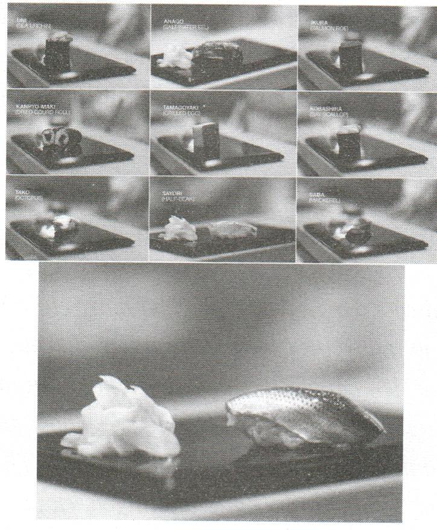
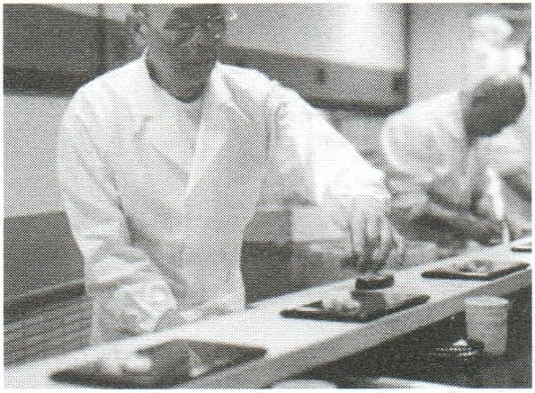

# Phần 3: Làm việc

## “Làm việc” cũng là “làm người”!

Lần nọ trong lớp học, một học viên chợt giơ tay hỏi tôi: “... Làm thế nào để cân bằng giữa cuộc sống và công việc?”. Tôi trả lời: “Với tôi, không có khái niệm cân bằng giữa cuộc sống và công việc, bởi công việc chính là cuộc sống.

Thật vậy, ai trong chúng ta cũng gắn với một (hay một số) nghề nghiệp hay công việc và dành phần lớn cuộc đời của mình để làm nghề hay làm việc đó. Thời gian một ngày của chúng ta chủ yếu được dành cho công việc, chúng ta “sống” ở nơi làm việc có khi còn nhiều hơn ở nhà. Nhưng điều quan trọng hơn hết là: Rất hiếm ai có một cuộc sống hạnh phúc mà lại không hạnh phúc với việc mình làm. Hay nói cách khác nếu “đạo sống” và “đạo nghề” của một người không hòa quyện với nhau hay thậm chí trái ngược nhau thì người đó rất khó có được một cuộc sống hay cuộc đời trọn vẹn.

Như vậu, “làm việc” cũng chính là “làm người”, nà “làm người” thì không thể không “làm việc”. Con người của mình cũng sẽ được thể hiện rõ qua công việc của mình, qua chất lượng công việc mà mình làm, qua lý tưởng công việc mà mình theo đuổi. Nếu ta nhìn nào cách mà mình làm việc, cách mù mình sống thì đó chính là “tắm gương” trung thực phản chiếu “com người” mình. Khi đó tự ta sẽ cảm thấu “thật sự tự hào bề con người của mình” hay “mình không đáng được tôn trọng, thậm chí đáng bị khinh”.

Nếu như “đạo sống” (làm người) là những giá trị mà ta lựa chọn cho cuộc đời của mình thì “đạo nghề” (làm việc) chính là lý tưởng nghề nghiệp của công việc mà ta làm. Nói cách khác, “đạo nghề” mà mình chọn chính là cách để mình hiện thực hóa “đạo sống” của mình trong công việc bà nghề nghiệp mà mình làm. Chẳng hạn, ta thích trở thành cảnh sát giao thông vì ta yêu sự bình yên của phố phường, hay là vì ta thích “núp lùm” để thổi phạt? Ta muốn trở thành người dạy học là vì ta yêu con người, yêu sự phát triển mỗi ngày của đứa trẻ hay yêu thứ quyền lực mà ta có thể thị uy với nó? Ta chọn nghề nấu ăn vì đó cũng là một nghệ thuật và ta muốn nhìn thấy niềm vui trên khuôn mặt thực khách khi họ được thưởng thức một món ăn ngon, hay vì muốn kiếm lợi từ việc chế biến lại những thực phẩm kém an toàn?...

Nói cách khác, “đạo nghề” chính là “đạo sống” trong công việc. Làm việc mà không có lý tưởng nghề nghiệp cũng giống như sống mà không có mục đích. Làm một nghề “vô đạo” thì không chỉ bản thân người làm nghề mà cả xã hội cũng có thể bị ảnh hưởng.

Hành trình “tìm thấy chính mình” của con người, xét về bản chất, là hành trình tìm kiếm con người văn hóa và con người chuyên môn của mình. Đáng tiếc là khi nhìn vào bức tranh xã hội ngày nay, nhất là ở những quốc gia chưa phát triển, có vẻ như không nhiều người tìm thấy được điều đó. Hằng ngày, vào giờ tan sở cũng như lúc bắt đầu ngày mới, chúng ta nhìn thấy trong dòng người đông đúc trên đường phố nhiều gương mặt mỏi mệt vô hồn hơn là những con người “sáng sáng háo hức đi làm, tối tối hăm hở cề nhà”.

Rồi chúng ta cũng nhìn thấy cả những con người mang danh là làm nghề mà rốt cuộc những việc họ làm lại chệch rất xa khỏi sứ mệnh hay cái đạo của nghề đó: Bác sĩ lẽ ra phải chữa bệnh cứu người thì lại “làm tiền”, vòi vĩnh bệnh nhân, mặc cả với cả mạng sống của người bệnh. Cô giáo lẽ ra phải là một điểm tựa thì lại là nỗi sợ hãi của học trò. Không ít cảnh sát không phải là người thực thi pháp luật hay người bảo vệ, mà là “hung thần” trong mắt người dân. Dường như còn quá ít người (trong đó có thể bao gồm chính chúng ta) là làm “đúng việc” của mình!

Trong tác phẩm Những ngày thứ bn với thầu Morrie cũng có đoạn: “Quá nhiều người quẩn quanh với một cuộc đời vô nghĩa. Họ có vẻ lờ đờ, ngay cả khi họ đang bận rộn làm những việc mà họ cho là quan trọng. Đó là bởi tì họ đang theo đuổi những thứ không đúng. Cách để làm cho cuộc đời bạn Hở nên có ý nghĩa là cống hiến bản thân bạn để yêu thương người khác, cho cộng đồng xung quanh bạn nà để tạo ra một thứ gì đó khiến bạn cảm thấu có mục đích bà có ý nghĩa”.

Để có thể tạo nên một thành tựu đủ lớn trong công giệc thì ta phải yêu nó, ta phải hạnh phúc cống hiến cuộc đời mình cho công việc đó. Nhưng để tiêu nó, trước hết tn phải hiểu nó. Bởi lẽ, làm sao có thể yêu một thứ mà mình không hiểu?

Ngay cả với những mục đích “ít nhuốồm màu lý tưởng” hơn (chẳng hạn như làm việc không phải là để tìm thấy ý nghĩa của cuộc đời mình trong đó, mà là để tìm kiếm danh lợi) thì nguyên tắc này vẫn đúng. Vì không bao giờ có thể thành công với một công việc nếu không làm tốt nó, mà sẽ không thể làm tốt nó nếu như không yêu nó, và cũng không thể yêu nó nếu như không hiểu nó. Hơn nữa, khi ta hiểu, yêu và làm tốt một công việc thì danh lợi sẽ đến như một hệ quả tất yếu, như câu tục ngữ ông bà ta vẫn thường nói là

“công thành danh toại” (phải có “công” (công lao) rồi mới có “danh” (danh vọng)).

Làm việc mà không có lý tưởng nghề nghiệp cũng giống như sống mà không có mục đích. Nhưng làm thế nào để biết, liệu là mình có thực sự hiểu “đúng” bản chất của cái nghề, cái việc mà mình đang lựa chọn và theo đuổi hay không?

Theo tôi, có thể bắt đầu bằng hai câu hỏi:

Mình có đang hiểu đúng và làm tốt sứ mệnh của nghề / của việc không?

Việc mà mình chọn làm có đúng với cơn người của mình không?

Nhưng mục tiêu của chương sách này không phải là nhằm đưa ra đáp án cho những câu hỏi đó. Bởi hơn ai hết, mỗi người sẽ biết đâu là cái “đúng” nhất với bản thân mình, mình nên lựa chọn cái gì và chịu trách nhiệm gì với lựa chọn đó. Thay vào đó, chương này sẽ thử phác thảo chân dung một số nghề (như là một số ví dụ minh họa để bàn về chủ đề “đúng việc” này) trong xã hội dưới hình thức các “cặp đối ngẫu” để độc giả có thêm những góc nhìn, những đối sánh cần thiết, cũng như tự mình chiêm nghiệm ra đâu là cái “đạo” quan trọng nhất của nghề đó và người làm nghề này cần có những “đạo sống” gì. Chẳng hạn như các nghề sau:

## Quản trị hay cai trị?

(Nghề lãnh đạo / chính khách)

Đầu tớ hau phụ mẫu? (Nghề công chức)

## Doanh nhân, trọc phú hay con buôn?

(Nghề kinh doanh)

Nhà báo hau bồi bút? (Nghề viết báo)

Nhà văn hay bồi bút? (Nghề viết văn)

## Ca sĩ hay thợ hát? Diễn viên hay thợ diễn?...

(Nghề làm nghệ thuật)

Bác sĩ hay lang băm? (Nghề y)

Luật sư hay lê sư? (Nghề luật)

Sử gia hau sử nô? (Nghề viết sử)

## Và một số nghề khác

...

Thậm chí chuyện chúng ta có tìm được câu

trả lời hay không cũng không quá quan trọng. Bởi như một câu châm ngôn đã nói:

“Ta trở nên khôn ngonn hơn bằng cách đặt ra các

câu hỏi, nà cho dù không trả lời được, ta cũng sẽ Hở

nên

khôn ngoạn hơn, bì một câu hỏi được gói chém tốt

tự thân nó cũng đã chứa đựng câu trả lời, giống như

con

Ẩ ˆ z ` ~ $ x _ 4+ 2? ˆ Ốc sên húc nào cũng săn chặt bới cái vỏ ốc trên

lưng vậy”.

174

Vì vậy, hãy cứ bắt đầu từ những câu hỏi!

## Quản trị hay cai trị?

Trong một số buổi giao lưu với sinh viên của các trường đại học trong nhiều năm qua, khi tôi hỏi “Ước mơ của các bạn là gì?”, rất nhiều bạn trẻ có chung một câu trả lời rằng: “Em muốn trở thành một nhà lãnh đạo”. Có vẻ như lãnh đạo đang là một trong những nghề “hot” nhất hay việc “hot” nhất (nói theo ngôn ngữ thời thượng của giới trẻ) trong xã hội ngày nay.

Điều đó hoàn toàn dễ hiểu, bởi nhìn bên ngoài, người làm lãnh đạo thường có vị trí “ăn trên ngồi trốc” so với người khác. Các vị nguyên thủ quốc gia trông đầy quyền uy và bề thế, các nhà lãnh đạo doanh nghiệp cũng oai phong không kém với “quyền sinh quyền sát” công ăn việc làm của bao nhiêu người trong tay. Tóm lại, dù là điều hành một quốc gia hay một tổ chức, một bộ phận..., lãnh đạo luôn là một “cái chức” rất to, một “cái ghế” rất sang trong mắt nhiều người.

Có lần nọ, tôi ghé thăm nhà một người bạn mà lâu năm rồi không có dịp gặp gỡ. Anh vừa tâm sự vừa giãi bày với tôi: “Trời ơi, dạo này mình bận tối mắt tối mũi chẳng còn thời gian cho gia đình bạn bè. Làm lãnh đạo vất vả lắm cậu ạ!”. Đứa con trai út 7 tuổi của anh đang ngồi học bài gần đó bỗng lên tiếng: “Ba ơi, con cũng muốn làm lãnh đạo!” “Có biết lãnh đạo là gì không mà đòi làm hả ông tướng?” - “Dạ biết, là thường xuyên mặc đồ vét đẹp đi cắt băng đỏ trên tivi áF”. Anh cười khà khà, còn tôi thì nhớ ra đúng là trong những dịp hiếm hoi gặp nhau, lần nào anh cũng đang vừa đi dự lễ khánh thành ở đâu đó về. Và dường như trong đầu óc non nớt của con trai anh, làm lãnh đạo có nghĩa là đi... cắt băng khánh thành, và lãnh đạo là một cái nghề rất oai, làm gì cũng lên tivi!

Không ít nhà lãnh đạo ở nhiều nơi trên thế giới, đặc biệt các các quốc gia chậm phát triển, cũng mang một chân dung tương tự như thế. Họ luôn tất bật, bận bịu, nhưng qua thời gian giữ chức của họ, thứ hiếm hoi thay đổi là số băng khánh thành mà họ cắt, còn lại những thứ trọng yếu khác của đất nước thì hầu như vẫn như cũ hay thậm chí còn tệ hơn. Họ là những người mang danh lãnh đạo và ngồi nghề lãnh đạo nhưng thực chất không hề làm việc của lãnh đạo.

Và trái lại, cũng có những người mặc dù không ngồi bắt kỳ một “ghế” nào nhưng vẫn là những nhà lãnh đạo đích thực. Cô gái Paskistan Malala Yousafzai — người vừa được trao giải Nobel hòa bình năm 2014 và là gương mặt trẻ tuổi nhất trong lịch sử giải Nobel là một chân dung như thế. Cô bé nữ sinh 17 tuổi này đã không ngừng đấu tranh cho quyền được đi học cho trẻ em gái, bất kể những hiểm nguy mà mình phải đối mặt khi lựa chọn con đường đó. Lời tuyên ngôn “Hãy cầm sách và cầm bút lên! Chúng sẽ trở thành vũ khí mạnh mẽ nhất của chúng ta” của Malala đã truyền cảm hứng và tiếp sức cho nhiều phụ nữ và trẻ em trên hành trình tìm đến sự học của mình, cũng như đã góp phần thay đổi cái nhìn và cách đối xử của nhiều xã hội đối với phụ nữ theo hướng tốt đẹp hơn. Malala đã trở thành một nhà lãnh đạo được nể trọng mà không cần bất kỳ chức tước nào, bất chấp cả tuổi đời non trẻ, nhờ những thay đổi tích cực, lớn lao mà cô đã góp phần lan tỏa cho cộng đồng của mình.

Do đó, lãnh đạo hoàn toàn không phải là “cái chức” hay “cái ghế”, mà là một công việc; thậm chí đó còn là một công việc khó khăn và nhiều trọng trách. Có thể phác họa chân dung một nhà lãnh đạo đích thực bằng một số nét chính sau đây: (1) giúp cho quốc gia, cộng đồng, tổ chức, cá nhân mà mình lãnh đạo hiểu được những tỉnh thần, tư tưởng, giá trị tiền bộ, biết tự do lựa chọn và sống với những tỉnh thần, tư tưởng, giá trị tiền bộ đó, (2) giúp cho quốc gia, cộng đồng, tổ chức, cá nhân đó đạt được những thành tựu đề ra và có sự thay đổi đáng kể, và (3) đó là những thành tựu, thay đổi theo hướng tích cực, tiền bộ. Hay đơn giản hơn, để xác định một nhà lãnh đạo có đang “đúng việc” hay không, hãy thử đặt câu hỏi: Người đó đang “quản trị“ hay đang “cai trị cộng đồng, tổ chức của mình?

Hiểu một cách nôm na, “quản trị” hay, “cai trị” đều là quản lý, điều hành. Nhưng nếu nhà lãnh đạo làm điều đó chủ yếu bằng quyền lực và áp đặt thì goi là “cai trị”; còn bằng năng lực và tự do thì gọi là “quản trị.

Thực tế cho thấy mọi biện pháp cai trị, cho dù bằng mệnh lệnh, quy định hay bằng kiểm tra, kiểm soát hoặc thậm chí gây sức ép, đe dọa, đều chỉ có giá trị nhất thời, bởi cách làm đó thường tạo ra một lớp “thần dân” chỉ biết làm việc theo mệnh lệnh, bằng mặt nhưng không bằng lòng. Ngược lại, một nhà lãnh đạo có năng lực quản trị giỏi sẽ có khả năng “khiến cho người khác muốn làm điều gì đó mà bạn muốn anh ta làm bởi bì chính anh ta cũng muốn làm điều đó” (Dwight Eisenhowet). Khi đó, mỗi người dân hay nhân viên sẽ hiểu, chia sẻ hoài bão, sứ mệnh của quốc gia, của cộng đồng, của tổ chức và tự thân sẵn sàng chung sức, chung lòng chiến đấu cho sự phát triển và trường tồn của xứ sở, của tổ chức mà họ luôn tự xem nó là của mình, của chúng ta.

Tắt nhiên, nếu “người khác” là những người có cái đầu khai phóng và trái tìm có hồn thì việc “khiến cho người khác muốn làm cái việc mà mình muốn làm” sẽ rất dễ, nếu việc đó đúng luật và có đạo (đạo lý, đạo thiêng và đạo sống), còn ngược lại thì vô cùng khó, thậm chí trong nhiều trường hợp còn là... không thể.

Qua khá nhiều chiêm nghiệm, tôi cho rằng, một nhà lãnh đạo đích thực sẽ biết cách tìm ra “tiếng nói” của riêng mình trong mọi chuyện bà đồng thời giúp cho mỗi thành viên trong đội ngũ của mình tìm mm “tiếng nói” của họ, tìm ra thôi thúc của họ, và những tiếng nói, thôi thúc này sẽ được hòa quyện với nhau một cách tự nhiên trong các mục đích chung.

Có thể đúc kết công việc của nhà lãnh đạo thành một “công thức” kiểu như sau: [Lãnh đạo = (Chiến lược + Đội ngũ)]; trong đó: [Đội ngũ = (Con người + Hệ thống + Văn hón)]

Cho dù mục đích của quốc gia, cộng đồng, tổ chức là gì đi nữa thì nhà lãnh đạo luôn có hai công việc hệ trọng bậc nhất, đó là: Hoạch định chiến lược và kiến tạo đội ngũ đề hiện thực hóa chiến lược đó (hay có thể nói nôm na dân dã là “lìm đường” và “dụng nhân”). Nếu không làm hai việc này, nhà lãnh đạo vẫn chưa phải là một nhà lãnh đạo đúng nghĩa, cho dù anh ta đã làm các việc khác và làm tốt những việc đó.

Có một chủ doanh nghiệp nọ hỏi tôi tại sao anh ta làm việc quần quật ngày đêm, sát sao mọi việc từ lớn đến bé mà công ty của anh ta vẫn chẳng tiến lên là mấy, tôi bèn hỏi lại: “Thế anh dùng thời gian của mình vào những việc gì?”. Thì ra là từ khâu tuyển người cho đến sản xuất hay bán hàng, gần như không có khâu nào mà anh ta không nhúng tay vào; duy chỉ có... việc lãnh đạo (làm chiến lược, xây đội ngũ) là không để tâm làm. Đó là một trường hợp điển hình của việc “là lãnh đạo mà không làm lãnh đạo”. Thực tế thì lãnh đạo hoàn toàn có thể tham gia cùng làm công việc của đội ngũ, cùng hỗ trợ công việc của đội ngũ, nhưng cần ý thức rằng, không ai ngoài mình có thể làm công việc của “lãnh đạo” khi mình đang ngồi ghế lãnh đạo.

Và ở cấp vĩ mô cũng vậy, có những lãnh đạo vô cùng xông xáo, bận tối mắt tối mũi với trăm công ngàn việc, hôm nay đăng đàn ở mặt trận A, mai họp ở mặt trận B, ngày mốt đưa ra sáng kiến ở mặt trận C...; nhưng khi hỏi chiến lược 5 năm, 10 năm, 20 năm... của lĩnh vực mà vị lãnh đạo đó chịu trách nhiệm là gì thì... hầu như lại không ai biết!

Để đưa ra được một chiến lược đúng đắn, nhà lãnh đạo nhất thiết phải có viễn kiến tương lai, phải có tầm nhìn - tầm nhìn cho tổ chức, cộng đồng, quốc gia mà mình lãnh đạo và tầm nhìn cho bản thân mình. Bởi làm sao có thể đưa ra cách đi đúng khi mà còn chưa rõ bản thân mình muốn đi đâu về đâu hay mình muốn dẫn tổ chức, cộng đồng, quốc gia của mình đi đến cái đích nào!

Chẳng hạn, tầm nhìn của đất nước Hàn Quốc (do tổng thống Lee Myung-Bak, tổng thống đầu tiên xuất thân là doanh nhân trong lịch sử Hàn Quốc đưa ra) có thể được tóm tắt bằng ba con số 7 - 4 - 7 cho những thập niên tiếp theo: đưa tốc độ tăng trưởng kinh tế quốc dân hàng năm lên 7%, nâng gấp đôi thu nhập bình quân đầu người từ 20.000 USD lên 40.000 USD và đưa Hàn Quốc lọt vào top 7 quốc gia hùng mạnh và văn minh của thế giới; với ý nghĩa rằng đất nước sẽ bay vọt lên như tên gọi của một loại máy bay nổi tiếng (Boeing 747).

Còn nước Mỹ lại có một “giấc mơ Mỹ” (American Dream) được đưa ra bởi những người cha lập quốc cách đây gần 2,5 thế kỷ, với phương châm tưởng như rất giản dị mà vô cùng mạnh mẽ, đó là, biến nước Mỹ thành một nơi mà ở đó

“Bất kỳ ai cũng có thể thành công bằng tài năng và sự chăm chỉ của mình”. Nếu giấc mơ “giản dị” này thành hiện thực thì chuyện nước Mỹ trở thành siêu cường số 1 về kinh tế, số 1 về khoa học, số 1 về quân sự, số 1 về tầm ảnh hưởng văn hóa... của thế giới là hệ quả tất yếu và là chuyện đương nhiên.

Tầm nhìn và mồi quan tâm của một nhà lãnh đạo cũng là yếu tố then chốt quyết định anh ta là lãnh đạo tôi, lãnh đạo giỏi, lãnh đạo lớn hay lãnh đạo vĩ đại.

Một lãnh đạo ti thường chỉ quan tâm đến chức vụ, quyền lực, bổng lộc mà anh ta kiếm được là gì.

Một Jãnh đạo giỏi sẽ quan tâm nhiều đến công việc (làm sao để làm tốt việc lãnh đạo của mình), đến năng lực (mình cần có những năng lực gì để làm tốt việc đó), đến sự học (mình cần học gì để có được những năng lực đó).

Một lãnh đạo lớn bên cạnh những điều mà một lãnh đạo giỏi quan tâm thì còn quan tâm đến uy tín (đánh giá của bên ngoài) và phẩm giá (những giá trị bên trong) của bản thân mình. Nói cách khác là bên cạnh tài năng, nhà lãnh đạo lớn còn một nhân cách khiến người khác phải nể trọng.

Còn một lãnh đạo vĩ đại thì không chỉ tạo ra những thành tựu vĩ đại, mà quan trọng là họ sẽ

“tìm thấu bản thân mình trong sự phục tụ những người khác”, như một câu nói của Mahatma Gandhi. Với một nhà lãnh đạo vĩ đại, không phải là địa vị, quyền lợi hay được người khác công nhận, mà là niềm hạnh phúc lớn lao ở bên trong khi được cống hiến, được giải quyết một vấn đề nào đó cho xã hội của mình mới là động lực thôi thúc nhất!

Tuy nhiên, công việc của nhà lãnh đạo đúng nghĩa không phải là trở thành vĩ đại hay trở thành người hùng, mà là tạo ra người hùng, không phải là duy trì đám đông mà là kiến tạo đội ngũ. Bởi nếu không quy tụ được một ê-kíp tài năng có trái tim nóng và cái đầu sáng, sẵn sàng cùng nhau chiến đấu vì chính mình và vì mục tiêu chung, nhà lãnh đạo khó có thể tự mình đi đến cùng cái đích đã vạch ra. Mà những người tài thì luôn luôn tìm kiếm và đòi hỏi nhiều hơn từ những người dẫn dắt mình, như một câu châm ngôn đã nói rằng:

“Người tài có thể dễ dàng rời bỏ một ông sếp, nhưng khó mà rời bỏ một nhà lãnh đạo.

Người tài có thể dễ dàng rời bỏ một công việc, nhưng khó mà rời bỏ một sứ mệnh.

Người tài có thể dễ dàng rời bỏ một tổ chức, nhưng khó mà rời bó một đội ngũ / ê-kíp”.

Như vậy, với một người tài (có tài năng về một chuyên môn hay công việc nào đó) có cái đầu khai phóng và có trái tim có hồn, khi đi làm họ không chỉ cần tiền và những thứ mà ai cũng cần, mà họ còn cần ba thứ nữa, đó là: lãnh đạo, sứ mệnh và ê-kíp.

Điều đó cũng có nghĩa là: Nếu một nhà lãnh đạo trông giống một ông sếp hơn một người dẫn dắt, quanh mình có một đám đông hơn là một đội ngũ, và không thấy một ý nghĩa nào trong những việc mình đang làm, rất có thể người đó đang “cai trị” hơn là “quản trị”!

Tóm lại, có thể nói rằng để đạt được đến vị trí lãnh đạo đã khó, nhưng để trở thành một nhà lãnh đạo đúng nghĩa chứ không phải “nhà cai trị lại càng khó hơn. Một người bạn học là doanh nhân của tôi nói vui rằng, “lãnh đạo” có nghĩa là con đường lạnh lẽo (lãnh = lạnh, đạo = đường). Tôi thì trộm nghĩ, con đường ấy rất lạnh lẽo với những “nhà cai trị - những người tự đặt mình ở trên một đỉnh cao chót vót và dùng quyền lực, mệnh lệnh như công cụ để sai khiến người khác và tư lợi cho bản thân. Nhưng với một nhà lãnh đạo chân chính thì dấu có những khoảnh khắc cô đơn khó tránh khỏi của một người phải đứng “đầu sóng ngọn gió”, đó vẫn sẽ là một con đường ấm áp. Bởi trên hành trình ấy, anh ta luôn có những người đi cùng, và sẽ cùng anh ta đi được thật xa. Như một câu ngạn ngữ của người châu Phi: “Nếu bạn muốn đi nhanh, hãy đi một mình. Nếu bạn muốn đi xa, hãu đi cùng nhau!”.

## Đầy tớ hay phụ mẫu?

Ngày 19/09/2014, báo Đời sống nà Pháp luật đưa tin về một sự việc diễn ra tại một cơ quan công quyền của tỉnh Bình Phước như sau:

“Ngàu 15/8 uừa qua, sia đình ông Võ Văn Chương (thị xã Đồng Xoài - tỉnh Bình Phước) đã đến Cục Thi hành án dân sự tính Bình Phước để làm việc theo giấu hẹn.

Khi uừa vào phòng làm việc, bà Nguyễn Thị Kim Thoa (oợ ông Chương) bị một nữ nhân viên không đeo bằng tên, không mặc đồng phục, quát tháo: “Tại sao ngày hôm qua mời mù không đến”? Trong khi đó, giấu mời ghi ngày 15/8 nà bà Thon đã đến đúng ngùu, đúng giờ.

Chưa kịp trả lời, bà Thoa tiếp tục bị nữ nhân viên quát: “Lần trước gọi điện thoại sao không đến?”. Trước thái độ sau sắt của cán bộ Cục Thi hành án dân sự tỉnh, bà Thoa đặt câu hỏi: “Em làm gì ở đây và em tên gì?” Ngau lập tức, nữ cán bộ này xăng giọng: “Cô là dân tà sao dám hỏi tôi câu đó!”

Bức xúc trước thái độ của công chức nhà nước khi Hếp dân, bà Thoa yêu cầu được gặp Cục trưởng để phản ánh thì nữ cán bộ Hiếp tục thách thức rồi bỏ đi. Khi gặp được được ông Cục trưởng Cục Thí hành án dân sự tỉnh, người này trả lời cộc lốc: “Vào trong mà làm việc”!”

Nhiều độc giả bình luận rằng đây là “chuyện thật nhưng không lạ” ở xứ mình. Vì cho dù hai chữ “nhân dân” luôn chiếm một vị trí “hoành tráng” trong tên gọi và biển hiệu của các cơ quan công quyền (ủy ban nhân dân, tòa án nhân dân, quân đội nhân dân...) thì có vẻ như trong tâm trí của những người được giao nhiệm vụ làm công tác phục vụ nhân dân, nó lại không hề “hoành tráng” như vậy! Bằng chứng là trong dân gian lâu nay đã lưu truyền câu chơi chữ “cơ quan hành chính - hành là chính” như một cái lắc đầu ngao ngán khi nhắc đến “chốn công quyền” với thái độ “cửa quyền”.

Mặc dù vậy, khi đọc mẩu tin trên, tôi vẫn cứ cảm tưởng rằng câu nói: “Cô là dân mà sao dám hỏi tôi câu đó” không phải được thốt ra từ miệng của một người nữ cán bộ thời nay, mà là của một ông quan thời phong kiến nào đó. Vào thời phong kiến, “quan chỉ phụ mẫu”, tức là quan được xem như cha mẹ của dân, coi dân như con.

Hiểu theo nghĩa tốt, là quan có nghĩa vụ lo lắng chăm sóc cho dân như con của mình. Nhưng đồng thời, quan cũng xem dân như đối tượng để ban ơn, dạy dỗ. Là phận con, nên “cha mẹ” cho gì thì “con” ơn nấy, bảo gì biết nấy, làm gì được quyền chất vấn hay bắt bẻ, vì như thế là... hỗn hào với cha mẹ!

Có lẽ không chỉ riêng mình tôi mà nhiều người khác cũng có cảm nhận tương tự. Báo Người đô thị (ngày 29/09/2014) cũng phát biểu một cách đầy hài hước là “người nữ cán bộ Bình Phước nừa đột nhiên khôi phục chế độ phong kiến”. Bình luận về câu nói trên, tác giả bài báo này còn viết: “Nó càng không phải câu hỏi, tì bộc lộ từ tiềm thức người nói. Nhờ một bác sĩ thần kinh và tâm lú người Áo có tên Sigmund Freud, người ta hiểu được rằng cuộc sống cơn người không chỉ bị chỉ phối bởi những sì con tigười tự giác nhận biết, mà còn bởi vô thức - nơi hun hút những trải nghiệm quá khứ, những quan điểm, xác tín nền chặt tự bao giờ. Khi ý thức mắt kiểm soát để tiềm thức hé lộ, đó chính là lúc thành thật nhất của con người... Lúc thành thật nhất của người nữ cán bộ Bình Phước là khi chị ta xăng giọng: “Chị là dân...”

Câu hỏi đặt ra ở đây là: tại sao sau bao nhiêu năm nỗ lực đổi mới và cải cách hành chính, tư tưởng “quan chỉ phụ mẫu” ấy vẫn ăn sâu vào tiềm thức của các cán bộ công chức đến vậy? Ngay từ năm 1945, Chủ tịch nước Việt Nam dân chủ cộng hòa đã viết những lời sau: “Chúng ta phải hiểu rằng, các cơ quan của Chính phủ Hừ toàn quốc cho đến các làng, đều là công bộc của dân, nghĩa là để gánh vác việc chung cho dân chứ không phải để đè đều dân như trong thời kỳ dưới quyền thống trị của Pháp, Nhật. Việc gì lợi cho dân, ta phải hết sức làm. Việc gì hại đến dân, ta phải hết sức tránh. Chúng tu phải yêu dân, kính dân thì dân mới yêu ta, kính ta". Rồi những năm sau đó, chính phủ ở trung ương và chính quyền các địa phương cũng đều đưa ra các chương trình cải cách toàn diện cho bộ máy của mình. Các bộ ngành cũng có hẳn một chương trình cải cách hành chính từ cả mấy chục năm nay. Vậy thì phải chăng chúng ta đã trục trặc ở đâu đó trong cách làm của mình?

Ở các quốc gia phát triển, người ta thường phân loại những nhóm người làm việc trong cơ quan công quyền rất rõ ràng, và thường có ba loại phổ biến sau: Chính khách, quan chức và công chức. Chính khách là sản phẩm dân cử, còn quan chức là sản phẩm bổ nhiệm (thường do chính khách lựa chọn và bổ nhiệm), còn công chức là sản phẩm tuyổn dụng. Chính khách và quan chức có thể thay đổi thường xuyên theo nhiệm kỳ, nhưng công chức thì thường khá ổn định vì họ là đội ngũ vận hành nền hành chính quốc gia.

Còn ở ta, “cán bộ là đày tớ của dân” thường là khẩu hiệu được nêu cao trong các chiến dịch cải cách hành chính. Cách diễn đạt này có thể làm “mát ruột” các “ông chủ” nhân dân, nhưng trong thực tế lại không hiệu quả lắm. Tôi nghĩ vui, đang từ vị thế cha mẹ của dân mà đùng một cái bị “đánh tụt hạng”, mà lại bị tụt xuống tận vị trí... đày tớ (cứ tưởng bị hoán đổi vị trí làm con cái của dân là quá lắm rồi!) thì quan hay cán bộ nào mà chịu cho nổi! Hơn nữa, tên gọi “đày tớ” trong xã hội Việt Nam thường mang nghĩa thấp hèn. Trong thâm tâm, không ai muốn phải mang một thân phận hèn kém hay làm một công việc hèn kém, huống chi là những người vốn được coi là “phụ mẫu” từ xưa. Phải chăng đó là một trong những lý do khiến khẩu hiệu này dù được “truyền” mãi trong các cơ quan công quyền nhưng phần lớn các cán bộ vẫn chưa “thông” nổi?

Vậy thì quan chức, công chức nên là gì trong mối quan hệ với dân?

Trong tiếng Anh, người ta thường dùng từ “seroice” để chỉ các dịch vụ, và từ “seruant” đề chỉ người làm công việc này. Những từ này đều bắt nguồn từ từ “seroe”, tức hành động phục vụ một ai đó. Vì vậy, nên chăng gọi công chức là “người phục vụ” hơn là “người đày tớ” (dù trong tiếng Anh thì cả hai từ này đều là “servant”). Không chỉ bởi vì nó mang đến một tâm thế dễ chịu, dễ chấp nhận hơn cho các cán bộ công chức, mà còn xác lập một ý thức rằng họ không ban ơn cho ai mà cũng không hèn kém hơn ai. Họ cũng đang làm một nghề như bao nghề khác trong xã hội. Mà suy cho cùng, bản chất của mọi nghề trong xã hội đều là phục vụ: bác sĩ phục vụ bệnh nhân, chủ nhà hàng phục vụ thực khách, nhà báo phục vụ độc giả... Huống chi ở đây, đối tượng mà công chức phục vụ lại là đối tượng cao quý nhất: nhân dân.

Có người đề nghị rằng công chức nên xem người dân là khách hàng, vì dân chính là người trả lương cho họ thông qua tiền thuế. Đó cũng là một cách xác lập mối quan hệ khá công bằng và hợp lý cho cả hai bên. Chỉ có điều, chừng nào mà “ông chủ” của công chức (tức người giúp cho họ cái ghế đó và ngồi vững cái ghế đó) không phải là “khách hàng” nhân dân mà là... ai đó khác, chừng nào mà những câu chuyện phải tốn kém hàng trăm triệu để “chạy” vào vị trí công chức vẫn còn phổ biến, thì chừng đó khách hàng... còn lâu mới là thượng đế!

Einstein từng nói rằng: “Chỉ có một cuộc đời phục tụ người khác là cuộc đời đáng sống”. Và mình sẽ tìm thấy mình, tìm thấy ý nghĩa của đời mình trong “cuộc đời phục vụ” đó. Suy cho cùng, cái tên chỉ là cái tên. Dù được gọi bằng cái tên gì người đày tớ, người phục vụ, người bán hàng..., tất cả cũng như trở thành vô nghĩa nếu như người công chức không cảm nhận được sứ mệnh thiêng liêng trong công việc phục vụ nhân dân của mình và đặt sự “đáng sống” của cuộc đời mình ở những thứ khác. Và chừng nào chưa làm được điều đó, công cuộc cải cách hành chính vẫn chỉ là những khẩu hiệu treo trên tường!

## Doanh nhân, trọc phú hay con buôn?

Bàn về vai trò của kinh doanh, gần 100 năm trước, Lương Văn Can - một nhà yêu nước, một trí thức lớn và cũng là nhà kinh doanh - đã khẳng định trên tờ Thực nghiệp Dân báo:

“Đương buổi thế giới cạnh tranh này, các nước phú cường không đâu là chẳng đua tài thí sức ở trong trường thương chiến, văn minh càng Hiến bộ buôn bán càng thịnh đại, buôn bán thịnh thời trong nước giàu mạnh không biết đến đâu là cùng, buôn bán suy Hhời trong nước nghèo vốu không biết đâu mà kể, cứ xem cúi trình độ buôn bán một nước nào cao hay thấp, rộng hay hợp thời xét được dân nước ấu giàu hau nghèo, văn hau dã. Việc buôn bán thịnh suy có quan hệ đến quốc dân thịnh suu như thể, ta há nên coi hhường, xem khinh được sao”

Thế nhưng mãi đến những thập niên gần đây, vai trò của người làm kinh doanh mới được bắt đầu được công nhận bằng hai chữ “doanh nhân” (thay cho tên gọi “con buôn” có phần mang màu... rẻ rúng trước kia). Chỉ ít lâu sau đó, doanh nhân thoắt trở thành một nghề “thời thượng”. Hình ảnh doanh nhân được tôn vinh khắp các mặt báo, và có hẳn cả một ngày dành riêng cho doanh giới. Trong những năm phát triển nóng của nền kinh thương Việt Nam sau gia nhập WTO, có người còn nói vui là: “Đếm doanh nhân... mỏi tay!“

Nhưng rồi ngay chính giữa những ồn ào đó, người ta bắt đầu đặt câu hỏi: Phải chăng cứ làm nghề kiếm tiền thì được gọi là doanh nhân, cứ kiếm thật nhiều tiền thì là doanh nhân giỏi? Những cái chép miệng “bọn trọc phú ấy mà!, những tiếng tặc lưỡi: “ôi dào, chung quy lại cũng chỉ là phường con buôn!” bắt đầu xuất hiện ngày càng nhiều, cùng với những những vụ làm ăn bê bối bị vỡ lở, những cú vung tay cho những thú vui xa hoa... Nhưng khách quan mà nói, xã hội Việt Nam (và nhiều xã hội khác cũng vậy) vẫn còn định kiến với đồng tiền, với sự giàu có. Vậy thì làm thế nào để phân biệt một doanh nhân đúng nghĩa với trọc phú và con buôn một cách khách quan nhất?

Người ta thường nói, “giàu có gắn liền với tội lỗi”, điều đó là không đúng. Đồng tiền không có lỗi gì hết, đồng tiền chỉ là vật trung tính, bản thân nó không tốt cũng chẳng xấu gì cả. Tốt hay xấu chính là cách người ta kiếm tiền và cách người ta xài tiền. Đó cũng là lý do vì sao mà người ta thường nói, đằng sau một gia tài khổng lò có thể là một cống hiến lớn, cũng có thể là một tội ác lớn, cũng có thể là cả hai. Nếu một người rất giàu nhưng lại không làm rõ được nguồn gốc của sự giàu có đó có hợp pháp và hợp đạo không thì chắc hẳn là ai cũng có thể hình dung được cách kiếm tiền của họ là cách gì. Do vậy, tùy theo cách kiếm tiền mà ta có thể phân biệt các nhóm người trong giới làm ăn.

Có ba cách kiếm tiền:

- Kiếm bằng cách mang (mang lại một giá trị cho người khác).

- . Kiếm bằng cách sâu (sâu hại cho người khác).

- Kiếm bằng cách uừn mang, uừa gâu (uừa mang lại giá Hrị cho người tàu, lại uừa câu hại cho người kia).

Và đó cũng chính là điều làm nên sự khác biệt giữa ba nhóm người: doanh nhân, trọc phú và con buôn.

Trọc phú và con buôn đều giống nhau ở chỗ kiếm được tiền bằng cách lừa ai đó hoặc hại ai đó, chỉ khác nhau về quy mô (con buôn thì quy mô nhỏ, còn trọc phú thì quy mô lớn). Còn doanh nhân thì không lừa ai, không hại ai, mà kiếm tiền bằng cách dùng sản phẩm hay dịch vụ của mình để đáp ứng một nhu cầu của khách hàng hay giải quyết một vấn đề của xã hội, và họ luôn xem sứ mệnh của mình là không ngừng nâng cao đời sống con người và thúc đẩy xã hội phát triển bằng những sản phẩm dịch vụ tốt nhất. Chẳng hạn, vấn đề mà một công ty bán sữa tham gia giải quyết là góp phần “cải tạo giống nòi”, vấn đề mà một công ty phân bón tham gia giải quyết là “dinh dưỡng cho cây trồng”.

Để đánh giá một người có phải là doanh nhân hau không, người ta cũng không nhìn vào quy mô mà nhìn nào bản chất cách kiếm tiền của họ. Doanh nhân phải là những người làm nghề kinh doanh đúng nghĩa, và kinh doanh là kiếm tiền bằng cách phụng sự xã hội và không làm hại đến cộng đồng.

“Phụng sự xã hội” ở đây có nghĩa đáp ứng nhu cầu của khách hàng hay giải quyết vấn đề gì của xã hội thông qua các sản phẩm hay dịch vụ của mình. Còn “xã hội” ở đây có thể là một đối tượng nào đó, một ngôi làng, một thành phố, một quốc gia hay toàn cầu. Nếu như xã hội của bà tạp hóa là khu phố của mình, thì xã hội của Wal-Mart là toàn cầu. “Làm hại” có thể được hiểu như làm hàng giả, hàng nhái, hàng độc hại, gây ô nhiễm môi trường, quảng cáo sai sự thật, đối xử không tốt với người lao động và các chủ thể có liên quan... Cơ sở để xác định có “làm hại” hay không chính là pháp lý và đạo lý. Nếu một hành vi mà hoặc trái luật hoặc trái đạo thì sẽ bị xem là sai, là làm hại.

Khi kinh doanh mà không lừa ai, không hại ai, mà đưa ra được những sản phẩm, dịch vụ giúp kiến tạo xã hội hay đáp ứng các nhu cầu hợp pháp như vậy, lợi nhuận, thương hiệu, tiếng tăm... sẽ đến như một hệ quả tất yếu. Nói ngắn gọn, doanh nhân là những người “kiếm” bằng cách “mang” và không “gây”.

Chẳng hạn, bà bán trái cây dạo cũng có thể là doanh nhân (nếu bán trái cây tử tế, không có thuốc trừ sâu, không phun hóa chất để bảo quản trái cây...), cũng có thể là con buôn (nếu trái cây của bà ấy mua từ những nguồn độc hại, và được bảo quản bằng hóa chất...). Một bà bán tạp hóa cũng có thể là doanh nhân nếu cửa hiệu nhỏ của bà giải quyết được những vấn đề của khách hàng mà chợ và siêu thị không làm được như sự thân thiện, thuận tiện (gần nhà, mua giờ nào cũng được, bất kể sớm khuya...), luôn bán những sản phẩm đáng tin cậy với mức giá rẻ nhất hay có thể được thiếu nợ (mua về dùng trước, trả tiền sau). Như vậy, một doanh nhân, một người làm nghề kinh doanh sẽ thật sự hạnh phúc khi nào?

Có ba cấp độ hạnh phúc trong công việc của một

doanh nhân như sau:

- . Cấp độ 1: Hạnh phúc khi kiếm được tiền (tì tiền là mục đích của kinh doanh).

- . Cấp độ 2: Hạnh phúc khi kiếm được tiền, có uy tín và được mọi người quý trọng (có uy tín và được quý trọng tì những cống hiến mà mình đã mang lại cho mọi người).

- . Cấp độ 3: Hạnh phúc khi kiếm được tiền, có uụ tín và được mọi người quý trọng, bà đồng thời được sống đúng nới “đạo sống” của mình, sống đúng tới đam thê bà Hình yêu của mình trong công việc. (Vì khi một doanh nhân thực sự làm việc vì niềm tin, vì giá trị và vì đam mê của mình, anh ta chắc chắn sẽ gìn giữ và xác lập được nhân cách của mình trong kinh doanh và đồng thời có nhiều cống hiến cho mọi người. Và khi đó, tiền bạc và sự quý trọng của mọi người sẽ đến với anh ta như là hệ quả tất yếu).

Như vậy, một doanh nhân sẽ hạnh phúc trọn vẹn nhất, viên mãn nhất khi mà tiền bạc, tụ tín, quý trọng, giá trị nà đam mê đều thống nhất và hòa quyện với nhau trong công việc kinh doanh của mình, đó cũng là hạnh phúc của một con người tự do, cơn người tự trị khi chọn kinh doanh làm sự nghiệp của mình.

Chúng ta có thể hiểu sâu sắc hơn về hạnh phúc cấp độ 3 của một doanh nhân qua câu chuyện của một doanh nhân Nhật Bản sau đây:

Sukiyabashi Jiro và món ăn sushi

Ít ai có thể ngờ được một nhà hàng chỉ với 10 chỗ ngồi lại là nơi sở hữu món sushi ngon nhất thế giới.

Nhắc đến đẳng cấp Michelin, người ta thường nghĩ lới những nhà hàng sung trọng với không gian lung linh từ ánh đèn tà muỗng nĩn sáng choang. Thế nhưng trên thực tế, nhiều nhà hàng nằm ngoài chuẩn mực cao cấp này vẫn được công nhận và trao tặng sao Michelin, dựa trên những tiêu chuẩn sáng tạo bà khác tiường của mình. Sukiyabashi Jiro chính là một trong số đó.

### Sukiyabashi Jiro — viên ngọc trong đá

Nhận được một sao vàng đã là niềm mơ ước và mục tiêu to lớn của bất kỳ nhà hàng nào, và chỉ cần một sao thôi cũng đã đủ đưa nhà hàng đó lên tầm cuo mới trong con mắt giới chuyên môn ẩm thực nà khách hàng. Thế nhưng với Sukiyabashi Jiro, dù được trao tặng tới ba sao Michelin, nhà hàng vẫn khá khiêm tốn về mặt bằng lẫn phong cách.

*Hình: Các món sushi tinh hoa của quán Sukiyabashi Jiro 3 sao Michelin*

*Hình: Nghệ nhân Jiro Ono 90 tuổi đang chăm chút từng món sushi*

Giữ nguyên thiết kế cổ điển của nhà hàng sushi truyền thống, với bàn ghế gỗ vỏn vẹn 10 chỗ ngồi, nằm khiêm tốn trong tầng hầm một tòa nhà tại khu Ginza, Tokyo, ít ai ngờ rằng đây lại là nơi làm nên món sushi khiến đầu bếp Pháp lừng danh Joel Robuchon phải thốt lên: “Sukiyabashi Jiro đã cho tôi thấu thế nào là nghệ thuật sushi thực thụ”.

Đứng đầu bởi ông Jiro Ono đã 90 tuổi, nhà hàng sushi hàng đầu thế giới này đã tồn tại hàng chục năm, trước, trước khi những đầu bếp nà nhà phê bình ẩm thực nổi tiếng đến thử món ăn tại đâu. Họ đều bị sửng sốt và thuyết phục bởi chất lượng ẩm thực tuyệt hảo trong không gian quá sức giản dị. Danh tiếng của Sukiyabashi Jiro được đẩy cao hơn nữa vào năm 2011, khi bộ phim tài liệu “Jiro: Dreams oƒ sushi" được phát hành.

Bộ phim mở ra bí mật về sự kỳ công, nhiệt huyết nà kỹ thuật nấu nướng có một không hai bên trong nhà hàng sushi nhỏ bé này, bộ phim đã đóng vai trò quan trọng trong việc đưa nhà hàng sushi của Jiro ra thế giới — nơi thật sự xứng đáng với tầm cỡ của nó.

### Nhà hàng hạng nhất của đầu bếp hàng đầu

“Liệu người ta có thể nào yêu một lát cá sống hơn cả yêu ai đó không?” - câu hỏi hài hước ấy của người dẫn chuyện trong bộ phim “Jiro: DDreams of sushi” lại là sự miêu tả chính xác nhất về ông chủ nhà hàng Jiro Ono. Nhỏ bé bà trầm tĩnh, Jiro gây ấn tượng với người khác bởi thái độ dửng dưng với mọi lời ca tụng lẫn giải thưởng danh giá người ta trao tặng cho ông. Trái lại, xuyên suốt cả bộ phim tài liệu, phỏng vấn, Jiro chỉ tập trung nói về tình yêu của mình với nghệ thuật sushi.

Không những thế, có lẽ chỉ riêng với Jiro, sushi mới thăng hon thành một loại hình nghệ thuật bay bổng như vậu: “Ý tưởng về việc làm sushi đến với tôi bào mỗi giấc ngủ. Trong tơ, việc sáng tạo sushi của tôi được thành hình”.

Mối lương duyên với sushi của ]iro đã sớm nhu nở từ thời niên thiếu. Sinh ra trong một gia đình nghèo khó với người bố nát rượu, từ năm 9 tuổi, Jiro đã phải rời khỏi nhà để tự kiếm sống. “Không có nhà để nghĩ đến chuyên trở về” — với tâm thế đó — Jiro đã khởi nghiệp bằng công việc phụ giúp cho một cửa hàng sushi truyền thống rồi tiếp tục làm công việc này suối 79 năm.

Với kinh nghiệm làm việc gần tám thập kỷ trong lĩnh uực sushi, Jiro khiếm các đầu bếp khác phải nể phục bởi kinh nghiệm cũng như khả năng giữ gìn nét đẹp sushi truyền thống trong các món ăn của mình. Tự tuụ ra chợ lựa chọn nguyên liệu nào mỗi sáng sớm, sẵn sàng bỏ cả phần cá chỉ tì ngâm muối thiếu một vài phút, trở thành từ điển sống bề hương vị và cách sử dụng hàng chục nguyên hệu sushi khác nhau,... ông chính là bảo tàng lưu giữ những kiến thức, kỹ năng, nà phẩm chất quý giá của nghệ thuật sushi.

Sukiyabashi Jiro và những nguyên tắc có một không ha;

Lâu đời trong nghề, Jiro Ono đặc biệt trân trọng những tiêu chuẩn truyền thống của sushi. Điều này cũng ảnh hưởng đến phong cách ở Sukiyabashi Jiro khi nhà hàng luôn trung thành với những quan niệm cổ điển về nấu nướng lẫn ăn uống. Jiro Ono không bận tâm đến việc mở rộng nhà hàng, đầu tư cho quản cáo hau những dịch uụ đi kèm để lôi kéo khách hàng.

Nằm ngoài vòng xoay của thời đại nấu ăn — kinh doanh kết hợp ấy, Jiro nẫn tín tưởng nào bẻ đẹp dung dị của quán sushi mười chỗ ngồi, nơi lôi kéo thực khách bằng hương vị và chỉ bằng hương bị món ăn mà thôi.

Ở Sukiyabashi Jiro, bạn sẽ được phục uụ theo kiểu “một kèm một”. Thực khách ngồi trên phế đối diện với bàn chế biến của đều bếp, làm xong món sushi nào thì đầu bếp sẽ trao cho thực khách thưởng thức luôn. Do đó bạn đừng bất ngờ, khi nhà hàng ba sao Michelin Hống tăm này lại chỉ có vỏn vẹn năm nhân viên, bao gồm ông chủ ]iro cùng cơn trai bà các học trò. Cũng đừng bất ngờ, khi muốn trải nghiệm ẩm thực tại Sukiyabashi Jiro, bạn phải đặt chỗ... một, hai năm mới có suất.

Lý do đầu tiên là bởi có quá nhiều người muốn tới đâu, nhưng số ghế nhà hàng chỉ có vỏn vẹn mười theo đúng mô hình quán sushi truyền thống. Thêm nữn, Jiro cần có thời gian chuẩn bị nguyên liệu và lên thực đơn để đảm bảo sự hoàn hảo của bữn ăn.

Một nguyên tắc bất ngờ khác của Sukivabashi Jiro là bạn sẽ... không được gọi món. Tùu vào thời điểm bạn tới nhà hàng là mùa gì và có thức gì ngon, thì đầu bếp sẽ chuẩn bị cho bạn theo nguyên liệu đó. Sự tươi mới của thực phẩm và nét độc đáo của những đặc sản theo mùa là kết quả của biệc luôn tuân thủ nguyên tắc này.

Việc thưởng thức sushi cũng không thể tùu tiện. Chính Jiro là người sẽ quyết định cho bao nhiêu tonsnbi nào miếng sushi của bạn bởi theo quan tiệm truyền thống, không có ai hiểu rõ món sushi ấy hơn chính người đầu bếp. Nếu bạn có tiền bạc bà thời gian, chưa chắc bạn đã được thưởng thức sushi của Jiro. Điều quan trọng trong cả chế biến lẫn tận hưởng sushi là thái độ trân trọng, cẩn thận và nâng niu từng nét đặc trưng của món ăn. Đấu chính là tỉnh thần mà Jiro muốn truyền thi thông qua nhà hàng của mình.

Theo Tsubaki

Qua câu chuyện này ta có thể thấy, có thể việc kiếm được tiền cũng làm cho Jiro vui, khi được mọi người quý mến cũng có thể làm cho Jiro hạnh phúc. Nhưng chắc hẳn điều làm cho lro hạnh phúc nhất chính là việc ông được sống với niềm tin của mình, sống đúng với những giá trị, tình yêu và niềm đam mê trong công việc.

Với món suhi hảo hạng nhất thế giới của mình, có lẽ, trong công việc, jiro cũng là một trong những người hạnh phúc nhất thế giới.

Ngoài ra, không chỉ chuyện kiếm tiền, mà cách tiêu tiền của một người cũng quyết định họ là doanh nhân, trọc phú hay con buôn. Có vô lý quá không, bởi “tiền của tôi thì tôi có quyền tiêu, miễn tôi kiếm tiền “sạch sẽ” là được”. Đúng vậy, khi đồng tiền là của mình thì mình có quyền được dùng nó. Nhưng có khi cách ta dùng tiền dù không trái luật, nhưng lại có thể trái đạo. Chẳng hạn, tôi hoàn toàn có quyền được sống xa hoa giữa một ngôi làng nghèo đói, về mặt pháp lý tôi không sai nhưng nếu nói về đạo lý hay đạo sống thì liệu tôi có thể thấy hạnh phúc, vui sướng không khi quanh nhà mình, ngay trước mặt mình đều là những cảnh đời khốn khổ. Vấn đề xã hội đang nói đến khi bàn về cách tiêu tiền này không phải là pháp lý, mà là đạo lý, đạo sống. Không phải là chuyện đúng hay không đúng mà là chuyện nên hay không nên. Một người có văn hóa, có lòng trắc ẩn thì khó có thể thản nhiên hưởng thụ xa hoa ngay trước những nỗi khổ của đồng loại quanh mình như thế được!

Nếu như việc kiếm tiền của doanh nhân là rất khó, thì việc tiêu tiền lại càng khó hơn. Khi kiếm tiền vượt qua ngưỡng của những nhu cầu tiêu dùng cho bản thân, gia đình và cộng đồng nhỏ xung quanh mình, thì việc ứng xử với một "núi" tiền lại là một thách thức không nhỏ đối với những người giàu và những người rất giàu.

Một câu chuyện điển hình là cách đây không lâu, khi hai trong số những người giàu nhất thế giới là BI] Gates và Warren Buffet khởi xướng chiến dịch "Gioing Pledge" (tạm dịch là "Cam kết cho đi") nhằm kêu gọi các tý phú Mỹ dành phần lớn số tài sản của mình để góp phần thay đổi xã hội thông qua con đường từ thiện; họ đã nhận được sự hưởng ứng nhiệt tình từ những "đồng nghiệp" tỷ phú.

Đến nay, đã có hơn 70 tỷ phú Mỹ tham gia chiến dịch "cho đi" này. Những món tiền trị giá hơn một nửa hoặc gần như trọn vẹn tài sản của những doanh nhân vĩ đại lần lượt được hiến tặng vì mục đích tiến bộ xã hội. Thế nhưng, khi bước chân sang Trung Quốc - quốc gia đông dân nhất thế giới với hàng loạt hiện tượng "siêu giàu" đang nổi lên, công cuộc thuyết phục của hai người đàn ông huyền thoại này lại không được dễ dàng như thế. Bởi không phải tỷ phú Trung Quốc nào được mời tham dự "buổi tiệc lớn" của hai ông cũng sẵn sàng hay tỏ ra hào hứng với lời mời. "Sợ bị xin tiền" - đó là bình luận phổ biến nhất trên báo chí khi tường thuật lại cuộc thuyết phục chưa thành của Bill Gates và Warren Buíffet tại Trung Quốc.

Ở các nước phát triển, các hoạt động văn hóa, khoa học, giáo dục, y tế, môi sinh, dân sinh... chỉ dùng một phần từ ngân sách quốc gia. Một phần không nhỏ họ dùng nguồn quỹ vận động từ các doanh nhân hiến tặng. Vua thép

Andrew Carnegie đã gây xôn xao thế giới khi tuyên bố: "Cái chốt trong sự giàu có là một cái chết đáng hổ thẹn" và đề mình chứng cho việc này, ông đã hiến 90% tài sản của mình. Điều này cùng với truyền thống làm từ thiện lâu nay của các tỷ phú Mỹ, đã làm thay đổi cái nhìn về cách xài tiền, định nghĩa lại sự giàu có và góp phần hình thành nên păn hóa người giờu của nước Mỹ nói riêng và thế giới văn minh nói chung.

Do đó, “đoanh nhân” là một từ cao quý và rất đẹp. Một người không thể được gọi là doanh nhân nếu không có văn hóa và làm ăn không có văn hóa. Phải có văn hóa mới phân biệt được một doanh nhân với “trọc phú” hay “con buôn”. (Cũng như những người có học hàm, học vị cũng chưa chắc là đã có giáo dục, nhiều người không có học hàm, học vị gì cả nhưng lại rất có giáo dục). Văn hóa ở đây được hiểu như là “hệ điều hành” của con người, nó chỉ phối toàn bộ suy nghĩ và hành động của con người, của doanh nghiệp, của cả nền kinh thương.

Một doanh nhân văn hóa trước hết phải là một con người có văn hóa: Có một cái đầu đã được khai phóng để có khả năng minh định được ai là ai, cái gì là cái gì, mình là ai..., biết sống ở trên đời này vì cái gì...; có một trái tim giàu lòng lòng trắc ẩn, biết rung động trước cái đẹp (nhất cái đẹp vô hình, cái đẹp không nhìn thấy và không sờ thấy), biết thồn thức trước nỗi đau của đồng loại, biết phân nộ trước cái sai, cái xấu và cái ác. Một trong biểu hiện của con người văn hóa là hành xử tín thực, tức là, nói những gì mà mình thực sự nghĩ và thực sự làm những gì mình nói; đó là, luôn biết là mình biết cái gì và đặc biệt là biết rõ cái mà mình không biết để tránh đặt mình vào tình trạng ấu trĩ, vô minh mà mình lại không hề biết. Một doanh nhân nhân có văn hóa hay không sẽ biểu hiện rõ nhất ở cách họ kiếm tiền và dùng tiền, như đã bàn ở trên.

Nhiều doanh nhân than thở rằng: trước một bối cảnh xã hội còn ngồn ngang và trong một nền kinh thương còn nhiều khó khăn và đầy bất trắc, nếu làm ăn nghiêm túc, có văn hóa thì khó có thể tồn tại được. Nhưng một câu hỏi đặt ra: Doanh nhân muốn làm ra xã hội hay muốn xã hội làm ra mình? Bởi những người làm doanh nhân là những người làm lãnh đạo, chịu trách nhiệm dẫn dắt cả một cộng đồng, một nền kinh thương sau lưng mình. Và khi làm lãnh đạo thì họ sẽ phải chọn giữa một trong hai con đường: Một là: Hãy để xã hội nhào nặn họ, tạo ra họ, xã hội ra sao thì họ sẽ như vậy, xã hội xuống cấp họ cũng xuống cấp theo.... Hai là: Họ phải góp phần tạo ra xã hội này và làm cho nó tốt đẹp lên, tất nhiên là bằng sản phẩm, dịch vụ của mình, và xa hơn là bằng việc “làm người” của mình trong công việc quản lý và kinh doanh hàng ngày.

Điều này rõ ràng là khó, nhưng nếu “ai cũng chọn việc nhẹ nhàng” thì “gian khổ biết nhường phần ai“. Để xã hội tốt lên, mỗi người sẽ tự gánh vác cái phần trách nhiệm của mình, khi ai cũng làm vậy cả thì xã hội sẽ tốt lên. Tất cả những xã hội văn minh, những nền kinh thương văn minh, những con người văn minh và những doanh nhân văn minh đều hiểu và làm như vậy cả.

Những doanh nhân có tài năng, có bản lĩnh, có văn hóa thì sẽ biết cách giữ được mình. Họ không những không bị xã hội cuốn đi, mà còn góp phần phát triển, cải tạo xã hội thông qua công việc làm ăn, làm người, cũng như cuộc sống hàng ngày của họ. Trong dòng chảy cuồn cuộn và khắc nghiệt của nền kinh thương, chúng ta vẫn có thể nhìn thấy chân dung của những doanh nhân thành công, thậm chí là thành công lớn - bằng những cách đàng hoàng và tử tế, bằng việc không ngừng phụng sự xã hội.

## Trí thức hay trí nô?

“Trí thức là người quan tâm đến những việc không

chỉ của riêng cá nhân mình” (Nhà triết học, nhà văn người Pháp Jean-Paul Sartre — người từng được trao giải thưởng Nobel văn học

vào năm 1964)

“Trách nhiệm của trí thức là nói lên sự thật và phơi bày những điều giả dối”

(Nhà ngôn ngữ học gốc Do Thái Noam Chomsky -

người dẫn đầu cuộc bình chọn

Những người trí tuệ trên thế giới do

tạp chí Prospect của Anh thực hiện).

“Trí thức là những người khởi xướng các ý tưởng và đó là những ý tưởng quan trọng. Những ý tưởng đó có thể đúng hoặc sai, nhưng chúng phải có tầm quan là những ý tưởng ảnh hưởng đến số phận của cả một quốc gia và của nhân loại.”

(Nhà kinh tế học người Mỹ Thomas Sowell) Trí thức và vai trò của trí thức là một đề tài

không mới, nhưng chưa bao giờ cũ. Từ lâu nay, đó luôn là đề tài không dễ bàn thấu đáo nhưng lại rất dễ... gây tranh cãi. Tôi đã từng thử tìm kiếm trên Internet cách thế giới định nghĩa về từ “trí thức” thì gần như không có định nghĩa nào giống định nghĩa nào. Còn ở Việt Nam cũng đã có rất nhiều những ý kiến khác nhau, thậm chí trái ngược nhau, khi luận bàn về vấn đề thế nào là "trí thức". Có thể thấy rằng, đây là một đề tài đầy ý nghĩa đối với bất cứ xã hội nào, trong bất cứ thời đại nào, bởi trí thức thường được ví von như người tiên phong cầm đuốc “soi sáng” cho hành trình khai minh và giải phóng của xã hội, và cũng thường là nhóm người được xã hội dành cho nhiều sự tôn trọng, đề cao nhất.

Tôi chọn cách bắt đầu câu chuyện “trí thức hay trí nô” bằng cách chia sẻ một vài góc nhìn khác nhau, mỗi góc nhìn như vậy cho ta một cách hiểu về trí thức và vai trò của trí thức. Nếu ta có được nhiều góc nhìn về một vấn đề thì ta sẽ có cơ hội hiểu vấn đề đó một cách đầy đủ và sâu sắc hơn, vì khi đó không chỉ thấy “cây”, mà còn thấy “rừng”. Trong khuôn khổ cuốn sách này và từ một góc nhìn của riêng mình, tôi cho rằng trí thức là người có trí và luôn dùng cái trí của mình để góp phần thức tỉnh xã hội nhằm hướng mọi người đến cái đúng và cái đẹp.

Nếu ai đó “có trí” (sự hiểu biết) nhưng lại “không thức” (không thức tỉnh xã hội) mà để cho xã hội “ngủ” thì bị gọi là “trí ngủ”, chứ không phải là “trí thức”. Nếu ai đó thích làm cái việc của trí thức là “đánh thức xã hội” nhưng lại “thiểu

Z

trí, “lệch trí hay “vô trí” thì gọi là “trí dỏm” (cũng có học hàm, học vị nhưng đầu óc lại trồng rỗng, hoặc cũng có chút hiểu biết nhưng hiểu biết đó lại thể hiện sự lệch lạc và ấu trĩ). Và nếu ai đó “có trí”, “có thức”, nhưng “thiếu tâm” (thiếu

động cơ trong sáng) thì gọi là “trí gian” (gian

Z “

manh, xu thời, cơ hội). Cả hai loại “trí dóm” và “trí gian” đều là “nguy trí thức”, còn “trí ngủ” là “trí thức vô trách nhiệm”. Và có thể gọi chung nhóm này bằng một cái tên khác là “trí nô” (nô lệ cho bằng cấp, cho tiền bạc, quyền lực, danh vọng và những động cơ không trong sáng).

Có thể hình dung ba điều kiện để hình thành một con người “trí thức”, đó là: (1) “sự hiểu biết” (có trí); (2) “thức tỉnh xã hội”; và (3) “vì mục đích cao quý” (hướng xã hội đến cái đúng và cái đẹp, hướng xã hội đến cái chân - thiện - mỹ). Nếu không hội đủ cả ba điều kiện này (mà chỉ có một hay hai trong ba điều kiện) thì hoặc là “trí ngủ”, hoặc là “trí dỏm”, hay “trí gian”, chứ không phải là “trí thức”. Hay nói một cách nôm na, trí thức là người “có trí, “có thức” và “có tâm”; hoặc nói một cách văn vẻ hơn, trí thức là một người có hiểu biết sâu sắc, là một con người tự do và là một công dân có trách nhiệm.

Và cũng không phải cứ học cao thì được gọi là trí thức. Trong cuốn sách Trí thức và xã hội, nhà kinh tế học người Mỹ Thomas Sowell từng viết:

“Hầu hết chúng ta đều không xem nhà giải phẫu hau kỹ sư là trí thức, cho dù những chương trình huấn luyện mà họ phải trải qua là vô cùng khắt khe nà công giệc họ làm cũng đầu Hhử thách. Tương tự, ngay cả một bậc thầu tài chính lão luyện nhất và thành công nhất cũng chưa chắc là một trí thức.

Thành quả đầu ra, hau sản phẩm cuối cùng của một trí thức là những tư tưởng. Sản phẩm cuối cùng của Jonas Salk là vaccine, của Bill Gates là hệ điều hành máu tính. Cho dù để có được những thành quả đó họ đã phải đổ bao nhiêu trí lực, tầm nhìn, tài năng, những cá nhân đó cũng không phải là trí thức. Công việc của một trí thức bắt đầu bằng tư tưởng và kết thúc bằng tư tưởng... Và tất nhiên, có một vấn đề khác còn lớn hơn nữn, là hành động của họ ảnh hưởng đến xã hội mà họ đang sống như thế nào”.

Tôi cũng chia sẻ với Thomas Sowell một phần rằng, một kỹ sư giỏi hay một chuyên gia kinh tế giỏi sẽ không là trí thức nếu họ chỉ làm tốt công việc chuyên môn hàng ngày của họ mà không quan tâm lắm đến các vấn đề chung của xã hội, kể cả những vấn đề liên quan đến chuyên môn sâu của họ. Nhưng tôi cho rằng, nếu như kỹ sư giỏi và chuyên gia kinh tế đó dùng kiến thức chuyên môn uyên thâm của mình để chia sẻ với cả xã hội rằng không nên làm đường sắt cao tốc vì kỹ thuật dùng cho dự án này rất lạc hậu và dự án đường sắt cao tốc này sẽ rất không có lợi về mặt kinh tế, nhất là khi dùng vốn nhà nước để làm dự án này, và sau đó nhà nước buộc phải dừng dự án này lại thì khi đó họ thực sự là trí thức.

Từ cách hiểu này, chúng ta có thể thấy rằng, bàn về trí thức hay bàn về sự “đúng việc” của trí thức, thực chất cũng chính là bàn về trách nhiệm xã hội hay thôi thúc tự thân của những người hiểu biết.

Tôi rất thích một câu nói của Einstein “Thế giới này là một nơi nguụ hiểm, không phải vì những kể xấu xa mà vì những người chỉ biết đứng nhìn và không làm gì cắ”. Câu nói này nói về trách nhiệm xã hội (trách nhiệm “làm người”) của một người bình thường đối với cái xã hội hay cái cộng đồng mà mình đang sống. Một người bình thường vô cảm đã đáng phê phán, một người có hiểu biết sâu sắc và được lắng nghe mà yên lặng thì có khi còn đáng phê phán hơn. Một người bình thường còn có trách nhiệm xã hội như vậy, đối với những người có hiểu biết thì trách nhiệm xã hội này có khi lại càng lớn hơn.

Nói cách khác, vai trò của những người có hiểu biết là: dùng sự hiểu biết (và cả uy tín) của mình để góp phần giúp cộng đồng phân định rõ hơn sự đúng - sai, phải - trái, chân - giả, thiện ác, hay - dở, tốt - xấu, nên - không nên... trước những vấn đề chung mà xã hội đã, đang và sẽ gặp phải hay trải qua; dùng sự hiểu biết của mình để truyền bá tỉnh thần, tư tưởng, quan điểm mà mình tin là cần thiết để góp phần thúc đẩy xã hội phát triển theo hướng tiến bộ; dùng sự hiểu biết của mình để góp phần xác lập những chuẩn mực xã hội, những thang giá trị xã hội và đồng thời ra sức bảo vệ những chuẩn mực và giá trị đó; dùng sự hiểu biết của mình để góp phần định hướng, định hình xã hội... Tất nhiên, sự phân định, sự truyền bá, sự xác lập hay sự định hướng, định hình này cũng cần phải dựa trên cái nền là những giá trị vượt không gian và vượt thời gian, những giá trị có tính phổ quát của thế giới văn minh đương đại hay thế giới tương lai.

Và tất nhiên, để thực hiện trách nhiệm xã hội của mình thì người hiểu biết có thể nói, có thể viết, hay có thể làm gì đó (bởi lẽ không phải tất cả những người hiểu biết đều giỏi nói hay giỏi viết). Vì làm một điều tốt cũng là cách gián tiếp góp phần đấu tranh tiêu diệt cái xấu; làm một điều đúng cũng là cách gián tiếp góp phần chỉ cho người khác thấy những cái sai...

Thêm nữa, khi nói đến trí thức là nói đến vấn đề “chân lý” Không ai được phép độc quyền chân lý, nhưng ai cũng được quyền góp phần xác lập chân lý. Giới trí thức thường tự phân biệt giới mình với những giới khác ở chỗ luôn nỗ lực khám phá chân lý, xác lập chân lý và bảo vệ chân lý. Đó cũng là lý do vì sao mà ta có thể nói rằng, chân lý thường không thuộc về số đông hau “kẻ mạnh”, mà thường thuộc bề những người có hiểu biết (nay còn gọi là giới trí thức, giới tỉnh hoa). Nếu chân lý có thuộc về “kẻ mạnh” (nhưng thiếu hiểu biết) thì điều đó chắc chắn cũng chỉ là tạm thời mà thôi.

Khi bàn về trí thức, người ta thường bàn về vai trò, trách nhiệm, công việc, sứ mệnh, thiên chức của trí thức. Tuy nhiên, cũng cần phải bàn về “điểm mù” của trí thức, dù trí thức có cái trí hơn người. Bởi lẽ, trí thức cũng là con người, mà đã là con người thì cũng sẽ có cái nhằm, có lúc sai mà mình không hề biết; bởi lẽ, trí thức cho dù có trí thế nào đi nữa thì sự hiểu biết vẫn chỉ là hữu hạn. Điểm mù ở đây được hiểu là “mình không biết cái mà mình không biết” hay “mình cứ tưởng mình hiểu rất rõ một thứ nhưng thực ra mình chẳng hiểu gì cả hay hiểu một cách lệch lạc”. Khi chia sẻ, tranh luận hay góp ý sẽ giúp mỗi người nhìn thấy điểm mù của người và của mình. Khi nhận ra điểm mù của mình cũng là lúc “mình biết rõ cái mà mình không biết”; và khi nhận ra những “cái mà mình không biết” cũng là lúc cảm thấy mình thực sự hiểu biết. Đó cũng là điều kiện để mình có thể hiểu biết thực sự và là cơ hội để đẩy nhận thức và hiểu biết của mình đi xa hơn. Do vậy, cùng với trách nhiệm “thức tính xã hội" thì trí thức cũng có một trách nhiệm với bản thân là liên tục “phản tỉnh chính mình”, phản tỉnh với những điểm mù (nếu có) của mình. Nếu không liên tục “phản tỉnh chính mình” hay thậm chí là “phản tư chính mình” thì người hiểu biết sẽ dễ trở thành người ít hiểu biết hay người ấu trĩ trong một số vấn đề (kể cả những vấn đề thuộc chuyên môn hay sở trường của mình), và khi đó sẽ không chỉ khó thực hiện được tốt cái vai trò “thức tỉnh xã hội” vốn có của mình, mà còn có thể gây nguy hại cho xã hội.

Ở bất cứ xã hội nào thì sứ mệnh của trí thức vẫn thế. Và đối với những xã hội mà trong đó còn đầy rẫy sự bất thường thì một trong những sứ mệnh lớn nhất của trí thức chắc hẳn là góp phần đưa sự bất thường đó trở về sự bình thường. Nói cách khác, trong những xã hội mà sự bất thường của sự việc, sự vô minh của cái đầu, vô cảm của trái tim đang bao trùm thì trách nhiệm của người trí thức, của những người có hiểu biết còn nặng nề hơn (vì có quá nhiều cái cần phải khai sáng, cần phải thức tỉnh) và nguy hiểm hơn (vì không dễ dàng gì để làm cái chuyện khai sáng hay thức tỉnh trong những xã hội này).

Nhưng, đã là người có hiểu biết thì không thể không làm gì cả, bằng cách này hay cách khác, dù nhỏ bé hay lớn lao, dù ồn ào hay lặng lẽ.

Sử øia hay sử nô?

Trong số tất cả những người được xem là “có hiểu biết”, sử gia thường là người mà sự hiểu biết của họ được xã hội quan tâm đặc biệt. Vì lịch sử được ghi lại ra sao, được truyền lại cho đời sau thế nào, tất cả đều phụ thuộc vào góc nhìn và ngòi bút của họ. Thành ra, việc một người chép sử hay người nghiên cứu lịch sử (có thể gọi chung ở đây là sử gia) có thực sự làm đúng việc của họ hay không cũng thường được người đời đem ra “mổ xẻ”.

“Sử gia” khác “sử nô” ra sao? Câu chuyện “Thôi Trữ giết vua” sau đây có lẽ sẽ là câu trả lời dễ hiểu nhất cho thắc mắc đó:

Thời Xuân Thu, tướng quốc nước Tề tên là Thôi Trữ. Thôi Trữ sau khi giết uua Tề là TỀ Trang Công để đoạt quyền lực về tau mình đã cho gọi quan chép sử khi đó là Thái sử Bá đến và ra lệnh: “Nhà ngươi phải viết rằng tiên uương chết tì bệnh nặng”.

Thái sử Bá lắng lặng đưa cho Thôi Trữ bản sử mà ông đã viết xong. Thôi Trữ mở rũ, thấu trong đó viết: “Tháng năm mùa hạ, Thôi Trữ giết uua”, bèn đùng đùng nổi giận: “Ông phải viết khác đi, nếu không tôi sẽ giết ông!” Thái sử Bá lắc đều: “Bổn phận của Thái sử là viết đúng sự thật”. Thôi Trữ liền chém đầu Thái sử Bá.

Thái sử Trọng là em trai Thái sử Bá, sau khi anh bị giết, được bổ nhiệm thay chức nụ của anh. Thôi Trữ kinh ngạc vì thấu Trọng vẫn viết đúng như anh trai mình, liền rít lên:

- Ông không biết Thái sử Bá đã bị chém hau sao?

Trọng đáp:

- Thái sử chỉ sợ viết không trung thực chứ không sợ chết.

Thôi Trữ lại chém Thái sử Trọng.

Thái sử Thúc, em Hai Thái sử Bá cà Thái sử Trọng được vào thay. Ông cũng chép đúng như hai anh của mình và lại bị chém. Thái sử Quý, em út của ba Thái sử trên vào thay, vẫn viết: “Thôi Trữ giết pua”. Viết xong, ông nói với Thôi Trữ:

- Ông càng giết người thì càng chứng tỏ sự tàn bạo. Nếu tôi không biết thì người khác sẽ viết bà thiên hụ cũng biết Ông có thể giết chết Thái sử nhưng không thể giết chết được sự thật.

Thôi Trữ nghe xong lắc đầu, thở dài, không dám giết tiẾp.

Thứ phân biệt “sử gia” với “sử nỡ, chính là sự thật. Lịch sử là sự thật của quá khứ. Sự thật có phải là thứ mà họ yêu quý nhất, coi trọng nhất trong việc làm nghề của mình không? Họ có khát khao đi tìm sự thật không, hay vì khát khao những thứ khác mà sẵn sàng bẻ cong ngòi bút, phản bội lại lý tưởng của nghề (đạo nghề), của mình (đạo sống).

Nhưng ngay cả khi họ có khát khao đó, thì việc xác định đâu là sự thật cũng không hề dễ. Vì có một thực tế là người chiến thắng hay người nắm quyền lực thường là người xác lập quyền viết sử và chọn những người viết sử theo ý họ. Làm sao để tránh khỏi những thiên kiến về “bên thắng - bên thua”, không bị chi phối bởi quyền lực, bởi tiền bạc và bởi những yếu tố cảm tính khác? Làm sao để trong lịch sử không có “địch” và “ta”, làm sao để ta không đứng về “bên nào” (mà chỉ đứng về phía sự thật) khi viết sử, nghiên cứu sử, dạy sử và học sử? Làm sao để thực sự là người đưa xã hội đến gần với sự thật nhất chứ không phải là một ông “tuyên huấn lịch sử”, hay một ông “thợ nhào nặn lịch sử”? Bên cạnh một “trái tim nóng” (cái dung, niềm khát khao), người viết sử, nghiên cứu lịch sử sẽ còn phải cần đến một “cái đầu sáng” (năng lực minh định) để có thể làm đúng việc của mình.

Sử kú Tư Mã Thiên - kiệt tác lịch sử được người Trung Quốc xem như báu vật của mình đã trở thành một trong những quyển sử có tiếng nhất và có giá trị của nhân loại cũng bởi nhờ tính khách quan, trung thực mà nó mang trong mình. Tác giả của nó - Tư Mã Thiên, đã luôn giữ được một thái độ khách quan, trung thực cần thiết. Ông đã dám phê phán cả vị vua đương thời của mình, bênh vực lẽ phải cho kẻ đối địch, phần nào mà có nghi vấn, chưa chắc chắn thì ghi rõ là có nghỉ vấn, phần nào có nhiều giả thiết khác nhau thì đưa vào tất cả những giả thiết ấy. Tất cả những trang viết ấy đều có thể khiến Tư Mã Thiên phải trả giá bằng mạng sống của mình, nhưng ông vẫn đặt nó nhẹ hơn lý tưởng theo đuổi chân lý và sự thật của mình. Ở góc độ nào đó, ông cũng là con người tự do khi làm công việc viết sử, khi làm nghề sử gia của mình.

Nhưng có lần tôi trộm nghĩ: “Người như Tư Mã Thiên không hiếm. Ông vua như vua của Tư Mã Thiên mới hiếm kìa. Nếu ông vua ấy đem Tư Mã Thiên ra giết phắt đi hay là đốt hết sách của ông ấy thì liệu ngày nay có ai biết đến cuốn Sử ký ấy không?”

Dẫu trộm nghĩ như vậy, nhưng tôi vẫn tin rằng cũng như trong câu chuyện “Thôi Trữ giết vua”, Tư Mã Thiên này chết đi thì sẽ tiếp tục có những Tư Mã Thiên khác. Vì đi tìm sự thật vẫn luôn là khát khao ngàn đời nay của nhân loại. Không sì có thể giết chết được sự thật. Không ai có thể thay đổi được sự thật, người ta chỉ có thể bóp méo nó thôi.

Không phải chỉ có những người làm nghề phản ánh quá khứ như sử gia mới cần đến sự tín thực. Với những người mà công việc của họ thiên về chuyện phản ánh hiện tại và dự đoán, sáng tạo tương lai như những nhà nghiên cứu khoa học, câu chuyện trung thành với sự thật cũng là câu chuyện chưa bao giờ cũ.

Trong lời mở đầu của ấn phẩm Bàn về nhà nghiên cứu khon học của Viện Hàn lâm Khoa học Quốc gia Hoa Kỳ có đoạn: “Tổ chức nghiên cứu khoa học, cũng giống như các lĩnh uực hoạt động khác, cần phải được xâu dựng trên nền tằng của lòng tin. Các nhà khoa học tín rằng những kết quả nghiên cứu của những người khác là đáng tin cậu. Còn xã hội tín rằng kết quả của những nhà khoa học là sự phản ánh nỗ lực trung thực của họ để mô tả thế giới một cách chính xác và không thiên kiến”.

Cũng như các sử gia, công việc của các nhà nghiên cứu khoa học (khoa học tự nhiên, khoa học xã hội, khoa học ứng dụng...) là mô tả lại thế giới cho xã hội. Trong bối cảnh thế giới ngày càng trở lên hỗn loạn, thông tin (data) thì rất nhiều nhưng những góc nhìn (insights) thực sự hữu ích thì lại hiếm hoi, sự trung thực, tính khách quan của các nhà nghiên cứu trong công việc lại càng trở nên quan trọng. Chưa kể là kết quả khám phá của một nghiên cứu này lại có thể là thông tin đầu vào của một nghiên cứu khác. Do đó, nếu một nhà nghiên cứu lạc lối, anh ta có thể dẫn cả cộng đồng nghiên cứu lạc lối theo, và hệ lụy xa hơn là những gì xã hội nhận được chỉ là những góc nhìn lệch lạc.

Sự lạc lối đó sẽ xảy ra khi cán cân lợi ích cá nhân và động lực xã hội của nhà nghiên cứu bị mất thăng bằng. Động lực xã hội, như đã đề cập ở trên, là niềm hạnh phúc khi khám phá ra một tri thức mới, làm tăng thêm sự hiểu biết của xã hội về một vấn đề. Còn động lực cá nhân cũng muôn hình vạn trạng, có thể là danh tiếng của bản thân, là những lợi ích về tài chính, địa vị... mà nhà nghiên cứu sẽ nhận được nếu chịu lèo lái góc nhìn của mình theo một sự sai khiến nào đó.

Chẳng hạn, cũng trong tác phẩm Bàn về nhà nghiên cứu khoa học nêu trên, phần về “xung đột lợi ích” có đoạn: “Đôi kh: các lợi ích của nhà nghiên cứu xung đột cới nhau. Chẳng hạn như một nhà nghiên cứu có lợi ích tài chính ở một công tụ thì những kết quả nghiên cứu nào của anh ‡a có ảnh hưởng đến tương lại của công tụ đó sẽ bị ảnh hưởng (ví dụ anh ta được giao nhiệm uụ thẩm định hiệu quả của một sản phẩm mới được phát triển bởi một công tụ nhưng đồng thời có cổ phần trong chính công tụ đó). Hay anh ta nhận được một bản thảo, một lời đề nghị đánh siá một nấn đề theo những gì mà người ta đã soạn sẵn cho anh ta. Đó đều là những tình huống khó khăn đòi hỏi sự đánh đôi và những lựa chọn cứng rắn”.

Do đó, để làm đúng việc của mình, nhà nghiên cứu cần có cả hai thứ: ‡ự do học thuật và nghĩa uụ học thuật. Anh ta được quyền tự do lựa chọn lĩnh vực nghiên cứu, đề tài nghiên cứu của mình, tự do kết nối với những nguồn thông tin cần thiết cho nghiên cứu của mình, tự do công bố kết quả nghiên cứu của mình. Và ngược lại, anh ta phải thực hiện nghĩa vụ học thuật của mình là nói lên sự thật (hay ít nhất là thứ sự thật mà anh ta đã nỗ lực hết sức để tìm hiểu, để trình bày nó một cách khách quan nhất có thể). Khi đó, nhà nghiên cứu sẽ thực sự là những người theo đuổi chân lý và sự thật, chứ không phải là người “múa minh họa”, người “nhào nặn kết quả” sao cho “vừa vặn” với thiên kiến của bản thân hay một chính sách, một lập luận, một động cơ đã được bày sẵn. Nói cách khác, chỉ khi liên tục “phản tư bản thân”, nhà nghiên cứu mới có thể thực hiện được nghĩa vụ “phản tỉnh xã hội” của một người hiểu biết. Đó là hai mệnh đề luôn đi cùng nhau, không tách rời nhau trong công việc của họ.

Nhưng một khi đã là “một Hành niên của mội cộng đồng được xâu dựng trên những lý tưởng tề tín thực và tự do, nơi mà sự chăm chỉ và thành tựu công giệc là những điều được trên trọng nhất”, đó không chỉ là thách thức, là nghĩa vụ. Đó còn là niềm hạnh phúc riêng có của những người hiểu biết trên hành trình khám phá chân lý của mình.

## Nhà báo hay bồi bút? / Nhà văn hay văn nô?

Nghề báo có là một nghề đặc biệt. Đặc biệt, bởi nghề này và giới này được xem là “quyền lực thứ tự” (cùng với quyền lập pháp, quyền hành pháp và quyền tư pháp) trong đời sống xã hội. Trong thời đại ngày nay, khi thông tin vừa trở thành một quyền lực, vừa trở thành một hàng hóa quý giá và người nắm giữ thông tin là người nắm giữ lợi thế, vai trò của báo chí lại càng trở nên quan trọng hơn bao giờ hết.

Và có lẽ vì tầm quan trọng của nghề báo như vậy, nên đây cũng là một trong những nghề mà vấn đề đạo đức nghề nghiệp thường được đem ra bàn luận và nhắc nhở nhất. Điều đó không có gì là khó hiểu. Bởi “tín tức là bản thảo đầu tiên của lịch sử - như Phi] Graham - Cựu Tổng biên tập tờ báo Washington Post từng nói. Người dân tìm kiếm sự thật và nhìn nhận lịch sử thông qua báo chí. Nhưng sự thật có được công bố hay không, công bố đến đâu, công bố theo kiểu gì lại do người làm báo quyết định. Đi fìm sự thật và công bố sự thật pừa là một thứ quyền lực lớn lao, uừa là một nghĩa tụ thiêng liêng đến mức chính những người làm báo chân chính thường luôn phải tự nhắc nhở chính mình trước khi đợi được ai khác nhắc nhở.

Nhưng nghề báo cũng là nghề không dễ dàng chút nào!

Nhà báo nổi tiếng người Mỹ Hunter Thompson từng tâm sự: “Sự thật tuyệt đối là món hàng vô cùng hiếm nà vô cùng nguụ hiểm Hong môi Hường nghề báo”. Hiếm, bởi vì các thế lực trong xã hội luôn tìm cách tác động đến báo chí để “định hướng sự thật theo cách mình muốn. Nguy hiểm, bởi hành trình tìm thấy sự thật và phơi bày sự thật đòi hỏi người làm báo không chỉ nỗ lực dấn thân, ý chí chiến đấu mà có khi là cả sinh mạng của họ.

Với một nghề mà quyền lực trong tay không nhỏ mà những mối hiểm nguy, rủi ro nếu làm “đúng việc” lại quá lớn như vậy, tìm thấy chính mình đã khó mà giữ được chính mình lại càng khó hơn!

Câu chuyện này “đánh mất mình” của người làm báo từng được khắc họa đậm nét trong bộ phim kinh điển về nghề báo có tên là Citzen Kane. Bộ phim thường xuyên dẫn đầu các cuộc bình chọn phim hay nhất mọi thời đại này kể về cuộc đời của Charles Foster Kane - ông trùm báo chí Mỹ. Kane đã bước chân vào nghề báo với đầy ắp đam mê và những lý tưởng tốt đẹp. Ông lập ra “Bản tuyên ngôn nguyên tắc nghề báo” với phương châm: “Tôi sẽ trao cho mọi người ở thành phố này một tờ báo sẽ nói toàn sự thật. Tôi cũng sẽ trao họ một chiến sĩ đấu tranh cho quyền lợi của họ như là những người công dân bà là những con người. Ông xông xáo trên mọi mặt trận để chiến đấu cho lý tưởng đó của mình, bất chấp những thiệt hại mà nó gây ra cho bản thân. Chẳng hạn, ông sẵn sàng đăng những bài điều tra sắc sảo, dù như vậy làm ảnh hưởng tới lợi ích của chính công ty mà ông làm cổ đông lớn nhất. Ông cũng dám đăng bài chỉ trích cả Tổng thống Mỹ cho dù người vợ đầu của ông là cháu gái ruột của Tổng thống.

Nhưng rồi cũng chính thứ quyền lực mà Kane có được khi lên đến đỉnh vinh quang của nghề báo và trở thành một trong những người giàu nhất nước Mỹ đã kéo ông trượt xa khỏi lý tưởng mà ông đã chọn lựa. Lời tâm sự của Kane trong bộ phim: “Nếu tôi không giàu như vậu, có thể tôi đã là một con người vĩ đại” đã khiến không ít người phải suy nghĩ. Vì những tưởng ranh giới giữa một nhà báo chân chính và một “bồi bút” (từ thường được dùng để chỉ những người làm báo sẵn sàng bẻ cong ngòi bút của mình vì tiền bạc, danh vọng, lợi ích cá nhân...) là rất rõ ràng, nhưng trên thực tế có khi ranh giới đó cũng rất mong manh. Mong manh đến mức người ta có thể bước qua ranh giới đó lúc nào không hay biết, như Kane.

Thứ sẽ giữ cho những người làm báo không bước qua ranh giới đó, không gì khác, chính là “đạo nghề” của họ. Hiệp hội những người làm báo chuyên nghiệp (Society ot Protessional Journahsts, gọi tắt là SPJ) đã đưa ra bốn nguyên tắc của người làm báo chân chính như sau:

(1) Tìm kiếm và xuất bản sự thật Đạo đức của nghề báo là chính xác và công bằng. Nhà báo cần phải trung thực nà can đảm Hong biệc thu thập, xuất bản bà diễn đạt các thông Hn.

(2) Giảm thiểu các thiệt hại gâu ra Đạo đức của nghề báo là đỗi xử với các nguồn tín, đối tượng đưa tin, các đồng nghiệp và các thành niên trong cộng đồng như những con người xứng đáng được tôn trọng.

(3) Hành động độc lập

Nghĩa tụ cao nhất bà căn bản nhất của người làm báo là phục oụ lợi ích của công chúng.

(4) Chịu trách nhiệm và mình bạch Đạo đức của nghề báo là chịu trách nhiệm về công tiệc của mình và giải trình những lựa chọn của mình cho công chúng.

Những nguyên tắc trên được trích từ bản Các quy chuẩn đạo đức của SPJ. Còn sứ mệnh mà SPJ lựa chọn cho tổ chức của mình trong suốt hơn một thế kỷ hoạt động là: “Phát triển bà bảo vệ nghề báo”. Phát triển nghề là nhiệm vụ phổ biến của bất kỳ hiệp hội nghề nghiệp nào, nhưng “bảo vệ nghề” lại là một nhiệm vụ rất đặc thù và rất quan trọng của các hiệp hội nghề báo. Vì chừng nào mà quyền tác nghiệp của người làm báo chưa được bảo vệ, chừng nào mà môi trường báo chí còn quá nhiều áp lực khiến người làm báo không được tự do thực hiện sứ mệnh của mình, chừng đó cơ hội được biết sự thật của công chúng vẫn còn ít ỏi. Do đó, có thể nói rằng bảo vệ nghề báo chính là bảo vệ cơ hội tiếp cận sự thật của công chúng.

Có một nghề khác cũng là “nghề cầm bút như nghề báo là nghề viết văn. Tuy nhiên, khác với nghề báo, sứ mệnh của nghề viết văn không phải là tìm kiếm sự thật. Trong tác phẩm của mình, nhà văn có thể phản ánh hiện thực, hoặc cũng có thể tưởng tượng ra một thế giới khác với hiện thực. Nhưng dù bằng cách nào, sứ mệnh của người viết văn cũng không nằm ngoài việc tìm đến, hướng đến cái chân - thiện - mỹ thông qua những nhân vật (những thân phận) của mình. Nhà văn người Nga Pautovsky từng chia sẻ về nghĩa vụ của người viết văn trong tác phẩm Bụt quý như sau:

"Mỗi phút, mỗi lời tình cờ được nói ra và mỗi cái nhìn bô tình ta bắt gặp, môi ú nghĩ sâu sắc hoặc uui đùa, mỗi rung động thằm lặng của con tim, cũng như cả đến một bông xốp của hoa hướng dương đang bau hau lửa sao trong một uũng nước đêm - tắt cả những cái đó đều là những hạt rất nhỏ của bụi oàng. Chúng tạ, những nhà găn, chúng ta bồn đãi chúng trong hàng chục năm, hàng triệu những hại cát đó, lặng lẽ thu cgóp lại cho mình, biến chúng thành một hợp kim rồi từ hợp kim đó ta đánh "bông hồng bàng" của tạ - truyện, tiểu thuyết hau là thơ... Sáng tác của chúng ta là để cho cái đẹp của Trái Đất, cho lời kêu gọi đấu tranh vì hạnh phúc, bì niềm bui bà tự do, cho cái cao rộng của tâm hồn người bà sức mạnh của trí tuệ chiến thắng bóng tối và cho chúng rực rỡ như một mặt trời không bao giờ tắt."

Nếu như đối lập với một nhà báo chân chính là một “bồi bút, thì đối lập với một nhà văn chân chính là “văn nô” - tức một người sẵn sàng biến mình thành nô lệ, thành một kẻ tay sai cho một “ông chủ” nào đó. Đó có thể là một ông chủ hữu hình, cũng có thể là một ông chủ vô hình như tiền bạc, địa vị, danh tiếng... Một khi đã là “văn nô”, người viết văn có thể sẵn sàng tô hồng hoặc bôi đen một điều gì đó, hay viết ra những thứ rẻ tiền dễ dãi chỉ để phục vụ thị hiếu tầm thường của một số người đọc... Khi ấy, văn chương cũng không còn là “món ăn tỉnh thần” giúp người ta tìm đến cái đúng, cái thiện và cái đẹp mà chỉ là một thứ “vũ khí đánh thuê”, một món hàng để trao đổi không hơn không kém.

Cũng tương tự như nghề báo, “đạo nghề” của người viết văn là trung thực với niềm tin của mình, là không viết ra những điều mình không tin, không yêu, hay để làm phương hại lẽ phải. Cái khí phách ấy của người cầm bút từng được nhà văn Phùng Quán miêu tả trong bài thơ “Lời mẹ dặn”, với những câu thơ như một bản “tuyên ngôn làm nghề” của chính ông, cũng như của những người viết văn khác:

Người làm xiếc đi dây rất khó

Nhưng chưa khó bằng làm nhà văn

Đi trọn đời trên cơn đường chân thật.

Yêu mí cứ bảo là yêu

Ghét ai cứ bảo là chét

Dù ai ngon ngọt nuông chiều

Cũng không nói yêu thành ghét

Dù ai cầm dao dọn giết

Cũng không nói ghét thành tyêu

Tôi muốn làm nhà băn chân thật, chân thật trọn đời Đường một công danh không làm ngọt được lưỡi tôi Sét nổ trên đầu không xô tôi ngã

Bút giấy tôi ai cướp giật đí

Tôi sẽ dùng dạo oiết ăn lên đá.

Để có thể “đi trọn đời trên con đường chân thật”, gần như người cầm bút chỉ có một con đường duy nhất là trở thành một con người tự do - không chỉ là tự do trước những cám dỗ đường mật mà còn là tự do trước những nỗi sợ hãi, những hiểm nguy rình rập đe dọa. Đi trên con đường ấy, đúng là khó khăn hơn cả “làm xiếc đi trên dây”. Tuy khó, nhưng đã có rất nhiều người cầm bút đi được con đường ấy một cách trọn vẹn. Chính họ là những “người mở đường” để đưa con người đến gần hơn với chân lý, với cái thiện, cái đẹp và chống lại những cái sai, cái xấu, cái ác. Và cũng chính họ, bằng ngòi bút tự do của mình, đã, đang và sẽ đưa con người đến gần hơn với chân lý và tự do.

## Ca sĩ hay thợ hát? Diễn viên hay thợ diễn?...

Diễn viên hay thợ diễn?...

Nhìn vào “showbiz“ ngày nay, có cảm giác như rất dễ để trở thành ca sĩ. Bật tivi lên là có thể bắt gặp ngay một chương trình tìm kiếm tài năng ca hát. Và cứ ít lâu lại thấy xuất hiện thêm một

“ca sĩ mới nổi”, đến mức việc nhớ tên một ca sĩ nào đó bỗng trở thành “chuyện nhỏ mà không nhỏ” với nhiều khán thính giả.

Nhưng ca sĩ thì rất khác với thợ hát (hay cái máy biết hát), cũng như diễn viên thì rất khác với thợ diễn (hay cái máy biết diễn), người mẫu thì rất khác với “chân dài”.

Lẽ thường, ai làm nghề ca hát thì công chúng có thể gọi họ là ca sĩ, ai làm nghề đóng phim hay diễn kịch thì người ta sẽ gọi họ là diễn viên. Nhưng không phải ai trong số đó cũng làm “đúng việc” của mình, là làm một nghệ sĩ. Vì đã là nghệ sĩ thì phải làm nghệ thuật, mà làm nghệ thuật hay sáng tạo nghệ thuật là điều không hề dễ dàng. Vì để có khả năng sáng tạo nghệ thuật và trở thành một nghệ sĩ đích thực thì cần phải có năng khiếu, cần phải khổ học, khổ luyện và cần phải đam mê bền bỉ.

Chúng ta thường nhập nhằng giữa “giải trí, “văn hóa” và “nghệ thuật”. Thực tình mà nói, rất khó để tách biệt rạch ròi ba khái niệm này. Nhưng dưới góc độ giáo dục, chúng vẫn có sự khác biệt nhất định.

Giải trí là tằng “dễ thấy, dễ cảm” nhất; còn nghệ thuật hay văn hóa ở một tầng khác cao và xa hơn, nhưng đó chính là nơi mà tác phẩm, sản phẩm của những văn nghệ sĩ lớn chạm tới và thăng hoa. Hiểu một cách nôm na, mục tiêu của hoạt động giới trí thường là đáp ứng thị hiểu của công chúng (cả những thị hiếu tốt đẹp lẫn thị hiếu tầm thường), còn những người làm nghệ thuật sẽ luôn nỗ lực tạo ra các sản phẩm / tác phẩm nghệ thuật đích thực để nâng tâm hồn con người lên, đề góp phần giúp con người đào luyện đời sống tỉnh thần của mình, đề dẫn đắt thị hiểu của công chúng đến một tầm cao hơn chứ không phải là chạy theo một thị hiếu nhất thời nào đó. Còn øăn hóa thì không chỉ tác động vào tâm hồn, mà còn tác động vào tinh thần, tư tưởng và hệ giá trị của con người, thậm chí góp phần lật lịch sử xã hội sang một trang mới. Những văn nghệ sĩ lớn cũng thường là những con người tự do, những con người có tầm vóc văn hóa lớn và tác phẩm hay sản phẩm nghệ thuật của họ thường đứng ngoài chính trị, không bị chỉ phối nhiều bởi thị trường và luôn mang trong mình những thông điệp, những giá trị vượt không gian và thời gian. Bởi như Albert Einstein từng nói “tất cả những gì vĩ đại và cao cả nhất đều được tạo ra bởi cá nhân trong sự phấn đấu tự đơ”.

Dù sự phân biệt này có phần hơi khiên cưỡng, nhưng là điều cần thiết phải làm rõ. Vì “phục vụ công chúng” vốn là “chiêu bài” mà không ít người rman9-danh-nghệ-sĩ thường đem ra để ngụy biện cho việc làm nghề dễ dãi của mình. Chẳng hạn, làm phim thì phải nhét bằng được cảnh nóng dung tục (phi nghệ thuật và phi văn hóa) vào, vì “không nóng thì làm sao kéo được khán giả đến rạp”, hay ca sĩ lên sân khấu nhất quyết phải cho khán giả “nghe nhạc mỏi mắt” vì “hát chay không thì ma nó nghe”. Hay một “ca sĩ nhạc thị trường” rất hot từng đem công chúng ra làm bình phong khi có người phê bình phong cách âm nhạc có phần... tạp nham của mình rằng: “Có ai phục vụ được đông đảo công chúng như tôi không. Nếu chê tôi thì tức là chê hàng triệu khán giả đang nghe nhạc của tôi”.

Thực ra, làm giải trí cũng không có gì xấu cả, vì ai cũng được quyền làm những gì mà mình muốn miễn là điều đó không phương hại đến ai (không trái luật, cũng chẳng trái đạo). Còn về phía công chúng thì hôm nay người ta có thể vào nhà hát lớn để thưởng thức nhạc thính phòng và mấy bữa sau vẫn có thể đi vào quán bar để nhảy đầm nhằm giảm stress. Bởi lẽ nhu cầu giải trí hay nhu cầu thưởng thức văn hóa, nghệ thuật là nhu cầu tự nhiên và tự do của mỗi người.

Vẫn đồ nằm ở chỗ, nếu chỉ là giải trí nhưng ít văn hóa và ít nghệ thuật thì cho dù có hàng triệu triệu khán giả cũng không thể là nghệ sĩ lớn được. Vấn đề nằm ở chỗ, nếu chỉ có nhu cầu giải trí và tiêu khiển, nhưng đời sống tình thần của mình không được đào luyện bởi những sản phẩm văn hón, nghệ thuật đích thực thì lâu dần con người mình sẽ trở nên “bằn hàn” đi (về đời sống Hnh thần) bà thâm chí bị hủ bại đi nhưng mình lại không hồ nhận ra điều đó!

Tác giả Hoài Nam từng nhận xét trong bài báo “Nghĩ về công chúng của nghệ thuật”:

“Chúng ta thường có thói quen nhận xét về công chúng theo kiểu “Hím một mới, rằng công chúng thế này rằng công chúng thế kia. Nhưng thực tế là, rong công chúng, anh A khác anh B có khi một trời một pực. Nói cách khác, có những sự phân hón trong công chúng của nghệ thuật, có thể đó là sự phân hóa về tuổi tác, giới tính, ngành nghề, quan điểm xã hội, quan điểm thẩm mỹ, u.u và u.0... Tôi muốn nhấn mạnh đến sự phân hón bề trình độ nhận thức thẩm mỹ. Và theo lần ranh giới (không phải bao giờ cũng đứt khoát) này, có thể lạm nói đến hai loại công chúng nghệ thuật: công chúng tính hoa nà công chúng phổ thông. Công chúng tính hoa là những người am hiểu nghệ thuật, họ được (hoặc tự) trang bị đều đủ kiến thức để có thể tiếp cận tác phẩm nghệ thuật, nắm được nội dung, ý nghĩa, giá trị thẩm mỹ của nó một cách khá chính xác. Họ có khả năng phát hiện cái mới ở nó bà cũng có khả năng phê phán nó, họ nhìn thấu quá trình sáng tạo âm thằm của tác giả và có thể đặt yêu cầu với anh ta ở quá trình tiếp theo... Còn công chúng phổ thông, đó là những người yêu nghệ thuật một cách bắt tự giác, họ đến với nghệ thuật hầu như theo nhu cầu giải trí thuần túy. Họ có thể cũng có sự phẩm bình đánh giá tác phẩm, túc giả, son cơ bản thì đó là sự phẩm bình đánh giá thiên bề cảm tính và theo “lẽ phải thông thường” (chữ của Engels). Sau khí đã phân loại để nhận diện hai kiểu công chúng này, phải nói ngay một đặc điểm rất quan Họng: quan hệ giữa công chúng Hình hoa và công chúng phổ thôns là quan hệ giữa thiểu số bà đa số, hơn nữa, nhận định của hai loại công chúng tỀ nghệ thuật rất thường khi không trùng khít cới nhau, nếu không muốn nói là hau trái ngược nhau! Đến đâu, đã có thể tạm có câu trả lời cho xu hướng coi công chúng như đại lượng chuẩn để đo lường giá trị của tác giả, tác phẩm nghệ thuật: được số đông công chúng thừa nhận chưa hẳn đã là đủ điều kiện để tấn phong giá trị, nếu như số đông ấu chỉ gói gọn ở công chúng phổ thông”.

Tuy vậy, công chúng cũng không phải là đối tượng để... đồ lỗi theo kiểu: “Tác phẩm của tôi “cao” quá nên công chúng không đủ tầm để thưởng thức” mà thỉnh thoảng ta vẫn thường được nghe. Vì trên thực tế, một sản phẩm văn hóa - nghệ thuật có giá trị nhưng không dành cho đại chúng sẽ rất khác so với một sản phẩm mà tự thân nó đã không đến được với ai cả. Điều này cũng đồng thời cho thấy rằng tạo ra được một sản phẩm hay tác phẩm nghệ thuật đã rất khó, nhưng để tác phẩm này đến được với công chúng thành công lại càng khó hơn, vì điều đó còn tùy thuộc rất nhiều vào trình độ thưởng thức văn hóa nghệ thuật của công chúng.

Tại sao việc nâng cao năng lực mỹ cảm (khả năng cảm thụ cái hay, cái đẹp) cho công chúng thường là một việc không hề dễ dàng? “Con người công chúng” nói chung gồm ba phần: thể xác, trí tuệ và tâm hồn. Thể xác được nuôi dưỡng bằng cơm canh thịt cá, trí tuệ được nuôi dưỡng bằng tri thức, khoa học, còn tâm hồn được nuôi dưỡng bằng văn hóa và nghệ thuật. Nhưng oái oăm thay, trong ba phần của con người thì thể xác (phần con) là dễ nuôi nhất và cũng dễ hư nhất, chỉ cần bỏ đói một tí thì nó đã kêu gào lên đòi ăn ngay. Còn trí tuệ và tâm hồn (phần người) thì lại rất “ngoan”, cho thì nó ăn, không cho thì nó nhịn, nhịn lâu ngày thì nó sẽ chết; thậm chí là nó đã chết mà chính chủ nhân của nó cũng chẳng hề hay biết.

Điều đó đáng sợ hơn chúng ta nghĩ. Bởi một cái đầu không được khai minh thì sẽ trở nên vô mình, một trái tìm không được khai tâm thì sẽ trở nên vô hồn. Khi con người vừa vô minh vừa vô hồn thì sẽ trở nên vô tâm, vô cảm..., mà vô tâm thì rất gần với... nhẫn tâm, và đó cũng là nguồn gốc của mọi cái sai, cái xấu và cái ác.

Có thể thấy rằng, để có được những “con người công chúng” khác, trước hết cần phải có một nền giáo dục, một thứ giáo dục khác. Một thứ giáo dục có thể giúp khai minh trí tuệ con người, giúp cho con người có khả năng minh định được đúng - sai, phải - trái, hay - dở, tốt - xấu..., phân biệt được đâu văn hóa và đâu là phản văn hóa, đâu là nghệ thuật và đâu là phản nghệ thuật, đâu là tự do và đâu là hoang dại... Một thứ giáo dục mà có thể giúp khai tâm, kiến tạo tâm hồn con người, làm cho trái tim con người biết xúc cảm, biết rung lên trước cái đẹp (nhất là cái đẹp vô hình, cái đẹp không nhìn thấy hay sờ thấy được mà chỉ có thể cảm thấy), biết thổn thức trước những nổi đau, biết phẫn nộ trước cái sai cái xấu và cái ác, trái tm chan chứa tình thương yêu và giàu lòng trắc ẩn.

Khi số đông công chúng có cái đầu sáng để minh định và có trái tim nóng để xúc cảm thì những sản phẩm, tác phẩm văn hóa nghệ thuật đích thực nhất định sẽ được thăng hoa. Nhưng để có tầng lớp công chúng này, chỉ các nhà giáo dục hay các nhà quản lý văn hóa hay các bậc cha mẹ... vẫn là chưa đủ. Chính giới văn nghệ sĩ những người trực tiếp tác động đến việc hình thành những “con người công chúng” cũng giữ vai trò tiên quyết không kém trong việc nâng nền văn hóa - nghệ thuật của chúng ta lên bằng những sản phẩm, tác phẩm “có trách nhiệm.

Tuy nhiên, khi bàn tới công việc và sản phẩm của người nghệ sĩ, thì ta không chỉ nói về “nghệ thuật vị nhân sinh” (nghệ sĩ sáng tạo tác phẩm nghệ thuật với mục đích phục vụ con người, phục vụ xã hội), mà còn nói về “nghệ thuật vị nghệ thuật”. Nếu như nghệ thuật vị nhân sinh được hiểu nôm na là nghệ thuật mà nghệ sĩ sáng tạo ra với chủ đích là để phục vụ con người, phục vụ xã hội thì nghệ thuật vị nghệ thuật là thứ sản phẩm nghệ thuật mà người nghệ sĩ tự do sáng tạo ra, và trong quá trình sáng tạo, người nghệ sĩ không bận tâm đến chuyện có ai thưởng thức nó không, không màng đến chuyện mua bán tiền bạc hay các tác động của chính trị và tôn giáo. Những nghệ sĩ tài năng và có tầm vóc văn hóa mà sáng tạo nghệ thuật với tỉnh thần tự do này thì thường sẽ tạo nên những kiệt tác (về văn học, hội họa, âm nhạc...) cho đời.

Nhưng dù là nghệ thuật vị nhân sinh hay nghệ thuật vị nghệ thuật thì “ý thức nghệ thuật” luôn là thứ mà người nghệ sĩ chân chính cần có. Trong tác phẩm Một bông hồng cho căn nghệ, nhà thơ Nguyên Sa từng đề cập về ý thức nghệ thuật của văn nghệ sĩ như sau:

“Nghệ sĩ khi đặt tác phẩm muốn viết hqp đã viết Hước tắm gương soi là ý thức không phải chỉ thắc mắc: làm thế nào cho mới, cho hau, cho đẹp, cho sâu sắc. Nó còn tự hỏi: Tác phẩm sáng tạo đó để làm gì? Viết để làm gì? Vẽ để làm gì? Cứu cánh của nghệ thuật là gì?... Ngọn lửa ấu phải được thắp lên trong ú thức của mỗi người làm văn nghệ.

Có thể ý thức bề nghệ thuật được thắp nhờ mồi lửa gọi là cuộc sống. Đối chiếu tác phẩm, những ảnh hưởng sâu rũ với cuộc nật lộn mưu sinh, với chiến cuộc càng ngày càng thê thảm, pới sự tan nát của đất nước cùng ngày càng rõ rột, nới số lượng những tên phung phá băm nằm quê hương mỗi ngày một đông, tới sự chốt đứng sừng sững ở trước mặt từ bao giờ, lớp ánh sáng buồn chợt hiện ra: Tác phẩm của ta có thể làm được gì? Nên làm gì huy không nên làm gì? Bằng cách này hay cách khác ý thức pỀ nghệ thuật bao giờ cũng chuyển mình từ mội trạng thái "hỗn độn sơ thuỷ" sang trạng thái ú thức sáng tỏ bà tự ý. Tôi thường nhìn thấu sự chuyển đổi, sự lột xác ghê sớm ấu khi người sáng tạo dừng lại ff ngàầu ft tháng. Tôi không nói đến những người mượn văn nghệ làm phương tiện, sau khi cứu cánh đã đạt, phương Hiện liền bị uứt bỏ như chiếc xe cũ. Tôi muốn nói Hiêm đến những người mà tác phẩm, sự sáng tạo là hơi thỏ, là sự sống, là dòng máu bất khả phân với cuộc đời. Thế mà có lúc nó đứng yên nghỉ. Một tháng, nửa năm. Hai năm, ba năm. Trong sự tm lặng ngội ngạt đó tôi mới nghe thấu sự gào thét của biển: Làm thế nào cho mới? Tắt cả rồi sẽ đi đến đâu? Rút lại, thế nào là đẹp?”

Đó là những trăn trở tựa “tiếng gào thét của biển” về trách nhiệm của người văn nghệ sĩ. Đền nay đã là gần 50 năm kể từ ngày chúng được xuất bản lần đầu vào năm 1967. Không rõ trong gần nửa thế kỷ đó, những câu hỏi đau đầu đặt ra cho người nghệ sĩ nói riêng và nền văn nghệ nói chung đã được trả lời hay chưa, có bao nhiêu văn nghệ sĩ ngày nay còn đau đầu những câu hỏi đó?

Đó quả thật là những câu hỏi không dễ trả lời!

## Và một số nghề khác

Đác sĩ

Trong một lần nhận lời nói chuyện với đông đảo sinh viên trường y, tôi đề nghị các bạn thử dùng một từ duy nhất để mô tả về cái nghề mà các bạn đang học. Kết quả mà tôi nhận được thật đa dạng: nào là nghề đặc biệt, nghề cao quý, nghề danh giá, nghề vất vả, nghề nguy hiểm... Có lẽ tắt cả đều đúng và đều khắc họa được những vinh quang lẫn nhọc nhằn của cái nghề mà sự “đúng việc” hay “sai việc” của nó có ảnh hưởng đến sinh mệnh và sức khỏe của cả đời người.

Có rất nhiều người làm nghề y, nhưng không phải ai cũng tạo dựng được một “y nghiệp” cho mình, dù có khi người đó là một bác sĩ rất giỏi nghề, thậm chí là rất giàu có và nổi tiếng nhờ tay nghề của mình. Vì một “y nghiệp” thường được tạo dựng từ những yếu tố sau đây: 1 đạo, ụ đức, v lý gà ụ thuật.

Y đức là yếu tố thường được nhấn mạnh nhiều hơn cả với nghề y, trong bắt kỳ xã hội nào, ở bắt kỳ thời đại nào. Trong lời thề Hippocrates lời thề y đức mà người làm nghề y thường trang trọng xưng tụng trước khi bắt đầu hành nghề, có đoạn: “Tôi xin thề sẽ trung thành với quy hắc danh dự bà sẽ liêm khiết trong khi hành nghề bác sĩ. Tôi sẽ săn sóc miễn phí cho người nghèo, không bao giờ đòi hỏi một sự thù lao quá đáng so với công sức đã bỏ ra”. Danh y Hải Thượng Lãn Ông cũng từng răn dạy: “Nếu nhà bệnh có mời, nên tùu bệnh nặng hay nhẹ mà đi xem, đừng thấu người phú quý mà đi trước, nhà nghèo khổ mà đi sau. Xem mạch cho đàn bà con gái, nhất là gái goá và mỉ cô, phải bảo một người đứng bên để tránh sự hiềm nghị. Đã là nhà làm thuốc phải để ý giúp người, không nên vắng nhà luôn, nhất là đi chơi. Chữa bệnh cho người nghèo bà quan quả cô độc càng cần phải lưu ú, nhất là người con hiếu, nợ hiền hau U. có thể trợ cấp thêm nếu họ không đủ ăn, như thế mới là nhân thuật. Khi bệnh nhân khỏi, chớ cầu trả lễ nhiều, nên để họ tự xử, tì làm thuốc là thuật thanh cao, thì người làm thuốc phải có Hết thanh cao. Tôi thường thấu các thầu thuốc tầm thường, hoặc nhân người bệnh ốm nặng, hoặc nhân lúc nguy cấp về đêm tối, mà bệnh dễ chữa bảo là khó, bệnh khó bảo là không chữa được; hau đối cới người giàu sang quyền quý thì ân cần để tính lợi, với người nghèo túng thì lạnh nhạt coi thường, như vậu là bắt lương, coi nghề làm thuốc cũng như nghề buôn bán là không được..."

Có lần vào viện thăm một người thân, tôi thấy người nhà của chị len lén nhét phong bì vào túi của một y tá, dù ngay trên tường của phòng bệnh treo một khẩu hiệu rõ to là: “Nói không với phong bì”. Tôi hỏi chị đó là thông lệ của bệnh viện này hay sao, và ngạc nhiên khi chị cho biết rằng bệnh viện này khá “lành”, có hay không có “phong bš” thì người ta vẫn chăm sóc tốt. Tôi bèn thắc mắc tại sao chị vẫn làm như vậy thì chị trả lời rằng: “Không đưa thấy... kỳ kỳ sao đó!”.

Quả là “kỳ kỳ” làm sao, khi mà chuyện bất thường (đưa phong bì cho bác sĩ) lại trở thành bình thường, còn chuyện bình thường (không đưa phong bì) lại trở thành bất thường như thế. Chưa cần phải đọc đến những câu chuyện đau lòng về bệnh nhân tử vong do bác sĩ tắc trách, chuyện tiêm nhằm vắc-xin... làm xã hội rúng động trong suốt thời gian qua, chỉ riêng điều đơn giản mà tôi được tận mắt chứng kiến này cũng đủ để nói lên rằng có vẻ như khái niệm “y đức” đang dần trở nên xa lạ với nhiều người.

Nếu như y đức là những giá trị đạo đức, những chuẩn mực hành nghề của người làm nghề y thì “y đạø” là việc trả lời câu hỏi “Học y để làm gì? Làm nghề y để làm gì?”. “Để chữa bệnh cứu người”. Không khó để đưa ra câu trả lời “mẫu mực” ấy. Nhưng trên thực tế, đáp án có khi lại là: “để... có quyền quyết định với sinh mệnh người khác”, “để... mở phòng mạch tư kiếm tiền. Điều này cũng chẳng có gì sai, vì mỗi chúng ta được tự do làm những gì mình muốn, miễn là không làm phương hại đến người khác và không vô trách nhiệm với ai. Tuy nhiên, một sinh viên học y vì yêu sứ mệnh thiêng liêng, cao quý của nghề chắc chắn sẽ trở thành một thầy thuốc rất khác so với một sinh viên quyết định chọn nghề y vì “nghề này ngon, ra trường kiếm được nhiều tiền”. Cũng như một bác sĩ coi sự khỏe mạnh của bệnh nhân là hạnh phúc sẽ có thái độ rất khác với một bác sĩ coi sự khúm núm của bệnh nhân trước uy quyền của mình là hạnh phúc. Hiểu theo nghĩa nào đó, “đạo” là con đường. Phải biết mình muốn đi đến đâu, mình chọn con đường nào thì mới biết cách nào là phù hợp để đi tới đó. Không thể có y đức nếu như không rõ y đạo, hiểu sai/ chọn sai y đạo.

Ví dụ, dưới đây là một phiên bản lời tuyên thệ vào ngày nhận bằng tốt nghiệp (của sinh viên Trường Đại học Y khoa Huế trước đây) mà trong đó, “y đạo” được thể hiện rất rõ ràng:

- . Trước đẳng tối cao mà tôi Hn tưởng,

- Trước các y lỔ của thố giới nà Việt Nam Hippocrates nà Hải Thượng Lãn Ông,

- . Trước các thầu nà các bạn đồng môn đã gâu dựng 1/ nghiệp cho tôi,

- Trước các bậc sinh thành ra tôi,

- Và nhất là trước lương tâm chức nghiệp của chính tôi.

Tôi xín tuyên thệ

1. Coi nghề thầu thuốc mà tôi đã tự chọn như một con đường cứu người bà giúp đời, chứ không xem như một phương tiện thương mại,

2. Trong khi hành nghề, tôi chỉ dùng mọi hiểu biết về người bệnh để phục uụ u đạo,

3. Vì tình yêu tổ quốc, tôi sẽ cố phát triển những sắc thái đặc biệt của nền v học Việt Nam,

4. Vì tình yêu thương nhân loại, tôi sẽ cứu tất cả mọi người bà truyền nghề cho bắt cứ những ai có khả năng và thiện chí,

ó.. Vì tôn trọng sinh mạng của người bệnh và tư tưởng cao đẹp của nghề thầu thuốc, tôi sẽ phải học hỏi bà nghiên cứu trọn đời,

Hôm nau chỉ mới là bắt đầu.

“Trước lương tâm chức nghiệp của chính tôi” và “Hôm nay mới chỉ là bắt đầu”, đó là hai câu gây ấn tượng nhất với tôi trong lời tuyên thệ này. Thề trước ai cũng không quan trọng bằng thề trước lương tâm con người và lương tâm chức nghiệp của chính mình. Và để đi trọn vẹn trên con đường mình đã chọn hay để trung thành với lời thề của mình là cả một hành trình dài và gian khó mà không ít người đã “lạc lỗi” và đánh mất chính mình trên con đường ấy; nên rất cần phải tự nhắc mình về điều đó. Rất tiếc là phiên bản lời tuyên thệ này đến nay đã không còn được sử dụng nữa và được thay thế bằng một phiên bản khác - dài hơn, nhưng nhạt nhòa về “y đạo” hơn rất nhiều.

Hay một ví dụ khác về y đạo mà tôi tình cờ bắt gặp khi xem bộ phim truyền hình nổi tiếng của Hàn Quốc - Thần ụ Huh Joon. Song hành trong suốt bộ phim này là hai nhân vật chính, cả hai nhân vật này đều khát khao được vào viện nội y của triều đình. Tuy nhiên, dù ước muốn là giống nhau, nhưng động cơ của hai người này hoàn toàn khác nhau. Một người muốn vào viện nội y vì muốn trở thành ngự y của triều đình, muốn được trở thành người nổi tiếng, có quyền lực và để được người đời xem là danh ụ. Còn một người muốn vào viện nội y bởi vì chỉ ở đó mới có những tài liệu cổ kim quý giá nhất để tìm tòi, nghiên cứu và học hỏi nhằm có thể có trình độ chữa được nhiều căn bệnh cho nhiều người, và luôn muốn trở thành một ‡Øm u theo như lời dạy của thầy mình.

Muốn trở thành danh ụ hay tâm ụ, đó là quyền tự do lựa chọn của môi người, người ngoài không có quyền phán xét Nhưng về mặt cá nhân, vào viện nội y vì kho sách v học hay vì cái chế ngự ụ thì chắc chắn sẽ có hai sự nghiệp hoàn toàn khác nhau. Một bên thì có khả năng lên đến đỉnh cao của nghề nghiệp và quan trọng hơn là trở thành con người tự do (tự do trước quyền lực và danh vọng). Còn một bên sẽ khó có thể lên đến đỉnh cao của nghề nghiệp vì đặt trọn tình yêu cho cái ghế hơn là cái nghề của mình, và quan trọng hơn là không thể trở thành con người tự do được, mà sẽ trở thành người nô lệ (nô lệ cho quyền lực, cho danh vọng, cho “cái ghế”).

Và tất nhiên, nếu chỉ có cái tâm thôi thì cũng chưa đủ, mà yếu tố chuyên môn (ÿ lý cà ty thuật) cũng rất quan trọng. Y lý là khoa học, là lý thuyết, là nguyên lý; còn y thuật là kỹ năng, là tác nghiệp, là thực hành. Nếu không có hai thứ này, thầy thuốc cũng khó lòng mà “đúng việc” được vì lắm khi “lực bất tòng tâm”.

Sir Wiliam Osler, vị thầy thuốc lừng danh người Canada, vốn được coi là “cha đẻ” của ngành y tế hiện đại từng nói rằng: “Thầu thuốc giỏi thì chữa lành bệnh. Thầy thuốc vĩ đại thì chữa lành cho người mắc căn bệnh đó”. Hai về của câu nói này thoạt nghe có vẻ như không có gì khác nhau, nhưng thực sự “chữa một căn bệnh” và “chữa cho một con người” là sự khác biệt rất lớn. Một căn bệnh chỉ là một căn bệnh, nhắm chữa được thì nhận không được thì “né”, có đủ tiền đóng viện phí thì nhận không đủ tiền thì từ chối. Nhưng một con người thì khác. Con người không thể là một món hàng để trao đổi hay ngã giá, mà là một sinh mệnh, một cuộc đời mà một thầy thuốc vĩ đại sẽ thấy mình có trách nhiệm với nó một cách hết sức tự nhiên.

Bác sĩ nổi tiếng người Mỹ Patch Adams, người mà câu chuyện cuộc đời ông từng được tái hiện lại bằng một bộ phim cùng tên, cũng từng phát biểu một câu tương tự: “Chữa một căn bệnh, bạn có thể thắng, bạn có thể thun. Chữa cho một bệnh nhân, tôi đảm bảo bạn sẽ luôn thắng, cho dù kết quả ra sao đi nữa”. “Thắng” ở đây có nghĩa thắng về “đạo sống” và “đạo nghề” của mình, chứ không hẳn “thắng” là chữa khỏi bệnh. Nếu chữa lành bệnh cho bệnh nhân thì đó là một hạnh phúc, còn khi đã dốc sức, dốc tâm rồi mà cũng không chữa lành bệnh được thì mình cũng không “thẹn với lòng” mình. Và cứ mỗi năm, ông lại tổ chức một nhóm tình nguyện viên đi khắp thế giới, đóng giả làm những chú hề để mang đến niềm vui cho những người bệnh, kể cả những người mà cơ hội sống của họ là rất mong manh.

Một thầy thuốc “đúng việc” không chỉ “cứu sống” chính cuộc đời họ mà còn “cứu sống” cả một cộng đồng xung quanh họ, thậm chí là cả nhân loại. Nhìn lại lịch sử ngành y, chúng ta không thể không biết ơn những con người “pững bề ty đạo, sáng về ty đức, sâu bề v lý, giỏi về ụ thuật” như Louis Pasteur, Alexandre Yersin... Mong rằng sẽ có nhiều hơn những chân dung như thế, để chân dung của mỗi người chúng ta và của cả loài người ngày càng sáng hơn, mạnh khỏe hơn.

Cảnh sát, công an, bính sĩ

Tháng 10 năm 2014, cư dân mạng Việt Nam đồng loạt chuyền tay nhau một bản tin với những hình ảnh xúc động về ngày làm việc cuối cùng trước khi nghỉ hưu của một người cảnh sát giao thông già. Đây không phải là lằn đầu tiên một nhân vật nào đó trong đời thường được tôn vinh bởi cộng đồng mạng, nhưng có lẽ là một trong số những lần hiếm hơi mà nhân vật chính của câu chuyện lại là người làm một nghề thuộc dạng “ít được thiện cảm” hiện nay trong mắt công chúng. Vậy, người cảnh sát ấy đã làm những việc gì khiến cộng đồng lay động đến mức như vậy?

“Chiều nào đi làm về cũng sặp bác ấy", "Bác ấu rất tốt bà hiền lành" hay "À hóa ra đây là bác cảnh sát hay cứu người tự tử trên cầu Chương Dương".. là những dòng chia sẻ của công chúng dành cho người cảnh sát giao thông này. Nhưng một người bà con của tôi cũng làm cảnh sát lâu năm nói rằng khi đọc những dòng ấy, anh vừa vui lại vừa buồn. Anh nói, vui vì “hóa ra người ta vẫn quý cảnh sát chúng tôi đấy chứ”, nhưng cũng buồn vì lẽ ra đó là “việc thường ngày” của người cảnh sát, công an. Vậy mà những hành động tưởng chừng như lẽ đương nhiên ấy lại trở thành “hiện tượng” và được tôn vinh, phải chăng vì có quá ít người ở vị trí này làm đúng việc của mình?

Nhưng không phải lúc nào người cảnh sát, công an làm đúng việc của mình cũng được thương, được quý. Chẳng hạn vào đầu năm 2015, có chuyện một cô người mẫu nọ vi phạm luật giao thông và đã bị cảnh sát bắt giữ do những hành vi chống đối, lăng mạ người thi hành công vụ. Những tưởng câu chuyện quá rõ ràng về mặt pháp lý này chẳng có gì để mà tranh cãi, thế mà nó vẫn làm dấy lên những làn sóng tranh cãi trái chiều, thậm chí là tranh cãi rất kịch liệt trong cộng đồng. Điều lạ là chiếm một tỷ lệ không nhỏ trong đó là những ý kiến đả kích những người cảnh sát trong sự việc đó (dù anh ấy đã làm đúng việc) như là: “Mấy ông giao thông này thường ngày vẫn ăn tiền của dân, bị chửi là đúng rồi”, hay “công an gì mà không bảo vệ dân”...

Vậy rốt cuộc, công việc của người cảnh sát, công an là phải bảo vệ dân hay bảo vệ ai?

Bản thân câu hỏi này cũng rất có vấn đề. Thực ra, câu hỏi đúng sẽ không phải là “bảo vệ ai“, mà là “bảo vệ cái gì”.

Và “cái gừ“ đó ở đây chính là bảo vệ pháp luật, bảo vệ tỉnh thần thượng tôn pháp luật, thực thi pháp luật, đảm bảo mọi người đều bình đẳng trước pháp luật - cho dù đó là một chính trị gia, một người nổi tiếng, hay chỉ là một người dân bình thường (Tắt nhiên, pháp luật đó phải đi từ hiến pháp và hiến pháp đó phải đi từ nhân dân; đó phải là thứ pháp luật lấy phẩm giá và lẽ phải làm trọng). Đó là một lý tưởng hết sức cao quý mà người chiến sĩ cảnh sát, chiến sĩ công an chỉ có thể làm được khi họ dám đứng ngoài sự chỉ phối của quyền lực, tiền bạc, hay thậm chí là cảm xúc cá nhân khi thực thi nhiệm vụ của mình. Tất nhiên, không phải pháp luật nào cũng đúng, cũng như nhiều trường hợp không thể chỉ lấy pháp luật ra mà phán xét. Nhưng nguyên tắc hành động của một người bảo vệ pháp luật luôn là “trọng luật mà có tình”, chứ không phải là “trọng tình mà phá luật.

Với binh sĩ thì khác. Vì nhiệm vụ của quân đội không phải là bảo vệ pháp luật, hay bảo vệ ai, mà là bảo vệ đất nước. Trong quân đội, trung thành, tuân lệnh là nguyên tắc được đặt lên hàng đầu với binh sĩ. Nhưng ở nhiều quốc gia, người ta quy định rằng binh sĩ được phép cãi lệnh của cấp trên nếu như lệnh đó yêu cầu anh ta nã súng vào nhân dân mình. Và cũng tương tự như với cảnh sát, công an, câu hỏi người binh sĩ cần đặt ra cho mình để có thể “đúng việc” là mình phải trung với cái gì, chứ không phải trung với a1.

Trong tác phẩm Thế giới như tôi đã thấu, Eimstein từng nói: “Dạy cho cơn người một chuyên ngành thì chưa đủ. Bởi bằng cách đó, anh ta tuy có thể tớ thành một cái máu khả dụng nhưng không thể trở thành một con người với đầu đủ phẩm giá. Điều quan trọng là anh ta phải được dạy để có một cảm Đức sống động về cái gì là đáng để phẩn đấu trong cuộc đời. Anh ta phải được dạu để có một ý thức sống động về cái gì là đẹp và cái gì là thiện. Nếu không, với kiến thức được chuyên môn hóa của mình, anh ta chỉ giống như một con chó được huấn luyện tốt hơn là một con người được phát triển hài hòa. Anh ta cần phải học để hiểu những động cơ của con người, hiểu những ảo tưởng nà những nỗi thống khổ của họ để tìm được một thái độ ứng xử đúng đắn với từng con người đồng loại của mình cũng như với cộng đồng”.

Như vậy, một con người mà không làm được việc gì hay chẳng có chuyên môn gì cả thì không có gì phải bàn nhiều, nhưng một người chỉ giỏi chuyên môn, chuyên ngành mà không quan tâm tới những vấn đề khác thì chỉ là một “cái máy khả dụng”, hay nói cách khác là một “con chó được huần luyện tốt”, chứ không phải là một con người phát triển hài hòa với đầy đủ phẩm giá của con người.

Einstein đã dùng hình ảnh con chó để ví von vì muốn nhấn mạnh đến tính trung thành của loài vật này. Đồi với loài chó, ai cho nó ăn thì nó sẽ theo chứ nó không phân biệt được đó là một vị giáo sư đáng kính hay một tên tướng cướp khốn nạn; khi bảo nó cắn ai thì nó cắn chứ nó không thể và không thèm quan tâm là người đó có đáng cắn hay không.

Con người nói chung (chứ không riêng gì cảnh sát, công an, binh sĩ) thì khác, họ trung thành với những chân giá trị, tức là làm gì, theo ai, không phải là theo một cá nhân cụ thể nào đó mà thực ra là theo cái chân giá trị mà cá nhân hay tổ chức đó đang thực sự đại diện. Chẳng hạn, cũng đều làm công nghệ thông tin (IT), nhưng làm IT cho Microsoft và làm IT cho Bin Laden thì giống và khác nhau chỗ nào? Giống nhau là ở đâu cũng làm nghề IT để kiếm sống, nhưng khác nhau ở chỗ mình làm cái đó để phục vụ cho mục đích gì. Nghĩa là, ngoài chuyện cố gắng làm tốt công việc ra, thì mình cũng cần phải quan tâm tới cả sứ mệnh thực sự của cái tổ chức hay cá nhân mà mình đang phục vụ (sứ mệnh đó là lẽ sống hay lẽ chết) và đặc biệt là người ta đang hướng đến mục đích đó bằng cách nào (cách đó là lẽ phải hay lẽ trái).

Hãy quay lại với ví dụ về bộ phim Azalar từng được đề cập ở chương I. Trong phim, anh lính Jake Sully đã không cầm súng nã vào “phe bên kia” (những sinh vật của hành tỉnh Pandora) như được giao nhiệm vụ, bởi vì anh nhận ra tính phi nghĩa của cuộc chiến, mặc dù “phe bên kia” là một giống loài khác với giống loài của anh. Anh chọn yêu cái đẹp, trung thành với cái đúng, hơn là yêu khoản tiền mà anh được trả để cầm súng hay yêu cái tổ chức trả cho anh những đồng tiền đó.

Tất nhiên, để xác định cái mà mình đang tin yêu có thực sự là cái đúng, cái đẹp hay không là điều không dễ. Để làm được điều đó, con người cần có cái đầu khai phóng, hay nói như Einstein là “được phát triển hài hòa với đầy đủ phẩm giá”. Muốn vậy, cần có một nền giáo dục khai phóng mà trong đó con người phải được dạy và được học để có khả năng minh định được cái gì là thực, cái gì là đẹp (lẽ phải), cái gì là quan trọng và đáng để phấn đấu trong cuộc đời (lẽ sống), chứ không phải là nên yêu ai, kính trọng ai, trung thành với ai.

Dưới đây là Lời thề danh dự của Hiệp hội Cảnh sát Quốc tế: “Bằng tắt cả danh dự của tôi, tôi xin hứa sẽ không bao giờ phản bội lại tắm huụ hiệu mà tôi đang đeo, sự tín thực của tôi, nhân cách của tôi hau niềm tin của công chúng. Tôi sẽ luôn luôn có đủ can đảm để giữ cho bản thân tôi bà những người khác chịu trách nhiệm về những hành động của chúng tôi. Tôi sẽ luôn tôn trọng hiển pháp, cộng đồng và tổ chức mà lôi phục nụ”.

Đọc lời thề này, có thể thấy rằng điều được nhắc đến đầu tiên và trên hết chính là phẩm giá của con người, và điều được nhắc đến sau chót là “tổ chức mà tôi phục vụ”. Nói cách khác, là “cái gì” quan trọng hơn “z5”. Nhưng việc minh định “cái gì” là “cái gì”, “ai” là “ai” và mình là “aï”, và điều đó, con người đó có đáng để mình bảo vệ và trung thành hay không vẫn luôn là một điều đầy thách thức với con người nói chung và người cảnh sát, công an, binh sĩ nói riêng ở mọi thời đại, mọi quốc gia, mọi xã hội; nhưng đó là một công việc không thể né tránh nếu muốn đi trọn vẹn hành trình làm việc, làm người của mình.
