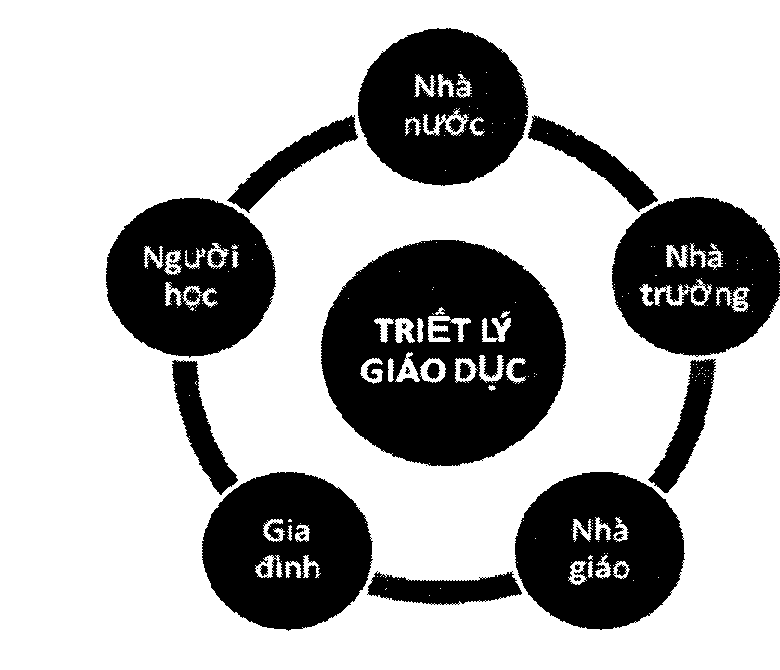

# Phần 4: Làm giáo dục

## Triết lý và Định chế

7

Tại sao sau “làm người”, “làm dân” và “làm việc” là “làm giáo dục”? Không khó để trả lời câu hỏi đó! Cũng như không khó để nhận thấy mối tương quan giữa nền giáo dục của một quốc gia và năng lực làm người, năng lực làm dân, năng lực làm việc hay làm nghề của người dân trong quốc gia đó. Nói một cách đơn giản là cứ nhìn vào người dân của một nước, có thể phần nào đoán được nền giáo dục của nước đó như thế nào; và ngược lại.

Xã hội loài người không ngừng thay đổi, đặt ra những đòi hỏi tương ứng đối với giáo dục. Vì vậy mà cải cách hay đổi mới giáo dục là việc mà mọi quốc gia đều đã, đang, và sẽ phải trải qua. Với Việt Nam, điều này đã trở thành một việc cấp thiết và quan trọng đến mức cứ nhắc đến “giáo dục”, ta sẽ mau chóng gắn nó ngay với các cụm từ như “cách mạng, cải tổ, cải cách, đổi mới”. Vấn đề này thực ra không mới, bởi nó đã được nói nhiều, bàn nhiều, làm cũng nhiều. Tuy vậy, hẳn chúng ta dễ dàng thấy là kết quả đến nay vẫn còn xa mức mong đợi.

Công cuộc canh tân giáo dục đặt ra rất nhiều vấn đề cần đổi mới. Nhưng để có thể tạo ra kết quả thực sự, tôi cho rằng ba vấn đề sau đây là ba điểm mấu chốt cần được ưu tiên đổi mới trước hết:

(1) Đổi mới về triết lý giáo dục.

(2) Đổi mới về định chế.

(3) Đổi mới về gai trò của các chủ thể then chốt trong hệ thống giáo dục.

Đổi mới về triết lý giáo dục, chính là đi tìm câu trả lời cho những câu hỏi sau: Thế nào là cơn người? Đầu là đích đến của giáo dục? hay Đích đến của giáo dục là con người như thế nào? Làm thế nào để có được cơn người đó? Đã đến lúc chúng ta cần ngồi lại để nghĩ cho đến tận cùng: Chúng ta muốn có những con người như thế nào cho xã hội tương lai? Phải chăng là những con người tự do / tự trị? Những công dân có trách nhiệm? Những chuyên gia ưu tú? Con người tự do, công dân có trách nhiệm và chuyên gia ưu tú nghĩa là thế nào? Câu chuyện này đã được bàn khá nhiều trong Chương I- Làm người, Chương II - Làm dân và Chương II - Làm việc nên tôi sẽ không nhắc lại thêm ở đây.

Còn đổi mới về định chế nghĩa là như thế nào? Trong một xã hội văn mình luôn có ba định chế, đó là nhà nước (khu vực công), thị trường (khu vực tư) gà xã hội dân sự (chủ yếu là các chủ thể phi chính phủ và phi lợi nhuận). Nhà nước nắm quyền lực chính trị và thường theo đuổi quyên lực, thị trường nắm quyền lực kinh tế và thường theo đuổi lợi nhuận, còn xã hội dân sự sẽ nắm quyền lực văn hóa và thường theo đuổi chân lú.

Nhà nước thì quốc gia nào cũng có, nhưng nếu không phát triển kinh tế thị trường thì không thể có nền kinh tế hùng mạnh, cũng như không có xã hội dân sự thì không thể có nền văn hóa tiền bộ. Một quốc gia mà thiếu đi kinh tế thị trường hoàn thiện và xã hội dân sự mạnh mẽ thì chắc chắn quốc gia đó không thể thịnh vượng và văn minh.

Mục tiêu giáo dục là con người tự do. Tuy nhiên, sẽ không thể có giáo dục khai phóng và con người tự do nếu như không xác định rằng giáo dục là một “định chế” phần lớn thuộc về xã hội dân sự. Có thể có một phần nào đó trong nền giáo dục thuộc về nhà nước vì có mục đích chính trị hay thuộc về thị trường vì có mục đích kinh doanh, nhưng nếu như giáo dục về cơ bản không phải là một “định chế” thuộc về xã hội dân sự thì cái đích giáo dục khai phóng và con người tự do khó có thể đạt được.

Tuy chậm, nhưng Việt Nam cũng phải từng bước hướng đến một xã hội văn minh. Cụ thể là, trước đây Việt Nam chỉ có nhà nước, nhà nước ôm mọi thứ, quyết mọi chuyện, không có kinh tế thị trường mà chỉ có kinh tế kế hoạch hóa tập trung. Nhưng nay thì thay vì ôm mọi thứ và quyết mọi chuyện, nhà nước đã nhường khá nhiều việc lại cho “thị trường” giải quyết, và thực tế cho thấy thị trường giải quyết tốt hơn nhà nước. Nhờ vậy, kinh tế hiện nay dù còn khoảng cách khá xa so với các nền kinh tế thị trường trưởng thành nhưng cũng đã vượt trội so với thời “bao cấp”. Kinh tế sẽ còn phát triển mạnh hơn nữa khi nhà nước giảm “bao cấp” và giảm can thiệp hơn nữa vào thị trường để quay về với vai trò kiến tạo “luật chơi” và bảo đảm sân chơi công bằng và bình đẳng cho các chủ thể của thị trường.

Còn xã hội dân sự của Việt Nam chỉ mới manh nha thành hình. Nhà nước sẽ cần “nhường” bớt việc cho xã hội dân sự, tương tự như với kinh tế thị trường, nếu muốn công cuộc canh tân văn hóa giáo dục không bị “lạc đường” hay “ngược đường” so với những chuẩn mực cơ bản của một nền văn hóa - giáo dục tiến bộ. Chúng ta thường lo ngại giáo dục bị lạc hậu, nhưng tôi cho rằng lạc đường mới đáng lo hơn. Vì nghĩ một cách lạc quan thì lạc hậu dẫu sao cũng chỉ là đi chậm hơn (nhưng vẫn đúng đường). Còn một khi đã lạc đường hay ngược đường thì càng đi, ta lại càng rời xa cái đích muốn đến.

Tôi muốn dành phần lớn chương này để bàn về việc định nghĩa lại vai trò của các chủ thể then chốt trong hệ thống giáo dục, trả lại chân giá trị cho các chủ thể then chốt trong hệ thống giáo dục, cụ thể là năm chủ thể sau: nhà nước, nhà trường, nhà giáo, gia đình, và người học.

Vì công cuộc đổi mới giáo dục chỉ có thể thực sự diễn ra khi mỗi chủ thể giáo dục hiểu rõ công việc của mình, đồng thời biết giành lấy quyền vốn có của mình và trả lại quyền cho các chủ thể khác. Còn chừng nào mà các chủ thể này chưa “đúng việc”, mà vẫn lẫn lộn, mơ hồ, ôm đồm, chối bỏ việc của mình hay “giành việc” của những chủ thể khác thì khi đó, e rằng dù có “đối” bao nhiêu thì giáo dục cũng không thể “mới” được.

Vậy, đâu sẽ là “đúng việc” (đúng vai trò, đúng sứ mệnh, đúng quyền, đúng nghĩa vụ) của từng chủ thể trong “bộ năm” này?

*Hình: Sơ đồ tương tác 5 chủ thể trong Triết lý giáo dục*

## 1. Nhà trường

Dẫu ngày nay việc giáo dục không chỉ diễn ra trong nhà trường, nhưng nhà trường luôn có một vai trò rất riêng và không thay thế được. Nhưng trước khi bàn về vai trò đặc biệt ấy, hãy cùng lướt qua một vài dạng nhà-trường-mà-khôngphải-nhà-trường mà chúng ta vẫn gặp đó đây xung quanh mình.

Chẳng hạn, nhà trường sẽ không đúng nghĩa là nhà trường, khi đó là nơi để đào tạo tín đồ cho một tôn giáo nào đó. Trường học có thể dạy về tôn giáo, nhưng nếu đích đến của trường không phải là để tăng sự hiểu biết của học sinh về tôn giáo, mà là để dạy các em phải thờ phụng tuyệt đối một đức tin hay một vị thánh nào đó, ngôi trường ấy sẽ giống một giáo đường hơn.

Lâu nay chúng ta vẫn nghe về những ngôi trường của Nhà nước Hồi giáo (IS), ở đó, trẻ em không được học những bộ môn như triết học, khoa học, lịch sử, nghệ thuật, thể dục thể thao..., vì chúng được xem là không phù hợp với đạo Hồi (theo cách hiểu của IS). Hàng ngày, các em phải đến các trại sharia tập trung để học về tín ngưỡng và tôn giáo, phải tuyên thệ trung thành với những đắng tối cao và những tư tưởng cực đoan. Vì thế, chúng ta có thể choáng váng, nhưng sẽ không ngạc nhiên khi nhìn thấy trên tivi cảnh một chiến binh nhí IS thản nhiên cầm súng bắn chết một tử tù và hô to: “Đắng tối cao vĩ đại!.

Mặc dù không thể phủ nhận rằng trên thực tế vẫn có nhiều ngôi trường rất tốt được sáng lập và sở hữu bởi các tôn giáo, nhưng về nguyên tắc, trường học cần có sự độc lập cần thiết với tôn giáo, nhất là về mục đích và nội dung học tập.

Tương tự như vậy, phần lớn các trường học trong nền giáo dục cũng cần độc lập tương đối với chính trị, nếu không sẽ rất dễ trở thành một dạng “trại tuyên huấn” - nơi nhào nặn ra những con người công cụ cho các chế độ hay nhà cầm quyền chứ không phải là những con người tự do như lý tưởng mà lẽ ra nó phải hướng đến.

Và cũng như thế, nhìn tổng thể nền giáo dục, phần lớn các nhà trường (nhất là trường phổ thông công lập và đại học tỉnh hoa) sẽ không phải là một doanh nghiệp, nơi giáo dục được xem như một “món hàng” để trao đổi hay một công cụ để tìm kiếm thật nhiều lợi nhuận. Cho đến nay, cuộc tranh luận về việc nhà trường nên là vị lợi nhuận hay phi lợi nhuận hay không vì mục tiêu lợi nhuận vẫn chưa ngã ngũ. Nhưng chắc chắn có một nguyên tắc bất di bất dịch là: nhà trường có thể có lợi nhuận, nhưng không bao giờ được phép vì lợi nhuận mà hy sinh hay bóp méo mục tiêu giáo dục vốn có của một trường học.

Vậy, một nhà trường đúng nghĩa sẽ là... cái gì? Có nhiều quan điểm về vai trò của nhà trường trong xã hội, nhưng theo tôi, vai trò quan trọng nhất của nhà trường trong xã hội là đại diện cho trí tuệ và tư tưởng của xã hội đó và đại diện cho chân lý, công lý và lương tri mà xã hội đó hướng đến. (“Xã hội” ở đây không chỉ được hiểu là một cộng đồng, một địa phương, một quốc gia, mà còn được hiểu là xã hội toàn cầu).

Nên nếu phải chọn một hình ảnh gần nhất để ví von, tôi sẽ muốn ví nhà trường như một thánh đường thiêng liêng, nhưng “giáo lý” duy nhất được dạy ở đó không gì khác chính là “lương giáo” (lương tri, phẩm giá) và “khoa giáo” (chân lý, khoa học). Tức là dạy làm sao, học làm sao để trở thành những người lương thiện, biết hướng đến và sống với chân - thiện - mỹ, biết yêu chuộng lẽ phải, công lý và sự thật.

Trong một xã hội văn minh, hầu hết các nơi trong nhân gian đều là “cõi phàm”, chỉ có ba nơi thường được xem là “cõi thiêng”, đó là: nhà thờ, nhà chùa và nhà trường. Nếu như nhà thờ là thánh đường của Công giáo và giáo lý là Kinh Thánh, còn nhà chùa là thánh đường của Phật giáo và giáo lý là Kinh Phật, thì nhà trường có thể được ví như là “thánh đường” của “lương giáo” và “khoa giáo”, và giáo lý chính là khoa học và nghệ thuật, chính là chân lý và đạo lý.

Nhưng nếu một xã hội mà phần lớn nhà trường không “đúng việc”, mà chỉ toàn là “nhàtrường-mà-không-phải-nhà-trường” thì xã hội ấy sẽ ra sao?

Lịch sử hàng ngàn năm của văn minh phương Tây cho thấy, về cơ bản, xã hội được vận hành bởi triều đình (quyền lực cứng) và giáo hội

(quyền lực mềm). Và trường học về cơ bản cũng chỉ là nơi truyền giáo, khoa học đích thực khó có cơ hội phát triển nếu như nó dám đi ngược lại với những tín điều của các tôn giáo, mà câu chuyện của nhà bác học Galileo là một ví dụ điển hình. Vì tin rằng, trái đất hình cầu và trái đất quay quanh mặt trời mà Galleo đã bị giáo hội đưa lên giàn hỏa thiêu. Và chỉ khi buộc phải thừa nhận tín điều của giáo hội là mặt trời quay quanh trái đất thì mới được tha, nhưng ông vẫn lầm lầm “Dù sao thì trái đắt vẫn quay”. Qua đó cho thấy, phải khó khăn lắm thì nhà trường mới bước ra khỏi nhà thờ, nhưng nếu không cẩn thận thì có khi nhà trường lại bước bào nhà nước hau chui nào “nhà thương” (thương sta, doanh nhân, doanh nghiệp).

Nói cách khác, nhà trường sẽ khó mà hiện thực hóa được sứ mệnh thiêng liêng của mình, nếu không đạt được vị thế độc lập cần có sau: (1) Độc lập với quyền lực, chính trị; (2) Độc lập với tiền bạc (nhà nước hay nhà tài trợ có thể tài trợ tài chính cho trường học hoạt động nhưng không được phép chỉ phối hay bóp méo bản chất công việc của trường học; và đồng thời, trường học cũng không được phép để tiền bạc hay quyền lực chi phối hay bóp méo bản chất công việc của mình); (3) Độc lập với tôn giáo.

Nói ngắn gọn hơn, trong một nền giáo dục tiền bộ, có thể có những nhà trường có mục đích chính trị, hay có mục đích lợi nhuận, hay có mục đích tôn giáo, nhưng hầu hết nhà trường (bất kể là trường công, trường tư hay kết hợp công - tư, bất kể là được tài trợ bởi nhà nước hay doanh nghiệp hay nhà thờ, nhà chùa) thì cần phi chính phủ, phi lợi nhuận (hay không vì mục tiêu lợi nhuận) và phi tôn giáo.

Chỉ khi nhà trường có được vị thế “ba độc lập” hay “ba phi” nói trên (độc lập ở một mức độ nào đó) thì may ra mới có thể có “tự do” (tự do học thuật, tự do đào tạo, tự do nghiên cứu...) và “tự chủ” (tự chủ về học thuật, tự chủ về nhân sự, tự chủ về tuyển sinh, tự chủ về tài chính...). Nhưng tóm lại là, chỉ khi có các tiền đề “độc lập”, “tự do” và “tự chủ” (nhất là về mặt học thuật) như trên, phần lớn nhà trường mới có thể phát triển theo đúng cái nghĩa mà thế giới văn minh đang hiểu, còn không thì không có gì để bàn nhiều. Tất nhiên, trước khi trao cho nhà trường những thứ này (độc lập, tự do) thì cũng cần một hành lang pháp lý hữu hiệu nhằm bảo đảm nhà trường sẽ phát huy tối đa những tỉnh thần và lý tưởng tốt đẹp của mình và đồng thời kiểm soát được những vấn đề phát sinh ngoài ý muốn.

Abraham Lincoln từng nói rằng: “Triết lý của nhà trường ở một thế hệ này sẽ là nền móng cho xã hội của thế hệ kế tiếp”. Victor Hugo cũng nói: “Một cánh cửa nhà trường mở ra, một nhà htù đóng lại”. Càng có nhiều zhà trường đích thực thì xã hội hiện tại mới càng tốt đẹp lên và nền móng cho xã hội tương lai mới càng vững chắc hơn. Muốn thế, nhà trường cần có quyền được quau về với chân giá trị của mình, được trả lại những gì thuộc về mình, cũng như được từ chối những thứ gì không thuộc về nà không phải là lý tưởng chân chính mà mình cần theo đuối.

## 2. Nhà giáo

Nhà giáo, theo cách hiểu thông thường, là người làm nghề dạy học. Và “dạy” ở đây có nghĩa là giúp cho người ta học. Nhưng trên thực tế, tùy theo “sự dạy” của mỗi người thầy mà xã hội sẽ có những cách nhìn nhận khác nhau về chân dung của họ. Ta có thể tạm khái quát và chia thành năm nhóm sau đây:

Nhóm thứ nhất là “thầy bình thường”, tức là những người thầy dạy theo cách nếu họ biết được những gì trong lnh vực của mình thì sẽ chia sẻ cái biết đó cho học trò của mình. Cách dạy này không có gì đáng để chê trách, vì nó giúp học sinh biết thêm những thông tin, kiến thức mới. Chỉ có điều, khi thầy “cạn vốn” để chia sẻ thì học sinh rất dễ rơi vào tình trạng bị động, lúng túng vì không biết phải tìm kiếm tri thức ở đâu, bằng cách nào; và khi kiến thức của họ bị lỗi thời thì học sinh cũng không biết làm sao để cập nhật nó.

Nhóm thứ hai là “thầu giỏi”. Khác với “thầy bình thường”, cái mà “thầy giỏi” truyền dạy cho học trò không chỉ là kiến thức mà còn là phương pháp học, nói nôm na là “cho cần câu, chứ không chỉ cho con cá”. Một khi học sinh đã nắm được phương pháp học (học được cách học) thì ngay cả khi những điều mà các em được dạy không còn phù hợp nữa trong tương lai, các em vẫn dễ dàng tìm được cách để giáo dục tự thân, tự học thêm, tự cập nhật để mình không chỉ luôn mới, mà còn luôn là người tiên phong.

Để dễ hình dung, hãy tưởng tượng bạn là nhân vật chính trong một... bộ truyện kiếm hiệp chẳng hạn. Một ngày nọ bạn gặp nạn và bị đẩy xuống vực sâu hay rơi vào một chốn thâm sơn cùng cốc nào đó. Nhưng trong cái rủi có cái may, tại đó bạn tình cờ gặp được một mối duyên kỳ ngộ, một cơ hội lớn để thay đổi bản thân mình. (Những ai thường đọc thể loại kiếm hiệp hẳn không xa lạ một kịch bản quen thuộc này!). Đó có thể là một cuốn sách ghi lại những bí kíp võ học độc đáo của một cao nhân nào đó để lại. Đó cũng có thể là một cao thủ võ lâm bậc nhất đã quy ấn lâu nay nhưng quyết định nhận bạn làm đệ tử và truyền lại cho bạn toàn bộ tỉnh hoa võ học và võ đạo, cũng như các phương pháp luyện công, luyện chưởng mà ông đã tu luyện và đúc kết trong cả đời mình.

Hẳn đến đây bạn đã phần nào hình dung được, một cuốn sách dạy võ bình thường cũng giống như là “thầy bình thường”. Bạn có thể học được từ đó 100 chiêu thức để đối phó với 100 tình huống khác nhau, nhưng khi tình huống thứ 101 xuất hiện, bạn sẽ chẳng biết phải làm sao vì... trong sách không có chỉ. Trái lại, vị chân nhân kia có thể chẳng chỉ cho bạn một “chiêu” nào cả, nhưng với những triết lý về võ học, võ đạo mà vị ấy truyền dạy, bạn sẽ tự mình biết cách nên làm gì trong tình huống thứ 101 này. Đó chính là điều “thầy bình thường” không biết hay không làm, nhưng “thầy giỏi” có thể làm được!

Nhóm thứ ba là “thầy lớn”. Điều lớn nhất mà những người thầy này mang lại cho học trò của mình không chỉ là kiến thức hay phương pháp học, mà còn là động cơ học và lòng hiếu tri (niềm khát khao tri thức và sự hiểu biết; “hiếu tri”, chứ không “hiếu điểm” hay “hiếu bằng”). Nói cách khác, họ không chỉ cho học trò của mình con cá hay cần câu, mà quan trọng hơn là cho động cơ đi câu. Bởi nếu một người không hứng thú với việc đi câu thì dù có ấn vào tay anh ta chiếc cần câu xịn nhất thì người đó cũng chỉ ngồi ỳ một chỗ. Ngược lại, một khi đã thích đi câu thì cho dù không được ai cho cái cần câu nào, anh ta cũng sẽ tự mình đi nhặt từng cái que, từng cọng dây để chế ra nó và đi câu.

Cách tốt nhất để giúp người học có động học một điều gì đó, đó là giúp họ hiểu rõ (1) “Tại sao phải học cái đó?” và (2) “Học cái đó để làm gì?”. Và để trả lời được câu hỏi (1) này thì cách tốt nhất là giúp người học nhận chân ra con người của mình, nhận chân ra mức độ hiểu biết, sự đốt nát hay sự ngộ nhận của mình về cái đó; để trả lời được câu hỏi (2) thì cách tốt nhất là giúp người học hiểu được ích lợi của việc học cái đó, cũng như sự tai hại, thiệt thòi nếu như không học cái đó. Sau khi giúp người học trả lời thỏa đáng hai câu hỏi này thì phần còn lại chỉ là nội dung học và phương pháp học.

Có một đứa cháu họ của tôi bình thường rất ghét học các môn xã hội, nhất là môn sử. Theo cách nói của cháu thì đó là môn học “chẳng được tích sự gì” và quá ngán ngẩm khi phải học nó để trả bài và thi hết môn. Nhưng một ngày nọ, bỗng dưng tôi thấy cháu cằm một cuốn sách tóm tắt về lịch sử Việt Nam mà tác giả là một nhà sử học đang sống ở nước ngoài. Tò mò, tôi mới hỏi chuyện thì cháu nói rằng một hôm nọ, cháu tình cờ đọc được một bài viết của tác giả này trên mạng và nhanh chóng bị cuốn hút. Đó là một bài viết về các đời vua của Việt Nam, nhưng nó rất giản dị, truyền cảm hứng, hoàn toàn khác với những bài học lịch sử khô cứng mà cháu vẫn thường hay học trên lớp. Đọc xong bài viết đó, cháu bỗng nhận ra đây mới đúng là sử và thấy thôi thúc phải đọc, phải hiểu nhiều hơn về quá khứ của dân tộc mình. Nghe đến đó, tôi trộm nghĩ rằng tác giả đó quả thật là một người thầy lớn, ít nhất là ở khía cạnh mà ông muốn chia sẻ trong môn lịch sử. Bởi, ở một mức độ nào đó, ông đã truyền được cho đứa cháu của tôi niềm say mê học lịch sử, cho dù ông chưa hề đứng lớp dạy cháu một ngày nào. Động cơ học quả thật là thứ quan trọng nhất, bởi nếu không có nó thì cho dù được truyền lại một phương pháp học từ một vị thầy giỏi, ta cũng sẽ chẳng học được gì mấy!

Nhóm thứ tư là “thầy khai mính” / “thầy khai phóng”. “Thầy khai minh” cũng giống với “thầy lớn” ở khả năng có thể thắp lên và truyền đi niềm khát khao tri thức cho người học. Tuy nhiên, nếu như “thầy lớn” làm điều đó trong phạm vi một lớp học thì “thầy khai minh” có thể làm điều đó trong phạm vi toàn xã hội, khiến cả xã hội thức tỉnh và say mê tìm kiếm tri thức để khai sáng cho bản thân mình, giải phóng con người mình ra khỏi sự vô minh, giáo điều, ấu trĩ.

Từng có một người thầy như thế xuất hiện trong lịch sử nước Nhật, vào thế kỷ 19. Ông là Fukuzawa Yukichi - người được xem là “Voltaire của nước Nhật”, là một người thầy vĩ đại của nước Nhật hiện đại. Ông cũng là tác giả cuốn sách Khuuến học với tuyên ngôn nổi tiếng: “Trời không sinh ra người đứng trên người, trời cũng không sinh rũ người đứng dưới người. Tắt cả đều do sự học mà ra”. Ông đã phê phán mạnh mẽ lối giáo dục cổ hủ, làm cho người dân Nhật Bản thời kỳ ấy nhận ra sự u mê, tăm tối của mình và không ngừng “thực học” để khai phóng bản thân, đồng thời góp phần đưa đất nước bắt kịp và đua tranh với các quốc gia hùng mạnh và văn minh nhất.

Đôi khi, những người “thầu lớn” hau “thầu khai mình” mang đến cho chúng tn một cảm giác... khó chịu, thậm chí cảm thấu “đau”. Khó chịu, bởi chúng ta cứ tưởng rằng mình đã biết rất nhiều, tưởng là không cần học nữa nhưng người thầu ấu lại khiến chúng ta nhận 1a sự tăm tối của mình, vỡ òa bà nhận chân ra con người thật của mình. Cảm giác ấu không dễ chịu chút nào, nhiều khi nó cờn làm ta tốn thương, nhưng đó chính là bản chất của giáo dục khai phóng.

Như nhà văn, nhà văn hóa Nguyên Ngọc từng nói: “Giáo dục làm cho cơn người bị tổn thương. Vì sao? Vì việc đem lại trí thức làm cho con người thấu hoá ra còn bao nhiêu cái mình chưa biết, càng học càng thấu cái mình biết, cái mới nừa được biết thêm càng vô cùng nhỏ bé trước cái chưa biết, không biết còn lại mênh mông, vô tận. Cảm giác tổn thương đó là một cảm giác lành mạnh. Nó khiến con người thiết tha đi tới trên đường tự khai phóng”.

Và nhóm cuối cùng, là những người tuy mang danh “thầy” nhưng thực chất chỉ là “thợ dạy”. Họ là những người dạy như một cái máy, chỉ biết tự động lặp đi lặp lại một bài giảng được lập trình sẵn mà không cần biết nó có mang lợi ích gì cho học trò hay không, cũng như không cần để tâm xem học trò có hiểu, có tiếp thu được hay không. Có đôi khi, chính họ cũng chẳng hiểu lắm về điều mình đang dạy nhưng vẫn cứ thế sao chép, lặp lại và truyền đi. Nói dí dỏm là họ dạy học... bằng lưỡi, chứ không phải bằng cái đầu hay trái tm.

Bên cạnh đó, tôi cũng thường nói vui rằng có thể phân chia những người được gọi là “nhà giáo” thành hai “môn phái” là: “chính giáo” và “tà giáo”. Những người thầy theo “chính giáo” là những người hiểu được sứ mệnh của mình là truyền bá “lương giáo” (lương tri và đạo lý) và “khoa giáo” (khoa học và nghệ thuật). Họ hiểu và tôn trọng quyền được làm ra chính mình của học trò, giúp học trò trở thành con người tự do, chứ không cố ý nhào nặn học trò, biến họ thành công cụ hay nô lệ cho một mục đích nào đó khác như “tà giáo”.

Tôi tin là nhà giáo nào cũng muốn mình đi theo con đường “chính giáo”. Nhưng đôi khi, chúng ta từ từ rời xa con đường đó và vô tình lạc vào một con đường khác mà không hề hay biết.

Về điều này, tôi muốn chia sẻ một trích đoạn trong cuốn tiểu thuyết có nhan đề Lần đầu thấu trăng của tác giả Võ Diệu Thanh - một cô giáo đang dạy học ở An Giang. Đó là một cuốn truyện viết về một ngôi trường nhỏ, ở một vùng quê nhỏ. Đó cũng chỉ là một lát cắt rất rất nhỏ, có thể là chưa đủ để phản ánh chính xác thực trạng diễn ra quanh chúng ta, nhưng tôi tin rằng không ít người làm nghề dạy học khi đọc trích đoạn này sẽ thấy phảng phất những mô thức quen thuộc:

“Hậu nói nó muốn được đi học để làm một cô giáo có lương tâm. Muốn được như vậu nó phải hoàn toàn tự do như thầu Độ. Nó thấy thầu cô mình đã bị tước mất tất cả tự ảo. Từ khi nào? Hình như từ rất sớm. Năm này qua tháng nọ, phải cúi đầu mà làm việc. Thầu sai cũng làm. Riết rồi không biết cái gì là đúng là sai nữa. Một ngày kia chơi nhận ra mình nhút nhái biết bao, hèn mọn biết bao. Nhưng mình đã cảm thấu an loàn trong cái vòng kim cô. Đến độ khi có thể sỡ nó xuống mình tự hỏi liệu có sống nổi không với cảm giác trống trải, mắt phương hướng của tự do.

... Dạy trong lớp chỉ ào ào theo những gì quụ định, xong tiết bước ra... Họ đuổi theo những kiến thức cao siêu đâu đó. Họ nghiên cứu tâm lý học trò trên sách vở, trên giáo trình một cách nhuằn nhuyễn. Khi cần thuyết trình họ nói thao thao bất tuyệt. Khí đứng giáng bài đọc vanh vách những khái niệm đã ăn sâu bào đầu óc họ từ năm này qua tháng kin. Giống như một tín đồ ngoan đạo thuộc làu lầu kinh kệ. . Con tắt phải đọc cái câu sống chan hòn với nhân loại cỏ câu. Con mắt trái đã liếc xéo những người tu bằng đường đạo khác mình. Dạu học trò chữ tôn sư trọng đạo nhưng người thầu đứng dạu như một cái xác không hồn, với mớ chữ nghĩa ngồn ngưng chằng chịt. Nếu học trò là Bồ Tát mới đủ độ lượng phụng thờ một cất xác chưa kịp chôn uùi

Thật đau xót khi đọc những lời có tính tự sự ấy. Đúng như tác giả đã viết, để có thể đi theo “chính giáo” và truyền bá “lương giáo” và “khoa giáo”, các nhà giáo trước hết phải là những con người tự do. Muốn thế, họ phải biết giành lấy những quyền thuộc về mình mà lâu nay họ chưa hề biết đến hoặc bị tước mất (mà có khi chẳng phải là ai đó tước mất của họ, mà là do họ tự khước từ các quyền vốn có của mình), bắt đầu từ việc đặt ra câu hỏi: “Ngày 20/11 để làm gì?”

Từ bao lâu nay, ngày 20/11 đã trở thành một ngày rất đỗi quen thuộc trong tâm trí của người Việt Nam, thậm chí nhiều người còn xem đó như một ngày tết đặc biệt: “Tết thầy cô giáo”. Vì thế, câu hỏi “Ngày 20/11 để làm gì?” thoạt nghe qua có vẻ dự thừa, có khi hơi ngớ ngẩn. Nhưng với các nhà giáo, việc suy nghĩ về chính cái ngày dành cho mình có thể mang nhiều ý nghĩa hơn là một câu hỏi vô thưởng vô phạt.

Trước hết, hãy quay lại tìm hiểu lịch sử hình thành của ngày này:

“Tháng 7 năm 1946, một tổ chức quốc tế các nhà giáo tiến bộ được thành lập ở Paris đã lấy tên là Liên hiệp quốc tế các công đoàn giáo dục. Năm 1949, lại một hội nghị ở Warszaton (thủ đô của Ba Lan), Liên hiệp quốc tế các công đoàn giáo dục đã ra bản "Hiến chương các nhà giáo" gồm 15 chương bới nội dung chủ yếu là đấu trunh chống nền giáo dục tư sản, phong kiến, xâu dựng nên giáo dục trong đó bảo vệ những quyền lợi của nghề dạu học bà nhà giáo, đồ cao trách nhiệm bà vị trí của nghề dạy học nà nhà giáo.

Công đoàn giáo dục Việt Nam, là thành viên của FISE từ năm 1953 (hội nghị có 57 nước tham dự), đã quuết định trong cuộc họp của FISE từ 26 đến 30 tháng 8 năm 1957 tại Warszatun, lấy ngày 20 tháng 11 năm 1958 là ngày "Quốc tế hiến chương các nhà giáo". Ngàu này lần đầu Hiên được tổ chức trên toàn miền Bắc Việt Nam. Khi Việt Nam thống nhất, ngày này đã trở thành ngày truyền thống của ngành giáo dục Việt Nam” (Wikipedia).

Lâu nay, chúng ta vẫn mặc nhiên xem rằng ngày 20/11 là ngày để tôn vinh các thầy cô giáo, và các thầy cô giáo cũng hoan hỉ đón nhận sự tôn vinh đó mà quên mất rằng ngày này vốn dĩ được đặt ra không phải là để tôn vinh hay không chỉ là để tôn vinh. Đó là ngày để nhắc nhở nhà giáo về sứ mệnh thiêng liêng của mình. Đó còn là ngày để nhắc nhở giáo giới về hành trình đấu tranh mà họ đã, đang và còn sẽ tiếp tục trải qua, để giành lấy quyền dạy học, quyền tự do thực hiện sứ mệnh thiêng liêng của mình (chứ không chỉ là đấu tranh đòi hỏi và bảo vệ phúc lợi của mình).

Vì thế, sự tôn vinh đầy trân trọng đó của xã hội trong ngày 20/11 một mặt có thể là niềm vui lớn với những người làm nghề dạy học; nhưng ở một mặt khác, nó lại khiến cho những nhà giáo có lương tri cảm thấy đầy áp lực và trách nhiệm. Bởi họ hiểu rằng sự tôn vinh đó cũng đồng thời đi kèm với những đòi hỏi khắt khe hơn, nhất là khi gần đây nghề giáo đang bị một bộ phận xã hội nhìn nhận thiếu tôn trọng vì hàng loạt trường hợp “con sâu làm rầu nồi canh” xảy ra liên tiếp. Với họ, nếu như không làm được gì cho xã hội mà lại nghiễm nhiên đón nhận sự tôn vinh đó từ xã hội thì quả là đáng xấu hồ.

Trong thời đại ngày nay, ý nghĩa của ngày 20/11 sẽ không chỉ dừng lại ở chuyện xác lập và tôn vinh nghề giáo nữa, bởi tầm quan trọng, vị trí, vai trò của nghề này đã mặc nhiên được công nhận mà không cần phải bàn luận thêm. Ngày 20/11 sẽ mang một ý nghĩa lớn hơn, nếu như đó là một ngày để những người làm nghề dạy học tư duy lại và nhận thức lại công việc và nghề nghiệp của mình, cũng như định nghĩa lại vai trò và sứ mệnh của giới mình đối với người học và xã hội. Cho dù xã hội và nhà nước còn nhiều thiếu sót đối với nhà giáo, thì việc những người làm nghề có trách nhiệm ngồi lại cùng nhau để trả lời lại những câu hỏi tưởng chừng như đơn giản nhưng lại liên quan hệ trọng đến công việc, sự nghiệp của mình và có thể giúp mang lại những thay đổi sâu sắc cho bức tranh nghề giáo nói riêng và cả nền giáo dục nói chung. Những câu hỏi đó có thể là: Ai là thầy? Ai là “thợ dạy”? Thế nào là “con người”? Thế nào là khai minh? Thế nào là vô minh? Thế nào là trí thức?..., và hàng loạt những câu hỏi khác có thể nhìn thấy từ đầy rẫy những bức xúc của xã hội.

Những nhà giáo có trách nhiệm hắn đã không ngừng trăn trở về những câu hỏi sống còn này, vào mỗi ngày đứng bục giảng, chứ không riêng gì ngày 20/11. Nhưng để những suy nghĩ riêng lẻ đó cộng hưởng thành một luồng suy nghĩ mạnh mẽ của cả giáo giới cũng như cả xã hội, bên cạnh việc dành ngày 20/11 như một ngày để suy nghĩ cho nghề, cần có thêm sự hiện diện của một tổ chức chính thức dành cho những người làm nghề. Tổ chức đó có thể là một Hiệp hội nhà giáo Việt Nam, hay một Ủy ban quốc gia về chuẩn mực nghề giáo. Sứ mệnh của những tổ chức xã hội nghề nghiệp này sẽ không chỉ dừng lại ở việc bảo vệ lợi ích của những thành viên là nhà giáo của mình, mà còn là bảo vệ cả những chuẩn mực đạo đức, chuẩn mực chuyên môn của giới mình và không ngừng nâng cao những chuẩn mực đó nhằm đáp ứng kịp thời những đòi hỏi mới của thời đại.

Nhìn ra thế giới, chẳng hạn như những người làm giáo dục Mỹ đã chuyên nghiệp hóa hoạt động của người thầy bằng cách xây dựng “Bộ quy chuẩn giảng dạy chuyên nghiệp” do một ủy ban quốc gia và hiệp hội nhà giáo ban hành. Nghề giáo là nghề đầy sáng tạo. Bộ quy chuẩn này được xem là một sự sáng tạo chung của nền giáo dục Mỹ, và dựa trên sự sáng tạo chung này, mỗi nhà giáo sẽ có thêm những sáng tạo riêng trong quá trình hành nghề của mình.

Nhìn sang các nghề khác, những người làm kiểm toán đã theo đuổi mục tiêu đạt “chứng chỉ hành nghề” của quốc gia và quốc tế, những người làm nghề y, nghề luật... cũng bắt đầu kết nối mình với những hội nghề nghiệp có uy tín quốc tế lớn... Họ đang chuyên nghiệp hóa và quốc tế hóa trình độ của mình để có thể thực hiện tốt hơn thiên chức nghề nghiệp mà họ đã tự nhận lãnh. Và rất nhiều người làm giáo dục giật mình khi đối diện câu hỏi từ một phụ huynh nước ngoài muốn cho con học tại Việt Nam: “Ở trường bạn, có bao nhiêu giáo viên có chứng chỉ hành nghề và đạt chuẩn chuyên nghiệp?” Giật mình và nhiều người lúng túng nhìn nhau: liệu đã đến lúc chúng ta cần một “cái chuẩn” chung, một “cái chuẩn” mới đầy trí tuệ để chuyên nghiệp hóa hoạt động của người thầy? Cái chuẩn ấy sẽ giúp ta hiểu rõ hơn về đạo đức nghề nghiệp và năng lực chuyên môn của nhà giáo. Chuẩn đạo đức chính là những kim chỉ nam mà bất cứ một nhà giáo nào cũng phải tâm niệm để xác lập phẩm chất của người thầy. Chuẩn chuyên môn chính là yêu cầu về khả năng sư phạm và trình độ chuyên môn mà người thầy cần phải có đối với từng buổi học, môn học, lớp học...

Đặt ra chuẩn mực chính là cách để bảo vệ uy tín, hình ảnh của những người làm nghề giáo trong xã hội và khiến cho tiếng nói của giới (mà tổ chức này làm đại diện) đối với chính quyền, với cộng đồng sẽ trở nên mạnh mẽ hơn bao giờ hết. Đó cũng là cách để chúng ta có những người thầy có khả năng đua tranh mạnh mẽ cùng đồng nghiệp của mình trên khắp thế giới, có khả năng tạo ra những người trò tự do và có khả năng sống một cách đàng hoàng và làm việc thành công ở bất kỳ xứ sở nào trên thế giới. Đó còn là cách nhằm đề cao và tôn vinh những người thầy đúng nghĩa, loại khỏi giới nhà giáo những nhân tố có thể làm hoen ố hình ảnh của nghề cao quý này.

Nhưng những thay đổi đầu tiên trong diện mạo của nghề giáo có thể được tạo ra từ chính các nhà giáo, bắt đầu từ những suy tư về chính cái nghề của mình trong thời đại mới, về chính cái ngày dành cho mình... một cách hết sức giản đơn như thế, mà cũng đầy sâu sắc mạnh mẽ như thế. Giản đơn, nhưng cũng đủ mạnh mẽ để thắp lên một đốm lửa nhỏ để từ đó, niềm tin vào giáo dục lại được thắp lên!

## 3. "Nhà mẹ" / Gia đình

Khi bàn về cải cách giáo dục, người ta thường nhấn mạnh việc làm sao để hai chủ thể “nhà trường” và “nhà giáo” làm đúng việc của mình, mà ít khi nhắc đến một “nhà” khác cũng không kém phần quan trọng là... “nhà mẹ”, tức gia đình. Gia đình chính là “ngôi trường” đầu tiên mà hầu hết mọi người đều trải qua trước khi đặt chân vào trường học chính thức hay “trường đời”. Đó cũng là một trong ba thành tố có ảnh hưởng lớn nhất trong hành trình trưởng thành của một con người và thường được nhắc chung với nhau là nhà trường, gia đình và xã hội.

Trong bối cảnh ngày nay, sự quan tâm và “can dự” của gia đình vào việc giáo dục con mình lại càng trở nên cần thiết hơn bao giờ hết.

Tuy nhiên, nếu như nhà nước không được xem giáo dục là công cụ để “nhào nặn” người dân thành thứ “dân” mà mình muốn, thì gia đình (chủ yếu là cha mẹ) cũng cũng không nên “nhào nặn” con mình theo kiểu như vậy. Khi cha mẹ thực sự thương con thì sẽ giúp con biết “khai phóng bản thân”, “tìm ra chính mình”, “làm ra chính mình”... chứ không nên biến con mình thành người mà mình muốn; cũng không nên “dùng” con để hiện thực hóa những giấc mơ của mình (nhưng lại không phải là giấc mơ của con). Một cha mẹ có hiểu biết và có tắm lòng sẽ xem con mình trước hết là một “con người”, sau đó mới là “con mình”. Và “con người” thì luôn to hơn và quan trọng hơn “con mình”. Ngược lại, một đứa con hiểu biết và hiếu nghĩa cũng sẽ biết làm sao để được sống cuộc sống của mình, nhưng không làm phương hại tới người khác, cũng không vô trách nhiệm với ai, và đặc biệt là không làm cho cha mẹ mình phải đau lòng vì những lựa chọn hay cách thức chia sẻ của mình. Một khi gia đình có những người cha người mẹ tự do và đầy tình thương yêu, có những đứa con hiểu biết và hiếu nghĩa thì lý do gì mà gia đình đó lại không được hạnh phúc tròn đầy!

Hiện nay, cánh cửa hội nhập trì thức giữa Việt Nam và thế giới đã được mở rộng rất nhiều so với trước, cũng như với sự xuất hiện ngày càng nhiều của các trường quốc tế, trường tư thục và nhiều mô hình giáo dục mới khác, lẽ ra cha mẹ sẽ “khỏe” hơn nhiều trong chuyện giáo dục con mới đúng, chứ tại sao lại phải “can dự” nhiều vào việc giáo dục con cái? Chưa kể là điều kiện kinh tế của các gia đình bây giờ cũng tốt hơn nhiều so với trước, nhờ vậy mà cha mẹ cũng có thể thoải mái lựa chọn những giải pháp giáo dục tốt hơn cho con mình.

Tất nhiên, không thể phủ nhận những điểm thuận lợi nêu trên. Nhưng cũng chính những thuận lợi đó đã vô tình góp phần tạo ra hai “vấn nạn” lớn nhất trong tư duy giáo dục con cái của nhiều gia đình ngày nay là: (1) Phó mặc con cho nhà trường, và (2) Cho rằng cứ bỏ tiền ra là có thể mua được giáo dục tốt cho con.

Có nhiều lý do khiến cha mẹ phó mặc chuyện giáo dục con cái cho nhà trường: quá bận rộn, quá vô tâm, quá sức... nhưng phần lớn là vì tâm thế cho rằng một khi con đã đi học thì coi như mình không còn là người chịu trách nhiệm chính. Coi như khi ấy, con mình sẽ trở thành ai, ra sao là việc của trường, của các thầy cô giáo. Thế nên mới có chuyện nhiều phụ huynh một ngày nọ nhận được thư mời họp của trường về một chuyện “ngoài sức tưởng tượng” của con thì mới ngã ngửa kêu trời, thậm chí còn đổ lỗi hay trách ngược nhà trường về việc mà lẽ ra mình cũng có một phần trách nhiệm.

Ví dụ có lần, tôi đọc trên báo mẩu chuyện về một ông bố, khi biết con mình bị nhà trường kỷ luật vì đánh nhau với bạn, ông đã xông vào trường đánh giáo viên của con vì cho rằng giáo viên đã chèn ép, thiếu công bằng với con mình, “không biết dạy nên mới để học trò đánh nhau”. Tôi chợt nghĩ, có khi chính ông mới là người đã khiến con ông bị kỷ luật chứ không phải là do nhà trường hay ai khác!

Việc cho rằng hếễ có tiền thì có thể mua được giáo dục tốt cho con cũng là một lối suy nghĩ rất phổ biến ngày nay, thậm chí là ở cả những phụ huynh rất quan tâm đến việc giáo dục con mình. Nhưng thực sự, nền tảng văn hóa, nền tảng giáo dục của một con người không phải là thứ có thể mua bằng tiền. Tiền bạc không bao giờ là thứ đảm bảo chắc chắn cho giá trị giáo dục mà con cái chúng ta sẽ nhận được (dù nó có thể giúp mang lại cơ sở vật chất, chất lượng dịch vụ tốt hơn).

Có một người mà tôi biết đã dồn hết mọi tiền bạc để cho con đi học ở một trường quốc tế có tiếng và cũng là thuộc diện đắt đỏ bậc nhất ở Sài Gòn, dù gia đình chị cũng thuộc diện tương đối khá giả chứ không phải giàu có lắm, với mong muốn sẽ cho con một nền giáo dục “chuẩn quốc tế” không thua kém bất kỳ ai. Bỗng một ngày nọ, chị nói với tôi rằng chị đang muốn tìm một ngôi trường khác cho con, trường công bình thường cũng được. Chuyện là đứa con của chị xin mẹ cho đi trại hè ở nước ngoài cùng với các bạn cùng lớp, nhưng chị thấy chi phí chuyến đi lên đến hàng ngàn đô la - một con số quá lớn nên chị không đồng ý. Ít lâu sau, chị tình cờ đọc được tin nhắn của con gửi cho bạn với những lời chê trách chị thậm tệ, thậm chí con còn gọi chị là “bà già lầm cẩmỨ, rồi “bà già quê mùa không biết gì”.

Quá sốc và đau buồn trước những gì mà mình được con đáp trả, chị đâm ra hoài nghị, phải chăng chính vì được học trong một môi trường xa xỉ đắt đỏ với những người bạn giàu có hơn nhà mình rất nhiều mà con đâm ra ích kỷ, chỉ biết đòi hỏi mà không biết ơn những gì những người khác đã làm cho mình. Nên bây giờ chị lại muốn cho con học ở một trường công bình thường để con bớt đua đòi hơn, dù biết rằng có khi trường công cũng có vô số vấn đề không như mình mong muốn.

Tuy nhiên, chuyện trường công hay trường tư, chuyện đầu tư nhiều tiền hay ít tiền cho sự học của con không thể giải quyết được tận gốc những vấn đề mà chị cũng như nhiều phụ huynh khác đang “đau đầu nhức óc”. Bởi trong bối cảnh nhiều xáo trộn ngày nay, các bậc làm cha làm mẹ không thể trông cậy hết vào nhà trường, xã hội hay một giải pháp đâu đó bên ngoài trong chuyện giáo dục con mình. Khi mà nhà trường thay vì là một “thánh đường của lương giáo” lại là nơi ngổồn ngang quá nhiều vấn đề đáng lo ngại như nạn chạy trường, mua điểm, gian lận thi cử, bạo lực học đường, đua đòi...; khi mà xã hội đang hứng chịu nhiều cú sốc văn hóa và vô số biến tướng về cách sống, cách hành xử như hiện nay thì hy vọng lớn nhất và cũng là giải pháp chắc chắn nhất cho việc dạy con và cứu con mình khỏi những lệch lạc của cuộc sống lại chính là gia đình. Nói nôm na như như một phụ huynh từng nói với tôi là: “Nhà trường vầy, xã hội vầy thì sao dám giao con cho ai? Chỉ có mình tự cứu lấy con mình thôi!

Nhưng đó cũng không phải là chuyện dễ dàng gì với các gia đình, khi mà toàn cầu hóa đang cuốn chúng ta vào một cơn lốc xoáy mãnh liệt, kèm theo bối cảnh khủng hoảng về nhiều mặt, đẩy những đứa trẻ ra khỏi vòng kiểm soát của cha mẹ một cách nhanh chóng. Cùng với nó là khoảng cách thế hệ ngày càng bị kéo dãn bởi những thay đổi như vũ bão của thời cuộc. Tình thương yêu không bao giờ mắt đi, nhưng sự đối thoại giữa ông bà, cha mẹ và con cái đang ngày càng khó khăn hơn vì khoảng cách thế hệ quá lớn này. Nếu như trước đây, khoảng cách giữa hai thế hệ thường được xem là khoảng 25 năm thì ngày nay, với sự thay đổi chóng mặt và khôn lường của mọi thứ, có khi chỉ cách nhau mấy tuổi đã là hai thế hệ. Nhưng không đối thoại thì làm sao có thể dạy con? Không đối thoại thì chuyện con nhìn cha mẹ như “đồ cổ”, “hàng tồn kho” (hay như “bà già lầm cẩm” trong câu chuyện của chỉ bạn nói trên), còn cha mẹ nhìn con như những đứa “không ra thể thống gỳ, “không thể hiểu nổi” e là chuyện khó tránh khỏi!

Một người chủ một doanh nghiệp lớn mà tôi biết đặt ra một quy định như sau cho gia đình mình: Hàng tuần, cho dù có bận rộn đến mấy đi nữa, cả gia đình phải ăn với nhau ít nhất là một bữa cơm chung. Và hàng chục năm qua, gia đình anh hiếm khi phá vỡ quy định này. Dù bận rộn đến mấy, cứ hàng tuần, vợ chồng con cái dâu rể nhà anh (trong đó có không ít người thành đạt ngoài xã hội) lại sum vầy đông đủ để ăn cơm cùng nhau (trừ trường hợp có ai đó phải vắng mặt vì lý do đi công tác xa) và trong khoảng thời gian đoàn viên đó hầu như không ai đụng tới điện thoại hay máy tính. Anh nói, trong thời đại bận rộn ngày nay, bữa cơm gia đình vừa là “diễn đàn đối thoại” giữa các thế hệ, lại vừa là một “trường học đặc biệt” cho những đứa trẻ. Chỉ là một mâm cơm nhỏ nhưng lại có tác dụng rất lớn trong việc xóa nhòa khoảng cách giữa cha mẹ con cái.

Ai cũng muốn có những bữa ăn ngon, nhưng thế nào là bữa ngon? Có thể hình dung một bữa ăn ngon (nhất là bữa ăn sum họp gia đình) gồm năm yếu tố sau: yếu tố đầu tiên, tất nhiên đồ ăn phải ngon; yếu tố thứ hai là món ăn phải được trình bày đẹp, vì người ta không chỉ ăn bằng miệng mà còn “ăn” bằng mắt nữa; yếu tố thứ ba là khung cảnh của bữa ăn (đây cũng là lý do mà trong những gia đình văn minh, dù nhà có nhỏ hẹp mấy đi nữa thì nơi đẹp nhất và thoáng nhất thường chính là bàn ăn ở gian bếp); yếu tố thứ tư là những người cùng ăn (ăn cái gì là quan trọng, nhưng ăn với ai đó cũng quan trọng không kém); và yếu tố cuối cùng là câu chuyện của bữa ăn. Đó cũng chính là lý do vì sao mà mâm cơm đầm ấm đã trở thành nơi khởi nguồn cho việc hình thành gia đạo và cũng là trường học vĩ đại bậc nhất của mỗi người, nhất là thuở đầu đời.

Tất nhiên, “mỗi cây mỗi hoa, mỗi nhà mỗi cảnh”, không ai giống ai, không nhà nào giống nhà nào, và không phải cứ đối thoại là sẽ xóa nhòa được khoảng cách thế hệ. Khi ấy, việc xây dựng gia đạo như một “người thầy lớn” giúp dạy con nên người là việc mà các ông bố bà mẹ hoàn toàn có thể chủ động được.

Gia đạo, đó là “con đường” của một gia đình. Con đường ấy có thể được thừa hưởng từ các thế hệ trước, hay do chính thế hệ của mình ý thức tạo dựng nên. Còn “gia pháp”, “gia phong!, trong mường tượng của nhiều người cũng tựa như một cây roi bên cạnh bàn thờ tổ tiên, không dùng để đánh mắng con cái bao giờ nhưng lúc nào cũng có tác dụng nhắc nhở, răn đe, hướng dẫn con cháu trở về con đường đúng đắn. Nghe những điều này có vẻ hơi hoài cổ. Nhưng càng hiện đại thì càng cần phải sàng lọc và gìn giữ những nếp nhà, tuy xưa cũ nhưng vẫn còn nguyên giá trị. Từ nếp nhà này cộng với những giá trị phổ quát từ thế giới tiền bộ thì mới có thể hình thành một “gia đạo hội nhập” cho con cháu thời nay.

Gia đạo là những thứ mà một gia đình hay đại gia đình đã dày công tạo dựng và lưu truyền qua nhiều thế hệ để hình thành nên bản chất và đặc trưng của chính gia đình ấy, là người thầy có ảnh hưởng thằm lặng nhưng vô cùng lớn tới con cháu. Gia đạo là việc nghệ sĩ Thành Lộc lớn lên và làm nghệ thuật với lời cha dặn: “Nghệ sĩ chân chính thì không hơn thua nhau nơi cánh gà”. Gia đạo cũng là việc có những bạn thủ khoa chia sẻ: “Em được may mắn sinh ra trong một gia đình hiếu học”. Hay có lúc gia đạo chỉ đơn giản là việc một cô nhân viên nổi trội và được yêu mến trong tổ chức vì luôn tâm niệm lời mẹ dạy: “Ở nhà với mẹ thì sao cũng được, nhưng ra đường thì phải luôn nhớ: Ăn thì nhường mà làm thì giành”.

Nhưng không phải gia đạo nào cũng tốt, như các cụ ngày xưa đã nói, có hai loại gia đạo phổ biến nhất mà các bậc cha mẹ có thể tự chọn lựa nhằm để lại cho con cháu đời sau, đó là: (1) “Cha mẹ hiền thì để đức cho con”; hoặc (2) “Đời cha ăn mặn thì đời con khát nước”. Và đề có gia đình mình có gia đạo nào thì đây phải là sự lựa chọn cỉ đời, chứ không phải chỉ là lựa chọn vào cuối đời.

Gia đạo, một cách văn vẻ hơn, là văn hóa gia đình, là những giá trị làm nên một gia đình, là những thứ mà vì nó và để bảo vệ nó, các thành viên trong gia đình sẵn lòng hy sinh mọi thứ khác. Gia đạo sẽ làm một gia đình được kính trọng hoặc bị coi khinh. Đó cũng là thứ làm cho những đứa con sinh ra, lớn lên và cảm thấy tự hào về gia đình mình. Đó không phải là bố làm lớn, mẹ nhiều tiền hay gia thế lẫy lừng, nhà to, xe xịn, mà là những kỷ cương cần thiết, những giá trị vô hình đủ đẹp để mọi thành viên trong gia đình theo đuổi và làm gương cho con cháu. Gia đạo vừa là “chân ga” vừa là “chân thắng” của gia đình, giúp đứa con có động lực để vượt qua khó khăn để đi đến điều mình muốn, nhưng cũng biết dừng lại đúng lúc trước những cám dỗ.

Lớn lên trong một gia đạo như thế, khó ai có thể phản bội niềm tin, giá trị, truyền thống của gia đình mình, ngay cả khi bối cảnh xã hội xung quanh đầy rẫy những điều ngược lại.

Đó chính là câu chuyện của một huấn luyện viên bóng đá nổi tiếng tại Rwanda tên là Stone. Khi đang trên đỉnh cao sự nghiệp bóng đá của mình, Stone bị một cầu thủ khác cố tình chơi xấu, và hệ quả là ông vĩnh viễn không còn có thể chơi bóng được nữa. Trong tình huống đó, điều Stone hoàn toàn có thể làm là trả thù lại người chơi xấu ông, vì trả thù là điều được khuyến khích trong văn hóa Rwanda, một người đàn ông bị chơi xấu mà không trả thù thậm chí còn bị xem là hèn nhát. Nhưng Stone đã chọn cách tha thứ. Rồi ông chọn cách trở thành một huấn luyện viên bóng đá, dạy bóng đá cho những trẻ em đường phố của Rwanda, giúp chúng từ những đứa trẻ lang thang ngỗ ngược thành những cầu thủ thành công, dạy chúng thành những con người tử tế. Ông nói rằng, động lực lớn nhất giúp ông đi ngược lại cái “lẽ thông thường” của xã hội Rwanda chính là những lời mẹ ông vẫn luôn căn dặn từ tấm bé: “Con ạ, hãy biết yêu thương và tha thứ”. Stone được ngưỡng mộ như một biểu tượng của tình yêu thương và lòng tha thứ ở Rwanda, nhưng có lẽ chính người mẹ của ông với gia đạo tuyệt vời của bà mới là người còn đáng ngưỡng mộ hơn!

Không phải ai cũng may mắn được sinh ra trong một gia đình với gia đạo tốt đẹp như Stone.

Nhưng ngay cả trong hoàn cảnh đó, chúng ta vẫn có thể thay đổi bản thân mình và thay đổi gia đình mình thông qua việc tái xác lập một gia đạo mới, bắt đầu từ việc xây dựng những “nếp nhà” nho nhỏ. Cách cha mẹ đối xử với ông bà cũng sẽ ảnh hưởng không nhỏ đến cách con cái đối xử với cha mẹ. Hình ảnh cha mẹ thành kính khi thắp một nén nhang trước bàn thờ tổ tiên sẽ đi vào tiềm thức, tâm thức và ký ức của đứa con về cội nguồn và sự biết ơn để rồi mai này, đến lượt con cũng sẽ biết trân trọng nếp nhà như cha mẹ.

Để rồi nếp nhà ấy sẽ trở thành gia đạo, và gia đạo ấy sẽ quyết định số phận tương lai của gia đình và cả các thế hệ con cháu mai sau.

## 4. Người học

Người học thường được xem như “sản phẩm” của hệ thống giáo dục, gồm nhiều nhân tố, từ nhà nước, đến nhà trường, nhà giáo và gần gũi nhất là từ gia đình và các tác nhân ngoài xã hội.

Tuy nhiên, có thể nhận thấy, đồng thời với quá trình chịu tác động của hệ thống giáo dục này, con người còn là “sản phẩm” của chính mình, của một quá trình “giáo dục tự thân”.

Chẳng hạn, một số người vẫn bảo rằng, rất nhiều người trong số chúng ta là những sản phẩm bị “lỗi” của nền giáo dục Việt Nam. Nhưng có một thực tế khác: đâu phải tất cả những ai thụ hưởng nền giáo dục trong nước đều bị “lỗi”. Vẫn có rất nhiều người thành nhân và thành tài mà chưa hề thụ hướng một nền giáo dục nào khác ngoài những điều đã được học, được dạy trong nhà trường Việt Nam. Tìm hiểu những kinh nghiệm của họ, sẽ rất dễ nhận ra, điểm khác nhau chính là ở nhận thức về sự học và quá trình tự học, tự rèn luyện, tự thân vận động của họ.

Thực tế là không nhiều người xem việc học là một mục tiêu tự thân như vậy. Hầu hết chúng ta khi còn nhỏ thì học vì gia đình, lớn lên thì học vì bằng cấp, vì danh tiếng, hay vì muốn kiếm một chỗ làm tốt lương cao.

Năm 1931, học giả Phan Khôi từng nhận định: “Người mình coi sự học cũng như cái cục gạch để gõ cửa, khi cửa mở ra rồi thì cục gạch ném đi. Cái học của tu là để gõ cái cửa giàu sang, khi giàu sang rồi thôi không nói đến học nữa”. Còn năm 1959, học giả Nguyễn Duy Cần cũng đã viết trong tác phẩm Tôi tự học của mùnh như sau:

“Có kẻ đậu năm ba bằng, có người đậu cử nhân, Hến sĩ thế mà cũng bị người ta mắng cho là đồ vô học.

Như thế thì “người có học” là người như thế nào? Chắc chắn, nó phải có một định nghĩa rõ ràng, nhưng thường được hiểu ngằm hơn là nói trắng ra.

Tôi có quen nhiều bạn đậu kỹ sư điện, thế mà trong nhà có máy điện nào hư, phải đi tìm những anh thợ mứu điện đến sửa. Nếu ta bảo họ giảng nghĩa về điện học, thì phải biết, họ sẽ làm cho ta điếc óc. Tôi có biết nhiều ông giáo sư ở trường sư phạm ra, thế mà trong khi dạy học, họ không biết áp dụng một nguyên tắc sư phạm nào cả, học trò nẫn than phiền là giờ dạu của họ buồn ngủ muốn chết, không hiểu được gì dủ. Rồi họ còn bảo: “Học trò mà học dở, không phải lỗi hại thầy”. Tôi cũng thấu nài ông đậu bằng tiền sĩ hau thạc sĩ triết học, thế mà cách ăn ở với đời uung dại như mội người ngu, không hiểu chút gì bồ tâm lý con người cả.

Học như thế, không có lợi ích gì cho mình mà còn hạ phẩm cách của con người. Georses Duhnmel có nói: “Đừng sợ máu móc của bên ngoài, hãy sợ máy móc của cối lòng”. Một xã hội mà con người chỉ còn là bộ máy thì sứ mạng của văn hón đã đến ngày tận cùng tồi, mà Hình thần loài người rồi cũng đến lúc diệt pong: có xác mà không hồn. Học mà đưa con người đến tình trạng ấu, tôi tưởng thà đừng học có hơn không? Cái hiểm trạng của xã hội ngày nay phải chăng một phần nào đều do những bộ óc “học thức nửa mùa” ấu gây nên?”

Tất cả những dòng ấy đều được viết cách đây non một thế kỷ nhưng gần như chẳng khác chuyện thời nay là mấy! Vậy thì phải chăng đã đến lúc người học cần ý thức được vai trò “làm chủ” của mình trong toàn bộ quá trình giáo dục mà ở đó mọi tác nhân khác như nhà nước, nhà trường hay nhà giáo... chỉ đóng vai trò hỗ trợ, bồ sung và cung cấp thông tin, kiến thức cho người học để họ tự hoàn thành mục tiêu học tập của chính mình. Nghĩa là, người học vừa là nguyên liệu, vừa là sản phẩm, vừa là nhà sản xuất và cũng lại là trung tâm của cả quá trình giáo dục. Người học cần phải biết nắm lấy sự chủ động cao nhất trong toàn bộ quá trình này. Và mọi sự đổi thay, mọi sự cải cách hay mọi cuộc cách mạng về giáo dục đều bắt đầu từ sự học, chính xác là bắt đầu từ “cách mạng sự học” của bản thân mỗi người.

Trong một báo cáo toàn cầu về giáo dục vào năm 1996, UNESCO đã định nghĩa lại mục tiêu của việc học dành cho mỗi người như sau: học để hiểu biết, học để làm việc, học để làm người và học để chung sống. Chúng ta cũng có thể có một cách hiểu, một cách diễn đạt khác về những mục tiêu này, đó là: học làm người, học làm việc và học làm dân. Những mục tiêu này có thể được giải quyết một cách thấu đáo bằng phương pháp luận cơ bản mà tôi gọi là “Sư học 2W1H”. Cụ thể, chúng ta sẽ tìm được ý nghĩa thực sự của sự học nói chung, cũng như của từng tiết học, buổi học, môn học, lớp học, khóa học, cấp học, bậc học... với hệ thống câu hỏi: “Wñy - Tại sao học (lý do ) và “For What” - Học để làm gì?” (mục đích ); “What - Học cái gì để đạt được mục tiêu đó?” (nội dung học) và “Hơn; - Học như thế nào?” (phương pháp học). Trước tiên phải xác định được cái “Whu Ø For WhaF”, rỒi mới đến cái “Whaf” và cái “Ho”.

Hãy bắt đầu bằng một ví dụ cụ thể về chuyện học để làm việc: Một sinh viên bước chân vào khoa điện của một trường đại học. Từ ngưỡng cửa này, có rất nhiều “kịch bản tương lai” mà người sinh viên đó có thể chọn cho mình. Anh ta có thể chọn: “Miễn sao lấy được tấm bằng kỹ sư điện, còn chuyện biết gì về điện hay không tính sau”, hoặc là “Chẳng lấy được tấm bằng nào cũng được, chuyện đèn sách ở trường đi về đâu cũng được, miễn có thể trở thành một chuyên gia giỏi về điện nhờ suốt ngày miệt mài đam mê tự nghiên cứu và thực hành”; hay “Nhất định phải vừa có bằng kỹ sư hẳn hoi mà lại rất giỏi nghề”. Tùy theo mỗi kịch bản mà chàng sinh viên này sẽ có cách học, nội dung học khác nhau. Nhưng chính anh ta, chứ không ai khác, mới có thể quyết định tương lai của chính mình bằng việc hiểu rõ động cơ thực sự bên trong của mình trong suốt quá trình được đào luyện và tự đào luyện này.

Hay một câu chuyện khác: Có một sinh viên nói với tôi rằng em đang cảm thấy chán nản vì sau giai đoạn học đại cương, em không được xếp vào ngành học mà mình mong muốn. Em rất muốn theo ngành kiểm toán, nhưng lại bị xếp vào ngành tài chính nhà nước. Em đang cảm thấy không còn chút thiết tha nào với việc học và đang suy nghĩ liệu có nên bỏ học hay không. Tôi bèn nói với em: Mục tiêu học của em là gì? Nếu mục tiêu của em là lấy được một tấm bằng chuyên ngành kiểm toán của trường đại học thì đúng là em không nên mất thời gian ở trường đại học nữa, vì chắc chắn em sẽ không đạt được mục tiêu đó. Còn nếu mục tiêu của em là học nghề kiểm toán thì chuyện em được phân vào chuyên ngành nào hay có ngồi trên ghế giảng đường đại học hay không phải là chuyện quan trọng nữa. Bởi cho dù trong khoa tài chính nhà nước người ta không dạy em nghề kiểm toán, nhưng cũng không ai cắm em học thứ em muốn. Một khi em đã thực sự muốn học thì nhất định em sẽ kiếm được cách này hay cách khác để học. Chính em sẽ là người quyết định tương lai nghề nghiệp của em, chứ không phải cái quyết định xếp chuyên ngành của nhà trường.

Qua những ví dụ trên, có thể thấy rằng, tất cả những môn học, những lớp học... và thậm chí cả hệ thống giáo dục, đều có thể được định nghĩa lại bằng 2W1H. Không chỉ định nghĩa lại từ cấp vĩ mô mà còn từ bản thân mỗi người học, không chỉ định nghĩa lại từ cả một đời học mà còn từ mỗi tiết học.

Phải định nghĩa lại, vì chỉ có học thực mới có năng lực thực; chỉ có năng lực thực mới có thể làm thực; chỉ có làm thực mới có thể tạo ra giá trị thực; chỉ có tạo ra giá trị thực mới có thể sống thực, mới có thể có cuộc đời tự do. Tắt cả, bắt đầu từ thực học!

Và mỗi người sẽ có thể “thực học” thông qua việc “làm chủ” quá trình giáo dục và quá trình tự học của chính mình. Làm chủ sự học, tức là giành lấy một trong những quyền thiêng liêng nhất của con người: quyền được làm ra chính mình, chứ không phó mặc cho mình là một sản phẩm được “nhào nặn” bởi một bàn tay nào khác. Ngay cả một đứa trẻ non nớt cũng cần được tôn trọng quyền này. Nhà giáo dục Maria Montessori - tác giả của phương pháp Montessori nổi tiếng thê giới - từng đúc kết một câu hết sức súc tích về triết lý giáo dục dành cho trẻ em mà bà tin tưởng là: “Help me do it myself” (“Hãy giúp con để con có thể tự mình làm lấy”). Năng lực tự đào luyện mình chính là đích đến quan trọng nhất của sự học, và năng lực ấy chỉ có thể được hình thành ở người học khi họ có quyền được làm ra chính mình trong diễn trình giáo dục.

Yếu tố quan trọng nhất của mọi cuộc cách mạng là sự “đổi ngôi”: đổi vai trò của nhân dân từ người nô lệ thành người làm chủ, đổi kẻ bị trị thành người cai trị hay tự trị, và ngược lại. Cách mạng sự học cũng tương tự như vậy, nó thay đổi vai trò của người học từ thân phận của kẻ nô lệ của quá trình giáo dục thành người làm chủ quá trình giáo dục, và đổi từ quá trình giáo dục thành quá trình học tập. Khi ấy, tất cả các chủ thể (nhà nước, nhà trường, nhà giáo, nhà mẹ...) phải xoay quanh sự học của người học, lấy đó làm trung tâm phục vụ của mình. Khi ấy, “ là sản phẩm của chính mình” sẽ là câu tuyên ngôn mà người học phải giương cao trong cuộc cách mạng sự học của mình. Chính mỗi người là sẽ người nắm lấy thế chủ động trong hành trình làm ra chính mình, như sử gia người Anh, Edward Gibbon từng nói: “Mỗi người đều nhận được hai thứ giáo dục: một thứ do người khác truyền cho; một Huứ, quan trọng hơn nhiều, do mình tự tạo lấy”.

Khi người học hiểu được rằng “Ta là sản phẩm của chính mình” thì sẽ có thêm niềm tin vào giáo dục. Bởi có thể phải mất rất nhiều năm để có thể tạo ra một cuộc cách mạng về giáo dục, trong đó cần đến sự tham gia của nhà nước, nhà trường và cả các bậc thức giả trong xã hội. Nhưng một cuộc cách mạng về sự học của cá nhân có thể diễn ra một cách rất nhanh chóng, chỉ bằng sự chủ động và quyết tâm của chính bản thân mỗi người. Bởi đây là cuộc cách mạng “của ta, do tạ gà Vì tạ”!

Có niềm tin vào việc học, có niềm tin vào giáo dục, thì sẽ có niềm tin vào tất cả. Đó là tiền đề, cũng là cơ sở cho mọi thành công của mỗi cá nhân, của nền giáo dục và của cả xã hội trên con đường dài phía trước.

## 5. Nhà nước

Chủ thể cuối cùng trong “bộ năm” chủ thể của hệ thống giáo dục của bất kỳ quốc gia nào chính là nhà nước. Nói một cách ngắn gọn, công việc quan trọng nhất của nhà nước là tạo môi trường, tạo điều kiện để các chủ thể khác có thể làm đúng vai trò và phát huy tối đa vai trò của mình trong hệ thống giáo dục. Nếu nhà nước làm đúng việc và làm tốt việc này, khả năng những chủ thể khác cũng làm đúng việc và làm tốt việc của mình được tăng lên rất cao. Ngược lại, nó có thể khiến cho từng chủ thể cũng như toàn bộ hệ thống giáo dục rơi vào tình trạng tê hệt.

Năm 2009, tôi có một báo cáo tại Đại học Tokyo với nhan đề “Định nghĩa lại giáo dục” (trong đó đặc biệt là định nghĩa lại vai trò của các chủ thể then chốt trong một hệ thống giáo dục). Và năm 2011, tôi đã phân công TS. Nguyễn Khánh Trung và hai thành viên của Viện Nghiên cứu Phát triển Giáo dục (gọi tắt là “Viện IRED”) thực hiện một đề tài nghiên cứu so sánh giáo dục Việt Nam và Phần Lan (thông qua việc nghiên cứu điển hình giữa hai trường tiểu học công lập của hai nước), để tìm hiểu và làm rõ thêm thêm về vai trò của các chủ thể then chốt trong hệ thống giáo dục hiện nay.

Giáo dục Phần Lan là một trong những nên giáo dục tiền bộ của thế giới, được nhiều quốc gia quan tâm học hỏi. Đặt Việt Nam bên cạnh Phần Lan để so sánh, nghiên cứu này đã chỉ ra những vấn đề đáng trăn trở. Tại sao một quốc gia có điều kiện thiên nhiên khó khăn khắc nghiệt hơn cả Việt Nam, tại sao cũng xuất phát là một đất nước nghèo khó nợ nần sau 40 năm chiến tranh và thuộc phe bại trận mà nay Phần Lan đã trở thành một trong những quốc gia thịnh vượng và văn mình bậc nhất của thế giới và đặc biệt thành công trong giáo dục? Câu hỏi ấy khiến chúng ta không khỏi thắc mắc: điều mà họ đã làm khác chúng ta là gì?

Dưới đây là một phần bảng so sánh về vai trò của các chủ thể trong xây dựng nội dung chương trình giáo dục được trích từ nghiên cứu này:

Vai trò các chủ thể

Nhà nước

Việt Nam

Bao sân hết toàn bộ: tổ chức biên soạn chương trình giáo dục phổ thông, sách giáo khoa, sách giáo viên, các chuyên đề điều chỉnh theo đợt cũng như các nhiệm vụ kế hoạch giảng dạy hằng năm.

Phần Lan Biên soạn chương trình khung quốc gia, xét duyệt và cấp phép cho các bộ sách giáo khoa.

Hiệu trưởng

Giáo viên

310

Tổ chức triển khai thực hiện nội dung chương trình giáo dục, các chuyên đề điều chỉnh theo đợ. Kiểm soát, hướng dẫn các giáo viên thực hiện theo các văn bản, phản ánh các ý kiến của mình và của giáo viên lên trên thông qua các đợt học tập, hội thảo.

Thực hiện giảng dạy những gì đã được soạn sẵn một cách chỉ tiến phản ảnh lên cấp trên những ý kiến qua các hội thảo, các buổi học chuyên đề.

Tham gia chủ động vào việc biên soạn chương trình giáo dục địa phương, tổ chức biên soạn chương trình riêng của trường và chọn sách giáo khoa sử dụng trong trường trong sự trao đổi với các giáo viên.

Tham gia chủ động vào việc biên soạn nội dung chương trình giáo dục địa phương, của riêng trường và quyết định chọn sách giáo khoa để sử dụng, chủ động lựa chọn những chất liệu, nội dung phục vụ việc giảng dạy trong lớp.

Học sinh

Phụ huynh

Không biết chỉ học theo những gì đã có sẵn.

“Quá tầm tay”, không biết, giao phó con cái cho nhà trường.

Làm giáo dục

Có thể đóng góp với các giáo viên trong việc lựa chọn các môn học và thời lượng học thuộc thẩm quyền của trường cùng với giáo viên lựa chọn một số nội dung và chất liệu học tập trong các tiết học.

Không tham gia trực tiếp, nhưng gián tiếp bằng cách viết thư, điện thoại, gặp trực tiếp trao đổi với cán bộ, hiệu trưởng và giáo viên, sử dụng lá phiếu bầu ra các cấp chính quyền đại diện cho tiếng nói của mình. Đóng góp vào những nội dung giảng dạy thuộc thẩm quyền của trường.

Nghiên cứu cũng chỉ ra một số điểm khác biệt đáng lưu ý khác như: Nội dung chương trình giáo dục tại Việt Nam nặng về chính trị, thiên về sự đồng loạt, tập thể; trong khi nội dung chương trình giáo dục tại Phần Lan là nằm ngoài chính trị, ngày càng thiên về hình thức khác biệt hóa, cá nhân hóa trong giảng dạy nhằm hoàn thành mục tiêu đào tạo là “con người tự do, tự chủ gà tự chịu trách nhiệm”. Hay ở Phần Lan, sự khác biệt giữa chủ trương của nhà nước và thực tế đang diễn ra là không lớn, không có tình trạng chủ trương thì “đổi mới” nhưng cách làm thì vẫn như cũ.

Từ những so sánh trên về hai quốc gia, có thể rút ra kết luận rằng nếu nhà nước càng bao trùm và lấn át các chủ thể còn lại thì các chủ thể đó ngày càng trở nên bị động, đối phó.

Albert Einstein từng nói: “Sự kiểm soát mà mội nhà nước áp dụng lên hệ thống giáo dục có thể dẫn đến sự nô lệ hoá của các công dân của nó. Nếu các ủụ ban hay các hội đồng nhà trường bắt đầu can thiệp vào sự chọn lựa sách giáo khoa và phương pháp giảng dạy thì việc học thật sự sẽ bị giết chốt. Đối với con người, kiến thức không quan trọng lắm. Để có kiến thức, con người không cần đến đại học. Cái đó người ta có thể học từ sách. Giá trị củn giáo dục đại học không nằm ở chỗ học thuộc lòng thật nhiều kiến thức mà ở chỗ tập luyện tư duy, cát mà người ta không bao giờ học được từ sách giáo khoa. Bởi vì tất củ những gì vĩ đại nà cao cả đều được tạo ra bởi cá nhân trong sự phấn đấu tự dơ”.

Do đó, để đổi mới hệ thống giáo dục, việc trước hết cần làm là phải rà soát và trả lại quyền cho các chủ thể để mỗi chủ thể có thể làm đúng việc của mình. Chừng nào mà chủ thể này còn ôm đồm lấy việc lẽ ra thuộc về chủ thể khác, chừng nào mà mỗi chủ thể còn chưa hiểu được mình có những quyền gì để mà giành lấy; chừng đó sẽ vẫn còn một khoảng cách lớn giữa chủ trương và thực tế đổi mới giáo dục. Nói cách khác, là dù cờ “đổi mới” được phất đi phất lại không biết bao nhiêu lần, nhưng “đổi” hoài mà vẫn chưa thấy “mới”!

Bên cạnh việc tạo ra một “hệ sinh thái” lành mạnh cho các chủ thể, vai trò của nhà nước còn là thắp lên ngọn lửa cho sự học của mỗi người và sự học của cả một dân tộc. Giống như sự học của tổ chức bắt đầu từ hoài bão và sứ mệnh chung mà tổ chức đó theo đuổi hay sự học của mỗi người sẽ bắt đầu từ lẽ sống của người đó, sự học của dân tộc sẽ bắt đầu từ khát vọng quốc gia.

Hàng trăm năm trước, nước Nhật đã thực hiện cuộc Duy Tân Minh Trị, trong đó có chủ trương “Hòa thần Dương khí” (Tinh thần Nhật Bản, Tĩnh hoa phương Tây) nhằm đưa tất cả những quyển sách quý nhất của thế giới trong hầu hết các lĩnh vực đến với mọi người dân. Những tỉnh hoa trị thức của loài người đã phủ đều lên khắp nước Nhật với nhiều triệu bản in của mỗi tựa sách đã được phát hành. Người Nhật, trước đó, không hẳn là một dân tộc mê đọc sách, cũng không phải là một dân tộc sính ngoại, nhưng khát khao vươn mình, khát vọng đua tranh cùng phương Tây đã làm cho họ hiểu và tin rằng, sự học và tiếp nhận tỉnh hoa tri thức của phương Tây chính là con đường ngắn nhất và khôn ngoan nhất giúp họ có đủ năng lượng để thành công trong cuộc đua tranh này.

Chính khát vọng mãnh liệt ấy của dân tộc đã hun đúc cho hàng triệu công dân của đất nước mặt trời mọc, đã thổi bùng một niềm tin, một động lực ghê gớm, để mỗi ngày, họ dốc sức cho sự học, cho việc tiếp thu tri thức và văn mình của loài người, cho sự phát triển của bản thân, cho sự phồn thịnh và văn minh của quốc gia.

Quả thật, một quốc gia chỉ có thể hùng mạnh khi chia sẻ được nhiều giá trị với thế giới. Điều này đòi hỏi quốc gia ấy phải có nhiều con người có khát vọng và có khả năng tạo ra những giá trị đẳng cấp toàn cầu thông qua việc cung cấp các “sản phẩm” của mình cho “thị trường” toàn cầu. Chẳng hạn như cần có nhiều hơn những doanh nhân tạo ra được những sản phẩm cho thế giới dùng, những nhà văn viết ra được những quyển sách cho thế giới đọc, những nhạc sĩ sáng tác ra được những bản nhạc cho thế giới nghe, những họa sĩ vẽ ra được những bức tranh cho thế giới xem, những nhà khoa học đưa ra được những phát kiến cho thế giới ứng dụng... Cần có nhiều hơn những con người có khả năng sống một cách đàng hoàng và làm việc thành công ở bất cứ môi trường nào trên thế giới.

Giáo dục chính là con đường để tạo ra những con người mới cho xã hội tương lai. Và những con người mới này, cũng cần có một hệ giá trị mới, hệ giá trị mới ấy cần lấy phẩm giá con người làm trọng trong mọi chuyện và mọi vấn đề, hệ giá trị ấy cũng cần phải phù hợp với bối cảnh “loài người sống chung” và đang nỗ lực kết nối với các hành tỉnh khác.

Khát vọng thay đổi mình để thế giới được góp phần đổi thay, hay khát vọng định vị lại hình ảnh quốc gia, tạo dựng vị trí cho tập thể, hay đơn giản hơn là để khẳng định bản thân mình, để được sống với chính mình, luôn là những động lực (bên trong và bên ngoài), những tác nhân (bên trong và bên ngoài) tạo ra sức mạnh lớn lao cho việc học của mỗi người, cho mỗi nền giáo dục của quốc gia đó. Khát vọng đó sẽ được thắp lên bởi chính mỗi chủ thể trong hệ thống giáo dục. Nhưng mất bao lâu để thắp nó lên và giữ nó cháy được trong bao lâu, điều đó không chỉ phụ thuộc vào các thành viên cá nhân và các chủ thể khác nhau của xã hội, mà còn cũng phụ thuộc rất nhiều vào sự “đúng việc” trong mọi chuyện và mọi vấn đề của nhà nước vận hành quốc gia đó.
