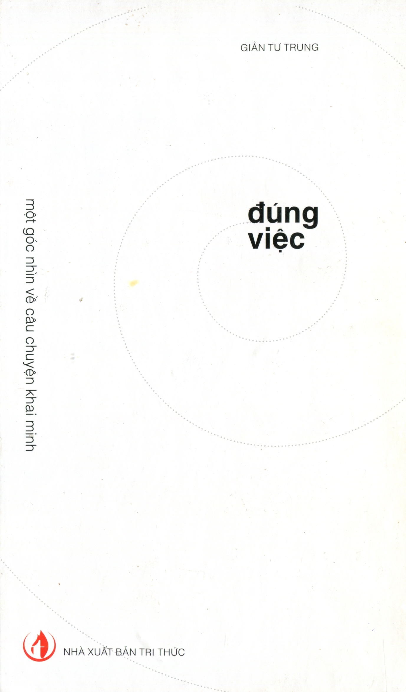
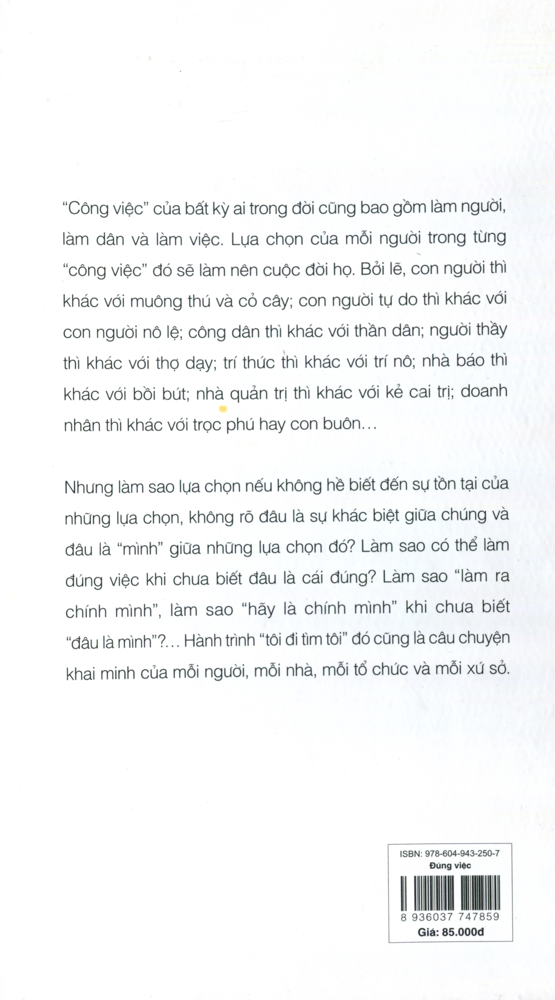

# ĐÚNG VIỆC - Một Góc Nhìn Về Câu Chuyện Khai Minh

**Tác giả:** Giản Tư Trung  
**Nhà xuất bản:** Tri Thức  

---

## Giới thiệu tác phẩm

> *“Công việc” của bất kỳ ai trong đời cũng bao gồm **làm người**, **làm dân** và **làm việc**. Lựa chọn của mỗi người trong từng “công việc” đó sẽ làm nên cuộc đời họ. Bởi lẽ, con người thì khác với muông thú và cỏ cây; con người tự do thì khác với con người nô lệ; công dân thì khác với thần dân; người thầy thì khác với thợ dạy; người làm khoa học thì khác với thợ khoa học; doanh nhân thì khác với trọc phú hay con buôn; và nhà hoạt động xã hội thì khác với kẻ cơ hội nhân danh xã hội...*
>
> *(Trích bìa sau tác phẩm)*

---

## Mục lục

1. [Đôi lời chia sẻ từ tác giả](00-doi-loi-chia-se.md)
   - Lời đề tặng
   - Căn nguyên của vấn đề và góc nhìn "Đúng việc"

2. [Phần 1: Làm người](01-phan-1-lam-nguoi.md)
   - 1. Thế nào là con người? Làm người là... làm gì?
   - 2. Để làm được “người”, cần có những năng lực nào?
   - 3. Làm thế nào để có được “năng lực làm người”?
   - 4. “Ta là sản phẩm của chính mình”
     - *(Bao gồm sơ đồ 5 cấu phần Quản trị cuộc đời)*
   - 5. Thay lời kết về câu chuyện “Làm người”

3. [Phần 2: Làm dân](02-phan-2-lam-dan.md)
   - Tại sao phải bàn về “làm dân”?
   - Làm chủ công ty và làm chủ quốc gia
   - “Vua chủ”, “dân chủ” và “nhóm chủ”
   - Lập pháp, hành pháp và tư pháp
   - Mặc định, hiến định và luật định
   - “Pháp quyền”, “pháp trị” và “nhân trị”
   - “Nô dân”, “thần dân” và “công dân”
   - “Dân trí”, “dân quyền” và “dân sinh”
   - Làm sao để có được “năng lực làm dân”?
   - *Khung tư liệu: Hiến pháp là gì và để làm gì? Quyền của nhân dân và nhà nước*

4. [Phần 3: Làm việc](03-phan-3-lam-viec.md)
   - “Làm việc” cũng là “làm người”!
   - Quản trị hay cai trị?
   - Đầy tớ hay phụ mẫu?
   - Doanh nhân, trọc phú hay con buôn?
     - *(Hình ảnh minh họa quán sushi Sukiyabashi Jiro & Nghệ nhân Jiro Ono)*
   - Trí thức hay trí nô?
   - Sử gia hay sử nô?
   - Nhà báo hay bồi bút? / Nhà văn hay văn nô?
   - Ca sĩ hay thợ hát? Diễn viên hay thợ diễn?...
   - Và một số nghề khác

5. [Phần 4: Làm giáo dục](04-phan-4-lam-giao-duc.md)
   - Triết lý và Định chế
     - *(Bao gồm sơ đồ Triết lý giáo dục)*
   - 1. Nhà trường
   - 2. Nhà giáo
   - 3. "Nhà mẹ" / Gia đình
   - 4. Người học
   - 5. Nhà nước

6. [Thay lời kết](05-thay-loi-ket.md)

---

## Bìa sau tác phẩm

