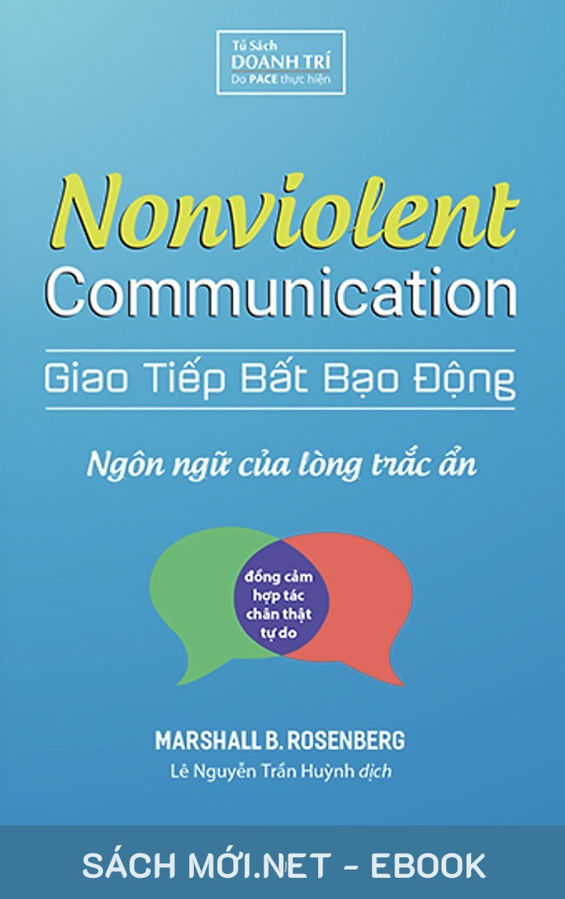

# Giao Tiếp Bất Bạo Động
### Ngôn ngữ của lòng trắc ẩn
**Marshall B. Rosenberg, Ph.D.**  
*Lê Nguyễn Trần Huỳnh dịch*

---

# Lời khen tặng dành cho Giao tiếp bất bạo động

### Môi trường công việc

“*Giao tiếp bất bạo động là một trong những cuốn* *sách hay nhất mà tôi từng đọc trong vai trò là một* *chủ doanh nghiệp, cũng như một người chồng và* *một người cha*. Chủ đề của cuốn sách không mới, nhưng đối với tôi, nó làm tốt hơn rất nhiều so với những cuốn sách khác trong việc trình bày những nguyên lý và cách thức để giao tiếp hiệu quả.”

—**Ben Peterson**, Chủ tịch sáng lập Công ty công nghệ

BambooHR “Khi mới đảm nhận vị trí Tổng Giám Đốc của Microsoft, một trong những việc đầu tiên mà tôi làm là đề nghị các thành viên Ban Lãnh Đạo đọc *Giao* *tiếp bất bạo động*, vì tôi muốn mọi người phát triển sự đồng cảm với nhau, một yếu tố quan trọng để giao tiếp và hợp tác hiệu quả.”

—**Satya Nadella**, Tổng Giám Đốc Tập đoàn Microsoft

“Một trong những việc đầu tiên mà Satya Nadella làm sau khi trở thành Tổng Giám Đốc của Microsoft là đề nghị các thành viên Ban Lãnh Đạo đọc *Giao* *tiếp bất bạo động*. Hành động này cho thấy Satya muốn tập trung vào việc tái tạo văn hóa Microsoft chứ không chỉ điều chỉnh chiến lược kinh doanh. Ông muốn xây dựng nền văn hóa của sự đồng cảm, một yếu tố thiết yếu không chỉ đối với việc tạo ra sự hòa thuận trong môi trường công sở mà còn đối với việc mang lại những dịch vụ và sản phẩm chạm đến trái tim người dùng.”

—Bài viết

“Satya Nadella đã tái tạo văn hóa Microsoft như thế nào?” trên tạp chí *Fast Company* của tác giả Harry McCracken “*Giao tiếp bất bạo động* là một phương pháp đơn giản hướng dẫn con người chúng ta cách kết nối với nhau ở mức độ trái tim. Nó giúp bạn thấu hiểu và đồng cảm với nhu cầu và cảm xúc đằng sau mỗi hành vi hay lời nói của người khác thay vì phán xét họ. Tôi rất khuyến khích bạn đọc cuốn sách này.”

—*Một độc giả trên Internet*

“Tôi yêu cuốn sách này và đã giới thiệu nó cho nhiều đồng nghiệp của mình. Tôi tìm đến cuốn sách trong lúc gặp khó khăn với việc đưa ra phản hồi cho cấp dưới mà không làm họ bị tổn thương. Cuốn sách đã giúp tôi loại bỏ sự phán xét trong thông điệp của mình và tập trung vào điều tôi thực sự muốn truyền đạt. Mỗi khi cần chuẩn bị cho một cuộc nói chuyện khó khăn, tôi lại đọc lại nó.”

—*Một độc giả trên Internet*

“Trong quá khứ, tôi từng làm việc cho một công ty có nền văn hóa tiêu cực, và cuốn sách này đã giúp tôi vượt qua giai đoạn khó khăn đó. Nó cho tôi những kỹ năng cần thiết để giao tiếp và phối hợp hiệu quả hơn với các đồng nghiệp. Tôi muốn giới thiệu *Giao tiếp* *bất bạo động* cho bất kỳ ai phải sống và làm việc cùng người khác.”

—*Một độc giả trên Internet*

### Giao tiếp

“*Giao tiếp bất bạo động* có thể làm thay đổi thế giới. Quan trọng hơn, nó có thể làm thay đổi cuộc đời bạn. Tôi cực kỳ khuyến khích bạn đọc nó.”

—**Jack Canfield**, tác giả sách *Chicken Soup for* *the Soul*

“Trong cuốn sách này, bạn sẽ tìm thấy một thứ ngôn ngữ rất hiệu quả để nói ra những suy nghĩ và cảm xúc bên trong mình. Phương pháp này đơn giản, và với sự thực hành, nó sẽ mang lại những kết quả tuyệt vời cho cuộc đời bạn.”

—**Vicki Robin**, tác giả sách *Your Money or* *Your Life*

“Tiến sĩ Rosenberg đã giúp chúng ta thấy được cách thức để giao tiếp hiệu quả với người khác. Bất kể bạn đang gặp vấn đề gì, phương pháp của ông cũng sẽ giúp ích cho bạn.”

—**Tony Robbins**, tác giả sách *Awaken the Giant Within*

và *Unlimited Power* “Cuốn sách này viết về một mô hình giao tiếp giúp nâng cao sự kết nối, sự thấu hiểu và lòng trắc ẩn. Nó có thể được áp dụng trong mọi lĩnh vực của cuộc sống: cách chúng ta giao tiếp với người khác trong gia đình, trong công việc, và cả cách chúng ta giao tiếp với chính mình. Việc học và thực hành *Giao tiếp* *bất bạo động* đã giúp ích rất nhiều cho cuộc đời tôi.”

—*Một độc giả trên Internet*

“Một cuốn sách tuyệt vời viết về sự đồng cảm, lắng nghe chủ động, lòng trắc ẩn. Nó sẽ giúp bạn nâng cao chất lượng cuộc đời mình và các mối quan hệ với gia đình, bạn bè, đồng nghiệp của mình.”

—*Một độc giả trên Internet*

“Đây có lẽ là cuốn sách hữu ích nhất mà tôi từng đọc trong cả cuộc đời mình, và tôi đã đọc đi đọc lại nó hàng chục lần.”

—*Một độc giả trên Internet*

“Đây là cuốn sách đơn giản, rõ ràng và sâu sắc nhất về chủ đề giao tiếp mà tôi từng đọc. Nó thực sự là một món quà dành cho tất cả chúng ta.”

—*Một độc giả trên Internet*

“*Giao tiếp bất bạo động* là ngôn ngữ của sự tỉnh thức. Nó có thể làm thay đổi cuộc đời bạn, mang lại sự sáng suốt cho tâm trí, và chuyển hóa các mối quan hệ của bạn.”

—*Một độc giả trên Internet*

“Nếu bạn muốn người khác thấu hiểu mình, và nếu bạn muốn thấu hiểu điều người khác *thực sự* nói đằng sau điều họ nói, thì hãy đọc cuốn sách này. Nó sẽ làm thay đổi cuộc đời bạn.”

—*Một độc giả trên Internet*

### Giải quyết mâu thuẫn

“*Giao tiếp bất bạo động* là một trong những phương pháp giúp giải quyết mâu thuẫn hữu ích nhất mà bạn sẽ từng biết.”

—**William Ury**, tác giả sách *Getting* *to Yes*

“Trong cuốn sách này, bạn sẽ học được những cách thức đơn giản để giải quyết mâu thuẫn và xây dựng những mối quan hệ dựa trên lòng trắc ẩn với gia đình, bạn bè và những người thân yêu khác của mình.”

—**John Gray**, tác giả sách *Men Are From Mars, Women*

*Are From Venus* “*Giao tiếp bất bạo động* giúp bạn bước ra khỏi suy nghĩ “ai đúng, ai sai?”; thay vào đó nhận ra rằng mọi người luôn hành xử để đáp ứng nhu cầu của mình. Không ai làm gì sai cả; vấn đề chỉ là cố gắng thấu hiểu và tìm cách đáp ứng nhu cầu của nhau.”

—*Một độc giả trên Internet*

“Sự phân biệt của tiến sĩ Rosenberg giữa *sử dụng* *quyền lực để trừng phạt* và *sử dụng quyền lực để* *bảo vệ* nên được xem là bắt buộc phải đọc đối với những nhà hoạch định chính sách hay những người thực thi pháp luật.”

—**Phóng viên D. Killian**

“Trong thời đại ngày nay với rất nhiều xung đột và chia rẽ, những nguyên lý của *Giao tiếp bất bạo động* là rất cần thiết để giúp giải quyết mâu thuẫn một cách hòa bình, dù ở cấp độ cá nhân hay tập thể, ở trong nước hay trên quốc tế.”

—**Midwest Book Review**

“Với rất nhiều ví dụ thực tế về những mâu thuẫn trong cuốn sách, Rosenberg đã cho thấy rằng, một khi “những kẻ thù” có thể nghe thấy nhu cầu của nhau, họ sẽ có thể kết nối với nhau với lòng trắc ẩn và tìm ra giải pháp mới đối với vấn đề mà trước đó tưởng chừng như vô vọng. Nếu bạn muốn giải quyết mâu thuẫn hiệu quả hơn, thì tôi rất khuyến khích bạn đọc cuốn sách này.”

—**Diana Lion**, Giám đốc Hiệp hội Hòa bình Phật giáo

“Đây chắc chắn là cuốn sách hay nhất mà tôi từng đọc. Tôi đã chia sẻ những nguyên lý của *Giao tiếp* *bất bạo động* trong các lớp học của mình về quản lý cảm xúc tức giận và ngăn ngừa bạo lực gia đình. Những học viên rất thích những kiến thức đó. Tôi muốn giới thiệu cuốn sách này cho bất kỳ ai muốn tìm một cách lành mạnh hơn để giao tiếp và kết nối với người khác.”

—*Một độc giả trên Internet*

“Khi có mâu thuẫn xảy ra, mọi người thường có những cảm xúc mạnh và nếu họ không biết cách làm rõ những cảm xúc đó, thì việc đó cũng giống như một con tàu bị lạc lối trong giông bão với cánh buồm bị xé toạc và mọi người bị tổn thương.”

—**Rachelle Lamb**, Giảng viên *Giao tiếp bất bạo* *động*

### Giáo dục

“Thông qua những ví dụ thực tế thuyết phục, tiến sĩ Rosenberg đã cho thấy tính thực tiễn của *Giao tiếp* *bất bạo động*. Các sinh viên của tôi chia sẻ rằng cuốn sách này đã làm thay đổi cuộc đời họ. Việc thực hành *Giao tiếp bất bạo động* trong những tương tác hàng ngày, trong những cuộc họp và trong lớp học cũng đã mang lại tác động lớn đến cuộc đời tôi.”

—*Một độc giả trên Internet*

“Cuốn sách này nên được đưa vào chương trình học của học sinh phổ thông và sinh viên đại học. Kỹ năng nói ra những nhu cầu thực sự của mình được trình bày trong cuốn sách là vô cùng cần thiết.”

—*Một độc giả trên Internet*

### Sức khỏe / Chữa lành / Mối quan hệ với bản thân

“*Giao tiếp bất bạo động* là phương pháp hiệu quả nhất để giúp chúng ta nâng cao sức khỏe tinh thần và chất lượng các mối quan hệ. Nó giúp chúng ta kết nối với nhau ở mức độ trái tim và tạo ra rất nhiều sự chữa lành. Nó là nhân tố còn thiếu trong xã hội ngày nay.”

—**Deepak Chopra**, tác giả sách *How to Know God* và *Ageless Body and Timeless Mind*

“Tôi từng nghĩ cuốn sách này sẽ chỉ dạy mình kỹ năng giao tiếp với người khác, nhưng rồi ngạc nhiên nhận ra rằng nó giúp tôi cải thiện khả năng giao tiếp với chính mình rất nhiều. Giờ đây, tôi có nhiều sự tử tế và thấu hiểu với bản thân hơn, và điều đó có nghĩa là tôi cũng có nhiều sự tử tế và thấu hiểu với người khác hơn.”

—*Một độc giả trên Internet*

“*Giao tiếp bất bạo động* hướng dẫn chúng ta cách phát triển sự đồng cảm, một trong những kỹ năng nền tảng của Thông minh Cảm xúc.”

—*Một độc giả trên Internet*

“Tôi rất thích chương viết về *Lòng trắc ẩn với bản* *thân* vì nó giúp tôi nhận ra rằng khi tôi thực hiện hành vi mà giờ đây tôi cảm thấy hối tiếc và tội lỗi, đó là vì tôi chỉ đang cố gắng đáp ứng một nhu cầu nào đó của mình. Điều đó giúp tôi tha thứ cho bản thân và học hỏi từ trải nghiệm ấy.”

—*Một độc giả trên Internet*

“Cuốn sách này đã làm thay đổi cuộc đời tôi, và điều thay đổi lớn nhất là cách tôi đối xử với chính mình. Cảm ơn Marshall.”

—*Một độc giả trên Internet*

### Mối quan hệ trong gia đình

“*Giao tiếp bất bạo động* đã cứu cuộc hôn nhân của chúng tôi. Không chỉ thế, nó giúp chúng tôi cải thiện mối quan hệ với bố mẹ, con cái và các anh chị em của mình.”

—*Một độc giả ở Arizona*

“Trong 40 năm, tôi đã không thể nào giúp bố tôi hiểu những suy nghĩ, cảm xúc, mong muốn của mình. Vậy mà chỉ sau khi đọc một nửa cuốn sách này, tôi đã có thể chia sẻ những điều đó theo cách bố tôi có thể đón nhận và cho tôi thứ tôi cần. Đây là một món quà vô giá mà không từ ngữ nào có thể diễn đạt được.”

—*Một độc giả trên Internet*

“Cuốn sách này dành cho các bậc phụ huynh muốn tác động đến hành vi của con cái bằng cách tạo ra sự kết nối với lòng trắc ẩn thay vì dùng quyền lực để ép chúng làm theo ý mình.”

—*Một độc giả trên Internet*

“*Giao tiếp bất bạo động* giúp tôi vượt qua những khuôn mẫu thói quen tiêu cực của mình và trở thành một người mẹ có sự thấu hiểu và cảm thông. Nó có thể giúp chuyển hóa tình trạng bạo lực trong xã hội ngày nay.”

—*Một y tá ở California*

“*Giao tiếp bất bạo động* vừa là một triết lý, vừa là một kỹ năng, giúp chúng ta chuyển hóa mối quan hệ với người khác và với chính mình.”

—*Một độc giả trên Internet*

### Phát triển bản thân

“*Giao tiếp bất bạo động* của Marshall Rosenberg là một cuốn sách tuyệt vời dạy chúng ta cách nói chuyện với người khác với lòng trắc ẩn, đặc biệt là khi ta hoặc họ đang giận dữ.”

—**Joe Vitale**, tác giả sách *Spiritual* *Marketing* và *The Power* *of Outrageous Marketing*

“*Giao tiếp bất bạo động* là một bước tiến lớn trong cách sử dụng ngôn ngữ để giao tiếp. Nếu đủ số người thực hành nó, thì chúng ta sẽ sống trong một thế giới hòa bình và nhân ái hơn.”

—**Wes Taylor**, tổ chức Progressive Health

“Đây là cuốn sách súc tích, rõ ràng nhất về chủ đề giao tiếp mà tôi từng đọc. Sau khi đọc, tôi có sự quyết tâm trở thành điều mà tôi muốn nhìn thấy trong thế giới.”

—*Một độc giả trên Internet*

“Tôi là người rất hay phán xét bản thân. Cuốn sách này dạy tôi cách yêu thương bản thân để từ đó tôi có thể thực sự yêu thương người khác. *Giao tiếp bất bạo* *động* có thể tạo ra sự hòa bình giữa các cá nhân, giữa các nhóm, giữa các quốc gia... Tôi tin rằng thế giới ngày nay rất cần nó.”

—*Một độc giả trên Internet*

“Đây là một trong số rất ít những cuốn sách đã làm thay đổi cuộc đời tôi, làm tôi phải suy nghĩ lại về bản thân và cách sống của tôi trong xã hội.”

—*Một độc giả trên Internet*

### Môi trường trại giam

“Môi trường trại giam thường có rất nhiều xung đột và bạo lực, nên *Giao tiếp bất bạo động* là vô cùng cần thiết.”

—**Dow Gordon**, Giảng viên *Giao tiếp bất bạo động* tại

trại giam Monroe ở Washington

### Hòa bình trên thế giới

“Áp dụng những khái niệm trong cuốn sách này sẽ giúp độc giả biết cách tạo ra nhiều lòng trắc ẩn hơn trên thế giới.”

—**Marianne Williamson**, tác giả sách *Everyday Grace* và chủ tịch danh dự của tổ chức Liên minh Hòa bình

### Trị liệu tâm lý

“*Giao tiếp bất bạo động* đã giúp tôi phát triển khả năng đồng cảm và việc thực hành trị liệu của mình. Nó giúp tôi kết nối một cách sâu sắc với gia đình, bạn bè và khách hàng của mình. Bất kỳ ai cũng có thể rèn luyện các kỹ năng đồng cảm được giới thiệu trong cuốn sách này.”

—*Một độc giả trên Internet*

“Đây là cuốn sách rõ ràng và sâu sắc nhất về chủ đề giao tiếp mà tôi từng đọc. Nó thổi một làn gió mới vào công việc trị liệu của tôi. Đóng góp lớn của tiến sĩ Rosenberg là cho thấy mối liên hệ giữa cảm xúc và nhu cầu, tinh thần chịu trách nhiệm cho cảm xúc của mình, và kết nối mọi thứ lại thành một công cụ mà bất kỳ ai cũng có thể áp dụng.”

—*Một độc giả trên Internet*

## Lời giới thiệu

—**Bác sĩ Deepak Chopra**

— Nhà sáng lập Trung tâm Chăm sóc Sức khỏe Chopra và tác giả của hơn 80 cuốn sách được dịch ra trên 43 ngôn ngữ, bao gồm 22 cuốn trong danh sách bán chạy nhất của báo *New York Times*.

Không ai xứng đáng với lòng biết ơn của chúng ta hơn Marshall Rosenberg, người đã sống cuộc đời mình đúng như tiêu đề của một trong những cuốn sách của ông: Speak Peace in a World of Conflict (tạm dịch: *Giao Tiếp Hòa Bình Trong Thế Giới Đầy* *Xung Đột*). Ông đã ý thức rất rõ về câu châm ngôn (hay lời cảnh tỉnh) được chứa đựng trong tiêu đề của cuốn sách đó: Điều bạn *sắp nói ra sẽ làm thay đổi* *thế giới*. Thực tại của mỗi cá nhân luôn chứa đựng một câu chuyện, và câu chuyện của mỗi chúng ta, bắt đầu từ lúc chúng ta chào đời, được dựa trên ngôn ngữ. Điều này đã trở thành nền tảng của cách tiếp cận của Marshall trong việc giải quyết mâu thuẫn: giúp con người giao tiếp với nhau mà không sử dụng những lời nói phán xét, chỉ trích và bạo lực.

Khi mở bản tin thời sự buổi tối, chúng ta có thể thấy hình ảnh những khuôn mặt giận dữ của những người biểu tình chống đối trên đường phố. Đằng sau mỗi khuôn mặt, mỗi lời la hét, mỗi cử chỉ là một lịch sử. Mọi người bị dính mắc vào lịch sử của họ với ý muốn trả thù, vì nó gắn liền với con người họ. Vậy nên, khi Marshall ủng hộ “giao tiếp hòa bình”, ông cũng đang ủng hộ một hệ giá trị mới. Ông hoàn toàn nhận ra được thực tế này. Như ông nói về Giao tiếp bất bạo động và vai trò của nhà hòa giải trong ấn bản mới – ấn bản lần thứ ba – của cuốn sách này: “Chúng ta cố gắng sống với một hệ giá trị khác trong khi chúng ta yêu cầu mọi thứ thay đổi.”

Trong tầm nhìn của Marshall về hệ giá trị mới này, mâu thuẫn được giải quyết mà không cần sự thỏa hiệp miễn cưỡng từ các bên. Thay vào đó, các bên tiếp cận nhau với sự tôn trọng. Họ tìm hiểu những nhu cầu của nhau, và trong một môi trường không có sự định kiến và thù địch, họ đạt được sự kết nối. Nhìn vào một thế giới đầy những xung đột và chiến tranh, nơi tư duy “địch – ta” là chuyện thường tình, nơi các quốc gia liên tục trừng phạt và trả đũa nhau, một hệ giá trị mới có vẻ là xa vời. Tại một hội nghị dành cho những nhà hòa giải ở châu Âu, một người nghi ngờ đã chỉ trích cách tiếp cận của Marshall là trị liệu tâm lý. Nói theo ngôn ngữ bình dân, có phải là ông đang yêu cầu chúng ta đơn giản là quên quá khứ đi và trở thành bạn bè, một viễn cảnh khá “xa vời”, không chỉ trong những vùng đang bị chiến tranh tàn phá mà còn trong bất kỳ vụ ly hôn nào?

Những nhân sinh quan khác nhau chứa đựng những hệ giá trị khác nhau. Những hệ giá trị này không chỉ là điều chắc chắn, mà người ta còn tự hào về chúng. Có một truyền thống lâu đời trên khắp thế giới về việc vừa coi trọng, vừa kinh sợ những chiến binh. Những người theo thuyết tâm lý của Jung nói với chúng ta rằng vị thần sao Hỏa, vị thần chiến tranh với tính khí thất thường, đã được in sâu trong vô thức của mọi người, khiến những xung đột và mâu thuẫn là không thể tránh khỏi. Trong nhân sinh quan này, bản chất con người sinh ra đã là xấu xa.

Tuy nhiên, có một góc nhìn khác về bản chất con người, được trình bày một cách sâu sắc trong cuốn sách này, và đó là niềm hy vọng duy nhất của chúng ta. Trong góc nhìn này, chúng ta không phải là những câu chuyện của mình. Những câu chuyện chỉ là những ảo tưởng do chúng ta tự tạo ra, được duy trì thông qua thói quen, sự học tập trong quá khứ, sự ép buộc của xã hội, và sự thiếu ý thức của chúng ta. Ngay cả những câu chuyện hay nhất cũng góp phần tạo ra bạo lực. Chẳng hạn, nếu bạn sử dụng bạo lực để đấu tranh với những hành vi sai trái, ngăn ngừa tội ác, hay tham gia vào thứ gọi là “chiến tranh vì mục đích tốt đẹp”, thì bạn đang góp phần tạo ra thêm bạo lực trên thế giới. Nếu bạn chọn không tham gia, thì có khả năng xã hội sẽ quay lưng với bạn và trừng phạt bạn. Nói ngắn gọn, việc tìm lối ra là không dễ dàng.

Ở Ấn Độ có một triết lý sống được gọi là Ahimsa. Nó thường được định nghĩa là “bất bạo động”, mặc dù ý nghĩa của nó được mở rộng từ các cuộc phản kháng hòa bình của Mahatma Gandhi đến tư tưởng “tôn trọng sự sống” của bác sĩ Albert Schweitzer. Nguyên tắc đầu tiên của Ahimsa là “không gây hại.” Điều làm tôi rất ấn tượng về Marshall Rosenberg, người vừa qua đời ở tuổi 80, chỉ 6 tuần trước khi tôi viết những dòng này, là ông đã thấm nhuần triết lý Ahimsa, cả ở mức độ nhận thức và mức độ hành động.

Mức độ hành động của Ahimsa được trình bày rất rõ ràng trong cuốn sách này dưới dạng những nguyên tắc của Giao tiếp bất bạo động, nên tôi sẽ không lặp lại ở đây. Thấm nhuần Ahimsa ở mức độ nhận thức có sức mạnh lớn hơn nhiều, và Marshall mang trong mình điều đó. Trong mọi cuộc xung đột, tư tưởng của ông là không có bên nào đúng hay sai, và thậm chí không cần quan tâm quá mức đến câu chuyện của mỗi bên là gì, vì ông nhận ra rằng mọi câu chuyện đều dẫn đến mâu thuẫn. Thay vào đó, ông tập trung vào việc thiết lập sự kết nối giữa các bên. Điều này cũng thể hiện một nguyên tắc khác của Ahimsa: Điều quan trọng không phải là bạn làm gì, mà là bạn đặt sự chú ý vào đâu. Chẳng hạn, nếu xét về mặt luật pháp, thì một vụ ly hôn sẽ kết thúc khi hai bên đã thống nhất về việc chia tài sản. Tuy nhiên, đằng sau đó là rất nhiều những cảm xúc của hai bên. Họ đã nói với nhau rất nhiều thứ, theo lời của Marshall, làm thay đổi thế giới của họ.

Sự bạo lực được dựa trên hệ thống của bản ngã, thứ hoàn toàn tập trung vào “tôi và của tôi” mỗi khi có mâu thuẫn xảy ra. Xã hội chúng ta tôn thờ những vị thánh và đưa ra lời thề phụng sự Thượng đế thay vì bản thân, nhưng có một khoảng cách rất lớn giữa những giá trị mà chúng ta ủng hộ và cách chúng ta thực sự sống. Ahimsa làm thu hẹp khoảng cách này bằng cách nâng cao sự nhận thức của chúng ta. Cách duy nhất để giải quyết mọi bạo lực trên thế giới là buông bỏ những câu chuyện của mình. Không ai có thể tỉnh thức mà vẫn bị kiểm soát bởi bản ngã và đây là nguyên tắc thứ ba của Ahimsa. Điều này cũng giống như lời dạy của Chúa Jesus trong “Bài giảng trên núi”: những người khiêm nhường sẽ thừa hưởng thế giới.

Vậy nên, điều quan trọng không phải là thay đổi hành vi, mà là nâng cao sự nhận thức. Để làm được điều đó, bạn phải đi một hành trình từ A đến B, nơi A là một cuộc sống dựa trên những đòi hỏi không ngừng của bản ngã và B là trạng thái ý thức vô ngã. Thành thật mà nói, không ai thực sự khao khát trạng thái này, vì từ góc nhìn của việc trở thành số một, việc đó có vẻ đáng sợ và bất khả thi. Nếu buông bỏ bản ngã đi, thì bạn nhận được gì? Một khi bản ngã không còn nữa, liệu bạn có phải ngồi im một cách thụ động không?

Câu trả lời nằm trong những khoảnh khắc mà bản ngã bỗng dưng biến mất đi, có thể trong những lúc thực hành thiền, sống trong thiên nhiên, hay đắm chìm trong những hoạt động nghệ thuật hay âm nhạc. Sự khác biệt duy nhất giữa những khoảnh khắc này – những khoảnh khắc mà chúng ta trải nghiệm niềm vui, sự sáng tạo và tình yêu thương – và Ahimsa là: những khoảnh khắc đó đến rồi đi, trong khi Ahimsa là một trạng thái ổn định. Chúng cho ta thấy những câu chuyện là những ảo tưởng mang tính vị kỷ do bản ngã tạo ra, với mục đích duy trì sự tồn tại của chính nó. Điều bạn nhận được từ Ahimsa không phải là bạn nâng cấp sự ảo tưởng của mình, điều mà bản ngã luôn cố gắng làm với việc tích lũy nhiều tiền bạc, tài sản và quyền lực hơn. Điều bạn nhận được là bạn trở thành con người thực sự của mình.

Theo tôi, “mức độ nhận thức cao hơn” là một từ quá lớn để nói về Ahimsa. “Mức độ nhận thức bình thường” thì chính xác hơn trong một thế giới mà mọi thứ rất bất thường, nơi hàng ngàn đầu đạn hạt nhân đang được nhắm vào kẻ thù và chủ nghĩa khủng bố có mặt ở khắp mọi nơi.

Đối với tôi, di sản của Marshall không nằm ở việc ông đã cách mạng hóa vai trò của nhà hòa giải, mà nằm ở hệ giá trị mới mà ông đã sống. Ahimsa phải được làm sống lại trong mọi thế hệ, vì con người đang bị giằng xé giữa hòa bình và bạo lực. Marshall Rosenberg đã chứng minh rằng việc bước vào trạng thái ý thức này là có thể và rất thực tế trong việc giải quyết xung đột. Ông đã để lại một con đường mà tất cả chúng ta đều có thể đi theo. Nếu trái tim chúng ta thực sự quan tâm, thì chúng ta sẽ đi theo. Đó là cách duy nhất để phát triển trí tuệ và chấm dứt những xung đột trên thế giới.

—**Deepak Chopra**

## Lời cảm ơn

 Tôi biết ơn vì được học tập và làm việc cùng giáo sư Carl Rogers trong quãng thời gian ông nghiên cứu về những nhân tố tạo nên một mối quan hệ hiệu quả. Kết quả của nghiên cứu ấy đóng vai trò quan trọng đối với sự phát triển của phương pháp giao tiếp mà tôi sẽ mô tả trong cuốn sách này.

Tôi sẽ mãi biết ơn vì giáo sư Michael Hakeem đã giúp tôi nhìn thấy những hạn chế của phương pháp thực hành tâm lý học mà tôi đã được đào tạo: phân loại con người dựa trên những căn bệnh. Việc đó làm tôi có động lực tìm kiếm những mô hình thực hành tâm lý học khác hiệu quả hơn, những mô hình được dựa trên sự thấu hiểu về tính toàn vẹn của con người và ý nghĩa cuộc sống của họ.

Tôi cũng biết ơn vì những nỗ lực của George Miller và George Albee trong việc nhắc nhở các nhà tâm lý học như tôi rằng: nếu thực sự muốn góp phần làm giảm đi sự đau khổ trên hành tinh này, chúng tôi phải tìm cách phổ cập kiến thức tâm lý và cung cấp những kỹ năng thiết yếu cho mọi người, chứ không chỉ tập trung vào chẩn đoán và điều trị bệnh cho họ.

Tôi cảm ơn Lucy Leu vì đã biên tập cuốn sách này và tạo ra bản thảo cuối cùng; Rita Herzog và Kathy Smith vì đã hỗ trợ chỉnh sửa; và Darold Milligan, Sonia Nordenson, Melanie Sears, Bridget Belgrave, Marian Moore, Kittrell McCord, Virginia Hoyte, Peter Weismiller vì sự hỗ trợ của họ.

Cuối cùng, tôi muốn bày tỏ lòng biết ơn đối với người bạn Annie Muller của tôi. Những đóng góp và phản hồi của cô đã giúp củng cố phần nền tảng cho *Giao tiếp bất bạo động* và làm cuộc đời tôi trở nên tốt đẹp hơn.

### Ngôn từ là cửa sổ (hoặc chúng là bức tường)

> *Tôi cảm thấy bị kết án bởi lời* *bạn nói, Cảm thấy bị phán xét* *và xua đuổi, Nhưng trước khi* *đi, tôi muốn biết,*
>
> *Đó có phải là điều bạn thực sự muốn nói không?*

> *Trước khi tôi trở nên phòng thủ,*
>
> *Và nói trong sự sợ hãi và tổn thương,*
>
> *Trước khi tôi dựng lên bức tường* *bằng lời nói, Cho tôi biết, tôi đã thực* *sự lắng nghe?* *Ngôn từ là cửa sổ, hoặc chúng là* *bức tường, Chúng giam cầm, hoặc* *giải phóng chúng ta. Khi tôi nói* *và khi tôi nghe,* *Hãy để ánh sáng tình yêu rọi* *chiếu qua tôi. Có những điều tôi* *cần phải nói,* *Những điều rất có ý nghĩa với* *tôi, Nhưng nếu lời tôi nói* *không rõ ràng, Thì bạn có thể* *giúp tôi không?*

> *Nếu bạn cảm thấy tôi đang* *công kích, Nếu bạn cảm thấy*
>
> *tôi không quan tâm,*
>
> *Hãy cố gắng nhìn xuyên qua những ngôn từ đó*
>
> *Để nghe thấy những điều hai ta cùng sẻ chia.*

—Ruth Bebermeyer(*)
