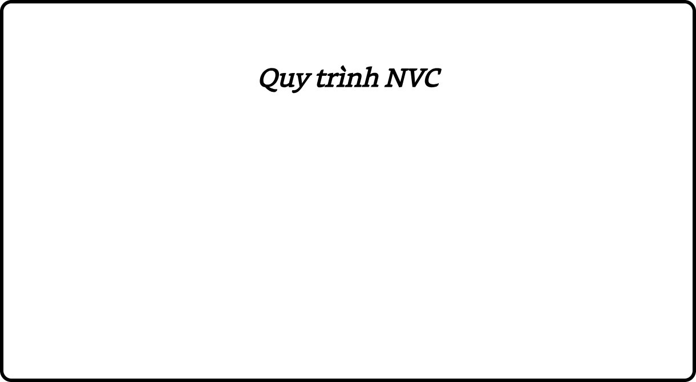

# Chương 1: Cho đi từ trái tim
### Tinh thần cốt lõi của Giao tiếp bất bạo động

*“Thứ tôi muốn trong cuộc sống là sự kết* *nối giữa tôi và người khác dựa trên lòng trắc ẩn* *và ý muốn cho đi từ trái tim.”*

—Marshall Rosenberg

## Giới thiệu

Tôi luôn tin rằng bản chất con người là tình yêu thương, rằng chúng ta muốn cho đi và nhận lại tình yêu thương vô điều kiện. Vậy nên, trong gần như cả cuộc đời mình, tôi luôn trăn trở về hai câu hỏi: Điều gì đã khiến chúng ta xa rời bản chất yêu thương của mình, khiến chúng ta hành xử ích kỷ và bạo lực? Và ngược lại, điều gì làm cho một vài người vẫn kết nối được với bản chất yêu thương của mình ngay cả trong những hoàn cảnh khó khăn nhất?

Sự trăn trở của tôi về hai câu hỏi này bắt đầu từ lúc tôi còn nhỏ, khoảng mùa hè năm 1943, khi gia đình tôi chuyển đến sống tại thành phố Detroit, bang Michigan. Hai tuần sau khi chúng tôi chuyển đến, một cuộc xung đột sắc tộc nổ ra khiến hơn 40 người bị giết chỉ trong vài ngày. Gia đình tôi sống ngay tại trung tâm cuộc bạo loạn, nên chúng tôi bị kẹt lại trong nhà ba ngày liên tiếp.

Khi cuộc xung đột chấm dứt và tôi bắt đầu đi học, tôi nhận ra một cái tên cũng nguy hiểm như một màu da. Khi cô giáo gọi tên tôi trong buổi học, hai cậu bé khác đưa mắt lườm tôi và mỉa mai nói: “Mày là thằng Do Thái?” Sau khi tan học, chúng đợi tôi sẵn ngoài cổng trường, xô tôi ngã xuống và đánh tôi.

Kể từ đó, tôi đã luôn suy nghĩ về hai câu hỏi nêu trên. Tôi tự hỏi điều gì giúp chúng ta kết nối được với bản chất yêu thương của mình ngay cả trong những hoàn cảnh tồi tệ nhất? Tôi nghĩ về những người như Etty Hillesum, người đã luôn giữ được lòng nhân ái ngay cả khi phải sống trong điều kiện khắc nghiệt ở trại tập trung của Đức Quốc Xã. Trong cuốn nhật ký của mình, cô viết về khoảng thời gian đó như sau:

> “Tôi không dễ dàng trở nên sợ hãi, không phải vì tôi dũng cảm, mà vì tôi biết mình đang nhìn thấy những con người với bản chất là tình yêu thương, và họ đang gây tổn thương cho người khác chẳng qua là vì họ cũng đang bị tổn thương. Sáng nay, một viên sĩ quan trẻ hét vào mặt tôi, nhưng tôi không hề cảm thấy tức giận. Thay vào đó, tôi thấy thương cảm và muốn hỏi anh ấy: “Có phải tuổi thơ anh đã rất bất hạnh, hay bạn gái đã làm anh thất vọng không?” Bên dưới hành vi cáu gắt của anh ấy, tôi nhìn thấy một con người yếu đuối với nhiều nỗi muộn phiền và khổ đau. Tôi muốn trao cho anh ấy sự quan tâm và thông cảm, vì tôi biết những người thanh niên trẻ đáng thương như anh sẽ trở nên nguy hiểm ngay khi họ đánh mất nhân tính của mình.

—Nhật ký của Etty Hillesum (1941 – 1943)

Trong quá trình nghiên cứu những nhân tố giúp con người duy trì tình yêu thương, tôi đã chú ý đến vai trò quan trọng của ngôn ngữ và cách chúng ta sử dụng ngôn từ. Từ đó, tôi đã xác định một mô hình giao tiếp cụ thể – cả nói và nghe – giúp con người khơi dậy lòng trắc ẩn và tạo ra sự kết nối với bản thân và người khác, dựa trên ý muốn cho đi từ trái tim. Tôi gọi mô hình này là Nonviolent Communication / Giao tiếp bất bạo động, trong đó cụm từ “bất bạo động” (nonviolence) được sử dụng giống như cách sử dụng của Gandhi – nói đến bản chất yêu thương bên trong trái tim con người, nơi tư tưởng bạo lực không có mặt. Bạn có thể nghĩ rằng chỉ có hành vi thể chất mới dẫn đến “bạo lực”, nhưng chính ngôn từ chúng ta sử dụng hàng ngày mới là thứ gây ra nhiều đau khổ và tổn thương nhất, cả cho người khác và cho chính mình. Thỉnh thoảng, mô hình giao tiếp này còn được gọi là Giao tiếp bằng lòng trắc ẩn (Compassionate Communication). Từ viết tắt NVC (Nonviolent Communication) được sử dụng xuyên suốt cuốn sách này để nói đến Giao tiếp bất bạo động hay Giao tiếp bằng lòng trắc ẩn.

## Hướng sự chú tâm vào nơi giúp khơi dậy lòng trắc ẩn

NVC giúp chúng ta nâng cao khả năng duy trì lòng trắc ẩn, ngay cả trong những điều kiện khó khăn nhất. Nó không chứa đựng bất kỳ điều gì mới; tất cả những kiến thức được tích hợp trong NVC đã được biết đến trong nhiều thế kỷ. Chủ đích của NVC là nhắc nhớ chúng ta về những thứ mà chúng ta đã biết nhưng đôi khi quên mất – về việc con người có liên quan với nhau như thế nào – và hướng dẫn chúng ta cách thức cụ thể để sống với những hiểu biết đó.

NVC giúp chúng ta nhìn nhận lại cách mình giao tiếp, cả khi nói và khi nghe. Thay vì phản ứng vô thức theo thói quen, chúng ta dừng lại và suy xét xem bản thân và người khác đang nhìn nhận, cảm nhận và mong muốn điều gì. Từ đó, chúng ta nói ra góc nhìn của bản thân với sự chân thật và rõ ràng, đồng thời lắng nghe góc nhìn của người khác với sự tôn trọng và thông cảm. Trong bất kỳ tình huống nào, NVC giúp chúng ta quan sát một cách cẩn thận để có thể chỉ rõ những hành vi và điều kiện đang ảnh hưởng đến mình. Sau đó, chúng ta suy xét những nhu cầu sâu hơn của bản thân và của người khác. Cuối cùng, chúng ta xác định và nói ra điều mình muốn một cách rõ ràng và cụ thể. Quá trình này đơn giản nhưng có sức mạnh to lớn.

> **NVC: phương pháp giao tiếp giúp con người khơi dậy lòng trắc ẩn và ý muốn cho đi từ trái tim.**

> **Khi sử dụng NVC để lắng nghe những nhu cầu sâu hơn của bản thân và của người khác, chúng ta nhìn nhận các mối quan hệ trong một sự nhận thức mới.**

Khi bị phán xét và chỉ trích, khuôn mẫu thói quen cũ của chúng ta là trở nên thu mình, phòng thủ hoặc tấn công. NVC giúp chúng ta thoát khỏi khuôn mẫu này; rồi nhìn nhận bản thân và người khác, cũng như những ý định và quan hệ của chúng ta, trong một sự nhận thức mới. Từ đó, sự phòng thủ, phản kháng và những phản ứng bạo lực được giảm đến mức tối thiểu. Khi chúng ta tập trung vào điều mà bản thân và người khác đang quan sát, cảm nhận và mong muốn thay vì phán xét hay chỉ trích, chúng ta khám phá ra lòng trắc ẩn nằm sâu bên trong tâm hồn mình. Thông qua sự nhấn mạnh về việc lắng nghe và suy xét – đối với bản thân cũng như đối với người khác – NVC giúp nâng cao sự quan tâm, tôn trọng, đồng cảm và tạo ra ý muốn cho đi từ trái tim.

Mặc dù NVC được gọi là “một phương pháp giao tiếp” hay “ngôn ngữ của lòng trắc ẩn”, ý nghĩa của nó lớn hơn nhiều so với một phương pháp hay một loại ngôn ngữ đơn thuần. Về bản chất, NVC là một lời nhắc nhớ chúng ta cần hướng sự chú tâm vào nơi mà chỉ ở đó chúng ta mới có thể xây dựng được sự kết nối và mối quan hệ thực sự hiệu quả với bản thân và người khác.

Có một câu chuyện về một người đàn ông đang loay hoay tìm một thứ gì đó dưới cây đèn đường. Một người cảnh sát đi ngang qua và hỏi anh ấy đang làm gì. Người đàn ông, bề ngoài hơi say xỉn, đáp: “Tôi đang tìm chìa khóa xe.” Người cảnh sát hỏi: “Anh làm rơi ở đây à?.” Anh ta đáp: “Không, tôi làm rơi ở con hẻm đằng kia.” Nhìn thấy vẻ mặt bối rối của người cảnh sát, anh ta giải thích: “Nhưng đằng kia tối lắm, đèn ở đây sáng hơn nhiều.”

Tôi nhận ra môi trường văn hóa đã khiến tôi hướng sự chú tâm vào nơi mà nhiều khả năng tôi không đạt được hay tìm được điều mình mong muốn. Vậy nên, tôi đã phát triển NVC như một cách để rèn luyện hướng sự chú tâm của mình vào nơi mà tôi có thể đạt được thứ mình muốn. Và thứ tôi muốn trong cuộc sống chính là *lòng* *trắc ẩn*, một sự kết nối giữa tôi và người khác, dựa trên *ý muốn cho đi* *từ trái tim*.

Lòng trắc ẩn và ý muốn cho đi từ trái tim đó được diễn đạt trong lời bài hát sau của người bạn Ruth Bebermeyer của tôi:

> **Hãy hướng sự chú tâm vào nơi nào mà chúng ta có thể hy vọng tìm thấy những gì mình mong muốn.**

> *Tôi chưa bao giờ cảm thấy được cho* *đi đến thế Khi bạn đón nhận từ tôi;*

> *Khi bạn hiểu niềm vui tôi cảm thấy khi trao cho bạn.*

> *Và bạn biết sự cho đi ấy không phải để khiến bạn* *mắc nợ tôi, mà vì tôi muốn sống với tình yêu tôi cảm* *thấy đối với bạn.*

> *Đón nhận với lòng biết ơn có lẽ là sự cho* *đi lớn nhất. Ta không thể nào*
>
> *Tách biệt được chúng đâu.*

> *Khi bạn trao cho tôi, tôi trao cho bạn sự đón nhận.*

> *Khi bạn đón nhận từ tôi, tôi cảm thấy thực sự được cho* *đi.*

Bài hát *Given to* của Ruth Bebermeyer(*) – Chúng ta cho đi từ trái tim đơn thuần vì niềm vui được làm cuộc đời người khác trở nên tốt đẹp hơn. Sự cho đi này mang lại lợi ích cho cả người cho và người nhận. Đối với người cho, anh ấy được tận hưởng niềm vui vì thấy bản thân là người có giá trị khi đã đóng góp vào sự hạnh phúc của người khác. Đối với người nhận, anh ấy có thể tận hưởng món quà một cách trọn vẹn mà không cần lo lắng về nghĩa vụ phải đền đáp. Nhưng nếu sự cho đi không xuất phát từ trái tim mà từ cảm giác sợ hãi, tội lỗi, xấu hổ hoặc mong muốn được đền đáp, thì việc đó sẽ gây ảnh hưởng tiêu cực đến mối quan hệ của hai bên.

Việc sử dụng NVC không đòi hỏi người mà chúng ta giao tiếp phải biết về NVC, thậm chí không đòi hỏi việc người đó được tạo động lực kết nối với chúng ta. Nếu chúng ta kiên trì với những nguyên tắc của NVC, xác định chủ đích duy nhất của mình là nói và nghe với lòng trắc ẩn và làm mọi thứ có thể để giúp người kia biết điều đó, thì họ sẽ tham gia vào quá trình đó cùng chúng ta. Tôi không nói điều này luôn nhanh chóng xảy ra, nhưng tôi tin rằng lòng trắc ẩn rồi sẽ nảy nở nếu chúng ta kiên trì với những nguyên tắc của NVC.

## Quy trình NVC

NVC có bốn yếu tố mà để lòng trắc ẩn và ý muốn cho đi từ trái tim được khơi dậy trong tất cả các bên, chúng ta cần hướng sự chú tâm vào chúng.

Thứ nhất, chúng ta *quan sát* điều gì đang thực sự xảy ra: người kia đang nói hay làm gì khiến cuộc đời chúng ta trở nên tươi đẹp hay ít tươi đẹp hơn? Mấu chốt ở đây là nói ra điều quan sát mà không xen lẫn bất kỳ sự đánh giá hay phán xét nào – chỉ đơn thuần chỉ rõ điều người kia đang làm mà chúng ta thích hoặc không thích. Thứ hai, chúng ta bày tỏ những *cảm xúc* của mình khi quan sát hành động đó: chúng ta cảm thấy tổn thương, sợ hãi, khó chịu, vui mừng, thích thú? Thứ ba, chúng ta bày tỏ những *nhu cầu* của mình liên quan đến những cảm xúc ấy. Khi sử dụng NVC, chúng ta cần ý thức về sự hiện diện của ba yếu tố này để cho người khác biết mình đang như thế nào một cách chân thật và rõ ràng.

Ví dụ, một người mẹ có thể nói ra ba yếu tố này với cậu con trai tuổi thiếu niên của mình như sau: “Felix, mẹ thấy hai đôi vớ bẩn dưới bàn cà phê và đôi thứ ba ở cạnh tivi. Mẹ cảm thấy không hài lòng vì mẹ muốn những căn phòng mẹ và con cùng sử dụng có sự ngăn nắp hơn.”

Sau đó, bà có thể nói ra yếu tố thứ tư – một *lời đề* *nghị* cụ thể: “Con có thể mang những đôi vớ vào phòng riêng của mình hoặc cho chúng vào máy giặt không?” Trong yếu tố này, chúng ta cho người kia biết chúng ta muốn họ làm gì để làm cuộc đời chúng ta trở nên tươi đẹp hơn.

Như vậy, một phần của NVC là bày tỏ bốn yếu tố này một cách thật rõ ràng, dù bằng lời nói hay bằng phương tiện giao tiếp khác. Phần còn lại của NVC là lắng nghe bốn yếu tố này từ người khác. Trước tiên, chúng ta lắng nghe xem điều quan sát, cảm xúc và nhu cầu của họ là gì; sau đó, chúng ta tìm hiểu xem họ đang đề nghị điều gì để làm cuộc đời họ trở nên tươi đẹp hơn.

Khi chúng ta tập trung vào bốn yếu tố trên và giúp người kia làm điều tương tự, chúng ta sẽ tạo ra một dòng chảy giao tiếp (flow of communication) qua lại giữa hai bên, cho đến khi lòng trắc ẩn nảy sinh một cách tự nhiên: đây là điều quan sát, cảm xúc và nhu cầu của tôi; đây là điều tôi đề nghị để giúp cải thiện chất lượng cuộc đời mình; đây là điều quan sát, cảm xúc và nhu cầu của bạn; đây là điều bạn đề nghị để giúp cải thiện chất lượng cuộc đời mình...

Những hành động cụ thể mà chúng ta quan sát, cái tác động đến cuộc đời chúng ta Những cảm xúc của chúng ta liên quan đến điều ta quan sát Những nhu cầu, giá trị, ham muốn tạo ra những cảm xúc đó Hành động cụ thể mà chúng ta đề nghị để giúp cải thiện chất lượng cuộc đời mình Khi sử dụng NVC, chúng ta có thể bắt đầu bằng việc bày tỏ bốn yếu tố của bản thân một cách chân thật, *hoặc* lắng nghe bốn yếu tố này của người khác với sự đồng cảm. Mặc dù chúng ta sẽ đi qua từng yếu tố này từ Chương 3 đến Chương 6, điều quan trọng cần nhớ là NVC không phải là một công thức cứng nhắc, mà là thứ cần được linh hoạt điều chỉnh đối với những hoàn cảnh cũng như môi trường văn hóa khác nhau. Và mặc dù NVC được gọi là một “quy trình” hay “ngôn ngữ”, bạn có thể bày tỏ và lắng nghe cả bốn yếu tố mà không cần thốt ra một từ nào. Bản chất của NVC nằm trong sự ý thức của chúng ta về bốn yếu tố, chứ không phải trong những lời chúng ta nói ra.

## Áp dụng NVC trong cuộc sống

Trong các mối quan hệ với bản thân hoặc với người khác, NVC giúp chúng ta kết nối với bản chất nhân ái của mình. Do đó, nó có thể được áp dụng một cách hiệu quả ở mọi cấp độ giao tiếp và trong nhiều tình huống khác nhau:

Mối quan hệ tình cảm Gia đình Trường học Cơ quan và tổ chức Mối quan hệ tư vấn và trị liệu Đàm phán trong kinh doanh và ngoại giao Các cuộc xung đột và tranh chấp Nhiều người sử dụng NVC để giúp mối quan hệ tình cảm của họ trở nên sâu sắc hơn. Một học viên chương trình NVC tại thành phố San Diego (California, Mỹ) chia sẻ:

> “VVC giúp tôi vượt qua cảm giác bị công kích và có thể thực sự lắng nghe điều người khác nói. Tôi đã nhận ra người chồng mà tôi
>
> lấy 28 năm qua có rất nhiều sự tổn thương bên trong mình. Một tuần trước khóa học NVC, anh ấy đề nghị tôi li dị. Nhưng giờ đây, chúng tôi đang ở đây cùng nhau, và tôi cảm thấy biết ơn vì NVC đã góp phần mang lại kết thúc có hậu cho cuộc hôn nhân của chúng tôi. Tôi đã học cách bày tỏ những cảm xúc và nhu cầu của mình, và lắng nghe những cảm xúc và nhu cầu của anh ấy. Chúng tôi đã học cách chấp nhận, yêu thương và trưởng thành cùng nhau.

Nhiều người khác sử dụng NVC để xây dựng những mối quan hệ hiệu quả trong công việc. Một giáo viên ở thành phố Chicago (Illinois, Mỹ) chia sẻ:

> “Trong khoảng một năm qua, tôi áp dụng NVC trong lớp học của mình bao gồm những học sinh có nhu cầu giáo dục đặc biệt (các em chậm phát triển ngôn ngữ, gặp khó khăn trong học tập hay có vấn đề về hành vi) và thấy nó rất hiệu quả. Chẳng hạn, một ngày nọ vào lớp, tôi thấy một cậu bé đang khạc nhổ, chửi bới và lấy bút chì đâm các bạn khác. Tôi nhẹ nhàng nhắc cậu bé: “Con thử nói với các bạn theo ngôn ngữ hươu cao cổ(*) nhé...” Cậu bé nghe vậy liền dừng lại, nhìn các bạn và nói: “Các cậu đi ra khỏi bàn tớ được không? Tớ cảm thấy khó chịu khi các cậu đứng quá gần.” Các đứa bé kia đáp: “Xin lỗi, tụi tớ quên mất là nó làm phiền cậu.

Một bác sĩ ở Paris (Pháp) chia sẻ:

> “Tôi ngày càng áp dụng NVC nhiều hơn trong công việc của mình. Một vài bệnh nhân còn hỏi liệu tôi có phải áp là nhà tâm lý học hay không, vì họ nói rằng thường thì các bác sĩ khác không hề quan tâm đến cuộc sống hay cảm xúc của họ. NVC giúp tôi hiểu và đồng cảm với những cảm xúc và nhu cầu của bệnh nhân. Tôi nhận ra kỹ năng
>
> này là rất quan trọng, đặc biệt là khi tương tác với những bệnh nhân mắc bệnh máu khó đông và AIDS vì họ có rất nhiều cảm xúc đau khổ và tức giận. Gần đây, một bệnh nhân AIDS được tôi điều trị trong suốt 5 năm qua nói với tôi rằng điều giúp cô ấy nhiều nhất chính là sự đồng cảm, an ủi và khuyến khích cô ấy tiếp tục sống của tôi. Chính NVC đã giúp tôi làm điều đó. Thường thì trong quá khứ, khi biết bệnh nhân mắc bệnh nan y, tôi chỉ tập trung vào tiên lượng và điều trị, chứ không hề đồng cảm, an ủi, động viên họ. NVC đã giúp tôi phát triển một sự nhận thức mới và một ngôn ngữ mới. Giờ đây, tôi cảm thấy hạnh phúc và có nhiều năng lượng hơn trong công việc của mình.

NVC cũng có thể được áp dụng trong chính trị. Nhiều năm trước, một thành viên nội các chính phủ Pháp chuẩn bị tham gia thương lượng về một số vấn đề nhạy cảm giữa Pháp và Algeria. Một tuần trước cuộc đàm phán, bà ấy về thăm gia đình và rất ấn tượng với sự thay đổi trong cách giao tiếp giữa em gái mình và chồng, và được họ chia sẻ về NVC. Được truyền cảm hứng, bà liên hệ chúng tôi để nhờ đào tạo NVC cho nhóm đàm phán. Cuộc đàm phán diễn ra tốt đẹp và NVC được họ xem là nhân tố chính tạo ra sự thành công đó.

Một lần khác, tại Jerusalem, tôi tổ chức một khóa học NVC với những học viên người Israel thuộc nhiều đảng phái chính trị khác nhau. Họ có những quan điểm đối lập về vấn đề tranh chấp giữa Israel và Palestine ở Bờ Tây, và muốn học cách sử dụng NVC để nói ra lập trường của mình một cách hiệu quả. Trong buổi học, tôi và một giảng viên khác làm mẫu kỹ năng lắng nghe đồng cảm, sau đó mời các học viên thực hành với nhau. Sau 20 phút, một học viên chia sẻ rằng cô ấy sẵn lòng xem xét thay đổi quan điểm của mình nếu những người thuộc đảng phái khác có thể lắng nghe cô theo cách này.

Hiện nay, trên toàn cầu, NVC đang được sử dụng để giúp giải quyết những xung đột về sắc tộc, tôn giáo, chính trị, đặc biệt tại những nơi có căng thẳng kéo dài như Israel, Palestine, Nigeria, Rwanda, Sierra Leone, v.v... Một lần nọ, tôi đến Belgrade (thủ đô của Serbia) để đào tạo NVC trong ba ngày cho những nhà hoạt động hòa bình. Khi vừa đến, tôi nhìn thấy vẻ mặt muộn phiền hiện rõ trên khuôn mặt của những học viên, vì đất nước của họ đang bị vướng vào cuộc chiến tranh khốc liệt giữa Bosnia và Croatia. Nhưng vào ngày cuối cùng, họ nở những nụ cười rạng rỡ và chia sẻ niềm vui và lòng biết ơn sâu sắc vì đã được thắp lại niềm hy vọng. Trong hai tuần kế tiếp, trong các khóa đào tạo tại Croatia, Israel và Palestine, tôi lại được nhìn thấy những học viên đang tuyệt vọng tại những nơi bị chiến tranh tàn phá dần lấy lại tinh thần và sự tự tin từ việc học NVC.

Tôi cảm thấy may mắn vì được đi khắp thế giới và giúp rất nhiều người học một phương pháp giao tiếp mang lại cho họ sức mạnh và niềm hạnh phúc. Giờ đây, với cuốn sách này, tôi cảm thấy vui và hào hứng vì được chia sẻ giá trị của NVC với bạn.

*Trong cuốn sách này, thỉnh thoảng bạn sẽ gặp* *những cuộc đối thoại có tựa đề “NVC trong thực* *tế.” Đó là những cuộc đối thoại có thật, trong đó* *người nói đã áp dụng các nguyên tắc của Giao* *tiếp bất bạo động. Tuy nhiên, như bạn đã biết,* *bản chất của NVC không nằm ở ngôn từ được sử* *dụng, mà nằm ở sự nhận thức và ý định của* *người nói. Những điều này được thể hiện chủ yếu* *thông qua sự hiện hữu, sự im lặng, sự đồng cảm* *cũng như biểu cảm gương mặt và ngôn ngữ cơ* *thể. Vậy nên, hãy nhớ rằng mặc dù các cuộc đối* *thoại mà bạn sẽ đọc chỉ bao gồm những lời nói,* *đằng sau đó là rất nhiều thứ khác nữa cùng tạo* *nên sự kết nối dựa trên lòng trắc ẩn giữa hai* *bên.*

### NVC trong thực tế: “Quân giết người! Bọn ám sát! Lũ sát hại trẻ con!”

Nhiều năm trước, tôi được mời chia sẻ Giao tiếp bất bạo động cho khoảng 170 người đàn ông Hồi giáo Palestine trong một nhà thờ Hồi giáo tại Trại tị nạn Dheisheh ở Bethlehem. Vào thời điểm đó, thái độ của người Hồi giáo đối với người Mỹ rất tiêu cực. Khi đang nói, tôi bỗng dưng nghe thấy những tiếng xì xầm ngày càng lan rộng trong khán giả. Người phiên dịch của tôi nói: “Họ đang nói ông là người Mỹ.” Bỗng dưng, một người đàn ông lao lên trước mặt tôi và hét: “Mày là quân giết người!.” Ngay lập tức, có hàng loạt giọng nói khác cùng vang lên: “Quân giết người! Bọn ám sát! Lũ sát hại trẻ con!”

May mắn thay, lúc đó tôi vẫn có thể giữ sự chú tâm của mình vào cảm xúc và nhu cầu của người đàn ông ấy. Trong trường hợp này, tôi có một vài dấu hiệu để nhận biết điều đó. Sáng hôm đó, trên đường đến trại tị nạn, tôi nhìn thấy rất nhiều vỏ bình xịt hơi cay được ném vào trại đêm trước đó.

Trên các bình” đó hiện rõ dòng chữ: “Sản xuất tại Mỹ." Nhờ đó, tôi đoán những người tị nạn này đang có rất nhiều sự tức giận đối với nước Mỹ vì đã cung cấp bình xịt hơi cay và những vũ khí khác cho Israel.

Tôi nói chuyện với người đàn ông gọi tôi là “quân giết người” **Tôi:** Có phải anh cảm thấy tức giận vì anh muốn chính phủ nước tôi sử dụng nguồn lực theo cách khác? (Tôi không biết liệu mình đoán có đúng hay không – điều quan trọng là tôi nỗ lực kết nối với những cảm xúc và nhu cầu của anh ấy) **Anh ta:** Đúng vậy, mẹ kiếp! Tụi mày nghĩ tụi tao cần bình xịt hơi cay sao? Tụi tao cần nhà cửa, hệ thống thoát nước, chứ không phải bình xịt hơi cay! Tụi tao cần giành lại đất nước của mình!

**Tôi:** Có phải anh cảm thấy giận dữ và muốn đất nước anh có sự hỗ trợ để cải thiện điều kiện sống và có được độc lập về chính trị?

**Anh ta:** Mày có biết cuộc sống ở đây trong 27 năm qua của tụi tao như thế nào không? Mày có từng nghĩ về điều đó chưa?

**Tôi:** Có phải anh cảm thấy rất tuyệt vọng và muốn có sự thấu hiểu về việc sống trong những điều kiện ở đây?

**Anh ta:** Mày muốn hiểu hả? Nói tao biết, mày có con không? Chúng được đến trường và có sân chơi phải không? Con tao thì bị bệnh! Nó chơi trong ống cống! Trường học của nó không có sách vở! Mày có từng thấy một ngôi trường không có sách vở chưa?

**Tôi:** Có phải anh cảm thấy rất khổ sở vì phải nuôi dạy con cái ở đây, và anh muốn có sự thấu hiểu rằng anh muốn điều mà tất cả mọi phụ huynh đều muốn cho con cái mình – một sự giáo dục tốt, cơ hội để vui chơi và trưởng thành trong một môi trường lành mạnh?

**Anh ta:** Đúng vậy, quyền cơ bản của con người! Nhân quyền – đó chẳng phải là điều bọn Mỹ tụi mày thường nói sao? Sao không có nhiều người Mỹ hơn đến đây và thấy các người đang mang đến loại nhân quyền nào ở đây?

**Tôi:** Có phải anh muốn nhiều người Mỹ hơn nhận thức về sự đau khổ to lớn ở đây và hiểu rõ hơn về hệ quả của những hành động chính trị của nước chúng tôi?

Cuộc nói chuyện tiếp tục trong gần 20 phút nữa. Người đàn ông bày tỏ những nỗi đau của mình và tôi lắng nghe những cảm xúc và nhu cầu của anh ấy đằng sau mỗi câu nói. Tôi không đồng ý hay phản đối. Tôi đón nhận những lời nói ấy với sự nhận thức rằng chúng không phải là những lời công kích mà là món quà từ một người bạn sẵn lòng chia sẻ những tâm tư tình cảm, những tổn thương sâu sắc bên trong mình.

Khi anh ấy đã cảm thấy được thấu hiểu, anh ấy có thể nghe tôi giải thích về mục đích của mình khi có mặt ở trại tị nạn. Một giờ sau, chính người đàn ông vừa gọi tôi là “kẻ giết người” mời tôi về nhà dùng bữa tối trong lễ Ramadan(*).

> **Bốn yếu tố của NVC:**

> **1/ Quan sát 2/ Cảm xúc 3/ Nhu cầu 4/ Đề nghị Hai phần của NVC:**

> **1. Bày tỏ bốn yếu tố của bản thân một cách chân thật 2. Lắng nghe bốn yếu tố của người khác với sự đồng cảm**
