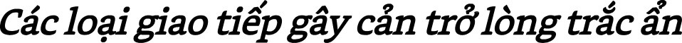
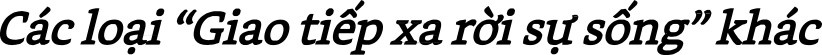

# **CHƯƠNG 2**

*“Đừng phán xét, và bạn sẽ không bị phán xét. Khi* *bạn phán* *xét người khác, bạn cũng sẽ bị phán xét.”*

—Kinh thánh Matthew 7:1

Trong quá trình nghiên cứu câu hỏi điều gì đã khiến chúng ta xa rời bản chất nhân ái của mình, tôi đã xác định các loại giao tiếp gây cản trở lòng trắc ẩn và góp phần khiến chúng ta hành xử bạo lực với bản thân và người khác. Tôi gọi các loại giao tiếp này là “*giao* *tiếp xa rời sự sống*” (life-alienating communication).

Một loại “giao tiếp xa rời sự sống” *là phán xét đạo* *đức*, tức là đánh giá người có hành vi không hòa hợp với những giá trị của chúng ta là xấu xa, hay sai trái. Ví dụ về những lời phán xét này là: “Bạn thật ích kỷ”, “Cô ấy thật lười biếng”, “Họ thật thành kiến”, “Nó không thích hợp.” Đổ lỗi, lăng mạ, sỉ nhục, dán nhãn, chỉ trích, so sánh đều là những hình thái của sự phán xét.

Nhà thơ Rumi từng viết: “Có một thế giới không chứa đựng khái niệm đúng sai. Tôi sẽ gặp bạn ở đó.” “Giao tiếp xa rời sự sống” nói chung và “phán xét đạo đức” nói riêng giam cầm chúng ta trong thế giới của đúng và sai. Đó là thứ ngôn ngữ phân tích, phân loại con người và những hành động của họ. Khi nói thứ ngôn ngữ này, chúng ta phán xét người khác và hành vi của họ trong khi tâm trí bị lấp đầy bởi những khái niệm đúng – sai, tốt – xấu, bình thường – khác thường, trách nhiệm – vô trách nhiệm, thông minh – ngu dốt, v.v...

Từ khi còn nhỏ, tôi đã học cách giao tiếp “vô cảm”, thiếu sự suy xét đến những cảm xúc và nhu cầu của bản thân và của người khác. Khi ai đó hành xử theo cách tôi không thích, tôi lập tức phán xét họ. Chẳng hạn, nếu giáo viên bảo tôi làm một việc tôi không muốn làm, thì tôi sẽ phán xét họ là “vô lý và xấu tính.” Nếu ai đó cắt ngang đầu xe tôi trên đường, thì phản ứng của tôi sẽ là “Thằng ngu!.” Khi dùng thứ ngôn ngữ này, chúng ta giao tiếp dựa trên suy nghĩ về sự sai trái của người khác vì đã không hành xử như chúng ta kỳ vọng. Chúng ta tập trung vào đánh giá và chỉ trích hơn là vào những nhu cầu không được đáp ứng của bản thân và của người khác. Theo đó, nếu vợ tôi muốn tôi quan tâm nhiều hơn, thì cô ấy là “đòi hỏi và phụ thuộc.” Nhưng nếu tôi muốn cô ấy quan tâm nhiều hơn, thì cô ấy là “xa lánh và vô tâm.” Nếu đồng nghiệp để ý đến chi tiết nhiều hơn tôi, thì anh ấy là “khó tính và ưa bắt lỗi.” Nhưng nếu tôi để ý đến chi tiết nhiều hơn, thì anh ấy là “cẩu thả và lơ là”.

Khi phán xét người khác, thực ra là chúng ta đang muốn bày tỏ những nhu cầu và giá trị của mình, nhưng chúng ta , nhưng chúng ta đã làm điều đó theo cách rất “bi kịch”, bởi khi làm như vậy, chúng ta sẽ chỉ khiến người nghe trở nên phản kháng và phòng thủ hơn. Hoặc nếu họ đồng ý thay đổi hành vi theo ý muốn của chúng ta, thì nhiều khả năng hành động đó xuất phát từ cảm giác sợ hãi, tội lỗi hoặc xấu hổ vì họ cho rằng mình bị phán xét như vậy là đúng.

Khi hành động của họ không xuất phát từ trái tim mà xuất phát từ cảm giác sợ hãi, tội lỗi, xấu hổ hay bị ép buộc, thì cả hai bên đều sẽ phải trả giá đắt. Khi làm vậy, nhiều khả năng họ sẽ cảm thấy ức chế, tức giận và lòng tự trọng bị ảnh hưởng. Hơn nữa, sự thiện chí, lòng trắc ẩn và ý muốn cho đi chân thành cũng bị giảm đi, mang lại những hệ quả tiêu cực cho mối quan hệ giữa hai bên.

Điều quan trọng là chúng ta cần phân biệt giữa *phán xét đạo đức* (moralistic judgment) và *đánh giá* *dựa trên giá trị* (value judgment). Tất cả chúng ta đều có những đánh giá dựa trên giá trị, về những thứ mà chúng ta xem trọng trong cuộc sống: sự trung thực, sự tự do hay sự hòa thuận. Những đánh giá đó phản ánh niềm tin của chúng ta về cách thức của cuộc sống này. Còn khi hành vi của ai đó không hòa hợp với giá trị của chúng ta, chúng ta có xu hướng sử dụng phán xét đạo đức đối với họ. Một ví dụ về sự phán xét đạo đức là: “Bạo lực là xấu. Người gây bạo lực là độc ác, xấu xa.” Nếu chúng ta được dạy sử dụng một thứ ngôn ngữ khác giúp khơi dậy lòng trắc ẩn, thì chúng ta sẽ học cách nói rõ những nhu cầu, giá trị và cảm xúc của mình một cách trực tiếp. Ví dụ, thay vì nói “Bạo lực là xấu”, chúng ta có thể nói: “Tôi cảm thấy e ngại đối với việc sử dụng bạo lực để giải quyết mâu thuẫn. Tôi xem trọng hòa bình và muốn mọi người tìm cách khác để giải quyết mâu thuẫn.”

Mối quan hệ giữa ngôn ngữ và bạo lực là đề tài nghiên cứu của giáo sư tâm lý O.J. Harvey tại Đại học Colorado. Ông thu thập mẫu ngẫu nhiên những tài liệu từ nhiều quốc gia trên thế giới và lập bảng liệt kê tần suất xuất hiện của những từ ngữ phân loại và phán xét con người. Nghiên cứu của ông cho thấy có một mối tương quan cao giữa tần suất sử dụng những từ ngữ đó và tần suất những vụ xung đột xảy ra. Tôi không hề ngạc nhiên khi biết những nơi có văn hóa suy nghĩ và giao tiếp tập trung vào nhu cầu của con người có tình trạng bạo lực xảy ra ít hơn rất nhiều so với những nơi có văn hóa dán nhãn con người là “tốt” hay “xấu”, và tin rằng “người xấu” xứng đáng bị trừng phạt. Tại Mỹ, trong 75% chương trình truyền hình được chiếu vào khung giờ mà trẻ con xem nhiều nhất, nhân vật anh hùng hoặc giết chết hoặc đánh bại “kẻ xấu.” Và khi những cảnh bạo lực này diễn ra vào lúc cao trào của chương trình, chúng ta đã bị nhồi nhét vào đầu khái niệm “tốt – xấu” và niềm tin rằng bạo lực cần được sử dụng để trừng phạt “người xấu”.

Nguyên nhân gốc rễ của hầu hết, nếu không muốn nói là tất cả bạo lực – dù là bạo lực về thể xác, cảm xúc hay ngôn từ, dù là bạo lực giữa các cá nhân, các nhóm hay các quốc gia – là lối suy nghĩ rằng mâu thuẫn xảy ra là do sự sai trái của người khác, và tương ứng với điều đó là sự thiếu khả năng suy xét những cảm xúc và nhu cầu nằm sâu hơn của bản thân và của người khác. Chúng ta nhìn thấy cách suy nghĩ nguy hiểm này trong giai đoạn Chiến tranh Lạnh. Chính phủ Hoa Kỳ xem Liên Xô là “đế chế độc ác” đang quyết tâm phá hủy nước Mỹ. Ngược lại, chính phủ Liên Xô xem Hoa Kỳ là “bọn đế quốc áp bức” đang cố gắng khuất phục nước mình. Không bên nào nhận ra những sự sợ hãi và tổn thương ẩn đằng sau những sự “dán nhãn” đó.

> **Có một vài cách giao tiếp khiến chúng ta xa rời bản chất nhân ái của mình.**

> **Trong thế giới của phán xét, chúng ta chủ yếu bận tâm về “ai là người như thế nào.”**

> **Khi phán xét người khác, thực ra là chúng ta đang muốn bày tỏ những nhu cầu và giá trị của mình.**

> **Phân loại và phán xét con người làm tăng khả năng bạo lực xảy ra.**

> **So sánh là một loại ngôn ngữ phán xét.**

Một loại “giao tiếp xa rời sự sống” khác là so sánh, và về bản chất thì nó cũng là một loại ngôn ngữ phán xét. Trong cuốn sách  *How to Make* *Yourself Miserable* (tạm dịch: Cách tự làm mình khổ), Dan Greenburg trình bày một cách hài hước về tác động của sự so sánh đối với chúng ta. Ông nói rằng nếu độc giả muốn cảm thấy đau khổ, họ có thể làm một vài bài tập so sánh bản thân với người khác. Bài tập đầu tiên có bức hình một người mẫu nam và một người mẫu nữ với các số đo “lý tưởng” theo tiêu chuẩn của xã hội. Độc giả được yêu cầu tự lấy các số đo cơ thể mình, so sánh chúng với các “người mẫu”, và tập trung vào những điểm khác biệt.

Bài tập này lập tức tạo ra cảm giác muộn phiền ở độc giả, nhưng khi họ lật sang trang tiếp theo, họ nhận ra nó chỉ là bước khởi động. Ở bài tập thứ hai, độc giả có cơ hội so sánh bản thân với người khác ở mức độ cao hơn: sự thành công. Greenberg cho độc giả một vài cái tên danh nhân để so sánh. Cái tên đầu tiên là nhà soạn nhạc vĩ đại Mozart. Bài tập liệt kê số lượng ngôn ngữ mà Mozart biết nói và số lượng bản nhạc ông đã sáng tác ở tuổi 12. Độc giả được yêu cầu ngẫm nghĩ về những thành tựu họ đã đạt được trong toàn bộ cuộc sống, so sánh chúng với những thành tựu Mozart đã đạt được ở tuổi thiếu niên, và tập trung vào những điểm khác biệt.

Khi làm hai bài tập trên, bạn sẽ có thể nhận ra sự so sánh gây cản trở lòng trắc ẩn nhiều như thế nào, đối với cả bản thân và người khác.

Một loại “giao tiếp xa rời sự sống” khác là chối bỏ trách nhiệm, tức giao tiếp dựa trên sự thiếu nhận thức rằng mỗi chúng ta chịu trách nhiệm cho những suy nghĩ, cảm xúc và hành động của chính mình. Một ví dụ của loại giao tiếp này là từ “phải”, chẳng hạn như “Có những thứ bạn phải làm, dù muốn hay không”, cho thấy người nói đang phủ nhận trách nhiệm đối với những hành động của mình. ví dụ khác là cụm từ “khiến tôi cảm thấy”, chẳng hạn như “Bạn khiến tôi cảm thấy xấu hổ”, cho thấy người nói đang phủ nhận trách nhiệm đối với những suy nghĩ và cảm xúc của mình.

Trong cuốn sách *Eichmann ở Jerusalem* viết về phiên tòa xử Adolf Eichmann(*), tội phạm chiến tranh trong Thế chiến II, tác giả Hannah Arendt trích dẫn lời nói của Eichmann rằng hắn ta và các đồng đội sĩ quan Đức Quốc Xã có một cái tên riêng cho thứ ngôn ngữ chối bỏ trách nhiệm mà chúng sử dụng. Chúng gọi nó là *Amtssprache*, có thể tạm dịch là “ngôn ngữ quan liêu.” Eichmann cho ví dụ rằng nếu được hỏi tại sao chúng làm một hành động nào đó, thì câu trả lời sẽ là “Tôi phải làm.” Nếu được hỏi tại sao “phải làm”, thì câu trả lời sẽ là “Đó là lệnh của cấp trên”, “Đó là chính sách của đại đội”, “Đó là luật.”

Chúng ta chối bỏ trách nhiệm đối với hành động của mình khi cho rằng tác nhân bên ngoài là nguyên nhân của hành động đó, chẳng hạn như:

Những tác nhân mơ hồ, chung chung – “Tôi dọn dẹp phòng mình vì tôi phải làm điều đó.”

Hoàn cảnh sống, sự chẩn đoán, hoặc lịch sử của chúng ta – “Tôi uống rượu vì tôi là một người nghiện rượu.”

Hành động của người khác – “Tôi đánh con mình vì nó chạy ra đường” Mệnh lệnh của cấp trên – “Tôi nói dối khách hàng vì sếp bảo tôi làm vậy.”

Áp lực nhóm – “Tôi hút thuốc vì bạn bè tôi đều làm vậy.”

Những chính sách, quy định, luật lệ của tổ chức – “Tôi phải cho em nghỉ học vì đó là quy định của nhà trường.”

Những vai trò thuộc về giới tính, xã hội, hay độ tuổi – “Mặc dù ghét nhưng tôi phải đi làm vì tôi là một người chồng và một người cha.”

> **Chúng ta có thể thay thế ngôn ngữ chối bỏ trách nhiệm với ngôn ngữ của sự lựa chọn.**

Những sự thôi thúc không thể kiểm soát – “Tôi ăn kẹo vì sự thôi thúc bên trong đã khiến tôi làm vậy.”

Có lần, trong một khóa học NVC cho các phụ huynh và giáo viên, khi tôi chia sẻ về sự nguy hiểm của thứ ngôn ngữ với hàm ý không có sự lựa chọn, một người phụ nữ tức giận phản đối: “Nhưng có những thứ mà bạn phải làm, dù muốn hay không! Và tôi thấy không có gì sai khi nói với con cái mình rằng có những thứ mà chúng phải làm!” Khi được đề nghị cho ví dụ, cô ấy mỉa mai nói: “Dễ thôi! Khi tôi rời khỏi đây tối nay, tôi phải về nhà và nấu ăn! Tôi ghét nấu ăn, ghét cay ghét đắng, nhưng tôi đã làm việc đó mỗi ngày trong 20 năm qua, ngay cả khi tôi bị bệnh nặng, vì đó đơn giản là việc tôi phải làm.” Tôi nói với cô ấy rằng tôi cảm thấy buồn khi biết cô ấy đã dành phần lớn cuộc đời làm một việc mà mình không thích, và tôi hy vọng cô ấy sẽ tìm thấy những lựa chọn khác bằng việc học NVC.

Tôi cảm thấy vui vì cô ấy học rất nhanh. Vào cuối khóa học, cô ấy về nhà và thông báo với gia đình rằng cô ấy sẽ không nấu ăn nữa. Ba tuần sau, trong một buổi hội thảo NVC, hai đứa con của cô ấy đến tham dự. Tôi tò mò hỏi về phản ứng của chúng với quyết định đó của mẹ. Đứa con trai lớn đáp: “Thưa thầy, con đã nghĩ: Tạ ơn Trời Đất!.” Nhìn thấy vẻ mặt khó hiểu của tôi, cậu bé giải thích: “Con nói với bản thân, cuối cùng thì mẹ cũng không phàn nàn trong các bữa ăn nữa!.”

Lần khác, tôi đến giảng NVC cho một trường học, một giáo viên nói: “Tôi ghét việc cho điểm. Tôi không nghĩ chúng có ích và chúng tạo ra rất nhiều lo lắng cho học sinh. Nhưng tôi *phải* cho điểm, vì đó là quy định.” Chúng tôi vừa học thứ ngôn ngữ giúp nâng cao sự nhận thức về trách nhiệm cho mỗi hành động của bản thân, nên tôi đề nghị cô ấy chuyển câu nói “Tôi *phải* cho điểm vì đó là quy định” sang “*Tôi lựa chọn* cho điểm vì *tôi muốn*...” Cô ấy lập tức đáp: “Tôi *lựa* *chọn* cho điểm vì tôi muốn giữ công việc của mình”, rồi vội vàng bổ sung: “Nhưng tôi không muốn nói theo cách đó vì nó khiến tôi cảm thấy có trách nhiệm với việc làm của mình.” Tôi mỉm cười nói: “Đó chính là lý do tại sao tôi muốn cô nói theo cách đó.”

Tôi đồng ý với quan điểm của nhà văn George Bernanos khi ông nói:

> “Từ lâu, tôi đã nghĩ rằng nếu một ngày nào đó công nghệ hủy diệt phát triển đến mức khiến loài người chúng ta biến mất khỏi trái đất, thì việc đó không phải do những người chế tạo ra các công nghệ đó, mà do những người thiếu trách nhiệm, chỉ im lặng chấp nhận mọi chính sách được đưa ra. Những điều kinh khủng mà chúng ta đã thấy và những điều kinh khủng hơn mà chúng ta sẽ thấy không phải là dấu hiệu của sự gia tăng số lượng những người không phục tùng, không vâng lời mà là dấu hiệu của sự gia tăng số lượng những người ngoan ngoãn, dễ bảo và thiếu trách nhiệm.

Một loại giao tiếp gây cản trở lòng trắc ẩn khác là nói ra điều mình muốn dưới dạng mệnh lệnh. Một mệnh lệnh, dù rõ ràng hay ẩn ý, đều tạo cho người nghe cảm giác lo ngại rằng họ sẽ bị đổ lỗi hoặc trừng phạt nếu không làm theo. Đây là một loại giao tiếp phổ biến trong nền văn hóa của chúng ta, đặc biệt ở những người nắm giữ vị trí quyền lực.

> **Chúng ta không bao giờ có thể bắt người khác làm bất kỳ điều gì.**

> **Suy nghĩ dựa trên sự “xứng đáng” gây cản trở lòng trắc ẩn.**

Các con tôi đã cho tôi một vài bài học vô giá về việc ra lệnh. Trong quá khứ, tôi đã từng nghĩ rằng trong vai trò làm cha mẹ, công việc của tôi là ra lệnh cho con cái. Tuy nhiên, tôi đã học được rằng dù có ra lệnh bằng cách nào đi nữa, tôi cũng không thể bắt chúng làm bất kỳ điều gì. Tất cả những gì tôi có thể làm là khiến chúng ước gì chúng đã làm theo ý tôi – thông qua sự trừng phạt; để rồi sau đó, chúng lại khiến tôi ước gì tôi đã không làm như vậy! Đây là một bài học đối với những ai trong chúng ta tin rằng trong vai trò làm phụ huynh, giáo viên hay quản lý, công việc của chúng ta là thay đổi hay dạy người khác cách cư xử.

Chúng ta sẽ tìm hiểu kỹ hơn về chủ đề này khi chúng ta học cách phân biệt giữa đề nghị (request) và ra lệnh (demand)một phần quan trọng trong NVC.

Niềm tin rằng có những hành động “xứng đáng” được khen thưởng và những hành động “xứng  đáng”  bị  trừng  phạt cũng có liên quan đến “giao tiếp xa rời sự sống.” Niềm tin này được thể hiện trong câu nói: “Hắn ta xứng đáng bị trừng phạt vì hành động của mình.” Khi nói như vậy, chúng ta đang tin rằng bản chất của người kia là “xấu” và sự trừng phạt cần được áp dụng để khiến họ hối lỗi và thay đổi hành vi. Tuy nhiên, tôi tin rằng nếu một người thay đổi, không phải để tránh sự trừng phạt, mà vì họ thấy sự thay đổi mang lại lợi ích cho bản thân, thì chỉ khi đó tất cả mọi người mới thực sự được hạnh phúc.

Từ nhỏ, hầu hết chúng ta đã được dạy nói thứ ngôn ngữ khuyến khích sự phán xét, dán nhãn, chối bỏ trách nhiệm, so sánh, ra lệnh hơn là ý thức về những cảm xúc và nhu cầu của mình. Tôi tin rằng nguyên nhân gốc rễ của “ngôn ngữ xa rời sự sống” là cách nhìn về bản chất con người đã tồn tại trong nhiều thế kỷ. Cách nhìn này nói rằng con người có bản chất xấu xa và thiếu sót, vậy nên cần được dạy dỗ để kiểm soát bản chất ấy. Sự dạy dỗ đó thường khiến chúng ta tự hỏi có gì sai với mình và bị ngắt kết nối với những cảm xúc và nhu cầu ở bên trong.

> **“Giao tiếp xa rời sự sống” có nguồn gốc triết học và chính trị sâu sắc.**

“Ngôn ngữ xa rời sự sống” có nguồn gốc từ những xã hội có sự thống trị, nơi phần lớn những người thuộc cấp bậc thấp bị kiểm soát bởi một số lượng nhỏ những cá nhân thuộc cấp bậc cao để phục vụ cho lợi ích của những cá nhân ấy. Trong những xã hội ấy, điều quan trọng đối với những người thống trị như vua, hoàng đế, quý tộc... là nhồi vào đầu quần chúng thứ “tư duy nô lệ.” “Ngôn ngữ xa rời cuộc sống” phục vụ cho mục đích này một cách hoàn hảo: nếu con người càng suy nghĩ tập trung vào những phán xét đạo đức như “tốt – xấu”, “đúng – sai”, “thích hợp – không thích hợp”, thì họ càng có xu hướng tìm kiếm định nghĩa về điều gì là “tốt / xấu”, “đúng / sai”, “phải / nên làm” bên ngoài mình, ở những người nắm giữ quyền lực. Khi chúng ta kết nối với những cảm xúc và nhu cầu bên trong mình, chúng ta không còn là những nô lệ ngoan ngoãn, dễ bảo nữa.

Bản chất con người chúng ta là nhân ái và muốn cho đi và đón nhận tình yêu thương. Tuy nhiên, chúng ta đã được dạy nhiều loại “giao tiếp xa rời sự sống” khiến chúng ta nói và hành xử theo cách gây tổn thương cho bản thân và người khác. Loại thứ nhất là *phán xét đạo đức*, tức đánh giá người có hành vi không hòa hợp với những giá trị của chúng ta là *tồi tệ* hay *sai trái*. Loại thứ hai là *so sánh*, gây cản trở lòng trắc ẩn đối với cả bản thân và người khác. Loại thứ ba là chối bỏ trách nhiệm, tức giao tiếp dựa trên sự thiếu nhận thức rằng mỗi chúng ta chịu trách nhiệm cho những suy nghĩ, cảm xúc và hành động của chính mình. Và loại thứ tư là ra lệnh, tạo cho người nghe cảm giác lo ngại rằng họ sẽ bị đổ lỗi hoặc trừng phạt nếu không làm theo.
