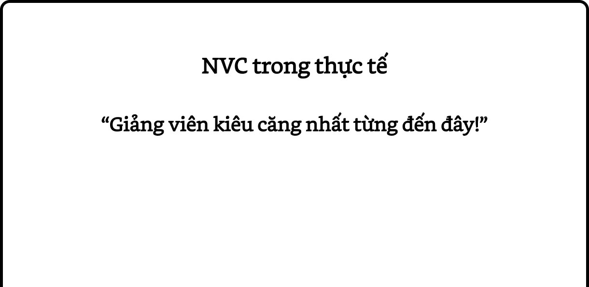

# Chương 3: Quan sát mà không đánh giá

*“QUAN SÁT! Đó là một trong những điều quan trọng* *nhất* *trong cuộc sống.”*

—Nhà văn Frederick Buechner

> *Tôi có thể chấp nhận nếu* *bạn nói điều tôi đã làm* *hoặc không làm.* *Và tôi có thể chịu đựng những đánh* *giá, nhưng xin đừng trộn lẫn chúng* *với nhau.*

> *Nếu bạn muốn làm vấn đề rối* *thêm, Thì đây là cách làm* *điều đó:*

> *Trộn lẫn việc tôi làm*
>
> *với cách bạn phản ứng với nó.*

> *Nói với tôi rằng bạn thất vọng*
>
> *khi thấy tôi chưa làm xong*
>
> *việc nhà, Nhưng gọi tôi là “vô*
>
> *trách nhiệm”*
>
> *sẽ không tạo động lực cho tôi đâu.*

> *Nói với tôi rằng bạn tổn thương*
>
> *khi tôi nói “không” với đề nghị của bạn,*
>
> *Nhưng gọi tôi là “cứng* *nhắc” sẽ không làm tôi* *đổi ý đâu.*

> *Tôi có thể chấp nhận nếu* *bạn nói điều tôi đã làm* *hoặc không làm,* *Và tôi có thể chịu đựng những đánh* *giá, nhưng xin đừng trộn lẫn chúng* *với nhau.*

Marshall YRosenberg – ếu tố đầu tiên của NVC đòi hỏi chúng ta tách biệt *quan sát* (*observation*) với *đánh giá* (*evaluation*). Chúng ta cần làm rõ điều gì đang xảy ra gây ảnh hưởng đến cuộc đời mình mà không trộn lẫn với bất kỳ sự đánh giá nào.

*Quan sát* là một yếu tố quan trọng trong NVC khi chúng ta muốn bày tỏ những gì đang diễn ra bên trong mình một cách trung thực và rõ ràng với người khác. Khi chúng ta trộn lẫn *quan* *sát* với đánh giá, khả năng người kia nghe thấy thông điệp mà chúng ta thực sự muốn truyền đạt sẽ giảm đi. Thay vào đó, họ có khuynh hướng nghe thấy sự chỉ trích và do đó thể hiện sự chống đối.

NVC không đòi hỏi chúng ta luôn luôn khách quan và không bao giờ đánh giá. Nó chỉ yêu cầu chúng ta tách biệt những *quan sát* với những đánh giá của mình. Khi đánh giá, chúng ta đang sử dụng “ngôn ngữ tĩnh” để mô tả một thực tại không ngừng thay đổi. Nhà ngôn ngữ học Wendell Johnson chỉ ra rằng khi làm như vậy, chúng ta tạo ra rất nhiều vấn đề cho bản thân và người khác. Ông nói: “Ngôn ngữ của chúng ta là một phương tiện truyền đạt thông tin không hoàn hảo. Nó khuyến khích chúng ta phân loại và dán nhãn, nói về sự cố định và bất biến, trong khi thế giới mà chúng ta cố gắng diễn tả và nắm bắt bằng ngôn ngữ đó lại là thế giới của sự tương tác, thay đổi, học tập, phát triển. Sự bất cân xứng này là một phần vấn đề của chúng ta.” Ngược lại, NVC là “ngôn ngữ động”, khuyến khích chúng ta chỉ ra *quan sát* trong một thời gian và bối cảnh cụ thể.

Ruth Bebermeyer, một đồng nghiệp của tôi, sáng tác bài thơ sau để nói về sự khác nhau giữa đánh giá và *quan sát*, giữa *ngôn ngữ tĩnh* và *ngôn ngữ động*:

> **Khi chúng ta trộn lẫn quan sát với đánh giá, người nghe có khuynh hướng nghe thấy sự chỉ trích.**

> *Tôi chưa từng thấy một người “lười”;*

> *Tôi thấy một người tuần qua không* *tập thể dục và có ngày ngủ trưa hai* *giờ liền*
>
> *nhưng anh ấy không phải* *“lười”. Trước khi bạn gọi anh* *ấy là “lười”, hãy nghĩ kỹ* *xem, anh ấy “lười”*
>
> *hay chỉ làm những việc mà bạn gọi là “lười”?*

> *Tôi chưa từng thấy một đứa trẻ “ngốc”;*

> *Tôi thấy một đứa trẻ thỉnh thoảng làm* *những việc tôi không hiểu hay không* *lường trước;* *nhưng cậu bé không phải* *“ngốc”. Trước khi bạn gọi* *cậu bé là “ngốc”, hãy nghĩ* *kỹ xem, cậu bé “ngốc”*
>
> *hay chỉ có nhận thức khác với bạn?*

> *Tôi chưa từng thấy một “đầu bếp”;*

> *Tôi thấy một người kết hợp các* *nguyên liệu, bật lửa, canh lò, nướng* *thịt.*

> *Tôi thấy những điều đó, nhưng không phải một “đầu* *bếp”*
>
> *Nói tôi nghe, bạn thấy một đầu bếp*
>
> *hay một người làm những việc mà bạn gọi là “đầu bếp”?*

> *Khi ta gọi một người là “lười”*
>
> *người khác gọi là “mệt mỏi” hay “thư* *giãn”, Khi ta gọi một người là* *“ngốc”* *người khác gọi là “nhận* *thức khác”. Vậy nên, tôi kết* *luận,* *mọi rắc rối sẽ không còn*
>
> *nếu ta không trộn lẫn điều* *mình thấy với ý kiến của* *riêng mình.*

> *Và tôi cũng muốn nói:*

> *Đây chỉ là ý kiến của riêng tôi.*

Bạn thấy đấy, trong khi tác động của những nhãn dán tiêu cực như “lười biếng” và “ngu ngốc” có thể là rõ ràng, những nhãn dán tích cực hoặc trung lập như “đầu bếp” cũng có thể khiến sự nhận thức của chúng ta về tính tổng thể của một sự vật hay con người trở nên giới hạn.

## Loại hình thông minh cao nhất của con người

Triết gia người Ấn Độ J. Krishnamurti từng nói: “Quan sát mà không đánh giá là loại hình thông minh cao nhất của con người.” Khi đọc câu này lần đầu tiên, tôi lập tức nghĩ “Nhảm nhí!”, rồi nhận ra rằng mình vừa đưa ra một đánh giá! Đối với hầu hết chúng ta, việc chỉ quan sát, đặc biệt là quan sát con người và hành vi của họ, mà không thêm vào bất kỳ sự đánh giá, bình phẩm, phán xét nào là không dễ dàng.

Có lần, tôi đến tư vấn cho một trường tiểu học, nơi có những mâu thuẫn dai dẳng giữa đội ngũ giáo viên và hiệu trưởng. Đầu tiên, tôi họp riêng với các giáo viên; và sau đó tổ chức cuộc họp chung bao gồm cả các giáo viên và hiệu trưởng.

Tôi mở đầu cuộc họp riêng với các giáo viên bằng câu hỏi: “Thầy hiệu trưởng đã nói hay làm gì mà các anh chị không thích?” Một giáo viên lập tức đáp: “Ông ta là kẻ to mồm!” Bạn thấy đấy, câu hỏi của tôi là về *quan sát*, tức hành vi cụ thể của thầy hiệu trưởng, trong khi câu trả lời “to mồm” lại là đánh giá của người giáo viên.

Một giáo viên thứ hai nói: “Tôi biết anh ấy có ý gì: thầy hiệu trưởng nói quá nhiều!” Đây cũng là một đánh giá (về việc thầy hiệu trưởng nói nhiều như thế nào) thay vì một *quan sát* rõ ràng. Một giáo viên thứ ba nói: “Thầy hiệu trưởng nghĩ rằng chỉ có điều ông ta nói là có giá trị!” Tôi giải thích rằng việc suy diễn ý nghĩ của người khác cũng không phải một *quan sát*. Một giáo viên thứ tư nói: “Ông ta luôn muốn là trung tâm của sự chú ý.” Khi tôi nói rằng đó cũng là sự suy diễn về ý muốn của người kia, hai giáo viên đồng thanh thốt lên: “Câu hỏi của thầy thật khó trả lời!”

Sau đó, chúng tôi thảo luận để lập ra một danh sách các *hành vi cụ thể* của thầy hiệu trưởng đã gây ảnh hưởng đến các giáo viên, và đảm bảo chúng không chứa đựng bất kỳ sự đánh giá nào. Ví dụ, trong các cuộc họp hàng tuần, thầy hiệu trưởng thường kể chuyện về tuổi thơ và trải nghiệm chiến tranh của mình, khiến cuộc họp trung bình kéo dài hơn 20 phút so với kế hoạch. Khi tôi hỏi các giáo viên là họ có từng nói với thầy hiệu trưởng về vấn đề này chưa, họ trả lời rằng họ đã thử nhưng luôn trộn lẫn với những đánh giá. Họ đồng ý sẽ thử nói lại với thầy hiệu trưởng, dưới dạng *quan sát*, trong cuộc họp chung diễn ra sau đó.

Trong cuộc họp chung, tôi đã sớm thấy điều mà các giáo viên nói. Bất kể nội dung đang thảo luận là gì, thầy hiệu trưởng sẽ xen vào: “Việc này làm tôi nhớ lại khoảng thời gian...” và sau đó kể chuyện về tuổi thơ hay trải nghiệm chiến tranh của mình. Tôi đợi các giáo viên bày tỏ sự khó chịu của mình với hành vi của thầy hiệu trưởng bằng NVC. Tuy nhiên, thay vào đó, họ lại thể hiện sự phản đối bằng ngôn ngữ không lời: đảo mắt, ngáp một cách mỉa mai, nhìn đồng hồ... Tôi chịu đựng cảnh này một lúc và nói: “Xin lỗi, nhưng có ai muốn nói gì không?” Một sự im lặng căng thẳng bao quanh căn phòng. Cuối cùng, người giáo viên phát biểu đầu tiên trong cuộc họp trước thu hết can đảm, nhìn thẳng vào thầy hiệu trưởng và nói: “Ed, ông là kẻ to mồm!”

Bạn thấy đấy, việc từ bỏ thói quen cũ và rèn luyện khả năng tách biệt *quan sát* với đánh giá không phải lúc nào cũng dễ dàng. Cuối cùng, các giáo viên cũng làm rõ được cho thầy hiệu trưởng về hành vi của mình. Thầy hiệu trưởng lắng nghe một cách nghiêm túc và nói: “Sao trước đây các anh chị không cho tôi biết?” Ông ấy thừa nhận mình có thói quen kể chuyện, rồi bắt đầu... kể một câu chuyện liên quan đến thói quen này! Tôi ngắt lời và nhẹ nhàng nói rằng ông ấy lại làm như vậy. Vào cuối cuộc họp, chúng tôi thảo luận về việc trong tương lai, nếu các giáo viên muốn cho thầy hiệu trưởng biết rằng họ đang không thoải mái với những câu chuyện của thầy, thì họ có thể làm điều đó như thế nào.

## Tách biệt Quan sát với Đánh giá

Bảng sau cho thấy cách tách biệt *quan sát* với *đánh* *giá*:

| Tình huống / Trường hợp | Ví dụ về sự trộn lẫn Quan sát với Đánh giá | Ví dụ về sự tách biệt Quan sát với Đánh giá |
| :--- | :--- | :--- |
| **1. Sử dụng từ miêu tả tính cách mà không chỉ rõ rằng sự đánh giá là ý kiến chủ quan của riêng mình** | Bạn quá hào phóng. | Khi tôi thấy bạn đưa hết số tiền ăn trưa của mình cho người khác, tôi nghĩ bạn quá hào phóng. |
| **2. Sử dụng động từ có hàm ý đánh giá** | Anh ta hay trì hoãn. | Anh ta chỉ ôn bài vào buổi tối trước ngày thi. |
| **3. Hàm ý rằng sự suy diễn / kết luận của mình về những suy nghĩ, cảm xúc, ý định, mong muốn của người khác là khả năng duy nhất** | Cô ấy sẽ không làm xong việc đúng thời hạn. | Tôi nghĩ rằng cô ấy sẽ không làm xong việc đúng thời hạn. *hoặc* Cô ấy nói: “Tôi sẽ không làm xong việc đúng thời hạn.” |
| **4. Hàm ý rằng sự tiên đoán của mình chắc chắn sẽ xảy ra** | Nếu bạn không ăn uống cân bằng, thì sức khỏe của bạn sẽ bị giảm sút. | Nếu bạn không ăn uống cân bằng, thì tôi sợ rằng sức khỏe của bạn có thể bị giảm sút. |
| **5. Không nói một cách cụ thể về sự việc** | Những người nhập cư không biết chăm lo cho nhà cửa của họ. | Tôi chưa từng thấy gia đình nhập cư sống tại số nhà 1679 đường Ross dọn tuyết trên vỉa hè nhà của họ. |
| **6. Sử dụng từ miêu tả năng lực mà không chỉ rõ rằng sự đánh giá là ý kiến chủ quan của riêng mình** | Hank Smith là tiền đạo tồi. | Hank Smith đã không ghi bàn trong 20 trận. |
| **7. Sử dụng những tính từ hoặc trạng từ mà không chỉ rõ rằng sự đánh giá là ý kiến chủ quan của riêng mình** | Jim thật xấu xí. | Ngoại hình của Jim không hấp dẫn tôi. |

Những từ như *luôn luôn*, *không bao giờ*, *chưa từng*, *mọi lúc*... là *quan sát* khi được sử dụng theo cách sau:

*Bất cứ lúc nào* tôi thấy Jack bên chiếc điện thoại, thằng bé đều nói chuyện ít nhất nửa tiếng.

Tôi nhớ rằng bạn *chưa từng* viết thư cho tôi.

Nếu những từ đó được sử dụng với hàm ý cường điệu, thì *quan sát* và *đánh giá* đang bị trộn lẫn và có khuynh hướng tạo ra sự phòng thủ ở người nghe:

Anh *lúc nào cũng* bận rộn!

Em *chẳng bao giờ* có mặt khi tôi cần!

Những từ như *hiếm khi* và *thường xuyên* cũng có thể góp phần tạo ra sự trộn lẫn *quan sát* với đánh giá:

> Trong ba lần gần đây khi tôi khởi xướng một

| Quan sát kết hợp Đánh giá | Quan sát không Đánh giá |
| :--- | :--- |
| Bạn hiếm khi làm điều tôi muốn. | Trong ba lần gần đây khi tôi khởi xướng một hoạt động nào đó, bạn đều nói mình không muốn tham gia. |
| Anh ấy thường xuyên đi làm trễ. | Anh ấy đi làm trễ ba lần trong tuần qua. |

Yếu tố đầu tiên của NVC đòi hỏi chúng ta tách biệt *quan sát* với *đánh giá*. Khi chúng ta trộn lẫn chúng với nhau, người nghe có khuynh hướng nghe thấy sự chỉ trích và do đó phản kháng điều chúng ta nói. Bên cạnh đó, khi đánh giá, chúng ta đang sử dụng “ngôn ngữ tĩnh” để mô tả một thực tại không ngừng thay đổi. Ngược lại, NVC là “ngôn ngữ động”, khuyến khích chúng ta chỉ ra những *quan sát* trong một thời gian và bối cảnh cụ thể, chẳng hạn như: “Hank Smith đã không ghi bàn trong 20 trận” thay vì “Hank Smith là tiền đạo tồi.”

Nhiều năm trước, trong một khóa học NVC, sau khi đã giảng được khoảng nửa giờ, tôi dừng lại để các học viên bày tỏ ý kiến. Một người đàn ông (tên là Phil) giơ tay phát biểu: “Ông là giảng viên kiêu căng nhất từng đến đây!”

Trong những trường hợp như thế này, tôi có một vài lựa chọn. Một lựa chọn là trở nên phòng thủ và biện minh cho bản thân. Một lựa chọn khác là công kích người kia vì đối với tôi, họ đã công kích tôi trước. Trong trường hợp này, tôi đã chọn lựa chọn thứ ba: tập trung vào những cảm xúc và nhu cầu đằng sau câu nói của người đàn ông này.

**Tôi:** (*đoán xem quan sát của Phil là gì*) Có phải anh đang phản ứng về việc tôi đã nói liên tục trong 30 phút trước khi cho học viên có cơ hội phát biểu?

Phil: Không. Vấn đề là ông làm phương pháp này nghe có vẻ đơn giản quá.

**Tôi:** (*cố gắng làm rõ hơn quan sát của Phil*) Có phải anh đang phản ứng về việc tôi đã không nói gì về những khó khăn khi áp dụng NVC đối với một vài người?

Phil: Không, không phải một vài người, mà là ông!

**Tôi:** Vậy là anh đang phản ứng về việc tôi đã không chia sẻ những khó khăn của mình khi áp dụng NVC?

Phil: Đúng vậy.

**Tôi:** (*đoán xem cảm xúc và nhu cầu của Phil là gì*) Có phải anh cảm thấy khó chịu vì muốn biết rằng chính tôi cũng gặp khó khăn khi áp dụng NVC?

Phil: (*im lặng một chút*) Đúng vậy.

**Tôi:** (*Cảm thấy thư giãn hơn vì đã kết nối được* *với cảm xúc và nhu cầu của Phil, tôi hướng sự* *chú ý vào lời đề nghị của anh* *ấy*) Anh có muốn tôi thừa nhận ngay bây giờ rằng chính tôi cũng gặp khó khăn khi áp dụng NVC?

Phil: Có.

**Tôi:** (*đã hiểu rõ về quan sát, cảm xúc, nhu cầu và* *đề nghị của Phil, tôi hướng sự chú ý vào bên* *trong để xem tôi có sẵn lòng làm theo lời đề nghị* *ấy không*) Đúng, tôi cũng nhiều lần gặp khó khăn, thậm chí hoàn toàn quên đi những điều mình đã dạy. Trong chương trình này, tôi sẽ kể về những lần đó. Điều giúp tôi vượt qua và tiếp tục rèn luyện là khi sống với tinh thần của phương pháp này, các mối quan hệ của tôi được cải thiện rất nhiều.

## Bài tập 1: Quan sát hay Đánh giá?

Trong bài tập sau, bạn hãy khoanh tròn các câu nói chỉ có *quan sát*, không bị trộn lẫn với *đánh giá*.

1. “Hôm qua, John tức giận một cách vô cớ.”

2. “Tối qua, Nancy cắn móng tay khi đang xem tivi.”

3. “Sam không hỏi ý kiến của tôi trong cuộc họp vừa qua.”

4. “Bố tôi là người tốt.”

5. “Janice làm việc quá nhiều.”

6. “Henry thật hung hăng.”

7. “Tuần này, trong tất cả các ngày, Pam đều có mặt ở công ty sớm nhất.”

8. “Con trai tôi thường xuyên không đánh răng.”

9. “Luke nói với tôi rằng tôi không hợp với áo màu vàng.”

10. “Cô tôi phàn nàn về người khác khi nói chuyện với tôi.”

*Dưới đây là câu trả lời của tôi cho Bài tập 1:*

1. Nếu bạn khoanh tròn câu này, thì chúng ta không có cùng quan điểm. Tôi cho rằng “vô cớ” là một *đánh giá*. Hơn nữa, đối với tôi, nói rằng John cảm thấy “tức giận” cũng là một *đánh giá*. Anh ấy có thể cảm thấy sợ hãi, tổn thương, muộn phiền... Người nói có thể tách biệt *quan sát* với *đánh giá* bằng cách nói: “John nói với tôi rằng anh ấy cảm thấy tức giận” hay “John đấm tay vào mặt bàn.”

2. Nếu bạn khoanh tròn câu này, thì chúng ta có cùng quan điểm rằng người nói đã chỉ rõ *quan sát* *mà không trộn lẫn với đánh giá*.

3. Nếu bạn khoanh tròn câu này, thì chúng ta có cùng quan điểm rằng người nói đã chỉ rõ *quan sát* *mà không trộn lẫn với đánh giá*.

4. Nếu bạn khoanh tròn câu này, thì chúng ta không có cùng quan điểm. Tôi cho rằng “người tốt” là một *đánh giá*. Người nói có thể tách biệt *quan sát* với *đánh giá* bằng cách nói: “Trong 25 năm qua, bố tôi đã đóng góp một phần mười lương của mình cho tổ chức từ thiện.”

5. Nếu bạn khoanh tròn câu này, thì chúng ta không có cùng quan điểm. Tôi cho rằng “quá nhiều” là một *đánh giá*. Người nói có thể tách biệt *quan sát* với *đánh giá* bằng cách nói: “Tuần này, Janice đã dành hơn 60 giờ ở cơ quan.”

6. Nếu bạn khoanh tròn câu này, thì chúng ta không có cùng quan điểm. *Tôi cho rằng “hung hăng” là* *một đánh giá*. Người nói có thể tách biệt *quan sát* với *đánh giá* bằng cách nói: “Henry đánh em gái của mình khi cô bé chuyển kênh tivi.”

7. Nếu bạn khoanh tròn câu này, thì chúng ta có cùng quan điểm rằng người nói đã chỉ rõ *quan sát* *mà không trộn lẫn với đánh giá*.

8. Nếu bạn khoanh tròn câu này, thì chúng ta không có cùng quan điểm. Tôi cho rằng “thường xuyên” là một *đánh giá*. Người nói có thể tách biệt *quan* *sát* với *đánh giá* bằng cách nói: “Đã hai lần trong tuần này con trai tôi không đánh răng trước khi đi ngủ.”

9. Nếu bạn khoanh tròn câu này, thì chúng ta có cùng quan điểm rằng người nói đã chỉ rõ *quan sát* *mà không trộn lẫn với đánh giá*.

10. Nếu bạn khoanh tròn câu này, thì chúng ta không có cùng quan điểm. *Tôi cho rằng “phàn nàn” là* *một đánh giá*. Người nói có thể tách biệt *quan sát* với *đánh giá* bằng cách nói: “Tuần này, cô tôi gọi điện thoại cho tôi ba lần, và mỗi lần đều nói về những người *đã cư xử* với cô theo cách cô không thích.”

### Bài thơ: Mặt nạ (Ruth Bebermeyer)

> *Có một người* *Luôn giữ mặt* *nạ*
>
> *Trên gương mặt mình*
>
> *Với đôi tay mỏng* *manh. Đôi tay ấy* *Đã giữ mặt nạ* *Trong thời gian* *dài Liệu có mỏi* *không?*

> *Trong nhiều* *năm Tôi tự hỏi*
>
> *Nhưng không* *dám Rồi một* *ngày* *Tình cờ tôi* *thấy Đằng sau* *mặt nạ Không* *có gì cả!*

> *Người phụ nữ đó*
>
> *Gương mặt đâu rồi?*

> *Đeo mặt*
>
> *nạ đã quá*
>
> *lâu,*
>
> *Cô đã trở thành*
>
> *Chiếc mặt nạ ấy.*

—Khuyết danh
