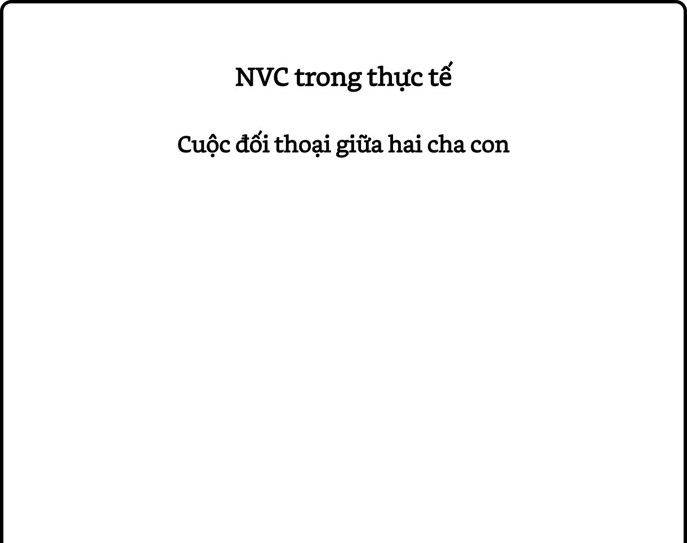

# Chương 10: Bày tỏ sự tức giận một cách đầy đủ

Chủ đề về sự tức giận cho chúng ta cơ hội đặc biệt để hiểu sâu hơn về NVC, vì nó có liên quan đến nhiều khía cạnh khác nhau của phương pháp này.

> **Làm tổn thương người khác là cách thể hiện sự tức giận rất nông cạn.**

Khi tức giận, nhiều người trong chúng ta thường la hét, đánh  đập,  chỉ  trích  người khác, làm họ tổn thương về mặt thể xác hoặc tinh thần. Tuy nhiên, tôi cho rằng chúng là những cách thể hiện sự tức giận rất nông cạn. Với NVC, chúng ta sẽ học cách bày tỏ cảm xúc này một cách đầy đủ và hiệu quả hơn nhiều.

Nhiều người cảm thấy không thoải mái khi nghe cụm từ *Giao tiếp bất bạo động* hay *Giao tiếp bằng* *lòng trắc ẩn* vì họ nghĩ rằng phương pháp này cũng khuyên họ “kìm nén cơn giận” và “dĩ hòa vi quý” như bao phương pháp giao tiếp khác. Họ đã quá chán ghét việc được dạy để xem sự tức giận của mình là một cảm xúc tiêu cực cần được loại bỏ. Tuy nhiên, trên thực tế, NVC không hề khuyên chúng ta làm những điều đó. Thay vào đó, nó khuyến khích chúng ta tìm hiểu những suy nghĩ, cảm xúc và nhu cầu đằng sau sự tức giận của mình, và bày tỏ chúng với lòng trắc ẩn.

## Phân biệt tác nhân kích thích và nguyên nhân

Trong NVC, bước đầu tiên để thể hiện sự tức giận một cách đầy đủ là buông bỏ suy nghĩ rằng người khác là nguyên nhân của cảm xúc bên trong chúng ta, chẳng hạn như: “Anh ta làm mình nổi điên khi làm điều đó.” Loại suy nghĩ này sẽ khiến chúng ta bày tỏ sự tức giận của mình một cách nông cạn bằng cách đổ lỗi, chỉ trích, trừng phạt người khác. Trong Chương 5, chúng ta đã thấy rằng hành vi hoặc lời nói của người khác chỉ có thể là *tác* *nhân kích thích* (*stimulus*), chứ không bao giờ là *nguyên nhân* (*cause*), của những cảm xúc bên trong chúng ta. Điều này đặc biệt đúng đối với cảm xúc tức giận.

Nhiều năm trước, tôi đến giảng tại một nhà tù ở Thụy Điển. Trong một bài tập, tôi yêu cầu các học viên xác định *tác nhân kích thích* của sự tức giận bên trong mình. Một tù nhân tên John trả lời: “Ba tuần trước, tôi đưa ra một đề nghị với ban quản lý nhà tù và đến giờ vẫn chưa được hồi đáp.” Đã thấy đây là một *sự* *quan sát* rõ ràng, tôi hỏi: “Khi chuyện ấy xảy ra, bạn tức giận *vì điều gì*?” John đáp: “Tôi vừa nói đó thôi. Tôi tức giận vì họ không hồi đáp lời đề nghị của tôi!” Bạn thấy đấy, người tù nhân này đã đánh đồng *nguyên* *nhân* với *tác nhân kích thích* của cảm xúc bên trong mình.

> **Hành vi hoặc lời nói của người khác chỉ có thể là tác nhân kích thích, chứ không bao giờ là nguyên nhân, của sự tức giận bên trong chúng ta.**

Chúng ta dễ dàng hình thành thói quen này nếu sống trong những nền văn hóa sử dụng sự tội lỗi để thao túng con người.

Trong những nền văn hóa này, việc khiến người ta có suy nghĩ rằng họ có thể làm một ai đó khác cảm thấy theo một cách nào đó là quan trọng. Để làm được điều đó, việc đánh đồng *nguyên nhân* với *tác nhân kích thích* là rất có ích. Ví dụ, khi bố mẹ nói: “Con làm bố mẹ buồn vì đạt điểm kém”, họ đang đánh đồng *nguyên nhân* với *tác* *nhân kích thích* của cảm xúc bên trong mình, nhằm mục đích khiến đứa trẻ cảm thấy tội lỗi và nỗ lực học tập hơn. Và khi nghe điều đó, đứa trẻ cũng sẽ nhanh chóng phát triển một niềm tin sai lầm rằng hành vi hoặc lời nói của người khác là nguyên nhân của những cảm xúc, bao gồm sự tức giận, bên trong nó.

Chúng ta hay nói “Bạn làm tôi tức giận”, “Bạn làm thế khiến tôi tổn thương”, hay “Tôi cảm thấy buồn vì bạn làm thế.” Bằng nhiều cách nói, chúng ta tự ru ngủ bản thân rằng cảm xúc của mình là kết quả của những hành động của người khác. Do đó, bước đầu tiên của việc bày tỏ cơn giận một cách đầy đủ chính là việc nhận ra rằng những gì người khác làm không bao giờ là nguyên nhân của cám xúc của chúng ta.

> **Chúng ta dễ dàng hình thành thói quen đánh đồng nguyên nhân với tác nhân kích thích nếu sống trong những nền văn hóa sử dụng sự tội lỗi để thao túng con người.**

> **Nguyên nhân của sự tức giận là những suy nghĩ phán xét và chỉ trích trong tâm trí của chính chúng ta.**

Vậy nguyên nhân của sự tức giận là gì? Trong Chương 5, chúng ta đã bàn về bốn lựa chọn để tiếp nhận một thông điệp hay hành vi từ người khác mà chúng ta không thích. Sự tức giận được sinh ra khi chúng ta chọn lựa chọn thứ hai: phán xét, chỉ trích người kia. Dù chúng ta có ý thức về việc này hay không, thì nguyên nhân của sự tức giận là những suy nghĩ phán xét và chỉ trích trong tâm trí của chính chúng ta.

Lựa chọn thứ ba được trình bày trong Chương 5 là thay vì “đi lên cái đầu” và phán xét người kia, chúng ta “ở lại trái tim” và kết nối với những cảm xúc và nhu cầu của chính mình. Và khi làm như vậy, chúng ta sẽ không bao giờ cảm thấy tức giận.

Ví dụ, một ai đó hẹn gặp chúng ta nhưng đến sát giờ thì báo đến trễ 30 phút. Nếu chúng ta có nhu cầu được quan tâm, thì chúng ta có thể cảm thấy tổn thương. Nếu chúng ta có nhu cầu sử dụng thời gian một cách hiệu quả, thì chúng ta có thể cảm thấy bứt rứt. Nhưng nếu chúng ta có nhu cầu nghỉ ngơi một chút, thì chúng ta lại cảm thấy biết ơn vì người ấy trễ hẹn. Do đó, nguyên nhân của những cảm xúc của chúng ta là những nhu cầu của chính chúng ta, chứ không phải là hành vi của người khác. Và khi kết nối với những nhu cầu của bản thân, chúng ta có thể có những cảm xúc mạnh, nhưng không bao giờ là sự tức giận. Sự tức giận là dấu hiệu cho thấy chúng ta đã “đi lên cái đầu” và phán xét người khác, thay vì “ở lại trái tim” và tập trung vào những nhu cầu của chính mình.

Lựa chọn thứ tư được trình bày trong Chương 5 là kết nối với những cảm xúc và nhu cầu của người kia. Và khi làm như vậy, chúng ta có thể cảm thấy cảm thông, trắc ẩn hoặc một cảm xúc nào đó khác, nhưng cũng không bao giờ là sự tức giận. Chúng ta không đè nén sự tức giận; chúng ta chỉ nhận thức rằng sự tức giận không có mặt trong những khoảnh khắc mà chúng ta chọn tập trung vào những cảm xúc và nhu cầu của bản thân và của người khác.

## Tại trung tâm của mọi sự tức giận là những nhu cầu không được đáp ứng

Tôi thường được hỏi: “Nhưng chẳng phải có những tình huống mà việc chỉ trích người khác và  tức  giận  là chính  đáng?

Chẳng hạn, khi thấy người ta phá hoại môi trường một cách vô tâm, tàn nhẫn, tôi phải chỉ trích họ và tức giận chứ?” Như đã nói, chúng ta càng chỉ trích người khác, họ càng trở nên phòng thủ và không muốn quan tâm đến những nhu cầu của chúng ta. Hơn nữa, tôi thực sự tin rằng bất kỳ khi nào chúng ta phân loại con người và hành vi của họ là “vô tâm” hay “có lương tâm”, “tàn nhẫn” hay “có đạo đức”, chúng ta đang góp phần làm gia tăng sự bạo lực trên hành tinh này.

> **Khi phán xét người khác, chúng ta đang góp phần gia tăng sự bạo lực.**

> **Sử dụng sự tức giận như một hồi chuông cảnh tỉnh.**

Tại trung tâm của mọi sự tức giận là những nhu cầu đang không được đáp ứng. Do đó, sự tức  giận  có  thể  có  ích  nếu chúng ta sử dụng nó như một hồi chuông cảnh tỉnh, nhắc rằng chúng ta đang bị mắc kẹt trong những suy nghĩ phán xét và chỉ trích, thay vì kết nối với những nhu cầu của mình. Khi nhận ra điều đó, chúng ta có thể chọn sử dụng năng lượng của mình một cách hiệu quả hơn vào việc tìm cách đáp ứng những nhu cầu của bản thân, thay vì lãng phí nó vào việc tìm cách trừng phạt người khác. Việc phát triển sự nhận thức này đòi hỏi rất nhiều sự thực hành, và tôi muốn đề xuất một bài tập để giúp bạn làm điều đó: bất kỳ khi nào nhận ra mình đang tức giận, hãy thay câu: “*Tôi* *tức giận vì họ...*” bằng “*Tôi tức giận vì tôi có nhu* *cầu...*”

Tôi từng học một bài học về sự tức giận khi làm việc với các học sinh của một ngôi trường giáo dưỡng dành cho trẻ con ở bang Wisconsin (Mỹ). Trong hai ngày liên tiếp, tôi bị đấm vào mũi theo những cách rất giống nhau. Vào ngày đầu tiên, tôi nhận cú thúc cùi chỏ trong khi can thiệp một vụ đánh nhau giữa hai học sinh. Tôi nổi điên lên và cố gắng lắm mới không đánh trả. Vào ngày thứ hai, tình huống tương tự, vẫn chiếc mũi đó, thậm chí còn đau hơn, nhưng tôi không hề tức giận.

Tối hôm đó, khi suy ngẫm về sự việc, tôi nhận ra mình đã dán nhãn đứa trẻ thứ nhất là “thằng nhóc hư đốn”, ngay cả trước khi cùi chỏ cậu bé chạm vào mũi tôi. Do vậy, khi bị đấm, tâm trí tôi lập tức đưa ra lời phán xét cay nghiệt: “Thằng nhóc hỗn láo không có quyền làm như vậy!” Ngược lại, tôi nhìn đứa trẻ thứ hai là một “sinh vật đáng thương” và lo lắng cho tình trạng của em. Do vậy, mặc dù mũi rất đau và chảy máu rất nhiều, tôi không hề tức giận. Từ đó, tôi nhận ra những suy nghĩ phán xét và chỉ trích trong tâm trí của chính mình mới là thứ tạo ra sự tức giận, chứ không phải là hành vi của người khác.

Để hiểu rõ về mối quan hệ giữa tác nhân kích thích và nguyên nhân của sự tức giận, chúng ta hãy quay lại cuộc đối thoại giữa tôi và John, người tù nhân tại nhà tù ở Thụy Điển:

> **Sự tức giận thôi thúc chúng ta sử dụng năng lượng vào việc tìm cách trừng phạt người khác, thay vì tìm cách đáp ứng những nhu cầu của bản thân.**

John: Ba tuần trước, tôi đưa ra một đề nghị với ban quản lý nhà tù và đến giờ vẫn chưa được hồi đáp.

**Tôi:** Khi chuyện ấy xảy ra, bạn tức giận *vì điều gì*?

John: Tôi vừa nói đó thôi. Tôi tức giận vì họ không hồi đáp lời đề nghị của tôi!

**Tôi:** Khoan đã. Thay vì nói: “Tôi tức giận *vì họ*...”, hãy dừng lại và ý thức về những điều bạn đang nói với chính mình, vì chúng mới là thứ khiến bạn tức giận.

John: Tôi chẳng nói với mình điều gì cả.

**Tôi:** Dừng lại, chậm thôi, hãy lắng nghe những gì đang diễn ra bên trong mình.

John: (*sau một chút suy ngẫm*) Tôi nói với mình rằng họ không hề tôn trọng con người; họ là lũ quan liêu máu lạnh, ích kỷ, chẳng quan tâm đến ai khác ngoại trừ bản thân! Họ là bọn...

**Tôi:** Cảm ơn bạn, vậy là đủ rồi. Bây giờ bạn đã biết tại sao mình tức giận rồi đấy. Đó là vì bạn có những suy nghĩ phán xét, chỉ trích như vậy trong tâm trí của chính mình. John: Nhưng những suy nghĩ đó có gì sai?

**Tôi:** Tôi không nói rằng chúng sai. Nếu tôi nói như vậy, thì chính tôi cũng đang có những suy nghĩ đó. Tôi không nói việc phán xét, chỉ trích người khác là “máu lạnh”, “ích kỷ” hay “vô tâm” là sai; tôi chỉ nói đó mới chính là nguyên nhân của sự tức giận bên trong bạn. Thay vì làm như vậy, hãy tập trung vào những nhu cầu của mình. Bạn có nhu cầu gì trong tình huống này?

John: (*sau một quãng im lặng dài*) Tôi cần nhận được sự đào tạo như tôi đã đề nghị. Nếu không được đào tạo, thì khi ra tù, tôi sẽ nhanh chóng quay lại đây thôi.

**Tôi:** Và khi tập trung vào nhu cầu ấy, bạn cảm thấy thế nào? John: Tôi cảm thấy sợ.

**Tôi:** Bây giờ, hãy tưởng tượng bạn là người quản lý nhà tù, và tôi là người tù nhân đến gặp bạn. Tôi nói với bạn theo một trong hai cách sau:

(1) “Ông là kẻ quan liêu, máu lạnh, ích kỷ, chẳng quan tâm đến ai khác ngoại trừ bản thân”, và (2) “Tôi thực sự cần nhận được sự đào tạo đó. Tôi sợ rằng nếu không được đào tạo, thì khi ra tù, tôi sẽ nhanh chóng quay lại đây thôi.” Cách nói nào sẽ làm bạn dễ nghe và muốn đáp ứng nhu cầu của tôi hơn? Đối với cách thứ hai, thậm chí nếu tôi không nói thành lời, thì ánh mắt của tôi cũng sẽ biểu hiện những suy nghĩ phán xét, chỉ trích ấy.

(*John dán mắt vào* *sàn nhà và im lặng*) **Tôi:** Này anh bạn, có chuyện gì vậy?

John: Tôi không nói được!

Ba giờ sau, John đến gặp tôi và nói: “Tôi ước gì thầy đã dạy tôi những điều sáng nay hai năm trước. Nếu thế, thì tôi đã không giết chết người bạn thân nhất của mình.” Bạn thấy đấy, mọi sự bạo lực là kết quả của niềm tin sai lầm rằng người khác là nguyên nhân của sự đau khổ bên trong chúng ta và do đó họ xứng đáng bị trừng phạt.

Lần nọ, tôi thấy cậu con trai của mình lấy một đồng 50 cent từ phòng chị gái nó. Tôi hỏi: “Brett,  con  hỏi  ý kiến  chị chưa?” Thằng bé đáp: “Con không lấy nó từ chị.” Bây giờ, tôi đứng trước bốn lựa chọn, và mỗi lựa chọn sẽ dẫn đến những kết quả rất khác nhau. Nếu tôi phán xét, chỉ trích Brett là “đứa nói dối” hoặc “nó không tôn trọng mình” (lựa chọn 2), thì khả năng những nhu cầu của tôi được đáp ứng sẽ giảm đi rất nhiều. Tuy nhiên, khả năng này sẽ tăng lên đáng kể nếu tôi đồng cảm với thằng bé (lựa chọn 4), rồi bày tỏ một cách chân thành những cảm xúc và nhu cầu của chính mình (lựa chọn 3).

May thay, trong tình huống này, tôi đã chọn lựa chọn 3 và 4. Tôi cố gắng lắng nghe những cảm xúc và nhu cầu của Brett: thằng bé sợ bị phạt! Nhờ vậy, tôi tạo ra được sự kết nối về mặt cảm xúc với con mình và vấn đề được giải quyết ổn thỏa. Tuy nhiên, nếu tôi phán xét Brett là “đứa nói dối”, dù nói ra thành lời hay chỉ suy nghĩ trong đầu mình, thì nhiều khả năng thằng bé sẽ không cảm thấy an toàn để nói về sự việc đã xảy ra một cách trung thực. Một lần nữa, đây là hiện tượng “lời tiên tri tự hoàn thành.” Tại sao người ta muốn nói sự thật khi biết rằng họ sẽ bị phán xét là “đứa nói dối” và bị trừng phạt khi làm như vậy?

> **Khi chúng ta tập trung vào những nhu cầu thay vì những suy nghĩ phán xét và chỉ trích, sự tức giận sẽ được thay thế bằng những cảm xúc “phục vụ sự sống”, thôi thúc chúng ta tìm cách đáp ứng những nhu cầu của bản thân, thay vì tìm cách trừng phạt người khác.**

> **Mọi sự bạo lực là kết quả của niềm tin sai lầm rằng người khác là nguyên nhân của sự đau khổ bên trong chúng ta và do đó họ xứng đáng bị trừng phạt.**

> **Nhớ lại bốn lựa chọn để tiếp nhận một thông điệp tiêu cực:**

> **1.Phán xét, chỉ trích bản thân 2. Phán xét, chỉ trích người khác 3. Kết nối với những cảm xúc và nhu cầu của bản thân 4. Kết nối với những cảm xúc và nhu cầu của người khác Sự phán xét có khuynh hướng dẫn đến hiện tượng “lời tiên tri tự hoàn thành.”**

Tôi cho rằng khi tâm trí chúng ta càng chứa đầy những suy nghĩ phán xét, chỉ trích người khác là *xấu xa, tham lam, vô* *trách nhiệm, dối trá,* *lừa đảo, phá hoại môi* *trường, xem trọng  lợi* *nhuận  hơn  thiên* *nhiên*..., họ càng không quan tâm đến những nhu cầu của chúng ta. Ví dụ, nếu chúng ta muốn bảo vệ môi trường và đến gặp một nhà điều hành doanh nghiệp với thái độ: “Ông là kẻ tàn phá hành tinh này. Ông không có quyền lạm dụng thiên nhiên như vậy”, thì khả năng nhu cầu của chúng ta được đáp ứng sẽ giảm đi đáng kể. Rất ít người có khả năng duy trì sự tập trung vào nhu cầu của người khác khi họ thấy mình bị phán xét và chỉ trích. Dĩ nhiên, đôi khi chúng ta có thể thành công trong việc sử dụng những lời phán xét, chỉ trích để khiến người khác cảm thấy sợ hãi, tội lỗi hoặc xấu hổ và làm theo ý chúng ta. Khi điều đó xảy ra, chúng ta có thể tin rằng mình có thể “thắng” bằng cách phán xét, chỉ trích.

Tuy nhiên, nếu nhìn rộng hơn, thì chúng ta sẽ nhận ra rằng mỗi khi người khác làm theo ý chúng ta chỉ vì họ cảm thấy sợ hãi, tội lỗi hay xấu hổ, chúng ta không chỉ thua, mà còn góp phần làm gia tăng sự bạo lực trên thế giới. Chúng ta có thể đã giải quyết được một vấn đề trước mắt, nhưng một vấn đề khác sẽ xuất hiện. Người ta càng nghe thấy sự phán xét và chỉ trích, họ càng trở nên phòng thủ hoặc phản kháng và càng không quan tâm đến những nhu cầu của chúng ta trong tương lai. Vậy nên, ngay cả khi nhu cầu hiện tại của chúng ta được đáp ứng, chúng ta sẽ phải trả giá cho nó sau này.

## Bốn bước để bày tỏ sự tức giận một cách đầy đủ

Vậy làm thế nào để bày tỏ sự tức giận một cách đầy đủ? Bước đầu tiên là dừng lại, không làm gì cả ngoại trừ hít thở.

Chúng ta không chủ ý đưa ra thêm bất kỳ lời phán xét, chỉ trích nào khác. Chúng ta đơn giản im lặng. Từ sự tĩnh lặng đó, chúng ta đi đến bước thứ hai: xác định những suy nghĩ khiến mình tức giận. Ví dụ, chúng ta tình cờ nghe thấy một câu nói khiến chúng ta tin rằng người khác không muốn nói chuyện với mình vì màu da của mình. Chúng ta cảm nhận sự tức giận, dừng lại, hít thở và nhận ra những suy nghĩ đang quay cuồng trong tâm trí mình: “Thật bất công! Cô ta là kẻ phân biệt chủng tộc!” Chúng ta biết rằng mọi lời phán xét đều là cách thể hiện đầy bi kịch của những nhu cầu không được đáp ứng. Do đó, chúng ta thực hiện bước thứ ba: kết nối với những nhu cầu đằng sau những suy nghĩ đó. Nếu chúng ta phán xét người khác là “phân biệt chủng tộc”, thì nhu cầu có thể là sự công bằng, sự tôn trọng, sự thuộc về, hoặc sự kết nối.

Bây giờ, chúng ta có thể mở miệng và nói ra sự tức giận của mình – nhưng sự tức giận giờ đây đã được chuyển hóa thành những nhu cầu và những cảm xúc kết-nối-với-nhu-cầu. Việc làm rõ những cảm xúc này đòi hỏi rất nhiều lòng can đảm. Đối với tôi, việc tức giận và chỉ trích người khác: “Cô là kẻ phân biệt chủng tộc” là rất dễ. Việc kết nối với những cảm xúc và nhu cầu sâu hơn đằng sau câu nói đó khó hơn nhiều. Chúng ta có thể nói với người kia: “Khi bạn bước vào phòng, nói chuyện với những người khác nhưng không nói gì với tôi, và đưa ra lời bình luận về người da trắng, tôi cảm thấy buồn nôn và sợ hãi vì tôi có nhu cầu được đối xử công bằng. Bạn có thể chia sẻ mình cảm thấy thế nào khi nghe tôi nói điều này không?”

## Trước hết, hãy bày tỏ sự đồng cảm

Tuy nhiên, đối với người kia, việc nghe chúng ta chia sẻ về hành vi của họ thường là khó khăn. Do đó, trong đa số trường hợp, nếu chúng ta muốn tăng khả năng người kia có thể kết nối với những gì đang diễn ra bên trong chúng ta, thì trước khi đi đến bốn bước trên, chúng ta cần thực hiện thêm một bước nữa: đồng cảm với nhu cầu đã dẫn đến hành vi của họ mà chúng ta không thích. Chúng ta càng lắng nghe và đồng cảm với người khác, họ càng sẵn sàng lắng nghe và đồng cảm với chúng ta.

> **Bốn bước để bày tỏ sự tức giận:**

> **1.Dừng lại, hít thở 2. Xác định những suy nghĩ phán xét, chỉ trích trong tâm trí mình 3. Kết nối với những nhu cầu không được đáp ứng của mình 4. Nói ra những cảm xúc và nhu cầu của mình Chúng ta càng lắng nghe và đồng cảm với người khác, họ sẽ càng sẵn sàng lắng nghe và đồng cảm với chúng ta.**

Trong 30 năm qua, tôi đã có nhiều kinh nghiệm nói NVC với những người không có thiện cảm với những nhóm sắc tộc khác với mình. Lần nọ, vào sáng sớm, tôi bắt một chiếc taxi tại sân bay để đi vào thành phố. Đoạn, tiếng người điều phối taxi vang lên trong loa: “Đón ông Fishman tại giáo đường Do Thái ở đại lộ.” Người hành khách đi cùng tôi lẩm bẩm: “Bọn người Do Thái này dậy sớm để đi bòn rút hết tiền của mọi người!”

Trong 20 giây, đôi tai tôi xì khói. Trong quá khứ, có lẽ tôi đã đấm anh ta. Thay vì làm như vậy, tôi dừng lại, hít thở sâu và trao sự đồng cảm với những cảm xúc tức giận, sợ hãi và tổn thương đang trào dâng bên trong mình. Tôi ý thức rằng lời bình luận của người đàn ông kia chỉ là *tác nhân kích thích*, còn *nguyên nhân* khiến tôi tức giận là những suy nghĩ phán xét, chỉ trích và những nhu cầu của chính tôi. Tôi ngồi im lặng, cho phép những suy nghĩ bạo lực xuất hiện trong tâm trí và đơn thuần quan sát chúng. Tôi thậm chí tận hưởng hình ảnh mình vặn cổ anh ta.

Việc trao sự đồng cảm cho bản thân giúp tôi có thể hướng sự chú ý vào những cảm xúc và nhu cầu đằng sau câu nói của người đàn ông kia. Tôi muốn cố gắng đồng cảm với anh ấy trước. Tại sao? Vì tôi muốn nhìn thấy vẻ đẹp bên trong anh ấy, và tôi muốn tăng khả năng anh ấy thấu hiểu tôi. Tôi biết mình sẽ không nhận được sự thấu hiểu đó nếu trong lòng anh ấy vẫn chứa đầy sự bực bội. Kinh nghiệm chỉ tôi rằng tôi càng lắng nghe và đồng cảm với người khác, họ sẽ càng sẵn sàng lắng nghe và đồng cảm với tôi.

Tôi hỏi: “Có phải anh bực bội? Có vẻ anh đã có một vài trải nghiệm không vui với người Do Thái.”

> **Ý thức về những suy nghĩ bạo lực xuất hiện trong tâm trí mà không phán xét chúng.**

> **Khi tập trung vào những cảm xúc và nhu cầu của người khác, chúng ta nhận ra mình và họ có rất nhiều điểm chung.**

Người đàn ông đáp: “Đúng! Bọn người này thật kinh tởm. Họ sẽ làm bất kỳ điều gì vì tiền!”

Tôi hỏi: “Có phải anh cảm thấy không tin tưởng và có nhu cầu bảo vệ bản thân về mặt tài chính khi phải làm việc với người Do Thái?”

Anh ấy kêu lên: “Đúng”, rồi tiếp tục đưa ra nhiều lời phán xét khác, trong khi cố gắng lắng nghe những cảm xúc và nhu cầu đằng sau chúng. Và khi làm như vậy, tôi nhận ra mình và anh ấy có rất nhiều điểm chung. Tôi nhận ra mình cũng có nhu cầu bảo vệ bản thân và cũng biết cảm giác không tin tưởng là như thế nào. Ở cấp độ tâm trí, chúng tôi có những suy nghĩ rất mâu thuẫn với nhau; nhưng ở cấp độ trái tim, chúng tôi có những cảm xúc và nhu cầu hoàn toàn giống nhau. Do đó, tôi đã học được rằng tôi sẽ kết nối với người khác nhiều hơn nếu tôi tập trung vào những điều diễn ra trong trái tim họ, thay vì bị dính mắc vào những thứ diễn ra trong tâm trí họ.

Người đàn ông này tiếp tục tuôn ra sự buồn bực của mình. Sau khi nói xong về người Do Thái, anh ấy chuyển sang người da màu. Trong lòng anh ấy chất chứa rất nhiều nỗi đau. Sau khoảng 10 phút giãi bày tâm sự, anh ấy dừng lại: anh ấy đã cảm thấy được thấu hiểu. Vậy nên, tôi bắt đầu cho anh ấy biết những điều đã diễn ra bên trong mình:

**Tôi:** Anh biết không, ban đầu khi nghe anh nói, tôi cảm thấy rất nhiều sự tức giận, buồn bực và chán nản, vì tôi có những trải nghiệm rất khác với người Do Thái. Tôi ước gì anh cũng đã có một vài trải nghiệm giống như vậy. Anh có thể cho tôi biết anh đã nghe tôi nói gì không?

Người đàn ông: Ý tôi không phải là...

**Tôi:** Đợi đã, thứ lỗi cho tôi. Anh có thể cho tôi biết anh đã nghe tôi nói gì không?

Người đàn ông: Anh vừa nói gì nhỉ?

**Tôi:** Để tôi lặp lại nhé. Tôi thực sự muốn anh nghe thấy nỗi đau của tôi khi nghe những điều anh nói. Điều này rất quan trọng đối với tôi. Tôi nói tôi cảm thấy rất buồn vì tôi có những trải nghiệm rất khác với người Do Thái. Tôi ước gì anh cũng đã có một vài trải nghiệm giống như vậy. Anh có thể cho tôi biết anh đã nghe tôi nói gì không?

Người đàn ông: Anh nói rằng tôi không có quyền nói theo cách mà tôi đã nói.

> **Chúng ta muốn người kia thực sự nghe thấy nỗi đau của mình.**

**Tôi:** Không, tôi muốn anh nghe tôi theo cách khác. Tôi thực sự không muốn chỉ trích anh. Tôi không hề muốn làm như vậy.

Tôi chủ ý làm chậm cuộc nói chuyện lại, vì theo kinh nghiệm của tôi, người ta càng nghe thấy sự chỉ trích, họ càng không nghe thấy nỗi đau của tôi. Nếu người đàn ông này nói: “Anh nói rằng tôi không có quyền nói theo cách mà tôi đã nói”, thì điều đó có nghĩa là anh ấy đã không nghe thấy nỗi đau của tôi.

Do đó, tôi không muốn anh ấy nghe thấy sự chỉ trích, vì tôi muốn anh ấy thấu hiểu những điều đã diễn ra trong trái tim tôi. Chỉ trích người khác thì dễ; giúp họ hiểu mình mới là khó. Khi nghe thấy sự chỉ trích, người kia thường sẽ trở nên phòng thủ hoặc phản kháng và do đó không thể thực sự lắng nghe chúng ta. Do vậy, khi chúng ta nhận thấy cảm giác bị chỉ trích đã bước vào tâm trí họ, chúng ta có thể cần chậm lại, bày tỏ lại nỗi đau của mình, hoặc lắng nghe nỗi đau của họ thêm một chút nữa.

## Không vội vã

Có lẽ điều quan trọng nhất trong quá trình rèn luyện NVC là “không vội vã”. Nếu muốn thoát khỏi những khuôn mẫu thói quen cũ và thực hành một cách sống mới hòa hợp hơn với những giá trị của mình, thì chúng ta sẽ cần làm mọi thứ chậm hơn so với thông thường.

> **Thực hành diễn đạt lại những sự phán xét dưới dạng những nhu cầu không được đáp ứng.**

Một người bạn của tôi, Sam Williams, đã viết ra bốn yếu tố của NVC trên một tấm thẻ nhỏ và treo tại bàn làm việc. Mỗi khi thấy sếp đến gần, anh ấy sẽ dừng lại, nhìn tấm thẻ và suy ngẫm về cách mà mình muốn nói chuyện với sếp. Khi tôi hỏi liệu các đồng nghiệp có thấy anh ấy hơi kỳ lạ vì liên tục nhìn xuống dưới và mất nhiều thời gian để nói ra một điều gì đó không, Sam đáp: “Thật ra thì không mất nhiều thời gian đến vậy. Nhưng ngay cả khi tốn thời gian, thì việc đó cũng xứng đáng, vì tớ muốn giao tiếp với mọi người theo cách mà tớ thực sự muốn.” Ở nhà, Sam công khai hơn, giải thích cho vợ con tại sao mình cần nhìn tấm thẻ. Bất cứ khi nào có tranh cãi trong gia đình, anh ấy sẽ rút nó ra và suy xét trước khi nói. Sau khoảng một tháng, anh ấy cảm thấy đủ tự tin để cất nó đi. Một ngày nọ, Sam và Scottie, cậu con trai bốn tuổi của anh ấy, tranh luận về việc xem tivi và cuộc tranh luận diễn ra không tốt lắm. Thế là chú nhóc Scottie bèn nói một cách cấp thiết: “Bố, lấy tấm thẻ ra đi!”

Nếu bạn muốn thực hành áp dụng NVC, nhất là trong những tình huống căng thẳng, thì tôi đề xuất bài tập sau. Như bạn đã biết, mọi sự tức giận đều đến từ những suy nghĩ phán xét, chỉ trích trong tâm trí chúng ta. Vậy nên, đầu tiên, bạn hãy liệt kê tất cả những suy nghĩ phán xét, chỉ trích thường xuyên xuất hiện nhất trong tâm trí mình bằng cách điền vào chỗ trống trong câu sau: “Tôi không thích những người...” Sau đó, đối với mỗi suy nghĩ, bạn hãy tự hỏi: “Khi đưa ra lời phán xét này, tôi có nhu cầu nào không được đáp ứng?” Bằng cách này, bạn đang rèn luyện cho tâm trí mình tập trung vào những nhu cầu, thay vì vào sự phán xét, chỉ trích.

Hầu hết chúng ta đã được nuôi dưỡng trong những môi trường bạo lực, do đó phán xét và chỉ trích đã trở thành bản năng của chúng ta. Vậy nên, việc thực hành là thiết yếu, và chúng ta cần chậm rãi, đi từng bước một, suy xét kỹ trước khi nói, và đôi khi chỉ hít thở một hơi sâu và không nói gì cả. Cả việc học và áp dụng NVC đều cần thời gian.

## Tổng kết

Phán xét, chỉ trích người khác là những cách thể hiện sự tức giận rất nông cạn. Nếu chúng ta muốn bày tỏ sự tức giận một cách đầy đủ, bước đầu tiên là buông bỏ suy nghĩ rằng người khác là nguyên nhân của cảm xúc bên trong chúng ta. Thay vì suy nghĩ như vậy, chúng ta hướng sự chú tâm vào những cảm xúc và nhu cầu của chính mình. Khi chúng ta bày tỏ nhu cầu, khả năng chúng được đáp ứng sẽ cao hơn rất nhiều so với khi chúng ta phán xét, chỉ trích, trừng phạt người khác.

Bốn bước để bày tỏ sự tức giận là: (1) dừng lại, hít thở, (2) xác định những suy nghĩ phán xét, chỉ trích trong tâm trí mình, (3) kết nối với những nhu cầu của mình, và (4) nói ra những cảm xúc và nhu cầu của mình. Trong nhiều trường hợp, giữa bước 3 và 4, chúng ta có thể cần lắng nghe và đồng cảm với người kia trước để họ có thể sẵn sàng lắng nghe và đồng cảm với chúng ta hơn.

> **Chậm rãi, đi từng bước một, không vội vã.**

Cuối cùng, quá trình học và áp dụng NVC cần thời gian, và chúng ta cần chậm rãi, đi từng bước một, không vội vã.

*Bill, một cậu bé 15 tuổi, lấy xe hơi của Jorge,* *người bạn thân của gia đình Bill, mà không xin* *phép. Cậu bé chở Eva, cô con gái 14 tuổi của* *Jorge, và một người bạn nữa đi vài vòng rồi trả* *chiếc xe lại một cách nguyên vẹn. Sau đó, Eva kể* *lại sự việc với Jorge, rồi Jorge nói với bố của Bill.* *Bố của Bill, người vừa học NVC, trò chuyện với* *con trai mình.*

Bố: Bố nghe nói con, Eva và Dave lấy xe của chú Jorge mà không xin phép.

Bill: Không, tụi con không làm việc đó!

Bố: (*lên giọng*) Đừng nói dối; việc đó chỉ làm mọi thứ tệ hơn thôi!

*Rồi người bố nhớ ra rằng để kết nối với con trai,* *ông ấy cần kết nối với những cảm xúc và nhu* *cầu của chính mình trước.*

Bố: Con ngồi đó một chút; bố cần suy nghĩ.

*Nhìn vào bên trong, người bố nhận ra mình tức* *giận và sợ hãi như thế nào. Tức giận vì ông ấy* *nói với chính mình: “Nó là đứa nói dối!” Sợ hãi* *khi ông ấy nghĩ đến những hậu quả có thể xảy ra* *từ hành động của Bill.*

Bố: (*nói với chính mình*) *Ôi, mình cần diễn đạt lại* *sự phán xét “đứa nói dối” dưới dạng những cảm* *xúc và nhu cầu. Mình đoán mình sợ vì muốn có* *thông tin chính xác để xử lý tình huống này.*

Bố: (*nói ra thành lời, sau một khoảng im lặng suy* *xét* nên bắt đầu nói như thế nào) Bill, có phải con lo rằng mình sẽ bị trừng phạt nếu cho bố biết sự việc đã xảy ra một cách chính xác?

Bill: Đúng, bố luôn hà khắc mỗi khi con làm một điều gì đó mà bố không thích.

Bố: Có phải con muốn nhận được nhiều sự thấu hiểu và đối xử công bằng hơn trong những tình huống đó?

Bill: Vâng, chắc rồi, nghe như con sẽ nhận được sự thấu hiểu và đối xử công bằng từ bố ấy!

Bố: *(nói với chính mình) Mình tức điên khi thằng* *bé nói như vậy! Nó không thấy mình đang cố* *gắng nhiều như thế nào sao?*

*Mình có nhu cầu được quan tâm và thấu hiểu đối* *với những cảm xúc và nỗ lực của mình.*

Bố: (*nói ra thành lời*) Có phải con lo rằng dù con có nói gì đi nữa, con cũng sẽ không được đối xử công bằng?

Bill: Bố thì quan tâm gì đến việc đối xử công bằng với con? Khi có vấn đề xảy ra, bố chỉ muốn trừng phạt người khác. Bên cạnh đó, sự việc có gì to tát đâu? Ngay cả khi tụi con lấy xe, không ai bị thương và chiếc xe được trả lại một cách nguyên vẹn.

Bố: Có phải con sợ bị trừng phạt nếu thừa nhận việc lấy xe và con muốn tin rằng mình sẽ được đối xử công bằng?

Bill: Đúng.

Bố: (*im lặng để sự kết nối trở nên sâu hơn*) Bố có thể làm gì để giúp con cảm thấy tin tưởng?

Bill: Hứa rằng bố không bao giờ trừng phạt con nữa.

Bố: (*nhận thức rằng sự trừng phạt sẽ không giúp* *Bill phát triển sự nhận thức về hậu quả của việc* *mình làm, mà chỉ góp phần tạo ra sự phản kháng* *và chia rẽ, người bố bày tỏ sự sẵn lòng đồng ý với* *lời đề nghị của Bill*) Bố sẽ cởi mở với thỏa thuận đó nếu con đồng ý tiếp tục nói chuyện với bố cho đến khi bố cảm thấy an tâm rằng con nhận thức được về hậu quả của việc mình làm. Tuy nhiên, trong tương lai, nếu có chuyện gì đó xảy ra khiến bố lại không cảm thấy an tâm, thì bố có thể vẫn dùng quyền lực, nhưng không phải để trừng phạt con, mà chỉ để bảo vệ con.

Bill: Tuyệt làm sao! Nghe như con ngu ngốc đến nỗi bố phải dùng quyền lực để bảo vệ con!

Bố: (*nói với chính mình*) Mình muốn giết thằng bé! Mình tức điên khi nó nói như vậy. Nó chẳng biết quan tâm gì cả! Khỉ thật, mình đang có nhu cầu gì? Mình có nhu cầu được quan tâm và thấu hiểu...

Bố (*bày tỏ sự tức giận thành lời*) Con biết không, Bill, khi con nói như vậy, bố cảm thấy tức điên. Bố đang cố gắng rất nhiều, và khi nghe con nói điều đó... Nghe này, bố muốn biết liệu con có muốn nói chuyện tiếp với bố không.

Bill: Con không quan tâm.

Bố: Bill, bố thực sự muốn lắng nghe con, thay vì rơi vào thói quen chỉ trích và trừng phạt con mỗi khi có vấn đề xảy ra mà bố không thích. Nhưng khi nghe con nói: “Nghe như con ngu ngốc đến nỗi bố phải dùng quyền lực để bảo vệ con!” với giọng điệu khi nãy, bố thấy thật khó để kiểm soát chính mình. Bố cần con giúp đỡ. Nếu con muốn bố lắng nghe, thay vì chỉ trích và trừng phạt con, thì hãy giúp bố. Còn nếu không, thì có lẽ bố sẽ lại áp dụng biện pháp cũ.

Bill: Biện pháp cũ là gì?

Bố: Chẳng hạn như: “Con sẽ bị cấm túc trong hai năm: không TV, không xe hơi, không tiền bạc, không hẹn hò, không mọi thứ!”

Bill: Vậy hẳn là con muốn bố sẽ làm theo cách mới.

Bố: (*với giọng hài hước*) Bố vui vì bản năng sinh tồn của con vẫn còn đó. Bây giờ, bố muốn con nói bố biết liệu con có sẵn sàng mở lòng chia sẻ với bố không?

Bill: “Mở lòng” có nghĩa là gì?

Bố: Nó có nghĩa là con chia sẻ những cảm xúc của mình về chuyện này, và bố cũng sẽ làm điều tương tự. Con có sẵn lòng không?

Bill: Được, con sẽ thử.

Bố: (*thở dài nhẹ nhõm*) Cảm ơn con. Bố biết ơn vì con sẵn lòng thử. Bố đã nói với con rằng Eva bị cấm túc trong ba tháng chưa? Con bé sẽ không được làm bất kỳ điều gì. Con cảm thấy thế nào về chuyện đó?

Bill: Cái gì? Thật bất công!

Bố: Bố muốn biết con cảm thấy thế nào về chuyện này. Bill: Con vừa nói mà – chuyện này hoàn toàn bất công!

Bố: (*nhận ra Bill không kết nối với những cảm xúc* *của mình,* *người bố quyết định phỏng đoán*) Có phải con bực bội vì Eva phải trả giá quá nhiều cho lỗi lầm của con bé?

Bill: Không phải. Ý con là, đó không thực sự là lỗi của bạn ấy.

Bố: Vậy có phải con khó chịu vì Eva phải trả giá cho một việc không do bạn ấy đề xướng?

Bill: Vâng, Eva chỉ làm theo điều con nói bạn ấy làm.

Bố: Có phải con buồn khi nhìn thấy tác động của việc mình làm đối với Eva?

Bill: Con nghĩ vậy.

Bố: Bill, bố thực sự cần biết liệu con có nhận ra hậu quả của việc mình làm không.

Bill: Vâng, con đoán mình đã làm một việc thật tồi tệ.

Bố: Thay vì phán xét hành vi của mình là “tồi tệ”, bố muốn con thử nhìn nó như một việc con làm đã xảy ra không theo ý muốn của con. Và bố vẫn cần cảm thấy an tâm hơn rằng con nhận thức được về hậu quả của việc mình làm. Con có thể nói bố biết con cảm thấy thế nào vào lúc này về hành vi của mình không?

Bill: Con cảm thấy thực sự ngu ngốc, bố... Con không có ý làm hại ai cả.

Bố: (*diễn đạt lại sự phán xét của Bill dưới dạng* *những cảm xúc và nhu cầu*) Có phải con buồn và hối hận về việc mình làm, và con muốn được thấu hiểu rằng mình không có ý gây hại?

Bill: Vâng, con không có ý tạo ra nhiều vấn đề như vậy. Con đã không nghĩ về hậu quả.

Bố: Có phải con ước gì mình đã suy xét kỹ hơn trước khi hành động?

Bill: (*suy ngẫm*) Dạ phải...

Bố: Bố đã cảm thấy an tâm khi nghe điều đó. Và để giúp chú Jorge hiểu hết về sự việc, bố muốn con đến gặp và nói với chú ấy về những điều con vừa nói với bố. Con có sẵn sàng không?

Bill: Con sợ; chắc chú ấy giận lắm.

Bố: Có thể, và đó cũng là một hậu quả mà con phải gánh chịu. Con có sẵn lòng chịu trách nhiệm cho hành động của mình không? Bố muốn bố và chú Jorge tiếp tục là bạn bè, và bố đoán con cũng muốn giữ tình bạn với Eva, đúng không?

Bill: Eva là một trong những người bạn thân nhất của con. Bố: Vậy con đến gặp họ nhé?

Bill: (*sợ hãi và miễn cưỡng*) Dạ... được...

Bố: Có phải con sợ và muốn cảm thấy an toàn hơn khi đến đó? Bill: Dạ phải.

Bố: Chúng ta sẽ đi cùng nhau. Bố sẽ ở đó với con và vì con. Bố thực sự tự hào vì con sẵn lòng.
