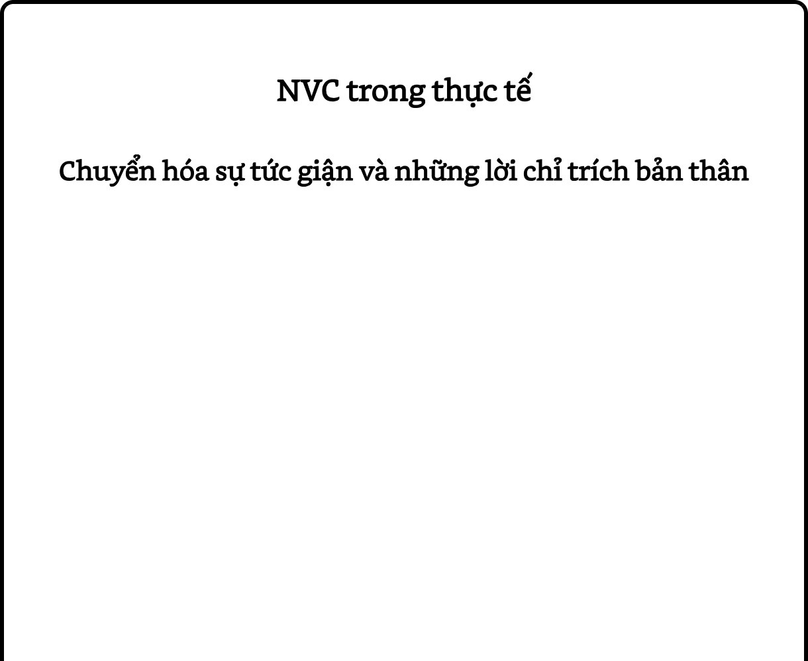

# Chương 13: Giải phóng bản thân và hỗ trợ người khác
### Giải phóng bản thân khỏi những niềm tin và khuôn mẫu thói quen cũ

Tất cả chúng ta đều đã được dạy những niềm tin và khuôn mẫu thói quen gây Trải qua nhiều thế hệ, thậm chí nhiều thế kỷ, phần lớn những niềm tin và khuôn mẫu thói quen do xã hội áp đặt này đã ăn sâu vào cuộc sống của chúng ta đến nỗi chúng ta không còn ý thức về sự hiện diện của chúng. Điều này giống như việc diễn viên hài Buddy Hackett, người . Do đó, chúng ta cần rất nhiều sự nhận thức và nỗ lực để nhận ra những niềm tin và khuôn mẫu thói quen này; rồi chuyển hóa chúng thành những suy nghĩ và hành vi có ích đối với cuộc đời mình.

Sự chuyển hóa này đòi hỏi chúng ta kết nối với những nhu cầu của chính mình, điều không phải là dễ đối với nhiều người. Nền văn hóa của chúng ta không chỉ không dạy chúng ta về những nhu cầu của mình, mà còn cản trở chúng ta nhận thức về chúng. Như đã nói ở Chương 2, ngôn ngữ mà chúng ta đang thừa hưởng có mục đích để phục vụ những người nắm giữ quyền lực như vua chúa và quý tộc trong những xã hội có sự thống trị thời xa xưa. Trong những xã hội này, người ta được dạy thứ ngôn ngữ để biến họ trở thành những người ngoan ngoãn và dễ bảo, và những người bày tỏ nhu cầu của mình thì bị chỉ trích là “ích kỷ” và “đòi hỏi” (trong tiếng Anh, từ “đòi hỏi / needy” xuất phát từ từ “nhu cầu / need”).

Bằng cách khuyến khích chúng ta phân biệt giữa “quan sát” và “đánh giá”, nhận ra những suy nghĩ hoặc nhu cầu đằng sau những cảm xúc của mình, và đưa ra đề nghị bằng “ngôn ngữ hành động” rõ ràng, NVC giúp chúng ta nâng cao khả năng ý thức về những niềm tin và khuôn mẫu thói quen do xã hội áp đặt lên mình. Và việc ý thức về chúng là một bước quan trọng để phá vỡ sự ảnh hưởng của chúng lên chúng ta.

## Giải quyết những xung đột bên trong

NVC có thể giúp chúng ta giải quyết những xung đột bên trong chính mình. Trong cuốn sách *The* *Revolution in Psychiatry* (tạm dịch: *Cuộc cách mạng* *trong tâm thần học*), tác giả Ernest Becker viết rằng những xung đột bên trong này thường là nguyên nhân của sự trầm cảm. Điều này là bởi khi chúng ta bị mắc kẹt trong một cuộc đối thoại bao gồm những “giọng nói” phán xét và mâu thuẫn với nhau trong tâm trí, chúng ta không nhận ra những nhu cầu của mình và do đó không thể nhìn thấy những sự lựa chọn để đáp ứng chúng. Sự trầm cảm cho thấy chúng ta đang bị ngắt kết nối với những nhu cầu của chính mình.

Lần nọ, có một người phụ nữ bị trầm cảm đến gặp tôi. Tôi yêu cầu cô ấy xác định những “giọng nói” mâu thuẫn với nhau bên trong mình và viết chúng ra thành một cuộc đối thoại như thể chúng đang nói chuyện với nhau. Đây là hai dòng đầu tiên trong “cuộc đối thoại” đó:

> **Chúng ta có thể giải phóng bản thân khỏi những niềm tin và khuôn mẫu thói quen do xã hội áp đặt lên mình.**

Giọng nói 1 (“người phụ nữ của sự nghiệp”): Tôi nên làm nhiều thứ hơn trong cuộc đời mình. Tôi đang lãng phí kiến thức và tài năng của mình.

Giọng nói 2 (“người mẹ có trách nhiệm”): Bạn đang thiếu thực tế. Bạn là mẹ của hai đứa trẻ. Nếu bạn chưa làm tròn được trách nhiệm đó thì sao có thể đảm nhận thêm việc khác?

Bạn có thể thấy hai câu nói trên chứa đầy những từ ngữ đánh giá và phán xét, chẳng hạn như “nên”, “lãng phí”, “thiếu thực tế”, “chưa làm tròn trách nhiệm.” Những biến thể của cuộc đối thoại này đã diễn ra trong tâm trí người phụ nữ này trong nhiều tháng. Tôi đề nghị cô ấy tưởng tượng “người phụ nữ của sự nghiệp” uống một “viên thuốc NVC” để diễn đạt lại câu nói: “Tôi nên làm nhiều thứ hơn trong cuộc đời mình. Tôi đang lãng phí kiến thức và tài năng của mình.” dưới dạng: “Khi..., tôi cảm thấy... vì tôi có nhu cầu... Do đó, bây giờ tôi muốn...”

Cô ấy đáp: “*Khi* tôi dành phần lớn thời gian cho con cái và không được làm công việc mà mình yêu thích, *tôi cảm thấy* chán nản và thất vọng *vì tôi có* *nhu cầu* về sự thành tựu trong sự nghiệp. *Do đó, bây* *giờ tôi muốn* tìm một công việc bán thời gian trong chuyên môn của mình.”

> **Khả năng lắng nghe những cảm xúc và nhu cầu của chính mình và đồng cảm với chúng có thể giải phóng chúng ta khỏi sự trầm cảm.**

Sau đó, tôi yêu cầu cô ấy làm điều tương tự đối với câu nói của “người mẹ có trách nhiệm”: “Bạn đang thiếu thực tế. Bạn là mẹ của hai đứa trẻ. Nếu bạn chưa làm tròn được trách nhiệm đó thì sao có thể đảm nhận thêm việc khác?” Cô ấy đáp: “*Khi* tôi tưởng tượng mình đi làm, *tôi cảm thấy* lo sợ *vì tôi có nhu* *cầu* đảm bảo rằng các con mình sẽ nhận được sự chăm sóc tốt nhất. *Do đó, bây giờ tôi muốn* tìm những dịch vụ trông trẻ có chất lượng để hỗ trợ tôi trong khi tôi đi làm và lập kế hoạch để có đủ thời gian ở bên bọn trẻ khi tôi không mệt mỏi.”

Người phụ nữ này cảm thấy nhẹ nhõm rất nhiều ngay khi cô ấy dịch những “giọng nói” phán xét và mâu thuẫn với nhau trong tâm trí mình sang ngôn ngữ NVC. Cô ấy đã có thể hiểu những nhu cầu đằng sau chúng và trao cho bản thân sự đồng cảm. Mặc dù cô ấy vẫn phải đối mặt với những thách thức, chẳng hạn như đảm bảo dịch vụ trông trẻ có chất lượng tốt, cô ấy không còn trở nên bất lực và trầm cảm khi có sự xung đột xảy ra bên trong mình.

## Nuôi dưỡng sự bình an trong tâm trí

Khi chúng ta bị mắc kẹt trong những suy nghĩ phán xét và chỉ trích, việc tạo ra một môi trường bên trong lành mạnh trở nên thật khó khăn. NVC giúp chúng ta nuôi dưỡng được nhiều sự bình an trong tâm trí hơn bằng cách khuyến khích chúng ta tập trung vào điều mình thực sự muốn thay vì vào những lỗi sai của bản thân hoặc của người khác.

Lần nọ, trong một chương trình NVC kéo dài ba ngày, một học viên chia sẻ sự hiểu biết sâu sắc của mình. Vào rạng sáng ngày học thứ hai, cô ấy tỉnh giấc với một trong những cơn đau đầu tồi tệ nhất mà mình từng có. Cô ấy chia sẻ: “Bình thường, điều đầu tiên tôi làm sẽ là chỉ trích bản thân. Mình đã *không nên* ăn thứ đó. Mình đã *nên* để bản thân được nghỉ ngơi. Lẽ ra mình *không nên* làm điều này; lẽ ra mình *nên* làm điều kia. Nhưng kể từ khi học NVC, thay vì làm như vậy, tôi đã tự hỏi: “Vào lúc này, cơ thể mình cần gì?”

> **Tập trung vào điều mình thực sự muốn, thay vì vào những lỗi sai của bản thân hoặc của người khác.**

“Tôi ngồi dậy và xoay cổ thật chậm rãi, sau đó đứng dậy, đi vòng quanh và làm những thứ khác để chăm sóc bản thân. Cơn đau đầu giảm xuống đến mức tôi có thể đi đến lớp học. Khi tôi trao sự đồng cảm cho cơn đau đầu, tôi nhận ra mình đã không trao đủ sự chú ý cho bản thân vào ngày hôm trước, và cơn đau đầu đã đến để nói với tôi rằng: “Tôi cần chú ý đến bản thân hơn.” Tôi đã làm theo thông điệp đó và có thể tham dự toàn bộ chương trình. Tôi đã thường xuyên bị đau đầu trong cả cuộc đời mình, và đây là một sự chuyển biến rất quan trọng đối với tôi.”

Trong một chương trình khác, một học viên hỏi NVC có thể giúp giải phóng chúng ta khỏi những suy nghĩ tức giận khi lái xe trên đường như thế nào. Đây là một chủ đề quen thuộc với tôi! Trong nhiều năm, nếu ai đó lái xe không đúng với tiêu chuẩn của tôi, thì tôi sẽ lập tức xem họ là “kẻ thù không đội trời chung.” Tâm trí tôi phun ra hàng loạt những suy nghĩ chỉ trích: “Thằng cha này bị gì vậy? Hắn không nhìn đường sao?” Với trạng thái tâm trí đó, tất cả những gì tôi muốn làm là trừng phạt người kia, và vì tôi không thể làm điều đó, nên sự tức giận bị tích tụ trong cơ thể tôi và gây ra những ảnh hưởng tiêu cực.

> **Xoa dịu sự căng thẳng bằng cách lắng nghe những cảm xúc và nhu cầu của chính mình.**

> **Xoa dịu sự căng thẳng bằng cách đồng cảm với người khác.**

Cuối cùng, tôi cũng học được cách diễn đạt lại những sự phán xét của mình dưới dạng những cảm xúc, nhu cầu và trao cho bản thân sự đồng cảm: “Mình sợ chết khiếp khi người ta lái xe như vậy. Mình thực sự mong họ có thể nhìn ấy sự nguy hiểm của việc họ làm!” Phù! Tôi ngạc nhiên khi nhận ra mình cảm thấy ít căng thẳng hơn nhiều chỉ bằng cách lắng nghe về những cảm xúc và nhu cầu của bản thân thay vì chỉ trích người khác.

Sau đó, tôi cũng thực hành đồng cảm với những người lái xe khác và được hưởng lợi từ việc làm đó. Lần nọ, xe tôi bị mắc kẹt sau một chiếc xe chạy chậm hơn rất nhiều so với tốc độ quy định và cứ dừng lại mỗi khi đến một ngã ba. Trong lúc bực bội càu nhàu: “Chẳng thể nào lái được!”, tôi nhận ra sự căng thẳng mà tôi đang tự tạo ra cho chính mình. Do đó, tôi dừng lại và chuyển sự chú ý sang những cảm xúc và nhu cầu của người lái xe kia. Tôi đoán người đó đang lạc đường, cảm thấy bối rối và mong những người lái xe khác kiên nhẫn một chút. Lát sau, khi đã có thể lái xe vượt lên, tôi mới thấy đó là một bà già – chắc phải ngoài 80 tuổi – với vẻ mặt hoảng sợ. Tôi cảm thấy vui vì mình đã thực hành đồng cảm, thay vì bấm còi inh ỏi hoặc làm những việc theo thói quen khác để thể hiện sự bất mãn đối với những người có cách lái xe mà tôi không thích.

## Thay thế sự chẩn đoán bằng NVC

Nhiều năm trước, sau khi đầu tư chín năm cuộc đời vào việc học tập và đạt những bằng cấp để trở thành một nhà trị liệu tâm lý, tôi tình cờ xem cuộc đối thoại giữa triết gia người Israel Martin Buber, và nhà tâm lý học người Mỹ Carl Rogers. Vào thời điểm đó, Buber đến nước Mỹ và được mời tham gia một cuộc thảo luận cùng Carl Rogers tại một bệnh viện tâm thần trước một nhóm các chuyên gia sức khỏe tâm thần.

Trong cuộc đối thoại này, Buber đặt câu hỏi liệu có bất kỳ ai có thể thực sự trị liệu tâm lý cho người khác trong vai trò là một nhà trị liệu tâm lý không. Ông cho rằng sự phát triển của con người xảy ra thông qua việc hai cá nhân gặp nhau và chia sẻ với nhau một cách chân thật và cởi mở, thứ mà ông gọi là “mối quan hệ không ranh giới.” Ông không tin rằng sự chân thật này có thể tồn tại khi người ta gặp nhau trong vai trò là một “nhà trị liệu tâm lý” và một “bệnh nhân”. Rogers đồng ý rằng sự chân thật là điều kiện tiên quyết của sự phát triển. Tuy nhiên, ông cũng nói rằng những nhà trị liệu tâm lý giỏi có thể vượt lên trên vai trò của mình và gặp gỡ bệnh nhân với sự chân thật đó.

Buber tỏ vẻ hoài nghi, nói rằng ngay cả khi những nhà trị liệu tâm lý cam kết tương tác với bệnh nhân bằng sự chân thật và cởi mở, những cuộc gặp gỡ như vậy cũng không thể xảy ra chừng nào những bệnh nhân vẫn tiếp tục xem mình là “bệnh nhân” và người kia là một “nhà trị liệu tâm lý”. Ông quan sát thấy rằng quá trình đặt cuộc hẹn để gặp ai đó tại văn phòng của họ và trả tiền để được “chữa bệnh” làm củng cố sự nhìn nhận đó; và cản trở sự phát triển của một mối quan hệ chân thật giữa hai người.

Cuộc đối thoại này đã làm sáng tỏ sự mâu thuẫn trong tư tưởng đã kéo dài của tôi đối với việc “giữ khoảng cách cảm xúc” – một quy tắc bất khả xâm phạm trong trường phái tâm lý trị liệu mà tôi đã được dạy. Trong trường phái này, việc mang những cảm xúc và nhu cầu của mình vào quá trình trị liệu thường được xem là một dấu hiệu của sự thiếu năng lực của nhà trị liệu. Một nhà trị liệu giỏi cần đứng bên ngoài quá trình trị liệu, đóng vai trò như một chiếc gương để bệnh nhân nói ra những suy nghĩ và cảm xúc bên trong mình. Mặc dù hiểu lý thuyết đằng sau việc “giữ khoảng cách cảm xúc”, tôi luôn cảm thấy không thoải mái khi thực hành nó. Hơn nữa, tôi tin vào những lợi ích của việc mang bản thân mình vào quá trình trị liệu.

Do đó, tôi bắt đầu thử nghiệm bằng cách thay thế ngôn ngữ điều trị bằng ngôn ngữ NVC. Thay vì diễn giải những điều khách hàng của mình nói theo những lý thuyết tâm lý mà tôi đã học, tôi hiện diện và lắng nghe họ với sự đồng cảm. Thay vì chẩn đoán họ, tôi mở lòng chia sẻ những điều đang diễn ra bên trong mình. Ban đầu, việc này thật đáng sợ; tôi lo rằng các đồng nghiệp của mình sẽ phản đối. Tuy nhiên, kết quả đạt được lại rất thành công đến nỗi tôi đã sớm vượt qua mọi sự ngần ngại. Ngày nay, sau 35 năm, khái niệm mang bản thân mình một cách đầy đủ vào mối quan hệ *nhà trị liệu - khách hàng* không còn là điều xa lạ. Tôi cũng thường xuyên được mời trình bày về chủ đề này với những nhà trị liệu tâm lý.

> **Thay vì diễn giải những điều khách hàng của mình nói, tôi hiện diện và đồng cảm với họ.**

> **Thay chẩn đoán họ, tôi mở lòng chia sẻ những điều đang diễn ra bên trong mình.**

Lần nọ, tôi được mời trình bày tại Bệnh viện Tâm thần Trung ương. Sau buổi trình bày,  tôi  được  đề nghị  nói chuyện với một bệnh nhân, một người phụ nữ 29 tuổi có ba con, để đưa ra đánh giá và khuyến nghị điều trị. Sau khi nói chuyện với cô ấy trong khoảng nửa tiếng, đội ngũ bác sĩ chịu trách nhiệm cho cô ấy hỏi tôi: “Tiến sĩ Rosenberg, xin đưa ra một chẩn đoán phân biệt. Theo ông, người phụ nữ này bị *tâm thần phân liệt* hay bị *loạn* *thần do rượu*”?

Tôi nói rằng tôi cảm thấy không thoải mái với những câu hỏi như vậy. Ngay cả khi từng làm việc trong một bệnh viện tâm thần trong quá trình học tập, tôi cũng không bao giờ cảm thấy chắc chắn khi chẩn đoán con người dựa trên sự phân loại của những căn bệnh. Tôi cũng từng đọc các nghiên cứu chỉ ra sự bất đồng quan điểm giữa những nhà tâm thần học và những nhà tâm lý học về những sự phân loại này. Các nghiên cứu kết luận rằng sự chẩn đoán bệnh nhân trong những bệnh viện tâm thần phụ thuộc phần nhiều vào trường phái trị liệu mà người bác sĩ tâm thần đã theo học, hơn là vào những đặc điểm của chính bệnh nhân.

Do đó, tôi tiếp tục chia sẻ, ngay cả khi việc đưa ra chẩn đoán dựa trên những thuật ngữ bệnh lý là phổ biến, tôi vẫn không muốn làm như vậy vì không thấy nó mang lại lợi ích cho bệnh nhân. Đối với những căn bệnh thể chất, việc xác định tên bệnh cụ thể thường cho ra một hướng điều trị rõ ràng và hiệu quả; nhưng đối với những căn bệnh tâm thần, tôi không nhìn thấy mối quan hệ đó. Theo quan sát của tôi, tại các bệnh viện tâm thần, trong những cuộc họp thảo luận về các ca bệnh, đội ngũ bác sĩ dành phần lớn thời gian để tranh luận với nhau nhằm đưa ra chẩn đoán; nhưng trong nhiều trường hợp, họ không đạt được sự nhất trí và trở nên bế tắc.

Cuối cùng, tôi giải thích với đội ngũ bác sĩ rằng NVC thôi thúc tôi tự hỏi mình những câu hỏi sau thay vì suy nghĩ xem bệnh nhân của mình có vấn đề gì: “Người này đang có những cảm xúc và nhu cầu gì? Tôi đang có những cảm xúc và nhu cầu gì liên quan đến người này? Tôi muốn đề nghị người này thực hiện hành động nào mà tôi tin rằng nó sẽ giúp họ sống hạnh phúc hơn?” Tôi tin rằng với những câu hỏi này, chúng ta sẽ trở nên chân thật và có thể giúp ích cho người khác nhiều hơn so với việc chúng ta đơn thuần chẩn đoán họ.

Một lần khác, tôi được đề nghị miêu tả cách mà NVC có thể được dạy cho những người được chẩn đoán “tâm thần phân liệt mãn tính”. Với sự quan sát của khoảng 80 các nhà tâm lý học, bác sĩ tâm thần, người làm công tác xã hội và y tá, tôi ngồi trên sân khấu cùng 15 bệnh nhân được chẩn đoán như trên. Khi tôi đang giới thiệu bản thân và giải thích mục đích của NVC, một trong các bệnh nhân bỗng nói những lời có vẻ không liên quan đến những điều tôi đang nói. Nhớ rằng bệnh nhân này đã được chẩn đoán “tâm thần phân liệt mãn tính”, trong khoảnh khắc đó, tôi đã tin vào sự chẩn đoán ấy và cho rằng sự việc là do anh ấy “thiếu khả năng nắm bắt vấn đề”. Tôi nói: “Có vẻ anh gặp khó khăn trong việc theo dõi những điều tôi nói.”

Vào lúc đó, một bệnh nhân khác lên tiếng: “Tôi hiểu điều anh ấy nói.” rồi giải thích sự liên quan giữa những lời nói của bệnh nhân đầu tiên và đoạn giới thiệu của tôi. Nhận ra người đàn ông này không hề “thiếu khả năng nắm bắt vấn đề”, mà chính tôi mới là người không nắm bắt được sự kết nối giữa những suy nghĩ của chúng tôi, tôi cảm thấy hối hận và thất vọng vì đã tin vào sự chẩn đoán và quy trách nhiệm cho anh ấy. Thay vì làm như vậy, tôi muốn tôi đã chịu trách nhiệm cho những cảm xúc của chính mình, chẳng hạn như bằng cách nói: “Tôi cảm thấy bối rối. Tôi muốn nhìn thấy mối liên kết giữa những điều tôi nói và lời đáp của anh, nhưng tôi không nhìn thấy. Anh có thể giải thích cho tôi không?”

Ngoại trừ sự trục trặc ban đầu đó, phần còn lại của phiên làm việc diễn ra thành công tốt đẹp. Ấn tượng với sự phản ứng của các bệnh nhân, một khán giả hỏi rằng điều gì đã giúp họ hợp tác tốt đến thế. Tôi trả lời rằng khi tôi tránh việc chẩn đoán người khác và thay vào đó duy trì sự kết nối với những cảm xúc và nhu cầu đang tồn tại bên trong họ và bên trong chính mình, người ta thường sẽ đáp lại một cách tích cực.

Sau đó, một vài khán giả khác đề nghị thực hiện một phiên làm việc tương tự để họ có thêm cơ hội học tập. Lần này, các bệnh nhân xuống sân khấu làm khán giả, và một vài người làm khán giả khi nãy tình nguyện lên sâu khấu. Trong quá trình giảng giải, tôi gặp khó khăn trong việc giúp một bác sĩ tâm thần hiểu rõ sự khác nhau giữa sự hiểu biết về mặt lý trí và sự đồng cảm của NVC. Bất kỳ khi nào một ai đó trong nhóm bày tỏ một cảm xúc, anh ấy sẽ đưa ra những lý thuyết tâm lý đằng sau cảm xúc đó thay vì thể hiện sự đồng cảm. Khi điều này xảy ra đến lần thứ ba, một trong các bệnh nhân đang ngồi hàng ghế khán giả la lớn: “Anh không thấy mình lại làm như vậy sao? Anh đang diễn giải những điều cô ấy nói thay vì đồng cảm với cô ấy!”

Tóm lại, bằng cách áp dụng sự nhận thức và các kỹ năng của NVC, chúng ta có thể hỗ trợ người khác trong những mối quan hệ chân thành, cởi mở và kết nối, thay vì những mối quan hệ công việc dựa trên sự chẩn đoán và xa cách cảm xúc.

## Tổng kết

Với NVC, chúng ta có thể thoát khỏi sự trầm cảm bằng cách nhận ra những cảm xúc và nhu cầu đằng sau những thông điệp tiêu cực bên trong và đồng cảm với chúng. NVC cũng giúp chúng ta nuôi dưỡng được nhiều sự bình an trong tâm trí hơn bằng cách khuyến khích chúng ta tập trung vào điều mình thực sự muốn thay vì vào những lỗi sai của bản thân hoặc của người khác. Những người làm nghề tư vấn hoặc trị liệu tâm lý cũng có thể sử dụng NVC để tạo ra những mối quan hệ chân thành, cởi mở và kết nối với khách hàng của mình.

*Một học viên NVC chia sẻ câu chuyện sau đây:*

Sau khi hoàn thành khóa học NVC, tôi trở về nhà và gặp một người bạn mà mình đã không gặp trong hai năm. Cô ấy tên là Iris và làm thủ thư tại một trường học đã 25 năm. Lần đầu tiên tôi gặp Iris là sáu năm trước, trong một chuyến đi khám phá rừng rậm và leo dãy núi Rockie ở bang Colorado (Mỹ) trong hai tuần. Sau khi nghe tôi hăng hái chia sẻ về NVC, Iris thổ lộ rằng cô ấy vẫn còn cảm thấy tổn thương từ những điều mà Leav, người thủ lĩnh của chuyến đi ở Colorado, đã nói với mình. Tôi vẫn còn nhớ rõ Leav: một người phụ nữ rắn rỏi, đôi bàn tay hằn những vết dây thừng, trèo lên từng bậc núi một cách dứt khoát; cô ấy phân tích phân động vật, hú lên trong đêm tối, nhảy múa bên ngọn lửa, kể những câu chuyện của cuộc đời mình, và mỉm cười vẫy chào tạm biệt chúng tôi lần cuối. Trong chuyến đi ấy, Leav đã đưa ra phản hồi với Iris như sau:

“Iris, chị không thể chịu đựng được những người như em, lúc nào cũng ngọt ngào và dễ thương, luôn là cô thủ thư ngoan hiền và yếu đuối. Sao em không bỏ những thứ đó đi và trở nên mạnh mẽ hơn?”

*Trong sáu năm qua, Iris đã nghe thấy giọng nói* *của Leav văng vẳng trong đầu mình, và trong* *sáu năm qua, cô ấy đã trả lời Leav trong đầu* *mình. Cả hai chúng tôi đều muốn xem NVC có* *thể giúp ích như thế nào trong tình huống này.* *Tôi đóng vai Leav và lặp lại câu nói trên với Iris:*

**Tôi:** (*trong vai Leav*) - Iris, chị không thể chịu đựng được những người như em, lúc nào cũng ngọt ngào và dễ thương, luôn là cô thủ thư ngoan hiền và yếu đuối. Sao em không bỏ những thứ đó đi và trở nên mạnh mẽ hơn?

Iris: (*quên mất NVC và nghe thấy sự chỉ trích và* *xúc phạm*) Chị không có quyền nói như thế với em. Chị không biết em là ai hay em là loại thủ thư nào. Em làm công việc của mình một cách nghiêm túc, và cho chị biết, em xem mình là một nhà giáo dục, như mọi giáo viên khác...

**Tôi:** (*trong vai Leav, bày tỏ sự đồng cảm*) Có phải em tức giận vì muốn chị hiểu rõ về em trước khi đưa ra lời phán xét?

Iris: Đúng! Chị đâu biết em đã phải đánh đổi những gì để đăng ký chuyến đi này. Nhìn đi! Em ở đây, hoàn thành nó rồi, chẳng phải sao? Em đã đối mặt và vượt qua mọi thử thách!

**Tôi:** Có phải em cảm thấy tổn thương và muốn được ghi nhận cho sự dũng cảm và những nỗ lực của mình?

*Tôi tiếp tục trao sự đồng cảm cho Iris thêm* *một vài lần như vậy nữa và nhận thấy có một* *sự chuyển đổi bên trong cô ấy. Những sự* *chuyển đổi như vậy, xảy ra khi người ta cảm* *thấy được thấu hiểu, có thể được quan sát trên* *cơ thể, chẳng hạn như họ trở nên thư giãn và* *hít thở sâu hơn. Điều này thường cho thấy họ* *đã nhận đủ sự đồng cảm cho nỗi đau của mình* *và giờ đây có thể chuyển sự chú ý sang một* *điều gì đó khác. Trong tình huống này với Iris,* *tôi có cảm giác rằng cô ấy cần nhận thêm sự* *đồng cảm cho nỗi đau về một chuyện khác của* *mình trước khi có thể nghe thấy những cảm* *xúc và nhu cầu của Leav. Điều này là bởi trong* *sáu năm qua, cô ấy đã luôn tự dằn vặt mình vì* *đã không đáp lại Leav. Iris xác nhận cảm giác* *này của tôi khi nói:*

Iris: Khỉ thật, lẽ ra tớ nên nói những thứ này với chị ấy sáu năm trước!

**Tôi:** (*là chính mình, bày tỏ sự đồng cảm*) Có phải cậu thất vọng vì muốn mình đã giải thích rõ hơn về bản thân vào lúc đó?

Iris: Tớ thấy mình thật ngu ngốc! Tớ biết mình không phải là “cô thủ thư ngoan hiền và yếu đuối”, nhưng tại sao tớ lại không nói điều đó với chị ấy?

**Tôi:** Có phải cậu muốn mình đã kết nối với bản thân nhiều hơn để nói ra điều đó?

Iris: Ừ. Tớ cảm thấy giận chính mình. Tớ ước gì tớ đã không để chị ấy xúc phạm mình.

**Tôi:** Có phải cậu muốn mình đã quyết đoán hơn?

Iris: Đúng. Tớ muốn lần sau tớ có thể nhớ rằng tớ có quyền đứng lên để bảo vệ chính mình.

*Iris im lặng một lúc rồi bày tỏ sự sẵn sàng để* *lắng nghe lời nói của Leav theo một cách khác.*

**Tôi:** (*trong vai Leav*) - Iris, chị không thể chịu đựng được những người như em, lúc nào cũng ngọt ngào và dễ thương, luôn là cô thủ thư ngoan hiền và yếu đuối. Sao em không bỏ những thứ đó đi và trở nên mạnh mẽ hơn?

Iris: (*lắng nghe những cảm xúc và nhu cầu của* *Leav*) Leav, có phải chị khó chịu khó chịu vì... vì em là người...

*Lúc này, Iris nhận ra mình mắc một lỗi thường* *gặp: cô ấy đang chịu trách nhiệm cho cảm xúc* *của Leav thay vì kết nối với nhu cầu của Leav.* *Để kết nối với nhu cầu của Leav, cô ấy cần thay* *những từ “vì em là người...” bằng “vì chị muốn...”*

Iris: (*thử lại lần nữa*) Leav, có phải chị khó chịu vì chị muốn... ừm... vì chị muốn..

*Vì đã đóng vai Leav một cách nhập tâm từ nãy* *đến giờ, tôi bỗng nhận ra nhu cầu thực sự của cô* *ấy:*

**Tôi:** (*trong vai Leav*) - Sự kết nối! Đó là điều chị muốn! Chị muốn cảm thấy kết nối với em, Iris! Và chị khó chịu vì chị thấy giữa chị em mình có những bức tường ngăn cách. Chị muốn dỡ bỏ hết những rào cản đó đi để có thể chạm đến em!

Chúng tôi ngồi im lặng bên nhau một lúc rồi Iris xúc động nói: “Nếu tớ biết sự kết nối là tất cả những gì chị ấy muốn... nếu chị ấy có thể nói với tớ điều đó...trời ơi, ý tớ là... điều đó thật ấm áp.” Mặc dù có lẽ không bao giờ tìm lại được Leav để xác nhận chuyện này, cô ấy cảm thấy nỗi đau dai dẳng suốt mấy năm qua bên trong mình đã được chữa lành. Hơn nữa, với sự nhận thức mới, cô ấy cũng thấy việc tiếp nhận những lời nói khó nghe của người khác.

> *. Càng có nhiều lòng biết ơn, bạn càng ít trở thành* *nạn nhân của* *sự oán giận, tuyệt vọng và trầm cảm. Như một liều* *thuốc tiên, lòng biết ơn dần dần làm tan rã lớp vỏ* *cứng của bản ngã – nhu cầu chiếm hữu và kiểm soát* *của chúng ta – và biến chúng ta trở thành những con* *người hào phóng. Lòng biết ơn là nhân tố cốt lõi trong* *quá trình chuyển hóa tâm hồn, giúp tâm hồn chúng ta* *trở nên cao thượng và to lớn.*

Sam Keen, triết gia –
