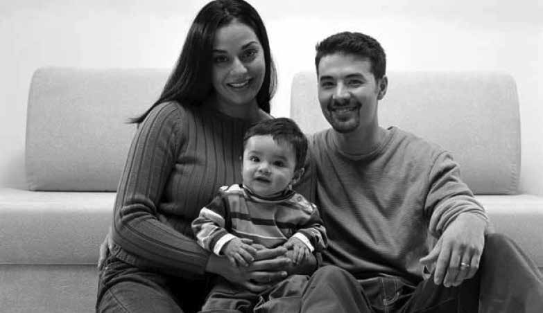
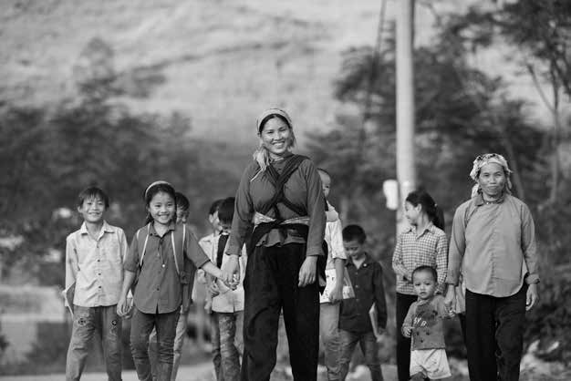

# LỜI GIỚI THIỆU

Làm cha mẹ là một cuộc hành trình xen lẫn niềm hân hoan, sự bực bội và cảm giác vui sướng cũng như mệt mỏi. Sinh con, nuôi dưỡng con trưởng thành và dạy con tất cả những điều con cần để con có một cuộc sống hạnh phúc và thành công quả là một thách thức rất lớn.

Trong cuộc sống đôi khi các bậc làm cha, làm mẹ phải đối mặt với những thách thức quá lớn và họ không biết phải làm gì. Có lúc dường như tất cả những gì chúng ta làm đều không hiệu quả. Cũng có những thời khắc chúng ta vượt qua được tất cả những áp lực trong cuộc sống.

Hầu hết chúng ta đều học làm cha mẹ thông qua trải nghiệm thực tế. Chúng ta có ít thông tin về sự phát triển của trẻ vì thế chúng ta chỉ dựa vào bản năng hay là các trải nghiệm tuổi thơ của chính chúng ta. Nhưng nhiều khi bản năng của chúng ta thật sự chỉ là các phản ứng cảm xúc không được cân nhắc kỹ lưỡng. Và cũng có khi các trải nghiệm từ thời thơ ấu của chúng ta là những điều tiêu cực hoặc thậm chí là bạo lực.

Kết quả là, nhiều bậc cha mẹ nghĩ rằng kỷ luật chính là quát tháo và đánh đập. Một số người cảm thấy tồi tệ về việc mất bình tĩnh của mình, số khác thì cảm thấy vô vọng.

Nhưng ở đây có một cách khác. Kỷ luật thật sự có nghĩa là giảng dạy. Giảng dạy dựa trên việc thiết lập những mục tiêu cho việc học tập, việc lập kế hoạch và tìm giải pháp tiếp cận hiệu quả.

Công ước về Quyền trẻ em đảm bảo rằng việc bảo vệ trẻ em khỏi tất cả các hình thức bạo lực bao gồm trừng phạt thân thể và công nhận các quyền được tôn trọng và có phẩm cách của trẻ em.

Kỷ luật tích cực là không bạo lực và tôn trọng trẻ em như một người học. Nó là một *phương pháp giảng dạy* để giúp trẻ thành công, cung cấp cho trẻ thông tin và hỗ trợ sự phát triển của trẻ.

Trẻ em có quyền được bảo vệ khỏi mọi hình thức bạo lực.

> *Điều 19: Công ước Liên Hợp Quốc về Quyền Trẻ em*

Tài liệu này dựa trên kết quả nghiên cứu trong nhiều thập kỷ, dạy cho chúng ta về quá trình trẻ phát triển và phương pháp nuôi dưỡng con hiệu quả. Phương pháp trình bày trong tài liệu được dựa trên những nghiên cứu đó.

Kỷ luật tích cực là:

Không bạo lực Chú trọng vào việc giải quyết vấn đề

Tôn trọng Dựa trên các nguyên tắc phát triển của trẻ

Kỷ luật tích cực cung cấp nền tảng cho các bậc cha mẹ. Đó là bộ các nguyên tắc có thể áp dụng trong các tình huống khác nhau. Trên thực tế, đây là một bộ nguyên tắc có thể hướng dẫn tất cả những tương tác của bạn với trẻ, chứ không chỉ là những thách thức.

Công ước về Quyền Trẻ em công nhận rằng, cha mẹ có quyền được trợ giúp trong việc thực hiện vai trò quan trọng của họ. Tài liệu này nhằm cung cấp thông tin và hỗ trợ cha mẹ học cách để xây dựng kỷ luật cho con của họ mà không dùng đến bạo lực.

Cha mẹ có quyền được hỗ trợ và giúp đỡ trong việc nuôi dưỡng con.

> *Điều 18 và 19: Công ước Liên Hợp Quốc về Quyền Trẻ em*

**Kỷ luật tích cực đã kết hợp các vấn đề dưới đây: những điều chúng ta biết về sự phát triển lành mạnh của trẻ; các phát hiện từ nghiên cứu khoa học về làm cha mẹ hiệu quả và các nguyên tắc về quyền trẻ em.**

Nghiên cứu về sự phát triển lành mạnh của trẻ

**Kỉ luật tích cực**

Các nguyên tắc về quyền trẻ em Nghiên cứu về làm cha mẹ hiệu quả

## Tài liệu này dành cho ai?

Tài liệu này dành cho các bậc cha mẹ có con ở mọi lứa tuổi, chỉ ra các vấn đề chung nảy sinh trong thời kì từ khi mới sinh cho tới hết tuổi thanh niên và chứa đựng các thông tin hữu ích cho mọi gia đình.

Tài liệu này cũng dành cho các ông bố, bà mẹ tương lai. Chuẩn bị trước khi thực sự làm cha mẹ sẽ rất hữu ích. Khi chúng ta có kiến thức và được chuẩn bị cho những thách thức thì chúng ta có khả năng xử lý chúng thành công.

Tài liệu này cũng dành cho những người làm công việc hỗ trợ các bậc cha mẹ như: các nhà giáo dục, những người hướng dẫn nhóm cha mẹ, nhân viên hỗ trợ gia đình. Tài liệu có thể được sử dụng cho các cá nhân hay các nhóm để thảo luận và hỗ trợ giải quyết vấn đề.

Một vài đứa trẻ có những thách thức đặc biệt mà không phải là đặc thù ở độ tuổi của chúng, như chứng tự kỷ, rối loạn tập trung, rối loạn hội chứng ngộ độc rượu ở thai nhi (FASD), chậm phát triển và tổn thương não. Nếu hành vi của con bạn nằm trong các trường hợp đặc biệt thì bạn nên tìm sự giúp đỡ và tư vấn càng sớm càng tốt. Tuy thông tin trong tài liệu này rất hữu ích cho mọi gia đình, nhưng bố mẹ của trẻ có những thách thức như vừa nêu nên tìm hiểu thêm hướng dẫn từ các chuyên gia được đào tạo chuyên sâu như bác sỹ và các điều dưỡng viên sức khỏe công cộng.

### Kỷ luật tích cực không phải là:

Kỷ luật tích cực *không phải là* việc làm cha mẹ một cách dễ dãi, tùy ý

Kỷ luật tích cực *không phải là* để trẻ làm bất cứ điều gì trẻ muốn

Kỷ luật tích cực *không phải là* không có các quy tắc, giới hạn hoặc mong đợi.

Kỷ luật tích cực *không phải là* các phản ứng tức thời hoặc các trừng phạt thay thế như tát và đánh.

### Kỷ luật tích cực là:

Kỷ luật tích cực *là* giải pháp dài hạn để phát triển việc tự xây dựng kỷ luật của con bạn.

Kỷ luật tích cực *là* giao tiếp một cách rõ ràng về những kỳ vọng, những nguyên tắc và những giới hạn.

Kỷ luật tích cực *là* xây dựng một mối quan hệ tôn trọng giữa bạn và con.

Kỷ luật tích cực *là* dạy cho con bạn những kỹ năng sống lâu dài.

Kỷ luật tích cực *làm tăng* sự tự tin và khả năng xử lý các tình huống khó khăn trong cuộc sống của con bạn.

Kỷ luật tích cực *là* sự dạy dỗ dựa trên nguyên tắc lịch thiệp, không bạo lực, thấu cảm, tự tôn trọng bản thân và tôn trọng người khác.

## Tài liệu này được kết cấu như thế nào?

Tài liệu này được sắp xếp theo trình tự các bước. Bước tiếp theo được xây dựng trên cơ sở các bước trước đó. Do đó, tài liệu sẽ hữu ích nhất khi bạn đọc toàn bộ tài liệu và làm các bài tập.

Khi phát triển kỹ năng về kỷ luật tích cực của bạn, hãy nhớ rằng tất cả chúng ta – cả cha mẹ và con – đều là những người học hỏi. Tất cả chúng ta cùng thử, thất bại, thử lại và cuối cùng sẽ thành công.

Nuôi dạy con không phải là một điểm đến, mà là một cuộc hành trình. Đối với bất kỳ cuộc hành trình nào, cũng cần phải chuẩn bị.

Hãy bắt đầu bằng cách nghĩ về những công cụ mà chúng ta sẽ cần tới để có một hành trình thành công.

Kỷ luật tích cực là *cách tiếp cận* trong thực hành làm cha mẹ.

Đó là cách *tư duy.* Kỷ luật tích cực được xây dựng trên 4 nguyên tắc của việc thực hành làm cha mẹ hiệu quả  – Tập trung vào việc xác định mục tiêu lâu dài – Tạo sự ấm áp và cấu trúc  – Hiểu cách trẻ nghĩ và cảm nhận và Giải quyết vấn đề.

### Các khối xây dựng Kỷ luật tích cực

Giải quyết vấn đề

Hiểu cách trẻ nghĩ và cảm nhận

Tạo sự ấm áp Tạo cấu trúc

Xác định mục tiêu lâu dài

Mỗi chương trong 4 chương tiếp theo của tài liệu này tập trung vào những nguyên tắc trên đây.

Chương 1 giải thích sự khác biệt giữa mục tiêu dài hạn và mục tiêu ngắn hạn trong thực hành làm cha mẹ. Trong chương này, bạn sẽ suy nghĩ về những mục tiêu riêng của mình cho sự phát triển của trẻ.

Chương 2 giải thích về tầm quan trọng của việc tạo sự ấm áp và cấu trúc cho con bạn. Bạn sẽ nghĩ bây giờ làm như thế nào để có thể tạo sự ấm ấp và cấu trúc nhiều hơn.

Chương 3 dẫn bạn qua các giai đoạn phát triển của trẻ em. Chương này cung cấp thông tin về cách suy nghĩ và cảm nhận của trẻ ở các lứa tuổi khác nhau và lý giải cách ứng xử của trẻ.

Chương 4 cung cấp các ví dụ về hành vi điển hình của trẻ ở các độ tuổi khác nhau. Bạn sẽ thực hành giải quyết vấn đề để tìm ra tại sao trẻ lại ứng xử theo các cách như vậy.

Trong Chương 5, bạn sẽ gộp tất cả các thông tin này cùng với nhau. Bạn sẽ đánh giá hiệu quả của các phản ứng đối với những hành vi được mô tả trong chương 4. Bạn sẽ thực hành cách tiếp cận kỷ luật tích cực và đạt được sự hiểu biết toàn vẹn về lý do tại sao kỷ luật tích cực có hiệu quả như vậy.

Khuyến nghị là bạn dần dần đưa các kỹ năng vào thực hành. Điều quan trọng là bạn hiểu được tất cả các nguyên tắc kỷ luật tích cực trước khi thực hiện nó.

Khi bạn tiếp xúc với con, bạn phải nghĩ về những mục tiêu lâu dài của mình, cách bạn tạo cảm giác ấm áp, và thiết lập cấu trúc, lý giải cách ứng xử của con bạn. Dần dần, cách suy nghĩ của bạn sẽ bắt đầu thay đổi. Sau đó với việc thực hành, các kỹ năng của bạn sẽ dần được cải thiện.

Các khối xây dựng Kỷ luật tích cực không chỉ quan trọng trong những năm đầu cuộc sống của con trẻ mà còn rất cần thiết trong suốt sự phát triển của trẻ em.

Ngay cả khi con bạn 20 tuổi, bạn vẫn có thể sử dụng những nguyên tắc này để giúp đỡ các em đưa ra những quyết định, giải quyết vấn đề và tìm cách tiếp cận có tính xây dựng để giải quyết xung đột.
