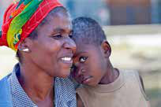
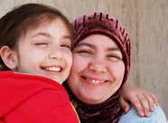
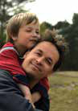

# KỶ LUẬT TÍCH CỰC TRONG THỰC HÀNH LÀM CHA MẸ HÀNG NGÀY

### Joan E. Durrant, Ph.D.

# KỶ LUẬT TÍCH CỰC TRONG THỰC HÀNH LÀM CHA MẸ HÀNG NGÀY

### Joan E. Durrant, Ph.D.

Tổ chức Cứu trợ trẻ em đấu tranh cho quyền của trẻ em.

Chúng tôi mang đến sự cải thiện trước mắt cũng như lâu dài cho cuộc sống của trẻ em trên toàn thế giới.

Tổ chức Cứu trợ trẻ em hoạt động vì một thế giới:

-  Tôn trọng và đánh giá cao mỗi trẻ em

-  Học hỏi và lắng nghe tiếng nói của trẻ em

-  Nơi mà mỗi trẻ em luôn có hy vọng và cơ hội

Tiêu đề:  Kỷ luật tích cực trong thực hành làm cha mẹ hàng ngày (chỉnh sửa lần thứ 4) ISBN: 978-1-927612-04-0

© Tổ chức cứu trợ trẻ em Thụy Điển 2016 Lần đầu tiên xuất bản là Kỷ luật tích cực: Là gì và thực hiện như thế nào? Xuất bản lần đầu năm 2007, Xuất bản lần hai năm 2011, Xuất bản lần ba năm 2013

Bản quyền ảnh thuộc về:

•	 Tổ chức Cứu trợ Trẻ em – Văn phòng đại diện tại Việt Nam ( trang 7, 32, 47,51,72,73, 95,97,99)

-  Uffe Weng  (trang 43)

-  Vinh Prag (trang 44)

-  Stockphoto cho tất cả các trang còn lại

Giám đốc dự án:   Dominique Pierre Plateau Tác giả:   Joan E. Durrant, Ph.D.

Dịch giả: Tiến sĩ Lê Văn Hảo Biên tập: Nguyễn Bảo Chinh và Nguyễn Thu Hằng

Thiết kế:

Keen Media (Thailand) Co. Ltd., 22nd Floor Ocean Tower II, 75/40 Sukhumvit 19 Bangkok 10110, Thailand

Các tài liệu bổ trợ bao gồm cả video có tại www.frp.ca/PositiveDiscipline và tại http://resourcecentre.savethechildren.se/library/positive-discipline-everyday-parenting

# LỜI NÓI ĐẦU

Tài liệu này nhằm trả lời cho Báo cáo về bạo lực đối với trẻ em trên thế giới năm 2006, một nghiên cứu toàn cầu về bạo lực đối với trẻ em của Liên Hợp Quốc.

Nghiên cứu này cho thấy, trẻ em bị bạo lực khắp nơi trên thế giới và nguyên nhân của vấn đề này là do thói quen văn hóa lạc hậu cũng như sự thiếu hiểu biết về quyền con người của trẻ em.

Báo cáo về nạn bạo lực đối với trẻ em trên thế giới đã đưa ra các giải pháp nhằm giảm thiểu bạo lực đối với trẻ em trong mỗi gia đình. Các giải pháp này nhấn mạnh tầm quan trọng của:

- Việc thay đổi các thực hành văn hóa góp phần chống lại nạn

bạo lực đối với trẻ em như loại bỏ các trừng phạt thân thể và tinh thần.

- Tăng cường mối quan hệ và giao tiếp không bạo lực đối với

trẻ em.

- Xây dựng kỹ năng về kỷ luật không bạo lực, cách giải quyết vần

đề và hòa giải xung đột cho các bậc cha mẹ.

- Tôn trọng trẻ em, gia đình, phẩm cách và nhu cầu phát triển

của trẻ.

- Tăng hiểu biết về sự phát triển của trẻ.

- Tăng nhận thức về quyền con người của trẻ em.

*Thông tin chi tiết về Báo cáo bạo lực đối với trẻ em trên thế giới, vui*
*lòng truy cập website: www.violencestudy.org*

**Quyền trẻ em là gì?**

Mọi người đều có quyền cơ bản. Những quyền này áp dụng cho tất cả mọi người không phân biệt chủng tộc, màu da, giới tính, ngôn ngữ, tôn giáo, tư tưởng, nguồn gốc, sự giàu có, hoàn cảnh xuất thân hay khả năng.

Không chỉ người lớn mới có quyền con người – trẻ em cũng có. Nhưng vì trẻ em còn nhỏ và phải sống phụ thuộc vào người lớn cho nên nhiều người lớn không cho rằng trẻ em có đầy đủ các quyền của con người.

Năm 1989, các nhà lãnh đạo thế giới đã phê chuẩn công ước trong đó đề ra các quyền cơ bản của trẻ em. Đảm bảo tất cả mọi người trên thế giới biết rằng, trẻ em cũng có những quyền công dân.

Công ước về Quyền trẻ em đã được phê duyệt ở hầu hết tất cả các nước trên thế giới. Bất kỳ quốc gia nào phê chuẩn hiệp ước này đều phải cam kết bảo đảm rằng quyền của trẻ em luôn luôn được bảo vệ.

Công ước này chỉ ra rằng cha mẹ có vai trò chính trong việc nuôi

dạy con. Cha mẹ là những người thầy, người dẫn dắt và là hình

mẫu lý tưởng quan trọng nhất cho con.

Nhưng cha mẹ không phải chủ sở hữu của con. Các nguyên tắc nhân quyền bảo đảm không ai có thể là tài sản

của ai.

Công ước quyền trẻ em có nội dung như sau:

- Quyền được sống và phát triển đầy đủ các tiềm năng của trẻ:

  - Có thực phẩm, chỗ ở phù hợp và nước sạch

  - Được hưởng sự giáo dục đầy đủ

  - Quyền được chăm sóc sức khỏe

  - Quyền được vui chơi giải trí

  - Quyền được tham gia các hoạt động văn hóa

  - Quyền được biết về các quyền của mình

  - Quyền về nhân phẩm

- Quyền được bảo vệ khi:

  - Bị bạo lực, xâm hại hoặc chăm sóc không đầy đủ

  - Bị bóc lột sức lao động

  - Bị đối xử tàn nhẫn

- Quyền tham gia gồm:

  - Bày tỏ quan điểm và quan điểm được tôn trọng

  - Có tiếng nói trong các vấn đề ảnh hưởng đến trẻ

  - Có quyền cập nhật thông tin

  - Tự do giao lưu với những người khác

Kỷ luật tích cực được dựa trên các quyền của trẻ em để cho trẻ em được phát triển lành mạnh, bảo vệ khỏi bạo lực và tham gia các hoạt động học tập.

Tài liệu này mang đến cho các bậc phụ huynh cách làm thế nào để họ có thể dạy con mình trong khi vẫn tôn trọng các quyền con người của trẻ em.

*Thông tin về Công ước Liên Hợp Quốc về quyền của trẻ em, chi tiết tại*
*website: www.unicef.org/crc.*

# MỤC LỤC

Lời nói đầu iii

Lời giới thiệu 1 Tài liệu này dành cho những ai? 5 Cuốn sách này có kết cấu như thế nào 7

Chương 1: XÁC ĐỊNH MỤC TIÊU LÂU DÀI CỦA BẠN 11

Chương 2: TẠO SỰ ẤM ÁP VÀ CẤU TRÚC 23 Tạo sự ấm áp 24 Tạo cấu trúc 31

Chương 3: HIỂU CÁCH TRẺ NGHĨ VÀ CẢM NHẬN 41 Trẻ từ 0 đến 6 tháng tuổi 43 Trẻ từ 6 đến 12 tháng tuổi 47 Trẻ từ 1 đến 2 tuổi 51 Trẻ từ 2 đến 3 tuổi 59 Trẻ từ 3 đến 5 tuổi 65 Trẻ từ 5 đến 9 tuổi 73 Trẻ từ 10 đến 13 tuổi 101 Trẻ từ 14 đến 18 tuổi 109

Chương 4: GIẢI QUYẾT VẤN ĐỀ 123 Trẻ từ 0 đến 6 tháng tuổi 125 Trẻ từ 6 đến 12 tháng tuổi 131 Trẻ từ 1 đến 2 tuổi 135 Trẻ từ 2 đến 3 tuổi 143 Trẻ từ 3 đến 5 tuổi 147 Trẻ từ 5 đến 9 tuổi 155 Trẻ từ 10 đến 13 tuổi 159 Trẻ từ 14 đến 18 tuổi 161

Chương 5: PHẢN ỨNG BẰNG KỶ LUẬT  TÍCH CỰC 165 Bước 1 – Nhớ lại những mục tiêu của bạn 166 Bước 2 – Tập trung vào sự ấm áp và cấu trúc 168 Bước 3 – Xem xét cách trẻ nghĩ và cảm nhận 170 Bước 4 – Giải quyết vấn đề 171 Bước 5 – Phản ứng bằng kỷ luật tích cực 172 Trẻ từ 0 đến 6 tháng tuổi 173 Trẻ từ 6 đến 12 tháng tuổi 179 Trẻ từ 1 đến 2 tuổi 191 Trẻ từ 2 đến 3 tuổi 213 Trẻ từ 3 đến 5 tuổi 227 Trẻ từ 5 đến 9 tuổi 255 Trẻ từ 10 đến 13 tuổi 267 Trẻ từ 14 đến 18 tuổi 287

THAM KHẢO:

Một số điểm cần biết về trầm cảm sau sinh 178 Một số điểm cần biết liên quan đến việc trẻ khóc 184 Một số điểm cần biết về tâm trạng của cha mẹ 190 Một số điểm cần lưu ý về việc khám phá của trẻ 197 Một số điểm cần biết về việc cha mẹ nổi giận với con 204 Một số lưu ý về cách phản ứng phủ định của trẻ 212 Một số điều bạn nên biết về sự sợ hãi của trẻ 219 Một số điều cần biết về tại sao trẻ ăn vạ 226 Một số điều cần biết về việc đánh/đập/tát trẻ 233 Một số điều cần biết về nguyên tắc chuyển giao 240 Một số điều cần biết về việc phê bình trẻ 247 Một số điều cần biết về sự tức giận của trẻ 273

Kết luận 331 Vài nét về tác giả 333
