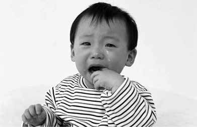
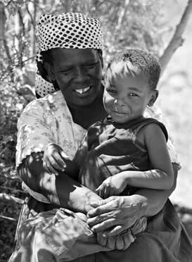
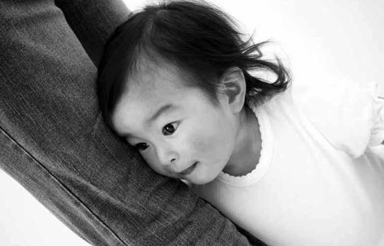
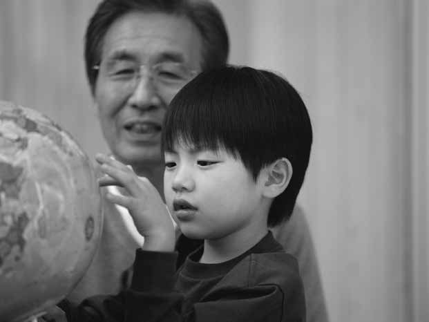
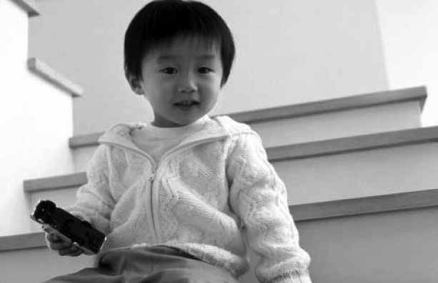
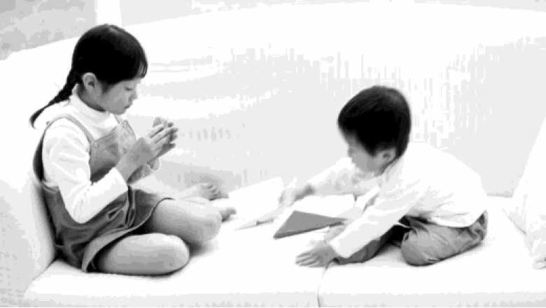
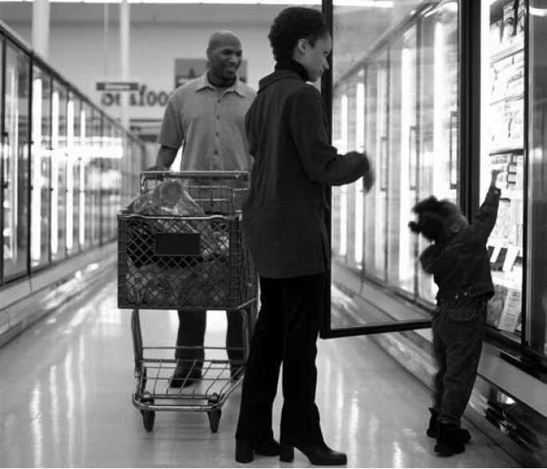
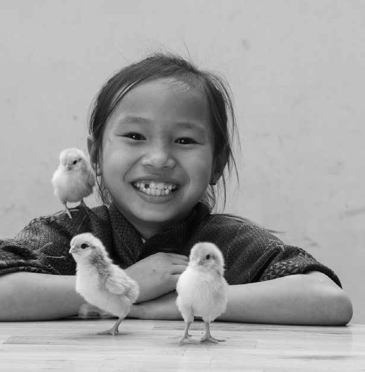
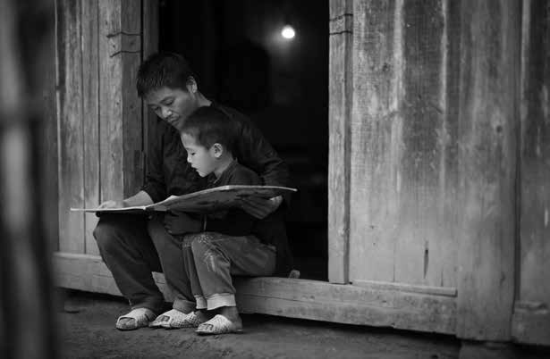

# CHƯƠNG 3: HIỂU CÁCH TRẺ NGHĨ VÀ CẢM NHẬN

Khối thứ 3 của kỷ luật tích cực là việc hiểu trẻ nghĩ và cảm nhận như thế nào.

Khi chúng ta nhìn thế giới thông qua con mắt của trẻ 1 tuổi, 5 tuổi hay 13 tuổi, chúng ta có thể bắt đầu hiểu được hành vi của trẻ. Khi đó chúng ta sẽ trở thành những giáo viên hiệu quả hơn.

Trong chương này, bạn sẽ học được cách làm thế nào đạt được các mục tiêu làm cha mẹ của mình bằng việc tạo nên sự ấm áp và cấu trúc phù hợp với giai đoạn phát triển của trẻ.

Hiểu cách trẻ nghĩ và cảm nhận

Tạo sự ấm áp Tạo cấu trúc

Xác định mục tiêu lâu dài

## Trẻ từ 0 tới 6 tháng tuổi

Trẻ sơ sinh hoàn toàn lạ lẫm với thế giới.

Bé chưa hiểu nhiều về mọi thứ, dễ bị hoảng sợ. Các bé cần biết rằng mình đang được che chở và được bảo vệ an toàn.

Trong giai đoạn này, việc cha mẹ trao cho bé nhiều **sự ấm áp** rất quan trọng.

Cấu trúc chưa thực sự cần thiết trong giai đoạn này. Bé chưa thể hiểu được các nguyên tắc hay những lời giải thích. Các bé chỉ cần biết rằng những nhu cầu của mình sẽ được đáp ứng.

Những trẻ mới sinh chưa biết bất cứ một từ nào. Chúng khóc để cho chúng ta biết chúng cần gì đó. Bé học rất nhanh xem liệu bé có thể tin tưởng ta lắng nghe và đáp ứng hay không.

Điều quan trọng nhất mà cha mẹ có thể làm ở giai đoạn này là đáp lại các nhu cầu của bé và cố gắng hết sức để hiểu những nhu cầu của bé.

Một trong những điều bé cần nhất đó là được ôm ấp, âu yếm, được bồng bế và đu đưa.

Việc âu yếm trẻ sơ sinh của bạn là rất quan trọng đối với mối quan hệ giữa hai người. Nếu bé cảm thấy an toàn khi ở bên bạn, bé cũng sẽ không sợ học những điều mới sau này.

Sự âu yếm cũng quan trọng đối với sự phát triển bộ não của bé. Đu đưa và bồng bế giống như thức ăn của bộ não, xây dựng những kết nối giữa các tế bào não.

Trẻ sơ sinh chưa hiểu được những cảm xúc *của chính mình*. Bé cũng không hiểu được bạn cảm thấy thế nào. Khi bé khóc, bé không cố ý làm cho bạn nổi giận!

Bé thậm chí còn không biết nổi giận là gì! Các bé thậm chí còn không biết tại sao mình khóc! Đôi khi, chính tiếng khóc của các bé lại khiến các bé sợ hãi.

Hãy nhớ rằng việc khóc là bình thường. Thậm chí nếu bé tiếp tục khóc khi bạn đã cố gắng dỗ dành thì cũng là bình thường.

Ở giai đoạn này, điều quan trọng nhất cha mẹ có thể làm là cho bé thấy rằng bé được an toàn. Khi bé cảm thấy an toàn với bạn, bé sẽ phát triển **sự gắn bó** mạnh mẽ với bạn.

Sự gắn bó này sẽ là nền tảng cho mối quan hệ giữa bạn và bé sau này.

Trong giai đoạn này, trẻ bắt đầu học cách sử dụng cơ. Chúng học cách nắm và nhai. Bé rất thích vồ lấy các vật và cho mọi thứ vào miệng.

Nắm và nhai đồ vật giúp bé phát triển các cơ. Qua việc cầm nắm các vật, bé học được cách sử dụng tay và các ngón tay. Qua việc nhai đồ vật, bé rèn luyện được các cơ cần thiết để có thể ăn thức ăn cứng hơn và học nói.

Khi bé vơ đồ trang sức của bạn và cho vào miệng, không phải là bé hư đâu. Bé đang hành động theo bản năng của mình. Bé đang sử dụng cách duy nhất mà bé có để tìm hiểu xem những vật này là gì. Ngoài ra, bé cũng đang rèn luyện các cơ cần thiết.

Ngay khi bé có thể cho được các vật vào miệng, công việc của cha mẹ là đảm bảo không có bất cứ thứ gì ở gần có thể làm hại bé. Nếu bé cho các vật nhỏ vào miệng, bé có thể bị nghẹt thở. Nếu bé cho thuốc hay các chất bẩn vào miệng, bé có thể bị ốm.

Điều đặc biệt quan trọng là trong môi trường của bé, cần phải bỏ đi tất cả các đồ vật có thể gây nguy hiểm nếu bé chạm vào hoặc nhai.

Hãy ghi nhớ rằng bé ở độ tuổi này không hiểu được sự nguy hiểm. Giải pháp tốt nhất đó là đảm bảo cho môi trường xung quanh bé thực sự an toàn. Sau này, khi ngôn ngữ và nhận biết của bé đã phát triển, bạn có thể bắt đầu dạy bé về sự nguy hiểm.

## Trẻ từ 6 tới 12 tháng

Ở độ tuổi này, trẻ thường ít khóc và cười nhiều hơn.

Khi trẻ khóc, có thể là do trẻ sợ bạn sẽ đi mất. Trẻ ở độ tuổi này sẽ nhận ra là bạn đã ra khỏi phòng, nhưng lại chưa hiểu được rằng bạn sẽ quay lại!

Điều này khiến trẻ cảm thấy rất sợ hãi. Trẻ có thể cảm thấy hoàn toàn bất lực.

Một trong những nhiệm vụ quan trọng của bạn trong giai đoạn này là xây dựng **lòng tin** của trẻ vào bạn. Trẻ cần được biết rằng bạn luôn ở gần đó.

Các bé ở tuổi này cũng có thể khóc bởi vì trẻ đang mọc răng. Mọc răng thường khiến trẻ bị đau nhưng trẻ chưa thể nói với bạn điều đó.

Bị ốm cũng là một lý do khiến trẻ khóc trong giai đoạn này. Chưa nói được nên trẻ không thể nói cho bạn biết những khi trẻ cảm thấy ốm yếu.

Các bé không biết làm thế nào để nói với bạn rằng chúng bị sốt, đau đầu, đau bụng, viêm họng hay buồn nôn. Chúng chỉ có thể khóc.

Một lý do khác khiến trẻ thường khóc đó là do bộ não của trẻ đã bắt đầu được tổ chức.

Việc trẻ khóc vào cùng thời điểm mỗi buổi tối là một hiện tượng bình thường. Đây là một tín hiệu cho thấy cơ thể và bộ não của trẻ đang phát triển theo một nhịp điệu nhất định. Khóc là một phần của tiến trình này.

Tuy nhiên, trẻ chưa hiểu được chuyện gì đang xảy ra với mình. Biết bạn đang ở gần khi trẻ trải qua các cảm giác đi cùng với tiếng khóc sẽ giúp trẻ.

> Trẻ em có quyền được chăm sóc và hướng dẫn phù hợp với năng lực phát triển của các em.
> *Điều 5: Công ước Liên hợp quốc về Quyền Trẻ em*

Một trong những điều thú vị nhất nảy sinh trong giai đoạn này đó là trẻ bắt đầu học nói. Đầu tiên trẻ bập bẹ. Trẻ có thể phát ra những tiếng như ba hoặc da hay ma.

Trẻ học các âm thanh ngôn ngữ bản địa của mình khi bố mẹ đáp lại các tiếng bập bẹ của trẻ. Khi trẻ nói ba, bạn có thể nói ba ba ba lại với bé.

Khi bạn đáp lại những tiếng bập bẹ của trẻ, trẻ sẽ học được rằng ba là một âm thanh quan trọng và bắt đầu thực hành âm thanh đó. Chẳng bao lâu những âm thanh đó sẽ phát triển thành từ ngữ.

Trẻ cũng học được rằng khi trẻ nói, bạn sẽ nghe và đáp lại.

Đáp lại những tiếng bập bẹ của trẻ và những từ đầu tiên trẻ học được sẽ khuyến khích một trong những khối xây dựng của mối quan hệ  – **giao tiếp** quan trọng nhất giữa bạn và trẻ.

Ở giai đoạn ban đầu này, bạn có thể giúp trẻ học cách diễn đạt cảm giác của mình. Bạn cũng có thể cho trẻ thấy rằng bạn sẽ nghe những điều trẻ nói và rằng bạn tôn trọng những nỗ lực giao tiếp với bạn của trẻ.

## Trẻ từ 1 đến 2 tuổi

Đây là giai đoạn của những thay đổi thần kỳ!

Trong suốt giai đoạn này, con bạn bắt đầu chập chững biết đi và trẻ có sự bùng nổ ngôn ngữ.

Đi được sẽ làm thay đổi mọi thứ. Lúc này trẻ có thể đi tới bất kỳ chỗ nào trẻ muốn. Trẻ có thể với được những gì trẻ không thể với được trước đó.

Trẻ thích thú với khả năng tự lập mới của mình. Trẻ thích khám phá tất cả ngóc ngách. Trẻ thích chạm và nếm thử mọi thứ.

Đây là một phần trong hành trình khám phá thế giới của trẻ và cũng là cách trẻ cảm nhận thế giới thú vị của riêng mình.

Tất cả trẻ em đều cần khám phá, sờ mó và cảm nhận. Điều này thực sự cần thiết cho sự phát triển bộ não của trẻ.

Khi khám phá, trẻ là một nhà khoa học. Trẻ sẽ làm thí nghiệm để biết được những đồ vật nào sẽ phát ra tiếng ồn, những vật nào rơi, những vật nào nổi. Những thí nghiệm này dạy trẻ về các đồ vật trong thế giới quanh trẻ.

Ví dụ, trẻ sẽ cố ý làm rơi một đồ chơi nhiều lần. Không phải trẻ làm điều này để làm phiền bạn. Trẻ làm như vậy để biết được rơi là gì.

Trẻ sẽ cho tay vào thức ăn để khám phá cấu tạo của thức ăn. Trẻ cho đồ chơi vào miệng để cảm nhận vị của đồ chơi. Trẻ có thể phì thức ăn ra ngoài để biết được nó như thế nào.

Không có hành vi nào trên đây là hư. Đó là nhiệm vụ của trẻ ở giai đoạn khám phá thế giới của mình. Trẻ là một nhà thám hiểm!

Nhiệm vụ của cha mẹ trong thời kỳ này đó là đảm bảo mọi thứ xung quanh an toàn để khám phá. Nếu đứa trẻ lẫm chẫm của bạn có thể khám phá một cách an toàn, trẻ sẽ học được rất nhiều và rất nhanh. Trẻ cũng học được rằng thế giới trẻ đang sống là một nơi an toàn.

Với tất cả các khám phá của mình, con của bạn sẽ học được một số lượng từ mới đáng kinh ngạc một cách nhanh chóng. Trẻ sẽ muốn biết tên của mọi đồ vật mà trẻ nhìn thấy.

Đây chính là một cơ hội tuyệt vời để trao cho trẻ một vốn từ phong phú và niềm yêu thích từ ngữ. Do đó, nhiệm vụ quan trọng của bạn là:

Trò chuyện với trẻ

Đọc truyện cho trẻ

Nghe trẻ nói

Trả lời các thắc mắc của trẻ

Trong suốt giai đoạn này, nhiệm vụ của bạn là nuôi dưỡng **tính tự** **lập** đang phát triển ở con mình

Trẻ cần biết rằng bạn sẽ tôn trọng nhu cầu muốn tự lập của trẻ và rằng bạn sẽ ủng hộ khát khao học tập của trẻ.

Nhu cầu thích tự lập của trẻ có thể dẫn tới việc đôi khi trẻ tỏ ra đối đầu với bạn.

Ở giai đoạn này, trẻ bắt đầu biết nói "Không!". Trẻ nói "Không!" không có nghĩa là trẻ đang kháng cự lại bạn hay không vâng lời mà là trẻ đang cố gắng nói với bạn trẻ cảm thấy như thế nào.

Mặc dù có thể biết tên của nhiều vật dụng, tuy nhiên trẻ vẫn chưa biết tên của các cảm giác. Rất khó để trẻ giải thích cảm giác của mình.

Khi trẻ nói "Không!", trẻ có thể đang cố nói với bạn rằng:

"Con không thích cái đó."

"Con không muốn bỏ."

"Con muốn điều đó"

"Con muốn tự chọn quần áo của con."

"Con khó chịu."

Trẻ cũng không thể hiểu được cảm giác của người khác. Nếu trẻ không thể gọi tên được cảm giác của mình thì đương nhiên trẻ cũng không thể gọi tên được cảm giác của người khác. Khi bạn thấy mệt mỏi, muốn nghỉ ngơi yên tĩnh nhưng trẻ không thể hiểu được bạn cảm thấy thế nào và bạn cần gì. Nếu trẻ gây ồn, điều đó không có nghĩa rằng trẻ "hư". Đó là do trẻ không thể hiểu được bạn cảm thấy thế nào thôi.

Khi bạn đang vội mà trẻ không chịu mặc quần áo, điều đó không phải do trẻ muốn làm bạn muộn giờ. Đó là do trẻ không biết tại sao bạn phải đi ngay bây giờ, ngay trong lúc trẻ đang mải hoàn thiện bức vẽ của mình!

Khi trời mưa, bạn muốn mặc áo mưa cho trẻ nhưng trẻ kiên quyết "Không!", không phải là trẻ ngang ngạnh. Đó là do trẻ không hiểu cảm giác sẽ thế nào nếu bị ướt dưới mưa - hoặc trẻ muốn tự mình chọn lựa xem mình sẽ mặc gì.

Trẻ ở giai đoạn này trải qua rất nhiều ấm ức trong cuộc sống thường nhật. Trẻ muốn được độc lập nhưng chúng ta không thể luôn cho trẻ làm những gì trẻ muốn.

**Trẻ không chỉ thường xuyên nói "Không!" mà trẻ cũng nghe thấy** **"Không!" rất nhiều.** Những trẻ mới biết đi bị ấm ức nhiều, nhiều lần trong ngày do người lớn nói "Không!" với trẻ quá thường xuyên. Chúng ta luôn cố gắng để trẻ được an toàn và dạy trẻ những quy tắc quan trọng.

Nhưng trẻ không hiểu được mục đích của chúng ta. Trẻ chỉ cảm thấy thất vọng khi bị nghe "Không!".

Kết quả là trẻ có thể ăn vạ. Sự thất vọng chồng chất lên trẻ và trẻ không biết phải trút bỏ bằng cách nào. Ngôn ngữ của trẻ chưa đủ để trẻ có thể diễn tả cảm giác của mình.

Vì vậy đôi khi trẻ bị sụp đổ trong nỗi buồn, chán nản và thất vọng. Trẻ thể hiện các cảm xúc của mình bằng cách khóc, gào thét và lăn mình ra sàn nhà ăn vạ.

Rất nhiều cha mẹ cũng gặp phải trường hợp này. Khi chúng ta không hiểu các ý định khi trẻ nói "Không!", đôi khi chúng ta cũng thất vọng và phát điên.

Trong những tình huống như vậy, chúng ta có thể dạy con mình những điều quan trọng chẳng hạn như cách kiềm chế, giải quyết sự thất vọng và cách thể hiện cảm giác theo cách tích cực.

Những lời dạy đầu tiên trong **giải quyết xung đột** là một khối xây dựng khác trong sự phát triển của con bạn. Những lời dạy đó củng cố mối quan hệ của bạn và dạy trẻ các kỹ năng sống.

## Trẻ từ 2 đến 3 tuổi

Trong giai đoạn này bạn có thể thấy những thay đổi trong hành vi của trẻ khiến bạn lo lắng. Nhưng thực ra đó là dấu hiệu của sự hiểu biết lớn dần về thế giới xung quanh trẻ. Thông thường, những thay đổi này có dạng những nỗi **sợ.**

Đột nhiên, con của bạn có thể sợ bóng tối. Hoặc trẻ có thể sợ các con thú, các âm thanh lạ, cái bóng… Trẻ có thể gào khóc khi bạn bỏ trẻ lại một mình.

Thường thì cha mẹ hay lo lắng về những thay đổi này. Họ nghĩ rằng con mình đang hành xử thiếu chín chắn nhiều hơn là chín chắn. Thực tế, những thay đổi này là tín hiệu cho thấy trẻ *đang trưởng thành*.

Khi trẻ hiểu hơn về nguy hiểm, trẻ sẽ học được cách sợ bị đau. Khi trí tưởng tượng của trẻ phát triển và trẻ có thể hình dung về các vật mà trẻ không thể nhìn thấy được, trẻ bắt đầu sợ quái vật, ma quỷ.

Đây có thể là thời kỳ đáng sợ đối với trẻ. Trẻ vẫn chưa có đầy đủ kinh nghiệm để phân biệt sự khác nhau giữa thực tế và điều không có thật. Trẻ tin rằng những gì trẻ nhìn thấy thì đều tồn tại.

Trẻ có thể bỗng nhiên hoảng sợ khi thấy hình mặt nạ, các bức vẽ trong sách, các nhân vật trong phim hoạt hình hay những đồ chơi có hình thù quái dị. Điều này xảy ra vì trẻ đã học được về nguy hiểm nhưng trẻ vẫn chưa biết được rằng một số thứ là không có thật.

Trong tâm trí trẻ, mọi thứ đều có sự sống. Nếu bạn đeo mặt nạ hình một quái vật, trẻ có thể nghĩ bạn là quái vật đó. Nếu trẻ tưởng tượng rằng có một quái vật dưới gầm giường, trẻ sẽ tin điều đó là thật.

Trẻ cũng có thể sợ hãi khi bạn rời xa trẻ. Đó là vì trẻ hiểu về nguy hiểm, nhưng vẫn chưa hiểu được rằng bạn sẽ luôn quay lại với trẻ. Trẻ có thể rất sợ hãi khi bạn để trẻ một mình hay ở với một người lạ.

Trong giai đoạn này, con bạn rất cần sự **hỗ trợ và đảm bảo.** Trẻ cần được biết rằng bạn hiểu và tôn trọng những cảm giác của trẻ và rằng bạn sẽ luôn giữ cho trẻ an toàn.

Một dấu hiệu khác về sự phát triển của trẻ đó là đột nhiên xấu hổ. Thậm chí một trẻ trước đây rất cởi mở khi mới biết đi, nhưng có thể hành động khác đi nhiều ở giai đoạn này.

Bỗng nhiên trẻ có biểu hiện xấu hổ trước những người lạ mặt. Đó là dấu hiệu thể hiện sự hiểu biết của trẻ về các mối quan hệ.

Hành vi mới này không phải là sự thô lỗ hay chối bỏ mà đó là sự phản ứng thông minh của trẻ trước tình huống đó. Trẻ đã hiểu sự nguy hiểm và biết phân biệt giữa người lạ và người mà trẻ quen biết.

Sự thận trọng của trẻ đối với những người lạ mặt thể hiện rằng trẻ ngày càng hiểu nhiều hơn về thế giới của mình.

Một sự phát triển khác thường khiến cha mẹ lo lắng đó là trẻ đột nhiên từ chối sự bế ẵm của bạn cha mẹ hay của họ hàng.

Khi điều này xảy ra, con của bạn không thô lỗ. Trẻ đang bắt đầu muốn kiểm soát cơ thể của riêng mình. Trẻ muốn tự mình quyết định những ai có thể chạm vào mình!

Đây là sự phát triển rất quan trọng của trẻ. Để dạy trẻ về sự an toàn và riêng tư của cơ thể, chúng ta cần tôn trọng quyền được kiểm soát cơ thể của bản thân trẻ.

Bạn cần nhớ rằng trẻ vẫn chưa hiểu được cảm xúc của người khác.

Khi trẻ khóc đòi bạn phải ở lại với trẻ, trẻ không hiểu rằng bạn cần phải đi. Khi trẻ không chịu nói chuyện với người lạ, trẻ vẫn chưa hiểu được rằng người đó đang cố gắng thân thiện.

Trẻ chỉ mới bắt đầu hiểu được cảm giác của chính mình. Điều này xảy ra trước khi trẻ hiểu được cảm giác của người khác.

Nhiệm vụ quan trọng nhất đối với cha mẹ trong giai đoạn này là **tôn** **trọng cảm giác của trẻ.**

Chúng ta dạy trẻ cách tôn trọng cảm giác của người khác bằng cách tôn trọng cảm giác của chính trẻ trước. Khi trẻ tin tưởng rằng bố mẹ tôn trọng cảm giác của mình, trẻ sẽ tự tin hơn vì trẻ có cảm giác an toàn. Tôn trọng cảm giác của trẻ có nghĩa là:

Giúp trẻ diễn tả cảm giác bằng lời

Nói với trẻ rằng đôi khi bạn cũng có cảm giác như thế

Không làm trẻ xấu hổ hay bối rối, ngượng nghịu

Không phạt trẻ vì đã tỏ ra sợ hãi

## Trẻ từ 3 tới 5 tuổi

Đây là giai đoạn thú vị! Trẻ muốn biết mọi thứ!

Ở tuổi này, trí não trẻ đã phát triển rất nhiều. Bây giờ trẻ đã hiểu rằng trẻ có khả năng học mọi thứ!

Khi nhìn thấy thứ gì mới, trẻ luôn tò mò muốn biết tên nó là gì, được dùng làm gì, nó hoạt động như thế nào, tại sao nó lại di chuyển như vậy…Ở giai đoạn này, trẻ thường hỏi rất nhiều!

Đôi khi cha mẹ thường cảm thấy mệt mỏi khi phải trả lời tất cả các câu hỏi của trẻ. Thậm chí có những câu hỏi mà chính cha mẹ cũng không biết phải trả lời thế nào.

Tuy nhiên, ở giai đoạn này, cha mẹ có thể gây dựng cho trẻ một nền tảng vững chắc giúp cho việc học hỏi của trẻ sau này bằng cách trả lời các câu hỏi của trẻ **một cách nghiêm túc.**

Nếu chúng ta tôn trọng sự tò mò, ham hiểu biết của trẻ, trẻ sẽ trải nghiệm sự hứng thú học tập. Cảm giác này sẽ theo trẻ khi đi học sau này.

Việc cha mẹ giúp trẻ trả lời các câu hỏi hay gợi ý giúp trẻ tìm câu trả lời chính là đang dạy trẻ nhiều điều như:

Việc không biết tất cả mọi thứ là bình thường

Các ý tưởng của trẻ mới quan trọng

Có nhiều cách để tìm kiếm thông tin

Việc tìm ra câu trả lời và giải quyết vấn đề thật, thú vị

Những đứa trẻ học được những điều này sẽ tự tin hơn khi phải đối diện với thử thách. Trẻ sẽ học được tính kiên nhẫn. Và trẻ sẽ học được rằng ham muốn học tập, khám phá là một điều tốt.

Tuy vậy, đôi khi trẻ muốn học cả những điều nguy hiểm. Trẻ có thể muốn học cách thắp nến, muốn biết chuyện gì xảy ra nếu trẻ nhảy từ trên một cây cao xuống hoặc chuyện gì sẽ xảy ra khi trẻ làm rơi chiếc đĩa yêu thích của bạn.

Do không được phép làm những điều nguy hiểm, ở giai đoạn này, trẻ bắt đầu học các quy tắc.

Trẻ càng hiểu được lý do tại sao phải có quy tắc, trẻ sẽ làm theo nhiều hơn.

Bạn cần phải nhớ rằng trẻ luôn muốn biết tại sao. Tại sao chim bay? Tại sao cá bơi? Và tại sao con không được thắp nến?

Trẻ hỏi tại sao không có nghĩa là trẻ đang muốn thử bạn, gây khó khăn cho bạn. Trẻ thực sự muốn biết câu trả lời.

Trẻ có quyền được tìm kiếm thông tin

Điều 13: Công ước Liên hợp Quốc về Quyền trẻ em.

Ở giai đoạn này, trẻ thích các trò chơi có tính tưởng tượng. Trẻ thích giả vờ là mọi thứ, bao gồm cả đóng vai giả là người lớn. Đôi khi trẻ có thể hòa mình vào trò chơi vì trẻ nghĩ những điều đó đều là thật.

Chơi là một công việc của trẻ. Đó chính là cách để trẻ thử nghiệm cảm giác của người khác. Trẻ đặt mình vào tình huống của người khác và quan sát mọi việc dưới con mắt của người khác. Chơi thực sự rất quan trọng đối với sự hình thành và phát triển khả năng thấu cảm của trẻ.

Chơi cũng quan trọng đối với sự phát triển não bộ của con bạn. Thông qua chơi, trẻ giải quyết các vấn đề, sáng tạo những điều mới, thử nghiệm và thấy được các vật hoạt động như thế nào.

Trẻ em có quyền vui chơi

Điều 13 Công ước Liên hợp quốc về Quyền trẻ em

Trẻ cần có thời gian để vui chơi. Đó là một khối xây dựng khác trong sự phát triển của trẻ.

Nếu trẻ có thời gian để phát triển trí tưởng tượng trẻ sẽ trở thành một người có óc tư duy và giải quyết vấn đề sáng tạo hơn.

Nếu trẻ có thể tháo rời một vật rồi sau đó lắp ráp các vật lại được thì trẻ có thể nhận thấy được rằng mình có thể hiểu và phân tích được mọi việc.

Nếu trẻ có thể vẽ và hát, trẻ sẽ tự tin hơn trong việc diễn đạt, thể hiện mình thông qua nghệ thuật.

Nếu trẻ có cơ hội giải quyết các mâu thuẫn, trẻ sẽ thành thục hơn trong giải quyết xung đột.

Một đặc điểm của trẻ trong giai đoạn này đó là trẻ luôn mong muốn được giúp đỡ. Trẻ muốn quét nhà, nấu nướng, giặt quần áo, sơn nhà và xây dựng…

Thông qua việc giúp đỡ, trẻ đang thực tập. Trẻ học và thực hành các kỹ năng quan trọng trong cuộc sống bằng cách xem người khác làm và giúp đỡ.

Khi giúp đỡ, trẻ có thể mắc nhiều sai sót. Trẻ không thể làm mọi việc hoàn hảo được. Trẻ có ít kinh nghiệm về những việc đó do vậy trẻ có thể không thể làm tốt như ta mong muốn.

Tuy nhiên, đây chính là cách trẻ học. Cũng giống chúng ta không bao giờ làm tốt việc gì ở lần đầu tiên, trẻ cũng cần một cơ hội mắc lỗi và học hỏi.

Khi chúng ta khuyến khích trẻ giúp đỡ, chúng ta đang tạo cơ hội cho trẻ được học tập. Và khi để trẻ thực hành cũng chính là chúng ta đang cho trẻ thấy rằng ta tôn trọng các kỹ năng và năng lực của trẻ.

Thông điệp này có ảnh hưởng lớn tới trẻ. Nếu trẻ biết được rằng mình có khả năng, trẻ sẽ tự tin hơn khi học những điều mới.

Một nhiệm vụ quan trọng cho cha mẹ trong giai đoạn này chính là **nuôi dưỡng sự tự tin về năng lực của bản thân cho trẻ** bằng cách:

Trả lời các câu hỏi của trẻ hay giúp trẻ tìm được câu trả lời

Đảm bảo rằng trẻ có thời gian vui chơi

Khuyến khích trẻ giúp đỡ mình

Sự tự tin của trẻ nhỏ về khả năng học hỏi của mình là nền tảng cho việc học tập sau này.

Trẻ sẽ đối mặt với rất nhiều thử thách trong những năm sắp tới. Nếu trẻ bắt đầu chuyến hành trình này với niềm tin rằng mình có khả năng, trẻ sẽ dễ dàng khắc phục và vượt qua được những thử thách đó.

## Trẻ từ 5 tới 9 tuổi

Giai đoạn này đánh dấu một bước ngoặt lớn trong sự phát triển của trẻ cũng như của cha mẹ. Trong giai đoạn này, phần lớn trẻ em sẽ bắt đầu đi học.

Khi trẻ nhập học, thế giới của trẻ sẽ thay đổi. Trẻ sẽ phải nhanh chóng học cách:

Tự mình xoay sở khi không có cha mẹ ở bên

Sống chan hòa với nhiều trẻ mới khác

Đáp ứng được mong đợi của nhiều người lớn

Tuân theo những lịch trình và những thói quen mới Những trải nghiệm trong những ngày đầu tới trường có thể ảnh hưởng rất nhiều tới cảm giác, suy nghĩ của trẻ về trường học cũng như việc học tập trong những năm tiếp theo.

Mặc dù tất cả trẻ em đều đến trường khi tới một độ tuổi nhất định tuy nhiên không phải tất cả trẻ em đều sẵn sàng ở một thời điểm. Trẻ có thể có những **tính khí** rất khác nhau ảnh hưởng mạnh mẽ tới cách trẻ phản ứng ở trường.

Tính khí hay khí chất của trẻ là bẩm sinh và không thể thay đổi. Đây chính là điều tạo nên tính cách riêng của trẻ.

Không có tính khí tốt hay xấu mà chỉ có những sự khác biệt. Tính khí tạo nên nét cá tính ở mỗi chúng ta. Mỗi tính khí có một điểm mạnh riêng.

Chúng ta hãy xem xét một số khía cạnh của tính khí.

**1.	Mức độ hoạt động**

Một số trẻ rất ưa hoạt động, lúc nào cũng muốn chạy nhảy, leo trèo. Trẻ hiếm khi chịu ngồi yên một chỗ thậm chí trong bữa ăn. Dường như lúc nào cũng thấy trẻ vận động.

Một số trẻ khác *không ưa vận động* và thích những hoạt động tĩnh như xem sách hay mải mê một đồ chơi nào đó rất lâu.

Mức độ hoạt động của các trẻ khác nằm đâu đó giữa hai cực này.

**2.	Tính đều đặn**

Một số trẻ có những *nhịp điệu* có thể đoán biết được. Trẻ đói bụng vào một thời điểm nhất định và thức dậy, buồn ngủ, đi tắm vào những thời điểm nhất định trong ngày.

Những trẻ khác lại có những *nhịp điệu* không cố định. Trẻ có thể rất đói vào buổi trưa của một ngày nhưng không đói vào bữa trưa của ngày tiếp theo. Trẻ có thể dậy rất sớm vào sáng thứ Hai nhưng sáng thứ Ba lại dậy muộn.

Những trẻ khác có *nhịp điệu* nằm đâu đó giữa hai cực này.

**3.	Phản ứng với các tình huống mới**

Một số trẻ chủ động *tiếp cận* các tình huống mới. Trẻ cười với người lạ mặt, hòa nhập và chơi cùng nhóm các bạn mới. Các em dễ dàng kết bạn, thích thử các thức ăn lạ miệng và thích đi đến những nơi các em chưa từng được tới.

Một số trẻ lại *tránh né* những tình huống mới. Trẻ tránh người lạ, cần một thời gian dài để hòa nhập vào một nhóm bạn mới, nhổ bỏ thức ăn lạ miệng, ngần ngại hay tránh đến những nơi xa lạ.

Phản ứng của những trẻ khác đối với các tình huống mới nằm đâu đó giữa hai cực này.

**4.	Tính thích nghi**

Một số trẻ *thích nghi nhanh chóng* với những thói quen, những nơi mới, những con người và thức ăn mới lạ. Có thể trẻ chỉ cần 1 đến 2 ngày để thích nghi với một kế hoạch mới, sống trong một ngôi nhà mới hay tới một ngôi trường mới.

Một số trẻ lại *thích nghi một cách chậm chạp*. Trẻ có thể phải mất hàng tháng để làm quen với một người hàng xóm mới, hay để cảm thấy thoải mái khi ở trường hay tuân theo một kế hoạch, thói quen nào đó.

Khả năng thích nghi của những trẻ khác nằm đâu đó giữa hai cực này.

**5.	Tính sao lãng**

Một số trẻ *dễ dàng bị sao lãng*. Trẻ dễ dàng thay đổi trọng tâm chú ý nếu lúc đó có một vật hay một điều gì đó tác động tới giác quan của trẻ. Trẻ mất nhiều thời gian để hoàn thành một nhiệm vụ nào đó do sự chú ý của trẻ bị phân tán liên tục. Tuy nhiên, khi trẻ buồn bực hay thất vọng chuyện gì đó, chúng ta có thể dễ dàng khiến trẻ thay đổi tâm trạng bằng cách hướng trẻ tới một việc khác.

Một số trẻ khác lại không *dễ dàng bị phân tán*. Những trẻ này có thể ngồi và đọc một cái gì đó nhiều giờ liền. Và khi trẻ đói hay buồn, chúng ta không dễ dàng khiến trẻ quên đi điều đó.

Độ tập trung của những trẻ còn lại có thể nằm đâu đó giữa hai cực này.

**6.	Tính kiên trì**

Một số trẻ có tính *kiên trì rất cao*. Trẻ có thể không chịu từ bỏ một nhiệm vụ nào đó cho tới khi giải quyết được nhiệm vụ đó. Trẻ luôn có một mục đích trong đầu và sẽ kiên định với mục đích đó cho tới khi đạt được mới thôi. Trẻ không từ bỏ ngay cả khi thất bại. Nhưng cũng không dễ dàng thuyết phục trẻ không được làm điều gì khi trẻ đã nhất định muốn làm điều đó.

Một số trẻ khác thì *kém kiên trì hơn*. Nếu như bị ngã, trẻ sẽ không tiếp tục leo trèo nữa. Nếu trẻ không thành công một cách nhanh chóng trong việc chơi xếp hình, sự thích thú của trẻ sẽ mất đi. Do vậy việc thuyết phục trẻ dừng làm một điều gì mà trẻ không muốn thì dễ dàng hơn.

Sự kiên trì của những trẻ khác nằm đâu đó giữa hai cực này.

**7.	Mức độ xúc cảm**

Một số trẻ có những *phản ứng rất mãnh liệt* trước một sự kiện hay tình huống nào đó. Nếu gặp khó khăn khi giải quyết bài xếp hình, trẻ có thể kêu gào và ném các mảnh ghép đó đi. Trẻ có thể có những biểu hiện buồn, tức giận một cách rõ ràng nhưng cũng biểu hiện niềm vui một cách rõ rệt. Trẻ khóc to khi buồn và hớn hở khi có chuyện vui. Bạn luôn có thể nhận ra trẻ cảm thấy thế nào.

Một số trẻ khác lại có những *phản ứng kìm nén* hơn. Khi trẻ có những nỗi buồn bên trong, trẻ thường khóc một cách lặng lẽ. Khi trẻ vui, hạnh phúc, trẻ mỉm cười. Rất khó có thể đoán biết được những trẻ này đang cảm thấy thế nào.

Mức độ xúc cảm của những trẻ khác nằm đâu đó giữa hai cực này.

## Bài tập – Tính khí của con bạn 1

Đánh giá con bạn theo 7 khía cạnh tính khí:

| Khía cạnh tính khí | Thấp (1) | (2) | (3) | Cao (4) |
| :--- | :--- | :---: | :---: | ---: |
| **1. Mức độ hoạt động** | *Ngồi yên được rất lâu* | | | *Luôn luôn vận động* |
| **2. Tính đều đặn** | *Đói và buồn ngủ vào các thời điểm khác nhau mỗi ngày* | | | *Đói và buồn ngủ vào cùng thời điểm mỗi ngày* |
| **3. Phản ứng với môi trường mới** | *Xấu hổ và ngại tiếp xúc với người lạ, không thích đến những nơi lạ, không ăn những đồ lạ miệng* | | | *Thích tiếp xúc với người lạ và thử ăn những đồ lạ miệng* |
| **4. Tính thích nghi** | *Mất một thời gian dài để thích nghi, thay đổi một thói quen hay hòa nhập với môi trường mới* | | | *Nhanh chóng thích nghi với một kế hoạch, quy định hay một môi trường mới* |
| **5. Tính sao lãng** | *Có thể tập trung vào một công việc rất lâu* | | | *Hướng chú ý vào mọi việc nhưng không tập trung được* |
| **6. Kiên trì** | *Dễ dàng mất cảm hứng khi làm mọi việc* | | | *Theo đuổi một việc nào đó cho tới khi thực hiện được mới thôi* |
| **7. Mức độ xúc cảm** | *Tâm trạng không được thể hiện rõ ràng ra bên ngoài* | | | *Thể hiện rõ khi vui, buồn, tức giận* |

## Bài tập – Tính khí của con bạn 2

**Hãy nghĩ về những điểm mạnh trong tính khí của con bạn.**

Những điểm mạnh trong tính khí của con tôi là:

.......................................................................................................................................................................

.......................................................................................................................................................................

.......................................................................................................................................................................

.......................................................................................................................................................................

.......................................................................................................................................................................

.......................................................................................................................................................................

.......................................................................................................................................................................

.......................................................................................................................................................................

.......................................................................................................................................................................

.......................................................................................................................................................................

.......................................................................................................................................................................

.......................................................................................................................................................................

Hãy nghĩ về những điều không phải là điểm mạnh trong tính khí của con bạn.

Khía cạnh không phải là điểm mạnh trong tính khí của con tôi:

.......................................................................................................................................................................

.......................................................................................................................................................................

.......................................................................................................................................................................

.......................................................................................................................................................................

.......................................................................................................................................................................

.......................................................................................................................................................................

.......................................................................................................................................................................

.......................................................................................................................................................................

.......................................................................................................................................................................

.......................................................................................................................................................................

.......................................................................................................................................................................

.......................................................................................................................................................................

Tính khí con của bạn ảnh hưởng lớn tới việc đã sẵn sàng đi học của bé.

Một số trẻ sẽ thấy môi trường mới thật thú vị, vui vẻ và sẽ thích nghi nhanh chóng với các thói quen mới và sẽ thích kết bạn.

Một số trẻ khác sẽ nhận thấy môi trường mới có nhiều áp lực, căng thẳng và cần có nhiều thời gian để thích nghi với các thói quen mới và thấy khó khăn khi kết bạn.

Việc cha mẹ nhận ra được tính khí của con mình và tôn trọng tính khí của con mình là rất quan trọng.

Không thể biến một đứa trẻ ưa hoạt động thành một đứa trẻ lười hoạt động hay biến một trẻ thiếu kiên trì thành một trẻ có tính kiên trì được.

Tuy nhiên, chúng ta có thể xác định được những mặt mạnh của trẻ và giúp trẻ phát triển những mặt mạnh đó. Chúng ta cũng có thể xác định các thách thức đối với trẻ và tạo ra môi trường kích thích, hỗ trợ giúp trẻ thử thách mình.

Không chỉ có tính khí của trẻ ảnh hưởng tới hành vi của trẻ, tính khí của bạn cũng ảnh hưởng tới hành vi của trẻ và nó cũng ảnh hưởng tới hành vi của bạn.

Mối quan hệ giữa cha mẹ với con cũng ảnh hưởng mạnh mẽ tới *sự* *hòa hợp* giữa tính khí của con và tính khí của cha mẹ.

Lấy trường hợp của một người cha/mẹ không thích hoạt động lắm. Người cha/mẹ này thích ở nhà, đọc sách và nghe những bản nhạc nhẹ nhàng.

Vậy chuyện gì sẽ xảy ra nếu người cha/mẹ này có một đứa con rất hiếu động? Chuyện gì sẽ xảy ra nếu đứa trẻ này bị giữ ở nhà và bị bắt phải ngồi yên một chỗ.

Nếu người cha/mẹ này nhận ra con mình ưa hoạt động hơn mình, cha mẹ đó có thể có những mong muốn, kỳ vọng phù hợp hơn đối với con mình và tìm cách đáp ứng những nhu cầu hoạt động của trẻ. Nếu cha mẹ đó không nhận ra rằng tính khí của trẻ ảnh hưởng tới hành vi của trẻ, cha mẹ đó có thể nghĩ rằng con mình đang ngày càng hư.

Việc cha mẹ suy nghĩ về tính khí của mình và xem xét xem tính khí đó phù hợp như thế nào với con mình là hết sức quan trọng. Làm được điều này sẽ giúp chúng ta biết được các nguyên nhân dẫn tới các xung đột trong gia đình.

### Bài tập – Tính khí của bạn 1

Đánh giá bản thân trong 7 khía cạnh tính khí dưới đây:

| Khía cạnh tính khí | Thấp (1) | (2) | (3) | Cao (4) |
| :--- | :--- | :---: | :---: | ---: |
| **1. Mức độ hoạt động** | *Tôi thích những hoạt động yên tĩnh nhất* | | | *Tôi thích vận động và các hoạt động thể chất* |
| **2. Tính đều đặn** | *Tôi đói và mệt vào các thời điểm khác nhau trong mỗi ngày* | | | *Tôi đói và mệt vào các thời điểm giống nhau mỗi ngày* |
| **3. Phản ứng với môi trường mới** | *Tôi không thấy thoải mái khi tiếp xúc với môi trường mới, gặp gỡ người lạ và ăn những món ăn lạ* | | | *Tôi thích được tiếp xúc với môi trường mới, gặp gỡ người lạ và ăn những món ăn lạ* |
| **4. Tính thích nghi** | *Tôi phải mất nhiều thời gian để thích nghi với một thói quen mới hay một môi trường mới* | | | *Tôi thích nghi nhanh chóng với các thói quen hay môi trường mới* |
| **5. Tính sao lãng** | *Tôi có thể tập trung chú ý vào một việc trong khoảng thời gian dài* | | | *Dòng suy nghĩ của tôi dễ dàng bị gián đoạn và không thể chú ý liên tục vào một việc* |
| **6. Kiên trì** | *Cảm hứng của tôi cho một công việc nào đó dễ dàng bị chuyển hướng và mất đi.* | | | *Tôi không dễ dàng từ bỏ công việc đang làm cho tới khi tôi hoàn thành nó* |
| **7. Mức độ xúc cảm** | *Cảm xúc của tôi thường không được thể hiện rõ ra ngoài và người khác thường không đoán biết được tôi đang nghĩ gì và cảm thấy như thế nào* | | | *Mọi người có thể biết được khi nào tôi vui, buồn hay tức giận* |

### Bài tập – Tính khí của bạn 2

Theo bạn những biểu hiện nào trong tính khí của bạn là điểm mạnh

Những biểu hiện nào trong tính khí của bạn là điểm mạnh:

.......................................................................................................................................................................

.......................................................................................................................................................................

.......................................................................................................................................................................

.......................................................................................................................................................................

.......................................................................................................................................................................

.......................................................................................................................................................................

.......................................................................................................................................................................

.......................................................................................................................................................................

.......................................................................................................................................................................

.......................................................................................................................................................................

.......................................................................................................................................................................

.......................................................................................................................................................................

Bây giờ hãy xem xét những biểu hiện nào trong tính khí của bạn không phải là điểm mạnh

Những biểu hiện trong tính khí của bạn không phải là điểm mạnh:

.......................................................................................................................................................................

.......................................................................................................................................................................

.......................................................................................................................................................................

.......................................................................................................................................................................

.......................................................................................................................................................................

.......................................................................................................................................................................

.......................................................................................................................................................................

.......................................................................................................................................................................

.......................................................................................................................................................................

.......................................................................................................................................................................

.......................................................................................................................................................................

.......................................................................................................................................................................

## Bài tập – So sánh

Dùng bút màu xanh tô vào những ô cho thấy những đánh giá của bạn về con bạn. Sau đó nối những ô này bằng một đường thẳng.

| Đặc điểm tính khí | Đánh giá |
| :--- | :---: |
| **Mức độ hoạt động** | ① ② ③ ④ |
| **Tính đều đặn** | ① ② ③ ④ |
| **Phản ứng với các tình huống mới** | ① ② ③ ④ |
| **Tính thích nghi** | ① ② ③ ④ |
| **Tính sao lãng** | ① ② ③ ④ |
| **Kiên trì** | ① ② ③ ④ |
| **Mức độ xúc cảm** | ① ② ③ ④ |

## Bài tập – So sánh

Dùng bút màu xanh tô vào những ô cho thấy những đánh giá của bạn về con bạn. Sau đó nối những ô này bằng một đường thẳng.

| Đặc điểm tính khí | Đánh giá |
| :--- | :---: |
| **Mức độ hoạt động** | ① ② ③ ④ |
| **Tính đều đặn** | ① ② ③ ④ |
| **Phản ứng với các tình huống mới** | ① ② ③ ④ |
| **Tính thích nghi** | ① ② ③ ④ |
| **Tính sao lãng** | ① ② ③ ④ |
| **Kiên trì** | ① ② ③ ④ |
| **Mức độ xúc cảm** | ① ② ③ ④ |

## Sự khác nhau trong tính khí của tôi và con

Con tôi và tôi khác nhau ở chỗ........................................................................

....................................................................................................................................

....................................................................................................................................

Sự khác nhau này có thể dẫn tới xung đột khi..........................................

....................................................................................................................................

....................................................................................................................................

Con tôi và tôi khác nhau ở chỗ........................................................................

....................................................................................................................................

....................................................................................................................................

Sự khác nhau này có thể dẫn tới xung đột khi..........................................

....................................................................................................................................

....................................................................................................................................

Con tôi và tôi khác nhau ở chỗ........................................................................

....................................................................................................................................

....................................................................................................................................

Sự khác nhau này có thể dẫn tới xung đột khi..........................................

....................................................................................................................................

....................................................................................................................................

Con tôi và tôi khác nhau ở chỗ........................................................................

....................................................................................................................................

....................................................................................................................................

Sự khác nhau này có thể dẫn tới xung đột khi..........................................

....................................................................................................................................

....................................................................................................................................

Con tôi và tôi khác nhau ở chỗ........................................................................

....................................................................................................................................

....................................................................................................................................

Sự khác nhau này có thể dẫn tới xung đột khi.........................................

....................................................................................................................................

....................................................................................................................................

## Sự giống nhau trong tính khí giữa chúng tôi

Tôi và con tôi hợp nhau ở chỗ..........................................................................

.....................................................................................................................................

.....................................................................................................................................

Sự giống nhau này khiến chúng tôi hòa hợp khi......................................

.....................................................................................................................................

.....................................................................................................................................

Tôi và con tôi hợp nhau ở chỗ..........................................................................

.....................................................................................................................................

.....................................................................................................................................

Sự giống nhau này khiến chúng tôi hòa hợp khi......................................

.....................................................................................................................................

.....................................................................................................................................

Tôi và con tôi hợp nhau ở chỗ..........................................................................

.....................................................................................................................................

.....................................................................................................................................

Sự giống nhau này khiến chúng tôi hòa hợp khi......................................

.....................................................................................................................................

.....................................................................................................................................

Sự giống nhau này khiến chúng tôi hòa hợp khi......................................

.....................................................................................................................................

.....................................................................................................................................

Tôi và con tôi hợp nhau ở chỗ.................................................................

......................................................................................................................

......................................................................................................................

Sự giống nhau này khiến chúng tôi hòa hợp khi......................................

.....................................................................................................................................

.....................................................................................................................................

Tôi và con tôi hợp nhau ở chỗ..........................................................................

.....................................................................................................................................

.....................................................................................................................................

Sự giống nhau này khiến chúng tôi hòa hợp khi......................................

.....................................................................................................................................

.....................................................................................................................................

Sự hòa hợp về tính khí của bạn và con có thể ảnh hưởng mạnh mẽ tới mối quan hệ giữa 2 người. Bằng cách nhận ra vai trò của tính khí trong hành vi của con bạn và trong hành vi của bạn, bạn có thể dần hiểu được các nguyên nhân các xung đột phát sinh.

Bạn cũng có thể hiểu được tại sao đánh hay quát, mắng không có tác dụng.

Con bạn là một cá thể cũng giống như bạn vậy. Tính khí của trẻ không thể thay đổi. Và tính khí của bạn cũng vậy.

Khi tính khí của bạn và con bạn không hòa hợp, bạn có thể tìm thấy các cách giải quyết những sự khác nhau đó mà không cần phải đánh hay quát mắng. Bạn cũng có thể thấy cách để tôn trọng những sự khác biệt đó và tìm hướng giải quyết.

Trong những năm đầu đến trường, mối quan hệ xã hội của trẻ trở nên càng quan trọng hơn. Những mối quan tâm của trẻ về tình bạn ngày càng tăng lên là một tín hiệu chứng tỏ tính độc lập ngày càng tăng ở trẻ.

Thế giới của con bạn đang dần được mở rộng. Trẻ đang dần học được nhiều hơn về những gì người khác đang nghĩ, những gì người khác tin và hành vi của người khác.

Đôi khi cha mẹ lo ngại rằng ở giai đoạn này họ đang dần mất khả năng kiểm soát đối với con mình. Họ lo lắng về tất cả những điều mới sẽ tác động tới con mình.

Tuy nhiên, đây là một phần quan trọng và cần thiết cho sự phát triển của con bạn. Trong suốt giai đoạn này, trẻ sẽ học được rất nhiều về người khác. Trẻ thậm chí cũng học được nhiều hơn về chính bản thân mình.

Ở giai đoạn này, lần đầu tiên trẻ phải giải quyết các vấn đề rất phức tạp. Trẻ phải học cách:

Xử lý các xung đột với trẻ khác

Giao tiếp với người khác thậm chí ngay cả khi họ không đồng ý

Tự đứng lên bảo vệ mình

Tự đứng lên bảo vệ người khác

Đối phó với những kẻ bắt nạt

Trung thành ngay cả trong khi khó khăn

Tử tế ngay cả trong khi người khác không như vậy

Những kỹ năng và sự tự tin mà con bạn lĩnh hội được trong những giai đoạn trước đây sẽ giúp trẻ có được một nền tảng vững chắc để đối mặt với những thách thức mới vừa nêu trên.

Những trẻ ý thức được rằng mình là một người tốt, biết chăm sóc, và có năng lực thì thường dễ đưa ra những quyết định tốt.

Những trẻ cảm thấy được cha mẹ chấp nhận và hỗ trợ thì thường dễ đến với cha mẹ hơn khi cần lời khuyên hay giúp đỡ.

Những trẻ đã được chứng kiến cách cha mẹ giải quyết xung đột, tức giận và căng thẳng mà không cần hung hăng hay dùng bạo lực sẽ dễ dàng hơn trong việc giải quyết tốt các xung đột của bản thân.

Những trẻ học được từ cha mẹ cách lắng nghe, giao tiếp và đối xử tôn trọng người khác thường cũng sẽ làm như vậy với bạn bè, thầy cô.

Tất cả những gì bạn đã làm để xây dựng một mối quan hệ bền chặt và tin cậy với con mình trong những năm trước đây sẽ tiếp thêm cho con sức mạnh để đối mặt với những tình huống khó khăn.

Đối với một đứa trẻ, việc nhận ra các điều phức tạp trong các mối quan hệ là một thách thức lớn. Đây là điều hoàn toàn mới mẻ với trẻ. Trẻ sẽ mắc lỗi vì không hiểu được tất cả những gì người lớn hiểu.

Nhưng một khi trẻ cố gắng, thất bại và thành công trẻ cũng sẽ học được nhiều điều về mọi người xung quanh và về bản thân. Sự thấu cảm của trẻ với người khác sẽ tăng lên. Và sự hiểu biết về lòng tin và giá trị riêng của bản thân trẻ cũng ngày càng được phát triển.

Nhiệm vụ chính của cha mẹ trong giai đoạn này là **hỗ trợ và hướng** **dẫn con mình**. Những đứa trẻ sẽ nhìn nhận chúng ta như là các hình mẫu và người dẫn dắt.

Chúng ta phải là người mà chúng ta muốn con mình trở thành.

Người thầy, người cô đầu tiên và quan trọng nhất, thông qua những hành vi ứng xử của chính mình, chúng ta có thể cho trẻ thấy làm thế nào để:

Tôn trọng quyền của người khác

Thể hiện lòng tốt

Giúp đỡ người khác

Hiểu khi trẻ làm tổn thương người khác

Sửa chữa sai lầm

Xin lỗi thật lòng

Là người trung thành

Hành động có phẩm cách

Giai đoạn này vô cùng quan trọng bởi nó là cầu nối giữa hai giai đoạn: thời trẻ em và thanh thiếu niên.

Chúng ta có thể xây dựng trên một nền tảng mà ta đã tạo ra trong những năm trước đó. Và chúng ta có thể chuẩn bị cho thời kỳ tự ra quyết định trong những năm thanh thiếu niên tiếp theo.

## Trẻ từ 10 tới 13 tuổi

Con bạn đang bước vào tuổi dậy thì. Có rất nhiều thay đổi gây phấn khích sắp xảy ra.

Cơ thể trẻ thay đổi. Trẻ không còn là một cậu bé/cô bé bé bỏng nữa. Con bạn đang chuẩn bị trở thành người lớn. Tuy nhiên khi đó con bạn vẫn còn là một đứa trẻ.

Điều này có thể dẫn tới xung đột trong gia đình.

Tại sao xung đột gia đình lại phổ biến ở giai đoạn này?

**Lý do 1** Ở giai đoạn này, trẻ muốn *độc lập hơn và tách ra* khỏi cha mẹ. Tuy nhiên cha mẹ lo lắng rằng con mình vẫn chưa có đủ tất cả những kiến thức và kỹ năng cần thiết để tự ra quyết định.

**Lý do 2** Những thay đổi lớn xảy ra về mặt thể chất có thể dẫn tới trạng thái *buồn rầu ủ rũ* của trẻ. Một đứa trẻ vốn vui vẻ có thể đột nhiên trở nên buồn rầu, ủ rũ, dễ dàng nổi giận.

**Lý do 3** Trẻ thường dành nhiều thời gian với *bạn bè* hơn với cha mẹ. Đôi khi trẻ muốn làm những điều mà bạn bè cùng tuổi làm, thậm chí cả khi cha mẹ không đồng ý.

**Lý do 4** Trẻ nhận ra rằng ở giai đoạn này trẻ có thể bất đồng quan điểm với cha mẹ mình. Trẻ đang tự hình thành niềm tin riêng và tìm hiểu mình là ai với tư cách là một cá thể độc lập.

**Lý do 5** Trong giai đoạn này, cha mẹ có thể cảm thấy lo sợ cho con mình. Họ có thể lo lắng về sự *an toàn* hay sức khỏe của trẻ. Họ có thể lo ngại rằng con họ sẽ gặp rắc rối hoặc học kém ở trường. Đôi khi cha mẹ cảm thấy bất lực.

Kết hợp với nhau, các lý do trên có thể dẫn tới xung đột thường xuyên trong gia đình.

Ở giai đoạn này, tình bạn ngày càng trở nên quan trọng với trẻ.

Bạn bè đóng vai trò quan trọng đối với sức khỏe tinh thần của trẻ. Bạn bè có thể là nguồn hỗ trợ, động viên và nguồn vui lớn của trẻ, có thể dạy con bạn những kỹ năng và giúp con bạn phát triển những sở thích mới. Trẻ cũng cần những hỗ trợ xã hội giống như người lớn vậy.

Tuy nhiên, việc trẻ ngày càng quan tâm tới việc kết bạn và giữ gìn tình bạn có thể dẫn tới những mỗi lo ngại đối với cha mẹ. Cha mẹ thường lo lắng về áp lực của bạn cùng trang lứa trong giai đoạn này. Đôi khi trẻ sẽ làm những việc cha mẹ không đồng ý chỉ để cảm thấy được chấp nhận bởi các bạn cùng trang lứa.

Một thử thách lớn đối với việc làm cha mẹ trong giai đoạn này là **giữ** **cho con được an toàn trong khi vẫn tôn trọng những nhu cầu gia** **tăng về tính tự lập, sự độc lập của con.**

## Các cách tạo mạng lưới an toàn cho con bạn

- Dành thời gian cùng nhau

º	 Làm việc cùng nhau º	 Nói chuyện với con về bạn bè của con º	 Lắng nghe những lo lắng và mối quan tâm của con º	 Nhìn nhận những thành quả của con º    Nói với con về những thách thức mà con sẽ phải đối mặt trong những năm sắp tới và cho con biết rằng bạn sẽ luôn có mặt để giúp đỡ con º	 Thành thật với con º	 Yêu thương, âu yếm con º	 Cố gắng hiểu cảm giác ẩn sau những hành vi của con

- Xây dựng lòng tự trọng cho trẻ

º	 Giúp trẻ khám phá và quý trọng chính mình º	 Khuyến khích trẻ tin vào năng lực bản thân º	 Giúp trẻ nhận ra những điểm mạnh và những nét tính cách đặc biệt

- Kết nối với trường học của con

º	 Đến dự các sự kiện ở trường của con º	 Giữ liên lạc với giáo viên của trẻ º	 Trao đổi với con về bài tập về nhà của con và sẵn sàng giúp đỡ º	 Tỏ ra quan tâm về cuốn sách trẻ đang đọc và thảo luận với trẻ

- Tạo dựng mối quan hệ với bạn bè trẻ

º	 Để bạn bè của con đến chơi nhà mình º	 Gặp gỡ gia đình bạn bè của con º	 Tham gia vào các sự kiện có con mình và bạn của con tham gia

•	 Gần gũi trẻ nhưng cũng cần có một khoảng cách nhất định º	 Biết trẻ đang ở đâu và đang chơi với ai nhưng cần tôn trọng nhu cầu sống tự lập của trẻ cũng như sự riêng tư của trẻ º	 Cho trẻ thấy rằng bạn tin tưởng vào trẻ

## Các cách khuyến khích tính độc lập của trẻ

- Giúp trẻ phát triển ý thức về các hành động đúng/sai

º  Nói với trẻ về những hoạt động nguy hiểm và giải thích cho trẻ tại sao nên tránh xa các việc làm đó: hút thuốc lá, sử dụng chất gây nghiện và các trò thách đố nguy hiểm tới tính mạng. º	 Nói với trẻ về các giá trị của bạn và lắng nghe trẻ º	 Nói với trẻ về những thay đổi về mặt cơ thể cũng như tinh thần mà trẻ phải trải qua khi đến tuổi dậy thì º	 Nói với trẻ về những áp lực trẻ sẽ phải đối mặt khi làm những việc mà trẻ nghĩ là sai hay nguy hiểm º 	 Giúp trẻ lập kế hoạch để trẻ cảm thấy được chuẩn bị để đối diện với những áp lực của bạn cùng lứa. º	 Giúp trẻ tìm được cách chống lại các áp lực đồng niên mà hiệu quả với trẻ.

- Giúp trẻ phát triển ý thức về trách nhiệm và năng lực của mình

º	 Để trẻ tham gia vào các công việc nhà º	 Nói cho trẻ biết về tiền và cách sử dụng tiền một cách khôn ngoan º	 Cho trẻ tham gia vào xây dựng các quy tắc và các mong đợi cho gia đình

- Giúp trẻ phát triển khả năng thấu cảm và tôn trọng người khác

º	 Khuyến khích trẻ giúp đỡ người gặp khó khăn º	 Nói với trẻ những việc cần làm khi những người khác không tốt

- Giúp trẻ định hướng tương lai

º	 Giúp trẻ đặt ra mục đích cho mình º	 Nói với trẻ về những kỹ năng và kiến thức trẻ muốn có khi lớn hơn º	 Khuyến khích trẻ có ước mơ, có tầm nhìn về những gì trẻ muốn trở thành º	 Giúp trẻ nhận ra cách để đạt được các mục tiêu của mình.

Tất cả những khối xây dựng mà cha mẹ đã thực hiện cho trẻ trong những năm trước, giờ đây trở nên rất quan trọng.

**Các khối được xây dựng từ những năm đầu đời tăng cường mối quan hệ gia đình trong những năm sau này:**

| Độ tuổi | Giai đoạn phát triển | Khối xây dựng (Nền tảng phát triển) |
| :--- | :--- | :--- |
| 14 – 18 tuổi | **Thanh thiếu niên** | Bản sắc |
| 10 – 13 tuổi | **Trước tuổi teen** | Tự tin |
| 5 – 9 tuổi | **Nhi đồng** | Tôn trọng các cảm xúc, Tìm kiếm thông tin |
| 3 – 5 tuổi | **Trước tuổi đi học** | Giải quyết xung đột không dùng bạo lực, Độc lập |
| 2 – 3 tuổi | **Chập chững** | Các kỹ năng giao tiếp thể hiện sự tôn trọng |
| 1 – 2 tuổi | **1 tuổi** | Gắn bó, Tin tưởng |
| 0 – 1 tuổi | **Sơ sinh** | Nền tảng yêu thương và an toàn |

Những trẻ nào sớm học được rằng cha mẹ là người để trẻ tin cậy thì đến giai đoạn này thường dễ nghe lời khuyên cha mẹ hơn.

Những trẻ đã được cha mẹ nuôi dưỡng tính độc lập từ khi còn nhỏ đến giai đoạn này thường sẽ khó bị ảnh hưởng hơn bởi những tác động tiêu cực từ phía bạn bè.

Những trẻ có cảm giác được tôn trọng khi còn nhỏ thì khi lớn lên sẽ dễ thể hiện và chia sẻ những sợ hãi và lo lắng của mình với cha mẹ hơn.

Những trẻ được cha mẹ nuôi dưỡng sự tự tin ngay từ khi còn nhỏ thì giờ đây thường dễ tin tưởng vào bản thân hơn.

Những trẻ nhận được sự ủng hộ và hướng dẫn của cha mẹ từ khi còn nhỏ thì đến giai đoạn này sẽ dễ tìm đến cha mẹ *trước khi* rắc rối xảy ra hơn.

Mối quan hệ bạn đã gây dựng với trẻ sẽ là một chiếc mỏ neo cho con khi thực hiện cuộc hành trình qua tuổi thanh thiếu niên của mình.

## Trẻ từ 14 tới 18 tuổi

Đây là giai đoạn phong phú lạ thường. Con của bạn đang ở ranh giới của người lớn.

Suốt thời thơ ấu, trẻ đã có những trải nghiệm và chuẩn bị cho giai đoạn này. Trẻ đã học được cách:

Tôn trọng người khác

Giải quyết xung đột không sử dụng bạo lực

Thể hiện cảm xúc theo cách tích cực

Đứng lên bảo vệ bản thân và người khác

Trong giai đoạn này con bạn đưa tất cả những kỹ năng quan trọng này để sử dụng hàng ngày.

Cha mẹ thường thấy rằng họ không gặp con mình nhiều ở giai đoạn này. Giờ đây con bạn phải tự mình vận dụng các kỹ năng đã học được.

Làm cha mẹ có con ở độ tuổi vị thành niên có thể là một trải nghiệm thú vị.

Con bạn gần như là một người trưởng thành và có thể trao đổi với bạn về hầu hết mọi thứ. Trẻ có thể có ý tưởng mới, phát triển các lý tưởng cho bản thân và đặt ra đường hướng của riêng mình.

Sẽ còn nhiều thử thách trên đường đi khi bạn cố gắng dàn xếp mối quan hệ đang thay đổi này. Tuy nhiên, như mọi lần, những thử thách này tạo ra các cơ hội để dạy con cách đưa ra quyết định tốt, giải quyết xung đột và ứng phó với thất bại.

Ở giai đoạn này, con bạn thử nghiệm với mọi khả năng trong sự nỗ lực tìm ra thực sự mình là ai. Nhiệm vụ quan trọng của trẻ là để tìm ra ***bản sắc độc nhất*** *của riêng* mình.

Con bạn có một động lực mạnh mẽ để thể hiện mình là ai, không phải một hình mẫu theo mong muốn của người khác. Trẻ có thể thể hiện chính mình thông qua một thay đổi đột ngột về lựa chọn:

Âm nhạc

Quần áo

Kiểu tóc

Bạn bè

Niềm tin

Sở thích về các món ăn

Các hoạt động ngoài giờ học

Các quan tâm/hứng thú về học thuật

Các kế hoạch cho tương lai

Trẻ em có quyền tự do bày tỏ và tự do suy nghĩ.

Điều 13, 14: Công ước Liên hợp quốc về Quyền trẻ em

Cha mẹ đôi khi trở nên quá lo sợ ở giai đoạn này. Họ có thể nghĩ rằng mọi điều mà họ dạy cho con mình đều uổng phí.

Con có thể hình thành những niềm tin mới về tôn giáo hay chính trị, hay dừng tham gia vào các nghi lễ tôn giáo hoặc không ăn một số loại thực phẩm nhất định. Con cũng có thể nhuộm tóc hay chỉ mặc trang phục màu đen.

Vì khi còn đang lẫm chẫm, trẻ đã thử nghiệm với các đồ vật quanh mình, giờ đây trẻ ở tuổi này đang thử nghiệm để tìm bản sắc và cá tính riêng. Trẻ đang thử nghiệm nhiều cá tính khác nhau để tìm ra cái phù hợp với mình nhất.

Để làm được điều này, trước tiên trẻ phải bỏ đi một số thói quen cũ. Cũng giống như con sâu bướm ẩn mình trong cái kén, giờ đây trẻ phải làm như vậy để có thể chứng tỏ mình là một người độc đáo.

Thông thường trẻ ở tuổi vị thành niên thường hay thử các nét cá tính rất khác biệt với bản sắc của cha mẹ mình. Trẻ nghe các loại nhạc mà cha mẹ mình không thích, mặc các loại quần áo, trang phục mà cha mẹ mình không thích và có những quan điểm mà cha mẹ mình không đồng ý.

Bằng cách trở nên khác biệt với cha mẹ mình, trẻ có thể dễ dàng nhận ra mình là ai.

Tuy nhiên cha mẹ thường lo lắng liệu những trải nghiệm đó sẽ dẫn trẻ tới đâu. Đôi khi trẻ còn thử cả chất gây nghiện, ruợu cồn. Hoặc có thể trẻ cũng muốn có trải nghiệm tình dục hay các quan hệ khác.

Trẻ ở tuổi vị thành niên cũng gặp khó khăn trong việc hiểu rằng những điều tồi tệ có thể xảy đến với mình. Trẻ chưa thực sự hiểu rằng mình có thể bị tổn thương, có thể có thai hoặc có thể chết. Đôi khi trẻ có thể làm những việc rất nguy hiểm vì trẻ tin rằng sẽ không có điều gì sai sót xảy ra với mình.

Trẻ thử đóng vai trò của người lớn, muốn làm những việc bị cấm đoán. Trẻ cũng muốn thử làm những việc thường thấy người lớn và cha mẹ làm.

Cha mẹ thường lo sợ con mình bị ảnh hưởng bởi những thanh niên khác, người có thể dẫn dắt trẻ làm điều nguy hiểm hay dại dột  – hay bởi những người lớn không gương mẫu.

Giờ đây sự tin cậy của con bạn trở nên đặc biệt quan trọng. Trẻ cần biết rằng trẻ có thể tìm tới bạn để có lời khuyên hay thông tin mà không phải lo sợ điều gì.

Trẻ không muốn bị kiểm soát. Nhưng trẻ thực sự cần biết rằng bạn luôn ở bên trẻ, cung cấp cho trẻ thông tin và kiến thức trung thực, mong đợi và cấu trúc rõ ràng, hợp lý và một môi trường an toàn.

Giờ đây sự tự tin và năng lực để đưa ra quyết định, các kỹ năng giao tiếp, sự tôn trọng, thấu cảm và kỹ năng giải quyết các xung đột mà trẻ đã học được từ trước tới nay sẽ được đưa ra áp dụng. Đây chính là khoảng thời gian trẻ cần những kỹ năng này nhất.

Đôi khi, khi cố gắng đưa ra các lựa chọn độc lập, trẻ sẽ mắc lỗi, có thể trẻ sẽ bị đau, cũng giống như khi còn nhỏ trẻ học khám phá các vật, trẻ có thể bị đau trong khi khát khao học hỏi về cuộc sống.

Và cũng giống như khi bạn tạo ra môi trường an toàn, cung cấp thông tin và hỗ trợ sự phát triển của trẻ khi trẻ còn nhỏ, giờ đây bạn cũng sẽ làm giống như vậy.

Con bạn đang thử nghiệm đôi cánh của mình. Có thể trẻ sẽ bị ngã nhưng trẻ sẽ học được cách bay lên mà không cần sự nâng đỡ của cha mẹ.

Điều quan trọng nhất cha mẹ có thể làm trong giai đoạn này là:

**Tăng cường** mối liên kết cha mẹ - con

**Giám sát** các hoạt động của con

**Nuôi dưỡng** tính độc lập của con

## Tăng cường mối liên kết cha mẹ – con

Mối liên kết giữa cha mẹ và con bắt đầu được hình thành ngay từ khi trẻ mới sinh. Thông qua việc xây dựng lòng tin và sự gắn bó với trẻ ngay từ khi trẻ còn nhỏ và việc vun đắp cho mối liên kết này ngày một vững chắc khi trẻ dần lớn lên, cha mẹ đã tạo nên mối quan hệ giúp khởi đầu chuyển tiếp từ giai đoạn thiếu niên sang giai đoạn người lớn.

Trẻ em có thể đối diện với giai đoạn vị thành niên này dễ dàng hơn nếu mối liên hệ giữa trẻ với cha mẹ:

- Ấm áp, tốt đẹp và yêu thương

- Ổn định, nhất quán và có thể dự đoán trước

Những trẻ có mối quan hệ khăng khít với cha mẹ thường có xu hướng:

- Có mối quan hệ tích cực với các trẻ cùng lứa và người lớn khác

- Có cảm giác được cha mẹ tin cậy và tiếp tục duy trì sự tin cậy đó.

- Phản ứng với người khác với thái độ tôn trọng và thấu hiểu

- Tự tin và tự trọng cao hơn

- Có thái độ hợp tác hơn với người khác

- Có sức khỏe tinh thần tốt hơn

- Lắng nghe và hành động theo lời khuyên của cha mẹ

Những cha mẹ đối xử với con bằng thái độ tôn trọng và tử tế thì ngược lại họ cũng thường dễ được đối xử theo cách thức tương tự.

Mặt khác, khi mối quan hệ cha mẹ và con mang tính kiểm soát và trừng phạt, trẻ tuổi vị thành niên thường có xu hướng:

- Sợ và tránh né cha mẹ

- Nói dối để thoát khỏi bị phạt

- Bị trầm cảm và lo lắng

- Cảm thấy tức giận và phẫn nộ

- Trút tức giận sang người khác

- Chống đối cha mẹ

Mối liên hệ tình cảm giữa cha mẹ và con tuổi vị thành niên chính là bối cảnh cho tất cả các tương tác giữa họ.

Nếu mối liên hệ đó ấm áp, tử tế và yêu thương thì việc hướng dẫn cho con trải qua giai đoạn này sẽ dễ dàng hơn.

## Giám sát các hoạt động của con

Việc tạo dựng cấu trúc cho trẻ tuổi vị thành niên là đặc biệt thách thức do nhu cầu tự lập rất lớn của trẻ. Nhưng dù trẻ có nhu cầu độc lập, trẻ vẫn cần sự chỉ dạy của cha mẹ.

Nhiệm vụ của cha mẹ là cung cấp tấm bản đồ để định hướng cho giai đoạn thay đổi này. Cha mẹ sẽ chỉ cho con thấy đâu là con đường gồ ghề khó đi và đâu là lộ trình an toàn dẫn tới đích con đang hướng tới. Tuy nhiên, con là người tự quyết định mình sẽ chọn con đường nào.

Một trong những cách tốt nhất giúp cha mẹ cung cấp bản đồ và hướng dẫn các cung đường an toàn là thông qua giám sát.

Giám sát có nghĩa là biết con đang làm gì theo cách tôn trọng nhu cầu, sự riêng riêng tư và tự lập của trẻ.

Cha mẹ có thể giám sát con tuổi vị thành niên bằng cách:

- Thể hiện sự quan tâm chân thành tới hoạt động của con

- Nói chuyện với con thường xuyên

- Ở bên con nhiều nhất có thể nhưng không phải theo cách soi mói

- Tham dự vào những sự kiện có con tham gia

- Biết được ai là bạn của con

- Chào đón bạn bè của con tới nhà chơi

- Mời bạn bè của con tham dự cùng trong những chuyến dã ngoại

của gia đình

- Biết được con mình thường làm gì trong giờ rảnh rỗi

- Chọn các hoạt động mà cả cha mẹ và con cùng ưa thích và có thể

cùng nhau thực hiện

- Ủng hộ con để đạt được mục đích

Giám sát sẽ đạt hiệu quả cao nhất khi cha mẹ có thể lựa chọn ra những cách tương tác thường xuyên với trẻ theo cách tích cực và vui vẻ.

Khi trẻ cảm thấy thích thú, thoải mái mỗi khi ở bên cha mẹ thì trẻ sẽ:

- Thấy việc cha mẹ giám sát mình chính là thể hiện sự quan tâm

- Dành nhiều thời gian hơn để ở bên cha mẹ và ít thời gian không

bị giám sát hơn

- Cảm thấy thoải mái khi nói chuyện với cha mẹ

- Lắng nghe lời khuyên của cha mẹ

- Muốn duy trì mối quan hệ tích cực với cha mẹ

Tuy nhiên khi mối tương tác của cha mẹ với con là tiêu cực, tức giận và trừng phạt, trẻ sẽ:

- Nhìn nhận việc giám sát của cha mẹ như một hành động kiểm soát, can thiệp

- Dành ít thời gian bên cha mẹ và nhiều thời gian không được giám sát

- Sợ nói chuyện với cha mẹ khi có khúc mắc

- Không nghe theo lời khuyên bảo của cha mẹ

- Chống đối cha mẹ

Một điều rất quan trọng là giám sát phải được thực hiện trong bối cảnh của mối quan hệ ấm áp và yêu thương.

## Nuôi dưỡng tính tự lập của trẻ

Giai đoạn vị thành niên chính là cơ hội cuối cùng để cha mẹ giúp đỡ con thực hành kỹ năng đưa ra quyết định trong môi trường an toàn và hỗ trợ. Trẻ sẽ nhanh chóng trở thành một người lớn tự lập.

Cha mẹ có thể tận dụng cơ hội này để nuôi dưỡng tính độc lập cho con bằng cách:

- Thực sự tôn trọng ý kiến của con, thậm chí khi ý kiến đó trái ngược với

ý kiến của bạn

- Khuyến khích trẻ quyết định xem đâu là những giá trị của mình

- Cho trẻ thấy tình yêu thương vô điều kiện

- Tham gia bàn bạc với con một cách bình đẳng

- Thể hiện sự tin tưởng vào khả năng ra quyết định của con và cùng đối

diện với những kết quả mà quyết định đó mang lại

- Tôn trọng cảm xúc của con

- Giúp đỡ con khi con mắc lỗi

- Động viên con tiếp tục cố gắng sau khi thất bại

- Xem xét ý kiến của trẻ khi trẻ cảm thấy mình bị đối xử không công

bằng

- Thương thuyết về cách giải quyết cho những bất đồng

Những trải nghiệm này sẽ khiến trẻ cảm thấy được tin cậy, lạc quan và tự tin về năng lực của mình.

Đôi khi, cha mẹ không khuyến khích tính độc lập của con mà họ không nhận ra bằng cách làm các hoạt động như:

- Chỉ trích các ý kiến của con

- Khiến trẻ cảm thấy tội lỗi khi không đồng ý với bố mẹ

- Chuyển chủ đề khác trong khi trẻ đang muốn nói chuyện về vấn

đề nào đó

- Không để ý tới cảm xúc của trẻ

- Nói với trẻ rằng bố/mẹ đã bảo mà khi trẻ mắc lỗi

- Không yêu thương hay từ chối trẻ khi trẻ gặp rắc rối

- Phớt lờ quan điểm, ý kiến của trẻ

- Cứng nhắc và không sẵn sàng thương thuyết với trẻ để có giải

pháp cho các bất đồng.

Những trải nghiệm này có thể khiến trẻ tuổi vị thành niên bất mãn, bực bội và trầm uất. Trẻ bắt đầu trở nên nghi ngờ về giá trị của mình và tin rằng mình không có năng lực đưa ra các ý tưởng tốt hoặc các quyết định tốt. Trẻ trở nên ít tự lập và phụ thuộc nhiều hơn vào người khác để đưa ra các quyết định thay trẻ.

Tính tự lập của trẻ chỉ được khuyến khích khi cha mẹ cho trẻ thấy rằng họ tôn trọng và tin tưởng vào trẻ.

## Bây giờ thì sao?

Bằng cách hiểu được suy nghĩ và cảm xúc của trẻ ở những giai đoạn khác nhau, cha mẹ đã được trang bị tốt hơn để có thể đối phó với những tình huống thử thách theo cách tích cực và mang tính xây dựng.

Những kiến thức này giúp bạn có một nền móng để *giải quyết vấn* *đề.* Thay vì việc chỉ phản ứng trong tình huống đó, bạn có thể nghĩ lý do trẻ lại cư xử như vậy và cách cư xử như vậy sẽ dẫn trẻ tới đâu.

Thông thường cha mẹ diễn dịch sai các lý do trẻ lại hành động như vậy. Khi chúng ta nghĩ rằng con mình đang đối đầu ngang ngạnh hay đang cố khiến chúng ta phát điên lên thì chúng ta thường đáp lại bằng sự tức giận và trừng phạt.

Khi chúng ta hiểu được rằng trẻ đang làm những việc cần làm cho sự phát triển của giai đoạn tiếp theo, chúng ta sẽ dễ phản ứng lại bằng những thông tin và hỗ trợ mà trẻ cần.
