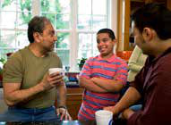

# KẾT LUẬN

Tài liệu này cung cấp các nguyên tắc cơ bản về kỷ luật tích cực, tập trung vào các mục tiêu lâu dài, tạo sự ấm áp và cấu trúc, thấu hiểu cách nghĩ và cảm nhận của trẻ và giải quyết vấn đề.

Bạn đã thực hành việc áp dụng nguyên tắc này vào các tình huống thách thức thường xảy ra với trẻ ở các lứa tuổi khác nhau. Việc thực hành này sẽ giúp bạn tìm ra các giải pháp cho một loạt các tình huống thách thức khác.

Tất nhiên, việc suy nghĩ một cách chín chắn khi bạn đang xúc động hay ức chế là rất khó khăn. Khi bạn cảm thấy nỗi tức giận của mình đang dâng lên, hãy hít một hơi thật dài, nhắm mắt lại và nghĩ tới:

1.	 Mục tiêu lâu dài của mình

2.	 Tầm quan trọng của sự ấm áp và cấu trúc

3.	 Mức độ phát triển của con

Sau đó hãy dành một chút thời gian nghĩ tới phản ứng cho tình huống theo cách có thể đạt được mục tiêu của mình và tôn trọng nhu cầu của trẻ.

Theo cách này bạn sẽ dạy trẻ cách giải tỏa sự thất vọng, nóng giận và xung đột. Bạn sẽ mang đến cho con bạn những kỹ năng cần thiết để sống mà không cần tới bạo lực. Bạn sẽ tạo dựng nên được tính tự trọng của con trẻ. Và bạn có được sự tôn trọng của chúng.

Không có cha mẹ nào là hoàn hảo. Chúng ta đều có những sai sót. Nhưng chúng ta cần phải học từ những sai lầm và rút kinh nghiệm để làm tốt hơn trong tương lai.

Hãy vui hưởng hành trình làm cha mẹ tích cực của bạn

Trong mọi hoạt động liên quan đến trẻ thì những lợi ích tốt nhất dành cho trẻ sẽ được xem xét đầu tiên.

Điều 3: Công ước Liên hợp quốc về Quyền trẻ em

# GIỚI THIỆU VỀ TÁC GIẢ

Joan E.Durrant, Ph.D. là một Nhà tâm lý học lâm sàng về trẻ em và Giáo sư về Khoa học Sức khỏe công cộng thuộc Đại học Manitoba ở Winnipeg, Canada. Bà đã làm việc rất nhiều với trẻ em và gia đình của chúng, giúp họ tìm ra những giải pháp tích cực cho các xung đột của họ.

Bà tiến hành nghiên cứu những yếu tố dẫn đến các cha mẹ đánh đập con, cũng như về tác động của các luật cấm trừng phạt thân thể. Nghiên cứu của bà đã được xuất bản trong các tạp chí như *Child Abuse* *and Neglect, Journal of Social Welfare and Family Law, International* *Review of Victimology, International Journal of Children’s Rights, and* *Youth and Society*, cũng như một số cuốn sách khác.

Tiến sĩ Durrant là nhà nghiên cứu chính và đồng tác giả *Tuyên bố* *chung về Trừng phạt thân thể đối với trẻ em và thanh thiếu niên* của Canada*;* thành viên của Ủy ban Tư vấn *Nghiên cứu của Tổng thư ký Liên* *Hợp Quốc về bạo lực đối với trẻ em;* đồng chủ biên của tài liệu *Loại bỏ* *bạo lực: Con* đường *tiến* đến *Kỷ luật mang tính Xây dựng* (UNESCO).

Tích cực trong việc giáo dục cộng đồng, TS. Durrant đã viết các tài liệu về làm cho mẹ/nuôi dạy con cho chính phủ Canada, đã thuyết giảng và thực hiện các hội thảo cho cha mẹ và các nhà chuyên môn ở nhiều nước với các chủ đề về trừng phạt thân thể và thực hành làm cha mẹ tích cực.

Cha mẹ, cộng đồng và chính phủ trên toàn thế giới thừa nhận các quyền được bảo vệ khỏi trừng phạt thân thể và quyền được kỷ luật với sự tôn trọng nhân phẩm của trẻ.  Ngày càng nhiều, cha mẹ đang được khuyên dùng kỷ luật tích cực, nhưng cha mẹ thường hỏi, Kỷ luật tích cực là gì? và tôi phải làm như thế nào?

Tài liệu này cung cấp các câu trả lời cụ thể cho các câu hỏi trên. Nó đặt ra 4 nguyên tắc rõ ràng về kỷ luật tích cực. Cha mẹ sẽ được học cách thức: 1) đặt mục tiêu, 2) tạo bầu không khí tích cực ở gia đình, 3) hiểu cách trẻ suy nghĩ và cảm nhận, và 4) giải quyết các vấn đề trong những tình huống thách thức. Cha mẹ sẽ thực hành các kỹ năng đó thông qua các tình huống thực tế. Và họ sẽ được học cách áp dụng những nguyên tắc trên qua một loạt các tình huống khác nhau.

Tài liệu này dành cho các bậc cha mẹ có con ở mọi lứa tuổi từ sơ sinh đến thanh thiếu niên. Tài liệu này cũng có thể được sử dụng cho các nhân viên hỗ trợ gia đình, các nhà giáo dục cha mẹ và các nhà chuyên môn khác, những người làm việc với cha mẹ và trẻ em.

Sự công nhận phẩm cách vốn có cũng như các quyền bình đẳng và không thể tước đoạt được của mọi thành viên trong cộng đồng con người là nền tảng của tự do, công lý và hòa bình trên thế giới.

*Lời mở đầu*

> **Công ước Liên Hợp Quốc về Quyền trẻ em.**
