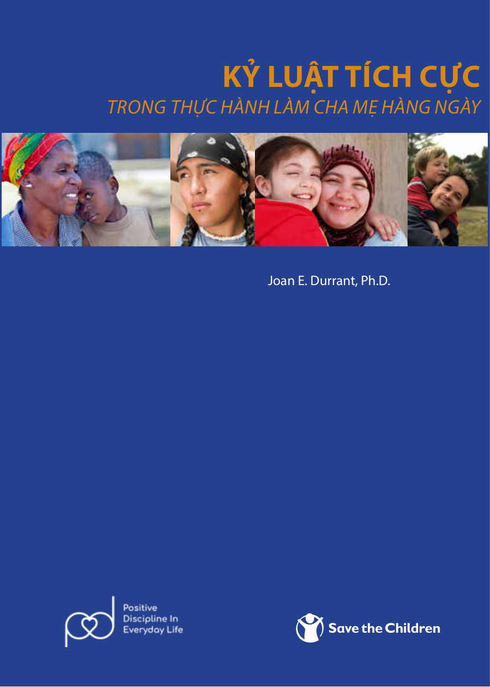

# KỶ LUẬT TÍCH CỰC TRONG THỰC HÀNH LÀM CHA MẸ HÀNG NGÀY
### (Positive Discipline in Everyday Parenting - PDEP)

**Tác giả:** Joan E. Durrant, Ph.D.  
**Dịch giả:** Tiến sĩ Lê Văn Hảo  
**Biên tập:** Nguyễn Bảo Chinh, Nguyễn Thu Hằng  
**Bản quyền ấn bản tiếng Việt:** Tổ chức Cứu trợ Trẻ em (Save the Children)  
**Nhà xuất bản / Đơn vị bảo trợ:** Save the Children Thụy Điển  

---

## Giới thiệu tác phẩm

> *“Kỷ luật thực sự có nghĩa là **giảng dạy**. Giảng dạy dựa trên việc thiết lập những mục tiêu cho việc học tập, việc lập kế hoạch và tìm giải pháp tiếp cận hiệu quả. Kỷ luật tích cực không phải là trừng phạt, quát tháo hay đánh đập; mà là phương pháp dạy dỗ bất bạo lực, tôn trọng quyền và phẩm giá của trẻ, giúp con phát triển toàn diện cả về thể chất lẫn tâm hồn.”*
>
> *(Trích Lời giới thiệu - Joan E. Durrant, Ph.D.)*

**Kỷ Luật Tích Cực Trong Thực Hành Làm Cha Mẹ Hàng Ngày** là cẩm nang giáo dục gia đình kinh điển được Tổ chức Cứu trợ Trẻ em (Save the Children) triển khai trên toàn cầu nhằm hưởng ứng Báo cáo của Liên Hợp Quốc về phòng chống bạo lực đối với trẻ em và Công ước về Quyền Trẻ em (UNCRC).

Cuốn sách cung cấp cho cha mẹ một bộ khung thực hành vững chắc gồm **4 khối xây dựng cốt lõi**:
1. **Xác định mục tiêu lâu dài:** Giúp cha mẹ vượt qua các phản ứng bốc đồng trước mắt để hướng con tới những phẩm chất tốt đẹp khi trưởng thành (tự tin, trung thực, biết yêu thương, có trách nhiệm).
2. **Tạo sự ấm áp và cấu trúc:** Trao cho con cảm giác an toàn tình cảm, sự gắn kết yêu thương vô điều kiện (ấm áp) đi kèm với ranh giới rõ ràng, sự định hướng và giải thích kiên nhẫn (cấu trúc).
3. **Hiểu cách trẻ nghĩ và cảm nhận:** Thấu hiểu đặc điểm tâm sinh lý và mức độ phát triển não bộ của con theo từng độ tuổi (từ sơ sinh đến 18 tuổi).
4. **Giải quyết vấn đề và phản ứng tích cực:** Phương pháp 5 bước xử lý xung đột hàng ngày mà không cần đến đòn roi, lời mắng nhiếc hay cô lập trừng phạt.

---

## Mục lục

1. [Lời nói đầu & Mục lục](00_loi_noi_dau.md)
   - Bối cảnh ra đời và Công ước Liên Hợp Quốc về Quyền trẻ em (UNCRC)
   - Ba nhóm quyền cơ bản: Quyền sống và phát triển, Quyền được bảo vệ, Quyền tham gia
   - Cấu trúc tổng thể của tài liệu

2. [Lời giới thiệu](00_loi_gioi_thieu.md)
   - Cuốn sách này dành cho ai?
   - Kỷ luật tích cực là gì và không phải là gì?
   - 4 khối xây dựng nền tảng của Kỷ luật tích cực

3. [Chương 1: Xác định mục tiêu lâu dài của bạn](01_chuong_1.md)
   - Phân biệt mục tiêu ngắn hạn và mục tiêu dài hạn của cha mẹ
   - Hình dung con bạn ở tuổi 20: Những phẩm chất bạn mong muốn con có
   - Biến những xung đột hàng ngày thành cơ hội giảng dạy dài hạn

4. [Chương 2: Tạo sự ấm áp và cấu trúc](02_chuong_2.md)
   - Sự ấm áp: Nền tảng của an toàn tình cảm và sự tin cậy
   - Cấu trúc: Bản đồ hướng dẫn hành vi, ranh giới và quy tắc rõ ràng
   - Kết hợp ấm áp và cấu trúc để nuôi dưỡng sự tự giác

5. [Chương 3: Hiểu cách trẻ nghĩ và cảm nhận](03_chuong_3.md)
   - Đặc điểm phát triển và cách nhìn thế giới qua từng độ tuổi:
     - Trẻ 0 - 6 tháng tuổi
     - Trẻ 6 - 12 tháng tuổi
     - Trẻ 1 - 2 tuổi
     - Trẻ 2 - 3 tuổi
     - Trẻ 3 - 5 tuổi
     - Trẻ 5 - 9 tuổi
     - Trẻ 10 - 13 tuổi
     - Trẻ 14 - 18 tuổi
   - Thấu hiểu khí chất, cảm xúc và tính cách riêng của từng đứa trẻ

6. [Chương 4: Giải quyết vấn đề](04_chuong_4.md)
   - Tìm kiếm nguyên nhân gốc rễ đằng sau hành vi thách thức của trẻ
   - Đặt mình vào vị trí của trẻ để nhìn nhận tình huống
   - Thực hành giải quyết vấn đề theo từng mốc tuổi phát triển

7. [Chương 5: Phản ứng bằng kỷ luật tích cực](05_chuong_5.md)
   - Quy trình 5 bước phản ứng tích cực trong tình huống xung đột
   - Phân tích và hướng dẫn xử lý chi tiết hàng chục tình huống điển hình:
     - Trẻ quấy khóc, biếng ăn, ăn vạ (temper tantrums)
     - Trẻ giành đồ chơi, đánh bạn, nói dối, chống đối
     - Trẻ lười học, mê game, tranh cãi với cha mẹ ở tuổi dậy thì
   - Các chuyên đề khoa học: Tác hại của đòn roi, kiểm soát cơn giận của cha mẹ, trầm cảm sau sinh

8. [Kết luận & Vài nét về tác giả](06_ket_luan.md)
   - Tóm lược các nguyên tắc vàng khi đối mặt với khủng hoảng nuôi dạy con
   - Quy tắc dừng lại - hít thở sâu - suy ngẫm trước khi phản ứng
   - Tiểu sử và sự nghiệp của Tiến sĩ Joan E. Durrant
