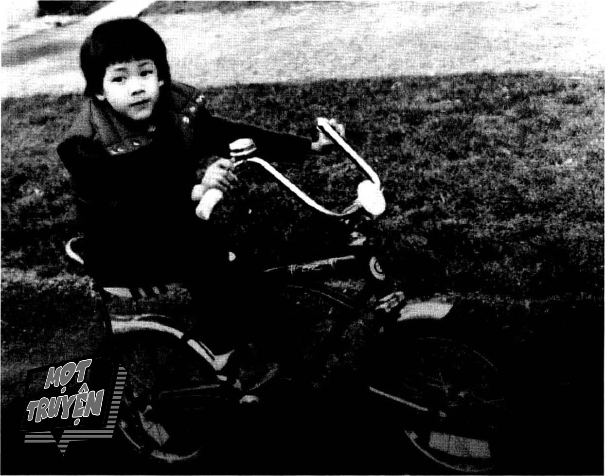
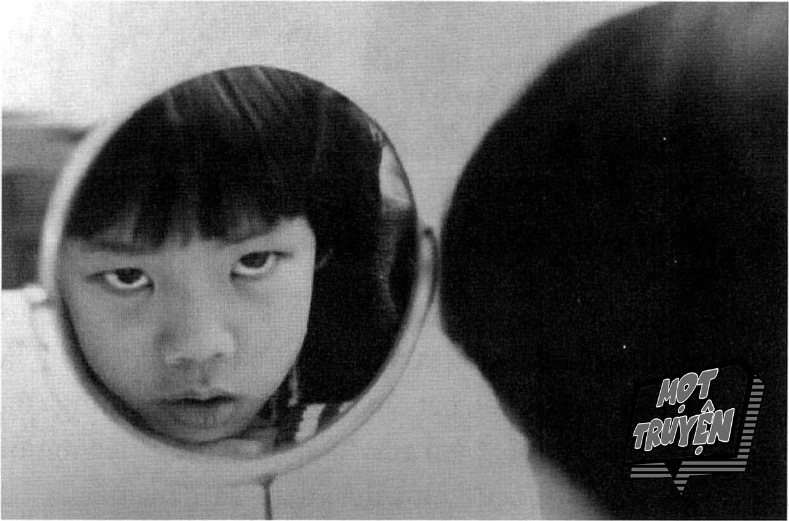
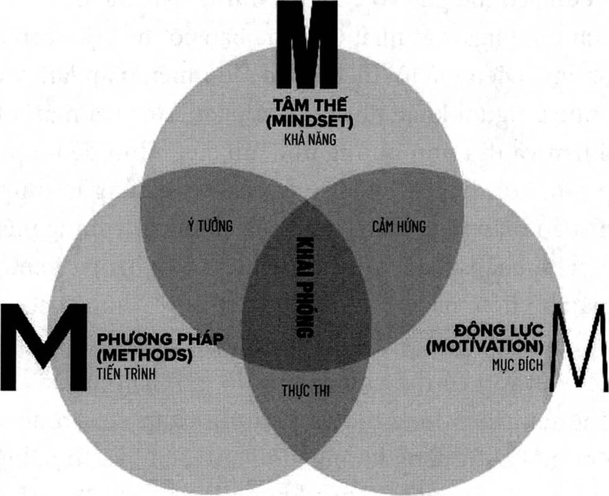

# Chương 1: Trở thành con người khai phóng

*“Mình thật ngu ngốc.”*

*“Mình không hiểu.”*

*“Mình quá đần độn nên không học được.”*

Đây chính là những điều tôi luôn nói với chính mình trong suốt quãng thời gian tuổi thơ. Không có ngày nào mà tôi không tự nhủ rằng mình là một người chậm chạp và ngu ngốc, rằng tôi sẽ không bao giờ có thể đọc được và sẽ không đạt được thành tựu gì trong cuộc sống. Nếu như có một viên thuốc thần kỳ có thể ngay lập tức nạp năng lượng và khiến bộ não trở nên siêu phàm (giống như trong bộ phim Limitless do Bradley Cooper thủ vai chính vào năm 2011), tôi sẽ bằng mọi giá để có được nó.

Tôi không phải là người duy nhất cảm thấy như vậy. Nếu bạn hỏi các giáo viên đã dạy tôi lúc nhỏ, nhiều người sẽ nói rằng họ sẽ không thể tin nổi có một ngày tôi sẽ viết ra quyển sách này. Lúc trước, họ thậm chí còn ngạc nhiên nếu biết được tôi có thể đọc sách chứ đừng nói là viết sách.

Tất cả những điều này bắt đầu từ tai nạn hồi mẫu giáo nó đã thay đổi hoàn toàn cuộc sống của tôi. Một ngày nọ tôi đang ở trong lớp thì có tiếng còi hú vang lên ngoài cửa sổ. Mọi người trong lớp ai cũng nghe, giáo viên nhìn ra bên ngoài và nói rằng có xe cứu hỏa ở phía dưới. Nghe vậy, tụi trẻ trong lớp có phản ứng rất tự nhiên là chạy ngay đến cửa sổ. Tôi đặc biệt cảm thấy hào hứng bởi vì khi ấy tôi đã rất thích các siêu anh hùng rồi (và giờ vẫn vậy). Đối với tôi, lính cứu hỏa là hình mẫu gần giống nhất với siêu anh hùng trong đời thực. Tôi lao đến cửa sổ nhanh hơn bất cứ ai khác.

Vấn đề là tôi không đủ cao để nhìn xuống và thấy được xe cứu hỏa. Một đứa trẻ chạy đi, kéo ghé đến và đứng lên ghế để xem, và sau đó tất cả chúng tôi đều bắt chước làm theo. Tôi chạy đi lấy ghế, kéo nó sát vào chiếc máy sưởi to bằng sắt được đặt dọc theo cửa sổ. Tôi trèo lên ghế và nhìn thấy những người lính cứu hỏa, tôi cảm thấy vui cực kỳ! Mắt tôi sáng rỡ lên và miệng thì há hốc khi được chứng kiến những con người dũng cảm đang hành động trong những bộ đồ bảo hộ trong cực kỳ chắc chắn, cùng với chiếc xe màu đỏ rực rỡ.

Nhưng sau đó một đứa trẻ khác kéo chân ghế, tôi bị mất thăng bằng và ngã xuống đập đầu vào máy sưởi. Đầu tối đập vào chiếc máy sưởi bằng kim loại rất mạnh và bắt đầu chảy máu. Nhà trường nhanh chóng đưa tôi vào bệnh viện và các bác sĩ chữa trị vết thương cho tôi. Nhưng họ cũng nói thật với mẹ tôi rằng não của tôi đã bị tổn thương không hề nhẹ.

Mẹ nói rằng sau tai nạn đó tôi không còn giống như trước đây nữa. Tôi đã từng là một đứa trẻ giàu năng lượng, tự tin và đầy tò mò, nhưng sau đó tôi đã thu mình lại hẳn và gặp nhiều khó khăn mới khi học. Tôi cảm thấy rất khó tập trung, tôi không thể chú tâm vào việc gì và trí nhớ thì dở tệ. Hẳn bạn cũng có thể hiểu được rằng đối với tôi, trường học thực sự là ác mộng. Các giáo viên sẽ phải lặp đi lặp lại cho đến khi tôi giả vờ rằng mình đã hiểu. Trong khi những đứa trẻ khác đang tập đọc thì tôi không thể nào hiểu nổi những con chữ ấy. Bạn có nhớ hoạt động đọc sách theo vòng tròn không? Trong đó mọi người sẽ chuyển tay nhau quyển sách và đọc to lên. Đối với tôi, đó là hoạt động tồi tệ nhất - tôi sẽ chờ đợi đầy lo lắng khi thấy quyển sách đang tiến gần về phía mình, và khi cầm nó trên tay thì tôi không thể hiểu được chữ nào cả (tôi nghĩ đó là lý do tại sao trước đây tôi cực kỳ sợ việc nói trước công chúng). Tôi phải mất đến ba năm nữa mới có thể đọc, và trong suốt một thời gian dài sau đó, việc học hành của tôi vẫn luôn chật vật và ngày càng khó khăn.

Nếu không nhờ vào những người hùng mà tôi thấy được trong truyện tranh có lẽ tôi vẫn chưa đọc chữ được. Những quyển sách bình thường không thể khiến tôi tập trung, nhưng chính niềm đam mê với truyện tranh đã thúc đẩy và là động lực giúp tôi cố gắng cho đến khi tự mình hiểu những câu chuyện trong đó mà không cần nhờ người khác đọc giúp. Tôi đã trùm mền và soi đèn pin để đọc truyện hằng đêm. Những câu chuyện đó khiến tôi hi vọng rằng con người sẽ có thể vượt qua được những khó khăn không tưởng.

Những người hùng tôi thích nhất là X-Men, không phải vì họ là những người mạnh nhất mà bởi vì họ bị hiểu lầm và họ khác biệt so với những người khác. Tôi cảm thấy đồng cảm với họ. Họ là người đột biến, họ không thể hòa nhập với xã hội và những người không hiểu cứ ra sức xua đuổi họ. Đó chính là hoàn cảnh của tôi, chỉ có điều tôi không có siêu sức mạnh. X-Men là những người bị xã hội ruồng bỏ, và tôi cũng vậy. Tôi thuộc về thế giới đó.

Tôi lớn lên ở hạt Westchester, một vùng thuộc ngoại ô thành phố New York, và một đêm nọ tôi cảm thấy cực kỳ hào hứng khi khám phá ra rằng: theo những gì được viết trong truyện thì Trường học Dành cho Học sinh Tài năng của Giáo sư Xavier không cách xa nơi tôi ở. Khi lên chín, gần như mỗi cuối tuần tôi đều đạp xe quanh khu của mình để tìm kiếm ngôi trường đó. Tôi bị ám ảnh về nó. Tôi nghĩ rằng nếu có thể tìm ra được vị trí ngôi trường thì cuối cùng tôi cũng tìm được một nơi mình hòa nhập được, một nơi tôi có thể yên tâm sống khác biệt, một nơi để tôi khám phá và phát triển những khả năng đặc biệt của mình.

## THẰNG BÉ BỊ HỎNG NÃO

Trong thế giới thực, cuộc sống vốn không tốt đẹp. Vào khoảng thời gian này, bà của tôi, người đã sống chung và góp công nuôi nấng tôi, bắt đầu có những triệu chứng của bệnh suy giảm trí tuệ. Cảm giác khi phải chứng kiến người mình yêu thương ngày một thất thần và dần mất đi trí nhớ là một cảm giác không thể tả nổi. Tôi cảm tưởng như mình mất bà hết lần này đến lần khác vậy, mọi chuyện cứ lặp lại như thế cho đến khi bà qua đời. Bà là cả thế giới của tôi, và ngoài những khó khăn trong việc học của bản thân thì bà cũng là một động lực khiến tôi muốn tìm hiểu về sức khỏe của não bộ.

Khi còn ở trường, tôi bị bắt nạt và đùa cợt, và việc này không chỉ xảy ra trong sân chơi mà còn trong cả lớp học. Tôi nhớ một ngày nọ khi còn học tiểu học, một giáo viên vì quá chán nản rằng tôi không thể nào hiểu được bài học, đã chỉ vào tôi và nói rằng: “Đó là thằng bé bị hỏng não. Tôi cảm thấy vỡ vụn khi nhận ra rằng hóa ra đó là suy nghĩ của cô về mình, và có lẽ những người khác cũng nghĩ như vậy.”

Thông thường thì khi bạn áp đặt nhận xét của mình lên người khác, bạn đã tạo ra một giới hạn - nhận xét đó sẽ trở thành giới hạn. Người lớn cần phải rất cẩn thận trong lời nói của mình bởi vì chúng sẽ nhanh chóng in sâu vào tâm trí một đứa trẻ. Đó chính là điều đã xảy ra với tôi trong khoảnh khắc đó. Khi tôi gặp khó khăn trong việc học, làm bài điểm thấp, không được mọi người chọn vào đội trong tiết học thể dục, hoặc tụt lại so với bạn bè cùng trang lứa, tôi sẽ tự nhủ rằng đó là do não mình bị hỏng. Làm sao mà tôi có thể làm tốt được như những người khác chứ? Tôi bị hỏng rồi. Đầu óc của tôi không hoạt động như người bình thường. Mặc dù đã học hành chăm chỉ hơn nhiều so với chúng bạn nhưng điểm của tôi không bao giờ tương xứng với những nỗ lực bỏ ra.

Vì quá cứng đầu nên tôi không từ bỏ. Tôi đã vượt qua được hết lớp này đến lớp khác, nhưng lúc nào tôi cũng chật vật và phải cố gắng rất nhiều. Mặc dù tôi học toán khá nhờ được các bạn học giỏi giúp đỡ, nhưng tôi rất tệ trong phần lớn những môn khác, đặc biệt là các môn như văn học, đọc, ngoại ngữ và âm nhạc. Sau đó, trong năm đầu tiên ở trường trung học, mọi thứ tệ đến mức tôi có nguy cơ bị rớt môn văn. Giáo viên đã gọi bố mẹ tôi lên để bàn cách làm sao để tôi đủ điểm qua môn này.

Cô đã đưa ra một dự án ngoại khóa cho tôi. Tôi sẽ phải viết một bài báo cáo về cuộc đời và sự nghiệp của hai thiên tài: Leonardo da Vinci và Albert Einstein. Cô ấy nói rằng nếu tôi có thể làm tốt bài báo cáo này thì cô ấy sẽ có thể cho tôi thêm điểm cộng đủ để qua môn.

Tôi cho rằng đây là một cơ hội lớn, là dịp để tôi làm lại từ đầu và vượt qua những khó khăn trong năm đầu trung học này. Tôi đã cố gắng hết sức để viết được bài báo cáo tốt nhất. Khi thực hiện dự án này, tôi đã dành hàng giờ tại thư viện sau giờ học, tôi cố gắng tìm hiểu tất cả mọi thứ có thể về hai thiên tài này. Điều thú vị là trong khi nghiên cứu, tôi nhiều lần đọc được rằng cả Albert Einstein và Leonardo da Vinci đều gặp khó khăn trong việc học.

Sau nhiều tuần nỗ lực, tôi cũng hoàn thành bài báo cáo. Tôi cảm thấy cực kỳ tự hào về thành quả của mình, đến nỗi tôi đã đóng tập báo cáo lại thành một quyển trông rất chuyên nghiệp. Bài báo cáo này chính là tuyên ngôn cá nhân của tôi, nó chính là cách để tôi tuyên bố với cả thế giới về những điều mình có thể làm.

Vào ngày nộp bài, tôi để nó vào trong cặp, hào hứng muốn đưa cho cô giáo và càng hồi hộp hơn nữa khi chờ đợi phản ứng của cô về công trình tôi đã làm. Tôi dự định sẽ đưa nó cho cô vào cuối buổi học, vậy nên tôi đã ngồi trong lớp và vượt qua bài học hôm đó, cố gắng tập trung nhưng tâm trí tôi liên trục trôi dạt, tôi cứ suy nghĩ về vẻ mặt của cô khi tôi nộp bài cho cô.

Nhưng cô đã có một hành động khiến tôi bàng hoàng, và tôi chưa hề chuẩn bị cho nó. Khoảng giữa tiết học, cô kết thúc bài giảng và nói với học sinh rằng cô có một bất ngờ dành cho họ. Cô nói rằng tôi đã thực hiện một dự án ngoại khóa và cô muốn tôi trình bày nó với mọi người trong lớp - ngay lúc đó.

Trong suốt quãng đời học sinh, tôi luôn cố thu mình lại để không bị gọi tên lên bảng, bởi vì tôi cảm thấy mình chỉ là một người bị hỏng và chẳng thể làm được gì nhiều. Tôi ngại ngùng hơn cả những học sinh trầm tính, và tôi không thích sự chú ý đổ dồn vào mình. Khi ấy, siêu sức mạnh của tôi là khả năng tàng hình. Tôi cũng cực kỳ sợ hãi việc phải nói trước đám đông. Tôi không hề nói quá đâu. Nếu bạn nối máy đo nhịp tim vào người tôi trong khoảnh khắc đó, có lẽ nhịp tim của tôi đã làm hỏng máy đo rồi. Thêm vào đó, tôi gần như không thở được. Tôi không thể nào đứng trước mọi người và nói với họ về những điều tôi đã thực hiện được. Vậy nên tôi đã chọn lối thoát duy nhất cho mình.

“Em xin lỗi. Em chưa làm bài đó” - tôi chỉ ấp úng vừa đủ để những từ ngữ thoát ra khỏi miệng mình.

Sự thất vọng hiện lên trên khuôn mặt cô giáo - khác xa với vẻ mặt mà tôi đã tưởng tượng trước đó - điều ấy làm tim tôi như bị bóp nghẹt. Nhưng tôi không thể làm điều mà cô yêu cầu được. Khi tiết học kết thúc, sau khi tất cả mọi người đã rời đi, tôi ném bài báo cáo vào thùng rác, và cùng với đó tôi cũng ném đi một phần lớn sự tự tôn và giá trị của bản thân mình.

## BẠN ĐÃ Ở RẤT GẦN RỒI, GẦN HƠN BẠN TƯỞNG TƯỢNG

Mặc dù gặp nhiều khó khăn trong trường học nhưng bằng cách nào đó, tôi vẫn vào được một trường đại học địa phương. Tôi nghĩ rằng việc trở thành tân sinh viên trong trường đại học chính là cơ hội để làm lại từ đầu. Tôi mơ về việc khiến gia đình mình tự hào và cho cả thế giới (và quan trọng hơn là bản thân tôi) thấy rằng mình có tiềm năng để thành công. Tôi sống trong một môi trường mới. Các thầy cô trong trường đại học dạy tôi theo cách khác với thầy cô ở trường trung học, và không ai trong ngôi trường này có sẵn định kiến về tôi. Tôi học tập chăm chỉ hết mức có thể, nhưng cuối cùng kết quả tôi nhận được còn kém hơn cả kết quả trong những năm trung học.

Vài tháng sau khi vào trường đại học, tôi bắt đầu phải đối mặt với hiện thực. Tôi không thể cứ lãng phí thời gian và tiền bạc như thế này trong khi gia cảnh tôi không khá giả. Tôi đã sẵn sàng bỏ học. Tôi nói với một người bạn về kế hoạch của mình và anh ấy đề nghị rằng trước khi ra quyết định, tôi nên đến thăm gia đình anh ấy vào cuối tuần. Anh ấy nghĩ rằng khi đưa tôi ra khỏi khuôn viên trường, tôi sẽ có những góc nhìn mới mẻ hơn. Khi chúng tôi đến nơi, bố anh ấy cho tôi xem quanh khu nhà trước khi bắt đầu bữa tối. Trên đường đi, ông hỏi về tình hình học hành của tôi, và chắc chắn là phản ứng của tôi đã khiến ông kinh ngạc. Tôi òa khóc. Không phải là kiểu rơm rớm nước mắt mà là òa khóc nức nở. Tôi nhận ra rằng ông ấy cảm thấy ái ngại vì đã hỏi, nhưng câu hỏi tưởng như vô hại của ông đã phá vỡ những rào chắn tôi dựng lên trước giờ, và làm vỡ òa cảm xúc tôi đã kìm nén suốt bấy lâu nay.

Tôi kể với ông toàn bộ câu chuyện về “thằng bé bị hỏng não” và ông kiên nhẫn lắng nghe. Khi tôi nói xong, ông nhìn thẳng vào mắt tôi.

“Jim, tại sao cháu đi học?” - ông hỏi. “Cháu muốn trở thành người như thế nào? Cháu muốn làm gì? Cháu muốn đạt được điều gì? Cháu muốn chia sẻ điều gì?”

Khi ấy tôi không có câu trả lời cho những câu hỏi này bởi vì trước giờ chưa có ai hỏi tôi như vậy, nhưng tôi cảm thấy mình phải trả lời ngay lúc đó. Tôi bắt đầu nói, và ông bảo tôi dừng lại. Ông xé ra một vài tờ giấy trong quyển sổ tay bỏ túi và nói tôi hãy ghi câu trả lời vào đó. (Trong quyển sách này, tôi sẽ hướng dẫn bạn cách đặt ra những câu hỏi để từ đó học hỏi và đạt được mọi thứ nhanh hơn.)

Trong vài phút tiếp theo, tôi viết ra một danh sách những điều mình muốn làm. Khi viết xong, tôi gấp những tờ giấy lại và nhét chúng vào túi. Nhưng ngay khi ấy, bố của bạn tôi đã chộp lấy những tờ giấy từ tay tôi. Tôi phát hoảng bởi vì tôi không nghĩ rằng sẽ có ai khác đọc những gì mình viết, đặc biệt là một người hoàn toàn xa lạ như vậy. Nhưng ông ấy đã mở chúng ra và đọc trong khi tôi đang cảm thấy đầy bất an.

Tôi cảm giác như ông ấy dành hàng tiếng đồng hồ chỉ để đọc những điều mà tôi viết mặc dù tôi biết việc đó chỉ diễn ra trong khoảng một hoặc hai phút. Khi đọc xong, ông nói: “Cháu đã đến rất gần rồi, gần cỡ này này” - ông vừa nói vừa giơ hai ngón tay trỏ lên trước mặt, tạo thành một khoảng cách cỡ ba mươi centimet - “để đạt được tất cả những thứ mà cháu viết trong danh sách đó.”

Câu nói đó nghe có vẻ thật vô lý. Tôi nói với ông ấy rằng tôi không thể nào làm được những điều trong danh sách này dù cho tôi có thêm mười cuộc đời nữa. Nhưng sau đó ông lại giơ hai ngón tay của mình lên, khoảng cách giữa chúng vẫn không đổi, và ông đặt mỗi ngón tay lên một bên thái dương của tôi. Khoảng cách mà ông muốn nói đến chính là bộ não của tôi.

“Đó chính là chìa khóa,” - ông nói - “đi với ta, ta muốn cho cháu xem thứ này.”

Chúng tôi quay trở vào nhà và ông dẫn tôi đến một căn phòng mà tôi chưa từng thấy. Trong phòng là những quyển sách được xếp đầy dọc theo các bức tường, cao từ sàn nhà lên đến tận trần nhà. Giờ đây khi nhớ lại, tôi nhận ra rằng khi ấy mình không phải là một người thích đọc sách, và việc ở trong một căn phòng như vậy chẳng khác nào bước vào một căn phòng đầy rắn. Nhưng điều tệ hơn là ông ấy bắt đầu cầm những con rắn trên kệ lên và đưa cho tôi. Tôi nhìn vào tiêu đề sách và nhận ra rằng đây là những quyển sách tiểu sử của những con người phi thường xuyên suốt chiều dài lịch sử, cùng với những quyển sách về phát triển bản thân, ví dụ như quyển The Magic of Thinking Big, The Power of Positive Thinking, và Think and Grow Rich.

“Jim, ta muốn cháu mỗi tuần đều đọc một quyển trong số này.”

Suy nghĩ đầu tiên của tôi là: Bác không nghe những gì cháu vừa nói sao? Tôi không nói ra câu này, nhưng tôi đáp lại rằng: “Cháu không nghĩ là mình làm được. Bác biết đấy, việc đọc với cháu rất khó khăn, và cháu có quá nhiều bài tập về nhà phải làm.”

Ông giơ một ngón tay lên và nói: “Đừng để trường học cản trở hành trình giáo dục của cháu.” Sau đó tôi mới biết được rằng ông ấy đang trích lại một câu nói nổi tiếng được cho là của Mark Twain.

“Bác ơi,” - tôi nói - “cháu biết đọc chúng sẽ rất có ích, nhưng cháu không muốn hứa những điều mình không thể thực hiện.”

Ông ngừng lại một lúc và sau đó đưa tay vào túi, lấy ra danh sách của tôi và bắt đầu đọc từng điều ra thành lời.

Nghe một người khác nói ra những ước mơ của mình - điều này đã làm bùng lên trong suy nghĩ và tâm hồn tôi một thứ gì đó thật mãnh liệt. Sự thật là trong danh sách đó có rất nhiều thứ tôi muốn làm cho gia đình mình - những thứ mà bố mẹ tôi không thể mua nổi hoặc chưa bao giờ tự thưởng cho bản thân mặc dù họ có đủ tiền đi nữa. Khi những điều này được nói ra thành lời, tôi chưa bao giờ bị tác động mạnh mẽ đến thế. Tôi thực sự cảm thấy mình có động lực và mục đích. (Chúng ta sẽ cùng nhau giải phóng động lực của bạn trong Phần 3.) Khi ông nói xong, tôi đã bảo rằng tôi sẽ thực hiện chính xác điều mà ông yêu cầu, mặc dù trong đầu tôi lúc ấy không thể nghĩ ra được cách nào để thực hiện điều quá xa vời đó.

## ĐẶT RA CÂU HỎI CHÍNH XÁC

Sau cuối tuần đó, tôi quay trở lại trường học, mang theo những quyển sách mà ông ấy đã đưa. Trên bàn học của tôi giờ là hai chồng sách: một là những quyển phải đọc theo chương trình trên trường và một là những quyển tôi đã hứa sẽ đọc. Sức nặng của lời hứa mỗi tuần một quyển bắt đầu đè nặng lên tôi. Làm sao để đọc nổi hai chồng sách này trong khi chỉ riêng việc đọc sách thôi đã là quá khó khăn với tôi. Tôi khi ấy vốn đã rất chật vật khi cố gắng đọc chồng sách đầu tiên - tôi sẽ phải làm gì đây? Lấy đâu ra thời gian đây? Vậy nên tôi không ăn uống, không ngủ nghỉ, không tập thể dục, không xem phim hay dành thời gian cho bạn bè. Thay vào đó, tôi gần như sống luôn ở thư viện, cứ thế cho đến một đêm nọ tôi ngất đi vì kiệt sức rồi ngã xuống cầu thang, và một lần nữa bị chấn thương ở đầu.

Phải mất hai ngày sau tôi mới tỉnh dậy trong bệnh viện. Tôi nghĩ rằng mình đã chết, và có thể một phần trong tôi mong rằng mình đã chết. Đó là một thời điểm cực kỳ tăm tối. Tôi bỏ bê tất cả mọi thứ, tôi sụt cân chỉ còn 53kg và cơ thể thì mất nước nhiều đến mức họ phải truyền nước biển cho tôi.

Thê thảm là vậy, nhưng tôi đã tự nhủ rằng: “Phải có một cách nào đó. Và ngay lúc đó, một cô y tá bước vào phòng tôi, mang theo một cốc trà có in hình Einstein, cũng chính là chủ đề mà tôi đã nghiên cứu rất kỹ trong dự án đọc sách của mình ở trường cấp hai.” Bên cạnh hình của ông là một câu trích dẫn: “Nếu chỉ dùng những tư duy cũ thì chẳng thể nào giải quyết được các vấn đề do tư duy ấy tạo ra”.

Đó chính là thời điểm tôi được khai sáng: Có thể tôi vẫn chưa đặt ra đúng câu hỏi. Tôi bắt đầu tự hỏi vấn đề thật sự của mình là gì? Tôi biết rằng mình học hỏi rất chậm chạp, nhưng đó đã là tư duy cũ đã tồn tại trong rất nhiều năm rồi. Tôi nhận ra rằng mình chỉ đang cố gắng giải quyết vấn đề trong học tập bằng tư duy cũ tôi được dạy trước đây - đó là học tập chăm chỉ hơn. Nhưng nếu tôi có thể tìm ra một phương pháp học tốt hơn thì sao? Nếu tôi có thể học theo một cách hiệu quả hơn, năng suất hơn và thậm chí là thú vị hơn thì sao? Nếu tôi có thể học được cách để học nhanh hơn thì sao?

Ngay tại thời điểm đó, tôi quyết tâm phải tìm ra được phương pháp mới, và với quyết tâm ấy, tâm thế của tôi bắt đầu thay đổi.

Tôi nhờ cô y tá tìm giúp một quyển danh mục các khóa học và lật giở xem từng trang. Sau khi xem xong vài trăm trang, tôi chỉ tìm thấy các lớp dạy về nội dung cần học - tiếng Tây Ban Nha, lịch sử, toán học, khoa học - nhưng lại chẳng có lớp nào dạy phương pháp để học.

## HỌC PHƯƠNG PHÁP HỌC

Khi ra viện, tôi cảm thấy rất tò mò với ý tưởng làm sao để học phương pháp học. Tôi tạm ngừng việc học trên trường và chỉ tập trung vào những quyển sách mà người hướng dẫn đã đưa cho tôi, cùng với những tài liệu tôi tìm được về các lý thuyết học tập dành cho người trưởng thành, lý thuyết về đa trí thông minh, khoa học thần kinh, phát triển cá nhân, tâm lý học giáo dục, phương pháp đọc nhanh và cả những phương pháp ghi nhớ từ thời xưa nữa (tôi muốn tìm hiểu xem những nền văn hóa cổ xưa đã làm gì để truyền lại các kiến thức trước khi có các phát minh về phương tiện lưu trữ như sách hay máy tính). Tôi bị ám ánh với câu đố này: Bộ não của tôi hoạt động như thế nào, và làm sao tôi có thể khiến nó hoạt động hiệu quả?

Sau khoảng vài tháng dành toàn bộ thời gian để nghiên cứu, đào sâu học hỏi theo định hướng mà tôi tự đặt ra, sự thay đổi đã đến. Tôi có thể tập trung tốt hơn. Tôi đã bắt đầu hiểu những khái niệm mới bởi vì tôi có thể chú tâm vào những thứ mình đọc chứ không dễ bị xao nhãng như trước đây nữa. Tôi có thể nhớ lại các thông tin đã học từ nhiều tuần trước mà không gặp khó khăn đáng kể. Năng lượng và sự tò mò của tôi cũng lên đến tầm cao mới. Lần đầu tiên trong đời, tôi có thể đọc và hiểu được thông tin trong một khoảng thời gian ngắn hơn nhiều so với trước đây. Khả năng mới này giúp tôi có được sự tự tin mình chưa từng có trước đây. Cuộc sống của tôi cũng thay đổi - tôi rõ ràng hơn, tôi biết mình cần phải làm gì để phát triển và tôi đã tạo ra được một động lực lâu dài và mạnh mẽ. Với những kết quả này, tâm thế của tôi cũng thay đổi và tôi bắt đầu tin rằng mọi thứ đều có thể.

Nhưng tôi cũng cảm thấy buồn. Tôi nghĩ nếu phương pháp học hỏi phổ quát (học phương pháp học) quan trọng này được dạy trong trường thì có lẽ tôi đã không phải tự nghi ngờ bản thân và trải qua nhiều khó khăn đến vậy trong suốt bao nhiêu năm qua. Tôi nhớ rằng các giáo viên lúc nào cũng nói tôi phải cố gắng học nhiều hơn và tập trung nhiều hơn. Việc nói với một đứa trẻ rằng nó phải “tập trung” cũng giống như việc bảo nó phải chơi đàn ukulele - sẽ rất khó nếu đứa trẻ ấy chưa được học cách chơi đàn.

Và, theo đúng hành trình của người hùng, tôi cũng bắt đầu chia sẻ những báu vật và bài học mà mình đã học được. Tôi bắt đầu hướng dẫn phương pháp này cho các học sinh khác. Sự thay đổi xảy ra khi tôi làm việc với một tân sinh viên, cô ấy muốn học làm sao để đọc nhanh hơn, hiểu nhiều hơn và nhớ tốt hơn những nội dung mình đang học. Cô ấy làm việc rất chăm chỉ và đạt được mục tiêu là đọc 30 quyển sách trong 30 ngày. Tôi biết phương pháp mà cô ấy đã sử dụng, vì đó cũng chính là phương pháp mà tôi sẽ dạy các bạn trong Chương 14 - nhưng tôi muốn biết tại sao cô ấy muốn làm điều này. Tôi nhận ra động lực là do mẹ cô được chẩn đoán bị ung thư giai đoạn cuối, và cô ấy quyết tâm cứu mẹ bằng cách học những quyển sách về sức khỏe và dược phẩm. Vài tháng sau, cô ấy gọi điện cho tôi và khóc vì vui sướng, cô nói rằng bệnh ung thư của mẹ đang thuyên giảm.

Trong chính khoảnh khắc ấy, tôi nhận ra rằng nếu tri thức là sức mạnh thì việc học hỏi chính là siêu sức mạnh. Và khả năng học hỏi của chúng ta là không giới hạn, chúng ta chỉ cần được dạy cách làm thế nào để tận dụng nó. Sự thay đổi tích cực trong cuộc sống của cô ấy đã tạo ra trong tôi một mục đích và giúp tôi nhận ra sứ mệnh của mình trong cuộc sống: dạy cho mọi người về tâm thế, động lực và phương pháp để nâng tầm bộ não của họ, từ đó giúp họ học hỏi mọi thứ nhanh hơn và đạt được cuộc sống phi thường.

Trong suốt hơn hai tập kỷ, tôi đã tạo ra các hệ thống phương pháp đáng tin cậy và đã được kiểm nghiệm nhằm giúp nâng cao khả năng học tập, và nhiều phương pháp sẽ xuất hiện trong quyển sách này. Tôi không chỉ giữ lời hứa đọc mỗi tuần một quyển sách mà còn tiếp tục phục vụ và giúp đỡ mọi người - từ những đứa trẻ bị nhận định là “khuyết tật trong học tập” đến những người lớn tuổi gặp các vấn đề khi bộ não bị lão hóa. Đội nhóm của chúng tôi, với sự tưởng nhớ dành cho bà tôi, cũng có rất nhiều đóng góp trong các nghiên cứu về bệnh Alzheimer. Chúng tôi tin rằng mọi đứa trẻ sinh ra đều có quyền được học, vì thế chúng tôi tài trợ cho các trường học trên khắp thế giới, từ Guatemala đến Kenya, mang đến dịch vụ y tế, nước sạch và giáo dục cho những trẻ em đang gặp khó khăn thông qua các tổ chức tuyệt vời như WE Charity và Pencils of Promise. Đó chính là sứ mệnh của chúng tôi. Chúng tôi nỗ lực hết mình vì mọi bộ não cần được giúp đỡ.

Chúng tôi dạy những kỹ năng này cho người khác và đã đạt được những thành quả ấn tượng, giúp tôi tiếp cận được với hơn 150.000 người trong những sự kiện trực tiếp hàng năm, và họ đến từ rất nhiều lĩnh vực khác nhau. Tôi là huấn luyện viên não bộ cho những người nổi tiếng hàng đầu trong ngành thể thao và giải trí, tôi giảng dạy tại rất nhiều công ty và trường đại học hàng đầu thế giới và hiện là lãnh đạo của một nền tảng học trực tuyến đang phát triển nhanh chóng bao gồm các học viên đến từ 195 quốc gia. Tôi cũng thực hiện một chương trình podcast hàng đầu về giáo dục với tên gọi Kwik Brain với hàng chục triệu lượt tải về, tôi cũng có những video hướng dẫn đạt được hàng trăm triệu lượt xem. Trong quyển sách này có rất nhiều bài học và lời khuyên thiết thực mà tôi đã học được sau nhiều năm, cùng với những thông tin và nguồn kiến thức thực tế từ các diễn giả khách mời đã xuất hiện trong chương trình của tôi.

Tôi nói tất cả những điều này để bạn hiểu được rằng tôi đã cống hiến cả cuộc đời mình để nghiên cứu và dạy bộ môn này, tôi biết rõ những kiến thức trong quyển sách này và quan trọng hơn là những điều tuyệt vời bên trong bạn.

## ĐI TÌM NGÔI TRƯỜNG CỦA GIÁO SƯ X

Đoạn kết của câu chuyện này còn có một điều thú vị bất ngờ nữa. Như đã nói ở trên, tôi thường xuyên thực hiện các buổi huấn luyện não bộ cho các CEO và đội nhóm của họ. Vài năm trước, Jim Gianopulos, khi ấy là CEO và Chủ tịch Hội đồng Quản trị của 20th Century Fox, đã mời tôi đến thực hiện một buổi huấn luyện cho các nhà quản lý của ông. Tôi đến hãng phim vào một sáng thứ Sáu và dành khoảng vài tiếng với những nhân viên cấp cao ở đây. Họ rất cởi mở tiếp nhận thông điệp của tôi, và họ có sự kết nối ngay lập tức với các kỹ thuật tôi hướng dẫn.

Sau khi buổi huấn luyện kết thúc, Jim đến chỗ tôi và nói rằng: “Buổi huấn luyện thật tuyệt, một trong những buổi tốt nhất tôi từng tổ chức. Tất nhiên là tôi cảm thấy rất vui khi nghe điều này, ai cũng thích nhận được những phản hồi tích cực, đúng không? Sau đó, khi đang đi thăm thú quanh hãng phim, tôi nhìn thấy một tấm poster của một bộ phim về Wolverine sẽ được công chiếu vào cuối năm đó.” Tôi chỉ vào tấm poster và nói: “Tôi rất mong chờ bộ phim này. Tôi cực kỳ thích nó.”

“Ồ, anh cũng thích siêu anh hùng à?” Jim hỏi.

“Tôi cực kỳ yêu thích họ. Nhóm X-Men là một phần quan trọng trong cuộc sống của tôi. Và tôi tiếp tục kể cho ông ấy nghe về chấn thương não khi còn nhỏ, về việc những quyển truyện tranh đã giúp tôi học đọc và cả chuyện tôi tìm kiếm ngôi trường của Giáo sư X nữa.”

Ông ấy mỉm cười và nói: “Anh biết đấy, chúng tôi sẽ quay bộ phim X-Men tiếp theo trong 30 ngày nữa ở Montreal. Sao anh không đến và ở đó một tuần tại phim trường? Các diễn viên sẽ rất thích làm việc với anh đấy.”

Và chẳng có điều gì trên đời có thể khiến tôi từ chối lời đề nghị ấy. Tôi chưa bao giờ được đến phim trường cả, và không phải là một phim trường ngẫu nhiên bất kỳ mà chính là phim trường của bộ phim X-men.

Sáng hôm sau, chúng tôi lên một chiếc máy bay được mọi người gọi là X-Jet. Phần lớn các diễn viên đóng vai người đột biến đều có mặt trên chuyến bay đó, và tôi được ngồi giữa Jennifer Lawrence và Halle Berry. Đó chính là ngày tuyệt vời nhất trong đời tôi.

Trên chuyến bay, và trong suốt tuần tiếp theo ở phim trường, tôi có cơ hội chia sẻ một số bí quyết để nâng tầm bộ não cho một số diễn viên và nhân viên tại đó, giúp họ đọc kịch bản và nhớ thoại nhanh hơn. Và bạn biết không? Cảnh quay đầu tiên tôi được chứng kiến là một cảnh trong trường học của Giáo sư X - cũng chính là nơi mà tôi đã dành không biết bao nhiêu ngày để tưởng tượng và cố gắng tìm ra khi còn nhỏ. Khoảnh khắc ấy đối với tôi thật sự kỳ diệu. Ước mơ của bạn là gì? Điều gì vẫn luôn hiện hữu trong tâm trí bạn và ngày đêm thôi thúc bạn? Hãy tưởng tượng nó với tất cả những chi tiết sống động. Hãy hình dung ra nó. Cảm nhận nó. Tin tưởng nó. Và làm việc mỗi ngày vì nó.

Và đó vẫn chưa phải là phần tuyệt vời nhất của câu chuyện này. Khi về nhà sau chuyến đi, tôi thấy có một gói bưu phẩm đã được gửi đến cho mình. Đó là một chiếc hộp rất to, bằng một chiếc TV màn hình phẳng cỡ lớn. Tôi mở chiếc hộp ra và trong đó là một tấm ảnh treo tường được đóng khung cẩn thận trong tấm ảnh là tôi và toàn bộ dàn diễn viên của bộ phim X-Men. Tấm ảnh còn có một đoạn ghi chú nhỏ được viết bởi ngài chủ tịch, ông ấy viết rằng:

> *Jim, cảm ơn rất nhiều vì đã chia sẻ siêu sức mạnh của anh cho tất cả chúng tôi. Tôi biết rằng anh đã tìm kiếm trường học siêu anh hùng dành cho mình từ khi còn là một đứa trẻ. Và đây là tấm ảnh kỷ yếu của anh.*

Xem tấm ảnh đầy đủ màu sắc tại

LimitlessBook.com/classphoto.

## CÙNG NHAU PHÁ VỠ GIỚI HẠN

**Sự phá vỡ giới hạn** *(danh từ)*

Đây là hành động hoặc quá trình loại bỏ những nhận định sai lầm và hạn chế về tiềm năng của con người, từ đó nhận thức được sự thật rằng chỉ cần có được tâm thế, động lực và phương pháp đúng đắn, cuộc sống sẽ không có một giới hạn nào cả.

Trong một khoảng thời gian quá dài, tôi đã để bản thân bị kìm hãm bởi những giới hạn do mình tự đặt ra. Tôi đã gặp phải một chấn thương mà theo tôi là cực kỳ tồi tệ khi còn nhỏ, và tôi tự thuyết phục bản thân rằng điều này sẽ dẫn đến một tương lai không mấy tươi sáng. Nhưng với sự giúp đỡ của một số người quan trọng, tôi đã nhận ra rằng những giới hạn mà mình vẫn tin tưởng hóa ra chẳng phải là giới hạn gì cả. Chúng chỉ đơn giản là những khó khăn mà tôi cần vượt qua, là những giới hạn mà tôi cần phá vỡ. Và một khi đã làm được như vậy, những điều tôi có thể trở thành hoặc thực hiện mỗi ngày là không giới hạn.

Đạt được trạng thái không giới hạn - điều này không chỉ đơn giản là bạn có khả năng học nhanh hơn, đọc nhanh hơn và có trí nhớ phi thường. Vâng, bạn sẽ học phương pháp để thực hiện tất cả những điều này, và hơn thế nữa. Nhưng không giới hạn không có nghĩa là hoàn hảo. Nó chỉ có nghĩa là bạn phát triển lên hơn mức mà bạn cho là có thể. Bạn đã học được các giới hạn từ gia đình của mình, từ nền văn hóa, từ các trải nghiệm cuộc sống, và ngược lại, bạn cũng có thể phá vỡ chúng. Những hạn chế này chỉ là các chướng ngại vật nhất thời mà bạn có thể học cách để vượt qua. Điều mà tôi hiểu được sau nhiều năm làm việc với nhiều người khác nhau, đó là phần lớn mọi người tự giới hạn và thu nhỏ những ước mơ của mình để nó phù hợp hơn với thực tế cuộc sống của họ. Chúng ta thuyết phục bản thân rằng hoàn cảnh của chúng ta, những niềm tin mà ta chấp nhận và hành trình mà ta đang đi chính là toàn bộ tiềm năng của chúng ta và ta sẽ không bao giờ vượt lên được hơn thế. Nhưng vẫn còn một sự lựa chọn khác. Bạn vẫn có thể học để phá vỡ giới hạn, từ đó khai phóng tâm thế, động lực và phương pháp của mình để tạo ra một cuộc sống không giới hạn. Khi bạn thực hiện điều mà những người khác không làm được, bạn sẽ có được một cuộc sống mà họ không có được. Chỉ riêng việc bạn quyết định đọc quyển sách này đã là một bước quan trọng rồi. Hãy nhớ rằng: chỉ cần bước một bước theo định hướng khác tốt hơn là đích đến của bạn đã khác hoàn toàn rồi.

Điều trọng yếu ở đây là bạn phải đi theo một tấm bản đồ - một mô hình để thành công. Khi đã có được công cụ này thì sẽ chẳng có khó khăn hay con quái vật nào trên đường mà bạn không vượt qua được. Và đây chính là tấm bản đồ:

**Mô Hình Khai Phóng**

## MÔ HÌNH KHAI PHÓNG

Bạn có thể học để trở thành, thực hiện, sở hữu và chia sẻ bất cứ điều gì mà không gặp giới hạn nào cả - bạn được hoàn toàn khai phóng. Tôi viết quyển sách này chính là để chứng minh điều ấy với bạn. Nếu hiện tại bạn không thể học hỏi hoặc sống ở mức độ tiềm năng cao nhất thì có nghĩa là đang có khoảng cách giữa hiện thực và lý tưởng mà bạn mong muốn. Lý do cho việc này chính là: có một giới hạn nào đó phải được dỡ bỏ và thay thế ở một trong ba khía cạnh sau:

• Một giới hạn trong Tâm thế - bạn không có nhiều niềm tin vào bản thân và khả năng của mình, hoặc những điều mình xứng đáng có được, hoặc những điều khả thi.

• Một giới hạn trong Động lực - bạn thiếu sự thúc đẩy, mục đích hoặc năng lượng để hành động.

• Một giới hạn trong Phương pháp - bạn được dạy và đang làm theo một quy trình kém hiệu quả, do đó không thể tạo ra được kết quả như mong muốn.

Điều này đúng đối với mọi cá nhân, gia đình hay tổ chức. Chúng ta mỗi người đều có một câu chuyện đặc biệt, những khó khăn và sức mạnh của riêng mình. Dù hoàn cảnh của bạn là gì thì sự thật tuyệt vời này cũng không thay đổi: bạn không hề cô đơn. Tôi sẽ giúp bạn khai phóng khả năng không giới hạn theo cách của riêng mình thông qua quy trình ba bước mà bạn sắp sửa được học: Tâm Thế Khai Phóng, Động Lực Khai Phóng và Phương Pháp Khai Phóng. Tôi sẽ nói kỹ hơn:

• Tâm Thế (ĐIỀU GÌ): những niềm tin, thái độ và định kiến do chúng ta tạo ra và ăn sâu bám rễ trong ta - niềm tin về việc ta là ai, thế giới hoạt động như thế nào, ta có khả năng gì và xứng đáng có những gì, và điều gì là khả thi.

• Động Lực (VÌ SAO): mục đích của mỗi người khi thực hiện hành động. Năng lượng cần có để thực hiện hành động nào đó.

• Phương Pháp (THẾ NÀO): một quy trình cụ thể để đạt được điều gì đó, đặc biệt là có những hướng dẫn theo trình tự, hợp logic và có hệ thống.

Một lưu ý khác về sơ đồ trong trang trước, đó là bạn sẽ thấy tại phần giao nhau giữa tâm thế và động lực sẽ là từ cảm hứng. Khi đó, bạn được truyền cảm hứng nhưng lại không biết nên sử dụng phương pháp nào hay làm sao để tập hợp được nguồn lực cho mình. Tại phần giao nhau giữa động lực và phương pháp sẽ là thực thi. Trong trường hợp này, kết quả của bạn sẽ bị giới hạn bởi những điều bạn cảm thấy mình xứng đáng có được, điều bạn nghĩ mình có thể làm và điều bạn nghĩ là khả thi, bởi vì bạn đang thiếu một tâm thế phù hợp. Tại phần giao nhau của tâm thế và phương pháp là ý tưởng. Những điều bạn muốn làm vẫn chỉ là ý tưởng trong đầu bởi vì bạn còn thiếu năng lượng để thực hiện chúng. Tại phần mà cả ba yếu tố này giao nhau chính là trạng thái không giới hạn. Đây cũng chính là lúc bạn hoàn toàn được khai phóng.

Trong quyển sách này, bạn sẽ thấy được những bài tập, những nghiên cứu, những công cụ trí óc, những thành tựu thú vị trong lĩnh vực khoa học và thực hành nhận thức cũng như trong kho tàng kiến thức cổ xưa (ví dụ, phương pháp mà người xưa dùng để nhớ được kiến thức tích lũy qua nhiều thế hệ khi các phương tiện lưu trữ thông tin như sách báo chưa được phát minh). Chúng ta sẽ tìm hiểu ba khía cạnh này theo thứ tự:

• Trong Phần II, Tâm Thế Khai Phóng, bạn sẽ biết được điều gì có thể xảy ra khi loại bỏ được những niềm tin hạn chế.

• Trong Phần III, Động Lực Khai Phóng, bạn sẽ tìm hiểu được lý do tại sao mục đích chính là sức mạnh của bạn, đồng thời cũng là chìa khóa để giải phóng sự thôi thúc và năng lượng trong bạn.

• Trong Phần IV, Phương Pháp Khai Phóng, bạn sẽ khám phá phương pháp để học hỏi sao cho tốt nhất thông qua các quy trình đã được chứng minh cùng với các công cụ và kỹ thuật có thể thúc đẩy bạn đến với cuộc sống mình hằng mơ ước và xứng đáng có được.

Và ở cuối quyển sách, tôi sẽ mang đến cho bạn một kế hoạch 10 ngày để khởi đầu hành trình đi đến mục đích xa hơn là một tuần không giới hạn và cuộc đời không giới hạn.

Khi đọc xong quyển sách này, bạn sẽ có được khả năng không giới hạn ở mọi lĩnh vực quan trọng trong cuộc sống của mình - có thể là trong học tập, sức khỏe, sự nghiệp, tình cảm hay phát triển cá nhân. Vì tôi chưa bao giờ thực sự theo học tại trường của nhóm X-Men nên tôi đã tạo ra một môi trường như thế cho bạn trong Học viện Kwik Learning online. Đây là nơi nhiều người với đủ mọi độ tuổi từ 195 quốc gia tham gia huấn luyện với chúng tôi mỗi ngày để khai phóng siêu sức mạnh trí tuệ của họ. Hãy xem Phương Pháp Học Tập Không Giới Hạn là sách giáo khoa. Sẽ rất vinh dự nếu tôi có thể trở thành Giáo sư X của bạn, và tôi cảm thấy rất phấn khởi vì bạn đã quyết định thực hiện hành trình này cùng tôi. Lớp học sẽ bắt đầu từ bây giờ. Và điều tuyệt vời nhất là gì? Đây chính là thời điểm tốt nhất để bắt đầu.

> *“Có một sự thật giờ đây chúng ta cần chấp nhận học hỏi là một quá trình trọn đời, trong đó ta phải luôn đi song hành với những thay đổi. Và nhiệm vụ quan trọng nhất là dạy mọi người cách để học hỏi.”*
>
> -PETER DRUCKER

