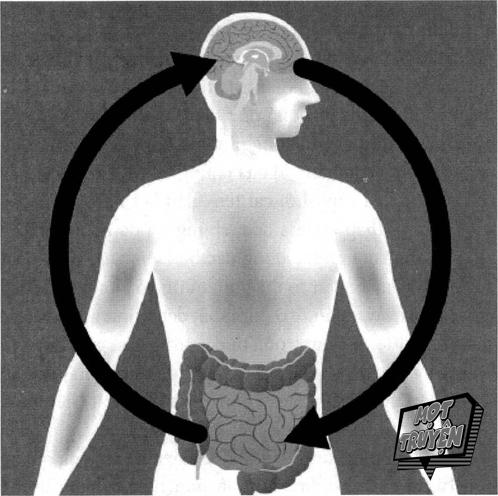
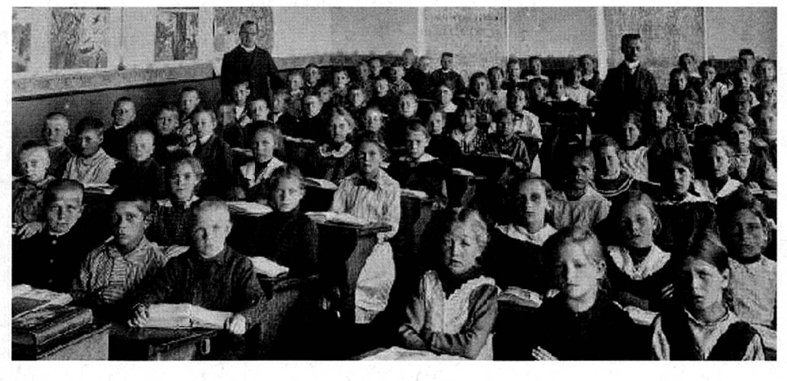

# Chương 3: Bộ não không giới hạn của bạn

Có thể bạn đang nghĩ rằng: Jim, tôi hiểu được điều anh muốn nói về công nghệ. Tôi cũng không muốn sống thiếu nó, nhưng tôi cảm thấy mình đang bị quá tải, bị xao nhãng và dễ quên hơn trước đây nhiều. Đây là tin vui cho bạn: Bạn vốn được sinh ra với một thứ công nghệ tối tân nhất - siêu sức mạnh vĩ đại nhất.

Hãy dành một chút thời gian để nhìn nhận sự phi thường của bộ não. Mỗi ngày bộ não tạo ra đến 70.000 suy nghĩ. Tốc độ của nó có thể sánh ngang với những chiếc xe đua siêu hạng nhất. Và cũng giống như dấu vân tay, mỗi người sẽ có một bộ não khác biệt - trong vũ trụ này không bao giờ có hai bộ não giống hệt nhau. Nó xử lý thông tin nhanh hơn bất cứ chiếc máy tính nào hiện nay và nó có khả năng lưu trữ gần như không giới hạn. Ngay cả khi bị tổn thương, nó vẫn có thể tạo ra những thiên tài, và thậm chí cả khi bạn chỉ có một nửa bộ não, bạn vẫn có thể hoạt động như một con người hoàn toàn bình thường.

Và đã có rất nhiều câu chuyện phi thường về bộ não. Ví dụ như chuyện về một bệnh nhân rơi vào tình trạng hôn mê nhưng vẫn tìm ra được cách giao tiếp với bác sĩ của mình. Hoặc chuyện về người phụ nữ có thể nhớ được những sự kiện quan trọng xảy ra chính xác vào ngày nào, kể từ thời điểm cô ấy 12 tuổi. Hoặc chuyện về một người vô công rồi nghề đã trở thành thiên tài toán học sau khi bị chấn thương vùng đầu trong một cuộc ẩu đả tại quán rượu. Tất cả những chuyện này đều không phải là khoa học viễn tưởng hay được lấy ra từ các tập truyện tranh siêu anh hùng. Chúng đơn giản là ví dụ cho những chức năng phi thường được tích hợp trong bộ máy kỳ diệu nằm bên trong đầu bạn.

Chúng ta thường xem nhẹ những chức năng ấy. Hãy nghĩ về những điều mà một người bình thường phải thực hiện để sống như một người “bình thường”. Khi lên một tuổi, bạn sẽ học cách bước đi, và đây là một chuyện không hề dễ dàng vì nó liên quan đến rất nhiều quy trình thần kinh và thể chất phức tạp trong cơ thể. Khoảng một năm sau đó, bạn sẽ học cách giao tiếp thông qua từ ngữ và lời nói. Mỗi ngày bạn học thêm hàng chục từ mới và ý nghĩa của chúng, và cứ tiếp tục học như vậy cho đến khi bạn đủ tuổi đến trường. Và khi đang học cách giao tiếp, bạn cũng đồng thời học cách lý giải nguyên nhân, tính toán và phân tích vô số các khái niệm phức tạp - và tất cả những điều này được thực hiện trước cả khi bạn đọc trang sách đầu tiên hay đến buổi học đầu tiên!

Bộ não là thứ khiến chúng ta trở nên khác biệt so với các loài động vật. Hãy nghĩ mà xem. Chúng ta không thể bay, chúng ta cũng không quá mạnh mẽ hay nhanh nhạy, chúng ta không có khả năng leo trèo khéo léo như một số loài khác, cũng không thể thở dưới nước. Khi xét về các năng lực thể chất, loài người chỉ ở mức trung bình. Nhưng chính nhờ sức mạnh của bộ não, chúng ta đã chiếm thế thượng phong tuyệt đối trên Trái Đất này. Vì đã sử dụng được năng lực trí tuệ phi thường này nên chúng ta đã sáng tạo ra cách để khám phá biển xanh sâu thẳm như loài cá, di chuyển những vật nặng hàng tấn như loài voi và thậm chí bay lượn như loài chim. Vâng, bộ não chính là một món quà kỳ diệu.

Bộ não phức tạp đến nỗi kiến thức của chúng ta về vũ trụ bao la có lẽ còn nhiều hơn kiến thức của ta về cách thức hoạt động của não. Và chỉ trong vòng một thập kỷ, chúng ta đã hiểu về bộ não nhiều hơn những gì ta biết về nó trong suốt lịch sử loài người... và trong khoảng thời gian từ lúc quyển sách này được in ra cho đến khi nó hiện diện trong nhà sách, có lẽ hiểu biết của chúng ta về bộ não sẽ còn tăng lên nhiều hơn nữa. Kiến thức về bộ não sẽ luôn luôn phát triển, và những gì ta biết vẫn còn rất ít ỏi thôi. Tuy nhiên, chỉ lượng kiến thức ít ỏi ấy thôi cũng đã rất đáng kinh ngạc rồi. Vậy nên, hãy cùng tôi khám phá bộ não không giới hạn của bạn.

Bộ não là một phần của hệ thần kinh trung ương (central nervous system - CNS). Bộ não có chức năng giống như trạm điều khiển trung tâm trong một sân bay vậy - nó có nhiệm vụ điều hướng tất cả những thông tin đến và đi, xử lý thông tin và phát ra các chỉ dẫn. Bộ não có ba khu vực chính: phần thân não, phần tiểu não và phần vỏ não (tên gọi gốc của tiểu não và vỏ não đều bắt đầu bằng từ cere, trong tiếng Latin có nghĩa là sáp bởi vì nó có kết cấu nhìn như sáp). Bộ não được cấu thành từ chất béo và nước, nặng khoảng 1,4 kilogam và sở hữu những sức mạnh cũng như khả năng phi thường.

Phần thân não điều khiển các chức năng cơ bản giúp chúng ta duy trì sự sống như hít thở, duy trì nhịp tim ổn định, tạo ra cảm giác thèm ăn hay quan hệ tình dục, và những phản ứng đóng vai trò sống còn trong tình huống nguy hiểm. Phần này nằm ngay phía trên cột sống và thuộc phần dưới của hộp sọ, sâu bên trong bộ não. Ở phía sau bộ não là phần tiểu não, có chức năng điểu khiển các chuyển động và sự phối hợp của cơ thể. Cũng có nhiều bằng chứng cho thấy rằng nó đóng vai trò trong việc ra quyết định của chúng ta.

Vỏ não là phần lớn nhất của bộ não, đây là nơi chịu trách nhiệm cho phần lớn các tư duy phức tạp, trí nhớ ngắn hạn và những kích thích giác quan. Vỏ não bao gồm các phần là thùy chẩm, thùy đỉnh, thùy thái dương và thùy trán. Thùy trán của chúng ta là nơi diễn ra phần lớn các hoạt động tư duy - nơi tạo ra các suy luận và sự sáng tạo.

Bộ não được chia làm hai nửa và chúng được liên kết với nhau bằng thể chai - bộ phận này có chức năng giống như dây nối điện thoại, kết nối hai bán cầu não của chúng ta và truyền tín hiệu qua lại. Hiện tại, khi bạn đọc những dòng này và cố gắng hiểu các thông tin mình đọc được, có khoảng 86 tỷ nơ-ron (hay còn được gọi là tế bào não) đang hoạt động và phối hợp một cách hài hòa. Khi các nơ-ron này truyền tín hiệu vào não, các chất dẫn truyền thần kinh sẽ tiếp nhận và sau đó truyền thông điệp sang một chất dẫn truyền thần kinh khác hoặc kết thúc tín hiệu khi phù hợp.

Chúng ta đã từng nghĩ rằng khả năng trí não của mỗi người sẽ đạt đến đỉnh cao ở cuối giai đoạn dậy thì, sau đó thì não sẽ không bao giờ phát triển nữa mà chỉ có thoái hóa dần thôi. Giờ đây, ta biết sự thật hoàn toàn không phải như vậy. Bộ não của chúng ta có tính khả biến thần kinh, có nghĩa là nó có thể thay đổi và tái định hình tùy vào hành động và môi trường sinh sống của chúng ta. Bộ não của ta luôn luôn thay đổi và tái định hình để trở nên phù hợp với môi trường và yêu cầu mà bạn đặt ra cho nó.

Bởi vì bộ não sẽ chịu ảnh hưởng từ yếu tố gen và môi trường, mỗi người sẽ có một bộ não khác nhau. Cũng như những bông tuyết vậy, không có hai bông tuyết nào giống nhau hoàn toàn. Mỗi bộ não sẽ thích nghi để phù hợp với nhu cầu của chủ nhân. Hãy thử xem xét trường hợp một người lớn lên trong môi trường đầy rẫy áp lực với đói nghèo và nguy hiểm luôn rình rập. Bộ não của người đó sẽ có cấu trúc rất khác so với não của một người được nuôi dưỡng trong môi trường thoải mái, sung túc và được yêu thương chăm sóc. Nhưng đừng vội kết luận rằng người sống trong môi trường tốt hơn sẽ có được bộ não tốt hơn, vì bạn còn phải cân nhắc nhiều yếu tố nữa.

Như tôi đã nói ở đoạn trước, bộ não có khả năng thay đổi và tái định hình, có nghĩa là bất cứ ai, trong bất cứ thời điểm nào, cũng có thể quyết định thay đổi các chức năng của bộ não được. Mặc dù có vẻ như những người lớn lên trong môi trường nhiều áp lực và ít sự hỗ trợ sẽ khó có thể tối đa hóa tiềm năng của mình vì bộ não họ phải thích nghi với hoàn cảnh ấy, nhưng ngày càng có nhiều bằng chứng cho thấy rằng những người này hoàn toàn có thể phát triển mạnh mẽ và đạt đến tầm cao mới chính nhờ vào tâm thế được trui rèn trong môi trường không thuận lợi như vậy. Nhiều người có tuổi thơ khó khăn nhưng vẫn thành công trong cuộc sống, và có lẽ chính tuổi thơ khốn khó và hoàn cảnh khắc nghiệt thuở nhỏ đã cho họ sự kiên trì và những tố chất khác để đạt đến thành công.

## TÌM HIỂU VỀ TÍNH KHẢ BIẾN THẦN KINH

Chúng ta học được gì từ bộ não của những tài xế taxi tại London?

Đây chính là câu hỏi mà nhà khoa học thần kinh Eleanor Maguire tại Đại Học London đã đặt ra khi cô ấy xem xét về khối lượng thông tin cực lớn được lưu trữ trong bộ não của những người lái xe taxi ở thành phố này - họ được gọi là “Nhà Thông Thái”. Để có được giấy phép lái xe, các ứng viên sẽ phải lái xe gắn máy đi qua các khu vực nhất định trong thành phố - trong vòng bán kính 10 kilomet kể từ trạm Charing Cross - trong vòng ba đến bốn năm và cố gắng ghi nhớ 25.000 con đường kết nối chằng chịt với nhau như mê cung, cùng với hàng nghìn địa điểm nổi bật trên các con đường này. Thậm chí sau một thời gian học hỏi vất vả như vậy, chỉ có khoảng 50% các ứng viên có thể vượt qua được bài sát hạch cấp bằng. Maguire nghĩ rằng những người đỗ kỳ thi sát hạch là những người có hồi hải mã trong não lớn hơn người bình thường.

Maguire và các cộng sự của mình đã khám phá ra rằng các tài xế taxi ở London thật sự có “nhiều chất xám hơn trong các hồi hải mã sau, so với những người có cùng độ tuổi, trình độ giáo dục và mức độ thông minh nhưng không lái xe taxi. Nói cách khác thì các tài xế taxi có các trung tâm trí nhớ lớn hơn so với những người khác. Có vẻ như thời gian họ lái taxi càng dài thì hồi hải mã của họ càng lớn, cứ như thể bộ não của họ có khả năng mở rộng để đáp ứng được nhu cầu điều hướng trên những cung đường của London vậy.”

Nghiên cứu về Tài xế Taxi London đã cho ta một ví dụ thuyết phục về tính khả biến thần kinh của bộ não, hay nói cách khác là khả năng tái cơ cấu và tự thay đổi khi bộ não được tiếp nhận với các kiến thức và trải nghiệm mới. Việc phải thường xuyên học những cung đường mới trong thành phố đã buộc bộ não của các tài xế taxi tạo ra những liên kết thần kinh mới. Những liên kết thần kinh này đã thay đổi cấu trúc và kích thước của bộ não - và đó chính là ví dụ tuyệt vời cho khả năng không giới hạn của bô não.

Tính khả biến thần kinh, hay đúng hơn là tính khả biến thần kinh của bộ não, có nghĩa là mỗi khi bạn học một điều gì đó mới, bộ não của bạn sẽ tạo ra một kết nối khớp thần kinh mới. Và khi điều này xảy ra, bộ não của bạn sẽ có những thay đổi về vật chất - nó sẽ nâng cấp phần cứng của mình để tiến đến một cấp độ trí tuệ mới. -

Tính khả biến thần kinh phụ thuộc vào khả năng phát triển và kết nối của nơ-ron với các nơ-ron khác trong những phần khác nhau của bộ não. Khi điều này xảy ra, nó sẽ tạo ra các liên kết mới, làm gia tăng hoặc suy giảm (tùy vào trường hợp) các liên kết cũ.

Bộ não có khả năng thay đổi. Chúng ta sở hữu một khả năng phi thường là có thể thay đổi cấu trúc và cơ cấu của não bộ qua thời gian, thông qua việc tạo ra các liên kết thần kinh mới, và chúng ta thực hiện điều này khi học hỏi, trải nghiệm và thích nghi với những điều mới. Tính khả biến thần kinh giúp ta hiểu được tại sao mọi thứ đều có thể. Các nhà nghiên cứu cho rằng mọi bộ não đều rất linh hoạt bởi vì mạng lưới liên kết đầy phức tạp của các nơ-ron có thể được thay đổi để tạo ra các lên kết mới. Đôi khi điều này sẽ giúp bộ não bù đắp cho những điều nó đã mất đi, ví dụ một bán cầu não có thể thực hiện chức năng của cả hai bán cầu. Giống như việc có những người bị đột quỵ nhưng sau đó họ có thể xây dựng và tìm lại được các chức năng của bộ não. Hay những người trước đây hay trì hoãn, hay suy nghĩ tiêu cực và ăn nhiều thực phẩm không lành mạnh sau này lại có thể thay đổi hành vi của mình và từ đó thay đổi cuộc sống.

Nếu việc học hỏi giúp tạo ra các liên kết thần kinh mới thì việc ghi nhớ sẽ giúp duy trì và tăng cường các liên kết ấy. Khi chúng ta không thể nào nhớ được hoặc gặp khó khăn trong việc ghi nhớ thì có nghĩa rằng liên kết giữa các nơ-ron đã bị đứt gãy. Trong học tập, việc bạn quên một kiến thức nào đó là do bạn chưa tạo được liên kết giữa điều mới học với những điều mình đã biết, và bạn cũng chưa biết được mình sẽ sử dụng nó trong cuộc sống thế nào.

Ví dụ, trong một thời điểm nào đó, bạn cảm thấy điều mình học được là rất giá trị, nhưng sau này bạn không bao giờ sử dụng lại thứ đã học thì bạn sẽ không thể nào ghi nhớ được nó. Tương tự, nếu học gì đó nhưng bạn lại không biết tại sao kiến thức ấy quan trọng hay làm thế nào để ứng dụng nó trong công việc và cuộc sống thì bộ não của bạn cũng sẽ không lưu trữ thông tin ấy. Việc quên đi những điều đã học là rất bình thường vì chúng ta là con người chứ không phải là máy móc. Nhưng nếu chúng ta có thái độ kiểu như: “Tôi có trí nhớ kém” hoặc “tôi quá ngốc nên không thể ghi nhớ được”, thì chúng ta đang tự ảnh hưởng tiêu cực đến khả năng học hỏi và phát triển của chính mình. Nói cách khác thì việc quên kiến thức không quá nghiêm trọng, nhưng chính những niềm tin tiêu cực ta tạo ra mới thật sự gây ra tác hại lớn. Thái độ như vậy sẽ khiến bạn củng cố thêm cho các niềm tin giới hạn, và bạn sẽ không thể nào nhận ra được sai lầm của mình và học lại kiến thức đó.

Điều này có ý nghĩa gì trong quá trình học tập của bạn? Nhờ tính khả biến, bạn sẽ có thể thay đổi và tái định hình bộ não để đáp ứng những mong muốn của mình. Bạn sẽ hiểu rằng ghi nhớ là một khả năng có thể luyện tập được - nếu bạn biết phương pháp giúp bộ não mình tiếp nhận, mã hóa, xử lý và củng cố thông tin. Điều này có nghĩa là chỉ cần một vài thay đổi nhỏ trong các khía cạnh như môi trường, thức ăn hay tập luyện, bạn sẽ có thể thay đổi các chức năng trí não của mình một cách ngoạn mục. Tôi sẽ chia sẻ các bí quyết mạnh mẽ này cụ thể trong Chương 8.

Kết luận là như thế này: Tính khả biến thần kinh giúp bạn hiểu rằng hành trình học tập, và thật ra là cả cuộc sống mình vốn không phải đã được định đoạt trước. Bạn có thể trở thành, thực hiện và chia sẻ bất cứ điều gì khi bạn tối ưu hóa và tái cấu trúc được bộ não của mình. Một khi bạn đã thông suốt và áp dụng được tâm thế, động lực và phương pháp đúng đắn, bạn sẽ trở nên không giới hạn.

## BỘ NÃO THỨ HAI

Các học viên nói với tôi rằng sau khi hiểu được về sự vĩ đại của bộ não, họ khám phá ra được giá trị thực sự của bản thân và lòng tự tôn của họ tăng lên đáng kể gần như ngay lập tức. Và thêm một tin tốt nữa đây: bạn không chỉ có một bộ não, mà có đến tận hai - bộ não thứ hai chính là trực giác của bạn. Đã bao giờ bản cảm thấy “linh tính mách bảo” một điều gì đó chưa? Một điều bạn hiểu rõ nhưng lại không biết tại sao mình hiểu? Đã bao giờ bạn thực hiện một quyết định gì đó do “trực giác thúc đẩy” hoặc cảm thấy “chộn rộn trong lòng” chưa? Đã bao giờ bạn tự hỏi điều ấy chính xác là gì không? Ẩn sâu bên trong hệ tiêu hóa của bạn là một “bộ não trong đường ruột”, và nó đang mở ra những hiểu biết mới về y học, giúp làm sáng tỏ mối quan hệ giữa việc tiêu hóa, tâm trạng, sức khỏe và thậm chí những suy nghĩ của bạn.

Các nhà khoa học gọi bộ não nhỏ này là hệ thống thần kinh ruột (enteric nervous system - ENS). Và nó không nhỏ lắm đâu. ENS là hai lớp màng mỏng bao gồm hơn 100 triệu tế bào thần kinh bao phủ bề mặt của ống tiêu hóa, suốt từ thực quản đến trực tràng. Khoa học mới chỉ đang có những khám phá đầu tiên về mối quan hệ giữa bộ não và đường ruột, cũng như tác động của nó đến bộ não, tâm trạng và hành vi của chúng ta. Mối quan hệ này có thể được đề cập dưới cái tên “liên kết não bộ đường ruột”. Trong thập kỷ vừa qua, chúng tôi đã khám phá ra rằng đường ruột có tác động đặc biệt lên cách thức hoạt động của bộ não. Bạn có thể hình dung nó giống như cách một cái cây vậy. Phần rễ ở dưới mặt đất sẽ hút nước và các chất dinh dưỡng quan trọng từ đất cũng như giao tiếp với những loại thực vật khác. Các chất dinh dưỡng này sau đó sẽ được truyền lên thân cây, giúp gia cố và phát triển thân cây, đồng thời cung cấp các chất cần thiết để cây mọc lá mới vào mỗi mùa xuân, từ đó thực hiện hoạt động quang hợp từ ánh sáng - đây cũng là một nguồn năng lượng khác cho cây.

Tương tự như vậy, các chất dinh dưỡng mà ta đưa vào cơ thể sẽ được hấp thụ trong đường ruột, và đó chính là nhiên liệu cho bộ não. Mặc dù bộ não chỉ chiếm một phần nhỏ trọng lượng cơ thể nhưng nó tiêu thụ đến 20% tổng năng lượng mà ta nạp vào, vậy nên các chất dinh dưỡng mà bạn hấp thụ sẽ có ảnh hưởng lớn đến những chức năng mà não bộ thực hiện hàng ngày.

Đường ruột của chúng ta được bao phủ bởi hơn một trăm triệu tế bào thần kinh, và nó là một phần của ENS. Khi bào thai lớn lên trong bụng mẹ, ENS và CNS cùng được phát triển từ một mô và hai hệ thống này vẫn tiếp tục kết nối với nhau thông qua dây thần kinh phế vị. Hai hệ thống này có rất nhiều đặc điểm cấu tạo giống nhau. Cả hai đều hoạt động thông qua các chất dẫn truyền thần kinh như nhau, bao gồm serotonin, dopamine và acetylcholine. Và tương tự như trường hợp của CNS, chúng ta cũng từng tưởng rằng mỗi người sinh ra với một số lượng tế bào nhất định trong ENS - và không thể sản sinh ra nhiều hơn. Thế nhưng ENS vẫn tiếp tục tạo ra nơ-ron mới khi con người đã trưởng thành và các tế bào hư hại cũng sẽ được sửa chữa. Đường ruột của chúng ta chứa các nơ-ron này, cùng với một mạng lưới các vi sinh vật, tạo nên hệ vi sinh trong cơ thể chúng ta. Tương tự như bộ não, hệ vi sinh của mỗi người cũng khác nhau.

Không chỉ vậy, những tế bào thần kinh này cũng hoạt động theo những cách thức cực kỳ giống với bộ não. Vào năm 2010, nhà khoa học thần kinh Diego Bohórquez tại Đại học Duke đã khám phá ra rằng các tế bào nội tiết trong ruột có “cấu tạo lồi lõm giống như bàn chân”, và cấu trúc này khá giống với cấu trúc của các khớp thần kinh mà tế bào thần kinh sử dụng để giao tiếp. Điều này khiến Bohórquez đặt ra câu hỏi rằng liệu các tế bào này có thể “nói chuyện” với bộ não thông qua phương thức tương tự như cách nơ-ron hoạt động hay không. Ông ấy đưa ra giả thuyết rằng nếu thực sự như vậy thì có lẽ chúng sử dụng các dây thần kinh phế vị, vốn là các tế bào kết nối đường ruột và thân não. Sau khi thực hiện nghiên cứu thêm, họ nhận ra rằng những tế bào này thực sự đang sử dụng dây thần kinh phế vị để phát và truyền thông điệp đến cho bộ não, và phương pháp này nhanh hơn so với việc truyền qua đường máu.

## PHỐI HỢP HOẠT ĐỘNG

Mối liên kết giữa bộ não và đường ruột vẫn đang được nghiên cứu sâu hơn, nhưng có vẻ như hai hệ thống này hoạt động theo phương thức rất giống nhau và hoạt động song song với nhau. Bộ não nhỏ cùng với bộ não lớn ảnh hưởng một phần đến sức khỏe tinh thần của chúng ta. Khi bạn có linh tính rằng có gì đó sai sai, hoặc khi bạn có cảm giác mình nên nghe theo trực giác mách bảo, thì điều đó không chỉ là mê tín đâu - linh tính, hay chính xác hơn là bộ não trong ruột của bạn, phân tích các sự kiện theo cách riêng của nó và truyền thông điệp ấy đến não. Không chỉ vậy, khi bạn nạp vào ruột mình những thực phẩm không tốt thì nhiên liệu bạn đưa lên não cũng không tốt.

Ngay lúc này, đường ruột của bạn đang tiêu hóa những thứ bạn vừa mới ăn và gửi nguồn nhiên liệu đó đến cho bộ não. Đồng thời, một phần bộ não của bạn đang cố gắng hiểu những trang sách mà bạn đang cầm trên tay (hoặc trên phần mềm đọc sách điện tử, nếu bạn thích đọc theo cách đó hơn), cảm nhận sự thoải mái của chiếc ghế bạn đang ngồi, xem xét môi trường xung quanh để đảm bảo bạn vẫn an toàn. Một phần khác của bộ não thì đang xử lý thông tin về các mùi hương trong môi trường, có thể là mùi cà phê, hoặc mùi nước hoa, hoặc mùi của những trang sách. Một phần khác của bộ não lại đang tiếp thu các ký hiệu ngôn ngữ trong quyển sách này và biến chúng trở thành các thông tin có ý nghĩa, sau đó thông tin sẽ được xử lý và lưu trong bộ nhớ ngắn hạn. Tại đó, chúng sẽ được gửi đến bộ nhớ dài hạn (nếu có đủ các điều kiện cần thiết, và chúng ta sẽ tìm hiểu về việc này trong phần sau.)

Tôi đề cập tất cả những điều này là để cho bạn thấy rằng bạn có một siêu sức mạnh tối thượng bên trong đầu mình. Bạn đồng thời cũng có năng lực rèn luyện và khiến sức mạnh ấy còn phi thường hơn nữa, hoặc khiến nó thoái hóa và mục nát. Bạn cần phải quyết định xem siêu sức mạnh của mình nên được sử dụng ở đâu: một môi trường giúp bạn đạt đến sứ mệnh trong cuộc sống hay môi trường khiến sự tập trung của bạn bị phân tán khỏi những ước mơ vĩ đại nhất.

## ĐIỀU HIỂN NHIÊN KHÓ HIỂU

Nếu như chúng ta đang sở hữu sức mạnh tâm trí to lớn như vậy thì tại sao ta vẫn chật vật khó khăn trong cuộc sống? Nếu bộ não thực sự kỳ diệu như vậy thì tại sao sự quá tải, sự xao nhãng, chứng hay quên hay cảm giác yếu kém lại ảnh hưởng đến ta nhiều đến vậy? Tại sao con người có nhiều tiềm năng như thế nhưng có những lúc ta không thể nhớ nổi một cái tên đơn giản hay chẳng thể nghĩ ra cách giải quyết cho những vấn đề cơ bản. Câu trả lời rất đơn giản, gần như là điều hiển nhiên nhưng không phải ai cũng hiểu: không có ai dạy chúng ta thực hiện điều đó cả.

Khi dạy một ý tưởng cho người khác, bạn sẽ mang lại giá trị cho họ trong ngày hôm đó. Khi dạy cho người khác cách học hỏi, bạn sẽ mang lại giá trị cho họ cả đời.

Trường học là một nơi rất tốt để học hỏi. Ở đó, chúng ta được dạy rằng mình cần học gì, cần nghĩ gì và cần nhớ gì. Thế nhưng rất ít, và gần như là không hề có, lớp học nào dạy chúng ta phương pháp học, phương pháp suy nghĩ, và phương pháp ghi nhớ.

Trong quyển sách mang tính tiên phong về giáo dục mang tên Creative School, Ngài Ken Robinson đã nói rằng: “Một trong những mối quan ngại lớn nhất của tôi là mặc dù hệ thống giáo dụng trên toàn thế giới đang được cải cách, nhưng các cải cách này lại bị ảnh hưởng bởi các động cơ chính trị và kinh tế - điều này khiến mọi người hiểu nhầm về cách thức con người học hỏi và cách thức vận hành của một ngôi trường tốt. Chính vì vậy, những cải cách này đang ảnh hưởng xấu đến tiềm năng của vô số người trẻ. Dù sớm hay muộn thì chúng cũng sẽ ảnh hưởng đến bạn hoặc một người mà bạn quen biết.”

Tôi nghĩ rằng chúng đã và đang ảnh hưởng đến bạn và mọi người xung quanh bạn rồi. Như bạn biết đấy, cá nhân tôi đã có một trải nghiệm khá phức tạp trong hệ thống giáo dục, và tôi hiểu rằng tôi là một trường hợp khác thường. Tuy nhiên, trong thực tế thì ngay cả khi tôi không trải qua chấn thương nghiêm trọng trong trường mẫu giáo thì có lẽ tôi cũng không học được nhiều từ hệ thống giáo dục trong trường. Đó là bởi vì trên toàn thế giới, có rất ít trường học nào có kết hợp dạy phương pháp học trong nội dung giảng dạy chính khóa. Họ chỉ đơn giản là cung cấp thông tin cho chúng ta. Họ sẽ đưa cho chúng ta những kiệt tác văn học, giới thiệu những con người đã làm thay đổi tiến trình văn minh của nhân loại. Họ sẽ kiểm tra chúng ta - đôi khi quá trình kiểm tra kéo dài bất tận - để xác định xem ta có thể lặp lại những gì họ đã dạy hay không. Nhưng họ sẽ không đào sâu hơn và dạy chúng ta phương pháp để ta tự học hỏi, tự làm giàu cho tâm trí, khám phá những khái niệm mới và thực sự đắm chìm vào những điều mình đã học được trong cuộc sống hàng ngày.

> *“Cách duy nhất để chiến thắng là học hỏi nhanh hơn bất cứ ai khác.”*
>
> -ERIC RIES

Tôi không có ý đổ lỗi cho những giáo viên đang làm việc cật lực để dạy dỗ con em chúng ta. Theo ý kiến của ý tôi, giáo viên là một trong những con người có sự quan tâm, cảm thông và có năng lực nhất trong xã hội. Thật ra, mẹ tôi đã trở thành giáo viên sau khi tôi bị chấn thương não bởi vì bà thấy tôi gặp quá nhiều khó khăn, và bà muốn giúp đỡ tôi cũng như những đứa trẻ khác giống tôi. Vấn đề nằm ở hệ thống lỗi thời mà giáo viên đang phải tuân theo. Nếu Rip Van Winkle[^5] tỉnh dậy khỏi giấc ngủ sau nhiều thập

kỷ thì điều duy nhất ông vẫn thấy quen thuộc chính là các lớp học, bởi vì chúng chẳng thay đổi gì mấy. Trong một thời đại mà những chiếc ô tô điện đang chạy theo hệ thống lái tự động và con người đang phát minh ra các phương tiện đưa nhân loại lên sao Hỏa thì hệ thống giáo dục của chúng ta giống như một cỗ xe chạy bằng ngựa kéo vậy.

Và còn cả vấn đề về công việc, sự nghiệp của chúng ta nữa - nó cũng đã có nhiều thay đổi sâu sắc với tốc độ ngày một nhanh. Quá trình tự động hóa và trí tuệ nhân tạo (artificial intelligence - AI) đang ảnh hưởng đến rất nhiều nghề nghiệp, những nhà máy đang dần thay thế nhân công bằng máy móc và nhiều thay đổi khác nữa. Không chỉ vậy, rất nhiều người trong chúng ta đang phải đối mặt thực trạng rằng các công việc ổn định dài hạn đang dần bị thay thế bởi các hợp đồng ngắn hạn và dễ thay đổi. Có nhiều công việc mà cách đây năm năm chưa có ai nghĩ đến thì giờ đã trở nên phổ biến, và còn có những công việc khác vẫn đang liên tục xuất hiện và sẽ ảnh hưởng đến thị trường việc làm trong những năm tiếp theo.

Tất cả những chuyện này đều mang cùng một ý nghĩa: Chúng ta phải tự chủ trong việc học hỏi và phát triển bản thân. Nếu trường học chỉ dạy chúng ta nội dung cần học nhưng không dạy phương pháp để học chúng thì chúng ta cần phải tự mình thực hiện điều ấy. Nếu công nghệ tạo ra sự quá tải và ảnh hưởng đến khả năng hoạt động của bộ não, chúng ta cần phải sử dụng những kiến thức của mình về việc học để tái thiết lập các nguyên tắc hoạt động cơ bản. Nếu môi trường làm việc đang phát triển quá nhanh chóng và chúng ta không thể biết được mình cần kỹ năng gì để tồn tại vào ngày mai thì cách duy nhất để đón đầu là trang bị bản thân khả năng học hỏi hoàn toàn tự chủ để đối diện với tương lai bất định sắp tới.

## KHỞI ĐỘNG SỨC MẠNH

Có một mẩu chuyện nhỏ quen thuộc như sau: Một ngày nọ, tại một nhà máy điện, mọi hoạt động đột nhiên dừng lại. Tất cả các loại máy móc đều ngừng chạy. Sự im lặng kéo dài đến đáng sợ. Những người vận hành nhà máy trở nên hoảng loạn và sau nhiều giờ liền, không một nhân viên nào có thể tìm ra được vấn đề. Đến lúc đó, trưởng bộ phận vận hành cảm thấy quá tuyệt vọng nên đã gọi người giỏi nhất ở trong vùng đến để giải quyết.

Chuyên gia kỹ thuật đến nơi và xem xét các loại máy móc xung quanh. Anh ấy đi đến một hộp điện trong hệ thống vốn có rất nhiều hộp điện, mở chiếc hộp đó ra và nhìn thật kỹ các con ốc vít và dây điện ở bên trong. Anh ấy vặn một con ốc vít và kỳ diệu thay, mọi thứ bắt đầu hoạt động trở lại, nhà máy lại tiếp tục vận hành như bình thường.

Vị trưởng bộ phận vận hành cảm thấy cực kỳ nhẹ nhõm. Ông cảm ơn người kỹ thuật viên và hỏi người này xem anh ta sẽ tính bao nhiêu tiền. Người kỹ thuật viên nói: “10.000 đô la”. Vị trưởng bộ phận cảm thấy rất sốc.

“Ý anh là sao? 10.000 đô la? Anh chỉ đến đây có vài phút. Anh chỉ vặn lại đúng một con vít. Đó là việc mà ai cũng làm được. Anh làm ơn hãy liệt kê ra chi tiết các khoản tiền trong đơn giá của anh.”

Kỹ thuật viên này đưa tay vào túi, rút ra một tập giấy nháp, viết lên đó vài dòng ngắn gọn và đưa tờ giấy cho vị trưởng bộ phận. Người này đọc và ngay lập tức thanh toán số tiền đó. Đơn giá như sau: “Vặn ốc vít: 1 đô la. Biết được cần phải vặn con ốc nào: 9.999 đô la.”

Vậy bài học rút ra từ câu chuyện này là gì? Không phải là đầu bạn có một con ốc vít bị hỏng đâu. Câu chuyện này cho ta thấy hai điều.

Bài học thứ nhất là giá trị khổng lồ mà một bộ não không giới hạn có thể mang lại cho bạn và những người khác. Chúng ta hiện đã bước vào thời kỳ kinh tế xem trọng khả năng chuyên môn hơn là sức mạnh cơ bắp. Thứ ở bên trong đầu bạn chính là tài sản quý giá nhất có thể giúp bạn tạo ra của cải. Nhưng không phải ai cũng biết chuyện này. Và một khi hiểu được thực tế này thì bạn không chỉ có sức mạnh mà còn được cả tiền tài. Khả năng tư duy, giải quyết vấn đề, ra quyết định đúng đắn, sáng tạo, cải tiến và tưởng tượng sẽ giúp chúng ta tạo ra giá trị trong cuộc sống. Bạn học hỏi càng nhanh thì số tiền kiếm được sẽ càng nhiều.

Và điều này dẫn chúng ta đến với bài học thứ hai. Chiếc ốc vít đó đã tạo ra sự khác biệt vô cùng to lớn. Tôi đã hướng dẫn và huấn luyện cho nhiều bộ óc phi thường, và bạn không cần phải là một thiên tài mới hiểu được rằng mọi tài năng đều có bí quyết cả. Một trong số các bí quyết ấy là: những người có khả năng trí tuệ vượt trội sẽ chọn lọc và tập trung vào một vài “con ốc vít” quan trọng để tạo ra sự khác biệt to lớn và khởi động cho mọi thứ. Quyển sách này mang đến cho bạn rất nhiều công cụ, chiến lược và hành vi mà tôi đã khám phá được, giúp bạn tối ưu hóa kết quả và thành tựu từ những nỗ lực mình bỏ ra.

Thế giới ngày càng mang đến nhiều thử thách hơn cho bạn, và mọi bằng chứng đều cho thấy rằng những thử thách ấy sẽ ngày càng nhiều và khó khăn hơn. Đồng thời, nếu có được bộ não sắc bén nhanh nhạy thì những điều bạn đạt được cũng sẽ ngày càng to lớn hơn, hơn nữa, giờ đây bạn đã hiểu được rằng mình có quá đủ tiềm năng để vượt qua bất cứ thử thách nào. Nhưng để làm được như vậy, bạn cần kiểm soát được quá trình học hỏi của mình.

Có thể bạn nghĩ rằng để đáp ứng được yêu cầu liên tục gia tăng hiện nay thì mình cần phải có những khả năng rất siêu phàm. Nhưng thật ra, trong bạn vốn đã ẩn giấu siêu sức mạnh rồi, đó là bộ não của bạn. Có thể bạn không có khả năng bắn tơ và tạo lưới nhện từ tay, nhưng bạn sở hữu một thứ tốt hơn nhiều, đó là mạng lưới tế bào thần kinh trong não bạn. Nguồn sức mạnh ẩn chứa trong đầu bạn chính là món quà tuyệt vời nhất và là lợi thế lớn nhất mà bạn có được. Điều chúng ta cần làm chỉ là nâng cấp bộ não, giống như nâng cấp điện thoại vậy. Vậy làm sao để cài đặt một phần mềm mới vào não bạn? Một trong những cách tôi thích nhất là điều bạn đang làm ngay lúc này. Phương pháp này tên là: ĐỌC

> *“Tôi không chỉ sử dụng bộ não mình có mà còn dùng tất cả những bộ não mình có thể mượn được.”*
>
> -WOODROW WILSON

---

### Chú thích trong chương

[^5]: Rip Van Winkle là một nhân vật hư cấu trong truyện ngắn The Sketch Book của Washington Irving (1783-1859), một tác giả người Mỹ. Rip Van Winkle là một nông dân sống trong một ngôi làng nhỏ gần ngọn núi Kaatskill, bên bờ sông Hudson. Trong truyện, sau khi uống rượu cùng những người bí ẩn trên ngọn núi, ông ngủ thiếp đi và khi ông tỉnh dậy, đã 20 năm trôi qua.

