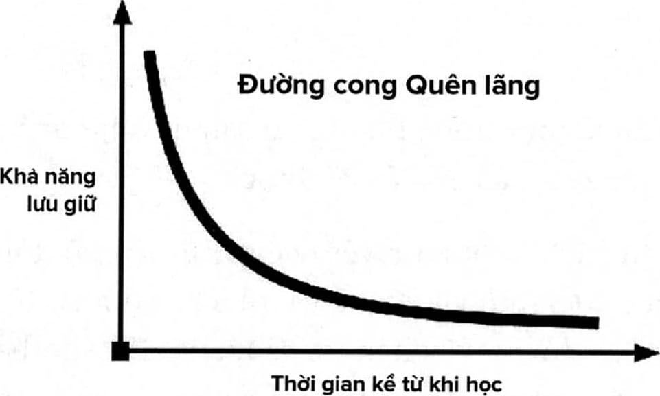
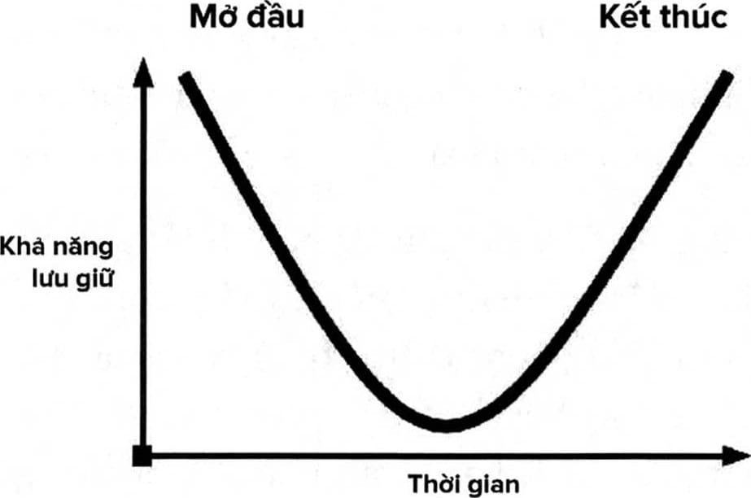

# Chương 4: Phương pháp để đọc và ghi nhớ quyển sách này và bất cứ quyển nào khác

Thời gian là một trong những tài sản quý giá nhất. Đó là thứ bạn không bao giờ lấy lại được.

Với tư cách là huấn luyện viên cho não bộ, tôi muốn bạn đạt được những kết quả và lợi ích cao nhất từ sự tập trung mình bỏ ra, vậy nên tôi sẽ mang đến cho bạn một vài khuyến nghị để tận dụng tối đa quyển sách này. Bạn có thể áp dụng lời khuyên này trong bất cứ điều gì mình muốn đọc và học hỏi.

Hãy bắt đầu bằng câu hỏi này: Đã bao giờ bạn đọc gì đó nhưng hôm sau là quên ngay?

Bạn không phải là trường hợp duy nhất đâu. Các nhà tâm lý học gọi việc này là “đường cong quên lãng”. Đó là một công thức toán học mô tả tốc độ một người quên đi các thông tin sau lần học đầu tiên. Các nghiên cứu cho thấy rằng con người quên đi khoảng 50% những điều họ học chỉ sau một giờ, và quên đi 70% trong 24 giờ tiếp theo.

Dưới đây là một vài khuyến nghị giúp bạn khắc phục được đường cong quên lãng. Ở phần sau đó, tôi sẽ chia sẻ với bạn các chiến lược cao cấp để tăng tốc khả năng học hỏi và lưu giữ những gì đã học trong các lĩnh vực như học tập, đọc nhanh và tăng cường trí nhớ.

Các nghiên cứu cho thấy rằng khả năng tập trung của chung ta sẽ suy giảm một cách tự nhiên sau 10 đến 14 phút. Nếu chúng ta thực hiện một công việc nào đó trong khoảng thời gian lâu hơn, thì kết quả ta đạt được sẽ giảm xuống tỉ lệ nghịch với thời gian bỏ ra, bởi vì khi ấy tâm trí ta không còn tập trung tốt nữa. Chính vì vậy, tôi đề nghị bạn sử dụng kỹ thuật Pomodoro - đây là một kỹ thuật giúp gia tăng hiệu suất làm việc được Francesco đề xuất, phát triển từ ý tưởng rằng: thời gian lý tưởng để tập trung vào một công việc là 25 phút, sau đó là 5 phút nghỉ. Mỗi khoảng thời gian 25 phút như vậy được gọi là một “Pomodoro”. Khi bạn đọc quyển sách này, tôi khuyên bạn nên đọc nó trong một Pomodoro và sau đó nghỉ giải lao 5 phút trước khi đọc tiếp.

Khi học, kỹ thuật Pomodoro cũng mang đến hiệu quả tốt vì nó phù hợp với các nguyên tắc về trí nhớ, đặc biệt là hiệu ứng ưu tiên và ưu hậu.

Hiệu ứng ưu tiên có nghĩa là bạn thường có xu hướng nhớ những điều mình được tiếp xúc ở phần đầu của buổi học, của bài giảng hoặc thậm chí là trong các hoạt động giao tiếp xã hội. Nếu bạn đến một buổi tiệc và gặp 30 người lạ mặt thì có lẽ bạn sẽ nhớ được một vài người đầu tiên (trừ khi bạn đã tập được khả năng ghi nhớ tên người thông qua các phương pháp mà tôi sẽ dạy ở phần sau của quyển sách).

Hiệu ứng ưu hậu có nghĩa là bạn cũng có xu hướng nhớ điều cuối cùng (gần đây nhất) mà mình học. Cũng lấy ví dụ trong buổi tiệc, bạn cũng sẽ nhớ được tên của vài người cuối cùng mình gặp.

Chúng ta ai cũng có xu hướng trì hoãn trước một kỳ thi và vào đêm cuối cùng trước ngày thi, ta sẽ ngồi xuống và cố gắng “học nhồi nhét” càng nhiều càng tốt mà không có các khoảng nghỉ ở giữa. Hiệu ứng ưu tiên và ưu hậu chính là hai trong số (rất nhiều) lý do khiến việc học nhồi không hiệu quả. Khi có các khoảng nghỉ, bạn sẽ tạo ra được nhiều điểm mở đầu và kết thúc trong việc học hơn, và vì thế sẽ ghi nhớ được một lượng kiến thức lớn hơn nhiều.

Nếu bạn ngồi xuống và đọc một quyển sách trong vòng hai tiếng đồng hồ mà không có khoảng nghỉ nào, có thể bạn sẽ nhớ được nội dung mình đã đọc trong 20 phút đầu tiên, và sau đó vào khoảng phút thứ 30, khả năng ghi nhớ của bạn sẽ giảm sút, và sau đó bạn có xu hướng nhớ những thứ gần thời điểm bạn kết thúc việc đọc. Điều này có nghĩa là khoảng thời gian chùng xuống ở giai đoạn giữa - khi bạn không có khoảng nghỉ để dung nạp và suy nghĩ về những điều mình vừa mới đọc - chính là khoảng thời - gian chết trong quá trình học hỏi. Vậy nên, khi đọc quyển sách này, mỗi lần bạn chỉ nên đọc trong một Pomodoro thôi để tiếp thu nhiều nhất những điều mình đọc. Nếu vẫn muốn chọn cách học nhồi, thì bạn cũng sẽ học được các phương pháp hữu ích trong quyển sách này để ghi nhớ thông tin trong “khoảng chùng” ở giữa này.

Bạn có biết rằng chính việc đọc quyển sách này sẽ giúp bạn trở nên thông minh hơn không? Nghe thì có vẻ phi thực tế, nhưng tôi hoàn toàn tin tưởng vào điều này. Thứ nhất, quyển sách này sẽ dạy bạn cách để trở nên thông minh hơn nhờ vào việc sử dụng các công cụ và chiến thuật mà tôi chia sẻ. Thứ hai, khi đọc sách một cách chủ động, bạn sẽ vẽ ra được hình ảnh trong tâm trí và tạo được sự kết nối giữa những kiến thức bạn vốn có sẵn và những điều mình đang học. Bạn sẽ nghĩ cách để ứng dụng điều mình đang học vào cuộc sống hiện tại, và bạn sẽ tưởng tượng về chuyện mình sử dụng kiến thức đó như thế nào. Điều này sẽ tạo nên tính khả biến thần kinh. Oliver Wendell Holmes đã nói rằng: “Đôi khi một ý tưởng mới hay một cảm xúc mạnh mẽ có thể khiến tâm trí con người mở rộng ra và không bao giờ thu ngược trở lại kích thước ban đầu nữa. Khi bạn đọc bất kỳ quyển sách nào, bạn sẽ có cơ hội mở rộng các phần của tâm trí mình, và tâm trí bạn sẽ thay đổi mãi mãi.”

### BẮT ĐẦU CÙNG KWIK

Hãy đặt đồng hồ đếm ngược 25 phút ngay từ lúc này và tập trung vào những điều bạn đọc trong khoảng thời gian này. Khi đồng hồ báo thời gian kết thúc, hãy đánh dấu lại trang đang đọc và đóng sách lại. Sau đó viết ra những gì bạn đã học được trong 25 phút đó.

## SỬ DỤNG PHƯƠNG PHÁP FASTER

Để tận dụng tối đa quyển sách này, tôi sẽ đưa ra một phương pháp đơn giản giúp bạn học bất cứ điều gì một cách nhanh chóng. Tôi gọi đó là phương pháp FASTER, và tôi muốn bạn bắt đầu sử dụng nó ngay trong khi đọc quyển sách này, bắt đầu từ bây giờ.

FASTER là từ viết tắt của các chữ Forget (Quên đi), Act (Hành động), State (Trạng thái), Teach (Dạy lại), Enter (Nhập vào) và Review (Ôn lại).

**F là Forget (Quên đi)**

Chìa khóa giúp bạn có được sự tập trung cao độ chính là xóa đi hoặc quên đi những thứ khiến bạn xao nhãng. Có ba thứ mà bạn cần quên đi (ít ra là trong một khoảng thời gian). Điều đầu tiên là những thứ bạn đã biết. Khi học một kiến thức mới, chúng ta có xu hướng mặc định rằng mình hiểu về vấn đề đó trong khi thực sự ta chưa hiểu nhiều đến mức ấy. Những định kiến ấy có thể cản trở khả năng hấp thụ thông tin mới của chúng ta. Một trong những lý do khiến trẻ em học hỏi nhanh hơn là bởi chúng giống như những tờ giấy trắng - chúng hiểu rằng mình chưa biết gì cả. Một số người tuyên bố rằng mình có hai mươi năm kinh nghiệm, nhưng thật ra họ chỉ có một năm kinh nghiệm nhưng được lặp lại hai mươi lần. Để có thể học hỏi vượt qua được những định kiến giới hạn trong hiện tại, tôi muốn bạn tạm thời gác lại những gì bạn đã biết hoặc bạn nghĩ mình biết về chủ đề này, sau đó tiếp cận nó với một tâm thế mà triết học trường phái Zen thường gọi là “tâm lý người bắt đầu”. Hãy nhớ rằng tâm trí bạn giống như một chiếc dù mà vận động viên nhảy dù sử dụng - chỉ hoạt động tốt khi nó được mở ra.

Điều thứ hai bạn cần quên đi là những chuyện không gấp hoặc không quan trọng. Ngược lại với niềm tin phổ biến hiện nay, bộ não bạn thật ra không thể làm việc đa nhiệm (tôi sẽ nói kỹ hơn về phần này sau). Nếu bạn không thực sự chú tâm, sự tập trung của bạn sẽ bị phân tán và như thế sẽ khó mà học hiệu quả được.

### BẮT ĐẦU CÙNG KWIK

Trong khi đọc quyển sách này, mỗi khi tâm trí bạn tự động phân tán và chuyển sang nghĩ về một thứ khác - và thứ đó quan trọng nhưng không gấp - thì đừng cố gắng dẹp suy nghĩ ấy đi. Bạn càng cố tránh thì nó càng bám chặt lấy bạn. Thay vào đó, hãy để một tập giấy ghi chú ở bên cạnh và ghi lại suy nghĩ hay ý tưởng đó. Như vậy thì bạn sẽ có thể giải quyết vấn đề này tạm thời, và bạn sẽ tập trung vào nó sau khi đã hoàn thành công việc hiện tại.

Cuối cùng, bạn cần quên đi các giới hạn của mình. Chúng có thể là những suy nghĩ cố hữu của bạn về bản thân, ví dụ như trí nhớ của bạn không tốt, hay bạn học rất chậm. Hãy từ bỏ những niềm tin cố hữu ấy (ít ra là trong một khoảng thời gian ngắn). Tôi biết rằng điều này nghe có vẻ rất khó thực hiện, nhưng hãy duy trì một tâm lý cởi mở và tin tưởng vào khả năng của mình. Bởi vì dù sao thì bạn cũng đang đọc quyển sách này, nên có lẽ ở sâu bên trong, bạn vẫn tin rằng mình có thể đạt được nhiều hơn những gì mình đang có trong cuộc sống. Hãy cố gắng hết sức để nghĩ đến những điều tích cực. Hãy nhớ rằng: Nếu bạn tin vào các giới hạn của mình thì chúng sẽ cứ tiếp tục tồn tại. Khả năng không phải là thứ đã được định đoạt từ trước, và bạn có thể học bất cứ điều gì.

**A là Act (Hành động)**

Phương pháp giáo dục truyền thống đã dạy rất nhiều người rằng học tập là một hoạt động thụ động. Bạn ngồi yên trong lớp, bạn không nói chuyện với người ngồi bên cạnh và chỉ tiếp thu thông tin thôi. Nhưng thật ra học hỏi không phải là thứ bạn thực hiện một cách thụ động như thế. Bộ não con người sẽ học được nhiều hơn khi nó tạo ra thứ gì đó chứ không phải là khi tiếp nhận gì đó. Chính vì vậy, tôi muốn bạn tự suy nghĩ xem mình cần phải làm gì để trở nên chủ động hơn trong việc học. Hãy ghi chú. Hãy làm tất cả các bài tập trong phần Bắt đầu cùng Kwik. Hãy tải ứng dụng Kwik Brain về để kiểm tra và huấn luyện những khả năng không giới hạn của bạn. Hãy đến trang web www.LimitlessBook.com/resources để có được các công cụ miễn phí khác. Tôi khuyên bạn nên tô đậm các ý quan trọng nhưng đừng lạm dụng việc này và tô tất cả các ý bạn đọc được. Nếu ý nào bạn cũng nghĩ là quan trọng thì thật ra bạn không biết điều gì là quan trọng cả. Bạn càng chủ động thì việc học của bạn sẽ càng tốt hơn, nhanh hơn và nhiều hơn.

### BẮT ĐẦU CÙNG KWIK

Một điều mà bạn có thể thực hiện để khiến việc đọc sách của mình trở nên chủ động hơn là gì? Hãy viết điều ấy ra đây:....................................................................

**S là State (Trạng thái)**

Tất cả các quá trình học hỏi đều có liên kết chặt chẽ với trạng thái của bạn. Trạng thái là những cảm xúc tại một thời điểm nào đó. Trạng thái sẽ chịu nhiều ảnh hưởng từ suy nghĩ của bạn (tinh thần) và những điều xảy ra với cơ thể bạn (thể chất). Sự tồn tại hoặc thiếu hụt cảm xúc về một vấn đề trong một tình huống cụ thể sẽ ảnh hưởng đến quá trình học hỏi của bạn, và vì thế sẽ ảnh hưởng đến kết quả. Sự thật là khi bạn gắn cảm xúc vào một thông tin thì thông tin ấy sẽ trở nên đáng nhớ hơn. Để chứng minh cho điều này, tôi mạnh dạn đoán rằng có một bài hát, một mùi hương hoặc một món ăn nào đó có thể khiến bạn cảm giác như được quay trở lại tuổi thơ. Thông tin kết hợp với cảm xúc sẽ tạo ra trí nhớ dài hạn. Và điều ngược lại cũng đúng. Cảm xúc thường trực của bạn lúc đi học ở trường là gì? Khi tôi hỏi khán giả điều này thì phần lớn mọi người đều nói to là “chán!”. Và có lẽ bạn cũng phần nào cảm thấy như vậy.

Nếu năng lượng cảm xúc của bạn ở trường học luôn ở mức thấp thì chẳng có gì lạ khi bạn không thể nào nhớ nổi bảng tuần hoàn các nguyên tố hóa học. Thế nhưng, một khi bạn làm chủ được trạng thái tinh thần và thể chất, bạn sẽ có thể biến việc học tập từ một trải nghiệm chán nản trở thành một hoạt động thú vị, đầy tò mò và thậm chí còn rất vui nhộn nữa. Để làm được điều này, bạn có thể thử thay đổi chuyển động của cơ thể trong môi trường học tập, hoặc tạo ra những cảm xúc khác nhau trước khi bắt đầu học. Hãy thay đổi tư thế học hoặc cách hít thở. Bạn có thể đứng hoặc ngồi tùy thích nếu bạn cảm thấy giàu năng lượng và hào hứng với những thứ mình sắp thực hiện. Hãy mong chờ những lợi ích mang lại từ điều bạn sắp sửa học và điều bạn sẽ thực hiện khi ứng dụng kiến thức ấy. Hãy nhớ rằng việc học hỏi luôn liên kết chặt chẽ với trạng thái của bạn. Hãy nhận thức rõ điều này và chọn những trạng thái vui vẻ, thích thú hay tò mò.

### BẮT ĐẦU CÙNG KWIK

Ngay tại thời điểm này, bạn có cảm thấy đầy cảm hứng, giàu năng lượng và tập trung không? Hãy đánh giá trạng thái hiện tại của bạn trên thang điểm từ 1 đến 10. Bạn có thể làm một điều gì ngay lúc này để nâng cao con số ấy?

**T là Teach (Dạy lại)**

Nếu bạn muốn giảm đường cong quên lãng xuống một cách đáng kể, hãy học với tâm thế rằng bạn sẽ dạy lại kiến thức ấy cho một người khác. Hãy nghĩ mà xem: Nếu bạn biết rằng mình sẽ phải trình bày lại cho người khác về những gì mình đã học được, thì khi học, bạn sẽ tiếp cận kiến thức với tâm thế rằng mình phải thực sự hiểu rõ nó, đủ rõ để giải thích lại cho người khác. Vì thế bạn sẽ tập trung cao độ hơn. Ghi chú kỹ lưỡng hơn. Và bạn có thể còn đặt ra câu hỏi trong quá trình học nữa. Khi dạy lại một kiến thức, bạn sẽ học nó hai lần: một lần bạn tự học, và lần thứ hai là thông qua việc dạy lại cho người khác.

Học tập không phải lúc nào cũng là hành trình đơn độc, bạn vẫn có thể tương tác với người khác trên con đường này. Có thể bạn sẽ thích quyển sách này hơn nếu rủ được người cùng học với mình, hoặc tốt hơn nữa là lập ra Câu lạc bộ Sách Không Giới Hạn với những cuộc gặp mặt hàng tuần để thảo luận về những ý tưởng và khái niệm trong sách. Khi tạo ra kỷ niệm cùng một hoặc một nhóm người, bạn sẽ tận hưởng việc học hơn. Khi làm việc chung với người khác, họ không chỉ giúp nhắc nhở bạn, mà còn có thể cùng bạn thực hành phương pháp này.

### BẮT ĐẦU CÙNG KWIK

Hãy tìm cho mình một người cùng đọc quyển sách này và cùng nhắc nhở nhau. Hãy ghi ra tên của (những) người này tại đây:.................................................................

**E là Enter (Nhập vào)**

Công cụ quản lý công việc cá nhân đơn giản nhất nhưng hiệu quả nhất là gì? Đó chính là lịch trình/thời gian biểu của bạn. Chúng ta ghi lại những điều quan trọng vào lịch trình, ví dụ như các cuộc họp ở nơi làm việc, họp phụ huynh, hẹn gặp nha sĩ, đưa chó đến thú y và nhiều việc khác nữa. Bạn có biết điều mà rất nhiều người không hề lên lịch trước là gì không? Đó là thời gian để phát triển bản thân. Nếu bạn không ghi lại những điều này trong lịch trình của mình, thì khả năng cao là bạn sẽ không thể hoàn thành nó. Một ngày rất có thể sẽ trôi qua rất nhanh và bạn dễ dàng “quên mất” việc phải rèn luyện cơ thể và bộ não của mình.

### BẮT ĐẦU CÙNG KWIK

Hãy lấy lịch trình của mình ra và đánh dấu những khoảng thời gian bạn sẽ đọc Không Giới Hạn trong bảy ngày tiếp theo. Bạn có thể đặt tên cho các khoảng thời gian này là PHÁT TRIỂN KHÔNG GIỚI HẠN, THỜI GIAN THIÊN TÀI, HUẤN LUYỆN NÃO BỘ, TRÒ CHUYỆN CÙNG JIM, hoặc bất cứ cái tên nào khác đủ thú vị để đảm bảo rằng bạn sẽ thực hiện theo đúng lịch.

**R là Review (Ôn lại)**

Một trong những cách tốt nhất để giảm thiểu tác động của đường cong quên lãng là chủ động nhớ lại những điều bạn đã học theo một phương pháp gọi là lặp lại ngắt quãng.

Bạn sẽ có thể ghi nhớ thông tin tốt hơn khi thực hiện ôn lại nhiều lần trong nhiều thời điểm khác nhau. Việc xem lại các tài liệu theo phương pháp ngắt quãng sẽ giúp gia tăng khả năng ghi nhớ của não bộ. Để tận dụng nguyên lý này, trước khi bạn bắt đầu đọc một phần trong sách, hãy dành ra một chút thời gian, có thể là chỉ vài phút, để chủ động nhớ lại những gì mình đã học được trong phần trước. Bộ não của bạn sẽ thực hiện ưu tiên cho các nội dung được ôn lại, đồng thời tâm trí bạn cũng được chuẩn bị để đón nhận những kiến thức tiếp theo.

### BẮT ĐẦU CÙNG KWIK

Trước khi bắt đầu đọc, hãy dành ra vài phút để nói hoặc viết lại những điều bạn nhớ về những kiến thức mình đã đọc lần trước.

## LỰA CHỌN THÔNG MINH

- Nhà triết học người Pháp Jean-Paul Sartre đã nói rằng: “Cuộc sống là chữ C, nằm giữa chữ B và D”, điều này có nghĩa là cuộc sống hiện tại của chúng tai chính là kết quả của những lựa chọn (C - choice) ta thực hiện giữa “B” (birth - thời điểm ta được sinh ra) và “D” (death - thời điểm ta chết đi). Sự thật đơn giản trong câu nói này cũng chính là điểm quan trọng ta cần nhớ trong hành trình học hỏi của mình. Đạt được trạng thái không giới hạn - đó là một lựa chọn, và nó phụ thuộc hoàn toàn vào bạn chứ không phải vào hoàn cảnh. Bạn có thể chọn từ bỏ năng lực này, nhưng tại sao bạn lại làm thế khi biết rằng mình có thể sống một cuộc đời không bị ràng buộc bởi bất cứ rào cản nào? Nhưng lựa chọn là một việc bạn phải chủ động thực hiện, và đây là lúc bạn cần lựa chọn.

> *“Đây là cơ hội cuối cùng của anh. Cơ hội này không đến lần thứ hai đâu. Nếu chọn viên thuốc màu xanh, mọi thứ sẽ chấm dứt, anh sẽ tỉnh dậy trên giường và tiếp tục tin vào những điều trước giờ anh vẫn tin. Nếu chọn viên màu đỏ, anh sẽ ở lại Vùng đất Diệu Kỳ, và tôi sẽ cho anh thấy cái hang thỏ này sâu đến đâu. Hãy nhớ rằng: thứ tôi mang đến cho anh là sự thật. Vậy thôi.”*
>
> -MORPHEUS

Vậy nên, tôi muốn bạn đưa ra lời hứa và cam kết thực hiện. Phần lớn mọi người thực sự muốn làm những điều mình nên làm. Nhưng cuối cùng họ vẫn không làm bởi vì họ nghĩ đó là một điều tùy chọn chứ không phải là lời hứa buộc phải thực hiện. Khi nghiêm túc đưa ra lời hứa, sức mạnh mà nó đem lại sẽ rất lớn. Tôi muốn bạn viết ra lời cam kết rằng mình sẽ đọc hết quyển sách này. Khi viết ra, khả năng chúng ta thực hiện lời hứa cũng sẽ cao hơn.

Trong trang tiếp theo, tôi đã chuẩn bị sẵn cho bạn một mẫu cam kết để bạn điền vào. Nếu bạn muốn có thêm quyết tâm, hãy chụp hình lời hứa có kèm với chữ ký của bạn và đăng lên mạng xã hội. Lời hứa được công khai như vậy sẽ giúp gia tăng sự cam kết của bạn. Hãy tag tôi vào theo cú pháp @JimKwik #LimitlessBook để tôi cùng tham gia ủng hộ bạn nhé!

Tôi: …………………………. cam kết sẽ đọc quyển sách này trong thời gian cách quãng, mỗi lần kéo dài từ 10 đến 25 phút cho đến khi hoàn thành trọn vẹn.

Tôi cam kết sẽ tập trung cao độ, quên đi những định kiến trước đây, loại bỏ những xao nhãng cũng như niềm tin bó buộc khả năng vốn có..

Tôi cam kết sẽ chủ động trong quá trình này. Tôi sẽ thực hiện toàn bộ các bài tập Bắt đầu cùng Kwik, sẽ ghi chú, bôi đậm và đặt ra cho bản thân những câu hỏi có liên quan đến nội dung mình đọc.

Tôi cam kết sẽ làm chủ được trạng thái của mình trong suốt quá trình đọc sách, tôi sẽ thường xuyên kiểm tra lại mức năng lượng của mình và luôn luôn chủ động điều chỉnh động lực khi cần thiết.

Tôi cam kết sẽ dạy lại điều mình học được cho người khác để đem lại lợi ích cho mọi người.

Tôi cam kết sẽ đặt ra thời gian đọc sách trong lịch trình của mình bởi vì một khi đã ghi vào lịch trình, tôi sẽ thực hiện được.

Tôi cam kết ôn lại những điều mình đã học để có thể ghi nhớ tốt hơn trước khi chuyển sang học những kiến thức mới.

Và cuối cùng, tôi cam kết rằng thậm chí nếu có lỡ “sai phạm” bất cứ điều nào trên đây thì tôi cũng sẽ không dằn vặt bản thân. Tôi sẽ quay trở lại và tiếp tục cố gắng thực hiện tốt nhất có thể.

Vâng! Tôi đã sẵn sàng trở nên KHÔNG GIỚI HẠN!

Ký tên:

Ngày tháng năm:

## CÂU HỎI CHÍNH LÀ CÂU TRẢ LỜI

Đã bao giờ bạn đọc đến cuối trang sách và nhận ra rằng mình không thể nhớ được những điều vừa mới đọc trong trang đó? Có thể bạn sẽ đọc lại trang này và rồi quên thêm một lần nữa. Tôi không muốn bạn trải qua chuyện tương tự khi đọc quyển sách này, vậy nên hãy nghĩ thử xem tại sao lại như vậy? Câu trả lời là: bạn chưa đặt ra đúng câu hỏi. Câu hỏi thực chất lại chính là câu trả lời.

Mỗi giây trôi qua, các giác quan của bạn thu thập đến 11 triệu mẩu thông tin từ thế giới xung quanh. Hiển nhiên là nếu bạn cố gắng hiểu được và giải mã tất cả các thông tin này cùng một lúc thì bạn sẽ ngay lập tức bị quá tải. Đó là lý do tại sao bộ não chúng ta thật ra là một công cụ chuyên dùng để xóa thông tin - nó được thiết kế nhằm lọc bỏ thông tin. Nhận thức của chúng ta thường chỉ có thể xử lý được 50 mẩu thông tin mỗi giây. -

Điều gì sẽ vượt qua được hệ thống lọc của bộ não? Một bộ phận gọi là hệ lưới hoạt hóa thần kinh (reticular activating system - viết tắt là RAS) sẽ quyết định việc này. RAS điều khiển rất nhiều chức năng, trong đó có việc điều hòa giấc ngủ và hành vi. Nó cũng là bộ phận sẽ lọc thông tin thông qua một quá trình được gọi là hình thành thói quen. Quá trình này cho phép bộ não bỏ qua những thông tin không có ý nghĩa hay lặp đi lặp lại, và chỉ tiếp nhận những thông tin khác.

Một trong những cách để hướng dẫn cho RAS chính là các câu hỏi mà chúng ta đặt ra cho bản thân. Những câu hỏi này sẽ giúp bộ phận này biết được điều gì là quan trọng.

Hãy lấy ví dụ là ngày sinh nhật của em gái tôi. Nhiều năm trước, em tôi cứ liên tục gửi cho tôi bưu thiếp, hình ảnh và email về chó pug. Bạn biết đấy, đó là giống chó có khuôn mặt bẹt và đôi mắt lồi to. Chúng rất hiền lành và bạn có thể cho chúng mặc đồ vũ công ba-lê và chúng sẽ không phản đối gì cả. Tất nhiên tôi cũng tự hỏi tại sao em tôi liên tục gửi hình chó pug như vậy - và sau đó tôi nhận ra rằng sắp tới sinh nhật của em ấy rồi, và mọi chuyện trở nên rõ ràng: em tôi đã đưa ra gợi ý rằng mình muốn có một con chó pug trong dịp sinh nhật.

> *“Mục đích thực sự của giáo dục là giúp con người đạt đến trạng thái mà họ luôn luôn đặt ra các câu hỏi.”*
>
> - BISHOP MADELL CREIGHTON

Sau đó, trong ngày hôm ấy, khi đang xếp hàng tính tiền ở quầy thực phẩm sức khỏe, tôi nhìn sang quầy tính tiền khác. Ngạc nhiên thay, tôi đã nhìn thấy một người phụ nữ đang đặt con chó pug của mình ở trên vai. Chà, lâu rồi mình chưa nhìn thấy giống chó này - mọi chuyện ngẫu nhiên đến vậy sao? Tôi nghĩ. Vào hôm sau, khi đang chạy bộ ở khu vực gần nhà, tôi nhìn thấy một người đang dắt sáu con chó pug đi dạo.

Câu hỏi ở đây là: những con chó pug này từ đâu ra? Phải chăng chúng chỉ xuất hiện một cách kỳ diệu trước mắt tôi? Tất nhiên là không rồi. Nhưng trong vô số những mẩu thông tin tôi nhận được hàng ngày trước đây, tôi chưa bao giờ chú ý đến những con chó này cả. Một khi khái niệm này vượt qua được rào cản nhận thức của tôi, tôi đã bắt đầu nhìn thấy chúng ở khắp mọi nơi. Bạn đã bao giờ trải qua điều gì tương tự chưa? Có thể là một loại xe cụ thể nào đó bắt đầu xuất hiện “một cách kỳ diệu” ở tất cả những nơi mắt bạn lướt tới.

Trong buổi phỏng vấn với người dẫn chương trình nổi tiếng là Jeannie Mai, chúng tôi đã so sánh hiệu ứng này với việc các nền tảng mạng xã hội giờ đây sẽ cho bạn thấy nhiều nội dung liên quan hơn, dựa theo những mối quan tâm của bạn trong quá khứ. Các nền tảng này biết được những thông tin ấy vì bạn đã nhấp vào, nhấn thích hay xem những nội dung đó. Hệ thống RAS của bạn cũng giống như thuật toán của các trang mạng xã hội vậy. Nó sẽ cho những thứ bạn quan tâm xuất hiện nhiều hơn, và loại bỏ đi thứ bạn không quan tâm hay tương tác.

Vậy nên thông thường thì câu trả lời vốn đã ở trước mắt bạn rồi, nhưng vấn đề là bạn vẫn chưa đặt ra đúng câu hỏi để câu trả lời ấy có thể xuất hiện. Thay vào đó, bạn đặt ra những câu hỏi vô dụng, hay tệ hơn là những câu hỏi khiến bạn cảm thấy bản thân thật tồi tệ. Tại sao tôi không thông minh hơn? Tại sao tôi không đủ giỏi? Tại sao tôi không thể giảm cân? Tại sao tôi không thể tìm ra một nửa đích thực? Chúng ta cứ hỏi những câu đầy tiêu cực như vậy, và những câu hỏi ấy sẽ khiến cho những điều tiêu cực liên quan xuất hiện trước mắt ta - nó là câu trả lời cho câu hỏi ta đặt ra - giống như trường hợp của những con chó pug vậy. Tâm trí của con người luôn luôn khái quát hóa mọi thứ để giúp ta hiểu hơn về thế giới xung quanh. Ở đây, ở đó, và ở khắp mọi nơi - chúng ta sẽ luôn tìm được bằng chứng để chứng minh niềm tin của mình.

Suy nghĩ là một quá trình lý giải nguyên nhân thông qua việc đặt câu hỏi và đưa ra câu trả lời. Bạn có thể đang băn khoăn liệu có thật như vậy không? Đây, bạn đang đặt ra một câu hỏi đấy. Mặc dù chúng ta có hàng chục nghìn suy nghĩ mỗi ngày, nhưng chỉ có một, hoặc hai câu hỏi chủ đạo, và chúng ta tập trung vào câu hỏi này nhiều hơn những thứ khác. Và bạn cũng hiểu rồi đấy, những câu hỏi này có tác dụng định hướng cho sự tập trung của chúng ta, từ đó quyết định cảm xúc của ta và sau cùng là ảnh hưởng đến cách ta sống. Hãy cân nhắc một thí nghiệm như sau: thử tưởng tượng một người thường xuyên đặt ra câu hỏi: “Làm sao để mọi người thích tôi?” Bạn không biết tuổi tác, nghề nghiệp hay ngoại hình của người này. Nhưng bạn sẽ biết về người này nhiều hơn những gì bạn nghĩ. Bạn nghĩ tính cách của họ sẽ như thế nào? Bạn không cần biết quá nhiều thông tin cũng có thể đoán được rằng người này muốn làm vừa lòng tất cả mọi người, họ bày tỏ nguyện vọng của mình một cách gián tiếp và không sống thật với cảm xúc hay suy nghĩ của mình. Một người cứ liên tục tự hỏi làm sao để mọi người thích mình sẽ không bao giờ thực sự có thể là chính mình, bởi vì họ chỉ luôn uốn nắn bản thân sao cho phù hợp với sở thích của những người xung quanh, dù có thể chính họ cũng không nhận ra điều này. Còn bạn, bạn lại biết tất cả những thông tin này chỉ từ một câu hỏi duy nhất mà họ đặt ra cho bản thân. Vậy thì bạn nghĩ câu hỏi chủ đạo của mình là gì?

## CÂU HỎI CHỦ ĐẠO CỦA BẠN

Khi tôi cảm thấy rằng não của mình đã hỏng rồi, tôi rất thích trốn tránh thực tại và tìm đến thế giới của các siêu anh hùng, truyện tranh, bộ trò chơi Dungeons and Dragons. Thế giới tưởng tượng ấy giúp tôi quên đi nỗi đau trong thực tại. Tôi cho rằng siêu sức mạnh hữu ích nhất cho tôi chính là khả năng tàng hình, và câu hỏi chủ đạo của tôi là: “Làm sao để mình trở nên vô hình?” Thay vì thể hiện bản thân, tôi chỉ luôn quan sát cuộc sống của mọi người. Tôi tự hỏi tại sao người này lại nổi tiếng như vậy, tại sao người kia vui vẻ như vậy, hoặc điều gì khiến người nọ thông minh như thế. Cuộc sống của tôi lúc nào cũng khó khăn, vậy nên khi tôi nhìn và học hỏi từ thế giới xung quanh, câu hỏi của tôi trở thành: “Làm sao để khiến mọi thứ tốt hơn?” Tôi muốn giải câu đố này: “Làm sao để hiểu được cách thức hoạt động của tâm trí, từ đó khiến nó hoạt động hiệu quả?” Tôi càng đặt ra nhiều câu hỏi mới thì những câu trả lời xuất hiện càng nhiều. Quyển sách này chính là kết quả sau hai thập kỷ tôi liên tục đưa ra những câu hỏi giúp gợi mở sức mạnh.

> *“Khi đặt ra câu hỏi, bạn sẽ không thể nào tránh được câu trả lời.”*
>
> — NGẠN NGỮ CAMEROON

Tôi gặp Will Smith lần đầu tiên trong bữa tiệc mừng sinh nhật 80 tuổi của Quincy Jones. Sau khi nghe về chấn thương não nghiêm trọng của tôi, anh ấy đã mời tôi đến dự buổi công chiếu Concussion - một bộ phim nói về những chấn thương vùng đầu trong môn bóng bầu dục. (Tôi sẽ nói về việc bảo vệ bộ não trong một chương khác.) Cuối cùng, Will đã mời tôi đến Toronto để cùng nhau thảo luận và làm việc trong vòng một tuần tại phim trường. Khi ấy Will đang đóng một bộ phim về siêu anh hùng, và hẳn bạn cũng biết được tôi đã vui mừng đến mức nào.

Điều tôi cảm thấy thú vị là các diễn viên và nhân viên làm việc từ 6 giờ tối đến 6 giờ sáng ở ngoài trời trong tiết trời mùa đông lạnh cắt da cắt thịt. Không phải mọi thứ ở Hollywood lúc nào cũng hào nhoáng bóng bẩy, trên phim trường có rất nhiều sự việc lập cập và gấp rút để kịp tiến độ quay. Trong một lần nghỉ giải lao, Will và tôi khám phá ra một vài câu hỏi chủ đạo của anh ấy, một trong số đó là: “Làm sao để khiến khoảnh khắc này trở nên tuyệt vời hơn nữa?” Khi chúng tôi đang đợi cảnh quay tiếp theo của Will, gia đình và bạn bè của anh ấy đang tập hợp lại thành từng nhóm để xem các diễn viên làm việc. Vào lúc 3 giờ sáng, tôi chắc rằng lúc đó mọi người đều cảm thấy lạnh và mệt mỏi, và đó là khi tôi thấy câu hỏi chủ đạo của anh ấy hoạt động như thế nào. Anh ấy mang sô-cô-la nóng cho mọi người, kể những câu chuyện cười để khiến họ vui vẻ, và anh ấy chủ động trở thành người tạo ra các hoạt động mặc dù đó đáng ra là lúc anh ấy nên nghỉ ngơi. Will đã khiến khoảnh khắc ấy trở nên tuyệt vời hơn. Câu hỏi chủ đạo dẫn lối cho sự tập trung và hành vi của anh ấy, và nó đã thay đổi trải nghiệm của tất cả mọi người khi đó.

### BẮT ĐẦU CÙNG KWIK

Một câu hỏi chủ đạo mà bạn tự hỏi chính mình là gì? Hãy viết nó ra đây: …………………………………………………………..

## CHUẨN BỊ CHO TÂM TRÍ

Những câu hỏi sẽ dẫn lối cho sự tập trung, vậy nên nó sẽ ảnh hưởng đến mọi hoạt động trong cuộc sống của bạn. Bởi vì mọi người thường không đặt ra đủ nhiều câu hỏi khi đọc thông tin, nên khả năng tập trung, hiểu và ghi nhớ thông tin của họ sẽ không được tốt. Nếu chuẩn bị cho tâm trí mình bằng những câu hỏi phù hợp trước khi đọc, thì bạn sẽ thấy câu trả lời (giống như những con chó pug) xuất hiện ở khắp nơi. Chính vì vậy, tôi sẽ đưa ra những câu hỏi quan trọng cụ thể xuyên suốt quyển sách này.

Để khởi động cho bạn, dưới đây là ba câu hỏi chủ đạo mà bạn cần đặt ra trong hành trình này. Chúng sẽ giúp bạn thực hiện hành động, ứng dụng những thứ mình đã học và biến kiến thức thành sức mạnh.

• Làm thế nào để tôi sử dụng điều này?

• Tại sao tôi phải sử dụng điều này?

• Khi nào tôi sẽ sử dụng điều này?

### BẮT ĐẦU CÙNG KWIK

Đây là ba câu hỏi kỳ diệu của bạn: Làm thế nào để tôi sử dụng điều này? Tại sao tôi phải sử dụng điều này? Khi nào tôi sẽ sử dụng điều này? Chúng sẽ giúp bạn tích hợp kiến thức từ quyển sách này vào trong khối óc, trái tim và đôi tay của bạn. Hãy để chúng thâm nhập và kết nối thật sâu với bạn. Hãy viết những câu hỏi này ra ở nơi mà bạn có thể nhìn thấy - có thể là trên bàn hoặc trong điện thoại.

Thay vì đọc một cách thụ động, hãy cân nhắc ba câu hỏi này khi bạn tiếp thu những kiến thức được viết trong sách. Hãy nhớ rằng, câu hỏi chính là câu trả lời. Kể từ chương tiếp theo, ở mỗi đầu chương bạn sẽ thấy một loạt câu hỏi mà tôi đã thiết kế để chuẩn bị cho tâm trí bạn trước khi bắt đầu đọc. Hãy học những câu hỏi này trước khi bạn đọc chương ấy, và bạn sẽ được chuẩn bị tốt hơn, từ đó có thể hiểu và nhớ tốt hơn những gì mình học.

Cùng với các câu hỏi, bạn cũng hãy làm các bài tập “Bắt đầu cùng Kwik” được kết hợp có chủ đích xuyên suốt quyển sách này. Chúng là những hoạt động được thiết kế để huấn luyện bạn thực hiện hành động ngay lập tức trong hành trình học hỏi cũng như trong cuộc sống. Phần lớn các bài tập này đều có thể được hoàn thành trong một đến hai phút. Hãy nhớ đến sức mạnh của tính khả biến thần kinh: Mỗi khi bạn trả lời một câu hỏi và thực hiện một hành động mới, bạn đã tái thiết lập lại bộ não của mình. Trong mỗi chương, tôi cũng sẽ đưa ra các bài tập để bạn thực hiện trước khi đọc tiếp phần tiếp theo, và các bài tập này sẽ thực sự giúp bạn ứng dụng kiến thức vào thực tế.

> *“Mỗi con người đều là thiên tài. Nhưng nếu bạn dựa trên khả năng leo cây để đánh giá năng lực của con cá, cả đời nó sẽ nghĩ rằng mình thật ngu ngốc.”*
>
> -ALBERT EINSTEIN

