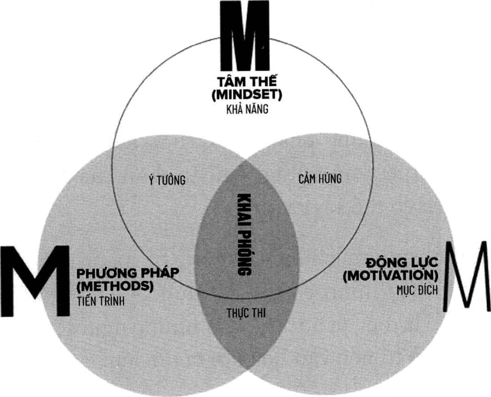

# Phần 2: Tâm thế khai phóng

## ĐIỀU GÌ

**Tâm Thế** *(danh từ)*

Những niềm tin, thái độ và định kiến đã ăn sâu và tâm trí chúng ta về việc ta là ai, thế giới hoạt động như thế nào, ta có khả năng gì và xứng đáng với điều gì, và những điều gì có thể xảy ra.

Nhân tố đầu tiên trong ba nhân tố của Mô hình Không Giới Hạn là Tâm thế. Đây chính là thái độ hoặc định kiến trong tâm trí ta, nó sẽ ảnh hưởng đến cách chúng ta tương tác và đánh giá tình hình trong các tình huống. Tâm thế được tạo ra từ niềm tin, thái độ và định kiến của chúng ta về bản thân mình và về thế giới xung quanh. Mọi hành vi của chúng ta đều được dẫn lối bởi niềm tin, vậy nên trước khi nói đến phương pháp học, trước hết chúng ta phải đề cập đến niềm tin nội tại - nhận định của chúng ta về những điều có thể xảy ra.

Khi mới sinh ra, chúng ta không hề mang sẵn tâm thế về những điều mình có thể đạt được - những niềm tin giới hạn đó là điều ta học được từ những người khác trong cuộc sống và từ nền văn hóa nơi ta lớn lên.

Hãy nghĩ đến việc một chú voi con bị buộc vào một chiếc cọc. Khi còn nhỏ, chú voi không đủ mạnh để nhổ chiếc cọc lên, vậy nên dần dần nó không còn cố gắng nữa bởi vì chú ta học được rằng có cố gắng cũng vô ích. Khi chú voi lớn dần lên, nó cũng dần mạnh hơn và đã có thừa sức mạnh để nhổ chiếc cọc lên nhưng nó vẫn để bản thân bị buộc lại bởi một sợi dây thừng và một chiếc cọc kim loại yếu ớt - những thứ chẳng hề đáng kể. Chú voi bị giới hạn bởi điều mà nó học được trong quá khứ. Trong lĩnh vực tâm lý học, hiện tượng này được là: sự bất lực tự tạo.

Phần lớn chúng ta hành động giống như chú voi kia. Trong một thời điểm nào đó, ta trải qua một chuyện và chuyện ấy khiến ta có định kiến về những điều mình có thể và không thể làm, từ đó niềm tin về tiềm năng của bản thân ta cũng bị giới hạn lại cho đến tận bây giờ. Nhưng nếu sự bất lực là do ta tự tạo nên từ những giới hạn mình học được, thì ta cũng có thể học để phá vỡ những giới hạn ấy. Trong phần này, bạn sẽ học bảy lời nói dối về tiềm năng con người mà chúng ta được dạy, và phương pháp để thay thế chúng bằng những niềm tin mạnh mẽ mới.

Tôi dùng từ LỜI NÓI DỐI ở đây là có chủ đích. Trong trường hợp này, LỜI NÓI DỐI (trong tiếng Anh, LỜI NÓI DỐI là LIE) là viết tắt cho cụm từ Limited Idea Entertained, có nghĩa là tư tưởng giới hạn được gieo vào đầu bạn. Nếu bạn cũng giống như phần lớn mọi người thì bạn đang gieo vào đầu mình những tư tưởng về bản thân, và các tư tưởng này khiến bạn nghĩ rằng mình nhỏ bé hơn rất nhiều so với tiềm năng thật sự của bạn. Bạn cho phép các tư tưởng này phát triển và trú ngụ trong tâm trí mình, nhưng thật ra trong trường hợp này, chúng chẳng qua chỉ là BS (là viết tắt của từ Belief System, nghĩa là Hệ thống Niềm tin) mà thôi. Trong những chương tiếp theo, bạn sẽ khám phá ra được những lời nói dối này từ đâu mà có, chúng đã trói buộc bạn như thế nào, và bạn cần làm gì để giải phóng bản thân. Hãy tự hỏi chính mình những câu này: Những giới hạn nào của mình thật ra chỉ là LIE và BS? Tôi nghĩ rằng bạn sẽ cảm thấy rất kinh ngạc khi tìm ra được câu trả lời, và những câu trả lời ấy sẽ mang lại cho bạn tự do và sự khai phóng.

Tôi sẽ kể cho bạn một câu chuyện ngắn trước khi chúng ta bắt đầu. Một trong những người bạn mà tôi yêu quý nhất là Stan Lee. Hẳn bạn cũng biết rằng chính những câu chuyện trong vũ trụ truyện tranh của Stan đã giúp tôi vượt qua một trong những thử thách lớn nhất trong đời khi còn nhỏ, và cho đến tận hôm nay thì các câu chuyện ấy và luôn là một nguồn cảm hứng bất tận cho tôi. Những cuộc trò chuyện giữa tôi và Stan cũng luôn thú vị và thường giúp tôi nhận ra rất nhiều điều.

Tôi còn nhớ một cuộc trò chuyện như thế, khi ấy chúng tôi đang ngồi trong xe hơi để cùng đi ăn tối. Stan trông rất nổi bật khi mặc một bộ vest với chiếc cà vạt Người Nhện ấn tượng, và tôi đã hỏi ông ấy điều tôi vẫn luôn thắc mắc.

“Stan, trong những năm qua anh đã tạo ra rất nhiều nhân vật tuyệt vời, ví dụ như đội Avengers và X-Men,” tôi nói. “Vậy ai là nhân vật anh thích nhất?”

Ông ấy trả lời mà không hề chần chừ dù chỉ một giây.

“Người Sắt”, ông nói. “Còn anh thì sao?”

Tôi chỉ vào chiếc cà vạt của ông và nói: “Tôi thích Người Nhện.”

Stan gật đầu và nói: “Sức mạnh càng lớn thì trách nhiệm càng nhiều.[^6]”

“Chính xác, Stan. Và ngược lại cũng đúng: trách nhiệm càng nhiều thì sức mạnh càng lớn.”

Ông ấy có vẻ thích ý tưởng này, và điều ấy làm tôi vui suốt cả buổi tối. Và mặc dù trước đây tôi chưa bao giờ nói ra chính xác câu chữ như vậy, tôi nhận ra rằng khi ấy tôi đã nói ra một trong những nguyên lý trọng yếu của tâm thế không giới hạn. Khi nhận lãnh trách nhiệm về việc gì đó, chúng ta đồng thời cũng sở hữu sức mạnh để khiến mọi thứ tốt đẹp hơn.

Đó chính là đặc điểm quan trọng tạo nên tầm thế không giới hạn. Hoàn cảnh và tình huống của mỗi người có thể ảnh hưởng đến việc ta là ai, nhưng chúng ta mới chính là người chịu trách nhiệm cho việc ta sẽ trở thành người như thế nào. Điều quan trọng là ta phải hiểu rằng ta chịu trách nhiệm cho những định kiến và thái độ của chính mình. Và một khi bạn chấp nhận được sự thật rằng tiềm năng của mình hoàn toàn nằm trong tầm kiểm soát của bản thân thì sức mạnh của tiềm năng ấy sẽ được tăng lên đáng kể.

Vậy nên, nào người hùng, hãy bắt đầu khởi động hành trình khai phóng tâm thế chính mình. Giống như điều Stan vẫn thường nói: “Tiến lên nào!”[^7]

> *“Vấn đề không đến từ những điều bạn không biết. Nó đến từ những điều bạn nghĩ rằng mình biết rõ, nhưng thật ra lại không phải như vậy.”*
>
> -MARK TWAIN

---

### Chú thích trong chương

[^6]: Đây là một câu nói nổi tiếng trong bộ truyện tranh Người Nhện.

[^7]: Từ gốc trong tiếng Anh là “Excelsior!”, đây là một từ tiếng Latin mang ý nghĩa “Luôn luôn tiến lên!” mà Stan Lee rất hay dùng trong các bộ truyện tranh của mình. Nó mang ý nghĩa là động  viên luôn tiến lên phía trước và tiến thẳng tới vinh quang.

