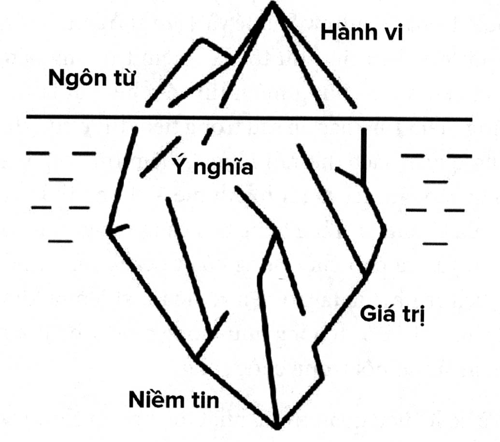

# Chương 5: Phép thuật của hệ thống niềm tin

> *Tại sao niềm tin lại có ảnh hưởng lớn đến thế trong cuộc sống của bạn?*

> *Tại sao những niềm tin giới hạn có thẻ cản trở bạn đạt MAT 1941 được mục tiêu?*

> *Làm sao để loại bỏ những niềm tin giới hạn?*

Hãy tưởng tượng bạn đang cầm trên tay một túi bắp rang bơ, bởi vì chúng ta sẽ cùng nhau đi qua một cuộc hành trình nho nhỏ đến với một cảnh phim. Nó sẽ bắt đầu như thế này:

Một chiếc cầu sắp sụp đổ bởi vì tên siêu ác nhân đã phá hoại những điểm chịu lực của cầu và chúng đã hư hỏng đến mức toàn bộ chiếc cầu chuẩn bị đổ sụp xuống dòng sông. Khi chiếc cầu đang nứt vỡ và lung lay dữ dội, siêu anh hùng của chúng ta biết được vấn đề và ngay lập tức đến nơi. Cô ấy là người duy nhất có sức mạnh ngăn chặn thảm họa xảy ra và cứu sống hàng trăm người.

Siêu anh hùng của chúng ta chỉ còn cách chiếc cầu 10 giây nữa. Nhưng khi cô đến càng gần với chiếc cầu thì trong đầu cô xuất hiện một giọng nói nhắc lại lần cô bị ngã đập mặt xuống đất lúc đang thực hiện động tác nhào lộn. Vài giây sau, cô lại nhớ chuyện bố đã từng nói rằng tốt nhất là cô không nên đặt hi vọng quá nhiều vào tương lai. Khi đã nhìn thấy chiếc cầu, một hình ảnh nữa lại hiện lên trước mắt cô: người bạn thân trước đây đang chế giễu cô, cho rằng cô quá ảo tưởng khi mong muốn trở thành một người vĩ đại.

Những mảnh vỡ từ chiếc cầu bắt đầu rơi xuống sông. Tiếng nứt vỡ ngày càng chát chúa hơn. Tiếng la hét của mọi người tràn ngập trong không gian.

Và siêu anh hùng của chúng ta, khi ấy trong lòng đầy những mối hoài nghi, đã ngồi xuống bên đường, đưa tay lên che mặt và ngập chìm trong cảm giác bất lực của bản thân.

Đợi đã... gì cơ?

Bạn chưa bao giờ thấy cảnh này trong một bộ phim siêu anh hùng, đúng không nào? Đó là vì một số lý do như sau. Lý do thứ nhất là một bộ phim như thế sẽ dở tệ. Lý do khác là dù cho các siêu anh hùng có những góc tối trong quá khứ hoặc những mâu thuẫn về đạo đức, họ cũng sẽ không trở thành siêu anh hùng nếu họ mang trong mình những niềm tin giới hạn. Siêu Nhân sẽ không nghĩ rằng nếu gặp may thì hôm nay mình sẽ có thể nâng được một tòa nhà cao tầng, hay ít ra cũng phải ba bốn tầng. Tony Stark không nghĩ rằng: “Bộ giáp Người Sắt này có lẽ sẽ không hoạt động tốt trong thời khắc quan trọng nhất bởi vì mình là kẻ chuyên gặp xui xẻo. Captain Marvel cũng không bay ra khỏi bầu khí quyển và đột nhiên lại có suy nghĩ là: “Không biết tinh thần của mình có đủ vững vàng để bay một mình trong vũ trụ không. Họ có siêu năng lực, và không hề bị bó buộc bởi bất cứ giới hạn nào.”

Và bạn biết không? Bạn cũng có siêu năng lực đấy. Vậy làm thế nào để hiện thực hóa siêu năng lực ấy? Bạn sẽ bắt đầu từ tâm thế của mình.

## TÌM KIẾM ROGER BANNISTER CỦA BẢN THÂN

Khi tôi còn là một đứa trẻ, khoảng 9 hoặc 10 tuổi, đại gia đình của tôi có một cuộc họp mặt thân mật. Khi đó có vài chục người ngồi quanh chiếc bàn lớn trong một nhà hàng đông đúc. Hôm đó là tối thứ Bảy, vì thế nhà hàng rất đông khách, và các nhân viên phục vụ thoăn thoắt di chuyển giữa các bàn để phục vụ thực khách càng nhanh càng tốt.

Vài phút sau khi chúng tôi ngồi xuống, nữ phục vụ đến để nhận đặt món. Bạn cũng biết rồi đấy, quá trình này rất mất thời gian. Và khi cô phục vụ đến và hỏi tôi muốn gọi đồ ăn thức uống gì, tôi mới nhận ra rằng cô ấy chưa hề ghi chú lại bất cứ món nào mà những người họ hàng của tôi gọi cả. Tôi cảm thấy rất tò mò. Lúc ấy bàn chúng tôi có khoảng 25 người và tôi đã thấy cô ấy phục vụ những vị khách khác nữa nên chắc chắn cô ấy không chỉ phục vụ một bàn này. Vậy làm thế nào mà cô ấy nhớ được hết tất cả những thứ chúng tôi đã gọi? Tôi gọi món mình muốn sát cô phục vụ thật kỹ khi cô ấy tiếp tục nhận đặt món của những người còn lại trong bàn. và quan

Lúc đó, tôi không tin chắc là những món tôi gọi sẽ được mang ra chính xác. Ngay ở độ tuổi này, tôi đã có rất nhiều nghi ngờ. Không phải bởi vì tôi là một người tiêu cực hay tôi không có niềm tin vào con người, chỉ là tôi cần phải nhìn thấy điều gì đó kỳ lạ trước, rồi sau đó tôi mới tin rằng nó có thể xảy ra. Trong trường hợp này, tôi nghĩ rằng cùng lắm thì cô phục vụ cũng chỉ nhớ được phần lớn các món mọi người gọi, nhưng cô ấy sẽ đặt chúng xuống sai vị trí, và chúng tôi sẽ phải đổi thức ăn cho nhau để có đúng món của mình.

Sau đó thì, các món đồ uống được mang ra trước, và mỗi người có chính xác món mình đã gọi, thậm chí cả ly Coke không đá của một người em họ và ly Coke với một lát chanh xanh, một lát chanh vàng và hai quả cherry cũng được mang ra chính xác. Được thôi, tôi nghĩ, cô ấy đã làm khá tốt. Nhưng còn rất nhiều món khác nữa. Vài phút sau, món salad được mang ra, và một lần nữa, mọi thứ đều hoàn hảo. Những người muốn ăn nước sốt riêng sẽ có nước sốt được để riêng, những người muốn sốt được trộn sẵn vào salad thì nó sẽ được trộn sẵn, và loại nước sốt mà từng người gọi cũng được phục vụ chính xác. Sự nghi ngờ của tôi bắt đầu lung lay. Và sau đó món chính được mang ra. Không hề có bất cứ một sai sót nào, mặc dù có một vài người đã yêu cầu những thứ khá oái oăm. Mọi thứ đều được nấu chính xác như chúng tôi đã yêu cầu, và tất cả các món ăn phụ cũng được phục vụ hoàn hảo.

Khi ấy, tôi bắt đầu thưởng thức món ăn của mình, nhưng vẫn không thể ngừng suy nghĩ về điều mà cô phục vụ đã làm được. Ở độ tuổi đó, tôi mới chỉ có thể bắt đầu đọc sách được, và chấn thương não của tôi đã gây ra đủ mọi khó khăn trong cuộc sống. Vậy mà ở đây lại có một người chứng minh cho tôi thấy rằng bộ não của chúng ta có khả năng vượt xa hơn những gì tôi có thể tưởng tượng.

Cô phục vụ đó chính là Roger Bannister của tôi. Bannister là một vận động viên điền kinh nổi tiếng trong những năm 1950. Trong giai đoạn Bannister mới bắt đầu sự nghiệp, mọi người ai cũng tin rằng không một vận động viên nào có đủ thể lực để chạy một dặm trong vòng ít hơn 4 phút. Mọi người ai cũng cảm thấy rằng cơ thể con người sẽ không thể nào chịu nổi nếu chúng ta cố gắng đạt được mục tiêu ấy. Sau đó, vào ngày 6 tháng 5 năm 1954, Bannister đã chạy được một dặm trong vòng 3 phút g 3 và 59,4 giây, qua đó chứng minh được rằng giới hạn mặc định là 4 phút có thể bị phá vỡ. Và thú vị nhất là chỉ chưa đầy hai tháng sau đó, một người khác phá vỡ kỷ lục mà Bannister lập được, và sau đó kỷ lục mới này cũng bị phá vỡ, và sau đó lại bị phá vỡ lần nữa. Kể từ đó trở đi, thời gian để chạy một dặm cứ liên tục bị rút ngắn.

Điều mà Bannister đã làm chính là cho mọi người thấy rằng giới hạn ấy thật ra chẳng phải là giới hạn. Đó cũng chính là điều mà cô phục vụ đã cho tôi thấy. Thông qua cô ấy, tôi nhận ra rằng giới hạn mà tôi vẫn đặt ra cho bộ não của mình thật ra nhỏ bé hơn rất nhiều so với khả năng thực sự của nó. Bạn biết đấy, sau đó tôi vẫn tiếp tục gặp khó khăn trong việc học suốt nhiều năm nữa, nhưng từ khoảnh khắc trong bữa tối ấy, tôi đã biết được rằng có những điều tôi nghĩ là không thể xảy ra nhưng nó vẫn xảy ra.

Trong trường hợp này, cô phục vụ là một người không giới hạn. Cô ấy đã cho tôi thấy một điều mà trước đó tôi không bao tin là có thể. Tôi chưa bao giờ làm quen với cô ấy, nhưng tôi luôn luôn biết ơn vì điều cô ấy làm đã vĩnh viễn thay đổi nhận thức của tôi về các giới hạn của bản thân. Cô ấy đã thay đổi tâm thế của tôi. Nếu như những người khác có thể sử dụng bộ não của họ để thực hiện những điều phi thường như vậy thì không có lý do gì mà tôi lại không thể dùng bộ não của mình để thực hiện những mục tiêu nhỏ hơn. Tôi chỉ cần tìm ra một phương pháp.

Tôi sẽ chia sẻ thêm với bạn về phương pháp ấy trong quyển sách này. Nhưng cốt lõi của nó chỉ là một khái niệm cơ bản mà thôi: phá vỡ giới hạn. Điều quan trọng để giúp bản thân đạt được trạng thái không giới hạn là loại bỏ những định kiến sai lầm. Thông thường thì chúng ta không đạt được mục đích bởi vì ta tự thuyết phục bản thân rằng mình không thể thực hiện được. Hãy quay lại ví dụ của Roger Bannister một chút. Trước mốc thời gian ngày 6 tháng 5 năm 1954, mọi người tin chắc chắn rằng con người không thể nào chạy được quãng đường một dặm trong thời gian dưới bốn phút. Bốn mươi sáu ngày sau khi Bannister làm được điều ấy, một người khác đã phá vỡ kỷ lục mà anh ấy đặt ra, và hơn 1.400 vận động viên điền kinh cũng đã học theo anh ấy. Cho đến bây giờ, việc chạy được một dặm trong thời gian dưới bốn phút vẫn là một thành tích cực kỳ ấy tượng, nhưng không phải là không thể. Một khi “rào cản” đã bị phá vỡ, sẽ có rất nhiều người có thể thực hiện được nó.

Vậy thì làm sao để vượt qua được những niềm tin giới hạn đó?

## NIỀM TIN GIỚI HẠN ẢNH HƯỞNG ĐẾN CHÚNG TA NHƯ THẾ NÀO

Những niềm tin giới hạn thường sẽ xuất hiện khi chúng ta độc thoại với bản thân. Những cuộc trò chuyện nội tại ấy sẽ tập trung xoay quanh việc bạn cố gắng thuyết phục bản thân rằng mình không thể làm được điều gì đó, chứ không phải là về việc bạn cần phải làm gì để đạt được nhiều hơn trong hiện tại và tương lai. Đã bao giờ bạn quyết định từ bỏ một điều gì đó, hoặc không theo đuổi ước mơ nữa bởi vì bạn tự thuyết phục rằng điều ấy là không thể? Nếu đã từng như vậy thì bạn cũng giống với rất nhiều người khác, nhưng việc này hoàn toàn không mang đến điều gì tốt đẹp cho bạn cả.

“Khi chúng ta đến với thế giới này, ta không hề biết chặng đường phía trước sẽ dễ dàng hay khó khăn, sẽ giàu có hay nghèo khổ, sẽ trở thành một người nổi bật hay chỉ là cái bóng lờ mờ. Chúng ta nhìn vào hai con người có vẻ là biết tất cả mọi thứ: Cha Mẹ mình” - chuyên gia thay đổi niềm tin Shelly Lefkoe đã nói như vậy trong bài phỏng vấn podcast với chúng tôi. Cha mẹ là những người thầy đầu tiên của chúng ta, và mặc dù họ không có ý gì xấu cả nhưng khi lớn lên, ta vẫn mang nhiều niềm tin giới hạn do họ gieo vào ta một cách vô thức.

Niềm tin giới hạn có thể cản trở bạn cả trong những công việc mà thông thường bạn có thể làm rất tốt. Đã bao giờ bạn trải qua một tình huống áp lực khi phải thực hiện một điều mà bình thường bạn có thể làm rất dễ dàng chẳng hạn như viết ghi chú hoặc thực hiện một phép tính đơn giản - nhưng sự căng thẳng của môi trường xung quanh đã khiến bạn có cảm giác nghi ngờ bản thân, đến mức bạn không thể thực hiện tốt việc đơn giản ấy? Đó là vì niềm tin giới hạn đã cản trở bạn. Nếu bạn tỉnh táo lại một chút thì bạn sẽ có thể thực hiện việc ấy rất dễ dàng, thế nhưng chính suy nghĩ bên trong đã đánh bại bạn. Giờ đây, hãy xem lại tình huống ấy, mở rộng nó ra và thử xem xét một lĩnh vực lớn trong cuộc sống của bạn. Có thể đó là sự đam mê của bạn dành cho công việc, hoặc khả h cho công việc, hoặc kha năng làm quen với mọi người. Nếu bạn để những niềm tin giới hạn nắm quyền điều khiển thì bạn sẽ chỉ mãi chật vật mà không đạt được thành tựu nào đáng kể, bạn sẽ tự hỏi tại sao mình chẳng bao giờ thành công, hoặc tự thuyết phục bản thân rằng bạn không xứng đáng có được điều ấy.

Alexis, người đã cùng tạo ra Kwik Learning với tôi, đã từng gặp nhiều khó khăn trong việc học khi còn nhỏ, cũng “học giống như tình huống của tôi vậy, nhưng lý do của cô ấy thì lại khác. Cô ấy được sinh ra tại Hàn Quốc, bố mẹ cô là doanh nhân khởi nghiệp và họ gặp nhiều khó khăn trong kinh doanh. Họ không có nhiều tiền nhưng luôn luôn cố gắng làm việc để chi trả cho cuộc sống. Mặc dù vẫn có nhà ở nhưng gia đình bốn người của cô phải sống trong một căn hầm nhỏ tại Hàn Quốc. Khi công việc kinh doanh thứ hai của họ thất bại, họ nhận được một lá thư từ Mỹ, thông báo rằng đơn ứng tuyển visa mà họ nộp cách đó bảy năm đã được chấp nhận. Khi ấy, vì đang lâm vào hoàn cảnh rất khó khăn nên gia đình cô ấy nghĩ rằng đây là một cơ hội mới và họ đã mượn một khoản tiền tương đương 2.000 đô la và chuyển đến Mỹ sống.”

Khi mới đến, Alexis không biết một chữ tiếng Anh nào cả. Đó thật sự là một cú sốc văn hóa - cô ấy không biết mọi người quanh mình đang nói gì, và văn hóa cũng hoàn toàn khác biệt. Bố mẹ cô cũng không biết nói tiếng Anh và tất cả họ đều gặp khó khăn để hiểu được thế giới đầy lạ lẫm này.

Alexis đăng ký vào học tại một ngôi trường gần nhà. Cô ấy là một học sinh khép kín và hướng nội, và bởi vì không biết ngôn ngữ nên cô ấy thường chỉ ngồi một mình trong bữa trưa hoặc ăn ở khu vệ sinh chỉ để không phải cảm thấy rằng mình là người ở ngoài lề xã hội.

Alexis phải mất đến sáu năm mới có thể thật sự hiểu được tiếng Anh, và cả những người bạn học cũng như giáo viên của cô ấy đều không hiểu tại sao Alexis lại gặp nhiều khó khăn đến vậy. Sau một vài năm, những người bạn cùng lớp bắt đầu chỉ trích rằng Alexis học quá chậm. “Bạn bị sao vậy?” “Bạn ngốc à?” “Bạn kỳ cục quá. là những cụm từ mà Alexis phải nghe rất thường xuyên trong quãng thời gian khi còn nhỏ.”

Những khó khăn mà Alexis phải đối mặt ở trường còn xuất hiện trong tiết thể dục, giờ học duy nhất mà có lẽ cô ấy không phải nói quá nhiều. Alexis nhớ lại lúc mình phải ngồi trên khán đài và viết đi viết lại câu “tôi sẽ mang theo đồ thể dục đến trường” bằng tiếng Anh. Nhưng khi đó cô ấy hoàn toàn không hiểu mình đang viết gì, và không ai có thể nói cho cô ấy hiểu rằng mình phải mang theo quần áo thể dục để thay khi có tiết.

Ở độ tuổi hai mươi, Alexis gặp khó khăn khi phải đọc hết toàn bộ một quyển sách. Cứ mỗi khi cố gắng học, cô ấy lại phải đấu tranh vất vả với những suy nghĩ tiêu cực trong đầu. Suy nghĩ mạnh mẽ nhất chính là sự nghi ngờ và chỉ trích đối với khả năng của bản thân, tuy nhiên những suy nghĩ khác, dù yếu ớt hơn nhưng chúng vẫn cố gắng chống lại sự nghi ngờ này. Rõ ràng vẫn có điều gì đó trong Alexis không chấp nhận rằng mình là kẻ “ngu ngốc”. Bố mẹ cô ấy phải làm việc vất vả để mang đến cho Alexis một cơ hội thứ hai, và cô không muốn khiến họ thất vọng. Mặc dù có những lúc cô ấy cảm thấy mình không đủ tài giỏi để làm bất cứ điều gì đặc biệt trong cuộc sống, nhưng cũng có những khi cô ấy cảm thấy chắc chắn rằng sẽ có một cách nào đó để thoát khỏi tình huống này, chứ không chỉ đơn thuần là chấp nhận nó.

Nếu Alexis nghe theo và để những suy nghĩ tiêu cực ấy định đoạt cuộc sống của mình thì có lẽ chúng đã đánh bại cô ấy trên hành trình này rồi, vì cô ấy sẽ không tìm kiếm các giải pháp cho vấn đề mình gặp phải. Thế nhưng ngược lại, cô ấy bắt đầu tìm kiếm câu trả lời bằng cách quan sát và học hỏi từ những người xung quanh. Cô ấy bắt đầu tự hỏi họ đã làm gì khác so với cô để có được thành công và hạnh phúc. Cô ấy muốn biết được liệu đó có phải chỉ là kết quả của sự may mắn kết hợp với tài năng thiên bẩm không, hay có một phương pháp để thực hiện. Trong hành trình học cách thành công, cô ấy đã tham gia vào một trong các lớp học ban đầu của tôi. Alexis không biết mình sẽ học được gì từ lớp đó, nhưng cô ấy biết rằng mình muốn đạt được một điều gì đó khác biệt - cô ấy muốn cảm nhận được niềm hi vọng trong cuộc sống của mình.

Trong ngày thứ nhất, chúng tôi học về trí nhớ. Mọi người đã học rất nhiều nội dung trong suốt tám tiếng, nhưng đến cuối buổi học, Alexis cảm thấy cực kỳ tươi mới và thậm chí còn cảm thấy hào hứng với những gì mình học được. “Mình còn có thể sử dụng bộ não để làm những gì nữa?” - cô ấy tự hỏi. Vậy là lần đầu tiên trong đời, cô ấy không cảm thấy mình là người chậm hiểu nữa, cô ấy cảm thấy rất hào hứng về việc học.

Ngày thứ hai, chúng tôi học về khả năng đọc nhanh. Ban đầu cô ấy không mong đợi nhiều vào nội dung này do bị ám ảnh bởi khó khăn mình phải trải qua trong quá khứ. Nhưng khi Alexis học được các thói quen đọc thông minh và thực hiện những bài tập đọc nhanh, mọi thứ đã thay đổi. Cô ấy đột nhiên nhìn thấy tiềm năng, và cả niềm vui, khi đọc. Cô ấy nhận ra rằng mình không quá chậm chạp hay ngu ngốc, chỉ là từ trước đến nay chưa có ai hướng dẫn cô phương pháp học và sử dụng siêu máy tính trong đầu mình. Khi khám phá ra được sức mạnh của việc học hỏi, những suy nghĩ tiêu cực và niềm tin giới hạn từ trước đến giờ trong đầu Alexis đã lùi lại phía sau và không còn nắm quyền điều khiển cô nữa.

Sau lớp học đó, lần đầu tiên Alexis đã có thể đọc hết một quyển sách và cảm thấy kinh ngạc vì mình hiểu được rất nhiều, nhớ được rất nhiều và tận hưởng trải nghiệm ấy rất nhiều.

Đó chính là thời điểm thay đổi then chốt trong cuộc đời cô. Từ một người có tâm thế giới hạn với niềm rằng “mọi thứ sẽ không thay đổi được đâu”, Alexis đã biết rằng cô ấy có thể thay đổi và định hình lại tâm trí để đạt được các mục tiêu trong cuộc sống. Lần đầu tiên trong đời, cô ấy bắt đầu tin vào chính mình và tưởng tượng ra những điều mình có thể làm được.

Ngày nay, Alexis không còn cảm thấy sợ khi phải học kiến thức mới nữa. Cô ấy không cảm thấy tội lỗi vì mình không biết điều gì đó. Cô sẽ tìm kiếm câu trả lời cho vấn đề và ứng dụng nó vào cuộc sống. Chính vì niềm đam mê học hỏi ấy, Alexis đã cùng tôi tạo ra Kwik Learning Online để chia sẻ trải nghiệm thay đổi diệu kỳ mà cô ấy có được với những người khác ở mọi quốc gia trên thế giới.

Trong quyển sách Mequilibrium, các tác giả là Jan Bruce, Tiến sĩ Andrew Shatté và Tiến sĩ Adam Perlman đã gọi những niềm tin như thế là “niềm tin tảng băng trôi” bởi vì bên dưới những niềm tin trên bề mặt là rất nhiều những niềm tin khác ẩn sâu trong tiềm thức của chúng ta. Trong quyển sách, họ nói rằng: “Niềm tin tảng băng trôi ăn sâu vào tâm trí và rất mạnh mẽ - chúng thúc đẩy cảm xúc của chúng ta. Tảng băng trôi càng vững chắc thì nguy hại nó gây ra cho cuộc sống của ta càng lớn... nó khiến cho lịch trình của ta trở nên rối loạn, khiến ta không thể thực hiện chế độ ăn uống như mong muốn, hoặc ngăn cản ta nắm lấy cơ hội trong cuộc sống.”

Và có lẽ điều quan trọng nhất mà họ nói chính là: “Nếu chúng ta điều khiển được tảng băng trôi ấy thì ta sẽ có khả năng cực kỳ lớn để làm chủ cảm xúc và cuộc sống của mình. Khi bạn làm tan tảng băng, những tác hại do nó gây ra cũng sẽ bị cuốn trôi đi theo dòng nước.”

Tiến sĩ Jennice Vilhauer, giám đốc Chương trình Tâm lý Trị liệu Bệnh nhân Ngoại trú tại Khoa Tâm thần và Khoa học Hành vi của Trường Y khoa thuộc Đại học Emory, đã khẩn thiết yêu cầu chúng ta đối mặt trực tiếp với những suy nghĩ tiêu cực trong đầu mình: “Giọng nói trong đầu bạn hay phán xét, nghi ngờ, khinh thường bạn và liên tục nói rằng bạn không đủ tốt. Nó nói ra những điều khiến bạn buồn, những điều mà bạn sẽ không bao giờ nói với một người khác. Tôi đúng là đồ ngốc. Tôi là đồ rởm. Tôi chẳng bao giờ làm được chuyện gì đúng. Tôi sẽ không bao giờ thành công.”

Cô ấy nói thêm: “Những suy nghĩ tiêu cực trong đầu không hề vô hại. Nó chiếm lấy tâm trí bạn, hạn chế bạn và ngăn cản bạn sống cuộc đời mà mình thực sự mong muốn. Nó cướp đi sự thanh thản trong tâm hồn và sự bình yên trong cảm xúc của bạn. Và nếu bạn không để tâm xử lý thì qua thời gian đủ lâu, nó có thể gây ra những vấn đề tâm lý nghiêm trọng như trầm cảm hay lo âu.”

Hãy cùng xem xét lại siêu anh hùng mà chúng ta đã nói đến ở phần đầu chương này. Cô ấy đã thất bại. Rõ ràng cô ấy có động lực muốn giải cứu mọi người. Và cô ấy chắn chắn chúng có phương pháp để làm điều ấy. Nhưng thứ cô ấy không có chính là tâm thế. Những suy nghĩ tiêu cực bên trong đã thuyết phục được cô ấy, khiến cô nghĩ rằng mình không đủ tốt, và vậy nên cô đã ngồi xuống bên đường và cảm thấy đau xót cho chính mình chứ không tiếp tục chiến đấu để giải cứu mọi người nữa. Chắc chắn một trong những bài học rút ra từ câu chuyện này là cô gái có siêu năng lực này đã làm hỏng chuyện. Cô ấy thất bại trong thời khắc quan trọng bởi vì cô không làm chủ được những suy nghĩ trong đầu mình.

Nhưng còn có một điều cực kỳ quan trọng nữa ta cần hiểu từ chuyện này: siêu anh hùng của chúng ta vốn đã có sẵn tất cả mọi thứ để thành công. Giá như cô ấy có thể vượt qua được những niềm tin giới hạn đang cản trở mình thì tài năng xuất chúng của cô đã được sử dụng đúng cách và giải cứu được mọi người.

Đó chính là lý do tại sao việc tháo gỡ những niềm tin giới hạn là rất quan trọng.

## NẾU TÔI NÓI RẰNG BẠN LÀ MỘT THIÊN TÀI THÌ SAO?

Khi bạn nghĩ đến các thiên tài, người đầu tiên xuất hiện trong đầu bạn là ai? Tôi nghĩ Einstein và Shakespeare là những người đầu tiên bạn nghĩ đến. Những người khác có thể là Stephen Hawking, Bill Gates, Marie Curie hoặc Ruth Bader Ginsburg. Những cái tên này sẽ hiện ra trong đầu của rất nhiều người bởi vì họ đều là những con người xuất chúng trong một số lĩnh vực cụ thể của trí thông minh, và ta hay đánh đồng loại trí thông mình này với các thiên tài. Nhưng bạn có nghĩ đến LeBron James không? Beyoncé thì sao? Hoặc Oprah? Hoặc bạn?

Nếu bạn chưa nghĩ đến những cái tên tôi đề cập ở phía sau thì cũng không có gì đáng ngạc nhiên. Phần lớn chúng ta thường đánh đồng thiên tài với một tiêu chí của trí thông minh, đó là IQ. Những người có IQ cao là thiên tài, và người có IQ thấp có thể rất thành công, thậm chí trở nên vĩ đại trong một lĩnh vực nào đó, nhưng họ không được xem là thiên tài.

Nếu bạn cũng có cách suy nghĩ như vậy thì bạn, cũng giống như một số người khác, đang định nghĩa thiên tài theo cách quá hạn hẹp. Thậm chí tôi còn nghĩ rằng phần lớn mọi người đã và đang định nghĩa thiên tài theo cách này. Nhưng sẽ có hai vấn đề. Thứ nhất, định nghĩa này sẽ khiến bạn không có sự trân trọng dành cho nhiều loại hình thiên tài khác. Vấn đề thứ hai là suy nghĩ ấy sẽ khiến bạn không xác định được thiên tài bên trong chính mình.

Có rất nhiều loại hình thiên tài khác nhau. Các chuyên gia có nhiều giả thuyết khác nhau về số lượng các loại, nhưng nhìn chung họ đều nghĩ rằng khả năng thiên tài sẽ được thể hiện trong bốn loại hình. Dưới đây là cách phân loại thiên tài đã tồn tại trong hàng nghìn năm qua:

- **Thiên tài ý tưởng:**  Đây là những người thể hiện khả năng

thiên tài của mình thông qua sự sáng tạo và các ý tưởng. Shakespeare là một thiên tài ý tưởng bởi vì ông ấy có khả năng thiên bẩm trong việc tạo ra những câu chuyện để ta tự soi xét lại bản thân. Galileo là một thiên tài ý tưởng bởi vì khi cùng nhìn lên bầu trời, ông ấy có khả năng nhìn nhận được những thứ mà người khác không thể. Các thiên tài ý tưởng là những người mà chúng ta hay nghĩ đến nhất mỗi khi nhắc tới khái niệm thiên tài.

- **Thiên tài tương tác:**  Khả năng của những thiên tài này sẽ

được bộc lộ khi họ tương tác với những người khác. Oprah Winfrey là một thiên tài tương tác bởi vì cô ấy có khả năng phi thường để kết nối với trái tim, khối óc và tâm hồn của rất nhiều người từ nhiều hoàn cảnh khác nhau. Khả năng thiên tài tương tác của Malala Yousafzai được bộc lộ thông qua việc cô ấy có thể kể những câu chuyện mà tất cả mọi người trên thế giới đều có thể đồng cảm. Thiên tài tương tác thường là những bậc thầy trong giao tiếp.

- **Thiên tài tầm nhìn:** Đây là những người thể hiện khả

năng thiên tài của mình thông qua việc thấy được bức tranh toàn cảnh và bám sát với mục tiêu mình đặt ra. Nelson Mandela là một thiên tài tầm nhìn bởi vì ông ấy có thể thấy được sự đúng đắn trong tầm nhìn của mình, mặc cho những tình huống khó khăn liên tục xảy đến với ông. Khả năng thiên tài tầm nhìn của Mẹ Teresa cũng giúp bà hình dung ra được một cuộc sống tốt đẹp hơn cho những người xung quanh mình, thậm chí trong những thời khắc đen tối nhất. Các thiên tài tầm nhìn thường sẽ hiểu được tầm nhìn dài hạn - điều mà phần lớn những người xung quanh không thể nào thấy được.

- **Thiên tài thông tin:**  Khả năng của những thiên tài này sẽ

được bộc lộ thông qua việc họ có thể chú ý đến những chi tiết nhỏ và sử dụng những chi tiết mà người khác không để ý hoặc không nhìn thấy được. Sergey Brin sử dụng khả năng thiên tài này để nhìn ra được tiềm năng của dữ liệu lớn, và từ đó tạo ra Google. Nếu bạn đọc quyển sách Moneyball, thì bạn sẽ biết được rằng Billy Beane và các nhân viên của ông đã tái định nghĩa lại môn bóng chày, cũng chính nhờ khả năng thiên tài của họ trong việc nhìn thấy được ý nghĩa của các dữ liệu. Các thiên tài thông tin rất thích thu thập mọi thông tin mà họ có thể tìm được, rồi từ đó tạo ra tầm nhìn to lớn hơn từ những thông tin ấy, và đây là điều mà phần lớn những người khác sẽ bỏ qua.

### BẮT ĐẦU CÙNG KWIK

Bạn nghĩ khả năng thiên tài của mình là gì? Hãy viết ra đây:

Trong phần lớn các trường hợp, khả năng thiên tài của mỗi người là sự kết hợp của hai hoặc nhiều loại hình thiên tài. Có rất ít người chỉ có khả năng trong lĩnh vực thông tin hay chỉ giỏi trong việc kết nối người với người. Nhưng điều quan trọng bạn cần hiểu ở đây là định nghĩa thiên tài vốn dĩ rộng hơn rất nhiều chứ không chỉ gói gọn trong lĩnh vực học thuật hay khả năng nhớ chính xác bảng tuần hoàn hóa học - và vì thế bạn cũng có những khả năng thiên tài bên trong mình.

Nếu bạn nghĩ rằng điều tôi nói thật vô lý, thì hãy quay trở lại đọc những chương trước trong quyển sách này. Để đạt được trạng thái không giới hạn, điều quan trọng là bạn phải khai phóng được khả năng thiên tài bẩm sinh của mình. Có thể bạn không có cùng loại thiên tài ý tưởng như Shakespeare hay thiên tài tương tác như Oprah, nhưng bên trong bạn vẫn tồn tại những loại hình thiên tài khác - chúng chỉ đang chờ được bộc lộ ra bên ngoài hoặc chờ được bộc lộ nhiều hơn. Điều cốt lõi là bạn phải khai phóng chúng.

## KHÔNG CHỈ TÂM TRÍ CỦA BẠN CHỊU TÁC ĐỘNG ĐÂU

Trước khi tôi mang đến cho bạn các công cụ để xây dựng tâm thế tích cực hơn, hãy dành khoảng một phút để nói về lợi ích của những suy nghĩ tích cực. Có sự liên kết chặt chẽ giữa suy nghĩ tích cực và sức khỏe thể chất. Trong một nghiên cứu của đại học John Hopkins, Tiến sĩ Lisa Yanek đã kết luận rằng: “trong xã hội thông thường, những người tích cực có tỷ lệ đau tim và các rủi ro về bệnh mạch vành ít hơn 13% so với những người tiêu cực.”

Đồng thời, Mayo Clinic cho rằng: “Suy nghĩ tích cực thường đi kèm với thái độ lạc quan, và đây là yếu tố quan trọng để giảm các áp lực trong cuộc sống một cách hiệu quả. Và khi áp lực cuộc sống giảm xuống, nhiều lợi ích sức khỏe sẽ gia tăng.”

Những lợi ích mà họ đề cập đến bao gồm:

• Gia tăng tuổi thọ • Giảm tỷ lệ trầm cảm • Giảm đau buồn • Tăng đề kháng đối với bệnh cảm lạnh • Sức khỏe tâm lý và thể chất tốt hơn • Sức khỏe tim mạch tốt hơn và giảm nguy cơ tử vong do các bệnh về tim mạch • Kỹ năng xử lý vấn đề tốt hơn trong tình huống khó khăn và áp lực

## TÁI ĐỊNH HÌNH NHỮNG NIỀM TIN GIỚI HẠN

Tôi luôn sử dụng một hình ảnh ẩn dụ mỗi khi nói về việc giúp mọi người thoát ra khỏi những niềm tin giới hạn. Tôi sẽ nói với họ rằng sự khác biệt giữa niềm tin giới hạn và tâm thế không giới hạn cũng giống như sự khác biệt giữa một chiếc nhiệt kế và một chiếc máy điều nhiệt vậy. Chiếc nhiệt kế chỉ có một chức năng duy nhất: phản ánh lại môi trường. Nó đo lường môi trường và đưa ra mức nhiệt độ, chỉ thế thôi. Điều này cũng giống như việc con người thường cũng chỉ phản ánh lại môi trường. Họ nhìn vào những niềm tin giới hạn của mình và phản ứng lại trong khuôn khổ những giới hạn ấy, và sống cuộc đời mình trong một khuôn mẫu giới hạn nhất định.

Ngược lại, máy điều nhiệt tiếp nhận thông tin từ môi trường và khiến môi trường thay đổi dưới sự điều khiển của nó. Nếu một chiếc máy điều nhiệt nhận thấy rằng căn phòng đang quá lạnh hoặc quá nóng, nó sẽ thay đổi môi trường để phù hợp với tiêu chuẩn lý tưởng mà nó đặt ra. Tương tự như vậy, nếu bạn gặp phải những khó khăn từ bên ngoài hay từ bên trong, bạn có thể hành động như một chiếc máy điều nhiệt - bạn có thể khước từ những niềm tin giới hạn ấy và tạo ra một môi trường phù hợp để đạt được những mục tiêu to lớn nhất.

Vậy, làm sao để bạn giảm thiểu các niềm tin giới hạn và từ đó phát triển tâm thế siêu anh hùng? Theo tôi, có ba điều cốt lõi bạn cần làm.

### Điều cốt lõi 1: Tìm ra Niềm tin Giới hạn của Bạn

Bạn đã thấy một vài ví dụ về niềm tin giới hạn trong quyển sách này, nhưng ngoài ra vẫn còn rất nhiều nữa (và chúng ta sẽ sớm tìm hiểu về bảy niềm tin giới hạn phổ biến nhất trong lĩnh vực học hỏi). Có thể đó là các niềm tin về khả năng, tính cách, mối quan hệ, trình độ giáo dục của bạn, hoặc bất cứ một điều gì khác có thể dẫn đến những suy nghĩ tiêu cực bên trong rằng bạn không thể trở thành người như mình mong muốn. Ngay từ bây giờ, hãy chú ý đến những lúc bạn tự nhủ rằng mình không đủ năng lực, thậm chí trong cả những lĩnh vực mà bạn nghĩ sẽ không có ảnh hưởng gì lớn đến cuộc sống của mình.

Ví dụ, có thể bạn đang tự nhủ rằng mình kể chuyện hài dở tệ. Có thể điều này đối với bạn không có gì to tát, bởi vì bạn không có mong muốn trở thành một người có khiếu hài hước. Nhưng mỗi khi tự nhủ như vậy, bạn có thể đồng thời truyền ra thông điệp rằng mình không phải là người có thể khiến mọi người thoải mái, không phải là một người đồng hành tốt hay người mà người khác muốn ở bên. Những suy nghĩ như vậy có thể khiến bạn trở nên lúng túng và nghi ngờ bản thân trong những tình huống xã hội quan trọng, hoặc khi bạn cần phải nói chuyện trước một nhóm người. Vậy nên, hãy cẩn thận lắng nghe mỗi khi bạn sử dụng các cụm từ như “tôi không thể”, “tôi không phải là” hoặc “tôi không”. Khi ấy bạn đang gửi thông điệp đến chính mình, và những thông điệp ấy sẽ ảnh hưởng đến suy nghĩ chung của bạn về bản thân. Ngay cả trong những trường hợp suy nghĩ tiêu cực của bạn chỉ xuất hiện trong một lĩnh vực cụ thể không quan trọng và bạn nghĩ rằng nó sẽ không ảnh hưởng đến cuộc sống của mình, hãy cứ tập trung lắng nghe.

Đồng thời, hãy cố gắng xác định nguyên nhân của những suy nghĩ ấy. Niềm tin giới hạn thường bắt đầu khi chúng ta còn nhỏ. Nhưng điều đó không có nghĩa rằng gia đình là khởi nguồn cho niềm tin ấy. Những tương tác xã hội đầu tiên của chúng ta cũng như những trải nghiệm đầu tiên trong môi trường giáo dục cũng có thể gây ra niềm tin giới hạn. Một số người không muốn làm một điều gì đó chỉ đơn giản vì khi còn là một đứa trẻ, họ đã thử làm điều ấy vài lần và không thành công.

Sau khi nhận thức được bạn đang tự cản trở bản thân thông qua những suy nghĩ tiêu cực, hãy dành thời gian để xác định nguồn gốc của những suy nghĩ ấy. Đây là một trải nghiệm mang lại cho bạn cảm giác tự do rất lớn. Bởi vì một khi đã nhận thức được, bạn sẽ bắt đầu nhận ra những điều này không phải là sự thật về mình, chúng chỉ là ý kiến mà thôi. Và khả năng cao là những ý kiến ấy hoàn toàn sai lầm.

Một khi bạn đã xác định được các suy nghĩ tiêu cực trong đầu mình, rằng mình không thể làm gì đó, hãy bắt đầu đối thoại ngược lại với chúng. Khi bạn thấy bản thân đang nghĩ là: “Tôi luôn làm hỏng mấy chuyện này”, hãy đáp ngược lại như sau: “Chỉ là trước nay tôi chưa làm tốt được chuyện này thôi, nhưng không có nghĩa là bây giờ tôi không thể làm được. Ý kiến này tôi không chấp nhận.”

### Điều cốt lõi 2: Hãy tìm Sự thật

Một trong những tác hại nghiêm trọng nhất của niềm tin giới hạn đó là trong nhiều trường hợp, nó hoàn toàn sai lệch. Liệu bạn có thật sự tệ hại trong việc nói trước đám đông không? Liệu bạn có thật sự kém cỏi khi lãnh đạo nhóm? Liệu bạn có thật sự là người nhạt nhẽo nhất tại bất cứ đâu không? Bằng chứng gì chứng minh cho điều ấy? Đã bao nhiêu lần bạn thực sự trải qua những tình huống này rồi? Và kết quả là gì?

> *“Cuộc sống vốn không có giới hạn, giới hạn chỉ là do bạn đặt ra mà thôi.”*
>
> -LES BROWN

Một trong những điều ác độc nhất của niềm tin giới hạn, đó là chúng đánh mạnh vào cảm xúc của chúng ta. Khi bạn chống lại niềm tin giới hạn, bạn sẽ nhận ra rằng chúng sẽ đánh trả mạnh mẽ - và thường thì chiến thắng sẽ thuộc về chúng - dù cho bạn đã cố gắng dùng lý trí để chiến đấu. Nhưng những suy nghĩ tiêu cực ấy có dựa vào bằng chứng nào trong thực tế không? Hãy nghĩ về những điều bạn đã trải qua khi nói trước đám đông (tiện thể tôi cũng muốn nói rằng đây là nỗi sợ hãi chung của rất nhiều người). Thay vì tập trung vào cảm xúc của bạn trong thời điểm đó, hãy cân nhắc xem mọi thứ đã thực sự xảy ra như thế nào. Mọi người có la ó đòi bạn phải xuống sân khấu không? Người khác có tìm đến bạn, cười vào mặt bạn và nói rằng bạn là một kẻ thất bại không? Sếp của bạn có gặp riêng bạn vào hôm sau để nói rằng bạn nên đổi nghề vì bạn chẳng thể nói ra được từ nào đàng hoàng không?

Tôi đoán là những điều đó chẳng hề xảy ra. Thay vào đó, khả năng cao là người nghe cảm thấy kết nối với những gì bạn đang nói. Nếu đó là một buổi nói chuyện công việc thì có thể những người khác cũng ghi chú lại điều bạn nói, và gần như chắc chắn rằng bạn đã mang lại cho họ những điều hữu ích. Vậy thì phải chăng lần tiếp theo bạn nên xuất hiện tại TED để diễn thuyết? Tất nhiên là không rồi. Nhưng như vậy có nghĩa là bạn thật ra đã truyền đạt ý tưởng tốt hơn nhiều so với những gì mà suy nghĩ tiêu cực trong đầu đang cố vẽ ra.

Và bạn còn phải đặt ra câu hỏi này nữa: Khi bạn không làm tốt được việc gì đó, thì có bao nhiêu % là do suy nghĩ tiêu cực của chính bạn đã liên tục can thiệp và phá hỏng mọi thứ? Đây là vấn đề thực sự mà nhiều người gặp phải. Khi họ đang thực hiện một việc mà họ không tự tin rằng mình có thể làm được, những suy nghĩ bên trong sẽ chỉ trích và khiến họ bị xao nhãng đến nỗi họ không thể tập trung vào công việc đang làm được... và vì thế họ không thể nào làm tốt. Đây là một trong các lý do tại sao bạn cần phải học cách chống lại và áp chế những niềm tin giới hạn bên trong. Càng thực hiện tốt điều này thì bạn càng ít bị xao nhãng khi đang thực hiện những thử thách quan trọng nhất để phát triển bản thân.

Vậy nên, khi bạn kiểm tra lại tính xác thực của những niềm tin giới hạn, hãy cân nhắc hai điều sau đây: liệu trong thực tế có bằng chứng nào cho thấy bạn không thể làm tốt việc này không, và liệu bằng chứng đó có bị ảnh hưởng bởi suy nghĩ tiêu cực của chính bạn không?

### Điều cốt lõi 3: Tạo ra Niềm tin mới

Giờ đây bạn đã xác định được niềm tin giới hạn của mình, và cũng đã cẩn thận xem xét tính xác thực của chúng. Đây là lúc bạn thực hiện bước then chốt nhất - tạo ra một niềm tin mới, niềm tin này phải chính xác hơn những LỜI NÓI DỐI mà bạn đã chấp nhận trước đây, đồng thời nó cũng phải mang lại lợi ích trong hành trình đạt đến trạng thái không giới hạn của bạn.

Bạn sẽ khám phá về quá trình thực hiện việc này trong chương tiếp theo, nhưng bây giờ hãy cứ điểm qua đôi nét. Ví dụ, một trong những niềm tin giới hạn của bạn là: mình luôn thất bại trong thời khắc quan trọng. Sau khi xác định nó là một niềm tin giới hạn, bạn đã thực hiện những điều cần thiết để kiểm tra tính xác thực của nó. Bạn nhận ra rằng mặc dù có đôi khi bạn để sự lo lắng xâm chiếm tâm trí trong những thời điểm áp lực, thế nhưng ít khi nào tình huống đó trở nên thật sự tồi tệ. Và sau khi xem xét kỹ lưỡng, bạn tìm ra được một vài lần mình có thể “vượt qua được tình huống khó khăn. Và thật ra thì, sau khi suy nghĩ lại, bạn nhận ra rằng số lần mình thành công còn nhiều hơn số lần thất bại.”

Vậy nên, bây giờ là lúc bạn cần tạo ra một niềm tin mới. Trong trường hợp này, niềm tin mới của bạn sẽ là không một ai có thể thành công 100% trong những tình huống quan trọng, nhưng bạn nên tự hào vì đã nhiều lần mình thực hiện tốt ngay cả khi áp lực là cực kỳ lớn. Niềm tin này sẽ hoàn toàn thay thế niềm tin cũ, nó được tạo ra dựa trên những bằng chứng xác thực và sẽ giúp bạn có được tâm thế tốt hơn nhiều trong lần tiếp theo phải hành động trong một tình huống quan trọng.

Tôi cũng có thêm một công cụ nữa để bạn sử dụng. Suốt nhiều năm qua, tôi đã nói chuyện với nhiều chuyên gia, và những cuộc trò chuyện này thường đi đến cùng một kết luận: chừng nào bạn còn tin rằng những suy nghĩ tiêu cực ấy là con người thật của bạn, là bản thể tốt nhất của bạn, thì nó sẽ mãi mãi dẫn dắt bạn. Rất nhiều người trong chúng ta hay nói những cụm từ như “Tôi hiểu rõ bản thân mình, và...” trước khi nói ra niềm tin giới hạn của mình.

Nhưng nếu bạn có thể tạo ra một nhân cách khác cho những suy nghĩ tiêu cực này - một nhân cách không phải là bạn thực sự - thì khả năng áp chế thành công những suy nghĩ ấy sẽ cao hơn nhiều. Kỹ thuật này đặc biệt hiệu quả và khi thực hiện cũng rất thú vị. Hãy đặt cho những suy nghĩ ấy một cái tên thật vô lý, và hãy hình dung nó có một dáng vẻ rất kì dị. Hãy khiến nó trông giống một nhân vật hoạt hình - loại mà chỉ thường xuất hiện trong những bộ phim tầm phào. Hãy cười nhạo nó vì nó lúc nào cũng quá tiêu cực. Hãy nhướn mắt nhìn nó khi nó xuất hiện trong tâm trí bạn. Bạn càng tách biệt nhân cách này ra khỏi nhân cách thật sự của mình thì bạn sẽ càng thành công trong việc loại bỏ nó ra khỏi cuộc sống.

## KHẢ NĂNG ĐẠT ĐƯỢC TRẠNG THÁI KHÔNG GIỚI HẠN

Giờ đây, khi đã biết được cách chinh phục những niềm tin giới hạn, bạn có thể bắt đầu sử dụng tâm thế tích cực để đạt đến trạng thái không giới hạn. Có thể điều này nghe có vẻ quá táo bạo, nhưng có rất nhiều bằng chứng cho thấy sự liên kết giữa tâm thế và thành tựu.

Một trong những khách mời trong chương trình podcast của tôi là James Clear, tác giả của quyển Atomic Habits, thuộc danh sách bán chạy nhất của tờ New York Times, và bạn sẽ gặp lại anh ấy ở phần sau của quyển sách này. Anh ấy đã viết về nghiên cứu được thực hiện bởi Tiến sĩ Barbara Fredrickson - nhà nghiên cứu tâm lý tại Đại học North Carolina. Ở đầu bài viết, Clear đã nhấn mạnh ảnh hưởng của những cảm xúc tiêu cực lên chúng ta thông qua ví dụ về việc chạm trán một con hổ trong rừng. Anh nói: “Các nhà nghiên cứu từ lâu đã biết rằng những cảm xúc tiêu cực sẽ lập trình cho bộ não thực hiện một hành động cụ thể nào đó. Ví dụ như khi bạn gặp một con hổ, bạn sẽ chạy. Tất cả những điều khác đều không quan trọng. Bạn tập trung hoàn toàn vào con hổ, vào nỗi sợ hãi mà nó gây ra và làm thế nào để thoát khỏi nó.” Điều mà Clear đang muốn nói đến ở đây là: những cảm xúc tiêu cực sẽ khiến chúng ta giảm số lượng những điều mình có thể thực hiện xuống. Bạn sẽ chỉ tập trung vào việc chạy trốn khỏi con hổ (một hình ảnh ẩn dụ), và tất cả những chuyện khác sẽ không có ý nghĩa gì cả. Nếu chúng ta để cảm xúc tiêu cực (như những niềm tin giới hạn) điều khiển mình thì thông thường ta chỉ hoạt động theo bản năng sống còn, và như thế có nghĩa là ta đã tự giới hạn các khả năng khác trong cuộc sống.

Điều mà Tiến sĩ Fredrickson khám phá ra, đó là khi có được tâm thế tích cực, bạn sẽ tạo ra kết quả hoàn toàn ngược lại. Cô ấy thiết kế một thử nghiệm, trong đó những người tham gia sẽ được chia thành năm nhóm và họ được xem các đoạn phim ngắn. Nhóm đầu tiên xem các đoạn phim mang đến niềm vui. Nhóm thứ hai xem các đoạn mang đến sự hài lòng. Nhóm thứ ba là các đoạn tạo ra nỗi sợ hãi và nhóm thứ tư là các đoạn tạo ra sự giận dữ. Nhóm thứ năm là nhóm đối chứng.

Sau khi xem xong các đoạn phim, những người tham gia được yêu cầu tưởng tượng ra các tình huống tương tự như tình huống họ vừa mới xem, và nghĩ xem mình sẽ phản ứng như thế nào trong tình huống ấy. Sau đó họ sẽ điền vào một bảng điền khuyết với 20 câu bắt đầu bằng cụm từ “Tôi muốn”. Những người trải qua cảm giác sợ hãi và tức giận sẽ viết ra ít câu nhất trong khi những người trải qua cảm giác vui vẻ hay hài lòng sẽ viết ra nhiều hơn, và nhiều hơn cả nhóm đối chứng. “Nói cách khác”, Clear diễn giải, “khi bạn có được những cảm xúc tích cực như niềm vui, sự hài lòng hay tình yêu, bạn sẽ thấy được nhiều điều mình có thể làm hơn trong cuộc sống.”

Một điều quan trọng nữa mà tôi cần lưu ý là: những lợi ích mà tâm thế tích cực mang lại không chỉ là cảm xúc tích cực. Clear đã đưa ra thêm ví dụ như sau:

Một đứa trẻ được chạy chơi ở bên ngoài, leo trèo trên những cành cây và chơi đùa cùng bạn bè sẽ phát triển được khả năng hoạt động cơ thể tốt hơn (kỹ năng thể chất), vui chơi với người khác và giao tiếp trong đội nhóm tốt hơn (kỹ năng xã hội), và có thể khám phá cũng như xem xét thế giới xung quanh tốt hơn (kỹ năng sáng tạo). Như vậy thì những cảm xúc tích cực khi được chơi đùa vui vẻ sẽ thúc đẩy đứa trẻ xây dựng những kỹ năng hữu ích và giá trị khác trong cuộc sống hàng ngày... Niềm vui khi được khám phá và sáng tạo ra những kỹ năng mới sau đó sẽ kết thúc, nhưng những kỹ năng nó học được sẽ tồn tại mãi.

Fredrickson gọi điều này là lý thuyết “mở rộng và xây dựng”, bởi vì những cảm xúc tích cực sẽ mở rộng cảm nhận của bạn về các khả năng trong cuộc sống và từ đó cởi mở tâm trí bạn, và nhờ thế bạn sẽ có thể xây dựng những kỹ năng cũng như nguồn lực mới - những thứ có thể đem lại giá trị trong nhiều khía cạnh khác của cuộc sống.

Lý thuyết này, cùng với nghiên cứu đã được đề cập ở đây, đã cho thấy rằng cảm xúc tích cực sẽ: (i) mở rộng sự chú ý và tư duy của con người; (ii) loại bỏ những đợt trỗi dậy của cảm xúc tiêu cực; (iii) giúp gia tăng tính bền bỉ của tâm lý; (iv) xây dựng những nguồn lực mới cho bản thân sau này; (v) khởi động cho hành trình phát triển liên tục để đạt đến cuộc sống tốt đẹp hơn trong tương lai; và (vi) gieo mầm cho sự thịnh vượng. Lý thuyết này đồng thời cũng mang đến một thông điệp quan trọng: Mọi người nên tìm và tạo ra những cảm xúc tích cực trong cuộc sống của mình, và của những người xung quanh. Điều này không chỉ mang lại cho họ cảm giác tốt đẹp trong thời điểm đó mà còn có thể thay đổi họ, để họ trở thành những con người tốt hơn và khởi động hành trình đến với một cuộc sống lâu dài, khỏe mạnh và thịnh vượng Tâm thế mới có được nhờ việc dẹp bỏ những suy nghĩ tiêu cực sẽ mở ra cho bạn một thế giới mới, trong đó bạn có thể làm được rất nhiều thứ. Khi bạn đang ngập tràn - cảm xúc tích cực, bạn sẽ nhìn thấy - và nắm lấy - các cơ hội, những điều mà trước đây mà chưa bao giờ để ý. Và khi đã có được động lực mạnh mẽ (và, rõ ràng là, với tất cả những điều này, làm sao mà bạn lại không có động lực được cơ chứ?) cùng với những phương pháp đúng đắn, bạn sẽ có thể tiến bước trên hành trình trở thành một người thật sự không giới hạn.

### TRƯỚC KHI CHÚNG TA TIẾP TỤC

Để học nhanh hơn, chúng ta cần phải vượt qua định nghĩa hạn hẹp về điều mà ta nghĩ rằng mình có thể làm được. Trong những trang tiếp theo, bạn sẽ tìm hiểu về bảy lời nói dối về việc học hỏi - chúng là những niềm tin giới hạn phổ biến nhất khiến mọi người không thể bứt phá thành công được. Trong suốt nhiều thập kỷ hướng dẫn mọi người cách học hỏi, tôi đã thấy nhiều học viên và khách hàng bám víu vào những niềm tin này. Chúng chính là những rào cản thật sự mà bạn phải đối mặt. Dù sao thì con người sẽ mãi mãi không thể nào học cách ghi nhớ mọi thứ tốt hơn nếu họ cứ tự nhủ với bản thân rằng mình có trí nhớ kém. Tất cả những thứ khác sẽ tự động trở nên ổn thỏa một khi bạn đã thoát ra khỏi mê cung của những thứ được gọi là “giới hạn” này. Khi đã loại bỏ được những lời nói dối này, bạn cũng sẽ loại bỏ được những vật cản quan trọng đang chắn ngang trên hành trình đến với trạng thái không giới hạn. Trước khi đọc chương tiếp theo, hãy thực hiện một số điều dưới đây:

• Nghĩ đến một thời điểm mà bạn thấy một người đạt được điều gì đó thực sự ấn tượng đối với bạn. Giờ đây, hãy nghĩ xem điều này có truyền cảm hứng gì cho bạn không?

• Hãy tái hình dung lại nhân cách của các suy nghĩ tiêu cực trong đầu bạn. Hãy thay đổi các đặc tính của nó khi nó xuất hiện trong đầu bạn, như vậy thì bạn sẽ ít tin tưởng nó hơn.

• Hãy chống lại một trong những niềm tin giới hạn ấy ngay bây giờ. Điều gì bạn hay tự nhủ rằng mình không thể làm được? Hãy tìm ra những chứng cứ chứng tỏ rằng niềm tin này là không đúng.

> *“Đây là lời nói dối kinh điển nhất: ai cũng có giới hạn. Giới hạn duy nhất tồn tại chính là những giới hạn mà ta tin vào.”*
>
> -WAYNE DYER

