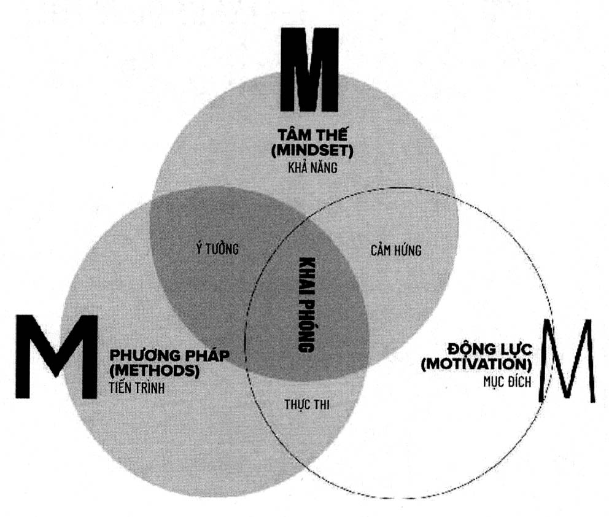

# Phần 3: Động lực khai phóng

"VÌ SAO"

**Động Lực** *(danh từ)*

Mục đích để con người thực hiện hành động. Năng lượng mà con người cần để đưa ra các hành vi nhất định.

Trong bộ phim Limitless, nhà văn Eddie Morra hoàn toàn không có động lực, thiếu tập trung và chẳng có chút năng lượng nào. Khi anh ấy uống viên thuốc có khả năng thúc đẩy hành động, cuộc sống của anh đã thay đổi ngoạn mục và trở nên tốt hơn rất nhiều, bởi vì khi đó anh đã có thể hành động để hiện thực hóa mọi thứ.

Hãy cùng phá vỡ một vài LỜI NÓI DỐI phổ biến về động lực. Trái với những gì mọi người vẫn cho là đúng, động lực cũng không phải là điều được định đoạt sẵn, giống như tâm thế vậy. Không một ai có sẵn ít hay nhiều động lực cả. Và khi mọi người nói rằng họ thiếu động lực, thì sự thật không phải là như vậy. Họ thật ra có động lực rất cao mới có thể nằm lì trên giường và xem ti vi.

Động lực cũng không phải là lúc nào bạn cũng cảm thấy vui vẻ thoải mái khi thực hiện điều mình cần phải làm. Một người bạn của tôi là nhà khởi nghiệp Tom Bilyeu rất ghét phải tập thể dục, nhưng anh ấy có lý do rõ ràng và mạnh mẽ để thực hiện việc đó, vậy nên anh ấy tập thể dục mỗi sáng. Tôi thì thật sự không thích tắm nước lạnh, nhưng tôi vẫn làm điều ấy mỗi ngày (ở Chương 8, tôi sẽ giải thích cho bạn tại sao).

Cuối cùng, động lực không phải là thứ mà mỗi sáng tỉnh dậy bạn đều có sẵn. Nếu chúng ta tự nhủ: “Tôi chẳng có tí động lực nào cả” thì bạn sẽ tự đặt mình vào một mê cung không lối thoát. Động lực không phải là thứ bạn có sẵn, mà đó là thứ bạn tạo ra. Và bạn hoàn toàn có thể duy trì nó trong thời gian dài. Động lực cũng giống như trải nghiệm khi tắm trong bồn nước ấm - bạn có thể tận hưởng điều này nhưng sự thoải mái cũng nhanh chóng qua đi trừ khi bạn làm ấm lại nước. Động lực không xuất phát từ cảm hứng tạm thời mà bạn có được sau khi tham gia một buổi hội thảo. Động lực là một quá trình. Và bởi vì tạo ra động lực là một chiến lược rõ ràng nên bạn có thể kiểm soát được động lực và tạo ra nó trong dài hạn nếu thực hiện theo đúng công thức.

Công thức như sau:** Động lực = Mục đích x Năng lượng x S3**

Khi bạn kết hợp mục đích, năng lượng và những bước nhỏ đơn giản (tiếng Anh là small simple steps - S3) thì bạn sẽ có được động lực trong dài hạn. Và dạng thức cao nhất của động lực chính là trạng thái tuôn chảy[^8]. Hãy tưởng tượng động lực cũng giống như

năng lượng vậy. Khi tạo ra nó, bạn phải phân phối nó đi chứ nếu không nó sẽ thất thoát và bị lãng phí. Một mục đích hay lý do rõ ràng sẽ mang đến cho bạn năng lượng. Những chiến lược bạn thực hiện sẽ tạo ra năng lượng cho bộ não và cơ thể bạn, và những bước nhỏ đơn giản sẽ không tốn nhiều năng lượng.

Trong phần này, chúng ta sẽ thảo luận về phương pháp để tạo ra và duy trì một động lực mạnh mẽ trong việc học tập và trong cuộc sống. Điều này hoàn toàn có thể đạt được nếu bạn có mục đích rõ ràng, nạp được năng lượng cho tâm trí và thể chất trong dài hạn, và tạo ra những bước nhỏ và đơn giản. Khi ấy, bạn sẽ đạt được đến trạng thái tuôn chảy.

Mục đích sẽ thúc đẩy chúng ta hành động, và mục đích của ta phải đủ rõ ràng để ta hiểu được tại sao mình cần phải hành động và kết quả mình mong muốn là gì. Việc tạo ra đủ năng lượng là rất cần thiết - nếu bạn mệt mỏi hay buồn ngủ, hoặc đầu óc cứ mơ hồ thì bạn sẽ không có đủ năng lượng để thực hiện hành động. Những bước nhỏ đơn giản sẽ tiêu tốn rất ít năng lượng và giúp bạn không cảm thấy tê liệt vì bị quá tải. Và cuối cùng, việc tạo ra trạng thái tuôn chảy chính là chìa khóa để duy trì động lực.

> *“Lý do tạo ra kết quả.”*
>
> -JIM KWIK

---

### Chú thích trong chương

[^8]: Khái niệm này sẽ được giải thích rõ trong Chương 10: Trạng thái tuôn chảy.

