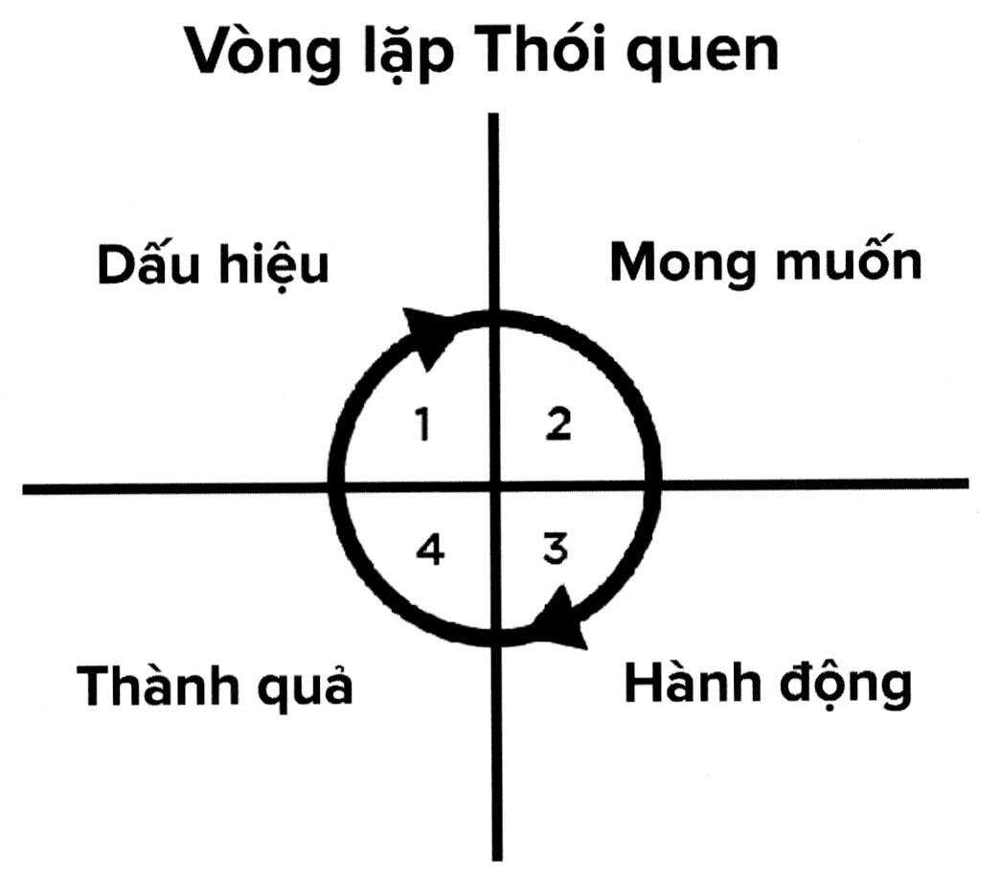

# Chương 9: Những bước nhỏ đơn giản

> *Bước nhỏ nhất và đơn giản nhất mà tôi có thể thực hiện bây giờ là gì?*

> *Làm thế nào để hình thành thói quen tốt và bỏ đi thói quen xấu?*

> *Điều gì tôi có thể thực hiện hàng ngày để trở nên không giới hạn?*

Bạn đã có được lý do hoặc mục đích để thực hiện điều gì đó. Bạn đã có năng lượng để thực hiện nó. Vậy còn thiếu gì nữa?

Đó chính là một bước nhỏ đơn giản (S3 - small simple step). Đó là hành động nhỏ nhất mà bạn có thể thực hiện trên con đường đến gần hơn với mục tiêu của mình. Đó là hành động cần ít công sức hay năng lượng nhất. Qua thời gian, những hành động này sẽ trở thành thói quen. Đó là lý do tại sao trong quyển sách này tôi đã đưa vào rất nhiều những bước nhỏ đơn giản được gọi là “Bắt đầu cùng Kwik”.

Vào những năm 1920, khi nhà tâm lý học người Nga là Bluma Zeigarnik đang ngồi trong một nhà hàng tại Vienne thì cô ấy để ý thấy rằng trong giờ cao điểm đông khách, những người phục vụ tại đó sẽ nhớ được rất tốt các món mà khách gọi, nhưng ngay sau khi món ăn đã được dọn lên thì họ có xu hướng quên đi việc khách nào đã gọi món nào.

Cô ấy cảm thấy tò mò về việc này và thực hiện một nghiên cứu, trong đó những người tham gia phải thực hiện các nhiệm vụ đơn giản và quá trình họ thực hiện sẽ bị gián đoạn nhiều lần. Sau đó, cô ấy hỏi những người tham gia xem họ còn nhớ nhiệm vụ nào và quên nhiệm vụ nào. Cô ấy nhận ra rằng những người này có thể nhớ được những công việc họ đang làm khi bị cắt ngang nhiều hơn gấp hai lần so với những việc họ đã hoàn thành trước khi bị cắt ngang. Cô ấy đi đến một kết luận - và sau này được gọi là hiệu ứng Zeigarnik - rằng những việc chưa được hoàn thành sẽ tạo ra một sự căng thẳng và khiến tâm trí của chúng ta ưu tiên nhớ đến việc ấy cho đến khi nó được hoàn thành. -

Tương tự như vậy, hẳn bạn cũng đã quen thuộc với sự căng thẳng này mỗi khi bạn trì hoãn thực hiện điều gì đó. Khi có một việc bạn biết rằng mình cần phải làm nhưng bạn lại cứ liên tục trì hoãn thì nó sẽ luôn đè nặng lên tâm trí bạn và thậm chí bạn còn cảm thấy khó khăn khi thực hiện những việc khác trong khi việc này vẫn chưa được hoàn thành. Bạn trì hoãn công việc ấy có thể là vì nó khó hơn hoặc chán hơn những việc khác bạn có thể làm, hoặc nó sẽ khiến bạn cảm thấy khó chịu, hoặc chỉ đơn giản là bạn tự thuyết phục bản thân rằng mình có rất nhiều thời gian để làm sau này. Chúng ta vẫn gặp nhiều khó khăn khi thực hiện những điều mình cần phải làm, dù đã có tầm nhìn rõ ràng và biết mình muốn trở thành người như thế nào. Vậy tại sao việc hành động vẫn quá khó khăn như vậy dù ta đã có thể duy trì được động lực trong dài hạn?

Một trong những lý do chủ yếu khiến mọi người không thể hành động đó là vì chúng ta cảm thấy quá tải bởi khối lượng công việc mình cần làm. Có thể bạn nghĩ rằng việc thực hiện một dự án hoặc duy trì một thói quen hàng ngày sẽ tốn quá nhiều công sức hoặc thời gian, và bạn nghĩ rằng mình không thể nào làm được. Khi nhìn vào toàn bộ dự án, chúng ta sẽ ngay lập tức cảm thấy rằng có quá nhiều việc cần phải làm, vậy nên ta lờ đi và trì hoãn. Nhà tâm lý học Hadassah Lipszyc đã nói: “Khi trì hoãn những việc cần phải làm, thường trong tâm trí chúng ta sẽ xuất hiện các suy nghĩ tiêu cực khiến tình hình càng xấu đi. Những suy nghĩ này có thể ảnh hưởng đến giấc ngủ, gây ra các triệu chứng lo lâu và tác động sâu hơn đến sức khỏe tinh thần và cảm xúc của con người.”

## HÃY TỬ TẾ VỚI CHÍNH MÌNH

Nếu như bạn gặp khó khăn trong việc hoàn thành việc gì đó trong khoảng thời gian tiêu chuẩn, thì khả năng cao là bạn sẽ cảm thấy tội lỗi và dằn vặt bản thân mình. Và như thế bạn sẽ khiến mọi thứ trở nên khó khăn chứ không dễ dàng hơn. Chúng ta đã biết rằng những việc chưa làm xong sẽ gây ra căng thẳng trong não bộ, và khi ấy nếu bạn còn thêm cả cảm xúc tội lỗi và xấu hổ vào thì bạn càng khiến bản thân khó hoàn thành được công việc, và bạn sẽ trở nên đau khổ hơn nữa.

Tiến sĩ Art Markman, giáo sư tâm lý học và marketing tại trường Đại học Texas, Austin viết: “Cảm giác tội lỗi vì lãng tránh công việc - nhất là trong điều kiện không cho phép - sẽ chẳng có ích gì và còn mang lại nhiều điều tiêu cực nữa. Nó sẽ khiến bạn cảm thấy tồi tệ hơn về công việc nói chung và ảnh hưởng đến khoảng thời gian đáng lẽ bạn nên dành cho bạn bè, gia đình hoặc tham gia vào các hoạt động thú vị. Tuy nhiên, đối với cảm giác xấu hổ thì hơi khác một chút. Có nhiều bằng chứng cho thấy con người có xu hướng chủ động trì hoãn để tránh cảm giác này. Cảm giác xấu hổ vì chưa hoàn thành công việc sẽ khiến vấn đề trở nên nghiêm trọng hơn chứ chẳng giải quyết được gì, vậy nên những cảm xúc này không mang lại lợi ích gì cả.”

Khi bạn cảm thấy tồi tệ vì mình không thực hiện những việc cần làm, bạn sẽ có xu hướng trì hoãn nhiều hơn nữa. Vậy nên hãy khoan dung với bản thân hơn một chút. Tự dằn vặt cũng không khiến mọi thứ cải thiện đâu, và bởi vì bạn đang đọc quyển sách này nên bạn đã và đang thực hiện các bước nhỏ để hạn chế tình trạng trì hoãn trong tương lai rồi.

Theo kinh nghiệm của tôi thì cách tốt nhất để xử lý tình huống này là tìm ra cách để phân chia công việc lớn thành những việc nhỏ và dễ thực hiện hơn, điều này sẽ giúp bạn hình thành nên các thói quen có thể dẫn đế thành công. Hãy cùng xem xét lại hiệu ứng Zeigarnik, mỗi khi bạn hoàn thành một công việc nhỏ, tâm trí bạn sẽ nhẹ nhõm hơn và không còn nghĩ về nó nữa. Và khi lần lượt thực hiện các công việc nhỏ này, bạn cũng càng tiến gần hơn đến với mục tiêu hoàn thành công việc lớn.

## NHỮNG BƯỚC ĐI THẬT NHỎ

Tiến sĩ B. J. Fogg là khách mời trong chương trình podcast của tôi, đồng thời ông cũng là nhà sáng lập và chủ tịch Viện Thiết kế Hành vi tại Đại học Stanford và là tác giả quyển Tiny Habits. Trong hơn hai thập kỷ qua, ông đã dành thời gian để nghiên cứu hành vi con người và ông nhận ra rằng chỉ có ba cách có thể thay đổi hành vi của một người trong dài hạn. Đầu tiên là một khoảnh khắc giác ngộ - và rất ít người có thể trải nghiệm được điều này một cách có chủ đích vào đúng thời điểm. Cách thứ hai là thay đổi môi trường, mặc dù điều này gần như ai cũng có thể thực hiện nhưng không phải lúc nào cũng khả thi. Cách thứ ba, theo cách Tiến sĩ Fogg gọi, đó là “những bước đi thật nhỏ”.

Có một câu chuyện tôi rất thích, và nó thể hiện rất rõ nguyên lý về những bước nhỏ đơn giản:

Có một vị vua nọ đang xem nhà ảo thuật trình diễn. Đám đông khán giả và cả nhà vua đều chăm chú theo dõi. Vào cuối buổi biểu diễn, đám đông vỡ òa tán dương nhà ảo thuật. Và nhà vua nói rằng: “Người này tài thật. Một tài năng được Chúa ban tặng.”

Nhưng một vị cố vấn thông thái đã nói với nhà vua rằng: “Thưa Đức Vua, thiên tài được tạo ra chứ không phải được sinh ra. Kỹ năng của ảo thuật gia này chính là thành quả có được từ sự nỗ lực và kiên trì. Những tài năng này được học hỏi và mài dũa qua thời gian với sự quyết tâm và kiên trì.”

Nhà vua không hài lòng trước câu nói này. Lời nói của vị cố vấn đã làm hỏng cảm giác vui vẻ mà nhà vua có được sau màn biểu diễn. “Một con người hẹp hòi và nhỏ mọn. Làm sao ngươi dám chỉ trích một thiên tài thực sự chứ. Tài năng không phải là thứ ngươi muốn là có được. Và ngươi hẳn là chẳng có được tài năng ấy.”

Nhà vua truyền chỉ xuống cận vệ: “Hãy giải tên này xuống hầm ngục sâu nhất.” Và ông ấy còn ban một ân huệ nhỏ cho vị cố vấn này: “Và để nhà ngươi không cảm thấy cô đơn, ta sẽ để vào đó hai sinh vật cùng loại với nhà ngươi. Ngươi sẽ sống trong hầm ngục với hai con lợn con.” Từ ngày đầu tiên bị tống giam, vị cố vấn thông thái đã luyện tập bằng cách chạy lên xuống bậc thang trong ngục, mỗi tay cầm một con lợn con. Nhiều ngày trôi qua, và nhiều tháng trôi qua, hai con lợn con đã lớn lên thành những con lợn trưởng thành. Và nhờ vào việc luyện tập mỗi ngày như thế, vị cố vấn đã gia tăng được sức mạnh thể chất của mình.

Một ngày nọ, nhà vua nhớ đến vị cố vấn và cảm thấy tò mò không biết liệu ông ta đã biết điều hơn sau khi bị tống giam chưa. Nhà vua truyền lệnh giải người này đến trước mặt mình.

Người tù nhân xuất hiện với một cơ thể vạm vỡ, mỗi tay nâng một con lợn trưởng thành. Nhà vua cảm thán: “Người này tài thật. Một tài năng được Chúa ban tặng.”

Vị cố vấn thông thái trả lời: “Thưa Đức Vua, thiên tài được tạo ra chứ không phải được sinh ra. Kỹ năng của thần chính là thành quả có được từ sự nỗ lực và kiên trì. Những tài năng này được học hỏi và mài dũa qua thời gian với sự quyết tâm và kiên trì.

Một trong số ít những điều có thể thay đổi hành vi của bạn là thực hiện những thay đổi nhỏ một cách liên tục. Bạn thực sự không muốn nấu ăn ngay lúc đó? Hãy làm một món ăn nhẹ đơn giản cho gia đình và nấu món chính sau. Bạn gặp khó khăn khi phải viết bài phát biểu dài cho hội nghị vào tháng sau? Bây giờ hãy cứ viết ra những ý chính trước. Bạn cảm thấy choáng ngợp vì số sách mình cần phải đọc trong môn kinh tế học? Hãy đặt ra mục tiêu đọc chương đầu tiên thôi. Giống như vị cố vấn thông thái nọ, bạn phải thực hiện từng bước nhỏ, mỗi ngày một bước nhỏ thôi.

Thông qua tất cả những tình huống này, có hai điều mà bạn cần nhận ra. Thứ nhất là phương pháp này sẽ tạo ra những công việc mà bạn có khả năng thực hiện được chúng sẽ là những chiến công nho nhỏ trên hành trình đạt được thành quả to lớn hơn. Thứ hai, phương pháp này có thể giúp bạn hoàn thành vượt hơn cả những mục tiêu đã đặt ra. Bạn hiện đã ở trong nhà bếp rồi, vậy nên có thể bạn sẽ tiến hành nấu bữa ăn luôn. Bạn đã ghi lại những ý chính cho bài thuyết trình rồi, và có thể bạn cảm thấy có hứng và viết ra một vài trang nháp luôn. Chương đầu tiên trong sách kinh tế học không đến nỗi khô khan như bạn nghĩ, và dù gì bạn cũng đã mở sách ra rồi, bạn có thể sẽ đọc luôn vài chương tiếp theo.

Khi chia nhỏ công việc lớn mà bạn có xu hướng trì hoãn ra thành những việc nhỏ hơn, hành trình để hoàn thành công việc ấy sẽ trở nên rõ ràng.

Khi bạn cảm thấy căng thẳng vì công việc cần làm có vẻ quá nhiều, cách giải quyết tốt nhất là hãy nhớ lại bài học từ hiệu ứng Zeigarnik. Bạn sẽ không thể nào cảm thấy nhẹ nhõm cho đến khi đã hoàn thành công việc, vậy nên hãy bắt tay vào thực hiện nó ngay đi. Hãy bắt đầu. Lúc nào cũng được, ở đâu cũng được. Thậm chí nếu bạn không có đủ năng lượng hay động lực để hoàn thành toàn bộ công việc thì cũng hãy cứ bắt tay vào làm. Bạn sẽ cảm thấy nhẹ nhõm hơn nhiều đấy.

### BẮT ĐẦU CÙNG KWIK

Hãy nghĩ về một công việc mà bạn đã trì hoãn trong một thời gian rồi. Đó là việc gì vậy?

Làm thế nào để chia nó thành các bước nhỏ đơn giản mà bạn có thể thực hiện mỗi ngày?

## CHẾ ĐỘ TỰ ĐỘNG

- Những bước nhỏ đơn giản được lặp đi lặp lại sẽ trở thành thói quen. Thói quen là một phần quan trọng định hình nên bản thân chúng ta. Rất nhiều nghiên cứu đã chỉ ra rằng khoảng 40 đến 50% những điều ta làm hàng ngày là kết quả của thói quen. Điều đó có nghĩa là một nửa cuộc sống của chúng ta được vận hành bởi một thứ mà các nhà khoa học gọi là tính tự động. Có thể bạn nghĩ rằng tỷ lệ này là quá cao - và lần đầu tiên khi biết được tôi cũng có cảm giác như vậy - nhưng hãy thử cân nhắc những việc bạn thực hiện hàng ngày mà không cần phải suy nghĩ. Bạn đánh răng không cần suy nghĩ. Cứ sau một khoảng thời gian nào đó bạn lại kiểm tra điện thoại một cách vô thức. Bạn lái xe đến văn phòng mà không thực sự nhớ được chính xác mình đã lái như thế nào. Bạn kéo khóa áo khoác, lấy một chiếc ly từ trong tủ ra và nhấn vào đồ điều khiển ti vi một cách tự động.

> *“Khi bắt đầu tiếp cận với bản thể không giới hạn của mình, có thể bạn sẽ phải đối mặt với những thói quen và hành vi cũ, và không phải chúng lúc nào cũng đúng đâu. Những điều này xuất hiện bởi vì bạn đã lặp lại chúng hàng nghìn lần.”*
>
> -DEBBIE FORD

Điều này tất nhiên rất cần thiết cho cuộc sống của chúng ta. Thử tưởng tượng xem, bạn sẽ cảm thấy quá tải đến mức nào khi phải suy nghĩ về tất cả mọi chuyện mình làm? Nếu thậm chí cả việc đánh răng cũng cần phải chú ý suy nghĩ và tính toán thì chưa đến 10 giờ sáng là bạn đã cảm thấy kiệt sức rồi.

Charles Duhigg, tác giả quyển sách thuộc danh sách bán chạy nhất là The Power of Habit đã viết rằng: “Nếu không có vòng lặp thói quen thì bộ não của chúng ta sẽ ngừng hoạt động do bị quá tải bởi tất cả những chi tiết nhỏ trong cuộc sống hàng ngày. Những người bị tổn thương ở vùng hạch nền trong não do tai nạn hoặc bệnh tật thường trở nên tê liệt về tinh thần. Họ gặp khó khăn khi thực hiện các hoạt động cơ bản như mở cửa hay quyết định món mình muốn ăn. Họ mất đi khả năng bỏ qua các chi tiết không quan trọng. Ví dụ, trong một nghiên cứu được thực hiện, các nhà khoa học nhận ra rằng các bệnh nhân bị tổn thương hạch nền không thể nhận ra được biểu cảm khuôn mặt, bao gồm các cảm xúc như sợ hãi hay căm ghét bởi vì họ không chắc rằng mình nên tập trung vào bộ phận nào trên khuôn mặt.”

James Clear, tác giả của quyển sách thuộc danh sách bán chạy nhất là Atomic Habits, đã nói rằng: “Những thói quen bạn thực hiện (hoặc không thực hiện) mỗi ngày sẽ ảnh hưởng rất lớn đến sức khỏe, tình trạng tài chính và hạnh phúc của bạn. Khi biết cách thay đổi thói quen, bạn sẽ có thể tự tin quản lý các công việc trong ngày cũng như tập trung vào những hành vi đem lại hiệu quả nhiều nhất và tái thiết lập lại cuộc sống theo hướng mình muốn.”

“Mọi thói quen đều có lợi cho bạn ở một khía cạnh nào đó”, Clear nói. “Trong cuộc sống, bạn phải đối mặt với nhiều vấn đề khác nhau. Khi bạn cần buộc dây giày, bộ não của bạn đã có giải pháp tự động cho điều ấy. Đó chính là thói quen. Thói quen là giải pháp cho một vấn đề lặp đi lặp lại trong cuộc sống - và bạn xử lý vấn đề ấy nhiều lần đến nỗi bạn giờ có thể làm mà không cần suy nghĩ nữa. Nếu giải pháp không còn hiệu quả nữa thì bộ não của bạn sẽ nâng cấp nó.”

Clear diễn giải rằng vòng lặp thói quen có bốn thành phần: một dấu hiệu, một mong muốn, một hành động và một thành quả. Thử xem xét ví dụ là bạn bật đèn mỗi khi bước vào phòng. Dấu hiệu ở đây là bước vào phòng và thấy phòng tối. Mong muốn là bạn nghĩ căn phòng sẽ tốt hơn nếu nó không còn tối nữa. Hành động là bật công tắc đèn lên. Thành quả là căn phòng không còn tối nữa. Bạn có thể áp dụng vòng lặp này vào bất kỳ thói quen nào, ví dụ như kiểm tra hộp thư mỗi khi đi làm về. Dấu hiệu là khi bạn lái xe đến cửa nhà vào cuối ngày. Mong muốn là hi vọng có thứ gì đó trong hộp thư. Hành động là đi đến chỗ hộp thư để kiểm tra. Và thành quả là lấy thư ra từ trong hộp. Bạn có thể không hề nghĩ về toàn bộ quá trình này cho đến khi bạn đã cầm những lá thư trong tay.

Tạo ra thói quen để tự động hóa các công việc cần thiết trong cuộc sống - đây là một kỹ thuật cơ bản mà chúng ta thực hiện chủ yếu theo vô thức, và nó thường có mang lại lợi ích cho ta. Tất nhiên là cũng có những thứ không hề có lợi nhưng cũng được tự động hóa. Tôi chắc rằng bạn cũng có thể nghĩ ra một vài ví dụ. Có thể dấu hiệu là bạn đi ngang qua tủ bếp. Bạn biết trong tủ có món khoai tây chiên khoái khẩu của mình, và mong muốn tự nhiên của bạn là ăn chúng. Hành động là bạn mở tủ bếp, mở gói khoai tây chiên và lấy ra một ít. Thành quả là sự ngon miệng đến từ những miếng khoai tây giòn tan, béo ngậy và mằn mặn... nhưng lại không tốt cho sức khỏe chút nào. Những thói quen tiêu cực của chúng ta cũng được thực hiện một cách tự động giống như thói quen tích cực vậy. Sẽ có nhiều miếng khoai tây chiên yên vị trong bụng bạn trước khi bạn nhận ra rằng mình đang ăn khoai tây chiên.

Giờ đây bạn đang ở trên hành trình để trở nên không giới hạn, bạn biết rằng việc bám víu vào những hành vi tiêu cực sẽ làm suy giảm siêu sức mạnh của bạn. Vậy thì làm thế nào để loại bỏ những thói quen xấu, và quan trọng nữa là tạo ra thói quen tốt?

## TẠO RA THÓI QUEN

Trước khi thực hiện điều này, hãy dành ra một chút thời gian để tìm hiểu xem bạn cần bao lâu để tạo ra thói quen mới. Trong một nghiên cứu thực hiện cho Đại học College London, Phillippa Lally, Cornelia H. M. van Jaarsveld, Henry W. W. Potts và Jane Wardle đã đưa những người tham dự vào một quá trình nhằm phát triển một thói quen tốt trong việc ăn uống hoặc tập luyện, ví dụ như uống nước vào bữa trưa hoặc đi bộ trước bữa tối. Những người này được yêu cầu thực hiện các hành vi mới này trong những tình huống cụ thể hàng ngày, trong vòng 84 ngày. Các nhà nghiên cứu đã viết rằng: “Phần lớn những người tham gia đều nhận thấy tính tự động của hành vi gia tăng đều đặn trong quá trình thử nghiệm, và điều này củng cố thêm cho giả thuyết rằng khi thực hiện một hành vi nào đó trong một tình huống nhất định, tính tự động của hành vi đó sẽ tăng lên. Khi nghiên cứu kết thúc, họ kết luận rằng một người trung bình sẽ cần 66 ngày để phát triển một hành vi trở thành thói quen, mặc dù có người tham gia chỉ mất 18 ngày và có người tốn đến tận 254 ngày.”

Phần lớn mọi người cũng cho rằng để loại bỏ một thói quen xấu thì điều quan trọng không phải là kết thúc thói quen đó mà là thay thế nó bằng một thói quen khác tốt hơn. Tiến sĩ Elliot Berkman, giám đốc Phòng thí nghiệm Khoa học Thần kinh Xã hội và Tình cảm tại Đại học Oregon nói rằng: “Việc bắt đầu thực hiện một hành vi mới sẽ dễ hơn việc kết thúc một hành vi cũ đã trở thành thói quen và không có hành vi nào khác để thay thế. Đó là lý do tại sao các phương pháp như kẹo cao su nicotine hoặc máy hít sẽ có hiệu quả hơn trong việc giúp bệnh nhân bỏ thuốc hơn là miếng dán nicotine.”

Vậy nên, nếu quá trình hình thành một thói quen mới, ví dụ như đọc mỗi ngày, về cơ bản cũng giống như quá trình kết thúc một thói quen xấu, ví dụ như lấy khoai tây chiên ra ăn mỗi khi đi ngang qua tủ bếp, thì làm thế nào để chúng ta thực hiện thay đổi ấy?

Cũng giống như rất nhiều chủ đề khác mà chúng ta thảo luận trong quyển sách này, động lực vẫn luôn đóng vai trò chủ đạo. Khi nói về những nỗ lực phải bỏ ra để loại bỏ thói quen cũ, Tiến sĩ Thomas G. Plante, trợ giảng giáo sư lâm sàng của Khoa Tâm thần học và Khoa học Hành vi tại Trường Y khoa của Đại học Stanford, cho rằng: “Thứ nhất, việc này phụ thuộc vào việc bạn muốn bỏ thói quen xấu ấy đến mức nào. Có nhiều người vừa muốn bỏ lại vừa muốn giữ. Họ muốn giảm cân nhưng vẫn thích các món ăn gây tăng cân. Họ muốn giảm tiêu thụ cồn nhưng vẫn thích có được khoảng thời gian vui vẻ. Họ muốn bỏ thói quen cắn móng tay nhưng nó giúp họ cảm thấy bớt căng thẳng. Vậy thì vấn đề trọng yếu ở đây là bạn muốn bỏ thói quen ấy nhiều đến mức nào. Thứ hai, thói quen xấu ấy đã hình thành được bao lâu rồi? Việc loại bỏ một thói quen mới sẽ dễ hơn thói quen đã ăn sâu bám rễ trong cuộc sống. Thứ ba, nếu không bỏ được thói quen xấu ấy thì hệ quả sẽ là gì? Vợ/ chồng bạn sẽ rời bỏ bạn? Bạn sẽ mất việc? Bạn sẽ bị ốm? Hoặc sẽ có điều gì rất xấu xảy ra nếu bạn không thay đổi?”

> *“Thói quen có thể là người đầy tớ tốt nhất hoặc người chủ tế nhất.”*
>
> -NATHANIEL EMMONS

Tiến sĩ B. J. Fogg đã tạo ra Mô hình Hành vi Fogg để xác định những tình huống cần phải xuất hiện để thay đổi hành vi của con người. Fogg lưu ý rằng: “Để tạo nên được một hành vi mới, một người phải có đủ động lực, đủ năng lực và đủ tình huống để thực hiện. Cả ba nhân tố này đều phải có mặt tại cùng một thời điểm thì hành vi ấy mới được thực hiện. Nói cách khác thì bạn cần ba thứ để phát triển một thói quen mới: Bạn cần có mong muốn thực hiện hành vi đó bởi vì nếu không thì sẽ cực kỳ khó để hình thành nên thói quen. Bạn cần có khả năng để làm được chuyện đó, bởi nếu nó nằm ngoài khả năng của bạn thì việc hình thành thói quen là gần như không thể. Bạn cũng cần một chất xúc tác để khởi động cho vòng lặp thói quen (đây là điều mà James Clear và một số người khác gọi là “dấu hiệu”).” Bây giờ, hãy xem xét lần lượt từng yếu tố:

**Động lực**

Chúng ta đã nói về động lực rồi, nhưng tôi vẫn muốn nhắc lại một lần nữa, và lần này là theo góc nhìn của Fogg. Fogg đã đưa ra ba loại động lực chính.

**1. Sự hài lòng/đau khổ:** Đây là động lực mang tính tức thời nhất. Trong trường hợp này, hành vi sẽ mang đến kết quả gần như ngay lập tức, có thể là tích cực hoặc tiêu cực. Fogg nói: “Tôi tin rằng sự hài lòng/đau khổ chính là những phản ứng rất tự nhiên, nó liên quan đến hành động chúng ta thực hiện khi đói, khi quan hệ tình dục và các hoạt động khác giúp ta sinh tồn và phát tán bộ gen của mình.”

**2. Hi vọng/sợ hãi:** Không giống như động lực thứ nhất, loại động lực này không tạo ra kết quả ngay lập tức, mà nó mang đến sự chờ đợi. Khi bạn hi vọng, bạn đang chờ đợi một thứ tốt đẹp xảy đến; còn sợ hãi là khi bạn chờ đợi điều ngược lại. “Loại động lực này đôi khi còn mạnh mẽ hơn cả sự thỏa mãn/đau khổ, và điều này được chứng minh trong hành vi hàng ngày của chúng ta” - Fogg nói. “Ví dụ, trong một số trường hợp, con người sẽ chấp nhận nỗi đau (chẳng hạn như một mũi tiêm vắc-xin cúm) để vượt qua được nỗi sợ hãi (sợ sẽ mắc bệnh cúm).”

**3. Sự chấp nhận/bài trừ về mặt xã hội:** Con người luôn muốn được những người khác chấp nhận, và tâm lý này đã xuất hiện từ thời xa xưa, khi ấy việc bị cộng đồng tẩy chay đồng nghĩa với án tử hình. Hiện nay, điều này vẫn là một động lực cực kỳ mạnh mẽ. “Động lực xã hội có lẽ đã ăn sâu bám rễ và ảnh hưởng mạnh mẽ đến hành vi của con người, và có lẽ nó cũng ảnh hưởng đến tất cả những sinh vật trong tự nhiên vốn phải sống theo nhóm để tồn tại.”

**Khả năng**

Fogg cho rằng khả năng đồng nghĩa với sự đơn giản, có nghĩa là khi một thứ đủ đơn giản, chúng ta sẽ có tỷ lệ thực hiện nó cao hơn. Ông ấy đã định nghĩa sáu loại hình đơn giản như sau:

**1. Thời gian:** Chúng ta chỉ nhìn nhận một hành động nào đó là đơn giản nếu ta có đủ thời gian để thực hiện được nó.

**2. Tiền bạc:** Tương tự, nếu một công việc nào đó vượt quá khả năng tài chính của mình thì ta không cho rằng đó là một việc đơn giản.

**3. Nỗ lực thể chất:** Chúng ta cho rằng những công việc tốn ít công sức thực hiện là việc đơn giản.

**4. Hoạt động não:** Những công việc đơn giản không bắt chúng ta phải suy nghĩ nhiều, và ta thường ngại những việc yêu cầu phải tốn nhiều suy tư.

**5. Sự phù hợp với quy chuẩn xã hội:** Điều này có liên quan đến động lực muốn được xã hội chấp nhận, như đã đề cập ở trên. Những việc đơn giản là việc phù hợp với quy chuẩn xã hội.

**6. Sự quen thuộc:** Công việc càng giống với những thứ quen thuộc mà mỗi người thực hiện hàng ngày sẽ được xem là càng đơn giản.

**Tác nhân dẫn đến hành động**

Cuối cùng Fogg diễn tả ba loại tác nhân có thể dẫn đến hành động:

**1. Thúc đẩy:** là một loại tác nhân có thể ngay lập tức tạo ra động lực. Ví dụ, nếu việc mở email mang lại cảm giác sợ hãi rằng mình sẽ phải đọc một điều gì đó không như ý thì khả năng cao là bạn sẽ tạo ra một thói quen để tránh được nỗi sợ ấy.

**2. Hỗ trợ:** Loại tác nhân này sẽ có hiệu quả khi bạn có nhiều động lực nhưng khả năng thực hiện lại hạn chế. Ví dụ, nếu bạn muốn sử dụng một phần mềm nào đó trên máy tính nhưng bản thân lại không giỏi về công nghệ, vậy thì một công cụ có thể đơn giản hóa quá trình sử dụng phần mềm sẽ thúc đẩy bạn sử dụng nó.

**3. Nhắc nhở:** Trong một số trường hợp, bạn sẽ có nhiều động lực và cũng có đủ khả năng. Điều duy nhất mà bạn còn thiếu chính là một dấu hiệu nhắc nhở. Nếu bạn thích làm món sinh tố bổ não thì tác nhân mà bạn cần chỉ là đi vào nhà bếp trong buổi - sáng và nhìn thấy chiếc máy xay sinh tố - điều đó sẽ thúc đẩy bạn làm sinh tố.

### BẮT ĐẦU CÙNG KWIK

Bạn có thể xác định được những thói quen mà mình muốn loại bỏ không? Thói quen nào đang ngăn cảnh bạn thực hiện những điều quan trọng khác trong ngày? Hãy viết nó vào đây, sau đó xác định các tình huống có thể thúc đẩy bạn thực hiện thói quen ấy:

## TẠO RA MỘT THÓI QUEN MỚI

Mô hình Hành vi Fogg cho chúng ta thấy tất cả những điều kiện cần thiết để biến một hành vi nhất định thành thói quen. Chúng ta biết rằng việc hình thành những thói quen tốt đóng vai trò quan trọng trong hành trình phát triển của mình, và ta cũng biết rằng để loại bỏ được thói quen xấu, ta cần phải thay thế nó bằng một thói quen tốt hơn. Nhưng làm thế nào để bạn biến hành vi thành thói quen được? Hãy nhớ công thức WIN (tạm dịch: chiến thắng):

- **W là Want (Mong muốn):**  Hãy đảm bảo rằng bạn

thực sự muốn hình thành nên thói quen này. Nếu không muốn thì gần như bạn sẽ không thể nào biến một việc trở thành thói quen được. Liệu thói quen bạn muốn hình thành có xuất phát từ một trong những động lực trong Mô hình Fogg không? Nếu không thì có thói quen nào khác tương tự như thói quen này và vẫn có thể giúp bạn đạt được mục đích tương đương không?

- **I là Innate (Thiên bẩm):**  Thói quen mới mà bạn

muốn hình thành có phù hợp với khả năng thiên bẩm của bạn không? Hãy nhớ rằng nếu bạn gặp khó khăn khi thực hiện một hành vi nào đó thì rất khó để biến nó trở thành thói quen. Nếu bạn muốn hình thành thói quen từ một việc mình làm rất tốt hoặc có thể làm tốt thì hành trình của bạn sẽ dễ hơn rất nhiều.

- **N là Now (Bây giờ):**  Hãy tạo ra một nhân tố có

thể khuyến khích bạn thực hiện hành động dẫn đến thói quen mới, ngay bây giờ. Bạn có thể đặt đồng hồ báo giờ trên điện thoại hoặc đặt một vật gì đó trong văn phòng để nhắc nhở rằng bạn cần dành ra thời gian để thực hiện điều mình đã lên kế hoạch thực hiện.

## HÃY HÌNH THÀNH TỪNG THÓI QUEN MỘT THÔI

Nếu như bạn vẫn còn băn khoăn liệu việc hình thành một thói quen tốt mới sẽ có tác động như thế nào đối với cuộc sống của mình, thì hãy xem xét câu chuyện từ một khách hàng của tôi. Xiang là một người bị chứng tâm thần phân liệt và trầm cảm. Anh ấy thường xuyên nghe thấy những giọng nói xui khiến anh ấy đi hại chính mình hoặc người khác, và anh ấy đã phải vào bệnh viện tâm thần một vài lần để điều trị vấn đề này. Sau khi tìm ra được phương pháp hành thiền đúng đắn và trải qua một đợt điều trị, anh ấy khám phá ra chương trình podcast của tôi và học được một vài phương pháp mà tôi hướng dẫn trong các lớp học của mình. Anh ấy bắt đầu nghe chúng thường xuyên hơn và thực hiện các bài tập Thử thách cùng Kwik - đây là một chuỗi các bài tập tôi đưa ra cho mọi người để gieo vào tâm trí họ những suy nghĩ mới, và từ đó giúp bộ não của họ sẵn sàng cho việc học hơn. -

Ban đầu, điều này rất thử thách đối với Xiang, nhưng anh ấy chỉ tập trung vào hai điều cụ thể: đánh răng bằng tay không thuận và tắm nước lạnh mỗi sáng. Mỗi tuần, anh ấy lại tăng thời gian tắm nước lạnh của mình lên thêm một phút. Khi làm vậy, anh ấy nhận ra rằng nếu mình thực hiện được một điều khó khăn như đứng dưới vòi nước lạnh trong vòng vài phút vào mỗi sáng thì chứng tỏ anh ấy vẫn còn còn ý chí rất cao muốn phá vỡ những giới hạn trong một số khía cạnh của cuộc sống. Bắt đầu từ những trải nghiệm trong chuỗi Thử thách cùng Kwik, anh ấy bắt đầu ứng dụng những điều mà mình đã học được về thói quen và hành vi để từ đó thay đổi những lĩnh vực khác trong cuộc sống.

Cuộc sống của Xiang đã cải thiện đáng kể. Anh ấy tham gia bài thi lấy bằng lái xe và đã đỗ. Anh ấy thay đổi chế độ ăn uống của mình, cắt giảm các loại nước uống có đường và bắt đầu thực hiện đi bộ năm phút trong công viên mỗi sáng. Anh ấy cũng bắt đầu đọc sách - quyển đầu tiên là Mindset của tác giả Carol Dweck - và khi đọc sách, anh ấy nghe nhạc baroque để thiết lập nhịp điệu cho quá trình đọc của mình và ngăn cản sự ảnh hưởng của những ảo giác trong đầu. Anh ấy mất một tháng để đọc xong quyển sách, nhưng khi đã xong, anh ấy cảm nhận được sự tự tin mà trước đây mình chưa từng có được. Những chuyến đi đến thư viện trở nên thường xuyên hơn. Xiang còn nâng việc học tập của mình lên một tầm cao mới và đăng ký tham gia các lớp khoa học máy tính tại một trường đại học địa phương. Và điều tốt nhất là hiện nay anh ấy đã tin rằng mình có thể liên tục học hỏi suốt đời.

Có thể bạn nghĩ rằng: trong quá khứ, khi cố gắng thay đổi các thói quen hàng ngày, mình đã thất bại nhiều lần rồi nên có lẽ mình sẽ không bao giờ thay đổi được chúng. Câu chuyện của Xiang cho thấy rằng chỉ cần thay đổi một đến hai thói quen nhỏ trong ngày, bạn sẽ có thể khởi động cho một quá trình thay đổi kỳ diệu trong cuộc sống. Những điều rất đơn giản như đánh răng bằng tay không thuận có thể chính là khởi đầu cho một lối sống hoàn toàn mới.

## TẠO RA CHUỖI THÓI QUEN BUỔI SÁNG

Tại sao tạo ra chuỗi thói quen buổi sáng lại quan trọng đến vậy? Tôi thực sự tin rằng nếu bạn khởi đầu một ngày mới thật tốt, và khởi động bộ não với một chuỗi các hoạt động đơn giản, thì bạn sẽ có được lợi thế rất lớn. Thêm vào đó, nếu tạo ra được chuỗi các thói quen vào đầu ngày thì bạn sẽ tận dụng được sức mạnh của một thứ Tony Robbins gọi là “khoa học quán tính”, có nghĩa là một khi đã bắt đầu thực hiện một việc gì đó thì bạn sẽ có thể tiếp tục thực hiện mà không cần phải tốn nhiều nỗ lực như khi mới bắt đầu thực hiện việc này.

Tôi có một chuỗi thói quen buổi sáng, và nó được thiết kế cẩn thận để chuẩn bị tâm trí tôi thật tốt, giúp tôi có được một ngày thật hiệu quả. Không phải ngày nào tôi cũng thực hiện tất cả những việc này, đặc biệt là trong những chuyến công tác xa, nhưng gần như mỗi ngày tôi đều thực hiện hầu hết các thói quen này. Tôi biết chắc chắn rằng chúng sẽ giúp tâm trí mình sẵn sàng, từ đó tạo tiền đề để gia tăng hiệu quả, hiệu suất công việc và sự tích cực xuyên suốt trong một ngày, bắt đầu ngay từ lúc tôi thức dậy.

Hãy để tôi miêu tả cho bạn một buổi sáng thông thường của mình:

Trước khi ra khỏi giường, tôi dành một chút thời gian để suy nghĩ lại những giấc mơ của mình. Giấc mơ sẽ phản ánh các hoạt động diễn ra trong tiềm thức khi bạn đang ngủ, và đây chính là một nguồn tài nguyên quý giá mà bạn có thể sử dụng. Trong lịch sử, có rất nhiều thiên tài thường xuyên có được những ý tưởng hay nhất và bắt đầu nhiều khám phá vĩ đại từ chính giấc mơ của mình. Mary Shelly đã nảy ra ý tưởng về tiểu thuyết Frankenstein trong giấc mơ. Giấc mơ cũng là chất liệu để Paul McCartney cũng viết nên bài hát “Yesterday”, và ý tưởng của Einstein về thuyết tương đối cũng có nguồn gốc như vậy.

Vậy nên, điều đầu tiên mà tôi làm mỗi ngày, trước cả khi ngồi dậy, là suy nghĩ lại về những giấc mơ để xem liệu có ý tưởng hoặc khái niệm hay phương pháp nào mới để thực hiện những điều mà tôi đang muốn đạt được không. Tôi biết rằng nhiều người khó có thể nhớ lại được giấc mơ của mình, vậy nên tôi sẽ trình bày một kỹ thuật ghi nhớ được thiết kế để giúp bạn làm được điều này. Hãy nghĩ về từ DREAMS (tạm dịch: những giấc mơ):

- **D là Decide (Quyết định):**  Vào đêm hôm trước, hãy

chủ động đưa ra quyết định rằng bạn sẽ nhớ lại giấc mơ của mình vào sáng mai. Một khi đã có chủ đích trong đầu, khả năng bạn nhớ được sẽ tăng lên đáng kể.

- **R là Record (Ghi lại):**  Hãy đặt một cây bút và một tờ

giấy bên cạnh giường, hoặc thậm chí là một ứng dụng ghi âm sẵn sàng trong điện thoại. Ngay khi thức dậy, hãy ghi lại bất cứ điều gì bạn nhớ về những giấc mơ của mình.

- **E là Eyes (Nhắm mắt):**  Hãy nhắm mắt lại ngay sau

khi bạn thức dậy. Giấc mơ có thể biến mất chỉ sau vài phút, và nếu bạn nhắm mắt lại thì bạn sẽ có thể nhớ được tốt hơn.

- **A là Affirm (Xác nhận):**  Trước khi đi ngủ, hãy đưa ra

lời khẳng định rằng bạn sẽ nhớ lại những giấc mơ, bởi vì lời khẳng định chính là công cụ không thể thiếu để đạt được mục tiêu.

- **M là Manage (Quản lý):**  Có rất nhiều lý do tại sao

bạn cần quản lý giấc ngủ và tạo ra các thói quen ngủ tốt, và một lý do là nó sẽ giúp bạn nhớ được giấc mơ tốt hơn.

- **S là Share (Chia sẻ):**  Hãy nói về giấc mơ của bạn

với người khác. Khi làm như vậy, bạn sẽ gợi mở được các giấc mơ nhiều hơn, và cũng sẽ dần phát triển được thói quen đào sâu vào giấc mơ để có thể thảo luận nó với người khác sau này.

Điều đầu tiên tôi thực hiện sau khi bước xuống khỏi giường là dọn giường. Đây là một thói quen thành công, là thành tựu đầu tiên mà tôi đạt được trong ngày hôm đó. Đó là một thành quả dễ dàng đạt được, và nó cũng giúp thời gian ngủ của tôi thêm phần dễ chịu bởi vì khi trở về nhà vào cuối ngày, bạn sẽ thấy tốt hơn khi giường đã được xếp gọn gàng. Đó là lý do tại sao trong quân đội họ sẽ huấn luyện bạn dọn giường gọn gàng ngay sau khi thức dậy bởi vì nó sẽ là một khởi đầu tốt để bạn thực hiện thành công các việc khác trong ngày.

Sau đó tôi sẽ uống một cốc nước lớn. Việc cấp nước cho cơ thể trong buổi sáng là rất quan trọng vì chúng ta mất rất nhiều nước trong giấc ngủ thông qua việc đơn giản là hít thở. Hãy nhớ rằng bộ não của ta có để 75% là nước, vậy nên để khởi động bộ não, ta cần phải được cấp đủ nước. Tôi cũng uống thêm một cốc nước ép cần tây, có tác dụng tăng cường hệ miễn dịch, tống khứ các chất độc hại trong gan và phục hồi tuyến thượng thận (tôi phải cảm ơn Anthony William và quyển sách Medical Medium vì đã cho tôi ý tưởng này). Ngay sau đó, tôi sẽ uống men vi sinh để đảm bảo bộ não thứ hai của tôi có đủ các dưỡng chất cần thiết.

Sau đó tôi đánh răng bằng tay không thuận. Tôi làm như vậy để luyện cho bộ não khả năng thực hiện những việc khó vì khi làm vậy, một phần khác trong bộ não sẽ được kích hoạt. Đồng thời, việc này cũng buộc tôi phải chú tâm vào chuyện mình đang làm. Tôi không thể vừa làm chuyện khác vừa đánh răng bằng tay không thuận được.

Sau đó tôi thực hiện một bài thể dục ba phút. Đây không phải là bài tập đầy đủ nhưng tôi muốn nâng cao nhịp tim của mình thật sớm trong buổi sáng bởi vì điều đó sẽ giúp tôi cải thiện giấc ngủ và kiểm soát cân nặng, đồng thời tăng cường cung cấp oxy cho não.

Tập thể dục xong, tôi sẽ tắm nước lạnh. Tôi biết vài người trong số các bạn sẽ cảm thấy rùng mình khi nghĩ về chuyện phải bắt đầu ngày mới bằng cách chiến đấu với cái lạnh từ vòi nước, nhưng liệu pháp lạnh như vậy sẽ rất có ích trong việc tái thiết lại hệ thống thần kinh và mang đến thêm nhiều lợi ích trong việc kiểm soát các chứng sưng viêm.

Khi tắm xong, tôi sẽ thực hiện một chuỗi các bài tập hít thở để nạp đủ oxy cho cơ thể. Sau đó, tôi thiền trong vòng 20 phút để đầu óc được thanh sạch trước khi bước vào ngày mới. Quy trình mà tôi thực hiện được gọi là Ziva Mediation, được phát triển bởi huấn luyện viên hành thiền của tôi là Emily Fletcher. Đây là một quy trình bao gồm ba bước là chánh niệm, hành thiền và thể hiện. Để xem video về quy trình này, hãy truy cập trang www.LimitlessBook. com/resources.

Tiếp theo, tôi sẽ làm món “trà bổ não”, đây là sự kết hợp của rau má, bạch quả, nấm hầu thủ, dầu MCT và một vài thứ khác. Sau đó tôi sẽ ngồi xuống và dành vài phút để ghi vào giấy những ý nghĩ đầu tiên trong ngày mới. Mục tiêu mỗi ngày của tôi là hoàn thành được ba chuyện liên quan đến công việc và ba chuyện cá nhân, và đây là lúc tôi lập kế hoạch về thời gian thực hiện chúng. Sau đó tôi dành ra nửa tiếng đọc sách. Tôi đặt ra mục tiêu đọc được ít nhất một quyển sách mỗi tuần, và bằng cách đưa việc đọc sách vào chuỗi thói quen buổi sáng, tôi sẽ có thể hoàn thành được mục tiêu này.

Cuối cùng, tôi sẽ uống món “sinh tố bổ não” với các thành phần là nhiều loại nguyên liệu tốt cho não mà chúng ta đã đề cập ở phần đầu chương này (và sẽ không có cá hồi trong món này đâu, bạn yên tâm).

Vâng, tôi phải thú thật là chuỗi thói quen này tiêu tốn khá nhiều thời gian. Như tôi đã đề cập ở đoạn trước, không phải ngày nào tôi cũng thực hiện đầy đủ, và tôi hiểu rằng một số người sẽ cảm thấy những việc này là quá nhiều và không thể làm hết được, đặc biệt là khi bạn cần phải gọi những người khác thức dậy nữa. Nhưng nếu bạn đặt mục tiêu là nâng cấp bộ não của mình sau khi đọc quyển sách này thì việc thực hiện một số thói quen buổi sáng như thế này là điều hết sức cần thiết. Dưới đây là một số bước quan trọng:

• Suy nghĩ về giấc mơ trước khi bạn ra khỏi giường. Có rất nhiều điều giá trị bạn có thể học được từ đây, vậy nên tôi khuyên bạn không nên bỏ qua bước này.

• Cấp nước và tăng cường oxy cho cơ thể.

• Cung cấp dưỡng chất với một vài loại thực phẩm tốt cho não.

• Lên kế hoạch cho ngày hôm đó.

Nếu thực hiện được ít nhất bốn điều trên đây thì bạn đã có được một khởi đầu tốt trong hành trình tăng tốc bộ não để giúp nó hoạt động ở cường độ cao hơn. Hãy kết hợp các thói quen này vào buổi sáng của bạn, càng nhiều càng tốt. Điều quan trọng nhất là thực hiện được một chuỗi các thói quen hiệu quả trong buổi sáng. Tôi cần phải nhấn mạnh với bạn rằng điều này sẽ có ảnh hưởng cực kỳ lớn trong việc tạo ra khởi đầu tốt trong một ngày, từ đó giúp mọi chuyện trong ngày hôm đó thành công hơn.

### BẮT ĐẦU CÙNG KWIK

Hãy tạo ra chuỗi thói quen buổi sáng mới cho mình. Không cần phải có nhiều hoạt động trong đó đâu. Chỉ cần một quy trình với ba bước đơn giản là đã có thể giúp bạn khởi đầu buổi sáng tốt hơn rồi. Để có một ngày mới thành công hơn, ba điều bạn sẽ luôn luôn thực hiện sau khi thức dậy là gì? Hãy viết ra chúng ra.

### TRƯỚC KHI CHÚNG TA TIẾP TỤC

Tất nhiên trong cuộc sống ai cũng cần có những thói quen, nhưng một khi bạn có thể chủ động cố gắng hình thành các thói quen tốt và thay thế các thói quen xấu bằng những hành vi tốt hơn thì bạn sẽ có thể nâng siêu năng lực của mình lên một tầm cao mới. Trước khi đọc chương tiếp theo, hãy thực hiện một số điều dưới đây:

• Củng cố lại kiến thức của mình về vòng lặp thói quen - hãy nghĩ lại về bốn thành phần trong những thói quen quen thuộc nhất của bạn, ví dụ như nấu bữa sáng hay dắt chó đi dạo. Dấu hiệu, mong muốn, hành động và thành quả của mỗi thói quen ấy là gì?

• Dành ra vài phút để nghĩ về một thói quen xấu mà bạn đang muốn thay thế bằng thói quen tốt hơn. Hãy sử dụng Mô hình Hành vi Fogg - hành vi mới nào sẽ phù hợp với mô hình này?

• Hãy nhớ lại các bước trong quy trình tạo ra một thói quen hiệu quả mới thông qua việc sử dụng công thức WIN.

> *“Nói cách khác thì trạng thái tuôn chảy chính là chiếc buồng điện thoại công cộng mà Clark Kent thay trang phục - đó là nơi Siêu Nhân xuất hiện.”*
>
> -STEVEN KOTLER

