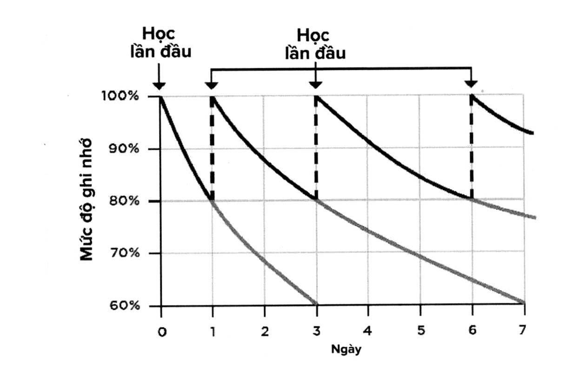

# Chương 12: Học tập

> *Nếu tôi học tập suốt đời, thì làm sao để tối ưu hóa thời gian học tập?*

> *Liệu việc học nhồi có phải là phương pháp học tốt nhất không?*

> *Làm thế nào để ghi chú tốt hơn?*

Vào một tối thứ Sáu nọ, tôi nhận được một cuộc gọi. Người ở đầu dây bên kia nói rằng anh ấy biết đến tôi thông qua một người bạn chung, và người này khuyên anh ấy liên lạc với tôi.

“Chắc chắn rồi, tôi có thể giúp gì cho anh?” - tôi nói.

Trong 30 giây đầu tiên của cuộc nói chuyện, người này có vẻ như rất bình tĩnh, nhưng sau khi tôi hỏi câu đó thì giọng của anh ấy trở nên kích động hơn.

“Làm ơn hãy giúp tôi. Diễn giả của chúng tôi không thể tham gia vào ngày mai do bận chuyện đột xuất. Đáng lẽ ông ấy sẽ thực hiện bài thuyết trình chính trong hội nghị.”

Tôi nói rằng mình rất tiếc khi biết chuyện này, nhưng tôi không nhận thực hiện thuyết trình trong thời gian gấp rút như vậy. Thông thường tôi lên lịch trước sáu tháng cho các buổi diễn thuyết trước công chúng, và tôi luôn dành thời gian để chuẩn bị kỹ lưỡng.

Nhưng anh ấy vẫn không nhụt chí. Anh ấy nói rằng người bạn chung đã nói rất nhiều về những buổi thuyết trình của tôi, và tôi chính là người có khả năng cao nhất để thực hiện một bài thuyết trình hay chỉ trong một khoảng thời gian ngắn.

“Làm ơn hãy cứu tôi”, anh ấy nói với giọng xúc động hơn nữa.

Tình cảnh khó khăn của người này bắt đầu làm tôi nghĩ lại. Tôi tình cờ rảnh vào hôm thứ Bảy đó, và hội nghị sẽ được tổ chức tại Manhattan - cũng là nơi tôi sống. Tôi quyết định hỏi anh ấy xem chủ đề của bài thuyết trình chính là gì. Khi anh ấy giải thích, tôi nhìn chằm chằm vào chiếc điện thoại như thể người bên kia đang nói một thứ ngôn ngữ ngoài hành tinh. - tôi nói - “Tôi chẳng hề biết gì về nó cả.”

“Vâng, nhưng vị diễn giả không đến được có một quyển sách.”

“Tôi vẫn chưa hiểu ý anh.”

Người ở đầu dây bên kia trả lời rất nhanh chóng, và rõ ràng là anh ấy đã chuẩn bị sẵn lý do này rồi. “Tôi nghe nói rằng anh là người đọc rất nhanh. Tôi nghĩ anh có thể đến sớm một chút, đọc qua quyển sách và sau đó thuyết trình.”

Tình cảnh này thật sự quá kỳ lạ, đến mức điều duy nhất mà tôi có thể làm khi ấy là: dấn thân sâu hơn. Làm sao mà tôi từ chối một thử thách như thế được chứ. Chúng tôi thỏa thuận các điều khoản, và anh ấy giải thích với tôi thêm một chút về những khán giả sẽ nghe buổi thuyết trình ấy, và sau đó tôi tắt điện thoại, tự hỏi mình điều gì vừa mới xảy ra.

Tôi đến trung tâm hội nghị lúc 10 giờ sáng. Người đàn ông đã gọi tôi tối hôm trước đưa tôi quyển sách và sắp xếp cho tôi một căn phòng yên tĩnh. Tôi sẽ phải thực hiện bài thuyết trình vào lúc 1 giờ chiều. Trong 3 tiếng đồng hồ tiếp theo, tôi đọc quyển sách, ghi chú cực kỳ nhiều và phác thảo các tiêu chí cơ bản cho buổi thuyết trình sắp tới. Sau đó tôi lên sân khấu thực hiện bài thuyết trình chính của sự kiện, và bài thuyết trình ấy cuối cùng lại là bài nói được đánh giá cao nhất trong suốt hội nghị. Tôi cảm thấy kiệt sức, nhưng tôi phải thừa nhận rằng mình đã cực kỳ hào hứng trong trải nghiệm lần ấy.

Có lẽ bạn sẽ không rơi vào tình cảnh như thế này đâu. Nhưng mặc dù yêu cầu của người đàn ông trên điện thoại là cực kỳ vô lý, nhưng tôi biết rằng mình có thể làm được, bởi vì một khi có năng lực thì bạn sẽ có được sự tự tin. Tôi không nói ra điều này để gây ấn tượng với bạn, tôi nói để bạn hiểu được điều gì là có thể, để chứng minh với bạn rằng những giới hạn sẽ được xóa nhòa một khi bạn học được cách thấu hiểu một chủ đề chỉ sau một lần tiếp xúc duy nhất, nhớ được điều mình đã học, có khả năng đúc kết được những điểm quan trọng nhất và hiểu được phương thức học hỏi của con người - nói cách khác là những điều được trình bày trong quyển sách này. -

Tôi sẽ không bao giờ có thể thực hiện được bài thuyết trình chính ấy nếu tôi không có khả năng học nhanh. Và cũng giống như những kỹ năng khác mà chúng ta đã đề cập ở đây, kỹ năng này cũng không phải là điều sinh ra đã có và không thể thay đổi. Ngược lại, nó là một khả năng mà bạn có thể luyện tập được. Bạn có thể học cách phá vỡ những giới hạn của bản thân trong việc học tập. Và khi làm được điều ấy, nó sẽ là siêu sức mạnh mà bạn có thể sử dụng cả đời.

### BẮT ĐẦU CÙNG KWIK

Hãy nghĩ về một chủ đề hay một môn học mà bạn muốn học trong tháng này. Bạn sẽ học nó như thế nào? Bạn đang tiếp cận nó theo phương pháp hay quy trình nào?

## BỐN CẤP ĐỘ NĂNG LỰC

Từ những năm 1960, các nhà tâm lý học đã xác định rằng có bốn cấp độ năng lực, hoặc cấp độ học tập. Cấp đầu tiên có tên là: “kém năng lực vô thức”. Đó là khi bạn không biết rằng mình không biết. Ví dụ, bạn có thể còn không nhận ra sự thật rằng kỹ thuật đọc nhanh có tồn tại trên đời, vậy nên bạn không hề biết rằng hiện tại mình không có được khả năng ấy.

Cấp độ tiếp theo được gọi là: “kém năng lực ý thức”, nghĩa là bạn đã nhận thức được điều mình không biết. Ví dụ, bạn nhận thức được rằng có những người có khả năng học và đọc và hiểu nhanh hơn rất nhiều nhờ vào kỹ thuật đọc nhanh, nhưng bản thân bạn thì lại chưa từng học về lĩnh vực này, và bạn cũng không hiểu được mình cần sử dụng những công cụ nào để đọc nhanh được.

Cấp độ thứ ba là “có năng lực ý thức”. Điều này có nghĩa là bạn nhận thức được sự tồn tại của một kỹ năng nào đó và bạn có khả năng thực hiện điều ấy, nhưng bạn chỉ thành công khi chủ động tập trung tâm trí mình vào đó. Bạn có thể làm được, nhưng cần có nỗ lực. Hãy tiếp tục lấy ví dụ trong việc đọc nhanh: ở cấp độ này, khả năng cao là bạn có thể đọc nhanh hiệu quả, nhưng chỉ khi bạn có thể tập trung và sử dụng được các công cụ đọc nhanh. Trong những lĩnh vực khác cũng vậy, ví dụ như đánh chữ hay lái xe, khi đạt đến cấp độ này thì bạn có thể làm được nhưng bạn cần chủ động dồn sự chú ý vào vệc này.

Cấp độ thứ tư - cũng là điều mà những người định hướng học tập suốt đời muốn đạt được - đó là “có năng lực vô thức”. Trong trường hợp này, bạn biết được cách thực hiện một điều gì đó, và đối với bạn điều ấy hoàn toàn tự nhiên. Trở lại ví dụ về việc đọc nhanh, thì ở cấp độ này bạn sẽ đạt đến trạng thái có năng lực vô thức khi việc đọc nhanh trở thành phương pháp đọc bình thường của bạn. Bạn không cố gắng đọc nhanh hơn, chỉ là mỗi khi bạn đọc đều sẽ nhanh như vậy. Bạn sẽ đánh chữ hoặc lái xe mà không cần cố ý chú tâm vào nó.

Giờ đây, chìa khóa giúp bạn đi từ cấp độ có năng lực ý thức đến có năng lực vô thức cũng rất rõ ràng: đó chính là thực hành. Thực hành sẽ giúp nâng cao năng lực của bạn.

Mặc dù các nhà tâm lý học chỉ dừng lại ở mức này, nhưng tôi muốn thêm vào một cấp độ nữa: bậc thầy thực sự. Đây là cấp độ vượt lên trên cả cấp độ có năng lực vô thức, có nghĩa là tại đây bạn sẽ có thể thực hiện một công việc gì đó một cách hoàn toàn tự nhiên với chất lượng cực kỳ cao. Đây chính là cấp độ của trạng thái không giới hạn. Và nếu bạn muốn trở thành một bậc thầy thì bạn cần phải học tập như một siêu anh hùng.

## PHƯƠNG PHÁP HỌC NHANH HƠN

Tại sao phần lớn chúng ta gặp khó khăn trong việc học? Đa số mọi người không biết cách học sao cho hiệu quả bởi vì họ chưa từng được dạy về kỹ năng này. Nhiều người tự mặc định rằng họ đã biết cách học rồi. Vấn đề là đại đa số những kỹ thuật mà bạn sử dụng giờ đây đã cũ kỹ và kém hiệu quả rồi, và nhiều kỹ thuật đã tồn tại từ hàng trăm năm trước.

Giờ đây chúng ta đang sống trong một thời đại cạnh tranh thông tin cấp độ cao, và thông tin xuất hiện ở khắp mọi nơi. Vậy mà chúng ta vẫn đang dùng những phương pháp cũ để học và xử lý thông tin. Phần lớn chúng ta được dạy rằng học là quá trình ôn đi ôn lại các tài liệu để có thể nhớ được kiến thức khi làm bài kiểm tra. Trong phần kế tiếp, chúng ta sẽ tìm hiểu tại sao việc học nhồi không phải là một ý hay, và lại còn rất kém hiệu quả.

Những con người thành công nhất trên thế giới đều là những người học hỏi trọn đời. Điều này có nghĩa là họ không ngừng học thêm các kỹ năng mới, cập nhật những kiến thức mới nhất trong lĩnh vực của mình và tìm hiểu về những lĩnh vực khác có ích cho công việc của mình. Như chúng ta đã đề cập trong phần trước, bạn sẽ có được nhiều lợi ích khi liên tục học hỏi suốt đời. Vậy nên nếu bạn muốn đạt được mục đích là có được khả năng học hỏi không giới hạn thì bạn cũng cần phải đạt mục tiêu học hỏi suốt đời.

Đây là điều mà James - một trong những học viên của chúng tôi - phải mất một khoảng thời gian mới nhận ra được. James gặp khó khăn trong việc học và sau khi tốt nghiệp cấp ba, anh ấy dành ba năm làm việc tại một cửa hàng bán rượu mặc dù ước mơ của anh ấy là trở thành một doanh nhân thành công. James nhận ra rằng để hiện thực hóa ước mơ thì mình cần phải học đại học, nhưng anh ấy nói với tôi rằng: “Mọi chuyện cực kỳ khó khăn với tôi. Tôi cuối cùng cũng có được tấm bằng kế toán, xin vào làm tại một công ty kế toán sau đó chuyển sang ngành ngân hàng. Tôi mất rất nhiều thời gian nhưng vẫn chưa thể lên được chức chuyên viên quản lý tài sản. Tôi làm chức chuyên viên phân tích, và ở vị trí này, tôi cần phải học rất nhiều, tìm hiểu rất nhiều và tôi lúc nào cũng chật vật. Tôi có khả năng làm việc với con người và có tính kỷ luật cao, nhưng việc học hỏi thực sự là thử thách đối với tôi. Tôi thi trượt rất nhiều lần mới có thể đỗ được những chứng chỉ như hiện tại. Trong khoảng thời gian tôi vừa đi làm vừa chuẩn bị cho kỳ thi CFP, mọi việc trở nên rất nặng nề.”

Khi chỉ còn 6 tuần nữa là đến bài thi quan trọng này - một bài thi thông thường sẽ phải học trong 12 tuần - thì James biết đến chương trình hướng dẫn đọc nhanh của tôi. Chương trình ấy đã khiến mọi thứ tiến triển tốt hơn, cải thiện việc học tập, giúp anh ấy “giữ bộ não của mình luôn khỏe mạnh trong suốt quá trình học tập cường độ cao” và cung cấp cho anh một nguồn năng lượng mạnh mẽ trong ngày thi.

James đã nhận được chứng chỉ CFP và nhờ vậy anh ấy đã có thể làm việc trực tiếp với khách hàng dưới cương vị là chuyên viên quản lý tài sản. Anh ấy tiếp tục sử dụng kỹ năng học hỏi mới này để tiếp tục đọc và tìm hiểu thêm nhiều kiến thức cần thiết khác.

James đã có thể dễ dàng bị khuất phục bởi các giới hạn trên hành trình của mình. Nhưng không, anh ấy đã học cách phá vỡ giới hạn của phương pháp học cũ và vượt qua chướng ngại vật trong sự nghiệp của mình.

## HỌC NHỒI THÌ SAO?

Thức trắng đêm để học là một phương pháp rất cũ được nhiều người sử dụng ngay cả khi họ không còn học ở trường nữa. Điều này xảy ra chủ yếu là do họ đã trì hoãn các công việc cần làm để chuẩn bị cho một bài kiểm tra hay bài thuyết trình quan trọng. Nhưng nhiều người cũng tin rằng học nhồi là cách chuẩn bị tốt nhất của họ. Tuy nhiên, khả năng cao rằng điều ấy không đúng.

- “Trong thực tế, học nhồi thường dẫn đến những khiếm khuyết về cảm xúc, tinh thần và thể chất, khiến khả năng ứng phó với môi trường của cơ thể bị suy giảm” - nhà báo Ralph Heibutzki đã nói như vậy trên tờ Seattle Post- Intelligencer. Anh ấy đã trích dẫn một nghiên cứu của Trường Y khoa Harvard, trong đó các nhà nghiên cứu chỉ ra rằng việc học hoặc làm việc nhồi nhét sẽ gây ra nhiều tác dụng phụ không mong muốn, bao gồm cả việc suy giảm các chức năng tinh thần”

Thêm vào đó, khi học nhồi, bạn thường sẽ phải hi sinh toàn bộ hoặc ít nhất là một phần lớn giấc ngủ bình thường của mình và điều này có thể gây phản tác dụng. Andrew J. Fuligni, giáo sư môn tâm thần học tại Đại học California tại Los Angeles, cùng đội ngũ của mình đã thực hiện một nghiên cứu về hiện tượng làm việc nhồi nhét, và họ nhận ra rằng việc thiếu ngủ do làm việc nhồi nhét thực sự sẽ ảnh hưởng đến kết quả. “Tất nhiên là học viên vẫn nên học chăm chỉ, nhưng việc ngủ đủ giấc là cực kỳ quan trọng để đạt được kết quả cao trong học tập. Các kết quả này hoàn toàn phù hợp với những nghiên cứu gần đây, tất cả đều kết luận rằng việc thiếu ngủ sẽ tác động tiêu cực đến quá trình học tập.”

Tôi đã từng làm việc với học viên ở nhiều độ tuổi khác nhau, và tôi nhận ra rằng việc học nhồi thường ít khi mang lại hiệu quả như mong muốn. Khi tập trung vào một môn duy nhất trong suốt nhiều giờ liền, khả năng cao là bạn sẽ không thể nhớ được những thông tin đã học. Ở phần trước, chúng ta đã nói về hiệu ứng ưu tiên và ưu hậu trong việc ghi nhớ. Và bởi vì bạn thường nhớ được thứ xảy ra ở đoạn đầu và đoạn cuối của mỗi chu kỳ học, nên việc học nhồi một lượng lớn kiến thức ở đoạn giữa sẽ chỉ khiến bạn quên đi nhiều hơn thôi. Chúng ta sẽ nói đến phương pháp khắc phục chuyện này trong phần sau.

Có thể bạn là học sinh trung học phổ thông đang phải học năm lớp học thêm nâng cao cùng lúc nhằm chuẩn bị thật tốt hồ sơ và nâng cao cơ hội được nhận vào các trường đại học hàng đầu. Hoặc có thể bạn là lãnh đạo của một công ty và đang cần cập nhật những thay đổi mới nhất trong lĩnh vực của mình. Dù trong trường hợp nào thì bạn cũng đang phải đối mặt với hai vấn đề cùng một lúc: một núi thông tin khổng lồ cần phải học, và vốn thời gian ít ỏi để thực hiện việc ấy. Nếu đang ở trong tình cảnh này thì bạn cần phải học thật hiệu quả. Sau nhiều năm giúp đỡ nhiều người học hỏi nhanh hơn, tôi có bảy thói quen đơn giản giúp bạn phá vỡ các giới hạn của mình.

**Thói quen 1: Chủ động Truy xuất Kiến thức**

Chủ động truy xuất kiến thức là quá trình bạn ôn lại kiến thức và ngay sau đó thực hiện kiểm tra xem mình đã nhớ được bao nhiêu. Kỹ thuật này cho phép bạn rút ra được sự khác biệt giữa việc tiếp nhận thông tin (hiểu được những con chữ trên trang giấy) và nhớ lại thông tin (khiến cho nó trở nên chủ động trong trí nhớ của mình).

Tiến sĩ William Klemm, nhà thần kinh học tại Đại học Texas A&M, đã viết rằng: “Phần lớn những người học không nhận ra được tầm quan trọng của việc chủ động nhớ lại kiến thức. Lý do một phần cũng bởi vì họ dựa vào các bài kiểm tra dạng lựa chọn để nhớ lại thông tin một cách thụ động, có nghĩa là họ sẽ nhận ra được câu trả lời đúng khi nó xuất hiện trước mắt, và điều này ngược với quá trình chủ động nhớ lại câu trả lời ngay từ đầu. Các nghiên cứu về việc học tập của sinh viên cho thấy rằng việc chủ động truy xuất - nhớ lại thông tin cần nhớ - đóng vai trò rất quan trọng trong việc hình thành trí nhớ về thông tin ấy.”

Để chủ động truy xuất kiến thức, hãy thực hiện:

• Ôn lại kiến thức mà bạn đang học • Sau đó đóng sách lại, tắt video bài học hoặc bài giảng, và sau đó viết lại hoặc trích lại tất cả những điều bạn nhớ được trong số những điều mình vừa mới học.

• Giờ đây, xem lại sách hoặc video. Bạn nhớ được bao nhiều?

Bạn cần đảm bảo dành đủ thời gian học tập để thực hiện quy trình này lặp đi lặp lại nhiều lần. Theo như Klemm đã nói, các nghiên cứu cho thấy rằng: “việc học hỏi sẽ hiệu quả nhất khi những nội dung trong bài học được học lại và tất cả các thông tin được kiểm tra dưới hình thức truy xuất chủ động ít nhất là bốn lần liên tiếp. Điều này dẫn đến thói quen quan trọng thứ hai mà bạn cần thực hiện.”

**Thói quen 2: Thực hiện Lặp lại Ngắt quãng**

Như đã đề cập ở phần trước của chương này, việc học nhồi sẽ gây ra nhiều hậu quả tiêu cực. Mặc dù trì hoãn là một xu hướng rất tự nhiên, nhưng nếu bạn để bản thân rơi vào tình huống mà mình phải tiêu thụ một lượng kến thức cực kỳ lớn trong một lần học duy nhất, thì khả năng cao là bạn sẽ không thể học được. Lý do là vì làm việc theo cách này sẽ đi ngược lại với các nguyên lý hoạt động của bộ não.

Thay vào đó, nếu bạn chọn ra các thời điểm cách nhau một khoảng để ôn lại những kiến thức đã học, và tập trung nhiều hơn vào những nội dung mà trước đây mình chưa nhớ được, thì bạn sẽ có thể sử dụng bộ não theo cách tối ưu nhất. “Lặp lại ngắt quãng là phương pháp đơn giản nhưng rất hiệu quả bởi vì nó giúp bạn tận dụng tối đa năng lực hoạt động của bộ não”. - James Gupta, CEO của nền tảng học online Synap, đã nói như vậy. “Nó bắt buộc bạn phải nỗ lực trong quá trình học, và bộ não của chúng ta cũng giống như cơ bắp vậy, nó sẽ phản hồi lại các kích thích và thông qua đó tăng cường liên kết giữa các tế bào thần kinh. Bằng việc ôn tập lặp lại cách quãng, bạn sẽ giúp các liên kết này trở nên mạnh mẽ hơn theo thời gian. Phương pháp này sẽ giúp bạn nhớ được kiến thức tốt hơn trong dài hạn, và theo kinh nghiệm của tôi thì một khi đã sử dụng phương pháp này, bạn sẽ sử dụng nó mãi mãi.”

Phương pháp lặp lại ngắt quãng có vẻ sẽ hiệu quả nhất khi bạn thực hiện ôn tập trong những khoảng thời gian cách đều nhau. Đó chính lý do tại sao bạn cần phải dành ra đủ thời gian để học. Có thể bạn sẽ ôn lại một lần vào buổi sáng và một lần nữa ngay trước khi ăn tối, lặp lại liên tục bốn ngày như vậy, sau đó bạn sẽ học tiếp những nội dung khác cũng theo phương pháp ngắt quãng thời gian đều nhau như vậy. Kỹ thuật này sẽ rất phù hợp với phương pháp chủ động truy xuất. Hãy ôn lại kiến thức, kiểm tra xem mình nhớ được bao nhiêu và sau đó tạm nghỉ trước khi quay lại ôn kiến thức này một lần nữa.

**Thói quen 3: Kiểm soát Trạng thái Tinh thần**

Như đã nói ở phần trước của quyển sách, trạng thái tinh thần của bạn trong một thời điểm nhất định sẽ ảnh hưởng cực kỳ lớn đến khả năng thành công của việc ấy. Ví dụ, nếu bạn vừa trải qua một ngày tồi tệ và bạn được yêu cầu thực hiện một bài thuyết trình tại công ty hoặc làm bài kiểm tra thì có lẽ bạn sẽ không thể thực hiện tốt đúng theo khả năng của mình được. Ngược lại, nếu tinh thần của bạn vui vẻ thì khi thực hiện cùng những công việc ấy, chắc chắn kết quả đạt được sẽ tốt hơn. Tâm trạng càng tích cực và có nhiều năng lượng thì kết quả của bạn sẽ càng tốt. Trong việc học cũng vậy.

Tư thế đứng hay ngồi cũng ảnh hưởng đến trạng thái tinh thần của bạn. Hãy ngồi như thể bạn đang chuẩn bị học một thông tin quan trọng có khả năng giúp bạn thay đổi cuộc sống. Bạn đã thay đổi tư thế rồi chứ? Nếu vậy thì hãy để ý xem bạn có cảm thấy tập trung hơn sau khi đổi thế ngồi không? Khi bạn ngồi thẳng, việc hít thở và tuần hoàn oxy đến não và các bộ phận trong cơ thể sẽ diễn ra tốt hơn. Nếu ngồi gù lưng thì bạn có thể sẽ ngăn cản quá trình hít thở, từ đó cảm thấy mệt mỏi hơn.

### BẮT ĐẦU CÙNG KWIK

Khi bạn đang ngồi trên ghế, hãy gù khòm lưng lại, nhìn xuống dưới, thở gấp và nhăn mặt. Thực hiện ngay bây giờ. Ở tư thế này bạn có cảm thấy đủ động lực để đạt được thành công không? Bạn nghĩ với trạng thái tinh thần như thế thì mình có thể làm việc hiệu quả không? Đây chính là tư thế của rất nhiều học sinh khi học bài. Vậy thì chẳng có gì lạ khi họ không thích thú gì với việc học và phải cố gắng rất nhiều để đạt được kết quả thường thường tầm trung? Giờ đây, hãy ngồi thẳng lưng lên và mỉm cười. Bạn cảm thấy tốt hơn nhiều chứ?

**Thói quen 4: Sử dụng Khướu giác**

Chắc hẳn rằng bạn đã từng gặp qua tình huống này rồi: Bạn bước vào một căn phòng và nhận ra một mùi gì đó đang tràn ngập không gian. Có thể đó là mùi thảo mộc đang được nướng trong lò. Mùi hương ấy ngay lập tức khiến bạn nhớ lại ký ức về một người bạn thời bé, khi ấy người này kể một câu chuyện buồn cười đến nỗi bạn cười sặc cười sụa. Tại sao mùi thảo mộc nướng lại gợi nhắc đến kỷ niệm đó? Bởi vì vào thời điểm xảy ra kỷ niệm ấy, trong không gian cũng tràn ngập thảo mộc nướng như vậy, và các mùi hương đặc biệt hiệu quả trong việc mang những ký ức đến vùng não trước của chúng ta. Mùi thơm của lá hương thảo được chứng minh có thể giúp tăng cường trí nhớ. Mùi bạc hà và chanh giúp gia tăng sự tập trung.

Jordan Gaines Lewis, nghiên cứu sinh sau tiến sĩ tại trường Y Khoa bang Pennsylvania, đã viết rằng: “Câu trả lời là do cấu trúc giải phẫu học của bộ não. Những mùi hương khi được tiếp nhận sẽ được xử lý bởi hành khướu giác, đây là bộ phận trải dài từ mũi cho đến phần dưới của bộ não. Hành khướu giác có các liên kết trực tiếp với hai bộ phận trong não có nhiệm vụ quản lý cảm xúc và ký ức là hạch hạnh nhân và hồi hải mã. Điều thú vị là thông tin về thị giác (hình ảnh), thính giác (âm thanh) và xúc giác (cảm giác chạm) không hề đi qua các khu vực não này. Đó là lý do tại sao khướu giác có tác dụng mạnh mẽ hơn hẳn các giác quan khác trong việc gợi nhắc lại những cảm xúc và ký ức.”

Điều này giúp chúng ta hiểu được vai trò của mùi hương - một công cụ cực kỳ quan trọng như vẫn chưa được tận dụng - trong việc ghi nhớ. Nếu một mùi hương nào đó có thể khiến chúng ta chìm ngập trong ký ức tuổi thơ thì một mùi hương khác có thể giúp ta nhớ lại kiến thức đã học. Nếu bạn đang chuẩn bị cho một kỳ thi quan trọng thì hãy thoa vào cổ tay một chút tinh dầu khi đang học, và khi đi vào phòng thi, hãy thực hiện điều tương tự. Nếu bạn dùng phương pháp này để chuẩn bị cho một cuộc họp quan trọng thì kết quả cũng sẽ tương tự. Tất nhiên là bạn không nên làm phiền những người khác, vậy nên đừng khiến cho mùi hương đậm đặc quá, chỉ cần vừa đủ để giúp thúc đẩy quá trình gợi nhớ của bạn.

**Thói quen 5: Âm nhạc cho Tâm trí**

Hãy nghĩ về những lúc bạn cảm thấy việc học thật dễ dàng. Liệu bạn có giống như rất nhiều người khác, cũng học bảng chữ cái thông qua một bài hát không? Hoặc bạn biết được việc Quốc hội thông qua một đạo luật nào đó vì chuyện này được đề cập trọng một bài hát của chương trình Schoolhouse Rock không? Kể từ khi âm nhạc xuất hiện, các bậc cha mẹ vẫn luôn dạy cho con mình các khái niệm cơ bản thông qua các bài hát. Họ thực hiện điều này vì nó thật sự mang lại hiệu quả, bởi vì cơ chế hoạt động của nó đã được khoa học chứng minh.

Rất nhiều nghiên cứu đã cho thấy mối liên kết giữa âm nhạc và việc học tập. Trong giả thuyết về kích-thích-và- tâm-trạng được Tiến sĩ E. Glenn Schellenberg đưa ra, ông đã nói về mối quan hệ giữa âm nhạc và tâm trạng cũng như sự liên kết giữa tâm trạng và học tập. Giả thuyết này cho rằng âm nhạc có thể giúp ta có được các điều kiện tinh thần cần thiết để nâng cao khả năng học tập của mình.

Nhạc baroque là loại hình âm nhạc mang lại nhiều giá trị đáng chú ý. “Âm nhạc giúp ổn định nhịp điệu của tinh thần, thể chất và cảm xúc, để từ đó con người đạt được trạng thái tập trung và chú tâm sâu - đây là trạng thái mà họ có thể xử lý và học được một lượng lớn thông tin”, chuyên gia âm nhạc và học tập Chris Boyd Brewer đã nói như vậy. “Nhạc baroque, điển hình là những bản nhạc của Bach, Handel và Telemann, có 50 đến 80 nhịp mỗi phút, do đó nó có thể tạo ra được một bầu không khí tập trung, giúp người học đạt được trạng thái tập trung sâu với sóng não alpha. Khi học từ vựng, học bài hay đọc sách thông tin trên nền nhạc này, hiệu quả học tập sẽ rất cao.”

Không có bằng chứng nào cho thấy rằng bạn sẽ đạt được hiệu quả tương tự khi nghe những thể loại khác, chẳng hạn như rap hoặc K-pop, nhưng bởi vì mỗi người sẽ có một sự phản ứng khác nhau với âm nhạc, nên có thể bạn sẽ phù hợp với một loại nhạc khác. Hình thức nghe nhạc trực tuyến giờ đây rất phổ biến rồi, vì thế tôi khuyên bạn nên bật các bản nhạc baroque mỗi khi học. Amazon Music, Apple Music và Spotify đều có danh sách tập hợp các bản nhạc baroque, và nếu bạn muốn khám phá thêm thì các nền tảng này đều có các danh sách nhạc cổ điển (phần lớn trong số này là nhạc baroque) được thiết kế dành riêng để hỗ trợ việc học.

**Thói quen 6: Dùng toàn bộ nộ não để lắng nghe**

Nếu muốn phá vỡ các giới hạn trong lĩnh vực học tập, bạn cần phải đảm bảo rằng kỹ năng nghe của mình đạt được trạng thái tốt nhất. Có mối liên kết rất chặt chẽ giữa việc nghe và việc học, không chỉ vậy, hơn một phần tư dân số là người học có thiên hướng về âm thanh, có nghĩa là cách chủ yếu để họ nạp kiến thức vào là thông qua việc lắng nghe.

Kỹ năng nghe rất cần thiết cho việc học, và chúng ta dành một phần lớn thời gian trong ngày để lắng nghe. Thế nhưng đa số mọi người không giỏi kỹ năng này. “Đã có rất nhiều nghiên cứu về chủ đề này”, Bob Sullivan và Hugh Thompson đã nói trong quyển sách The Plateau Effect của mình như vậy. “Một người lớn trung bình nghe nhiều gấp đôi thời gian họ nói, và mặc dù nghe là kỹ năng cốt lõi trong phần lớn các hoạt động giao tiếp của chúng ta, nhưng phần lớn mọi người lại khá tệ trong việc này. Điều này được chứng minh trong thí nghiệm sau: Những người tham gia kỳ thi được yêu cầu nghe một bài thuyết trình trong vòng 10 phút, và sau đó miêu tả lại nội dung của nó. Một nửa số người tham dự không thể nhớ được nội dung bài thuyết trình khi vừa mới nghe xong, và sau 48 giờ, có đến 75% số người tham gia không thể nhớ được nội dung chính của bài nói nữa”

Một trong những lý do chúng ta không nghe tốt đó là vì thông thường ta không sử dụng toàn bộ sức mạnh của bộ não để lắng nghe. Sullivan và Thompson, những người đã thực hiện thí nghiệm với Đại học Carnegie Mellon về bản chất của chứng xao nhãng kỹ thuật số, đã chỉ ra rằng: “bộ não con người có khả năng xử lý được thông tin dưới dạng nói tối đa là 400 từ một phút. Nhưng thậm chí một người đến từ New York cũng chỉ có thể nói được 125 từ một phút thôi. Điều này có nghĩa là ba phần tư năng lực của bộ não đang làm một điều gì đó khác trong khi ta đang lắng nghe người khác nói”

Để giải quyết vấn đề này, tôi đã phát triển một công cụ có thể giúp bạn dùng toàn bộ bộ não để lắng nghe. Hãy nhớ từ viết tắt HEAR (tạm dịch: LẮNG NGHE):

- **H nghĩa là Halt (Dừng lại):**  Khả năng rất cao là bạn khi

đang nghe người khác nói, vẫn có nhiều chuyện khác đang xảy ra xung quanh. Có thể là có người nhìn bạn. Có thể điện thoại bạn rung lên, báo có tin nhắn mới. Có thể là tiếng nhạc hoặc tiếng ti vi được bật trong phòng. Cùng lúc đó, bạn cũng đang nghĩ về những việc mình cần làm, về cuộc họp tiếp theo, hoặc món mình sẽ ăn trong bữa tối. Hãy cố gắng hết sức loại bỏ những điều này ra khỏi suy nghĩ của bạn để tập trung hoàn toàn vào người đang nói chuyện với mình. Hãy nhớ rằng việc lắng nghe không chỉ đơn thuần là nghe những từ họ nói ra, bạn còn phải để tâm đến ngữ điệu, ngôn ngữ cơ thể, biểu cảm khuôn mặt và nhiều điều khác nữa, vì chúng đều góp phần tạo ra ngữ cảnh và cung cấp thêm thông tin. Bạn chỉ có thể tiếp thu được tất cả những điều này nếu dừng được tất cả những việc khác lại.

- **E là Empathy (Đồng cảm):**  Nếu bạn có thể đặt mình vào

vị trí của người nói thì bạn sẽ có khả năng học được nhiều hơn thông qua việc lắng nghe, nhiều hơn hẳn so với khi bạn chỉ nghe một cách lãnh đạm. Hãy cố gắng hiểu được hoàn cảnh của người nói và động lực của họ, từ đó bạn sẽ hiểu được những thông tin mới, góp phần bổ sung cho những điều họ nói ra, và điều này sẽ giúp bạn cảm nhận được mọi thứ từ góc nhìn của họ.

- **A là Anticipate (Mong chờ):**  Hãy lắng nghe với tâm thế

mong chờ. Cần nhớ rằng trạng thái tinh thần của bạn sẽ ảnh hưởng đến việc học tập, vậy nên nếu bạn có thể tạo ra cảm xúc gắn với trải nghiệm này thì những điều bạn học được sẽ trở thành trí nhớ dài hạn. Sự nhiệt tình đối với những điều mình đang lắng nghe cũng sẽ giúp gia tăng đáng kể sự tập trung của bạn vào các nội dung ấy.

- **R là Review (Ôn lại):**  Nếu có cơ hội được tương tác trực

tiếp với diễn giả, hãy thực hiện ngay. Hãy hỏi những câu giúp bạn hiểu rõ vấn đề hơn, hoặc đề nghị họ nói lại một điểm nào đó. Nếu bạn có thể ghi chú lại thì cũng hãy ghi chú. Và sau đó, bạn cần chiêm nghiệm lại những gì diễn giả này đã nói, lặp lại những nội dung đó trong đầu bằng ngôn từ của chính mình và tưởng tượng ra bạn đang dạy lại cho một người khác. Như vậy, kiến thức trong đầu bạn sẽ trở nên vững chắc hơn.

**Thói quen 7: Chú ý việc ghi chú**

Khi học trong điều kiện lý tưởng, khả năng ghi nhớ của bạn sẽ tăng lên đáng kể. Và trong quá trình chuẩn bị cũng như lúc thực sự học, bạn cần cải thiện kỹ năng ghi chú của mình vì đây là điều cực kỳ giá trị.

Lợi ích cao nhất của việc ghi chú đó là nó giúp bạn cá nhân hóa những thông tin mình muốn ghi nhớ - bằng chính ngôn từ và phương pháp tư duy của bản thân. Khi được sử dụng đúng cách, các ghi chú này sẽ giúp bạn tổ chức và xử lý thông tin sao cho thông tin ấy có thể dễ dàng được sử dụng sau này.

Nhưng có nhiều người không biết cách ghi chú hiệu quả. Những lỗi thường gặp là quá chú tâm vào việc ghi chú đến nỗi không còn lắng nghe bài nói nữa, hoặc cố gắng viết lại tất cả những chi tiết mình nghe được. Ghi chú theo kiểu này sẽ không giúp ích cho bạn sau này đâu. Một khi đã nhận thức được những lỗi này thì bạn sẽ dễ dàng phòng tránh được nó, vậy nên hãy bắt đầu lập kế hoạch để cải thiện kỹ năng ghi chú của mình.

Đầu tiên, bạn cần phải hiểu rõ mục đích của việc ghi chú là gì. Ví dụ, mục tiêu khi ghi chú bài giảng cho bài thi giữa kỳ sẽ rất khác so với những ghi chú bạn cần thực hiện trong buổi học ôn bài trước ngày thi cuối kỳ. Tương tự, mục đích của việc ghi chú trong những buổi họp hàng tuần với đội nhóm của mình cũng sẽ khác với các ghi chú trong buổi họp vào tuần trước khi thực hiện bài thuyết trình cho một khách hàng quan trọng.

Khi đã hiểu rõ mục tiêu của việc ghi chú, bạn sẽ có thể xác định được thông tin nào có liên quan và thông tin nào không. Tôi có một người bạn là nhà văn, và anh ấy muốn tự mình viết lại tất cả những cuộc phỏng vấn mình đã thực hiện, mặc dù nếu giao việc này cho một dịch vụ viết phỏng vấn anh ấy sẽ tiết kiệm được nhiều thời gian hơn. Lý do là vì nếu tự mình làm thì anh ấy sẽ chỉ viết lại những nội dung hữu ích cho công việc sau này và loại bỏ những nội dung dài dòng khác vốn không có liên quan đến quyển sách mà mình muốn viết. Kết quả là anh ấy sẽ có được những nội dung tinh lọc và giá trị nhất. Tương tự như vậy, nếu bạn ghi chú khi đã có sẵn mục tiêu trong đầu thì những điều bạn ghi lại đều sẽ có ích.

Một khi đã làm rõ mục tiêu rồi, bạn cần phải thực hiện ghi chú một cách chủ động. Hãy tập trung lắng nghe để biết được chính xác điều mình cần biết, và thực hiện ghi chú sao cho bạn dễ dàng nhớ lại kiến thức ấy sau này. Nếu bạn muốn sử dụng từ viết tắt và ký hiệu thì hãy chỉ dùng những thứ quen thuộc. Đừng để sau này khi đọc lại, bạn còn không hiểu nổi ghi chú của chính mình.

Một điều cũng quan trọng tương đương nữa là: nếu được, hãy cố gắng sử dụng từ ngữ của riêng bạn. Như đã nói ở phần trước, một trong các lỗi phổ biến khi ghi chú là cố gắng ghi lại mọi thứ. Có hai tác hại rõ ràng khi làm như vậy. Thứ nhất, tốc độ viết của bạn sẽ không thể nào nhanh bằng tốc độ nói của người khác. Trung bình mỗi người có thể viết được 10 đến 12 từ mỗi phút, và một người trung bình có thể nói khoảng 100 từ mỗi phút. Thậm chí nếu bạn gõ ghi chú trên máy tính (nhưng tôi khuyên bạn không nên làm vậy, tôi sẽ giải thích sau), bạn cũng chỉ có thể ghi lại tối đa một nửa những gì mà người kia đang nói.

Nhưng có một tác hại khác quan trọng hơn: Nếu bạn ghi lại chính xác lời nói của người khác thì có lẽ bạn không hề xử lý những thông tin đó. Có nghĩa là trong thời điểm quan trọng nhất của việc học, bạn lại đang sử dụng phần lớn bộ não để chép chính tả. Khi bạn sử dụng từ ngữ của chính mình để ghi chú, thì khi ấy bạn mới đang xử lý thông tin, và từ đó bạn mới có thể nâng cao hiệu quả học tập được.

Và nhân tiện khi đang nói về chủ đề viết, tôi cũng muốn khuyên bạn viết tay những ghi chú của mình. Thậm chí nếu bạn sử dụng máy tính bảng để ghi chú thì hãy dùng bút điện tử chứ đừng đánh máy. Lý do thứ nhất là vì có rất nhiều chương trình có thể giúp bạn chuyển đổi từ chữ viết tay sang chữ đánh máy để lưu trữ thuận tiện hơn. Nhưng lý do quan trọng nhất là khi viết tay, bạn sẽ phải ngay lập tức bắt đầu quá trình xử lý kiến thức, và điều này đã được chứng minh là sẽ mang lại hiệu quả cao hơn.

“Các nghiên cứu gần đây cho thấy rằng thậm chí cả khi chỉ sử dụng máy tính để ghi chú thì chúng vẫn có thể cản trở việc học bởi vì khi đó quá trình xử lý thông tin của bộ não sẽ sơ sài hơn”, Pam A. Mueller và Daniel M. Oppenheimer đã nói như vậy trong nghiên cứu của mình về chủ đề này. “Chúng tôi tìm ra được rằng những sinh viên ghi chú trên máy tính trả lời những câu hỏi về khái niệm sai nhiều hơn những người ghi chú viết tay. Điều đó có nghĩa là mặc dù việc ghi chú trên máy tính có thể tiện lợi, nhưng những sinh viên dùng máy tính để ghi chú thường chỉ ghi lại chính xác những gì thầy cô nói chứ không xử lý thông tin và viết lại bằng từ ngữ của chính mình, và điều này không tốt cho việc học.”

Điều quan trọng nhất, đó là hãy đảm bảo rằng mình thật sự lắng nghe. Vai trò của bạn không phải là thư ký chép lại nội dung buổi họp, vai trò của bạn là tiếp nhận thông tin để sử dụng sau này. Chính vì vậy, bạn cần phải chú tâm lắng nghe. Hãy ghi lại những điều được nhấn mạnh. Đảm bảo rằng bạn hiểu được những điểm quan trọng mà người nói muốn thể hiện và nếu có cơ hội thì hãy đưa ra câu hỏi. Và bạn chỉ có thể làm được điều này khi thực sự tập trung vào thông tin được đưa ra, với mức độ tập trung ngang bằng với khi bạn đang nghe chính mình nói lại thông tin ấy.

Khi ghi chú, hãy dùng một phương pháp tôi hay gọi là “ghi lại và tạo ra. Ở phía bên trái của tờ giấy, bạn chỉ đang ghi lại, nghĩa là chép lại những điều mình nghe thấy, còn ở phần bên phải, bạn sẽ tạo ra, nghĩa là viết lại bằng ngôn ngữ của chính mình. Khi làm điều này, bạn sẽ rút ra những kiến thức cho riêng mình từ những điều bạn ghi lại. Tôi sẽ sử dụng kiến thức này như thế nào? Tại sao phải sử dụng? Khi nào sẽ sử dụng.

Sau khi thực hiện xong phần ghi chú, hãy ôn lại các nội dung ấy ngay lập tức. Nếu làm như vậy, bạn sẽ có thể ghi nhớ được thông tin nhiều hơn hẳn so với việc để những ghi chú ấy qua một bên và nhiều ngày sau mới xem lại. Một lợi ích khác là bạn sẽ có thể thêm vào những điều mà có thể mình đã bỏ lỡ trong khi ghi chú, bởi vì lúc đó nội dung bài nói vẫn còn rất rõ ràng trong đầu bạn.

## BÍ QUYẾT ĐỂ NÂNG CAO KỸ NĂNG GHI CHÚ

Nếu bạn muốn đảm bảo rằng những ghi chú của mình luôn đem lại hiệu quả cao nhất thì hãy nhớ từ viết tắt TIP:

- **T là Think (Suy nghĩ):**  Trước khi bắt đầu học về một tài

liệu nào đó mà bạn cần ghi chú, hãy nghĩ về những nội dung mà bạn muốn nhớ được sau khi học nhất. Điều này sẽ giúp bạn lọc ra được các thông tin giá trị nhất và loại bỏ bớt các nội dung không liên quan đến mục tiêu.

- **I là Identify (Xác định):**  Hãy lắng nghe thật kỹ những

thông tin được trình bày và xác định xem thông tin nào là quan trọng nhất đối để đạt được mục tiêu bạn đã đặt ra. Hãy nhớ rằng nếu cố gắng ghi lại tất cả mọi thứ thì bạn sẽ không thể nào đồng thời xử lý thông tin được đâu, và như vậy việc học của bạn khó khăn hơn. Hãy xác định nội dung quan trọng nhất và ghi chú lại.

- **P là Prioritize (Ưu tiên):**  Khi ôn lại các ghi chú của mình

sau khi học, hãy ưu tiên các thông tin có giá trị cao nhất đối với bạn, và bạn cũng có thể ghi thêm một số thông tin cần thiết khác để làm rõ thông tin quan trọng này hơn, hoặc bạn có thể tổng hợp tất cả lại thành một dàn ý để thấy rõ các ý chính.

### TRƯỚC KHI CHÚNG TA TIẾP TỤC

Nếu đã hiểu được rằng việc học hỏi suốt đời là điều kiện cần để đạt đến trạng thái không giới hạn, thì cách tiếp cận của bạn đối với việc học tập là rất quan trọng. Trước khi đọc chương tiếp theo, hãy thực hiện một số điều như sau:

• Ngay lập tức sử dụng phương pháp chủ động truy xuất kiến thức. Hãy học một số kiến thức mới và ngay sau đó kiểm tra xem bạn nhớ được bao nhiêu.

• Tìm ra một danh sách các bản nhạc phù hợp với bạn. Có rất nhiều bản nhạc bạn có thể sử dụng, và nếu tìm được loại nhạc phù hợp thì bạn sẽ có thể hấp thụ được thông tin tốt hơn. Vậy nên hãy dành thời gian để tìm ra những bản nhạc mình yêu thích. Thậm chí bạn có thể bật nhạc trong khoảng thời gian đọc phần còn lại của quyển sách này.

• Thử sử dụng các công cụ ghi chú mới. Bạn có thể đọc lại chương này một lần nữa và ghi chú lại. Hoặc xem một đoạn video TED Talk và ghi chú lại nội dung của nó. Hãy sử dụng các kỹ năng bạn vừa học được để nâng cao trải nghiệm học tập.

> *“Nếu chúng ta ai cũng thực hiện những điều mình có thể làm được, thì thành quả ta tạo ra hẳn sẽ rất đáng kinh ngạc.”*
>
> -THOMAS EDISON

