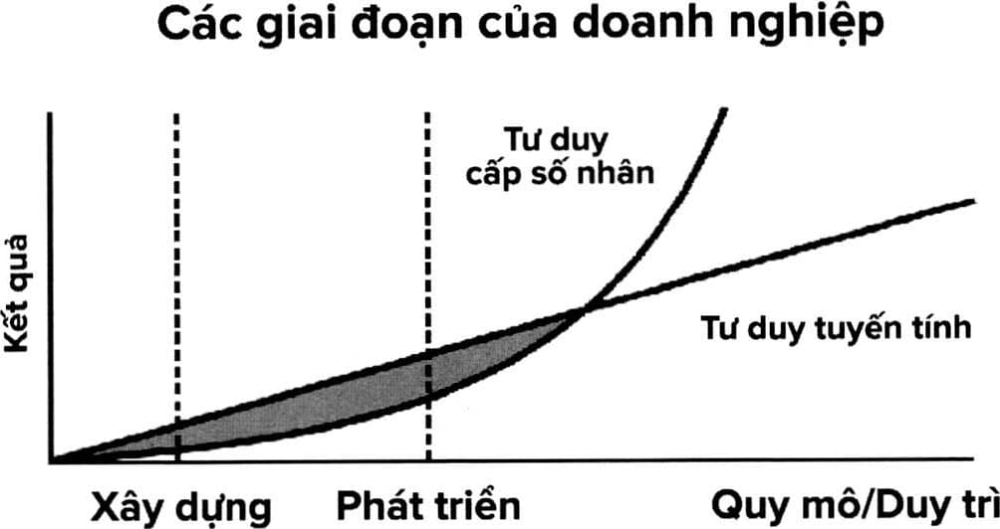

# Chương 15: Tư duy

> *Tại sao bạn cần phải tư duy từ nhiều khía cạnh khác nhau?*

> *Con người có thể sử dụng trí thông minh theo những cách nào?*

> *Khi tư duy khác biệt, bạn sẽ kết nối được với những siêu sức mạnh nào?*

Để đạt được những thành tựu lớn, thông thường một người sẽ phải có được tư duy khác biệt. Einstein được cho là tác giả của câu nói này: “Nếu chỉ dùng những tư duy cũ thì chẳng thể nào giải quyết được các vấn đề do tư duy ấy tạo ra. Và điều này hoàn toàn hợp lý. Trong công việc, học tập và các mối quan hệ với gia đình, chúng ta cũng thường chỉ sử dụng một lề lối tư duy nhất định, và lối tư duy ấy đã ngăn chặn tất cả những hướng tiếp cận được xem là không phù hợp. Nhưng điều này sẽ dẫn đến hai vấn đề. Thứ nhất là mọi lối tư duy đều nên được kiểm tra định kỳ để xem nó có còn đúng nữa không. Ví dụ, có rất nhiều doanh nghiệp đi đến tình trạng phá sản bởi vì họ chỉ chăm chăm tiếp cận thị trường theo một phương pháp duy nhất và không thể nhận ra rằng phương pháp ấy đã không còn hiệu quả với đối tượng mục tiêu nữa. Vấn đề thứ hai là lối tư duy cố hữu như thế thường sẽ tạo ra nhiều vấn đề, và các vấn đề này chỉ có thể được giải quyết thông qua những góc nhìn và tư duy mới.”

Vậy thì tại sao phần lớn chúng ta lại gắn mình vào những lối tư duy cố hữu như vậy? Tôi nghĩ nguyên nhân của việc này cũng giống với nguyên nhân tại sao ta không thể tập trung: đó là vì chúng ta không được dạy về “kỹ năng tư duy” trong trường học. May mắn là bạn vẫn có thể học được kỹ năng này, và tôi sẽ hướng dẫn cho bạn ngay ở phần sau.

## NHỮNG CHIẾC NÓN TƯ DUY

Tiến sĩ Edward de Bono đã phát triển khái niệm “sáu chiếc nón tư duy” để giúp con người thoát ra khỏi lối mòn tư duy của chính mình. Phương pháp này thường giúp các đội nhóm giải quyết vấn đề hiệu quả hơn, và các cá nhân cũng có thể dùng kỹ thuật này để có được những hướng tư duy mới hơn. Nguyên lý chính ở đây là chia việc tư duy ra thành sáu chức năng khác nhau, và mỗi chức năng sẽ được gắn với hình ảnh ẩn dụ là một chiếc nón.

• Bạn sẽ đội** chiếc nón màu trắng** khi ở trong trạng thái phân tích thông tin. Ở thời điểm này, bạn tập trung vào việc tìm kiếm thông tin và phân tích tất cả những thông tin mình cần để xử lý vấn đề. Để nhớ được loại này, hãy nghĩ đến màu trắng của những chiếc áo trong phòng thí nghiệm.

• Bạn chuyển sang đội** chiếc nón màu vàng** để mang lại những tư duy tích cực. Khi đó, bạn sẽ cố gắng tìm ra những điểm tích cực trong vấn đề hay thử thách mà mình đang gặp phải, nhấn mạnh vào những giá trị do chúng mang lại. Cách nhớ loại này là hãy nghĩ đến mặt trời màu vàng.

• Tiếp theo, bạn sẽ đội lên** chiếc nón màu đen** để tách mình ra khỏi những suy nghĩ tích cực và chuyển sự tập trung sang các khó khăn và khuyết điểm tồn tại trong vấn đề. Đây chính là lúc bạn cân nhắc đến những hậu quả khi không thể giải quyết được vấn đề. Để dễ nhớ hơn, hãy nghĩ đến chiếc áo thẩm phán màu đen.

• Sau khi thực hiện xong, bạn đội** chiếc nón màu đỏ** lên để kết hợp cảm xúc vào trong tư duy. Đây là thời điểm bạn có thể biểu hiện những cảm xúc của mình đối với vấn đề, thậm chí là cả cảm xúc sợ hãi. Đây cũng là lúc bạn cho phép những nhận xét cảm tính và trực giác của mình lên tiếng. Để nhớ loại này, hãy nghĩ đến trái tim màu đỏ.

• Lúc này, bạn chuyển sang** chiếc nón màu xanh lá.** Khi đội chiếc nón này, bạn đang ở trạng thái sáng tạo. Bạn đã phân tích vấn đề, và cũng đã thể hiện cảm xúc của mình, vậy thì lúc này hãy tự hỏi xem mình có thể đưa ra được ý tưởng nào mới ngoài những gì đã biết không? Làm thế nào để giải quyết theo những cách mới lạ trước đây bạn chưa từng thử. Bí quyết để nhớ loại này là nghĩ đến cỏ xanh.

• Cuối cùng, hãy đội** chiếc nón màu xanh dương** để chuyển sang trạng thái quản lý, tổng hợp. Lúc này, hãy đảm bảo rằng bạn thực hiện mọi thứ một cách hiệu quả và cân nhắc những đóng góp cũng như lợi ích của tất cả những chiếc nón khác. Thông thường các tổ chức sẽ khởi đầu với chiếc nón xanh dương để đưa ra mục tiêu cho buổi họp và đến cuối lại dùng nón xanh dương để tổng kết. Thậm chí nếu chỉ có một mình bạn sử dụng sáu chiếc nón thì đây cũng là chiếc nón bạn nên cân nhắc. Để nhớ được nó, hãy nghĩ đến bầu trời xanh.

Cách tiếp cận của De Bono trong vấn đề này mang đến một giải pháp sáng tạo, đồng thời cũng có tính hệ thống và linh hoạt cao, nhằm giúp bạn tận dụng tối đa khả năng tư duy của mình. Điểm cốt lõi của phương pháp này là nhìn vào vấn đề từ những khía cạnh hoàn toàn khác nhau. Đầu tiên, bạn cần làm rõ vấn đề mình muốn giải quyết là gì. Sau đó, hãy đảm bảo rằng bạn đã có đủ các thông tin cần thiết. Tiếp theo, hãy xem xét vấn đề dưới góc nhìn tích cực. Bước kế tiếp là suy xét một cách thực tế về những thử thách mình đang đối mặt, rồi cho phép bản thân cảm nhận những cảm xúc đối với vấn đề này. Sau đó, hãy tiếp cận vấn đề từ những góc nhìn mà trước đây bạn chưa hề thử, và để cho trí tưởng tượng được tự do phát huy. Sau đó bạn tổng kết lại mọi thứ để đảm bảo rằng mình đã giải quyết được những chuyện cần xử lý sau khi sử dụng phương pháp này.

Bạn có nhận ra rằng với phương pháp này, bạn đã sử dụng bộ não theo rất nhiều cách khác nhau không? Bạn đã phân tích, đã thể hiện cảm xúc, đã thỏa sức sáng tạo. Bạn xem xét mặc tích cực và tiêu cực của một vấn đề. Và bạn khả năng cao là đã tiếp cận vấn đề ấy với những công cụ mà thường ngày mình không thường sử dụng (nhưng có lẽ từ bây giờ trở đi bạn sẽ dùng nó rất nhiều). Einstein sẽ rất tự hào về bạn đấy.

### BẮT ĐẦU CÙNG KWIK

Hãy nghĩ đến một vấn đề mà bạn cần giải quyết ngay lúc này. Có thể là vấn đề như “Làm sao để thực hiện được công việc đó?” hoặc “Làm thế nào để giao tiếp tốt hơn với người trong gia đình?” Hãy dùng phương pháp Sáu Chiếc Nón Tư Duy để xem xét vấn đề trên mọi khía cạnh, từ đó tìm ra hướng giải quyết.

## TRÍ THÔNG MINH CỦA BẠN LÀ GÌ?

Tại sao chúng ta phải sử dụng những công cụ giúp ta tư duy theo nhiều cách khác nhau? Bởi vì con người thường chỉ sử dụng trí thông minh của mình chủ yếu theo một cách duy nhất. Tiến sĩ Howard Gardner, giáo sư nhận thức học và giáo dục học tại Trường Giáo dục thuộc Đại học Harvard, đã nghiên cứu sâu về trí thông minh và đưa ra tám loại hình trí thông minh khác nhau:

**1. Không gian:** Đây là người thường tư duy dựa trên không gian ở xung quanh họ. Các phi công thường là người có tư duy không gian, và những kỳ thủ bậc thầy cũng vậy, vì cả hai công việc này đều cần có sự sự hiểu thấu hiểu thiên bẩm về cách mọi vật được sắp xếp trong không gian. Nghệ sĩ Claude Monet cũng là một ví dụ của trí thông minh này bởi vì ông ấy đã sử dụng không gian rất xuất sắc trong những bức tranh của mình.

**2. Vận động:** Người thiên về loại hình thông minh này thường dùng cơ thể như một công cụ để giải quyết các vấn đề. Những vận động viên thể dục dụng cụ có trí thông minh vận động, và các tay trống cũng vậy. Cái tên đầu tiên xuất hiện trong đầu tôi khi nhắc đến trí thông minh loại này là Venus William, người đã thể hiện tài năng của mình thông qua vận động của cơ thể và làm được những điều mà rất ít người thực hiện được.

**3. Âm nhạc:** Đây sẽ là người có “khả năng cảm nhận nhịp điệu, cao độ, sự bằng trắc, sự trầm bổng, giai điệu và âm sắc” rất tốt. Các nhạc sĩ hẳn nhiên là những thiên tài về loại trí thông minh này, nhưng bạn cũng có thể tìm thấy trí thông minh loại này trong các nhà thơ bởi vì họ sử dụng các đặc điểm về bằng trắc và vần điệu cũng hay như cách họ sử dụng từ ngữ. Người nổi bật nhất sở hữu loại trí thông minh này mà tôi có thể nghĩ đến là Wolfgang Amadeus Mozart.

**4. Ngôn ngữ:** Những người mạnh về trí thông minh này có sự thấu hiểu đặc biệt với tất cả những hàm ý của từ ngữ chứ không chỉ là ý nghĩa được ghi trong tự điển. Các nhà văn thường thông minh trong lĩnh vực này, nhưng những diễn giả và luật sư bậc thầy cũng vậy. Người mạnh về trí thông minh ngôn ngữ đầu tiên mà tôi nghĩ đến sẽ là William Shakespeare.

**5. Logic - Toán học:** Đây là khả năng nhìn thấy được “mối quan hệ logic giữa các hành động hay các ký hiệu”. Các nhà toán học có thể cảm thấy rất thoải mái khi nhìn vào hoặc tìm kiếm mối quan hệ giữa các con số khác nhau. Những nhà khoa học cũng tương tự vậy - họ có thể rút ra sự liên kết giữa những sự vật hoặc lực tác động lên các vật. Albert Einstein chính là một ví dụ điển hình của loại trí thông minh này.

**6. Giao tiếp:** Những người thiên về trí thông minh này sẽ có khả năng thiên bẩm trong việc kết nối với những người khác và có được sự thấu hiểu sâu sắc về cảm nhận của người khác trong một thời điểm bất kỳ. Những nhà trị liệu thường có loại trí thông minh này, và các giáo viên cũng vậy. Khi nghĩ tới trí thông minh giao tiếp, tôi sẽ nghĩ ngay đến Oprah Winfrey bởi vì bà ấy có khả năng đáng kinh ngạc trong việc kết nối với bất cứ ai đang nói chuyện với mình

**7. Nội tâm:** Nếu bạn có trí thông minh nội tâm, bạn sẽ có một cảm nhận rất sâu sắc và tinh tế về những điều đang diễn ra bên trong mình. Những người mạnh về trí thông minh nội tâm sẽ rất giỏi trong việc “nhận biết bản thân”. Họ kết nối được với những cảm xúc của mình, họ biết thứ gì thúc đẩy hành động của mình và họ biết cần phải quản lý những điều ấy như thế nào. Nếu bạn biết được ai đó vẫn giữ được bình tĩnh trong các tình huống khó khăn thì khả năng cao là người ấy có trí thông minh nội tâm mạnh mẽ.

**8. Thiên nhiên:** Đây là loại hình trí thông minh thể hiện thông qua khả năng nhìn được những điều phức tạp và tinh tế trong thế giới tự nhiên. Nếu bạn chỉ có thể nhìn thấy một cánh đồng hoa thì người có loại trí thông minh này sẽ nhìn thấy được bốn loại hoa tulip khác nhau, một vài giống hoa oải hương, và một loại cỏ hiếm mà bạn nhìn chỉ tưởng đó là cỏ dại. Những nhà động vật học thường có trí thông minh thiên nhiên, và các kiến trúc sư cảnh vật cũng vậy. Đối với loại trí thông minh này, người đầu tiên tôi nghĩ đến là Jane Goodall, nhà linh trưởng học nổi tiếng.

Bạn có thấy bản thân mình giống với miêu tả nào trên đây không? Khả năng cao là bạn sẽ nhìn thấy chính mình trong nhiều loại hình trí thông minh khác nhau bởi vì hiếm có ai chỉ có duy nhất một loại trí thông minh. Thông thường thì bạn sẽ có một hoặc hai loại hình nổi bật, và có thể thêm một vài loại khác bạn cũng có thể sử dụng. Đồng thời trong danh sách trên cũng có những loại hình thông minh bạn rất hiếm khi, và thậm chí là không bao giờ, sử dụng đến.

Tất cả các loại trí thông minh này sẽ cho bạn biết những phương thức khác nhau để đạt được thành công trong cuộc sống này, và bất cứ loại hình nào cũng có thể giúp bạn giải quyết một công việc hay vấn đề cụ thể. Hãy nhận thức cả tám loại ấy, và cân nhắc từng loại hình khi sử dụng kỹ thuật sáu chiếc nón tư duy - cách làm này sẽ giúp bạn phá vỡ những giới hạn trong việc tư duy.

## PHONG CÁCH HỌC CỦA BẠN LÀ GÌ?

Cũng giống như việc mỗi người sẽ có những loại hình trí thông minh khác nhau, ta cũng sẽ có các phong cách học khác nhau. Mô hình phong cách học VAK đã được sử dụng từ năm 1920, và nó có thể giúp bạn xác định được mình thích học theo phong cách nào hơn:

- **V là Visual**  (Hình ảnh), có nghĩa là bạn có xu hướng học

tốt hơn thông qua các hình ảnh minh họa, bảng biểu, video và các loại phương tiện hình ảnh khác.

- **A là Auditory**  (Âm thanh), có nghĩa là bạn sẽ cảm thấy

thoải mái nhất khi học thông qua việc lắng nghe, có thể là nghe bài giảng, nghe một cuộc thảo luận, một tập podcast hoặc một cuốn sách nói,...

- **K là Kinesthetic**  (Vận động), có nghĩa là bạn thích học

thông qua các tương tác vật lý hơn. Những người học theo kiểu vận động thường sẽ học được nhiều hơn khi được trực tiếp thực hành những điều mình học.

> *“Nếu chưa từng suy nghiệm về cuộc sống của mình thì bạn chưa từng sống.”*
>
> -PLATO

Dưới đây là một số câu hỏi nhỏ giúp bạn xác định được mình phù hợp với phong cách học tập nào nhất:

**1. Khi bạn không thật sự hiểu hay nhớ được thứ gì đó thì lý do sẽ là:**

a. Nó nghe có vẻ không ổn hoặc không hợp lý

b. Nó có vẻ mập mờ không rõ ràng

c. Bạn không thể nắm bắt và không cảm nhận được nó

**2. Bạn đang chuẩn bị chỉ đường để một người khác tìm được nhà mình. Bạn sẽ:**

a. Vẽ đường đi lên một tờ giấy

b. Đưa ra chỉ dẫn bằng lời

c. Đến và trực tiếp đưa người này đến nhà mình

**3. Bạn đang thuê phòng trong khách sạn và đã thuê một chiếc xe. Bạn muốn đến thăm một người bạn nhưng không biết địa chỉ của người này. Bạn muốn họ:**

a. Vẽ ra đường đi cho bạn

b. Hướng dẫn đường đi bằng lời

c. Đến và đón bạn

**4. Khi học các tài liệu chuyên môn, bạn sẽ học được dễ dàng nhất khi:**

a. Có một chuyên gia giải thích các ý cho bạn

b. Bạn hình dung ra được các khái niệm và thấy được bức tranh toàn cảnh

c. Bạn có thể trực tiếp thực hiện hoặc cảm nhận được ý tưởng

**5. Bạn sắp sửa làm một món tráng miệng để đãi mọi người trong nhà. Bạn sẽ:**

a. Nấu một món quen thuộc

b. Xem qua một quyển sách nấu ăn

c. Hỏi lời khuyên của người khác

**6. Bạn đang chuẩn bị mua một dàn loa mới. Ngoài vấn đề về giá cả thì điều gì sẽ ảnh hưởng lớn nhất đến quyết định của bạn?**

a. Ý kiến của một người bạn

b. Cảm nhận của bạn về nó

c. Kiểu dáng hoặc mẫu mã đặc trưng của nó

**7. Hãy nhớ lại khi bạn học thứ gì đó mới lạ, ví dụ như học chơi một trò chơi mới. Cố gắng đừng chọn những điều liên quan đến hoạt động thể chất như tập đi xe đạp. Bạn sẽ học tốt nhất thông qua hoạt động nào:**

a. Xem hướng dẫn thực hiện với các hình ảnh, biểu đồ hoặc bảng thông tin

b. Nghe người khác hướng dẫn cách làm

c. Trực tiếp thử thực hiện hoạt động đó

**8. Trong số các trò chơi này, bạn thích trò nào nhất?**

a. Pictionary[^26]

b. 20 Questions[^27]

c. Charade[^28]

**9. Bạn chuẩn bị học cách sử dụng một chương trình mới trên máy tính. Bạn sẽ:**

a. Đọc hướng dẫn sử dụng

b. Gọi điện cho một người bạn để nhờ người này hướng dẫn

c. Bật nó lên và thử tìm tòi cách dùng

**10. Bạn sẽ dễ dàng nhận thấy và chú ý nhiều nhất đến:**

a. Chất lượng âm thanh của dàn loa

b. Sự tương phản của màu sắc, sáng tối hay họa tiết

c. Việc quần áo mặc có thoải mái không

**11. Bạn không biết là viết “ngả đường” hay là “ngã đường” mới đúng. Bạn sẽ:**

a. Hình dung ra từ ấy trong đầu và chọn từ trông có vẻ đúng nhất

b. Nói ra hai từ này

c. Viết ra hai từ này

**12. Một bộ phim mới đang được chiếu ở rạp. Điều gì sẽ có ảnh hưởng lớn nhất đến việc bạn có đi xem hay không?**

a. Ý kiến của bạn bè/gia đình

b. Bạn tự cảm thấy mình muốn đi xem

c. Bạn xem được một trích đoạn của bộ phim

**13. Bạn sẽ nhớ được đường đi rõ nhất khi:**

a. Bạn tự nhẩm lại sau khi nghe chỉ dẫn

b. Hình dung ra đường đi

c. Dùng bản năng để cảm nhận hướng đi đến đó

**14. Bạn sẽ thích nhất khi giáo viên của bạn dạy học thông qua hình thức nào nhất?**

a. Tờ thông tin, lưu đồ, biểu đồ và hình ảnh

b. Các chuyến đi thực địa, thí nghiệm và thực hành trực tiếp

c. Những cuộc thảo luận, diễn giả khách mời và đối thoại trực tiếp

**15. Một khi đã hoàn toàn hiểu được một ý tưởng mới, bạn sẽ có thể:**

a. Cảm nhận được ý tưởng, hoặc cảm thấy đã trở nên thực tế hơn

b. Nói ra ý tưởng thật rõ ràng

c. Hình dung được ý tưởng

**16. Bạn sẽ ra quyết định tốt nhất khi dựa vào:**

a. Trực giác của bản thân

b. Những thông tin rõ ràng nhất

c. Những gì nghe hợp lý nhất

**17. Tại một buổi tiệc, bạn sẽ cảm thấy thích thú nhất với những người**

a, Có thể nói chuyện một cách thú vị và mạch lạc ấm áp và dễ chịu

b. Tạo được cảm giác c. Có vẻ đẹp tỏa sáng

Sau khi đã viết ra câu trả lời, hãy sử dụng bảng đáp án dưới đây để xem phong cách học tập nào sẽ phù hợp với thiên hướng tự nhiên của bạn nhất:

1: a (A) b (V) c (K)

2: a (V) b (A) c (K)

3: a (V) b (A) c (K)

4: a (A) b (V) c (K)

5: a (K) b (V) c (A)

6: a (A) b (K) c (V)

7: a (V)b(A) c (K)

8: a (V) b (A) c (K)

9: a (V)b(A) c (K)

10: a (A) b (V) c (K)

11: a (V) b (A) c (K)

12: a (A) b (K) c (V)

13: a (A) b (V) c (K)

14: a (V) b (K) c (A)

15: a (K) b (A) c (V)

16: a (K) b (V) c (A)

17: a (A) b (K) c (V)

Những câu trả lời này sẽ giúp bạn biết được mình sẽ học tốt nhất theo phương pháp nào. Khả năng cao là bạn sẽ có cả ba xu hướng là âm thanh (A-audio), hình ảnh (V-visual) và vận động (K- Kinesthetic). Nhưng có thể một xu hướng sẽ xuất hiện thường xuyên nhất, và thông tin này sẽ rất hữu ích trong hành trình phá vỡ những giới hạn trong tư duy của bạn, bởi vì bạn sẽ có thể nỗ lực để kết hợp các xu hướng khác vào quá trình học tập.

## MÔ HÌNH TÂM TRÍ

Mô hình tâm trí là các nguyên tắc tư duy có thể giúp chúng ta hiểu được phương thức vận hành của thế giới. Hãy xem chúng như những lối tắt trong tư duy. Ví dụ, chúng ta đều đã biết rằng trong kinh tế học có mô hình tâm trí là cung và cầu. Bạn có thể cũng đã biết rằng cung là đại diện cho những thứ có mặt trên thị trường, có thể là một dịch vụ, sản phẩm hay hàng hóa nào đó. Khi so sánh cung của một thứ với mức cầu của nó, bạn sẽ có thể xác định được giá trị của nó, và thông thường giá trị được thể hiện dưới dạng gon để giá cả. Mô hình này là một phương thức nhanh hiểu được cách hoạt động của thị trường, nhưng không phải lúc nào mô hình này cũng đúng và nó cũng không bao gồm tất cả những nhân tố có thể ảnh hưởng đến thị trường. Tuy nhiên, nó là một cách đơn giản giúp chúng ta đánh giá được mức giá hay giá trị của một mặt hàng.

Mô hình tâm trí sẽ giúp rèn luyện tư duy của bạn vì dù sao thì không phải cứ muốn làm tốt là sẽ làm tốt được, bạn sẽ phải trải qua một quá trình tập luyện. Các mô hình này là lối tắt, và nó có thể tiết kiệm cho bạn rất nhiều thời gian trong quá trình đánh giá ý tưởng, ra quyết định hay giải quyết vấn đề.

Trong những trang tiếp theo, tôi sẽ giới thiệu cho bạn một số mô hình tâm trí hữu ích nhằm giúp bạn ra quyết định nhanh hơn, chuẩn xác hơn và trở nên sáng tạo hơn trong việc giải quyết vấn đề.

**Ra quyết định: Quy tắc 40/70**

Một trong những rào cản lớn nhất trong việc ra quyết định nhanh chính là cảm giác rằng mình không có đủ thông tin để đưa ra quyết định “đúng đắn”. Collin Powell, cựu Bộ trưởng Ngoại giao Mỹ đã áp dụng quy tắc 40/70 để quyết định. Quy tắc của ông ấy là không bao giờ ra quyết định nếu chưa có được ít nhất là 40% lượng thông tin có thể có được, và cũng không bao giờ cố gắng tìm kiếm quá 70% thông tin. Theo Powell, nếu chưa đủ 40% thì bạn chỉ đang phán đoán, còn nếu nhiều hơn 70% thì bạn đang quá chậm trễ trong quá trình ra quyết định. Tất nhiên điều này có nghĩa là bạn phải chấp nhận khả năng rằng mình có thể sai, và điều này là cần thiết trong mọi trường hợp.

“Khi bạn có được khoảng 70% trong tổng số các thông tin, thì bạn nên đưa ra quyết định ngay vì nếu không thì bạn sẽ để lỡ mất cơ hội. Theo kinh nghiệm bản thân, tôi thấy rằng bạn hãy tìm kiếm nhiều thông tin hết sức có thể, sau đó hãy lắng nghe trực giác của mình sau khi đã cung cấp cho nó những dữ liệu cần thiết. Đôi khi tôi không làm theo những tính toán phân tích mà nghe theo trực giác mách bảo” - Powell đã nói như vậy.

**Làm việc hiệu quả: Tạo ra một danh sách không-được-làm**

Việc này nghe qua có vẻ kỳ lạ, nhưng đôi khi ngoài việc biết mình phải làm gì, bạn cũng cần biết mình không được làm gì. Kỹ thuật này sẽ hiệu quả nhất khi bạn cần định hướng sự chú ý đến những điều quan trọng và tránh để tâm đến những thứ chưa cần thiết vào lúc đó.

Thông thường khi bắt đầu làm một dự án, hoặc đơn giản là trong một ngày bận rộn, bạn sẽ cảm thấy quá tải và không biết mình nên tập trung vào điều gì. Sức mạnh của danh sách không- được-làm nằm ở chỗ nó sẽ giúp bạn xác định ngay từ đầu những điều chắc chắn không cần quan tâm. Khi chúng ta viết ra những việc cần làm cho một ngày, thường ta sẽ không ghi thứ tự ưu tiên hay gắn một giá trị cụ thể cho từng công việc. Vậy nên danh sách việc cần làm của bạn có thể sẽ tràn ngập những chuyện mà mình không nhất thiết phải thực hiện trong hôm đó bởi vì bạn không biết được việc nào cần làm trước và mang lại giá trị cao nhất.

• Để danh sách không-được-làm không bị nhấn chìm bởi những thứ vụn vặt như cập nhật trạng thái trên mạng xã hội, hãy cùng xem qua phương pháp chính xác giúp bạn lập ra danh sách này:

• Đầu tiên, hãy viết ra những việc có thể quan trọng nhưng không thể thực hiện được do các điều kiện ngoại cảnh. Có thể bạn đang đợi email của ai đó hoặc đang đợi đồng nghiệp hoàn thành phần việc của mình và chuyển sang cho bạn làm tiếp.

• Tiếp theo, hãy viết những việc bạn nghĩ rằng mình cần làm nhưng không đem lại giá trị cho cuộc sống của bạn, bạn có thể xem các công việc này là việc tay chân. Bạn có thể hỏi bản thân xem mình có thể chuyển giao hoặc thuê một người khác để làm không. Bạn cũng có thể cân nhắc xem liệu ngoài bạn thì còn có ai khác nhận ra rằng việc này chưa hoàn thành không. Điều quan trọng ở đây là bạn nên dành thời gian cho những việc có thể thúc đẩy bạn phát triển và đạt được mục tiêu trong cuộc sống.

• Sau đó, hãy ghi ra các công việc bạn đang làm dang dở nhưng nếu có làm tiếp thì cũng không mang lại lợi ích gì nhiều. Đây có thể là những việc đã được lên lịch cố định, ví dụ như làm bữa trưa cho lũ trẻ hoặc họp nhanh với đội nhóm của mình vào đầu ngày. Đây là những việc đã có sẵn trong chuỗi hoạt động thường ngày rồi, vậy nên bạn không nên đưa chúng vào lại trong danh sách các việc cần làm mỗi ngày nữa.

• Cuối cùng, hãy viết những công việc gấp nhưng do người khác đưa cho bạn làm, ví dụ như nghiên cứu thông tin về một người nào đó hoặc tìm hiểu về một dự án hoặc thực hiện các cuộc gọi nhắc nhở. Những việc này có thể cần thiết, nhưng chúng không nhất thiết phải được bạn thực hiện.

Khi đã lập xong danh sách không-được-làm, bạn nên xem nó như một thực đơn gồm các món không thể gọi trong hôm đó, và bạn sẽ không dành thời gian cho chúng. Khi ấy bạn sẽ có thể dễ dàng xác định xem điều gì thật sự thúc đẩy mình phát triển và chỉ tập trung thực hiện những điều ấy.

### BẮT ĐẦU CÙNG KWIK

Điều bạn cần thực hiện ngay bây giờ: Dành thời gian để lập danh sách việc không-được-làm trong ngày hôm nay. Những việc nào bạn cần tránh để dành toàn bộ sự tập trung cho những việc đưa bạn đến mục tiêu? Hãy ghi ra thật cụ thể và đến cuối ngày, khi không thực hiện bất cứ điều nào trong đó, hãy đánh dấu hoàn thành cho những việc ấy.

**Giải quyết vấn đề: Học từ sai lầm**

Khi chúng ta dành thời gian để học hỏi từ những lỗi sai mình mắc phải, đặc biệt là những lỗi gây ra hậu quả lâu dài trong cuộc sống, chúng ta sẽ biến các lỗi sai ấy trở thành cơ hội học hỏi. Hãy sử dụng mô hình này để đánh giá xem mình đã làm sai điều gì, và từ đó cải thiện trong lần tới.

• Đầu tiên, hãy làm rõ những chuyện đã xảy ra và không xảy ra. Đôi khi chúng tay hay nhầm lẫn giữa nguyên nhân và những hậu quả liên đới, vậy nên bạn cần hiểu được rõ ràng điều gì đã dẫn đến sai lầm ấy.

• Tiếp theo, hãy tự hỏi tại sao những lỗi sai ấy lại xảy ra. Tìm kiếm nguyên nhân ở những tầng sâu hơn trong sự việc đó. Có thể bạn sẽ phải liên tục hỏi “tại sao” cho đến khi không thể nào hỏi được nữa.

• Sau đó, hãy suy nghĩ xem mình cần làm gì để tránh lặp lại sai lầm ấy trong tương lai. Nếu nguyên nhân dẫn đến sai lầm là những thứ bạn không thể kiểm soát được thì hãy nghĩ cách để ngăn ngừa những thứ ấy lặp lại.

• Cuối cùng, hãy sử dụng những điều bạn nhận ra sau khi làm bài tập này để xác định xem mình cần làm gì để tạo ra điều kiện tốt nhất, giúp mọi chuyện xảy ra như ý trong tương lai.

Để minh họa cho chiến lược này, hãy tưởng tượng ra tình huống sau đây: bạn đang thực hiện một dự án gây quỹ cho trường học của con, nhưng kết quả đạt được lại thấp hơn nhiều so với dự tính của bạn. Đầu tiên, bạn cần xác định rõ điều gì đã xảy ra. Liệu đội nhóm của bạn có phải vẫn chưa truyền được cảm hứng để mọi người quyên góp, hoặc những nhà hảo tâm không xuất hiện? Nếu vậy thì hãy giả sử có nhiều nhà hảo tâm, nhưng họ không đóng góp nhiều như mức bạn dự tính, và đôi khi còn không đóng góp.

Giờ đây, bạn cần tự hỏi mình lý do là gì. Có phải là do cách bạn trình bày dự án có gì đó chưa đúng không? Thời điểm của dự án có gì sai không? Có phải nền kinh tế đang gặp khó khăn không? Hãy nhớ rằng câu trả lời của bạn sẽ có thể dẫn đến nhiều câu hỏi hơn. Trong tình huống chúng ta đang thảo luận, giả sử bạn kết luận được vấn đề là do bạn chưa thể hiện được tầm quan trọng của chiến dịch này, và bởi vì cách đây hai tháng đã có một hoạt động gây quỹ khác được thực hiện rồi nên bạn không muốn thúc ép mọi người quá đáng. Bạn đang vận động quá nhẹ nhàng, và vì thế những nhà hảo tâm tiềm năng nghĩ rằng chiến dịch gây quỹ này không quá cần thiết.

Vậy làm thế nào để tránh việc này lặp lại trong tương lai? Bạn quyết định rằng lần sau khi thực hiện chiến dịch, bạn sẽ tiến hành nó trong khoảng thời gian đầu năm học, và dù cho khi ấy cũng đang có một chiến dịch khác thì bạn vẫn sẽ làm hết sức để nhấn mạnh giá trị và tầm quan trọng của chiến dịch này cũng như lý do tại sao các nhà hảo tâm cần mở hầu bao quyên góp. Kết luận ở đây là bạn nhận ra mình cần phải cải thiện phương pháp truyền tải thông điệp về chiến dịch của mình, và bạn quyết tâm học một lớp về kỹ năng này để chuẩn bị tốt hơn cho chiến dịch vào năm sau.

**Chiến lược: Tư duy thứ cấp**

Phần lớn chúng ta đều nghĩ về kết quả do hành động của mình tạo ra. Thế nhưng rất ít người nghĩ đến việc từ những kết quả ấy, sẽ có những kết quả thứ cấp nào khác xảy ra, rồi chúng sẽ kéo theo những hệ quả hậu thứ cấp nào khác nữa, và tất cả sẽ ảnh hưởng thế nào đến cuộc sống của chúng ta. Hãy xem xét quyển sách của Ryan Holiday là Conspiracy, quyển sách này miêu tả quá trình nhà khởi nghiệp Peter Thiel lên kế hoạch và thực hiện cuộc lật đổ một trong những đế chế tạp chí online lớn nhất nước Mỹ là Gawker. Thiel muốn đánh bại Gawker sau khi tạp chí này tiết lộ việc anh ta là người đồng tính. Nhưng anh ta không hành động ngay lập tức. Trong suốt 10 năm, anh ta và đội nhóm của mình đã lần lượt thực hiện từng bước theo một kế hoạch và chiến lược cụ thể để tiến đến mục tiêu cuối cùng là phá hủy hoàn toàn Gawker. Bạn nghĩ rằng hành động của Thiel là tốt hay xấu cũng được, nhưng nó chắc chắn không phải là kết quả của những suy nghĩ bồng bột trong chớp nhoáng. Đây là minh chứng cho kiểu tư duy cân nhắc đến kết quả dài hạn - nói cách khác là khả năng suy nghĩ một cách có chiến lược sau khi cân nhắc các chuỗi sự kiện có thể xảy ra.

Mô hình này rất đơn giản, nhưng không phải lúc nào cũng dễ dàng. Khi xem xét các hành động trong tương lai, hãy sử dụng phương pháp tư duy thứ cấp như sau:

• Luôn luôn tự hỏi: “Và sau đó thì sao?”

• Tư duy trong nhiều mốc thời gian khác nhau. Sau năm ngày thì kết quả của việc này là gì? Sau năm tháng thì sao? Sau năm năm thì sao?

• Sử dụng các cột để liệt kê ra các hệ quả khả dĩ và từ đó phác thảo ra những kế hoạch hành động bạn có thể thực hiện.

Nếu chỉ suy nghĩ về kết quả ngắn hạn trước mắt thì chẳng có gì khó khăn, nhưng việc cân nhắc chuỗi kết quả trong dài hạn mới có thể giúp chúng ta tìm hiểu sâu sắc hơn về những hệ quả có thể xảy ra theo thời gian. Và quan trọng nhất là phương pháp này sẽ giúp ta thấy được những gì người khác không thể thấy.

## NHỮNG BƯỚC NHẢY VƯỢT BẬC

Những bước tiến đều đặn trong hành trình là biểu hiện rõ ràng cho thấy bạn đang tiến bộ. Mỗi bước bạn tiến thêm trong quá trình trở nên không giới hạn đều rất đáng giá. Nhưng nếu bạn có thể tiến lên với những bước nhảy vượt bậc thì sao? Nếu chỉ bước 30 bước bình thường thì chúng ta có thể sẽ đi được hết con đường nhỏ trước nhà, nhưng nếu thực hiện được 30 bước nhảy vượt bậc thì ta hẳn đã có thể đi vòng quanh trái đất cả chục lần rồi. Đó chính là tư duy được Naveen Jain quảng bá - ông ấy là người đã được trao Huy chương Công nghệ Albert Einstein và là nhà đồng sáng lập của một số công ty tiên phong hàng đầu trên thế giới, trong đó có Moon Express (công ty tư nhân đầu tiên được cấp quyền đáp xuống mặt trăng), World Innovation Institute, iNome, TalentWise, Intelius và Infospace.

“Khi nhìn được mọi việc dưới một tâm thế khác, bạn sẽ có được tư duy bước nhảy vượt bậc”, Jain đã nói với tôi như vậy. “Đây không phải là tư duy vượt ra khỏi khuôn khổ thông thường, mà là tư duy theo một phạm vi hoàn toàn khác biệt. Đây chính là lúc mà những thiên tài bình thường bắt đầu trở thành thiên tài không giới hạn. Jain giải thích rằng phương pháp tư duy tuyến tính (là kiểu tư duy của phần lớn mọi người) khiến chúng ta chỉ nhìn vào vấn đề và cố gắng nghĩ ra giải pháp: Ta có thể tiếp cận vấn đề ở nhiều khía cạnh khác nhau. Ta có thể đội lên những chiếc nón khác nhau để mở rộng các giới hạn tư duy về vấn đề. Ta thậm chí cũng có thể nghĩ ra được giải pháp hiệu quả cho vấn đề và hoàn thành được công việc. Tất cả những việc này đều tốt cả.”

Nhưng nếu chúng ta có thể tìm kiếm nguồn gốc của vấn đề và giải quyết tận gốc thì sao? Điều này sẽ giúp ta có được những tiến bộ vượt bậc và mang lại khả năng thay đổi thế giới. Jain đưa ra ví dụ về vấn đề thiếu nước sạch ở nhiều nơi trên thế giới. Một người có thể giải quyết vấn đề này từ nhiều hướng tiếp cận khác nhau, ví dụ như tìm cách cải tiến hệ thống lọc nước và tạo ra hệ thống vận chuyển nước từ nơi có nhiều nước sạch đến nơi thiếu nước. Nhưng sẽ thế nào nếu bạn xác định được rằng nguyên nhân lớn nhất dẫn đến việc thiếu nước sạch chính là quá nhiều nước sạch được dùng cho việc tưới tiêu nông nghiệp chứ không phải để uống? Bạn sẽ giải quyết vấn đề theo hướng hoàn toàn khác. Sẽ như thế nào nếu có thể giúp việc tưới tiêu không tốn quá nhiều nước sạch có thể là kết hợp khí canh với thủy canh hoặc những phương pháp canh tác khác mà chưa có ai nghĩ đến hay thử nghiệm? Điều này sẽ giúp mang lại rất nhiều nước sạch và vấn đề ta cần xử lý sẽ được giải quyết tận gốc. Đó chính là hiệu quả của tư duy vượt bậc, và giá trị của nó là không có gì phải bàn cãi.

Khi Jain sáng lập công ty Viome, mục tiêu của ông ấy là giải quyết sự đeo bám của các căn bệnh mạn tính, và theo ông ấy thì đây chính là nguyên nhân gây ra khủng hoảng sức khỏe toàn cầu. Ông ấy hiểu hệ miễn dịch của mỗi người là khác nhau, vì vậy cách mỗi người tiêu hóa thức ăn cũng sẽ rất khác nhau. Do đó, ông và đội nhóm của mình đã phát triển một công cụ giúp phân tích thông tin về hệ vi sinh vật trong ruột của từng người để biết được “liệu thức ăn có phù hợp với cơ thể của bạn không, và làm thế nào để tối đa hóa các hoạt động của ruột, từ đó cải thiện tình trạng sức khỏe”. Khi tôi viết những dòng này, họ đang thực hiện thu thập thông tin từ rất nhiều người dùng, và các số liệu này sẽ góp phần giúp họ tạo ra những lời khuyên hữu ích cho từng người đang sử dụng công cụ của họ.

Naveen Jain hoạt động trong phạm vi rất rộng lớn. Ông ấy là một doanh nhân thành công và chưa bao giờ thành lập hai công ty trong cùng một lĩnh vực. một trong những nguyên lý hoạt động của ông ấy là: để tạo ra một công ty trị giá một tỷ đô la thì ta chỉ cần đơn giản là giải quyết được một vấn đề trị giá 10 tỷ đô la. Thực sự thì phần lớn chúng ta không suy nghĩ ở phạm vi rộng như vậy, nhưng bạn vẫn có thể sử dụng phương pháp tư duy vượt bậc này để rèn luyện cho bộ não của mình và khai phóng cho thiên tài trong bạn. Để tìm hiểu thêm về Viome và xem video tôi phỏng vấn Naveen Jain, hãy truy cập trang www. JimKwik.com/Viome.

## TƯ DUY CẤP SỐ NHÂN

Vậy thì, làm sao tư duy theo cấp số nhân? Có thể mục tiêu của bạn không phải là giải quyết tất cả các vấn đề trên thế giới, phát minh ra một công nghệ mới hay sáng lập một công ty tỷ đô, nhưng bạn có thể sử dụng tư duy cấp số nhân để tạo ra sự khác biệt thực sự cho trường học, công ty hoặc cho bản thân mình. Làm thế nào để bớt suy nghĩ tuyến tính và tư duy theo cấp số nhân, từ đó tạo ra thay đổi đáng kể trong cuộc sống?

Bước đầu tiên là hiểu rõ được tâm thế cấp số nhân là gì. Trong một bài viết cho tờ Harvard Business Review, Mark Bonchek, nhà sáng lập và giám đốc tư duy tại Shift Thinking, đã miêu tả tư duy tuyến tính giống như một đường thẳng trên biểu đồ và nó cứ tăng đều theo thời gian. Anh ấy dùng đường này để tương phản với một đường thứ hai đi theo đường cong, ban đầu đi lên chậm, nhưng sau đó sẽ gia tăng đột biến, vượt ra khỏi khuôn khổ của biểu đồ. Đây chính là cách anh ấy dùng hình ảnh để thể hiện tư duy cấp số nhân.

“Tâm thế tuyến tính sẽ tập trung vào mục tiêu khiến điều gì đó trở nên tốt hơn còn tâm thế cấp số nhân tập trung vào mục tiêu khiến điều ấy trở nên khác biệt”, anh ấy nói. “gia tăng 10% đã là tốt đối với phương pháp tuyến tính. Còn phương pháp cấp số nhân thì hướng đến gia tăng gấp 10 lần.”

Bonchek tiếp tục giải thích: “Tâm thế tuyến tính chỉ vẽ nên một đường thẳng từ hiện tại đến tương lai. Một giải pháp kinh doanh tuyến tính “tốt” sẽ giúp bạn thấy được chính xác mình sẽ đi từ điểm này đến điểm kế tiếp như thế nào. Nhưng mô hình cấp số nhân thì không đi thẳng như vậy. Nó sẽ giống như một cung đường cong, bạn sẽ không thấy được ngay lập tức điều gì ở sau góc cua, nhưng góc cua ấy sẽ đưa bạn lên một tầm cao mới.”

Bonchek đang nói về trường hợp cụ thể là ứng dụng tư duy cấp số nhân vào trong kinh doanh, nhưng nguyên lý này cũng có thể được ứng dụng khi tư duy về những lĩnh vực khác trong cuộc sống. Ví dụ, hãy tưởng tượng rằng bạn đang cố gắng tìm cách khiến tất cả các thành viên trong gia đình cùng ngồi lại ăn tối với nhau ít nhất ba lần trong tuần. Với tâm thế tuyến tính, bạn sẽ nhìn vào thời khóa biểu học tập, làm việc và hoạt động xã hội của từng người, sau đó cố gắng tìm ra một khoảng thời gian thích hợp để ăn cùng nhau. Tuy nhiên, với tâm thế cấp số nhân, bạn sẽ tiếp cận vấn đề bằng cách biến thời gian ăn tối cùng nhau trở thành một điều hoàn toàn khác.

Có thể “ăn tối cùng nhau” không phải là mục tiêu chính, mà điều ta muốn là tạo ra những khoảng thời gian trong tuần để mọi người cùng ở bên nhau mà không vướng bận những công việc khác. Có thể vấn đề không nằm ở lịch trình hàng ngày của mỗi người mà là việc họ có cam kết dành thời gian cho nhau không. Và kết quả của phương pháp này có thể không thể hiện được điều gì rõ ràng (có thể sau ba tháng thì tình hình cũng không khác mấy so với lúc mới bắt đầu), nhưng sau đó những thay đổi bạn tạo ra sẽ dần dần có hiệu quả, và một cách tự nhiên, gia đình bạn sẽ có nhiều thời gian hơn với nhau.

Nếu bạn muốn thúc đẩy khả năng tư duy cấp số nhân - và tiến được những bước vượt bậc trên hành trình khai phóng tài năng của mình - hãy thực hiện bốn bước sau mỗi khi bạn suy nghĩ về giải pháp cho một vấn đề:

**Bước 1: Xác định nguyên nhân sâu xa**

Như Naveen Jain đã giải thích trong ví dụ về vấn đề nước sạch trên thế giới, nguyên nhân cốt lõi có thể không thể được nhìn thấy nếu chỉ xem xét bề nổi của vấn đề trước mắt. Như Jain đã nói, nguyên nhân sâu xa của việc thiếu nước sạch không phải là do nước có đủ hay không, mà là bao nhiêu nước sạch được dùng cho việc tưới tiêu nông nghiệp. Khi giải quyết được nguyên nhân sâu xa, bạn sẽ có được một giải pháp phù hợp hơn nhiều cho vấn đề trước mắt.

Hãy quay lại với tình huống về việc ăn tối cùng nhau. Vấn đề trước mắt là mọi người ít khi nào ăn tối cùng nhau bởi vì ai cũng bận. Nguyên nhân sâu xa cho việc ai cũng quá bận rộn có thể là do vợ/chồng bạn cảm thấy mình cần phải làm tăng ca, con gái bạn muốn luyện tập để trở thành vận động viên xuất sắc, con trai bạn muốn có được kết quả học tập hoàn hảo để ứng tuyển vào một trường đại học có tỷ lệ chấp nhận chỉ là 3%, còn bạn thì cảm thấy mình cần phải cùng lúc tham gia điều hành ba dự án phi lợi nhuận. Nhưng có thể đó cũng không phải là nguyên nhân thực sự.

Có thể vấn đề thực sự là mỗi người trong gia đình đều cảm thấy áp lực phải đạt được thành tựu trong cuộc sống, nhưng không phải vì đó là mong muốn của họ, mà vì tất cả đang sống trong một cộng đồng cạnh tranh, nơi mọi người có xu hướng xem thường những ai không đạt được các thành tựu này.

**Bước 2: Tạo ra một cách tiếp cận mới**

Một trong những điều kiện tiên quyết của tư duy cấp số nhân là bạn phải suy nghĩ thật nhiều về những câu “Nếu... thì sao?” Evie Mackie tại Innovation Hub, thuộc John Lewis Partnership, đã nói rằng: “Những câu hỏi “Nếu... thì sao?” có tác dụng giúp mọi người hình dung ra những tình huống khác thường. Ví dụ, “Nếu loài người phải thích nghi và sống trong một thế giới mà 90% bề mặt Trái Đất bị chìm dưới biển thì sao?” hoặc “Nếu chúng ta không thể nào tương tác bằng cách dùng tay chạm vào thì sao?” Khi làm vậy, chúng ta có thể nghĩ đến những điều HOÀN TOÀN mới mà trước đây ta chưa hề nghĩ đến, và điều này có thể giúp ta tưởng tượng ra những phương pháp để tồn tại trong thế giới tương lai, và thế giới ấy có thể rất khác với hiện nay.

Trong ví dụ của chúng tôi, có thể bạn đã nhận ra nguyên nhân sâu xa là những áp lực mà xã hội đang đặt lên từng thành viên trong gia đình và buộc họ mỗi ngày phải thực hiện rất nhiều hoạt động tốn quá nhiều thời gian. Như vậy thì bạn cần đặt ra câu hỏi: “Nếu chúng ta không quan tâm đến suy nghĩ của những người khác thì sao?” Hoặc bạn có thể hỏi: “Nếu một ngày chỉ có 18 giờ chứ không phải 24 giờ thì sao?” hoặc thậm chí hỏi là: “Nếu chúng ta sống ở một nơi khác thì sao?”

**Bước 3: Đọc thêm thông tin**

Như bạn cũng đã biết, tôi rất tích cực ủng hộ việc đọc, càng nhiều càng tốt. Khi đọc, bạn có khả năng giải phóng bộ não của mình tốt hơn bất cứ hoạt động nào khác. Đọc là việc cực kỳ quan trọng nếu bạn muốn có được tư duy vượt bậc. Bạn có thể tiến được những bước cực kỳ lớn về mặt nhận thức nếu được trang bị đầy đủ kiến thức về một vấn đề nào đó.

Vậy thì, sau khi đã đặt ra những câu hỏi “Nếu... thì sao?”, hãy tìm kiếm các phương án thay thế. Có thể vợ/ chồng của bạn sẽ đọc sách về mối liên hệ giữa thành công trong công việc và hạnh phúc trong cuộc sống. Có thể con gái của bạn nên xem các blogger và những người nổi tiếng nói về việc trở thành vận động viên chuyên nghiệp và cuộc sống của một vận động viên như thế. Có thể con trai của bạn nên đọc nhiều nghiên cứu về những người tốt nghiệp từ các trường đại học có tỷ lệ chọi cao, để xem họ có đạt được nhiều thành tựu trong sự nghiệp và đời sống cá nhân không. Có thể bạn sẽ đọc nhiều sách về mục đích của những điều mình đang làm trong các tổ chức phi lợi nhuận, và cân nhắc lại xem những mục đích này có tầm quan trọng như thế nào đối với bạn.

**Bước 4: Ngoại suy**

Giờ đây, bạn đã xác định được nguyên nhân sâu xa, đã đặt ra những câu hỏi để hình dung ra những tình huống khác nhau để giải quyết vấn đề, và cũng đã tìm hiểu kỹ thông tin. Vậy thì đây là lúc bạn cần thử nghiệm một tình huống. Hãy làm thử nhé: Bạn nghĩ rằng mình làm rất nhiều việc mỗi ngày bởi vì bạn cần phải duy trì vị thế của mình trong cộng đồng. Bạn đã hỏi bản thân rằng: “Nếu chúng ta sống ở một nơi khác thì sao?” và nhận ra rằng mọi thành viên trong gia đình mình đều cảm thấy hứng thú với ý tưởng này. Bạn và các thành viên khác đã đọc nhiều thông tin và khám phá ra rằng mình có thể trở nên vui vẻ và mãn nguyện hơn nếu như các mục tiêu trong công việc/việc chơi thể thao/việc học/việc làm từ thiện của từng người được xem xét lại và thay đổi.

Vậy thì mọi chuyện sẽ thế nào nếu bạn chuyển đi sống ở một nơi khác cách đó hàng trăm dặm hoặc ở đầu bên kia của đất nước, hoặc thậm chí là ở một đất nước khác? Bạn biết rằng nếu thực hiện thay đổi quá lớn như vậy thì kết quả tốt đẹp sẽ không xuất hiện ngay lập tức. Bạn đã xem xét cả quy trình tuyến tính lẫn quy trình cấp số nhân, và bạn nhận thấy rằng khi thực hiện các thay đổi cần thiết này, ban đầu có thể mọi chuyện có vẻ như còn tệ hơn. Nhưng giả dụ cả bốn thành viên trong gia đình cùng thảo luận thật kỹ phương án này và sau cùng tất cả đều đồng ý thực hiện thì hai năm sau, có thể gia đình bạn sẽ đạt được nhiều thành tựu hơn - và tất cả sẽ có thể ăn tối cùng nhau gần như mỗi ngày.

### TRƯỚC KHI CHÚNG TA TIẾP TỤC

Đây là chương cuối cùng về các phương pháp giúp khai phóng bản thân, và tôi nghĩ bạn đang rất háo hức muốn thực hành những điều mình học được trong quyển sách này. Trước khi kết thúc, tôi sẽ cho bạn thấy sơ bộ về quy trình thực hiện thông qua một kế hoạch cho 10 ngày để khởi động và ứng dụng những điều bạn học được vào cuộc sống. Nhưng trước khi xem phần này, hãy thực hiện một số điều như sau:

• Xem lại tám loại hình trí thông minh của Howard Gardner trong chương này. Loại hình nào gần giống nhất với trí thông minh của bạn?

• Giờ đây bạn đã biết được mình phù hợp với phong cách học nào, vậy thì bạn có thể làm gì để kết hợp các phong cách này vào quy trình tư duy của mình?

• Hãy thử sử dụng cả sáu chiếc nón tư duy trong một tình huống cụ thể. Đặt ra cho bản thân một công việc đơn giản, và sử dụng phương pháp này của Edward de Bono để tiếp cận vấn đề.

> *“Đừng bao giờ ngừng khám phá. Đích đến của mỗi chuyến phiêu lưu cũng chính là điểm xuất phát của chúng ta. Nhưng nơi ấy không giống như lúc ta xuất phát nữa.”*
>
> ―T. S. ELIOT

---

### Chú thích trong chương

[^26]: Trong trò chơi này, một người sẽ vẽ một thứ bất kỳ và những người chơi khác cố gắng đoán xem họ đang vẽ gì.

[^27]: Đây là trò chơi trong đó một người sẽ nghĩ đến một từ bí ẩn. Từ đó có thể là người, động vật, đồ vật, địa điểm,... Những người khác sau đó hỏi tối đa 20 câu hỏi đúng-sai để đoán từ đó là gì. Nếu họ đoán đúng, họ thắng! Nhưng nếu hết 20 câu hỏi và họ không đoán được, người chọn sẽ thắng!

[^28]: Để chơi trò này, một người sẽ dùng hành động để diễn tả một cụm từ, những người khác sẽ cố gắng đoán cụm từ này là gì.xem họ đang vẽ gì.

