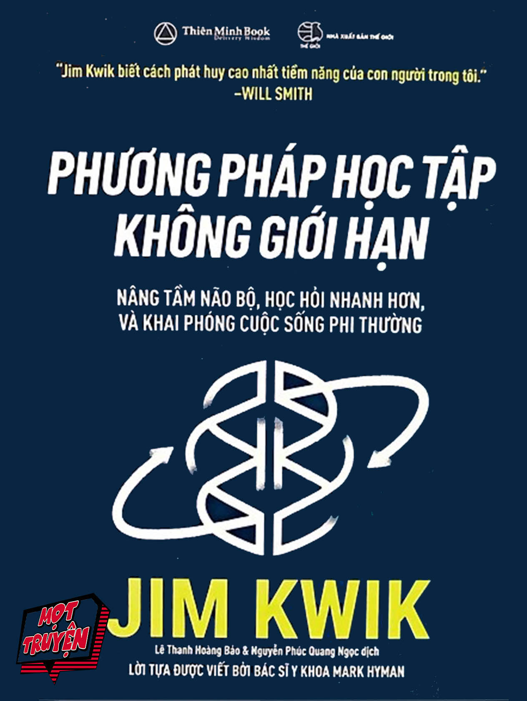

# PHƯƠNG PHÁP HỌC TẬP KHÔNG GIỚI HẠN (LIMITLESS)

> **Tác giả:** Jim Kwik  
> **Dịch giả:** Nguyễn Phúc Quang Ngọc & Lê Thanh Hoàng Bảo  
> **Phát hành:** Thiên Minh Book  
> **Nhà xuất bản:** Nhà xuất bản Thế Giới  

<p align="center">
  
</p>

---

## Giới thiệu tổng quan

***Phương Pháp Học Tập Không Giới Hạn*** (tựa gốc: *Limitless: Upgrade Your Brain, Learn Anything Faster, and Unlock Your Exceptional Life*) của chuyên gia huấn luyện não bộ hàng đầu thế giới **Jim Kwik** là cẩm nang toàn diện giúp khai phóng tiềm năng trí não, nâng cấp khả năng ghi nhớ, sự tập trung và tốc độ học tập.

Cuốn sách giới thiệu **Mô hình Khai phóng 3M (Limitless Model)** gồm 3 trụ cột thiết yếu:
1. **Tâm thế (Mindset - "Điều gì"):** Nhận diện và phá vỡ những niềm tin giới hạn (LIEs), xây dựng tư duy phát triển.
2. **Động lực (Motivation - "Vì sao"):** Tìm kiếm mục đích sống, tối ưu hóa năng lượng thể chất & trí não, thiết lập các bước nhỏ đơn giản (S3) và đạt trạng thái tuôn chảy (Flow).
3. **Phương pháp (Method - "Thế nào"):** 5 siêu kỹ năng học tập tăng tốc: Tập trung (Focus), Học tập (Study), Ghi nhớ (Memory), Đọc nhanh (Speed Reading), Tư duy (Thinking).

---

## 📚 Danh Sách Các Chương

| STT | Tên chương | File |
| :---: | :--- | :--- |
| 00 | [Bìa sách & Thông tin xuất bản](00_Thong_tin_xuat_ban.md) | `00_Thong_tin_xuat_ban.md` |
| 01 | [Lời khen tặng dành cho sách](01_Loi_khen_tang.md) | `01_Loi_khen_tang.md` |
| 02 | [Lời tựa (Bác sĩ Mark Hyman)](02_Loi_tua.md) | `02_Loi_tua.md` |
| 03 | [Lời giới thiệu](03_Loi_gioi_thieu.md) | `03_Loi_gioi_thieu.md` |
| 04 | [Phần 1: Tâm trí thông suốt](04_Phan_1_Tam_tri_thong_suot.md) | `04_Phan_1_Tam_tri_thong_suot.md` |
| 05 | [Chương 1: Trở thành con người khai phóng](05_Chuong_01_Tro_thanh_con_nguoi_khai_phong.md) | `05_Chuong_01_Tro_thanh_con_nguoi_khai_phong.md` |
| 06 | [Chương 2: Bây giờ chính là thời điểm quan trọng nhất](06_Chuong_02_Bay_gio_chinh_la_thoi_diem_quan_trong_nhat.md) | `06_Chuong_02_Bay_gio_chinh_la_thoi_diem_quan_trong_nhat.md` |
| 07 | [Chương 3: Bộ não không giới hạn của bạn](07_Chuong_03_Bo_nao_khong_gioi_han_cua_ban.md) | `07_Chuong_03_Bo_nao_khong_gioi_han_cua_ban.md` |
| 08 | [Chương 4: Phương pháp FASTER để đọc và ghi nhớ](08_Chuong_04_Phuong_phap_de_doc_va_ghi_nho_quyen_sach_nay_va_bat_cu_quyen_nao_khac.md) | `08_Chuong_04_Phuong_phap_de_doc_va_ghi_nho_quyen_sach_nay_va_bat_cu_quyen_nao_khac.md` |
| 09 | [Phần 2: Tâm thế khai phóng ("Điều gì")](09_Phan_2_Tam_the_khai_phong.md) | `09_Phan_2_Tam_the_khai_phong.md` |
| 10 | [Chương 5: Phép thuật của hệ thống niềm tin](10_Chuong_05_Phep_thuat_cua_he_thong_niem_tin.md) | `10_Chuong_05_Phep_thuat_cua_he_thong_niem_tin.md` |
| 11 | [Chương 6: 7 lời nói dối về việc học hỏi](11_Chuong_06_7_loi_noi_doi_ve_viec_hoc_hoi.md) | `11_Chuong_06_7_loi_noi_doi_ve_viec_hoc_hoi.md` |
| 12 | [Phần 3: Động lực khai phóng ("Vì sao")](12_Phan_3_Dong_luc_khai_phong.md) | `12_Phan_3_Dong_luc_khai_phong.md` |
| 13 | [Chương 7: Mục đích](13_Chuong_07_Muc_dich.md) | `13_Chuong_07_Muc_dich.md` |
| 14 | [Chương 8: Năng lượng](14_Chuong_08_Nang_luong.md) | `14_Chuong_08_Nang_luong.md` |
| 15 | [Chương 9: Những bước nhỏ đơn giản](15_Chuong_09_Nhung_buoc_nho_don_gian.md) | `15_Chuong_09_Nhung_buoc_nho_don_gian.md` |
| 16 | [Chương 10: Tuôn chảy (Trạng thái Flow)](16_Chuong_10_Tuon_chay.md) | `16_Chuong_10_Tuon_chay.md` |
| 17 | [Phần 4: Phương pháp khai phóng ("Thế nào")](17_Phan_4_Phuong_phap_khai_phong_the_nao.md) | `17_Phan_4_Phuong_phap_khai_phong_the_nao.md` |
| 18 | [Chương 11: Tập trung](18_Chuong_11_Tap_trung.md) | `18_Chuong_11_Tap_trung.md` |
| 19 | [Chương 12: Học tập](19_Chuong_12_Hoc_tap.md) | `19_Chuong_12_Hoc_tap.md` |
| 20 | [Chương 13: Ghi nhớ](20_Chuong_13_Ghi_nho.md) | `20_Chuong_13_Ghi_nho.md` |
| 21 | [Chương 14: Đọc nhanh](21_Chuong_14_Doc_nhanh.md) | `21_Chuong_14_Doc_nhanh.md` |
| 22 | [Chương 15: Tư duy](22_Chuong_15_Tu_duy.md) | `22_Chuong_15_Tu_duy.md` |
| 23 | [Lời kết: Quay lại giúp đỡ người khác](23_Loi_ket_Quay_lai_giup_do_nguoi_khac.md) | `23_Loi_ket_Quay_lai_giup_do_nguoi_khac.md` |
| 24 | [Kế hoạch hành động 10 ngày khởi động cùng Kwik](24_Ke_hoach_hanh_dong_10_ngay_khoi_dong_cung_Kwik.md) | `24_Ke_hoach_hanh_dong_10_ngay_khoi_dong_cung_Kwik.md` |
| 25 | [Những quyển sách bạn nên đọc](25_Nhung_quyen_sach_ban_nen_doc.md) | `25_Nhung_quyen_sach_ban_nen_doc.md` |
| 26 | [Lời cảm ơn](26_Loi_cam_on.md) | `26_Loi_cam_on.md` |
| 27 | [Về tác giả Jim Kwik](27_Ve_tac_gia.md) | `27_Ve_tac_gia.md` |
| 28 | [Về Nguyễn Phúc Quang Ngọc](28_Ve_Nguyen_Phuc_Quang_Ngoc.md) | `28_Ve_Nguyen_Phuc_Quang_Ngoc.md` |
| 29 | [Về Lê Thanh Hoàng Bảo](29_Ve_Le_Thanh_Hoang_Bao.md) | `29_Ve_Le_Thanh_Hoang_Bao.md` |
| 30 | [Thư ngỏ gửi độc giả & Chú thích](30_Thu_ngo_gui_doc_gia_va_chu_thich.md) | `30_Thu_ngo_gui_doc_gia_va_chu_thich.md` |

---

## Cấu trúc thư mục

```
PhuongPhapHocTapKhongGioiHan/
├── README.md                                             # Mục lục tổng quan
├── build_full_book.py                                    # Script chuyển đổi tự động từ PDF
├── images/                                               # Toàn bộ hình ảnh và sơ đồ trích xuất từ PDF gốc
│   ├── cover.jpg                                         # Bìa sách độ nét cao
│   ├── page_031_img_643.jpeg                             # Sơ đồ Phần 1
│   ├── page_036_img_694.jpeg                             # Minh họa Chương 1
│   ├── page_038_img_697.jpeg                             # Minh họa Chiếc mũ
│   ├── page_046_img_706.jpeg                             # Cốc Einstein
│   ├── page_055_img_717.jpeg                             # Mô hình Khai Phóng
│   ├── page_089_img_895.jpeg                             # Trục Não - Ruột
│   ├── page_097_img_964.jpeg                             # Khởi động sức mạnh
│   ├── page_103_img_1016.jpeg                            # Biểu đồ tập trung
│   ├── page_105_img_1019.jpeg                            # Hiệu ứng Primacy / Recency
│   ├── page_128_img_1225.jpeg                            # Sơ đồ Phần 2
│   ├── page_146_img_1312.jpeg                            # Mô hình Niềm tin
│   ├── page_195_img_1498.jpeg                            # Sơ đồ Phần 3
│   ├── page_263_img_1834.jpeg                            # Vòng lặp thói quen
│   ├── page_299_img_1225.jpeg                            # Sơ đồ Phần 4
│   ├── page_326_img_2184.jpeg                            # Lặp lại ngắt quãng
│   └── page_426_img_2576.jpeg                            # Tư duy cấp số nhân
├── quizzes/                                              # Bộ trắc nghiệm ôn tập cho các chương
├── 00_Thong_tin_xuat_ban.md
├── 01_Loi_khen_tang.md
├── ...
├── 30_Thu_ngo_gui_doc_gia_va_chu_thich.md
└── raw/
    └── PhuongPhapHocTapKhongGioiHan_JimKwik.pdf          # File PDF gốc
```
