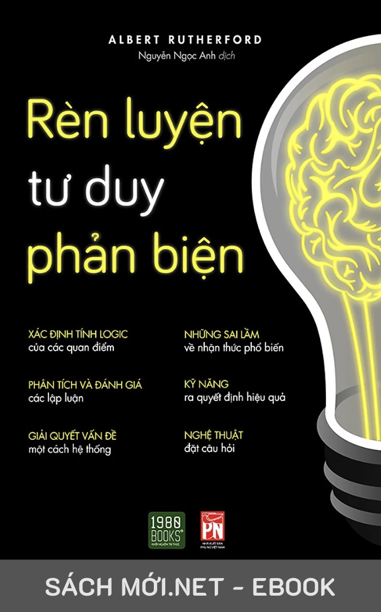

# RÈN LUYỆN TƯ DUY PHẢN BIỆN

**Tác giả:** Albert Rutherford  
**Người dịch:** Nguyễn Ngọc Anh  
**Đơn vị phát hành:** THƯ VIỆN EBOOK SACHMOI.NET  

Cuốn sách **"Rèn Luyện Tư Duy Phản Biện"** (Albert Rutherford) cung cấp những kiến thức nền tảng và phương pháp thực tế để:
- Nhận thức về quá trình suy nghĩ (siêu nhận thức - metacognition).
- Hiểu được cấu trúc và sự vận hành của các cấp độ não bộ ảnh hưởng đến niềm tin và quyết định.
- Nhận diện những hạn chế, lỗ hổng của trí nhớ và thực tế chủ quan.
- Xây dựng luận điểm vững chắc và tránh các cạm bẫy ngụy biện logic phổ biến.
- Tỉnh táo trước các chiêu trò tiếp thị, truyền thông, tin giả và mô hình đa cấp lừa đảo.
- Phân tích và huyền bí hóa các thuyết âm mưu dưới góc nhìn khoa học và lý trí.

---

## Danh mục tài liệu

- [Trang bìa & Mục lục](00_Trang_bia_va_Muc_luc.md)
- [Lời mở đầu](01_Loi_mo_dau.md)
- [Chương 1: Khoa học thần kinh về niềm tin và sự hoàn hảo](02_Chuong_1_Khoa_hoc_than_kinh_ve_niem_tin_va_su_hoan_hao.md)
- [Chương 2: Ký ức và sự ngộ nhận](03_Chuong_2_Ky_uc_va_su_ngo_nhan.md)
- [Chương 3: Thực tế](04_Chuong_3_Thuc_te.md)
- [Chương 4: Những lập luận và những ngụy biện logic](05_Chuong_4_Nhung_lap_luan_va_nhung_nguy_bien_logic.md)
- [Chương 5: Tiếp thị, truyền thông, và những trò chơi trí tuệ khác](06_Chuong_5_Tiep_thi_truyen_thong_va_nhung_tro_choi_tri_tue_khac.md)
- [Chương 6: Những thuyết âm mưu được huyền bí hóa](07_Chuong_6_Nhung_thuyet_am_muu_duoc_huyen_bi_hoa.md)
- [Kết](08_Ket.md)
- [Tham khảo](09_Tham_khao.md)
- [Trích dẫn tài liệu tham khảo](10_Trich_dan_tai_lieu_tham_khao.md)
