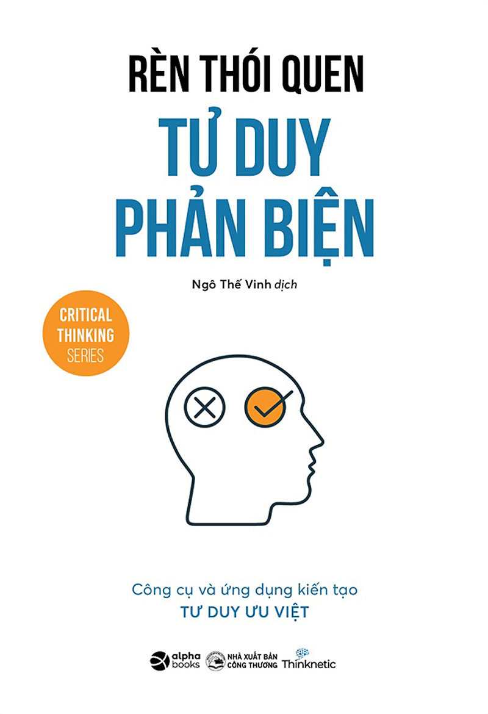

# RÈN THÓI QUEN TƯ DUY PHẢN BIỆN

---

## THÔNG TIN PHÁT HÀNH

**HỘI MÊ SÁCH**  
Tải eBooks miễn phí tại: [https://hoimesach.com](https://hoimesach.com)  
Nhận eBooks miễn phí qua Zalo: [https://zalo.hoimesach.com](https://zalo.hoimesach.com)  
Group: [https://facebook.com/groups/mesachhoi](https://facebook.com/groups/mesachhoi)

---

## THÔNG TIN XUẤT BẢN

### RÈN THÓI QUEN TƯ DUY PHẢN BIỆN

**NHÀ XUẤT BẢN CÔNG THƯƠNG**  
Trụ sở: Số 655 Phạm Văn Đồng, Bắc Từ Liêm, Hà Nội  
Điện thoại: 024-3 934 1562 | Fax: 024-3 938 7164  
Website: [http://nhaxuatbancongthuong.com](http://nhaxuatbancongthuong.com)  
E-mail: nxbct@moit.gov.vn

**Chịu trách nhiệm xuất bản:**  
Giám đốc - Tổng Biên tập: **NGUYỄN MINH HUỆ**  
Biên tập: Lương Thị Ngọc Bích  
Sửa bản in: Trung Trịnh  
Trình bày: Vũ Lê Thư  
Thiết kế bìa: Trang Fu

**CÔNG TY CỔ PHẦN SÁCH ALPHA**  
[www.alphabooks.vn](http://www.alphabooks.vn)  
VP HN: Tầng 3, Dream Center Home, số 11A, ngõ 282 Nguyễn Huy Tưởng, Phường Thanh Xuân Trung, Quận Thanh Xuân, TP. Hà Nội  
Tel: (84-24) 3 722 62 34 | Fax: (84-24) 3 722 62 37  
Chi nhánh TP. HCM: 138C Nguyễn Đình Chiểu, Phường 6, Quận 3, TP. Hồ Chí Minh  
Tel: (84-28) 38220 334 | 35

In 3000 cuốn, khổ 12 x 18 cm tại Công ty Cổ phần In và Thương mại Prima.  
Địa chỉ: số 35, ngõ 93 Hoàng Quốc Việt, Cầu Giấy, Hà Nội.  
Số xác nhận đăng kí xuất bản: 4436-2022/CXBIPH/03-251/CT  
Số Quyết định xuất bản: 455/QĐ - NXBCT ngày 08 tháng 12 năm 2022  
In xong và nộp lưu chiểu Quý I năm 2023  
**Mã số ISBN: 978-604-362-509-7**

---

> **BẰNG CÁCH DÀNH RA MỘT CHÚT**  
> thời gian để xây dựng các thói quen tư duy phản biện tốt, bạn sẽ giải phóng được thời gian để làm những điều mà bạn mong muốn trong cuộc sống.

## LỜI GIỚI THIỆU: TƯ DUY QUAN TRỌNG NHẤT TRONG THẾ GIỚI HIỆN ĐẠI

Kỹ năng nào trong cuộc sống có thể còn quan trọng hơn bằng đại học? Đó là tư duy phản biện (Critical Thinking), một kỹ năng cơ bản đang ngày càng trở nên quan trọng trong thế giới hiện đại.

Một trong những lý do khiến hầu hết chúng ta đưa ra các quyết định sai lầm, nhiều khi đi theo đám đông, đầu tư theo xu hướng và hành động theo phong trào dẫn đến thất bại mà thiếu những quyết định đúng đắn là vì hệ thống giáo dục không dạy tư duy phản biện. Đó là lý do khiến hầu hết chúng ta không bao giờ phát huy hết tiềm năng của mình, không có tư duy phản biện dẫn đến suy luận kém, không có khả năng phân biệt sự thật từ hư cấu, từ những lừa dối và ngụy biện.

Trong một xã hội tràn ngập thông tin và đầy cạm bẫy như ngày nay, nhận thấy tư duy phản biện ngày càng trở nên quan trọng và cần thiết đối với mọi người, từ các em học sinh đến sinh viên, người lao động, quản lý, điều hành và cả những nhà lãnh đạo, nên Alpha Books tìm kiếm và lựa chọn những cuốn sách hữu ích nhất về chủ đề này để giới thiệu tư duy phản biện là gì, cách xây dựng thói quen tư duy phản biện và phân biệt sự thật với hư cấu, qua đó, giúp các bạn vững chắc hơn trong hành trình của mình.

### Bộ sách này bao gồm:

-  **Tư duy phản biện từ làm quen đến thói quen:** 9 tiêu chuẩn, 8 yếu tố, 7 đặc điểm đối với nhà tư duy phản biện
-  **Rèn thói quen tư duy phản biện:** Công cụ và ứng dụng kiến tạo tư duy ưu việt
-  **Bẫy ngụy biện trong tư duy phản biện:** Bốn quy luật logic và các lỗi thường gặp
-  **Giải phóng sức mạnh tư duy phản biện:** Giải mã 10 kiểu ngụy biện, triệt tiêu chiêu trò lừa đảo và hiểu chính xác về ngụy khoa học

### Chúng tôi tin rằng, bộ sách này sẽ cung cấp cho các bạn:

- Khung tư duy phản biện được phát triển bởi hai trong số những nhà khoa học về tư duy phản biện giàu kinh nghiệm nhất mọi thời đại và cách biến nó thành của riêng bạn.
- 8 đặc điểm tư duy phản biện bạn đã có, nhưng không biết cách tối ưu hóa chúng.
- Cách xác định tin giả và thông tin sai lệch – tìm hiểu điều này và bạn sẽ có lợi thế LỚN hơn hầu hết mọi người xung quanh mình ngay bây giờ.
- Lý do bạn nên nghi ngờ bất cứ ai trích dẫn một nhân vật có thẩm quyền.
- 6 quy tắc biến thói quen hiện tại của bạn thành thói quen lành mạnh.
- Các bài tập dễ áp dụng, dễ thực hiện để bạn luyện tập mọi điểm đã đề cập. Bạn sẽ không “đọc và quên” bộ sách này.
- … và nhiều, nhiều hơn thế nữa!

Chúng tôi tin rằng, những người không ngừng học tập sẽ tiếp tục phát triển và thành công. Vì thế, cách thức trở thành một người có tư duy độc lập và đưa ra các quyết định thông minh là mục đích của chúng tôi. Chúng tôi mong rằng bộ sách thực tế, dễ đọc này sẽ giúp bạn xây dựng những lập luận vững chắc hơn, đưa ra các quyết định tự tin hơn và phát hiện ra những lỗi logic trong cuộc sống.

Tư duy phản biện sẽ giúp bạn có các quyết định đúng đắn hơn, thông minh hơn trong cuộc sống cá nhân và nghề nghiệp của bạn.

**NGUYỄN CẢNH BÌNH**  
*Chủ tịch Alpha Books - Viện trưởng Viện lãnh đạo ABG*
