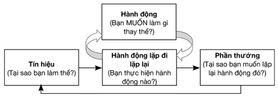

# CHƯƠNG 2: MẤU CHỐT CỦA CÁC THÓI QUEN

> "Chúng ta chính là những gì ta liên tục thực hiện. Vì thế, sự xuất sắc không phải một hành động mà là một thói quen.”
>
> *— Aristotle*

Bạn đã bao giờ đứng cạnh tủ lạnh hay bên chạn bếp, ăn thứ gì đó một cách vô thức trong khi bộ não bạn lướt qua danh sách những việc cần làm trong ngày hay chưa? Bạn mở cánh tủ và lấy thức ăn ra, nhưng đôi khi bạn cảm thấy như thể đó là hành vi vô thức thay vì là lựa chọn thực sự của bạn. Thật dễ để lạc lối trong những ý nghĩ của chính mình đến nỗi chúng ta đưa ra những quyết định dù cơ bản nhất trong trạng thái gần như mộng du. Nhưng tại sao lại thế? Làm thế nào chúng ta đưa mình trở lại thực tại được? Để giành lại quyền kiểm soát cuộc sống, chúng ta cần một tâm trí không ngừng đặt câu hỏi ngăn chúng ta ăn hết gói bỏng ngô hoặc hơn thế.

Các thói quen là những hành động và hành vi mà chúng ta làm một cách tự động, từ các lề thói thường nhật đơn giản nhất cho tới những hoạt động thể chất và tinh thần mà chúng ta đã học hỏi theo thời gian. Vì thói quen có thể là tốt hoặc xấu, lợi hoặc hại, chúng ta cần biết chúng được hình thành và quên đi như thế nào để sử dụng chúng một cách tích cực trong cuộc sống.

## BẠN CHÍNH LÀ CÁC THÓI QUEN CỦA MÌNH

Chúng ta sa vào các thói quen xấu khi trạng thái vô thức là điều ta không mong muốn. Một lí do quan trọng khiến chúng ta thường xuyên làm theo những hành vi mặc định thay vì dừng lại để cân nhắc một lựa chọn nào đó chính là căng thẳng thần kinh.

Có thể bạn đã biết, sự căng thẳng thần kinh làm suy giảm chức năng của vùng vỏ não trước trán – phần não bộ xử lý trí nhớ ngắn hạn.14 Điều này giải thích tại sao thật khó để quyết định bạn muốn loại nhân bánh pizza nào mặc dù đây là một quyết định không mấy rủi ro. Bạn đánh mất khả năng lý luận của mình.

Nếu những “sự cố” suy nghĩ này chỉ giới hạn trong chuyện ăn uống thì thứ duy nhất có thể phải gánh chịu hậu quả chỉ là vòng eo của bạn. Tuy thế, chúng ta có thể rơi vào trạng thái vô thức hoặc đóng băng quyết định trong mọi khía cạnh của cuộc sống, từ công việc cho tới các mối quan hệ. Đây chính là lí do mà mọi người vẫn thường tiếc nuối khi mọi sự đã rồi nhưng không nhận ra rằng trong phần lớn trường hợp, mọi chuyện có thể được giải quyết tốt hơn nhiều nếu ta dừng lại, rời khỏi băng chuyền quyết định mặc định và suy nghĩ thấu đáo. Phần lớn mọi người không dám tự hỏi xem mình muốn gì và tại sao lại muốn thứ đó. Nguyên do thường là câu trả lời sẽ khiến họ khó chịu hoặc phải hành động thêm ngoài danh sách những việc cần làm vốn bất khả thi.

Đến đây, mô hình tư duy nhanh và chậm sẽ phát huy hiệu quả.15 Chế độ tư duy nhanh bao gồm các hành vi mặc định vốn là những phản hồi tự động và nhanh chóng trước các tình huống; chúng có thể là tốt hoặc xấu, nhưng chính từ đây, những “thói quen xấu” dần hình thành. Chúng ta cũng có thể chuyển sang chế độ tư duy chậm, nhưng như bạn hẳn đã đoán ra, nó đòi hỏi bạn phải chậm lại để suy nghĩ thấu đáo một cách logic về tình huống. Vấn đề nằm ở đây. Chúng ta không giỏi nghĩ chậm lại, vì thế chúng ta cũng thường không giỏi suy nghĩ thấu đáo về thứ mà chúng ta đang vội vàng thực hiện hay tại sao ta lại đang thực hiện nó.

Vậy nên, lần tiếp theo bạn vớ lấy túi đồ ăn vặt một cách vô thức, hãy chậm lại. Cố gắng tìm hiểu tại sao bạn lại ăn, bạn nên làm gì thay vì ăn vặt, và cuối cùng làm thế nào bạn có thể tránh rơi vào trạng thái này lần nữa. Trong trường hợp của tôi, giải pháp là giấu túi bỏng ngô ở ngăn tủ trên cùng.

Bạn có thể hiểu thêm rất nhiều về bản thân, những gì khiến bạn hứng thú và đích đến cuộc đời của bạn thông qua đặt ra những câu hỏi đúng đắn. Bạn có thể thay đổi thói quen từ những lựa chọn nhỏ trong cuộc sống và dần đến những quyết định lớn lao. Các thói quen sẽ định hình cơ hội tương lai của bạn.

May thay, sự thay đổi các thói quen không chỉ dựa trên sự may mắn hay lòng quyết tâm. Có những mô hình được nghiên cứu kĩ càng mà bạn có thể sử dụng để tập các thói quen mới hoặc loại bỏ các thói quen xấu một cách logic. Vậy bạn muốn thay đổi điều gì?

## THÁO GỠ TRẠNG THÁI VÔ THỨC

Hãy nghĩ tới một việc bạn thường xuyên làm, những việc bạn làm để sửa soạn vào buổi sáng hoặc cách mà bạn rời khỏi nhà chẳng hạn. Nhiều khả năng là bạn thực hiện một số bước nhất định theo một trình tự cụ thể. Bạn kiểm tra xem mình đã mang điện thoại và chìa khóa chưa trước khi bước ra khỏi nhà. Bạn xếp cốc uống nước vào máy rửa chén sau khi dùng xong. Bạn bỏ bộ đồ tập vào máy giặt sau buổi tập luyện. Hoặc có thể bạn ấn nút tạm tắt chuông vài lần trước khi thức dậy, ăn sáng và uống cà phê ở cùng một cửa hàng trên đường tới chỗ làm. Bạn sẽ có vô số những kiểu mẫu “có sẵn” rất dễ chỉ ra nếu bạn chú ý tìm kiếm.

Nếu muốn xây dựng những thói quen mới trong bất kì khía cạnh nào của cuộc sống, dù là thói quen thể chất hay tinh thần, bạn đều có thể làm theo một kiểu mẫu để nhận diện và thấu hiểu chúng. Kiểu mẫu này bao gồm một tín hiệu, một hành động lặp đi lặp lại, một phần thưởng, và nó được gọi là “Vòng lặp Thói quen”.16 Ví dụ, bạn thức giấc thật sớm vào mỗi buổi sáng (tín hiệu), ăn sáng (hành động lặp), và cảm thấy cơ thể mình tràn đầy năng lượng cho một ngày mới (phần thưởng). Vì thế, bạn biết rằng cảm giác giàu năng lượng gắn liền với việc thức giấc và ăn sáng. Nhiều khả năng bạn sẽ duy trì thói quen này nếu nhận được phản hồi tích cực.

Chúng ta luôn sử dụng vòng lặp thói quen này với người khác hay thậm chí cả động vật. Bạn đã bao giờ nhìn thấy ai đó huấn luyện một con chó biết ngồi chưa? Con chó nghe thấy hiệu lệnh (tín hiệu), ngồi xuống (hành động lặp), và được ăn một miếng (phần thưởng). Cuối cùng, con chó sẽ ngồi xuống khi nghe lệnh ngay cả khi không được ăn vì sẽ có lúc chúng nhận được phần thưởng. Hiệu lệnh khiến con chó muốn ngồi xuống vì nó gắn liền việc ngồi với phần thưởng. Những phần thưởng lúc có lúc không có thể củng cố hành vi mạnh mẽ hơn cả những phần thưởng lần nào cũng nhận được.17 Đây là lí do trò đánh bạc lại dễ gây nghiện; bạn không thể biết liệu mình có thắng canh bạc tiếp theo hay không. Lời hứa hẹn không chắc chắn mà hiện hữu về một khả năng chiến thắng khiến bạn cứ cố thử hết lần này đến lần khác. Phần thưởng phải là thứ gì đó mà bạn muốn, nhưng không phải lần nào cũng xuất hiện. Vậy nên nếu có những ngày bạn dậy sớm, ăn sáng, và chuẩn bị thật tốt cho cả ngày nhưng vẫn có một ngày tồi tệ, thì điều đó không có nghĩa là bạn sẽ từ bỏ thói quen. Bạn biết rằng thói quen đó thường đem lại cho bạn một ngày tuyệt vời, vậy nên bạn cứ tiếp tục duy trì nó.

Về mặt định nghĩa, thói quen không phải là hành vi chỉ xuất hiện một lần. Vì thế, nó được gọi là “Vòng lặp Thói quen”, những phản hồi tích cực thúc đẩy vòng lặp tiếp diễn. Các thói quen sẽ lặp đi lặp lại mãi giống như một cái đĩa hát hỏng, dù chúng tốt hay xấu cho tới khi vòng lặp được thay đổi. Chúng ta vận dụng các kĩ năng tư duy phản biện ở chỗ này.

Hãy nghĩ tới các bước trong vòng lặp thói quen. Chúng có thể được chia nhỏ thành những câu hỏi để giúp bạn nhận diện những gì diễn ra trong tâm trí mình và tháo gỡ trạng thái vô thức.

### Tín hiệu

Tại sao bạn lại làm thế? Trong cuộc sống, hãy để tâm quan sát. Tìm kiếm các xu hướng và kiểu mẫu đi trước hành động của bạn. Một cảm giác, một thời điểm trong ngày, một hành động khác, hay một mùi hương nào đó đều có thể kích hoạt phản ứng của bạn. Cách này có thể mất chút thời gian và là một cách tuyệt với để tăng nhận thức về bản thân. Hãy coi việc tìm ra những tín hiệu là một thử thách thú vị.

### Hành động lặp đi lặp lại

Bạn làm gì? Đây là phần dễ dàng vì nó thường là một hành động thể chất rõ ràng mà bạn thực hiện. Đây là phần giúp bạn phân loại một thói quen là “tốt” hay “xấu”.

### Phần thưởng

Tại sao bạn lặp lại hành động nói trên? Các thói quen xoay vòng và lặp lại cũng là có lí do. Vậy thì lí do cho thói quen được nhận diện của bạn là gì? Phần thưởng nào khiến bạn muốn làm một điều gì đó hết lần này đến lần khác? Đó có thể là một phần thưởng vật chất (một viên đường hoặc trạng thái căng thẳng tột độ) hoặc một phần thưởng cảm xúc (bạn cảm thấy thư giãn hoặc hạnh phúc). Đây chính là phần quan trọng của vòng lặp thói quen. Nếu không có một phần thưởng thực sự hấp dẫn, bạn có thể sẽ không duy trì thói quen.

Khi đã hiểu vòng lặp thói quen, bạn có thể biến đổi thói quen theo hướng mình mong muốn.

## QUY TẮC VÀNG CỦA VIỆC HOÁN ĐỔI THÓI QUEN

Khi cảm thấy buồn chán, bạn sẽ lặp đi lặp lại một hành động nào đó. Ai cũng vậy cả. Nếu bạn muốn có tương tác xã hội, bạn có thể xem điện thoại. Nếu cảm thấy đói, bạn có thể tìm đồ ăn vặt. Bản thân các việc này không có gì xấu, nhưng nếu hành động lặp ấy trở thành trạng thái vô thức của bạn mỗi khi buồn chán, thì bạn có thể rơi vào tình trạng lướt điện thoại không ngừng hoặc ăn vặt quá mức mà không biết.

Giải pháp dễ nhất là tự hỏi bản thân, “tôi đang làm gì và tại sao?”. Trạng thái vô thức của bạn mỗi khi buồn chán là gì và tại sao bạn làm hành động lặp đó? Bạn có thể kết luận rằng hành động lặp của bạn là tốt (khi buồn chán, bạn thường đọc sách hoặc chạy bộ), vì thế bạn muốn duy trì thói quen đó. Bạn có thể kết luận rằng hành động lặp của bạn là không tốt (khi buồn chán, bạn tốn hàng giờ đồng hồ chỉ để lướt mạng xã hội và ăn chocolate).

Bạn có thể sử dụng Quy tắc Vàng để thay đổi thói quen. Bạn chỉ cần thay đổi một phần trong vòng lặp thói quen. Vì bạn không thể quyết định là từ nay mình sẽ không bao giờ buồn chán nữa (tín hiệu), nên điều bạn cần thay đổi là phần có ý nghĩa (hành động lặp) sang một thứ khác mà vẫn giải quyết được nhu cầu (phần thưởng). Việc này trở nên dễ dàng một khi bạn đã nhận ra được vòng lặp thói quen của mình, vì thế phản tư là một kĩ năng tư duy phản biện quan trọng. Bạn tự đặt cho mình những câu hỏi để tìm hiểu tại sao bạn lại làm một số việc nhất định, sau đó cân nhắc xem bạn muốn duy trì hay loại bỏ thói quen này, cuối cùng là đặt ra thêm một câu hỏi nữa để đào sâu khám phá… “Nếu tôi làm việc ‘X’ để thay thế thì tôi vẫn thấy mình được nhận thưởng chứ?”. Thay đổi thói quen chính là bước thử nghiệm của bạn. Bạn sẽ tìm ra một thứ hiệu quả và phù hợp với vòng lặp thói quen của mình sau khi thử một vài lần, rồi đi đến kết luận rằng đây là thói quen mới tuyệt vời nhất. Bạn có thể gặp may khi lựa chọn được hành vi mới tối ưu ngay trong lần thử đầu tiên!

Cũng giống như cắt nối gen, mục tiêu của bạn là cắt bỏ những “mã thói quen” mà mình không mong muốn và thay thế chúng [với thứ bạn muốn].

Dưới dây là một số ví dụ về sự hoán đổi thói quen:

1. Bạn cảm thấy thiếu năng lượng (tín hiệu), vì thế thay vì ăn chocolate (hành động lặp cũ), bạn lựa chọn ăn hoa quả (hành động lặp mới). Cả hai loại đồ ăn đều thỏa mãn cơn thèm đồ ngọt (phần thưởng), nhưng hành động lặp mới lành mạnh hơn.

2. Bạn bắt đầu làm việc (tín hiệu), và thay vì ngay lập tức dành ra hàng giờ để phân loại e-mail (hành động lặp cũ), bạn lập một danh sách những việc bạn cần làm được trong ngày hôm đó (hành động lặp mới). Cả hai đều thỏa mãn nhu cầu cảm thấy mọi thứ đâu vào đó (phần thưởng), nhưng hành động lặp mới giúp bạn bắt đầu ngày mới theo hướng có chiến lược thay vì bị động.

3. Bạn đã ăn tối xong và muốn thư giãn (tín hiệu), thay vì ngồi xuống xem TV ngay lập tức (hành động lặp cũ), bạn dọn dẹp trong khi nghe sách nói, nghe nhạc, hoặc chương trình podcast mà bạn ưa thích (hành động lặp mới). Cả hai đều thỏa mãn nhu cầu giải trí (phần thưởng), nhưng với hành động lặp mới, bạn đã hoàn thành công việc dọn dẹp mà vẫn thư giãn.

4. Bạn vừa nhận lương (tín hiệu), thay vì mua thêm quần áo mới (hành động lặp cũ), bạn tiết kiệm tiền để mua một món đồ bạn vô cùng muốn có nhưng hiếm khi mua (hành động lặp mới). Trong cả hai trường hợp bạn đều dùng tiền để mua một thứ gì đó bạn thích chứ không chỉ để trả hóa đơn (phần thưởng), nhưng bạn sẽ tiết kiệm được tiền cho một món đồ mình ưa thích hơn.

5. Bạn dùng hết giấy vệ sinh (tín hiệu), thay vì chỉ báo lại điều đó với bạn đời của mình (hành động lặp cũ), ngay lập tức bạn đưa nó vào danh sách mua hàng (hành động lặp mới). Cả hai đều khiến bạn cảm thấy mình đã hành động, nhưng lựa chọn mới nhiều khả năng sẽ thực sự đảm bảo cho bạn không còn bị thiếu giấy.

6. Sau bữa trưa ngày Chủ nhật (tín hiệu), thay vì đi uống rượu với bạn bè (hành động lặp cũ), bạn đi dạo với họ (hành động lặp mới). Cả hai đều thỏa mãn nhu cầu giao tiếp của bạn (phần thưởng), nhưng hành động thứ hai lành mạnh và tiết kiệm hơn.

## LÀM MỘT NHẬN MỘT MIỄN PHÍ

Đôi khi bạn muốn tạo thêm một thói quen mới nhưng không phải để thay thế thói quen cũ. Đây là lúc mà bạn có thể thực hiện việc “chồng thói quen”18 hoặc “xâu chuỗi thói quen”19.

Nếu nha sĩ khuyên bạn nên dùng chỉ nha khoa, bạn sẽ không bỏ thói quen đánh răng. Bạn gắn việc dùng chỉ nha khoa vào thói quen hiện tại bằng cách thêm bước này vào mỗi lần đánh răng. Làm như thế dễ hơn nhiều so với cố gắng tạo lập thói quen dùng chỉ nha khoa tách rời thói quen đánh răng. Một lần nữa, nếu bạn coi như mình đang gắn các thói quen mới vào những thói quen tốt khác thì mọi chuyện sẽ thật dễ dàng. Bạn chỉ cần đưa ra một lựa chọn có ý thức để thực hiện thật chỉn chu nhờ chế độ “tư duy chậm”.

Nếu muốn xây dựng một thói quen mới, bạn cần khiến cho nó trở nên dễ duy trì. Các thói quen tốt chính là những thói quen dễ thực hiện. Bạn tưởng rằng các thói quen tốt đòi hỏi sự tận tụy và lòng quyết tâm cao độ ư? Hãy nhớ lại xem một thói quen thực chất là gì; nó chính là trạng thái [hành động] vô thức, vì thế nó không đòi hỏi nhiều thời gian suy nghĩ hay công sức để thực hiện. Nó giải phóng tâm trí bạn để nghĩ về những điều khác. Vậy nên hãy nghĩ về thời điểm và cách thức mà bạn làm cho một thói quen mới gắn liền với lề thói thường nhật hiện tại một cách dễ dàng nhất, nhờ đó bạn sẽ thay đổi thành công.

Bạn có thể thực hiện phần lớn các việc thường ngày ở bất kì thời điểm nào trong ngày. Thiền định, viết nhật kí, đọc sách, tập thể dục – tất cả đều vừa vặn với lịch trình của bạn. Tôi luôn thấy việc viết nhật kí quả là khó khăn, vì tôi có thể làm việc đó bất kì lúc nào, nghĩa là tôi đã không sắp xếp được một thời điểm cố định trong ngày cho việc đó suốt một thời gian rất dài. Kết quả là tôi thường quên bẵng mất, không viết mỗi ngày. Giờ đây, tôi viết nhật kí ngay sau khi con gái tôi đi ngủ; tôi đã gắn nó với một tín hiệu cố định diễn ra mỗi ngày, và vì thế nó hiện là một phần trong lề thói thường nhật của tôi, có thể được thực hiện mà không phải gắng sức. Đây chính là mục tiêu của việc chồng thói quen. Hãy giải quyết nhiều mục tiêu hằng ngày cùng một lượt.

Cách nhanh nhất để thực hiện là lập một danh sách ngắn gọn, như mẫu sau đây:

| Lề thói hằng ngày | Lề thói hằng ngày mới – gắn liền với lề thói có sẵn |
|---|---|
| | |
| | |
| | |
| | |
| | |

Bạn có thể đặt ra danh sách lề thói hằng ngày hoặc hằng tuần. Nếu muốn tạo lập một thói quen hằng ngày mới, thì bạn hãy liệt kê tất cả những lề thói cố định mà bạn đang làm trong một ngày, như pha cà phê, đánh răng, đi tắm, v.v... vào một cột. Hãy cố gắng liệt kê chúng theo đúng thứ tự mà bạn thường thực hiện. Sau đó, hãy ghi các lề thói mà bạn muốn thêm vào ở cột còn lại. Hãy tưởng tượng bạn sẽ “gắn” mỗi thói quen mới vào một lề thói sẵn có để tạo ra một chuỗi thói quen mới dài hơn.

Nếu bạn chỉ muốn có thêm thói quen mới vào một số ngày trong tuần, không phải mọi ngày, thì hãy lập danh sách những lề thói hằng tuần. Bạn có thể gắn một hoạt động mới vào những ngày đi làm, sau một buổi tập thể dục nào đó, hay khi đi mua sắm. Hãy liệt kê các hoạt động thường xuyên và dễ đoán mà không diễn ra hằng ngày. Sau đó, liệt kê các lề thói mới mà bạn muốn thêm vào, “gắn” chúng vào các lề thói hằng tuần hiện tại.

## NHỮNG THAY ĐỔI NHỎ MÀ VĨ ĐẠI

Giờ đây bạn đã nắm được vòng lặp thói quen của mình và lập kế hoạch để hoán đổi các lề thói nhằm cải thiện thói quen hoặc gắn một lề thói mới vào các cái sẵn có. Có thể bạn còn muốn chọn ra vài thói quen tốt đang sở hữu và nâng cấp chúng thành những thói quen tuyệt vời. Lúc này, bạn dễ bị cám dỗ vào lối “tư duy lớn” và quyết định rằng lề thói mới sẽ bao gồm bài chạy bộ 10 km trước bữa sáng mỗi ngày. Trừ trường hợp bình thường bạn vẫn tập chạy mỗi sáng, rất khó để mục tiêu này phát huy hiệu quả. Hãy nhớ rằng các thói quen được duy trì là những thói quen dễ thực hiện.

Voltaire có một câu nói nổi tiếng rằng “cái tốt nhất là kẻ thù của cái tốt”. Điều đó không có nghĩa là bạn nên hạ thấp những mục tiêu cuối cùng của mình, nhưng thà làm điều gì đó mỗi ngày đều tốt còn hơn làm một cách hoàn hảo nhưng thỉnh thoảng mới làm. Nếu muốn chạy 10 km mỗi sáng, tốt hơn hết là bạn bắt đầu bằng cách tập chạy 2 km mỗi sáng thay vì mỗi tháng chỉ một lần cố chạy 10 km để rồi không làm gì những ngày còn lại.

Một kế hoạch tập luyện chạy marathon không đòi hỏi bạn phải chạy marathon mỗi lần tập. Bạn hãy bắt đầu ở mức vừa phải và dần dần tăng tốc cũng như cự li. Hãy cải thiện khả năng một cách từ từ.

Các nhà phát minh và những nhà khoa học vốn rất quen với cách tiếp cận này. Khi muốn phát triển một sản phẩm mới, rất hiếm khi bạn có được kết quả hoàn hảo ngay trong lần đầu tiên. Bạn sẽ phải đưa ra các điều chỉnh, kiểm tra, điều chỉnh tiếp, rồi lại kiểm tra. Bạn cải thiện sản phẩm từng chút một. Đây là cách mà người ta phát triển mọi thứ, từ dược phẩm cho tới máy hút bụi.

WD40 là một sản phẩm thành công sau khi 40 lần thử nghiệm công thức. Tương tự như vậy, James Dyson đã tạo ra 5.126 sản phẩm mẫu thất bại của chiếc máy hút bụi trước khi tạo ra chiếc máy đạt được thành công vang đội toàn cầu giúp ông thu về hàng triệu đô-la. Trong mỗi thử nghiệm, ông lại đưa vào những thay đổi nhỏ để cải thiện kết quả. Nếu thử nghiệm này thành công thì các nhà phát minh mới thêm một thay đổi nhỏ khác.

Cải thiện các thói quen cũng giống như vậy. Nếu bạn muốn đạt một mục tiêu vĩ đại, thì hãy cố gắng thực hiện nhiều thay đổi nhỏ đủ tốt. Có một vài thói quen cơ bản cốt lõi cần cân nhắc việc kiểm tra (tôi sẽ nói về chúng sau), nhưng phần lớn những tiến bộ của bạn sẽ đến từ những thay đổi nhỏ tích lũy thành sự thay đổi lớn. Hiệu ứng quả cầu tuyết sẽ khiến những mục tiêu lớn lao có cảm giác dễ đạt tới hơn.

Thế giới thể thao đã áp dụng lí thuyết này trong nhiều năm. Nó được gọi là “lí thuyết tiến bộ nhỏ” do huấn luyện viên môn xe đạp người Anh là Dave Brailsford đưa ra, và ông đã áp dụng nó vào mọi thứ từ cải thiện cách rửa tay cho tới tìm hiểu xem những bộ phận nào trên cơ thể vận động viên trong đội được phép tẩy lông. Họ thu được kết quả tốt hơn và giành nhiều huy chương vàng; những tiến bộ nhỏ của họ đã được tích lũy. Họ được khuyến khích tìm kiếm những thay đổi dù chỉ 1%, và giờ công nghệ đã cho phép họ có được những tiến bộ thậm chí còn lớn hơn với bộ thiết bị mới.

Những vận động viên marathon dùng tấm lót giày carbon đã cải thiện thành tích ở mức 2%,20 trong khi Eliud Kipchonge thậm chí đã sử dụng một đội hình những người chạy kèm theo hình chữ V trong cố gắng lập kỉ lục chạy marathon trong ít hơn hai giờ theo thiết kế của chuyên gia khí động học Robby Ketchell.21 Như vậy, quả là hữu ích khi bạn tư duy vượt ra ngoài khuôn khổ và tìm cách cải thiện từng chút một trong cuộc sống.

Một điểm bắt đầu phù hợp là cân nhắc điều gì giúp chúng ta tiết kiệm thời gian, không chỉ trong ngắn hạn mà cả về dài hạn. Đã bao nhiêu lần bạn nói rằng bạn cảm thấy mình không có đủ thời gian để làm những gì bạn cần hoặc muốn? Nhưng tất cả chúng ta đều có 24 giờ một ngày như nhau. Điều này không thể thay đổi. Chúng ta chỉ có thể kiểm soát cách mình sử dụng 24 giờ này mà thôi. Vậy nên những tiến bộ nhỏ giúp tiết kiệm vài phút cũng là một cách để “dành thời gian” cho những công việc khác của bạn hay đơn giản là để thỉnh thoảng thư giãn mà không thấy có lỗi.

Những tiến bộ nhỏ để “dành thời gian” bao gồm:

1. Đặt ra lề thói cho việc mua sắm và lên kế hoạch ăn uống để rút bớt số lần đi mua hàng.

2. Đặt ra lề thói cho việc dọn dẹp để việc nhà không chất đống và mất nhiều thời gian hơn để thực hiện so với ban đầu.

3. Đặt ra lề thói mà tối đa hóa được hiệu quả của mỗi lần đi ra ngoài nhằm giảm số giờ di chuyển.

4. Đặt ra lề thói kiểm tra e-mail và mạng xã hội nhằm giảm nguy cơ lãng phí thời gian dùng điện thoại di động.

5. Đặt ra lề thói để lưu trữ và sắp xếp đồ làm việc hoặc đi học nhằm giảm bớt thời gian đi tìm những đồ vật để sai chỗ.

…

Một khía cạnh khác mà bạn có thể dễ dàng áp dụng nguyên tắc tiến bộ nhỏ là việc tiết kiệm tiền. Bạn có thể cải thiện tình hình tài chính từng chút một nhờ nhiều ứng dụng cũng như bằng cách sử dụng các trang web so sánh đơn giản. Nếu mỗi lần mua sắm bạn đều mua được món hàng với giá hời nhất, thì số tiền tiết kiệm của bạn sẽ tăng lên. Người Anh có câu ngạn ngữ: “Nếu bạn tiết kiệm từng xu, thì những đồng bảng sẽ tự tích lũy”, và nó tóm tắt rất tốt ý niệm tiến bộ từng khoảng 1%. Bạn có thể tư duy phản biện về những gì bạn thực sự muốn chi tiền và thực hiện điều đó trong hoàn cảnh hiện tại.

Trong kinh doanh, chiến lược này được gọi là nguyên tắc Kaizen, một phương pháp của người Nhật Bản với nghĩa đen là “cải thiện liên tục”. Năng suất và hiệu quả của một doanh nghiệp có thể được cải thiện đáng kể thông qua một loạt những cải tiến nhỏ hợp logic.22  Cải thiện hoạt động chính của doanh nghiệp giúp giảm bớt thời gian và chi phí, nhưng giảm bớt chất thải cũng tác động trực tiếp tới hai yếu tố này. Vì thế điều tưởng như hoàn toàn hướng tới lợi ích của doanh nghiệp lại cũng đem lại lợi ích về mặt môi trường.

Bằng cách tối ưu hóa cuộc sống, bạn cũng sẽ có tác động dây chuyền đối với những người gần gũi với bạn – chẳng hạn các mối quan hệ của bạn có thể được cải thiện nếu bạn có nhiều thời gian rảnh hơn. Những cuộc phiêu lưu mới nào bạn có thể dấn thân và những cơ hội nào bạn bỗng dưng có thể nói “có”?

## BẠN ĐÃ XÂY DỰNG CUỘC SỐNG CỦA MÌNH DỰA TRÊN THỨ GÌ?

Những thói quen cốt lõi của bạn tạo thành nền móng cho các phần khác trong cuộc sống. Giống như trong câu chuyện và trong bài hát rằng “người thông thái xây nhà trên đá”, chúng ta cũng có thể xây dựng toàn bộ cuộc đời mình trên một tảng đá hay một bãi cát. Hệ quả của những lựa chọn nhỏ nhoi đó có thể lại vô cùng to lớn. Vậy nên, tìm hiểu bạn đang xây dựng cuộc sống của mình dựa trên cái gì chính là chìa khóa để đạt được tiến bộ nhanh chóng.

### Những kẻ đạo đức giả trong việc ngủ

Bất kì ai có con nhỏ đều hiểu tầm quan trọng của lề thói. Nhiều bằng chứng cho thấy lề thói khi đi ngủ giúp [trẻ] ngủ ngon hơn, cải thiện hành vi và thậm chí có lợi cho mối quan hệ giữa cha mẹ và bé cũng như sự phát triển ngôn ngữ.23 Nhiều bậc cha mẹ đã lưu ý lời khuyên này và luôn luôn thực hiện theo một lề thói cố định. Ngay cả những đứa con út cũng có thể xây dựng thói quen và chịu tác động từ chúng. Các bậc cha mẹ hiểu được điều này và hành động để cải thiện kết quả cho con mình. Thế còn lề thói dành cho người lớn thì sao?

Chúng ta giỏi nhận diện những thói quen tốt và xấu ở người khác hơn là ở chính mình. Chúng ta biết rằng trước khi đi ngủ mình nên ngưng dùng thiết bị điện tử, làm thứ gì đó thư giãn và đặt giờ “tắt đèn” cố định.24 Chúng ta biết rằng ngủ đủ giúp ta suy nghĩ mạch lạc hơn và sử dụng thời gian hiệu quả hơn.

Tuy vậy, Tổ chức Y tế Thế giới đã nhận diện một “đại dịch” thiếu ngủ bắt nguồn từ thế giới phương tây và giờ đang cực kì phổ biến ở châu Á và châu Phi.25 Quá nhiều người trong số chúng ta đang cố gắng đảm bảo các con mình có giấc ngủ đêm chất lượng nhưng lại không đặt ra những lề thói tương tự cho chính mình. Đa số chúng ta chính là những kẻ đạo đức giả trong việc ngủ. Có phải câu trả lời mặc định của bạn khi ai đó hỏi “Bạn khỏe không?” luôn là “Mệt mỏi lắm” hay không? Điều này được coi là bình thường ở nhiều nền văn hóa. Có lẽ bạn cho rằng trả lời khác đi có nghĩa là bạn chưa làm việc đủ chăm chỉ? Đây đúng là một vấn đề trên phạm vi toàn cầu.

Bạn có thể nghĩ ra nhiều mục tiêu và kết quả để cải thiện cuộc sống. Thông thường việc ngủ không nằm trong danh sách đó. Chúng ta coi nhẹ việc ngủ. Tuy thế, nếu bạn muốn phát triển những thói quen tốt và trở thành một người tư duy phản biện bậc thầy, đây chính là điểm mà tôi khuyên bạn nên bắt đầu. Một trong những thói quen cốt lõi của bạn, làm nền móng của thành công, chính là ngủ.

Hãy dành chút thời gian để suy ngẫm về lề thói khi đi ngủ của bạn. Nếu có một thiết bị thông minh đeo trên tay, bạn thậm chí có thể thu thập dữ liệu về giờ thức, thời lượng và chất lượng giấc ngủ. Bạn nên cố gắng ngủ ít nhất bảy tiếng mỗi đêm. Mỗi đêm đấy nhé. Thời điểm đi ngủ và thời điểm thức giấc của bạn không nên biến động nhiều giữa các ngày – trừ phi bạn làm việc theo ca thì khó tránh khỏi, còn với đa số nhóm nghề, bạn hoàn toàn có thể kiểm soát được việc đó. Hãy trung thực trong quá trình phân tích dữ liệu. Đó có phải là một nền móng đủ tốt để bạn xây dựng phần còn lại của cả một ngày hay không?

Tiếp theo, hãy nghĩ xem bạn muốn lề thói khi đi ngủ của mình như thế nào và không như thế nào. Hãy đi ngược từ thời điểm bạn dự định sẽ chìm vào giấc ngủ. Đặt ra một vài quy tắc, chẳng hạn bạn cần hoàn thành công việc vào lúc nào? Điều gì giúp bạn thư giãn và ngủ tốt hơn? Đó có thể là đọc sách, tập yoga, thiền định, viết nhật kí hoặc nghe nhạc. Bạn có thể có sẵn một vài ý tưởng hay hoặc vẫn cần thử nghiệm.

Bạn có thể phân tích cách mình bắt đầu một ngày mới theo cách tương tự. Nếu bạn có một thói quen xấu là ngủ nướng (thói quen cốt lõi), việc dậy sớm vào buổi sáng có thể trở thành một thói quen cốt lõi mới (hoạt động lặp) đem lại ảnh hưởng tích cực tới những khía cạnh khác trong cuộc sống, như ăn sáng hằng ngày thay vì bỏ bữa (hoạt động lặp), đi làm đúng giờ (hoạt động lặp) và hoàn thành nhiều việc hơn trong ngày (phần thưởng). Thông thường việc ngủ dậy muộn gắn liền với việc đi ngủ muộn. Đặt ra một lề thói mới đối với giờ đi ngủ hoặc giờ thức dậy sẽ khiến thói quen còn lại trở nên dễ thay đổi hơn.

### Điều chỉnh lề thói buổi sáng của bạn

Sau khi đã phân tích các lề thói liên quan đến giấc ngủ, chúng ta có thể tiếp tục với một số thói quen cốt lõi khác. Hãy nhớ rằng các thói quen cốt lõi là những lựa chọn nhỏ nhưng lại có tác động to lớn đối với cả ngày.

Hãy nhớ lại một vài món đồ chơi của bạn hồi nhỏ. Phần lớn mọi người sẽ nhớ họ từng chơi Lego khi còn là trẻ con, thậm chí cả khi đã trưởng thành. Đó quả là một công cụ diệu kỳ để gầy dựng rất nhiều kĩ năng, trong đó đôi khi bạn phải làm theo các chỉ dẫn để đạt được một mục đích nhất định. Nếu bạn không làm chính xác theo một bước nào đó ở giai đoạn đầu, thì toàn bộ “công trình” có thể không vận hành được. Bạn có thể phải tháo nó ra và bắt đầu lại. Một số bước có thể dễ dàng sửa chữa, một số bước khác thì không. Trong mỗi dự án đều có những bước cốt lõi.

Tác động của việc tiến hành liên tục mà bỏ qua việc kiểm tra lỗi không phải lúc nào cũng rõ ràng trong cuộc sống thường nhật, nhưng lại rất dễ thấy trong một dự án khác của Lego. Hiện giờ Lego có nhiều lựa chọn hơn bao giờ hết, gồm cả khả năng chế tạo và lập trình robot. Hằng năm, họ tổ chức cho trẻ em trên toàn cầu một cuộc thi chế tạo robot với khả năng hoàn thành các nhiệm vụ nhất định trong vòng hai phút, mang tên “First Lego League”. Các con robot phải xuất phát từ một trong các góc thảm chơi và người chơi chỉ có thể điều khiển chúng ở góc đó mà thôi, vậy nên chúng cần được lập trình sẵn để di chuyển ra các hướng. Dù khi xuất phát đám robot chỉ chệch đường một chút, các sai lệch sẽ tích lũy dần trên đường di chuyển của chúng. Và cuối cùng nó sẽ không cán đích. Các đội nhanh chóng nhận ra rằng họ nên dành thời gian điều chỉnh cho robot từ điểm xuất phát. Nếu con robot xuất phát chuẩn xác thì nó có thể đến đúng nơi dự định.

Chúng ta rất sẵn lòng căn chỉnh các thiết bị công nghệ xung quanh mình để tránh lỗi. Có thể bạn cài đặt đồng hồ quanh nhà theo một múi giờ nhất định, tinh chỉnh những cái cân trong phòng tắm hoặc bếp, còn phần lớn các thiết bị điện tử thông minh tự điều chỉnh nhận diện địa điểm mà không cần bạn ra tay. Giờ bạn chỉ cần cân nhắc nên căn chỉnh một ngày mới của bạn như thế nào.

Căn chỉnh là cách mà chúng ta đảm bảo một thiết bị nào đó thực hiện phép đo chính xác hoặc chân thật. So với một con số đơn giản, rõ ràng là bạn cần phép đo phức tạp hơn nhiều, nhưng nếu bạn coi những gì bạn muốn hoàn thành trong một ngày như thước đo thực sự, thì những thói quen cốt lõi tốt chính là thứ đưa bạn vào con đường đúng đắn để đạt tới các mục tiêu đó. Vậy nên bạn cần căn chỉnh một ngày của mình bằng cách đặt ra điểm xuất phát phù hợp. Bạn hãy xem xét sự thành công trong một ngày của mình phụ thuộc vào những thứ gì ngoài việc ngủ.

Thói quen cốt lõi (1) – duy trì liên tục việc dậy sớm. Như thế tức là bạn phải dậy vào cùng một khung giờ trong cả ngày đi làm và ngày nghỉ nếu công việc của bạn cho phép. Năng suất làm việc thường cao nhất vào buổi sáng, và những người thành công nhất luôn bắt đầu một ngày mới từ sáng sớm. Đối với đa số, “con chim đến sớm mới bắt được sâu” là một chân lí chứ không chỉ là một thành ngữ. Điều này cũng đúng với lứa tuổi thiếu niên; các lớp học buổi sáng đạt được kết quả trong bài kiểm tra cao hơn lớp học buổi chiều.26 Hãy chọn một khung giờ cho phép bạn hoàn thành những gì mình cần làm mà vẫn giúp bạn có đủ thời gian để ngủ.

Thói quen cốt lõi (2) – ăn sáng lành mạnh. Hãy lên kế hoạch cho bữa sáng nếu hiện giờ bạn chưa có thói quen này. Bạn có thể ăn ngũ cốc ăn liền, thức ăn nấu sẵn cho nhiều ngày, muffin ít đường đông lạnh, hay thậm chí tự nấu một món gì đó. Đôi khi đơn giản lại tốt hơn vì các nghiên cứu cho thấy rằng bữa sáng với ngũ cốc ăn liền giúp tăng 30–90% lượng hấp thụ vi chất trong ngày và giảm lượng hấp thụ chất béo.27

Thói quen cốt lõi (3) – uống đủ nước. Nếu bạn nghĩ mình đang đói, trước tiên hãy kiểm tra để đảm bảo không phải thực ra bạn đang khát. Chúng ta dễ rơi vào tình trạng thiếu nước khi quá căng thẳng mệt mỏi hoặc quá bận rộn để nhớ tới việc uống nước. Uống nước là cách tốt nhất để bù nước; một chút cà phê hay trà cũng được, nhưng đó không nên là nguồn duy nhất. Uống đủ nước giúp cải thiện các chức năng nhận thức như trí nhớ ngắn hạn, nhận thức thị giác và tâm trạng chung.28 Đó là một điều rất dễ để làm tốt, vậy nên hãy thêm nó vào danh sách các thói quen của bạn!

Thói quen cốt lõi (4) – hình dung và thiền định. Thiền định có thể được thực hiện dưới nhiều dạng thức khác nhau, bao gồm cả cầu nguyện và tập yoga. Những lợi ích của việc thực hành thiền định là giúp giảm căng thẳng, trầm cảm và lo lắng trong ngày.29 Bạn không cần dành quá nhiều thời gian cho việc này và hẳn bạn cũng hiểu rằng giảm căng thẳng giúp bạn đưa ra những quyết định tốt hơn về sau. Hãy thử nghĩ xem nó sẽ có tác động tích cực như thế nào tới các mối quan hệ của bạn ở chỗ làm hoặc ở nhà, hay cách mà bạn trình bày một bài thuyết trình! Phương pháp này là một ví dụ về việc đầu tư thời gian bây giờ để tiết kiệm thời gian sau này.

Thói quen cốt lõi (5) – tập thể dục. Bạn không cần phải chạy bộ 10 km buổi sáng để phương pháp này phát huy hiệu quả; hiện giờ có rất nhiều ứng dụng và loạt bài tập chỉ kéo dài 5–10 phút nhưng vẫn giúp tăng nhịp tim và endorphini. Các nghiên cứu cho thấy tập thể dục buổi sáng có thể cải thiện chức năng miễn dịch30 và điểm số học tập vì não bộ bạn ở vào trạng thái tốt hơn để học tập và xử lí thông tin.31

> **Chú thích:**
>
> i. Loại hormone làm cho cơ thể cảm thấy dễ chịu, đầu óc thư giãn.
> (BT)
> Thói quen cốt lõi (6) – hãy tự hỏi mình “Tại sao” khi bạn thực hiện
> những việc nhỏ. Học cách dừng lại và suy nghĩ3233. Đây là bước dầu tiên
> để cải thiện tư duy mang tính lí trí. Trong tương lai bạn sẽ biết ơn bản thân
> hôm nay vì đã làm gì hoặc không làm gì? Chậm lại và tự hỏi “Tại sao”
> chính là nền móng của những thói quen tư duy phản biện mà bạn muốn
> khắc sâu.

### CÁC BƯỚC HÀNH ĐỘNG

Sau khi rà soát lại các thói quen hiện tại, sử dụng danh sách hằng ngày và hằng tuần để nhận diện những lề thói sẵn có, bạn có thể tìm kiếm quan điểm khác từ một người bạn thân hoặc người thân trong gia đình. Đôi khi chúng ta có những thói quen xấu mà mình không để ý nhưng lại rất rõ ràng trong mắt người khác!

Có hai cách để thu thập thông tin từ người khác giúp bạn điều chỉnh các thói quen. Thứ nhất, họ có thể là người đặt câu hỏi cho bạn, những câu hỏi khó khăn mà bạn có thể không muốn đặt ra cho chính mình. Thứ hai, họ có thể là một đối tác đảm bảo thực thi giúp truyền động lực cho bạn duy trì thói quen mới.

### Đặt câu hỏi

Bạn có thể đặt ra cho mình những câu hỏi sau nếu không muốn thảo luận với người khác, nhưng hãy nhớ rằng bạn có thể mang một chút thiên kiến. Nếu bạn coi ý kiến của người khác là nhằm cung cấp thông tin hơn là phê phán, bạn sẽ đạt được nhiều tiến bộ hơn là khi làm một mình.

1. Nếu bạn đang muốn thay thế một thói quen xấu, có những cảm xúc nào gắn với “tín hiệu” và “phần thưởng”? Một người muốn cai thuốc có thể biết rằng tín hiệu là đi ra ngoài sau giờ làm, nhưng để nhận diện một thói quen thay thế, bạn cần nhận diện các cảm xúc thúc đẩy lựa chọn đó.

2. Vì lí do gì mà bạn muốn thay đổi thói quen của mình? Kể cả là vì lợi ích của người khác, bạn vẫn cần tìm ra thứ đem lại cảm giác chiến thắng cho mình. Bạn có thể muốn đọc nhiều hơn để lũ trẻ coi bạn là người thông thái, nhưng đọc nhiều cũng giúp tăng khả năng đọc hiểu và mở rộng vốn hiểu biết của bạn. Mục tiêu “ích kỉ” đóng vai trò quan trọng cho cả thành công về lâu dài.

3. Nếu bạn duy trì một thói quen mới, bạn có thể làm gì để tự thưởng cho mình ngoài những phần thưởng tức khắc trong vòng lặp thói quen? Đây thực chất là phiên bản người lớn của bảng dán “phiếu bé ngoan”. Có rất nhiều cách khác nhau để ghi lại các thói quen (xem Chương 5), nhưng bạn cần có một phần thưởng sau cùng để tăng độ quyết tâm, đặc biệt nếu bạn phải từ bỏ thứ gì mà bạn ưa thích.

4. Ai có thể hỗ trợ bạn, và hỗ trợ như thế nào? Liệu bạn có muốn chia sẻ tiến độ của mình với người khác không (giống như nhiều ứng dụng vẫn cho phép bạn thực hiện), và nếu có thì với ai? Điều này nghe có vẻ hà khắc, nhưng nó có nghĩa là bạn không thể giấu giếm các lựa chọn của mình và bạn sẽ phải đối diện với các quyết định mình đưa ra. Đây là công cụ theo dõi thói quen tương tự chiếc lọ đựng tiền phạt mỗi khi bạn chửi thề.

5. Bạn có thể dùng công nghệ nào để nhắc nhở bản thân? Có thể là một ứng dụng hoặc giấy nhớ. Những thói quen mới cần thời gian để ổn định, ngay cả khi chúng được lên kế hoạch cẩn thận và là những việc dễ thực hiện. Những công cụ nhắc nhở sẽ cho bạn lợi thế và giải phóng tâm trí bạn cho những thứ khác.

6. Bạn sẽ làm gì nếu mọi việc không đi theo đúng kế hoạch? Bạn sẽ trải qua những ngày tồi tệ, và đối mặt với sự thật này từ trước sẽ giúp bạn biết cách giải quyết. Quy tắc chung là nên tránh có hai ngày tồi tệ liền nhau, để khi “bỏ lỡ” một ngày bạn sẽ dồn sức ưu tiên làm việc gì đó vào ngày tiếp theo.

7. Những gì có thể không diễn ra thuận lợi và khiến bạn cảm thấy tốt hơn là không nên cố gắng chút nào trong ngày hôm đó? Hãy nhớ rằng “trăm hay không bằng tay quen”. Thà duy trì thói quen mới của bạn một cách không hoàn hảo mỗi ngày còn hơn chỉ làm hoàn hảo được một ngày rồi thôi.

8. Lập một danh sách các thói quen hoán đổi hoặc các chồng thói quen mà bạn muốn, sau đó sắp xếp chúng theo thứ tự. Đâu là điểm bắt đầu quan trọng nhất với bạn? Đừng cố gắng làm tất cả cùng một lúc. Bạn có thể đặt ra một chuỗi lần lượt để từ từ xếp một thói quen mới vào chỗ mà bạn muốn. Bạn có thể sử dụng danh sách này để chứng tỏ cho sự tiến bộ của mình. Hãy tiến lên bằng những bước ngắn. Nếu cần nhiều thời gian hơn cho một thói quen, bạn hãy cân nhắc các lề thói khác vì bạn không có nhiều hơn 24 giờ mỗi ngày. Nói có với việc này nghĩa là bạn phải nói không với việc khác! Hãy đảm bảo rằng bạn biết những quy trình nào là quan trọng nhất với mình để lập kế hoạch xoay quanh chúng.

### Trách nhiệm

Nếu bạn có thể tìm được ai đó đáng tin cậy hỗ trợ mình thì việc xây dựng một thói quen thật nhanh chóng sẽ trở nên dễ dàng hơn. Hơn thế nữa, chia sẻ những bằng chứng cho thấy bạn đã đạt được mục tiêu theo ngày hoặc theo tuần cũng là một phần thưởng thôi thúc bạn hoàn thành mục tiêu đó! Có một câu ngạn ngữ châu Phi rằng: “Nếu bạn muốn đi nhanh, hãy đi một mình. Nếu bạn muốn đi xa, hãy đi cùng nhau”. Những thói quen là mục tiêu dài hạn; nếu chỉ làm việc gì đó trong vài ngày thì đó không phải là một thói quen. Luôn nhớ là bạn đang lên kế hoạch để có một tương lai tốt đẹp hơn.

Vậy làm thế nào bạn đảm bảo được mình thực hiện mọi việc một cách có trách nhiệm?

1. Lựa chọn đối tác thật cẩn thận. Đó có thể là một người bạn, đối tác làm ăn, đồng nghiệp hoặc thành viên trong gia đình. Họ không cần phải là chuyên gia trong lĩnh vực mà bạn đang nhắm tới, mà chỉ cần là người quan tâm đến những tiến bộ của bạn và có thể ưu tiên kiểm tra xem bạn đang thực hiện tới đâu. Nếu có con, và nếu bạn muốn nêu gương tốt cho chúng trong việc nói được làm được, thì bọn trẻ có thể là những đối tác tuyệt vời. Bạn cũng có thể thuê ai đó làm việc này. Không phải vô cớ khi một số người trả tiền cho các lớp học Slimming World thay vì nhờ bạn đời hoặc bạn bè theo dõi mình. Huấn luyện viên cá nhân đòi hỏi bạn phải chịu trách nhiệm cho sự tiến bộ về thể chất của bạn. Rất nhiều doanh nghiệp đã được mở ra để giúp bạn kiên trì.

2. Hãy thật cụ thể khi nói về thói quen mà bạn muốn duy trì, cách mà bạn chia sẻ điều này với họ và khi nào bạn sẽ cập nhật cho họ biết tiến độ.

3. Quyết định điều gì sẽ xảy ra nếu bạn không làm được điều mình đã cam kết. Hãy đảm bảo rằng nó không mang tính phán xét mà nhằm khuyến khích, động viên bạn tiếp tục thực hiện mục tiêu. Một việc gì đó rất đơn giản như trao cho một bên thứ ba (không phải đối tác trách nhiệm của bạn nhé!) một khoản tiền nhỏ là đủ.

4. Xem xét một danh sách những cái cớ mà bạn dễ bám víu vào cùng với đối tác trách nhiệm và lên kế hoạch phản bác chúng. Mỗi lần lấy cớ sau này, bạn sẽ lại nghe chính những lời mình đã soạn ra.

Khi bạn đã quen sử dụng vòng lặp thói quen và chồng thói quen để sửa chữa hành vi của mình, bạn có thể sử dụng nó để đạt tới các mục tiêu cá nhân và trong công việc. Bạn cũng có thể bắt đầu áp dụng nó cho các kĩ năng và hoạt động thúc đẩy tư duy phản biện phát triển tích cực. Những thói quen tốt không chỉ là cơ sở cho sức khỏe thể chất tốt hơn nhờ ngăn bạn ăn hết cả túi bỏng ngô, mà còn đóng vai trò quan trọng trong việc làm chủ các kĩ thuật tư duy phản biện. Bản thân quy trình nhận diện vòng lặp thói quen cũng có thể trở thành một thói quen và vì thế, nó là một công cụ mà bạn có thể sử dụng một cách dễ dàng.

## TÓM TẮT

Bạn cần hiểu được vòng lặp thói quen và nhận diện nó trong cuộc sống thường nhật:

- Tại sao bạn làm thế? (tín hiệu)

- Bạn làm gì? (hành động lặp)

- Tại sao bạn lặp lại nó? (phần thưởng)

Để chỉnh sửa thói quen, bạn có thể áp dụng các chiến lược sau:

- Quy tắc Vàng – hoán đổi một hành động lặp cũ với cái mới nhưng không thay đổi tín hiệu và phần thưởng – điều này giúp ta dễ dàng duy trì hành động lặp mới.

- Gắn một hành động lặp mới vào một thói quen sẵn có để thực hiện việc chồng thói quen hay lập chuỗi thói quen – làm cho tín hiệu thật rõ ràng.

- Hãy đảm bảo rằng bạn biết tại sao sự thay đổi này đem lại lợi ích trực tiếp cho bạn, sau đó tự thuyết phục mình – hãy khiến lí do hoán đổi trở nên thật hấp dẫn.

- Đảm bảo rằng phần thưởng vẫn phù hợp với mong muốn ban đầu của bạn và đặt ra những phần thưởng lớn hơn nếu bạn xây dựng thói quen mới.

- Lên kế hoạch tiến bộ từng ít một để có được hiệu quả cao hơn. Làm thế nào bạn có thể tiến bộ được 1%? Điều này cũng dẫn tới những thay đổi thói quen dễ dàng hơn và có thể phát triển theo thời gian.

- Nhận diện các thói quen cốt lõi để tăng độ hiệu quả của bạn trong ngày. Chúng thường liên quan tới:

+ Việc ngủ

+ Dinh dưỡng

+ Uống đủ nước

+ Chánh niệm

+ Tập thể dục

- Cân nhắc hợp tác với một đối tác trách nhiệm để thực hiện bất kì thay đổi nào mà bạn nghĩ là mình sẽ khó duy trì. Đây có thể là một người thân thiết với bạn, một nhóm hỗ trợ, hoặc một ứng dụng.
