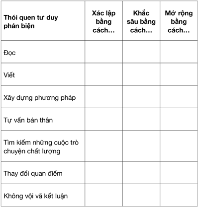

# CHƯƠNG 3: BIẾN TƯ DUY PHẢN BIỆN TRỞ THÀNH THÓI QUEN

> "Thời gian dùng để suy nghĩ chính là thứ giúp tiết kiệm thời gian nhất.”
>
> *— Norman Cousins*

Hãy hoàn thành câu “Giá mà tôi có đủ thời gian, tôi sẽ…”. Có thể bạn sẽ sửa sang lại căn nhà, viết một cuốn sách, học chơi một nhạc cụ, giao tiếp nhiều hơn, chơi với con cái thay vì làm việc vào cuối tuần, hay đi tới phòng tập gym. Bạn muốn làm gì nếu có thêm một giờ đồng hồ mỗi ngày?

Khát vọng sâu xa nhất chính là thứ mà bạn sẽ luôn cố gắng sắp xếp thời gian để thực hiện dù không có cỗ máy thời gian bằng cách luyện tập để tự động tư duy phản biện. Những thói quen tốt giúp tiết kiệm thời gian, giảm sự bất định và căng thẳng, mệt mỏi. Vậy là bằng cách dành ra một chút thời gian để xây dựng các thói quen tư duy phản biện tốt, bạn sẽ giải phóng được thời gian để làm những điều mà bạn mong muốn trong cuộc sống.

Giờ đây, bạn đã có một hệ thống cách xây dựng các thói quen cũng như biết được các kĩ năng và tính cách mà bạn cần để cải thiện khả năng tư duy phản biện. Chương này sẽ kết hợp hai yếu tố đó với nhau. Khi biến được hững điều này trở thành lề thói thường nhật, bạn sẽ thay đổi được lối tư duy và cách tương tác với thế giới một cách tích cực.

Các thói quen tư duy phản biện không chỉ giúp tăng sức mạnh và luyện tập cho não bộ của bạn luôn luôn suy nghĩ logic. Chúng còn bao hàm việc sử dụng thêm nhiều công cụ và kĩ thuật để suy nghĩ một cách lí trí theo thói quen. Áp dụng các thói quen đó cho phép bạn luôn luôn cởi mở tâm trí và có cách xử lý hiệu quả trong nhiều loại tình huống cần giải quyết vấn đề, cả trong cuộc sống riêng tư lẫn trong công việc.

Tại sao chúng ta cần lên kế hoạch cho những việc đó một cách có ý thức? Điều này có liên quan tới chế độ tư duy nhanh và chậm, liên quan tới trạng thái vô thức của chúng ta trong thế kỉ XXI. Thông thường, việc duy trì những kiểu mẫu tư duy cũ sẽ dễ dàng hơn, giống như ăn sáng cùng một món mỗi ngày hoặc đặt mua cùng một loại cà phê mỗi lần. Lề thói mới không hề khó thực hiện hơn, nhưng nó đòi hỏi một chút công sức để tạo ra khoảng trống tinh thần nhằm cân nhắc sự thay đổi.

Phần lớn những người không có tư duy phản biện có xu hướng lựa chọn làm như vậy vì họ có mô thức tư duy rằng tư duy phản biện đòi hỏi nhiều trí lực để xây dựng những thói quen mới. Nó cũng đòi hỏi khả năng phản tư và chịu trách nhiệm cho các quyết định của bản thân. Để làm chủ các kĩ năng tư duy phản biện, chúng ta cần tập luyện, và giống như bất kì thói quen nào khác, điều này có nghĩa là ta nhận thức được sự cần thiết của kĩ năng và biết cách làm thế nào để có được nó.

## BIẾN CÁC SỞ THÍCH THÀNH THÓI QUEN

Mục tiêu của bạn là thành thạo khả năng tư duy phản biện. Nếu như việc đi giày mỗi khi ra khỏi nhà là trạng thái vô thức của cơ thể, thì các kĩ năng tư duy phản biện trong Chương 1 sẽ trở thành trạng thái vô thức của trí não. Vậy, bạn nên đưa những lề thói nào vào các vòng lặp thói quen hằng ngày để phát triển các kĩ năng đó và tiến tới làm chủ được chúng?

Đối với mỗi sở thích mà bạn muốn biến thành thói quen, thường bạn sẽ có các điểm xuất phát khác nhau. Bạn sẽ cần xác lập sở thích mới, gắn nó vào thói quen đã có, hoặc mở rộng thói quen để cải thiện nó. Với mỗi thói quen, trước tiên hãy suy xét về điểm xuất phát để có thể đưa nó vào lịch trình thường nhật của bạn một cách hiệu quả.

### Xác lập

Bước này dành cho những việc mà bạn chưa làm. Hãy nhớ là bắt đầu từ từ, gắn hoạt động lặp mới vào một thói quen cố định đã có. Bạn có thể phải sử dụng các công cụ nhắc nhở, các ứng dụng, đối tác trách nhiệm hoặc tín hiệu thị giác để xác lập.

### Khắc sâu

Bước này dành cho một thói quen mà bạn đã có nhưng khó duy trì liên tục. Bạn cần cân nhắc xem hoạt động lặp này có đang ở đúng thời điểm trong ngày hoặc trong tuần không, sau đó phân tích vòng lặp thói quen để đảm bảo rằng bạn hiểu rõ tín hiệu và phần thưởng. Bạn có thể sẽ cần nhắc nhở chính mình tại sao bạn lại thực hiện việc này hoặc tìm ra một phần thưởng lớn hơn hay một tín hiệu rõ ràng hơn.

### Mở rộng

Bước này dành cho một thói quen đã xác lập mà bạn muốn nâng cấp. Vòng lặp thói quen mà bạn đang có vốn vẫn hoạt động tốt. Bạn cần suy xét xem mình muốn có thêm thành tựu gì và làm cách nào để đạt được. Bạn có cần dành thêm thời gian, tiền bạc, hoặc thay đổi các yếu tố trong lề thói thường nhật không? Ví dụ, bạn có thể đọc rất nhiều nhưng muốn thử thách mình đọc rộng hơn. Hãy điều chỉnh hoạt động lặp của bạn để hỗ trợ việc này. Chúng ta sẽ thảo luận thêm về những cách khác nhau để thực hiện trong Chương 4.

### Đọc đều đặn và phong phú

> "Xây dựng được thói quen đọc là bạn đã xây dựng cho mình nơi trú ẩn khỏi mọi nỗi đau khổ của cuộc sống.”
>
> *— W. Somerset Maugham*

*Tại sao?*

Việc đọc cung cấp cho bạn nhiều thông tin, gợi sự tò mò và khiến bạn nhìn nhận các sự việc xung quanh từ nhiều góc độ khác nhau. Nó cho phép bạn hiểu được nhiều tầng nghĩa của ngôn từ và cách diễn giải các ý tưởng. Việc đọc đưa bạn vào thế giới của người khác, cho bạn góc nhìn mới mẻ cùng khả năng thông cảm với những người mà bạn có thể không bao giờ gặp gỡ. Nó khơi dậy trí tò mò trong bạn, mở rộng tâm trí bạn tới những nơi mà bạn chưa bao giờ nghĩ đến, chỉ cho bạn thấy cách giao tiếp trong nhiều tình huống mà bạn có thể chưa từng trải qua.

Khả năng đọc viết đóng vai trò nền tảng trong việc cải thiện nhận thức34 và hỗ trợ nâng cao thành tích học tập. Khi đọc nhiều hơn, bạn sẽ thu thập được nhiều kiến thức hơn, cho phép bạn phân tích những vấn đề mới nhờ giảm bớt gánh nặng nhận thức. Bạn sẽ tự động mở rộng được vốn từ, biết nhiều từ mới hơn, hiểu được cả những lớp nghĩa sâu xa hơn của văn bản. Đây được gọi là “Hiệu ứng Matthew” từ Tin Mừng theo thánh Matthew 25:29 trong Kinh Thánh: “Phàm ai đã có thì sẽ nhận được thêm và trở nên dư dả; còn ai thiếu thốn thì ngay cái đang có cũng sẽ mất đi.”

Điều này đúng trong nhiều lĩnh vực của cuộc sống và đặc biệt xác đáng trên khía cạnh thu thập kiến thức. Các nhà giáo dục tập trung chú ý rất nhiều vào nó vì hiện nay vẫn tồn tại khoảng cách xã hội- kinh tế đáng kể trong kết quả học tập [của con trẻ] tương ứng với trình độ đọc viết của cha mẹ.35 Dù bạn xuất thân như thế nào, không bao giờ là quá muộn để bắt đầu xây dựng thói quen đọc – một thói quen bao giờ cũng có ích.

*Bằng cách nào?*

Cách thức phụ thuộc vào điểm bắt đầu và mục tiêu của bạn. Bạn cần xác lập, khắc sâu hay mở rộng thói quen? Bạn có ý định đọc nhưng không bao giờ thực hiện? Bạn thỉnh thoảng mới đọc và muốn khắc sâu nó như một thói quen chứ không chỉ là sở thích? Bạn đọc rất nhiều và muốn mở rộng ra nhiều thể loại hơn? Bạn có đọc và muốn đi sâu hơn vào việc phân tích văn bản?

1. Nếu bạn hiếm đọc sách nhưng muốn bắt đầu đọc, hãy nhặt ra một chủ đề bạn muốn tìm hiểu thêm hoặc nhờ một người bạn có thị hiếu tương đồng giới thiệu sách cho mình. Bạn bắt đầu bằng thể loại hư cấu hay phi hư cấu đều được. Bạn có thể mua một cuốn sách, mới hoặc cũ, mượn từ bạn bè hoặc đến thư viện. Đọc sách có thể là một thói quen không mấy tốn kém! Nếu bạn vẫn chưa biết chắc nên bắt đầu từ cuốn sách nào, hãy xem danh sách bán chạy của *New York Times* hoặc các danh sách những cuốn sách nhiều người ưa thích trên mạng.

2. Nếu bạn ưa thích loại sách phi hư cấu ngắn gọn, hãy xem xét đặt mua báo hoặc tạp chí. Phần lớn các tờ báo hiện nay được phát hành cả dưới dạng báo điện tử và báo giấy. Việc sử dụng mạng xã hội có thể rất hấp dẫn. Tuy thế, chất lượng ngôn ngữ trên đó thường rất thấp. Ngoài ra, các thuật toán vận hành theo cách khiến bạn có thể rơi vào một hộp cộng hưởng, khó tiếp cận các quan điểm khác biệt.

3. Nếu bạn đã có nhiều tài liệu để đọc nhưng lại không động đến chúng, hãy lựa chọn thứ đem lại sự thỏa mãn tức thì cho bạn. Cuốn *Moby* *Dick* có lẽ không phải là lựa chọn tốt nhất.

4. Gia nhập một câu lạc bộ sách. Có rất nhiều các lựa chọn trên mạng Internet nếu bạn không biết câu lạc bộ nào. Ngoài ra, bạn có thể tự mở một nhóm đọc sách với bạn bè, gia đình hoặc đồng nghiệp. Câu lạc bộ sách rất hữu ích cho việc cải thiện thói quen đọc; bạn được khuyên nên đọc gì, vào lúc nào, và đã có sẵn những đối tác trách nhiệm – những người sẽ luôn biết rõ nếu bạn không hoàn thành cam kết. Nhiều khả năng bạn cũng sẽ đọc cả những cuốn sách mà ít khi bạn tự lựa chọn.

5. Đặt tài liệu ở nơi mà bạn sẽ đọc chúng. Đặt một cuốn sách trên gối khi bạn dậy mỗi buổi sáng hoặc đặt cạnh sofa trước khi đi làm. Nếu bạn sử dụng một thiết bị điện tử, hãy nhớ sạc pin đầy đủ mỗi ngày. Một thói quen đọc có ích rất dễ bị lung lay nếu thiết bị sách điện tử bạn dùng luôn hết pin.

6. Sách nói có thể là một lựa chọn tốt nếu bạn không có nhiều thời gian. Làm nhiều việc một lúc ít khi đem lại thành công, nhưng đây là một ngoại lệ; bạn có thể thu về nhiều lợi ích từ việc nghe sách nói trong khi làm công việc chân tay. Bạn có thể nghe khi làm việc nhà hoặc làm vườn, trên đường đi làm, hoặc khi tập chạy. Tuy thế, để nghe được tốt, bạn phải đảm bảo mình không cần vừa nghe vừa đọc hoặc nói. Bạn không thể ghi nhớ những điều mình nghe được từ sách nói nếu đồng thời bạn đang đọc hoặc đang nói. Mặc dù sách nói truyền đạt nội dung cuốn sách, nó vẫn không đem lại cho bạn khả năng nhận diện ngôn từ mà bạn có được từ việc đọc, vậy nên nếu mục tiêu của bạn là cải thiện khả năng sử dụng ngôn ngữ viết, tốt nhất là hãy ưu tiên sử dụng phương tiện thị giác.

### Viết

> "Hãy viết mỗi ngày trong cuộc đời mình. Hãy đọc thật nhiều. Để xem điều gì sẽ xảy ra. Phần lớn bạn bè của tôi với lối sống như vậy đều đang có sự nghiệp rất thành công.”
>
> *— Ray Bradbury*

*Tại sao?*

Viết lách, cùng với việc đọc, giúp chúng ta học cách suy nghĩ. Nhiều chuyên gia lập luận rằng viết lách CHÍNH LÀ suy nghĩ, giúp tách riêng những gì chúng ta biết khỏi những gì chúng ta tưởng là mình biết, giúp ta có thể nhận thức và đánh giá các suy nghĩ của mình rõ ràng hơn. Đó là một cách tương đối nhanh chóng để cải thiện khả năng phản tư cùng với khả năng giao tiếp của bạn. Bạn học cách viết, và sau đó viết để học.36 Bạn học về bản thân, về những quan điểm và cảm xúc của mình, về cách mà bạn ra quyết định. Khi bạn ghi lại điều gì đó bằng ngôn từ, bạn có thêm một cơ hội để trình bày nó một cách thành thật, theo dõi những sự thay đổi và quan điểm của mình theo thời gian. Đó là những kĩ năng giúp bạn nhận thức các thói quen của mình dễ dàng hơn và suy nghĩ thấu đáo hơn khi đưa ra quyết định về bước đi tiếp theo.

*Bằng cách nào?*

Đánh giá xem bạn cần xác lập, khắc sâu hay mở rộng thói quen này. Có phải hằng ngày bạn chỉ viết e-mail mà không viết gì khác? Bạn thỉnh thoảng mới viết nhật kí vào kì nghỉ thay vì mỗi ngày? Bạn thường xuyên viết nhật kí nhưng muốn đi sâu vào phân tích hơn? Bạn muốn viết trên giấy, trên máy tính bảng hay đánh máy?

1. Nếu bạn muốn viết nhật kí nhưng thấy nản vì còn quá nhiều trang trống, hãy tìm loại sổ chia phần theo ngày thật ngắn như loại nhật kí năm năm. Sổ ghi ngày sẵn cho bạn cái khung để điền vào dễ dàng trong một không gian nhất định. Bạn không cần phải chờ đến ngày 1 tháng 1; có rất nhiều kiểu nhật kí có thể tùy chỉnh mà bạn tự do lựa chọn ngày bắt đầu.

2. Các hoạt động khác có thể giúp bạn xây dựng thói quen viết nhanh hằng ngày là việc ghi chép có mục đích xác định, như viết để cảm ơn, cầu nguyện, nhật kí sức khỏe hoặc ghi lại quá trình tập thể dục. Cách này phù hợp với một thói quen khác có thể bạn muốn xây dựng – nhật kí ghi chép quá trình tập thể dục có thể giúp bạn phát triển thói quen tập luyện tốt hơn. Một lần nữa, có rất nhiều loại sổ mà bạn có thể mua hoặc in ở nhà với tiêu đề phù hợp cho nhiều hoạt động khác nhau để thúc đẩy bạn.

3. Phát triển kĩ năng viết hơn nữa bằng cách viết những bài văn với kết mở. Hãy viết về bản thân. Đây không phải là một việc làm đề cao chính mình mà là để phản tư; có thể nhằm phục vụ lợi ích của bạn hoặc của người khác. Bạn có thể viết về các kì nghỉ của mình hoặc cách mà bạn đã phát triển sự nghiệp, tất cả để tạo ra những câu chuyện mà bạn có thể đọc lại sau này. Bạn có thể viết về tuổi thơ của mình để ghi lại những câu chuyện mà bạn muốn kể cho con cháu. Khi anh trai tôi kết hôn, vợ anh đã nhận được một cuốn sách về anh mang tựa đề  *An idiot’s guide to guiding an* *idiot* (Sách chỉ dẫn cách chỉ đạo một tên ngốc từ một kẻ khờ). Phải khẳng định rằng không có ai là kẻ ngốc cả, nhưng ý tưởng viết một cuốn “cẩm nang” về bản thân bạn hoặc ai đó thân thiết với bạn có thể là một cách viết lách vừa hé lộ nhiều điều, vừa hài hước. Nếu bạn thấy viết về ai đó là quá riêng tư, hãy thử viết về thú cưng hoặc sở thích của bạn.

4. Nếu bạn muốn cải thiện khả năng giao tiếp với độc giả, hãy viết một vài lá thư hoặc bài báo gửi cho các tạp chí, các nền tảng hoặc các báo mà bạn đọc. Việc này sẽ khiến bạn phải cân nhắc lựa chọn từ ngữ và giọng điệu truyền tải nội dung khi viết, và ngoài ra nó còn có khả năng đem lại phần thưởng dễ thấy hơn là sự thỏa mãn đơn thuần sau khi thể hiện được những ý nghĩ của bạn [với nhiều người khác].

5. Nếu bạn đã có sẵn thói quen viết để phản tư, bạn có thể kết hợp viết lách với nghiên cứu để viết về một nơi chốn, chủ đề hoặc nhân vật nào đó mà bạn vốn quen thuộc hoặc muốn tìm hiểu thêm. Bạn có thể làm việc này cho bản thân hoặc hướng tới mục tiêu xuất bản tác phẩm. Hãy đặt giới hạn thời gian hoặc số từ sao cho hợp lí mỗi ngày.

### Xây dựng phương pháp để đạt mục tiêu

> "Bạn không vươn lên ngang tầm với các mục tiêu của bạn. Bạn rơi xuống ngang tầm với các phương pháp của bạn. Mục tiêu của bạn là kết quả mà bạn mong muốn. Phương pháp của bạn là tập hợp các thói quen hằng ngày sẽ giúp bạn đi tới đích.”
>
> *— James Clear*

*Tại sao?*

Một mục tiêu “phải hoàn thành một lần trong đời” thường thấy chính là tham gia chạy marathon. Bạn gần như chắc chắn có những người bạn từng đạt mục tiêu này hoặc nói về việc thực hiện nó. Một số người hoàn thành mục tiêu, cảm thấy thích thú và lại làm lần nữa. Phần lớn mọi người hoàn thành chỉ một lần, nhận chiếc áo phông phần thưởng và lựa chọn những cuộc thi chạy đỡ nặng nhọc hơn sau đó.

Một trong những lí do mà các cuộc thi chạy marathon trở nên phổ biến là nó là một mục tiêu rõ ràng và dễ thấy – một thứ bạn dễ dàng hoàn thành. Tự nhủ với bản thân rằng bạn đang luyện tập để thi chạy marathon nghe cũng khá êm tai. Tuy thế, lựa chọn tham gia thi chạy marathon không phải là cách tốt nhất để phát triển thói quen chạy bộ. Bạn dồn hết sự tập trung vào mục tiêu, và bạn có thể bị choáng ngợp về cách sắp xếp thời gian, cách để không bị chấn thương trong quá trình tập và cách mà mọi người sẽ phán xét bạn. Đặt ra những mục tiêu lớn tức là ta cũng tạo điều kiện để gặp thất bại thảm hại.37 Điều này có thể dẫn tới lo lắng hoặc bế tắc về mặt tinh thần – không phải thứ bạn mong muốn khi cố gắng tiến bộ trong một khía cạnh nào đó của cuộc sống!

Không có gì là sai với việc đặt ra các mục tiêu, nhưng chúng không phải là chìa khóa để tạo lập thói quen một cách thành công. Để làm được điều đó, bạn cần tập trung vào các phương pháp. Phương pháp là các thay đổi vi mô diễn ra nơi hậu trường. Dù đặt mục tiêu là hoàn thành một cuộc thi chạy marathon, bạn vẫn sẽ không tự động phát triển được thói quen chạy bộ. Ngược lại, nếu bạn xây dựng thói quen chạy bộ, nhiều khả năng bạn sẽ hoàn thành được một cuộc thi marathon. Mục tiêu là kết quả thu được từ sự hiện diện của một phương pháp tốt.

Khi tập trung hoàn toàn vào một phương pháp, bạn đang trên con đường tiến bộ từng bước nhỏ mỗi ngày thay vì dành thời gian lo lắng về khả năng thất bại ở nhiệm vụ sau cùng. Bạn đang thành công bằng cách tập chạy hằng ngày, và cuộc thi marathon là một hệ quả chứ không phải đặc điểm mấu chốt. Điều này có nghĩa là nếu một sự kiện bị hủy (xin chào năm 2020) hay bạn bị ốm đau hoặc chấn thương, bạn sẽ không cảm thấy như mình đã thất bại. Mục tiêu mới ở đây là phương pháp dẫn tới một thói quen vẫn được duy trì cho tới cả sau ngày thi đấu.

*Bằng cách nào?*

Tham gia các cuộc thảo luận không chỉ đơn giản là chia sẻ ý tưởng và những ước mơ mà đến sau cùng, nó còn có thể giúp chúng ta tăng khả năng lắng nghe sâu, học hỏi hiệu quả và lên kế hoạch hành động. Hãy cố gắng hiểu người khác trước khi khiến họ hiểu được mình. Một cuộc thảo luận hiệu quả giúp chúng ta nhìn nhận khác đi về người khác và về chính mình; truyền cảm hứng cho ta mở rộng tầm tư duy và nhìn nhận mọi thứ thông thái hơn.

Những cuộc trò chuyện là cách để giải tỏa hiểu lầm, giải thích ý định để thúc đẩy hành động, đồng thời tăng cường sự cảm thông với nhau.42 Để đạt được điều này, chúng ta cần vượt ra ngoài khuôn khổ cuộc trò chuyện về con người và các sự kiện.

*Bằng cách nào?*

Bạn cần Xác lập, Khắc sâu hay Mở rộng thói quen này? Bạn đang trò chuyện dưới dạng nhắn tin nhiều hơn là trực tiếp? Bạn có coi những cuộc hội thoại là cơ hội để thu thập thông tin hay chỉ để bạn chia sẻ thông tin? Bạn có nhớ và nghĩ lại về những cuộc trò chuyện trước kia hay không?

1. Dành thời gian cho các cuộc trò chuyện trong cuộc sống cá nhân, dù là gặp mặt trực tiếp hay qua mạng Internet. Bạn có thể sắp đặt để nó trở thành một lề thói mới gắn liền với một thói quen sẵn có nếu cần thiết. Bạn có thể quyết định thực hiện cuộc gọi hình ảnh với cả gia đình sau bữa trưa Chủ nhật hoặc tạo chủ đề trò chuyện với những người sống cùng bạn trong bữa sáng mà không bị điện thoại hoặc TV làm xao nhãng. Bạn có thể lựa chọn đi bộ đến quán ăn trưa với một đồng nghiệp để trò chuyện trên đường hoặc chạy bộ cùng một người bạn và cập nhật tình hình với nhau.

2. Hãy xem xét những người mà bạn thường xuyên trò chuyện. Bạn có tiếp xúc với nhiều quan điểm khác nhau không hay đang ở trong một chiếc hộp cộng hưởng? Hãy cố gắng bắt chuyện trong khi xếp hàng, khi chờ xe buýt, hoặc cùng với ai đó ở chỗ làm mà bạn thường bắt gặp nhưng ít khi trò chuyện cùng. Đặt mục tiêu nói chuyện với những người thuộc các nhóm tuổi khác nhau và có nền tảng văn hóa khác nhau. Ngay cả những cuộc trò chuyện ngắn cũng có thể đem lại những kỉ niệm khó quên.

3. Thỉnh thoảng hãy dừng sử dụng thiết bị điện tử. Trong thời gian di chuyển tới chỗ làm hoặc đi mua sắm, bạn có thể nghe podcast, sách nói hoặc thư giãn với âm nhạc – đều rất hữu ích, nhưng đó cũng là cơ hội để bạn quan sát và tương tác với những người khác. Hãy lên kế hoạch để tiếp cận sao cho cân bằng. Nếu bạn luôn thường trực bộ tai nghe khi đi bất kì đâu và không trò chuyện với ai, bạn nên cân nhắc những cơ hội trò chuyện mà mình đang bỏ lỡ.

4. Dành thời gian trò chuyện với con trẻ. Phần lớn chúng sẽ rất vui vẻ kể với bạn về những điều chúng đang có hứng thú. Đây là một cách rất tốt để luyện khả năng lắng nghe và trao giá trị thực sự cho đứa trẻ. Trẻ em thường bị bỏ qua trong các cuộc thảo luận, nhưng chúng lại có thể đưa ra những quan sát tinh tường khi bạn dành thời gian tán gẫu với chúng.

5. Tương tự, hãy lập kế hoạch để trò chuyện với những người thuộc thế hệ trước. Họ đã trải qua những thay đổi lớn lao và có thể là nguồn thông tin, hiểu biết đáng quý. Hãy cân nhắc trò chuyện với những người trong gia đình, hàng xóm, hay những người bạn thường gặp.

6. Lên kế hoạch thực hiện những cuộc trò chuyện sâu sắc hơn với những người thân thiết với bạn. Chúng ta thường nói đến những điều lặt vặt khi gặp nhau, và giống như một món ăn vặt nhiều đường, cảm giác thỏa mãn không kéo dài. Nội dung những cuộc trò chuyện chất lượng chắc chắn là về những điều quan trọng hơn tình hình thời tiết và bạn định ăn gì tối nay. Hãy cố gắng chuyển từ nói chuyện về con người sang nói về các sự kiện, sau đó là về các ý tưởng. Nếu bạn cần gợi ý, hãy tìm kiếm trên mạng danh sách những câu bắt chuyện hiệu quả.43

### Thay đổi quan điểm khi cần thiết

> "Không thể tiến bộ nếu không thay đổi, và những người không thay đổi được tâm trí của mình cũng chẳng thể thay đổi bất kì thứ gì.”
>
> *— George Bernard Shaw*

*Tại sao?*

Một thói quen nữa giúp cải thiện khả năng tư duy phản biện là thay đổi quan điểm hoặc các quyết định của chúng ta khi có thêm nhiều dữ liệu hơn. Điều này không có nghĩa là bạn thiếu tự tin trong cách suy nghĩ hoặc ra quyết định, mà là bạn cởi mở và thừa nhận khi phạm sai lầm, thay đổi góc nhìn nếu cần thiết. Bạn phải đặt tính chính xác và sự thật lên trên cái tôi của mình.

Chúng ta đang sống trong một thế giới bùng nổ thông tin. Bạn có thể nghiên cứu tỉ mỉ một chủ đề nào đó [trước khi ra quyết định], rồi người ta phát hiện thêm dữ kiện mới khiến bạn phải thay đổi kết luận ban đầu. Các nhà khoa học liên tục phải làm như vậy; nếu không có những người tìm thấy và chấp nhận chứng cứ mới thì thế giới hẳn đã không đạt được nhiều tiến bộ công nghệ đến thế. Những người có tư duy phản biện coi thói quen ra quyết định là trường hợp mang tính cởi mở thay vì đóng kín, là mặt tích cực cho phép họ đạt được những kết quả tốt hơn chứ không chỉ là một phần năng lực của họ. Thói quen này thuộc loại làm khó hơn nói! Để trở nên thành thạo, bạn cần quan tâm tìm kiếm sự thật hơn là cho rằng mình luôn đúng.44

*Bằng cách nào?*

Bạn cần Xác lập, Khắc sâu hay Mở rộng thói quen này? Thói quen này thường liên quan tới vấn đề tự ái cá nhân. Một số người coi việc thay đổi suy nghĩ như một điểm yếu và xã hội thì xem nhẹ. Bạn cảm thấy sao khi phải thay đổi một quyết định? Nếu ai đó đem tới cho bạn thông tin mới đi ngược lại những kết luận trước đó của bạn, thì bạn cảm thấy biết ơn hay bực bội? Mức độ mà bạn bấu víu lấy kết luận “cũ” cho thấy bạn đã phát triển thói quen tinh thần này tốt đến đâu.

1. Cố gắng nhìn nhận các quyết định mà bạn đưa ra dưới dạng “một quyết định” chứ không phải “quyết định của tôi”. Khi một chứng cứ mới xuất hiện, bạn sẽ bớt thấy tự ái để thay đổi lựa chọn của mình, và cái tôi cũng sẽ ít cản trở bạn hơn.

2. Hãy tưởng tượng người đă ra lựa chọn là một người bạn hay một người họ hàng của bạn. Bạn sẽ khuyên họ làm gì?

3. Đôi khi, ta khó mà thay đổi suy nghĩ vì nó đòi hỏi ta thay đổi con đường đang đi. Giống như ví dụ ở phần trước, quay đầu lại và lựa chọn đường khác đúng đắn thì dễ hơn là cứ theo đuổi con đường sai lầm. Chi phí thời gian ngắn hạn mà bạn phải bỏ ra để sửa lỗi nhiều khả năng sẽ ít quan trọng hơn so với tác động lâu dài của một quyết định sai lầm. Hãy lựa chọn sao cho bạn trong tương lai biết ơn bản thân ở hiện tại.

4. Cố gắng nhìn nhận quyết định như một thử nghiệm khoa học hoặc một vụ kiện. Nếu các chứng cứ mới được phát hiện, hẳn bạn sẽ kì vọng các nhà khoa học và luật sư thay đổi quan điểm của mình. Điều tương tự cũng đúng với các lựa chọn trong cuộc sống của bạn. Trên đời có rất ít quyết định là thực sự đúng đắn vĩnh viễn.

5. Nhận diện những cái cớ của bạn và đặt câu hỏi liệu có phải bạn đưa chúng ra để bảo vệ một quan điểm đáng lẽ cần xét lại.45

### Tránh kết luận vội vàng

> "Tôi đã học cách có được sự kiên nhẫn lắng nghe khi người khác nói ra quan điểm của mình, ngay cả khi tôi nghĩ những quan điểm đó là sai. Bạn không thể đi đến kết luận công bằng trong một cuộc tranh chấp nếu không lắng nghe từ cả hai phía.”
>
> *— Nelson Mandela*

*Tại sao?*

Để trở thành một chuyên gia về tư duy phản biện, bạn cần luyện cho bản thân không vội vàng đi tới kết luận, đặc biệt là khi thiếu dữ liệu. Nhìn vào các thông tin hoặc các khía cạnh của tình huống hay vấn đề trước khi quyết định là một nỗ lực có ý thức.

Nelson Mandela là một chuyên gia trong nghệ thuật ra quyết định một cách tôn trọng và trong nghệ thuật lãnh đạo. “Làm thế nào mà ông trở thành một nhà lãnh đạo vĩ đại như vậy?” có người đã hỏi ông. “Đó là vì tôi đã học cách cất tiếng sau cùng” – ông trả lời. Ông lớn lên trong môi trường nơi người đưa ra quyết định luôn lắng nghe ý kiến của người khác trước khi tham gia thảo luận. Ông coi vai trò của người lãnh đạo “không phải là bảo người khác làm gì mà là tìm kiếm sự đồng thuận”. Ông khuyên mọi người rằng: “Đừng tham gia tranh luận quá sớm”. Ông thường tóm tắt các điểm đã thảo luận vào cuối buổi họp và nhẹ nhàng lái nó theo hướng mà ông tin là sẽ dẫn đến quyết định tối ưu, ngay cả khi nó khác với quan điểm ban đầu của ông.

*Bằng cách nào?*

Hãy nhớ lại một tình huống mà bạn phải ra quyết định đối với sự vụ quan trọng nào đó, không chỉ là cân nhắc nên xem bộ phim nào tiếp theo. Điều này sẽ giúp bạn quyết định liệu mình cần Xác lập, Khắc sâu hay Mở rộng thói quen này. Bạn thường quyết định ngay lập tức mình muốn làm gì sau đó đi thuyết phục những người khác? Bạn có kiểm tra thông tin thật nhanh nhưng chỉ từ những nguồn tương đồng với những suy nghĩ ban đầu của bạn? Bạn có kiểm tra một số quyết định kĩ càng nhưng lại thả nổi những quyết định quan trọng khác vì đã quá mệt mỏi hoặc vì nó tiêu tốn quá nhiều thời gian?

1. Nhờ lắng nghe người khác trước khi nói, bạn có thể thu thập thông tin khách quan. Nhờ nghiên cứu trước khi quan điểm của mình, bạn có thể ngăn mình không bị ngả theo các định kiến, cảm xúc, hoặc lựa chọn con đường ngắn nhất mà không cân nhắc những phương án khác. Hãy làm theo Mandela: lắng nghe trước và nói sau cùng.

2. Tự hỏi mình câu trả lời hiển nhiên nhất là gì mỗi khi phải đối mặt với một quyết định, sau đó tự hỏi tại sao. Có phải vì đó là lựa chọn mà những người khác kì vọng bạn đưa ra? Nếu vậy, ai là người kì vọng bạn đưa ra lựa chọn đó? Bạn có thể biện bạch có chứng cứ cho quyết định của bạn với bản thân trong tương lai hay không?

3. Nếu bạn biết có những tình huống mà bạn thường đưa ta các quyết định vội vã, hãy ghi chúng lại. Lên kế hoạch cho các lựa chọn. Thỉnh thoảng, thật dễ để dự đoán khi nào bạn sẽ cần lựa chọn, nhưng lại thật khó để thực hiện nghiên cứu. Chẳng hạn, trong một buổi phỏng vấn xin việc, bạn sẽ cần đưa ra các kết luận về đội nhóm bạn sẽ làm việc cùng, địa điểm làm việc và vai trò của bạn. Bạn có thể chuẩn bị trước phần nào, nhưng thường đến ngày đó mới thu thập được một vài chứng cứ. Tuy thế, bạn có thể vạch sẵn những câu hỏi phù hợp về nơi làm việc hoặc đội nhóm. Bạn có thể đưa ra những quyết định hợp lí một cách dễ dàng hơn mà không phải dựa vào cảm giác hoặc những định kiến do thiếu thông tin.

### CÁC BƯỚC HÀNH ĐỘNG

Với mỗi kĩ năng tư duy phản biện, hãy tìm ra điểm xuất phát phù hợp. Bạn có thể kẻ bảng giống như dưới đây để sắp xếp các suy nghĩ của mình.

Hãy thành thật về những gì bạn đã làm và cân nhắc xem bạn sẽ tiếp tục phát triển thói quen này trong ngắn hạn, trung hạn, hay dài hạn ra sao bằng cách cam kết thực hiện một số bước cụ thể. Xác định mình sẽ bắt đầu từ đâu. Thành Rome không được xây nên chỉ sau một ngày, mà là từ từ từng viên gạch mỗi ngày. Bạn có thể xây dựng những trạng thái vô thức về tinh thần mới thật tuyệt vời giúp tiết kiệm thời gian và công sức về lâu dài để định hướng trong thế giới này.

Cân nhắc sử dụng một ứng dụng hoặc bảng biểu theo dõi thói quen giống như bạn làm với thói quen thể chất.

## TÓM TẮT

Hướng tới xác lập, khắc sâu và mở rộng các thói quen tư duy phản biện theo thời gian. Nhận diện điểm bắt đầu cho mỗi thói quen nhằm tạo thành trạng thái vô thức mới.

Các thói quen nên phát triển bao gồm:

- Đọc rộng các chủ đề đều đặn hằng ngày.

- Viết lách.

- Xây dựng phương pháp để đạt được mục tiêu.

- Kiểm tra lại và tự vấn bản thân.

- Có các cuộc trò chuyện chất lượng.

- Thay đổi quan điểm của mình khi cần thiết.

- Tránh kết luận vội vã.

- Lên kế hoạch cho các thói quen bằng vòng lặp thói quen và gắn chúng với các thói quen có sẵn.

> *Chúng tôi không bán sách, chúng tôi bán kiến thức quản trị vượt trội của những doanh nhân và tập đoàn hàng đầu!*
