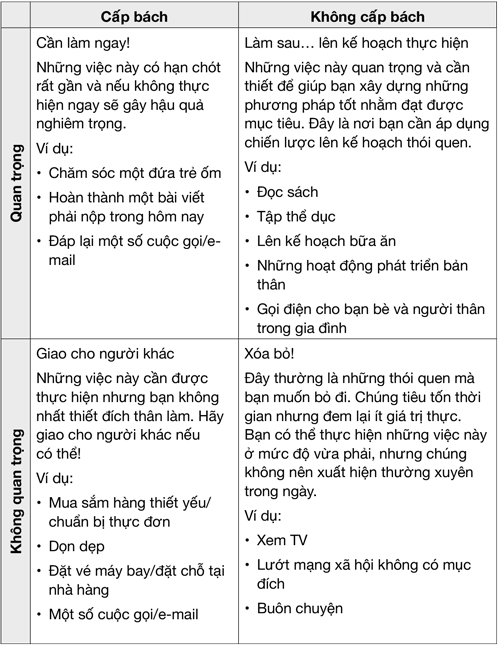

# CHƯƠNG 6: NHỮNG CÔNG CỤ HỖ TRỢ THÓI QUEN TƯ DUY PHẢN BIỆN: CÔNG CỤ THEO DÕI, LỊCH, ỨNG DỤNG VÀ NHIỀU THỨ KHÁC NỮA

> "Con người không định đoạt tương lai của mình, họ quyết định các thói quen, và các thói quen đó định đoạn tương lai.”
>
> *— F.M. Alexander*

Tôi từng đồng hành với một nhóm thiếu niên trong chuyến thám hiểm môi trường tới một nơi đồng không mông quạnh tại Croatia. Vì không thể bắt sóng wifi, cuộc trò chuyện nhanh chóng chuyển sang chủ đề dung lượng mạng di động còn lại trên điện thoại của mỗi người. Không ai muốn phải bỏ thêm tiền. Thật đáng ngạc nhiên, nhiều người đã tiết kiệm dữ liệu cho các chuỗi trò chuyện trên Snapchat. Vì không biết nó là gì, tôi hỏi họ tại sao nó lại quan trọng đến vậy.

Hóa ra phần lớn mọi người có những cuộc trò chuyện dở dang với bạn bè trên Snapchat và vì thế họ phải nhắn tin hằng ngày để duy trì “chuỗi”. Nếu không gửi tin nhắn, công cụ đếm sẽ trở về số không. Điều đó là đủ để việc nhắn tin liên tục trở thành mục tiêu ưu tiên của họ. Họ không muốn phải chịu trách nhiệm cho việc ngắt chuỗi – thứ có thể gây ra hậu quả tai hại cho mối quan hệ bạn bè với người kia – bất chấp lúc này họ đang ở nơi xa xôi vắng vẻ không có đủ thiết bị.

Sử dụng Snapchat là một thói quen được khắc sâu ở nhiều sinh viên và các chuỗi được ghi lại này chính là mấu chốt của thói quen đó. Những công ty công nghệ sử dụng khao khát nhìn thấy những “thành tích” của chúng ta để khiến ta sử dụng sản phẩm của họ lâu hơn, xem nhiều quảng cáo hơn. Tất cả chúng ta cũng có thể sử dụng cùng những kĩ thuật đó để khắc sâu thói quen cho bản thân một cách thú vị hơn.

Có rất nhiều những công cụ in và ứng dụng điện tử mà bạn có thể sử dụng để lên kế hoạch cho một ngày và theo dõi tiến độ trong việc phá bỏ một thói quen cũ hay xây dựng một thói quen mới.

Vậy nói ngắn gọn, tại sao chúng lại hiệu quả đến vậy? Những kĩ thuật hiệu quả nhất đều thực hiện được những điều sau:

- Cho bạn tín hiệu thị giác nhắc nhở bạn hành động.

- Cho bạn động lực khi nhìn thấy sự tiến bộ mà mình đang đạt được.

- Cho bạn sự thỏa mãn bằng cách ghi lại thành công của bạn ngay tại thời điểm đó.

Sử dụng bất kì công cụ nào trong số này cũng giúp ích cho bạn, vì trong khi các thói quen mới có thể được hình thành trong từ 18-254 ngày (trung bình là 66 ngày), chúng không trở thành phản ứng tự động trước mốc hai tháng đối với phần lớn mọi người. Rất nhiều điều có thể xảy ra trong quãng thời gian đó, vì thế nếu có thể “lừa” mình duy trì chuỗi thói quen bằng cách sử dụng các công cụ, bạn sẽ có được lợi thế lớn.

## LÊN KẾ HOẠCH

Nhận diện việc cần làm gì và vào lúc nào đòi hỏi phải có kế hoạch cụ thể. Đây là điểm khởi đầu cho một cuộc sống hiệu quả và năng suất. Hãy sử dụng công cụ lên kế hoạch, dù là một cuốn lịch đơn giản, nhật kí, hay ứng dụng, vì nó cho phép bạn duy trì có kiểm soát. Dưới đây là một số ứng dụng và kĩ thuật:

*Sử dụng lịch hoặc công cụ lên kế hoạch chi tiết hơn*, như các công cụ trên “Hello Day” hoặc “Unique planners” của Pirongs67.

*Học cách ghi nhật kí đề mục –* một phương pháp được sử dụng để vừa lên kế hoạch vừa theo dõi gần như mọi thứ mà bạn có thể nghĩ ra. Có rất nhiều trang web giải thích các kĩ thuật này và có cả những đầu sách hướng dẫn bạn cách sử dụng68. Bạn có thể dùng nhật kí đề mục với những trang được sắp đặt một phần từ trước hoặc tự mình thiết kế. Nếu bạn thích sử dụng công cụ in và muốn vừa được sáng tạo vừa duy trì tính tổ chức, phương pháp này rất phù hợp với bạn. Bạn có thể tùy chỉnh nhật kí theo ý mình và có cả những nhóm trên mạng xã hội chuyên để chia sẻ các ý tưởng và lời khuyên thành công.

*Thẻ điểm thói quen* – một phát kiến của James Clear,69 cho phép bạn tùy chỉnh hồ sơ thói quen để hiểu hơn về những hành vi của mình hằng ngày. Bạn liệt kê các lề thói hằng ngày theo thứ tự thực hiện rồi chấm điểm mỗi thói quen là hiệu quả, không hiệu quả hay trung bình. Nhờ vậy, bạn hiểu thêm về các hành vi khác nhau của mình để có thể trở thành con người bạn mong muốn. Nó rất hữu ích khi lên kế hoạch cho những thói quen mới vì nó chỉ ra đâu là những thói quen hiện tại mà bạn có thể gắn thói quen mới vào, đâu là những thói quen cần bỏ để thay thế bằng thói quen mới có lợi hơn.

*Quản lý dự án thứ Hai*70 – phần mềm này được dùng trong công việc nhiều hơn trong đời sống cá nhân. Những thói quen tốt ở chỗ làm đòi hỏi sự giao tiếp tốt, những nhiệm vụ rõ ràng và việc theo dõi các nhiệm vụ đó. Những phần mềm như thế này có thể giúp đội nhóm của bạn xây dựng những phương pháp đồng bộ hóa luồng công việc.

*Ứng dụng danh sách công việc Ike*71 *–* một ứng dụng đơn giản giúp bạn sắp xếp các nhiệm vụ hằng ngày và dài hạn ở cùng một nơi. Vì sử dụng phương pháp “Eisenhower”, nó giúp bạn phân loại những việc bạn cần làm dựa trên tầm quan trọng và độ cấp bách, và như thế bạn có thể sắp xếp thứ tự ưu tiên dễ dàng hơn. Dưới đây là một bảng mẫu nếu bạn thích viết trên giấy hơn. Bạn có thể kẻ bảng này trên một tấm bảng có thể dùng đi dùng lại, hoặc ghi vào nhật kí và công cụ sắp xếp công việc.

*ClickUp*72 – một ứng dụng có thể vận hành trên nhiều hệ thống để giúp bạn sắp xếp thứ tự ưu tiên, quản trị dự án, theo dõi thời gian và đặt mục tiêu. Bạn có thể sử dụng nó trong đời sống cá nhân, công việc hoặc cả hai bằng cách thiết lập ứng dụng sao cho hợp lí. Bạn có thể chia sẻ nó với những người khác và kết hợp với các hệ thống Outlook, Apple và Google để các e-mail và lịch được đồng bộ hóa dễ dàng, giúp hạn chế việc ghi chép nhiều lần.

## THEO DÕI

Cách tốt nhất để đảm bảo độ hiệu quả của việc xây dựng hoặc thay đổi thói quen là đơn giản ghi lại tiến độ của bạn qua công cụ Theo dõi Thói quen. Việc theo dõi thói quen cho bạn biết liệu mình đã đạt mục tiêu xây dựng, biến đổi, hoặc thay thế một thói quen hay chưa và thông báo cho bạn nếu có trục trặc. Hãy thử một vài công cụ khác nhau, và cũng giống như với một thói quen mới, đừng ngại thay đổi nếu bạn nhận thấy lựa chọn đầu tiên không phù hợp với mình.

### Lịch

Lịch giấy hoặc lịch điện tử là những cách đơn giản nhất để ghi lại tiến độ và giúp bạn biết liệu mình đã đạt tới mục tiêu hay chưa. Bạn thậm chí không cần viết gì cả.

1. Bạn có thể đánh một dấu chấm vào góc một ngày nào đó trên tấm lịch treo tường hoặc nhật kí để thể hiện bạn đã hoàn thành một lề thói mới. Sử dụng những chấm màu khác nhau hoặc nhiều chấm để thể hiện nhiều lề thói khác nhau nếu bạn muốn theo dõi nhiều cái cùng lúc. Bạn có thể gạch các ngày khác đi nếu muốn nhìn rõ hơn.

2. Bạn có thể cài đặt lời nhắc nhở trên các ứng dụng xếp lịch mà bạn có thể xác nhận hoặc loại bỏ để giữ một bản ghi tương tự. Chúng có thể phù hợp hơn nếu thói quen bạn cần thực hiện khiến bạn phải ra khỏi nhà hay bàn làm việc của mình, hoặc bạn không muốn nói với những người khác trong nhà về thói quen này.

### Nhật kí

Giống như lịch, bạn có thể viết ra sổ hoặc tạo tệp trên máy tính, trong đó bạn ghi lại những chi tiết và ngày tháng thực hiện thói quen. Nhật kí cung cấp nhiều thông tin hơn và thường là một công cụ mở rộng của lịch. Nhật kí ăn uống, nhật kí tập luyện hay nhật kí đọc sách phổ biến đến mức bạn có thể mua những cuốn sổ đã được thiết kế sẵn cho mục đích đó, hoặc tải một mẫu về và chỉnh sửa nếu muốn một phiên bản dành riêng cho mình. Nhật kí rất hữu ích nếu bạn muốn mở rộng một thói quen, vì nó có nghĩa là bạn có thể nhận diện các điểm cần cải thiện dễ dàng hơn.

### Habitica73

Một ứng dụng chạy trên các hệ nền tảng di động phổ biến nhất để giúp bạn theo dõi các thói quen hằng ngày. Khẩu hiệu của ứng dụng là “biến cuộc sống của bạn trở thành một trò chơi”, và bạn sẽ giành được những phần thưởng nếu duy trì được những thói quen mà bạn quyết định theo dõi. Bạn có thể nhờ cộng đồng trên đó hỗ trợ, đồng thời duy trì trách nhiệm khi rủ bạn bè hoặc gia đình cùng sử dụng ứng dụng. Nếu bạn thích các hình đại diện, trò chơi nhỏ và các phẩn thưởng số, ứng dụng này sẽ phù hợp với bạn. Khi chúng tôi viết cuốn sách này, ứng dụng Habitica đã có hơn bốn triệu người dùng, vì thế bạn sẽ dễ dàng nhận được sự hỗ trợ.

### Momentum74

Một ứng dụng khéo léo dành cho iOS, tập trung đảm bảo bạn không “mất chuỗi”. Bạn có thể thiết lập lời nhắc nhở, đặt mục tiêu hằng tuần cũng như tạo ghi chú giống như trong nhật kí. Bạn thậm chí có thể lên kế hoạch nghỉ một tuần (nghỉ ốm hoặc đi du lịch) mà không làm gãy chuỗi, một chức năng lẽ ra có thể giúp những thiếu niên ở Croatia khỏi phải khổ sở đến vậy! Nếu là người thích các bảng biểu (và ai lại không thích chúng cơ chứ?!), bạn cũng có thể xuất dữ liệu để phân tích thêm. Với khả năng đồng bộ hóa dữ liệu trên nhiều thiết bị, đây là một ứng dụng cực kì hữu ích.

### Streaks75

Một ứng dụng cho phép bạn theo dõi tối đa 12 thói quen. Nó khuyến khích bạn duy trì các “chuỗi” của một thói quen tốt nào đó nhằm giữ gìn động lực, và đi kèm với đồ họa rất đẹp. Những nhiệm vụ có thể được lập trình cho những ngày nhất định hoặc theo tần suất cố định mỗi tuần, và bạn cũng có rất nhiều tùy chọn ngôn ngữ để lựa chọn. Đây là một công cụ nhanh gọn và đơn giản để theo dõi những gì bạn đang làm và dễ dàng phát hiện điều bạn đang bỏ quên!

### StickK 76

Một “hệ thống cam kết” dành cho iOS và Android để bạn đặt ra cho mình các mục tiêu hay thậm chí tự đặt cược với chính mình. Bạn có các lựa chọn để nhờ bạn bè hoặc người thân trong gia đình làm đối tác trách nhiệm và đặt các mục tiêu cho nhóm.

### Chains 77

Một ứng dụng nữa tập trung vào phương pháp “đừng làm đứt chuỗi” để khắc sâu các thói quen. Nó dễ sử dụng và theo dõi bằng những sơ đồ tùy chỉnh được để thể hiện các chuỗi thói quen khác nhau mà bạn xây dựng.

### CÁC BƯỚC HÀNH ĐỘNG

1. Hãy cân nhắc các quyết định của bạn từ trước đến giờ. Bạn có cần hỗ trợ trong việc lên kế hoạch hằng ngày, theo dõi các thói quen hay một số trò chơi để rèn luyện trí não không? Chọn một khía cạnh để bắt đầu nhé.

2. Lựa chọn hình thức bạn muốn: giấy và bút, các chương trình chạy trên web hay những ứng dụng để hỗ trợ bạn trên khía cạnh đã chọn. Ngay cả khi bạn là người nhạy bén với công nghệ, bạn vẫn có thể thích dùng một cuốn nhật kí giấy hơn. Nếu thường có thói quen ghi lại mọi thứ, có thể bạn sẽ thích một ứng dụng theo dõi thói quen nhỏ gọn hơn. Hãy suy nghĩ thực tế nhưng đừng quên cảm xúc. Công cụ nào sẽ dễ sử dụng nhất?

3. Lên kế hoạch. Nếu bạn định viết danh sách những việc cần làm, khi nào bạn sẽ viết nó? Nếu bạn định ghi lại những gì các thói quen hằng ngày đạt được, khi nào bạn sẽ ghi? Nếu bạn định chơi một trong những trò rèn luyện trí não, lúc nào bạn sẽ chơi? Đây đều là những thói quen phải được lên kế hoạch với vòng lặp thói quen. Chúng là những thói quen bổ trợ cho các thói quen khác.

4. Chuẩn bị tinh thần để thử nghiệm. Đây chỉ mới là một danh sách rất ngắn những gì bạn có thể lựa chọn để lên kế hoạch, theo dõi và chơi trò chơi. Sẽ ngày càng có nhiều lựa chọn khác xuất hiện mỗi tuần. Hãy tìm những công cụ phù hợp với mình. Loại bỏ các lựa chọn không thích hợp. Những thói quen phải dễ dàng và đem lại cảm giác thỏa mãn, và những công cụ theo dõi thói quen cũng vậy!

## TÓM TẮT

- Động lực để hoàn thành thói quen có thể được cải thiện bằng những phần thưởng hữu hình trong công cụ theo dõi thói quen. Một trong những công cụ hiệu quả nhất là cố gắng duy trì “chuỗi” hành vi mong muốn.

- Lên kế hoạch tốt sẽ giúp bạn tăng cơ hội thành công và cải thiện khả năng sắp xếp thứ tự ưu tiên các ý nghĩ và hành động. Các công cụ hữu hình và điện tử có thể giúp việc này được thực hiện một cách nhanh chóng và đều đặn hơn.

- Bạn có nhiều lựa chọn công cụ hữu hình và điện tử để theo dõi, lên kế hoạch thói quen và chơi trò chơi nhằm cải thiện kĩ năng tư duy. Tất cả đều có công dụng riêng và bạn chính là người phải quyết định công cụ nào hữu ích nhất cho mình.
