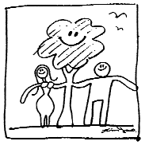
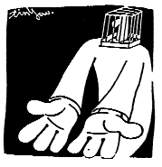

# Lời nói đầu

## Từ quan điểm khoa học thông tin lý giải về Trung y

Từ nhỏ trong bài học tiếng Anh, câu chuyện một ông vua phù phép chỉ vào đá, đá hóa thành vàng đã gây cho tôi một ấn tượng sâu sắc, “chỉ đá hóa vàng” là động lực chủ yếu nhất của khoa học phương Tây phát triển từ cổ xưa đến nay. Đối lập với “chỉ đá hóa vàng” của phương Tây, các đế vương Trung Quốc phương Đông thì không ngừng theo đuổi thuật trường sinh bất lão. Hai loại động cơ khác nhau này đã thúc đẩy khoa học Đông - Tây đi theo hai phương hướng khác nhau.

Còn nhớ hồi nhỏ, khi các nhà khoa học được giới thiệu trên các sách báo, hình ảnh các nhà hóa học thường được đặt bên cạnh hàng loạt những bình và ống nghiệm lớn nhỏ, cuối thế kỷ XX trước thời kỳ phát triển của công nghệ thông tin, đại đa số các nhà khoa học trong ấn tượng của mọi người đều là các nhà hóa học. Y học phương Tây phát triển lên chính là trong bối cảnh như vậy, dù là kiểm tra hay là thuốc trị bệnh, đều là logic, phương pháp và chế phẩm của hóa học. Cho đến tận ngày nay, y học phương Tây vẫn tràn đầy những hình bóng của kỹ thuật khoa học hóa học, thậm chí có thể nói y học phương Tây là khoa học dùng phương pháp hóa học để chữa bệnh.

Người Trung Quốc từ theo đuổi thuật trường sinh bất lão mấy nghìn năm đã phát triển ra kỹ thuật điều trị hết sức đặc sắc và độc đáo. Trung y cho rằng cơ thể con người là một vũ trụ nhỏ, hơn nữa còn xây dựng

nên lý luận âm dương, ngũ hành. Gần trăm năm nay, dù là người phương Tây hay là người Trung Quốc đều cho rằng loại lý luận âm dương ngũ hành này đều không có căn cứ khoa học, căn bản chỉ là huyền học. Cuối thế kỷ XX và đầu thế kỷ XXI, khoa học kỹ thuật thông tin và mạng Internet đã trở thành biểu trưng của khoa học kỹ thuật, hầu như ai ai cũng đều hoặc nhiều hoặc ít có trình độ tri thức nhất định về tin học và mạng Internet, cái quan trọng nhất trong tin học và mạng Internet là hệ thống học.

Từ quan điểm hệ thống học hiện đại quay trở lại xem xét âm dương ngũ hành của Trung y, chúng ta có thể phát hiện thấy hóa ra lý luận âm dương ngũ hành là một phương pháp dùng để mô tả hệ thống ở cái thời đại mà nhân loại chưa có công cụ máy móc và con số. Trước đây, chúng ta không thể nào tìm được một hệ thống tương tự dùng phương thức tương tự để giải thích cơ thể người. Nhưng trong thời đại hệ thống học phát triển như hiện nay, dùng hệ thống tin học và Internet mà chúng ta rất quen thuộc để giải thích cơ thể người, sẽ là một phương pháp làm cho Trung y càng dễ dàng được lý giải và nắm bắt. Tác giả muốn thử đứng ở góc độ này để trình bày lý luận Trung y. So với y học phương Tây, có thể nói Trung y là khoa học vận dụng nguyên lý hệ thống học để chữa bệnh.

Phần mềm là sản phẩm đặc biệt nhất trong khoa học kỹ thuật thông tin, nó là cái thứ đầu tiên mắt con người không thể nào nhìn thấy nó từ trong phần cứng mà lại do chính con người làm ra, nếu không biết có sự tồn tại của phần mềm, trực tiếp dùng phương pháp giải phẫu phần cứng máy tính, không thể nào chứng thực được sự tồn

tại của phần mềm. Công năng của cơ thể con người còn phức tạp hơn máy tính gấp ngàn vạn lần, xét từ quan điểm của khoa học thông tin, cơ thể con người không thể chỉ là phần cứng đơn thuần, nhất định nó còn tồn tại nhiều phần mềm mà chúng ta không thể nghiệm chứng được bằng phương pháp giải phẫu. Nhiều lý luận và khái niệm của Trung y học, rất có thể sẽ giống như phần mềm của máy tính, vĩnh viễn không nghiệm chứng được bằng giải phẫu học.

> 
>
> *“Một đôi nam nữ ở với nhau, hễ không cẩn thận là sẽ tạo ra một con người. Cơ thể con người phức tạp và hoàn mỹ, mà chỉ dùng phương pháp giản đơn như vậy để tạo ra.”*

Cơ thể con người là một hệ thống vô cùng phức tạp, mà phương pháp chế tạo thì lại rất đơn giản, chỉ cần một đôi nam nữ ở với nhau, hễ không cẩn thận là sẽ tạo ra một con người, nhưng sự bảo vệ cơ thể người thì lại cực kỳ phức tạp. Một bác sĩ trong bệnh viện phải trải qua bảy năm học tập trong trường y, sau đó lại phải nhiều năm học tập làm việc trong bệnh viện, khi đó mới trở thành một thầy thuốc có thể làm việc độc lập. Nhưng cho dù là một thầy thuốc nổi tiếng nhất hiện nay thì cũng có hàng rổ những bệnh tật mà anh ta phải bó tay.

Sau khi đã bỏ ra nhiều năm nghiên cứu Trung y, tôi phát hiện thấy những quan niệm sai lầm về sức khỏe đã hình thành nên những thói quen sinh hoạt sai lầm, và đến cả những phương thức xử lý sai lầm đối với bệnh tật, làm cho mức độ khí huyết của cơ thể người không ngừng suy giảm, khí huyết không đủ ở các mức độ khác nhau đã hình thành nên các bệnh mạn tính khác nhau. Cũng có nghĩa là, đại đa số các bệnh mạn tính thực ra là kết quả của những phương pháp sai lầm trong sử dụng cơ thể gây ra.

Y học hiện đại đang đứng trước rất nhiều căn bệnh mạn tính vô phương cứu chữa, chỉ biết trông mong vào tương lai một ngày nào đó

có thể phát minh ra loại thuốc mới, một lần là có thể chữa khỏi một loại bệnh nào đó, phương hướng nghiên cứu này rất có khả năng là không sát thực tế. Khôi phục lại thói quen sống chính xác, và dùng phương pháp chính xác xử lý bệnh tật, làm cho khí huyết cơ thể dần dần nâng cao lên, để khôi phục cơ thể và hệ thống tái sinh phát huy tác dụng, cách làm đó cần phải là con đường để nhân loại có nhiều cơ hội khắc phục được bệnh mạn tính.

> 
>
> *“Người mắc bệnh bao giờ cũng chỉ muốn tìm được linh đan linh dược để khỏi bệnh, mà không muốn điều chỉnh thói quen sinh hoạt của mình để loại bỏ nguồn gốc thực sự của bệnh tật.”*

Tác giả

Ngô Thanh Trung
