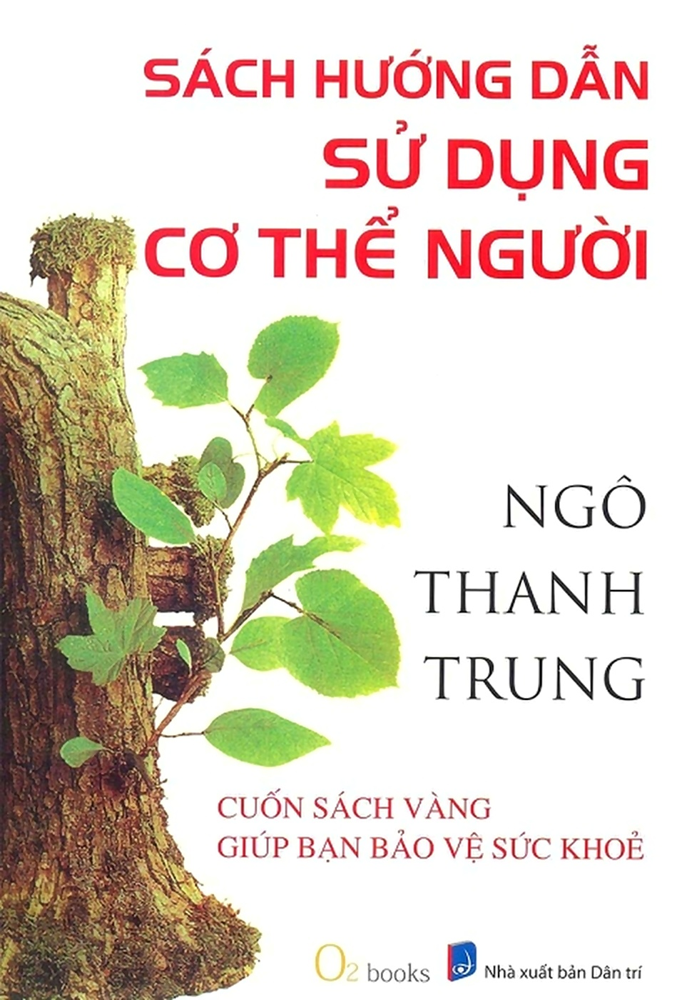

# Sách Hướng Dẫn Sử Dụng Cơ Thể Người (人体使用手册)

- **Tác giả:** Ngô Thanh Trung (吴清忠)
- **Dịch giả:** Trần Nghĩa Phương
- **Nhà xuất bản:** Dân Trí
- **Thể loại:** Y học thường thức, Đông y / Dưỡng sinh hiện đại

Cuốn sách kinh điển kết hợp giữa tư duy khoa học thông tin hiện đại và lý luận Đông y truyền thống để giải thích hoạt động của cơ thể con người, nguyên nhân sâu xa của các bệnh mạn tính và phương pháp dưỡng sinh đơn giản, hiệu quả hàng ngày.

---

## Mục lục các chương

| STT | Tên chương | Tệp Markdown |
| :-: | :--- | :--- |
| 00 | [Lời cảm tạ](00-loi-cam-ta.md) | `00-loi-cam-ta.md` |
| 01 | [Lời giới thiệu](00-loi-gioi-thieu.md) | `00-loi-gioi-thieu.md` |
| 02 | [Lời nói đầu: Từ quan điểm khoa học thông tin lý giải về Trung y](00-loi-noi-dau.md) | `00-loi-noi-dau.md` |
| 03 | [Mục lục](00-muc-luc.md) | `00-muc-luc.md` |
| 04 | [Chương 1: Chất vấn đối với y học hiện đại](chuong-01-chat-van-doi-voi-y-hoc-hien-dai.md) | `chuong-01-chat-van-doi-voi-y-hoc-hien-dai.md` |
| 05 | [Chương 2: Hệ thống cơ thể người](chuong-02-he-thong-co-the-nguoi.md) | `chuong-02-he-thong-co-the-nguoi.md` |
| 06 | [Chương 3: Hệ thống năng lượng khí huyết của cơ thể người](chuong-03-he-thong-nang-luong-khi-huyet-cua-co-the-nguoi.md) | `chuong-03-he-thong-nang-luong-khi-huyet-cua-co-the-nguoi.md` |
| 07 | [Chương 4: Hàn khí](chuong-04-han-khi.md) | `chuong-04-han-khi.md` |
| 08 | [Chương 5: Bệnh và chứng](chuong-05-benh-va-chung.md) | `chuong-05-benh-va-chung.md` |
| 09 | [Chương 6: Dưỡng sinh hàng ngày](chuong-06-duong-sinh-hang-ngay.md) | `chuong-06-duong-sinh-hang-ngay.md` |
| 10 | [Chương 7: Giảm béo](chuong-07-giam-beo.md) | `chuong-07-giam-beo.md` |
| 11 | [Chương 8: Điều dưỡng bệnh mạn tính](chuong-08-dieu-duong-benh-man-tinh.md) | `chuong-08-dieu-duong-benh-man-tinh.md` |
| 12 | [Chương 9: Tổng kết](chuong-09-tong-ket.md) | `chuong-09-tong-ket.md` |
| 13 | [Phụ lục: Phỏng vấn và trao đổi cùng tác giả](phu-luc-phong-van-va-trao-doi-cung-tac-gia.md) | `phu-luc-phong-van-va-trao-doi-cung-tac-gia.md` |
| 14 | [Lời cuối sách: Mong muốn mọi người đều có thể tự tin về sức khỏe](loi-cuoi-sach.md) | `loi-cuoi-sach.md` |
| 15 | [Danh mục hình minh họa trong sách](danh-muc-hinh-minh-hoa.md) | `danh-muc-hinh-minh-hoa.md` |

---

## Cấu trúc hình ảnh minh họa (`images/`)

Tất cả các hình ảnh trong sách gốc đã được trích xuất và lưu trữ trong thư mục `images/`:

1. **Tranh biếm họa minh họa đầu trang (`illustration_01.png` - `illustration_19.png`):**
   - 19 tác phẩm biếm họa triết lý độc đáo của họa sĩ nổi tiếng Thượng Hải Trịnh Tân Dao kèm theo các câu châm ngôn/đúc kết súc tích ở đầu các trang sách.
2. **Sơ đồ giải phẫu, kinh lạc và huyệt đạo (`hinh_01.png` - `hinh_19.png`):**
   - **Hình 1:** Sơ đồ hình vuông hệ thống cơ thể người.
   - **Hình 2.1, 2.2, 2.3:** Biểu đồ phân bố nguyên tố Canxi (Ca) trên kinh lạc, Đảm Kinh và Vị Kinh (nghiên cứu của GS. Phí Luân).
   - **Hình 3:** Huyệt Xích Trạch (Phế Kinh).
   - **Hình 4:** Sơ đồ biểu thị 5 mức năng lượng khí huyết.
   - **Hình 5:** Bàng Quang Kinh.
   - **Hình 6:** Phế Kinh.
   - **Hình 7:** Vị Kinh.
   - **Hình 8:** Đảm Kinh.
   - **Hình 9:** Đại Tràng Kinh.
   - **Hình 10:** Huyệt Đại Bao.
   - **Hình 11:** Phương pháp vỗ Đảm Kinh.
   - **Hình 12:** Tâm Bao Kinh.
   - **Hình 13:** Huyệt Đản Trung.
   - **Hình 14:** Huyệt Côn Luân.
   - **Hình 15:** Vị trí nghe tiếng nước khi day ấn Tâm Bao Kinh.
   - **Hình 16:** Huyệt Thái Xung (Can Kinh).
   - **Hình 17:** Huyệt Nội Quan (Tâm Bao Kinh).
   - **Hình 18:** Thận Kinh.
   - **Hình 19:** Can Kinh.
