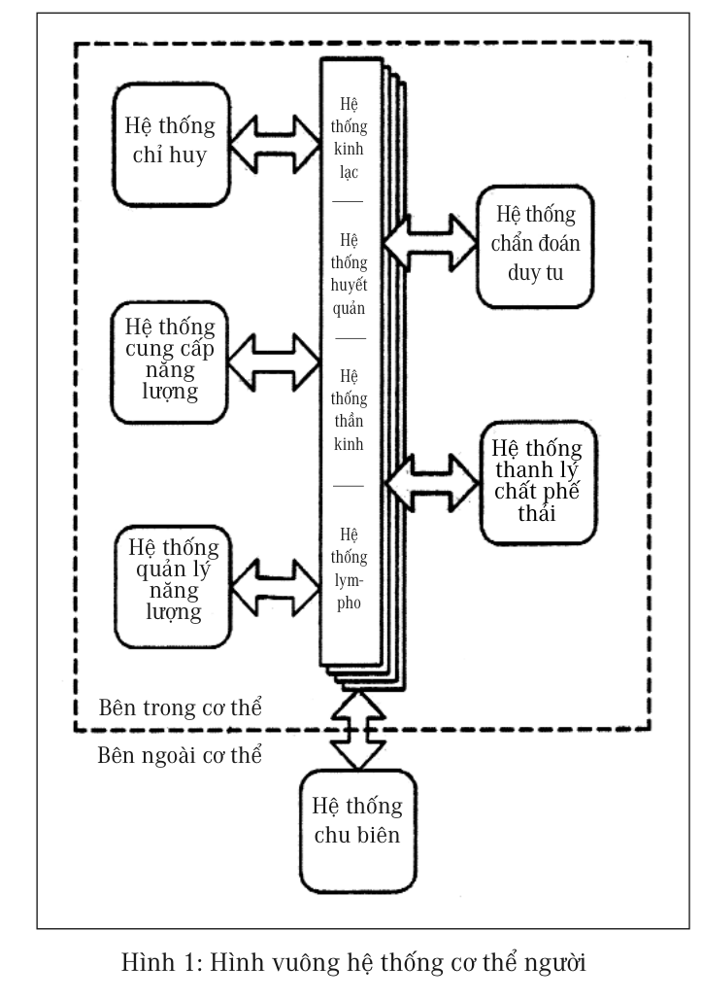

# Chương 2: HỆ THỐNG CƠ THỂ NGƯỜI

Lý luận y học Trung Quốc và lý luận phương Tây về căn bản có sự khác biệt rất lớn, lý luận Trung y cho rằng cơ thể con người là một hệ thống hoàn chỉnh. Những thầy thuốc Trung Quốc cổ đại đã phát minh ra lý luận âm dương và ngũ hành. Ngũ hành là sử dụng năm loại nguyên tố có đặc tính khác nhau trong tự nhiên để so sánh với năm cơ quan chủ yếu khác nhau trong cơ thể người. Năm loại nguyên tố kim, mộc, thủy, hỏa, thổ, tương ứng với năm cơ quan chủ yếu của cơ thể người là: phổi (phế), gan (can), thận, tim (tâm), tỳ, trong đó mỗi cơ quan tương ứng với một nguyên tố, phổi tương ứng với kim, gan tương ứng với mộc, thận tương ứng với thủy, tâm (tim) tương ứng với hỏa, tỳ tương ứng với thổ.

Nhân loại cổ đại chưa hề có bất cứ tri thức nào về giải phẫu học, với đa số người mà nói các cơ quan trong cơ thể người đều là vô cùng trừu tượng, ngoài việc dùng tưởng tượng ra, không có bất cứ một biện pháp để hình dung ra nó. Không những hình thể của các cơ quan không thể nào hình dung được, tính chất và công năng của các cơ quan càng không dễ dàng nói ra được. Kim, mộc, thủy, hỏa, thổ năm nguyên tố này trong tự nhiên, hầu hết mọi người đều hiểu được đặc tính của nó, bởi thế vô cùng thích hợp dùng để giải thích rõ ràng tính chất trừu tượng của các cơ quan trong cơ thể người. Đồng thời tính chất của năm nguyên tố này, cũng cung cấp cho các thầy thuốc những suy tư và diễn dịch nguồn gốc linh cảm hình thành bệnh tật.

> 
>
> *“Vỗ Đảm Kinh sẽ trực tiếp tác động làm cho lớp mỡ ở mông và mé ngoài hai đùi giảm bớt đi, làm như vậy độ khoảng từ một đến hai tháng sẽ cảm giác thấy ống quần rộng hẳn ra.”*

Lý luận Trung y cho rằng các cơ quan của cơ thể không phải tồn tại một cách độc lập, mỗi một cơ quan đều là một hệ thống, bao gồm bản thân cơ quan đó và các kinh lạc với các huyệt vị tương ứng của mỗi một cơ quan. Tình trạng này có phần giống với hệ thống đèn điện hiện đại, cơ quan trong cơ thể giống như bóng đèn điện, kinh lạc thì giống như dây điện nối từ nguồn điện tới bóng đèn, còn huyệt vị thì tựa  như các công tắc trên đường dây điện đó. Tổ hợp hoàn chỉnh bao gồm bóng đèn, dây điện và công tắc mới có thể gọi nó là hệ thống đèn điện. Khi bóng đèn không sáng, có thể là không có điện, cũng có thể là công tắc bị hỏng, hoặc dây điện có vấn đề, hoặc bóng đèn bị hỏng. Còn khi công năng của cơ quan trong cơ thể không tốt, có thể là (năng lượng) khí huyết của thân thể không đủ (giống như bóng đèn không có điện), cũng có thể là huyệt vị bị ách tắc (giống như công tắc bị hỏng), hoặc kinh lạc có quá nhiều rác thải gây nên trạng thái không lưu thông được (giống như dây điện có vấn đề), hoặc chính cơ quan đó có vấn đề (giống như bóng đèn đã bị hỏng).

Người Trung Quốc có câu tục ngữ “đầu đau chữa đầu, chân đau chữa chân” là để hình dung về người thầy thuốc có trình độ vô cùng thấp kém. Khi người bệnh xuất hiện những triệu chứng, người thầy thuốc giỏi phải biết quan sát kỹ bệnh nhân dùng những kỹ thuật học được từ sách thuốc cổ đại và kinh nghiệm tích lũy được sau nhiều năm công tác, tìm ra căn  nguyên chân chính của bệnh tật. Ví dụ khi chúng ta uống nước để lạnh có nhiệt độ rất thấp, nếu uống rất nhanh, thường hay tạo nên hiện tượng đau đớn dọc theo bên mặt đến tận huyệt Thái Dương trên góc trán. Theo quan điểm Trung y, cái tuyến đau đó là

đường kinh lạc dạ dày (Vị Kinh), do đó, loại đau này tiêu biểu cho việc khi uống nước lạnh quá nhanh, sẽ làm tổn thương đến dạ dày. Cũng có nghĩa là khi đó cảm giác thấy đau ở trán, nhưng thực ra là bệnh ở dạ dày. Vị trí phân bố của kinh lạc dạ dày là hai đường đối xứng rất dài nằm ở bên phải và bên trái chạy từ đầu xuống đến chân, nếu sau này khi đau đớn của bệnh tật xuất hiện ở phần đầu của đường kinh lạc này, Trung y sẽ nhận định là bệnh dạ dày, nhưng lại có thể tiến hành châm cứu các huyệt vị trên Vị Kinh ở bộ phận chân của bệnh nhân.

> 
>
> *“Phần lớn cái dùng mất trong thời gian xem tivi là thời gian tạo máu.”*

Có nghĩa là đau ở đầu, có khi lại phải chữa ở chân, “đầu đau không nhất định chữa ở đầu, chân đau không nhất định chữa ở chân”. Trung Quốc thời cổ đại, nếu có một thầy thuốc nào chỉ biết “đầu đau chữa đầu, chân đau chữa chân”, người ta nhất định sẽ hoài nghi năng lực chữa trị của người thầy thuốc đó.

Ngũ tạng lục phủ là một danh từ người Trung Quốc đã dùng hàng nghìn năm nay rồi, đó là chỉ các cơ quan chủ yếu trong cơ thể con người. Người Trung Quốc chia các cơ quan chủ yếu trong cơ thể người ra làm hai loại lớn là “tạng” và “phủ”. “Tạng” là chỉ các cơ quan đặc, không rỗng giữa hoặc có cơ cấu, gồm có năm tạng là tim, gan, tỳ, phổi, thận. “Phủ” là chỉ các cơ quan rỗng ở giữa, gồm có năm phủ là ruột non, mật, dạ dày, ruột già, bàng quang, ngoài ra người ta đem lồng ngực và khoang bụng kết hợp với nhau làm phủ thứ sáu, gọi tên là tam tiêu.

Tạng và phủ ngoài sự khác biệt rất lớn về tính chất ra, vị trí kinh lạc của chúng cũng rất khác biệt. Tất cả các đường kinh lạc của tạng đều ở mé trong của cánh tay và chân, và ở phía trước của thân thể. Kinh lạc của phủ thì lại nằm ở mé ngoài của cánh tay và chân, và ở phía

sau của thân thể. Khi con người đứng trước sự đe dọa nguy hiểm, bản năng con người biết khom người co thân lại, tất cả các đường kinh lạc của tạng ở phía trước thân thể được bảo vệ rất tốt, chỉ có kinh lạc của phủ thì lộ ra bên ngoài. So sánh giữa tạng với phủ thì tạng quan trọng hơn phủ rất nhiều, nếu quả là Đấng Tạo hóa đã sáng tạo ra cơ thể con người thì sự sắp xếp này quả là vô cùng hợp lý và sáng suốt. Cách phân loại “tạng” và “phủ” này của người Trung Quốc thể hiện một năng lực quan sát và trí tuệ rất cao.

> 
>
> *“Tam tự kinh của người già trăm tuổi: Vỗ Đảm Kinh, Đi ngủ sớm, Day tâm bao, Không tức giận, Ruột giữ sạch.”*

Ngoài ra, Trung y cổ đại còn phát hiện mỗi một đường kinh lạc của tạng đều có liên quan mật thiết đến một đường kinh lạc của phủ. Ví dụ Phế Kinh và Đại Tràng Kinh nằm ở mé trong và mé ngoài cánh tay, khi dùng châm cứu để điều trị, nếu vị trí mà đầu mũi kim đạt tới là chỗ đường kinh lạc đi qua, thì Phế Kinh và Đại Tràng Kinh thực tế ra chỉ cách nhau có mấy milimet.

Về giải phẫu học, tuy phổi và đại tràng là hai cơ quan ở hai vị trí hoàn toàn khác nhau, thậm chí không tìm thấy bất cứ mối liên hệ nào. Nhưng xét về mặt kinh lạc, hai cơ quan này lại có mối liên hệ hết sức chặt chẽ, các đặc tính vật lý trên hai kinh lạc, ví dụ như độ ấm, tính dẫn điện, sự lưu động của chất dịch v.v. đều chịu sự ảnh hưởng qua lại lẫn nhau rất mật thiết. Trung y cổ đại đã coi hai cơ quan này có hệ thống tương đồng, gọi là “hỗ vi biểu lý” (trong ngoài tương hỗ với nhau).

Các thầy thuốc Trung Quốc trải qua quan sát suốt mấy nghìn năm, cũng đã xác nhận rằng khi hai cơ quan này phát sinh biến đổi, thì thường là đồng bộ với nhau và xuất hiện sự thay đổi có cùng tính chất như nhau. Ví dụ, khi xuất hiện chứng cảm mạo, trong Trung y cho

rằng đó là hiện tượng phế nhiệt (chứng nhiệt và hàn là chỉ số vô cùng quan trọng của Trung y đối với chẩn đoán bệnh tật), lúc này thông thường cũng có đi kèm với triệu chứng táo bón, Trung y gọi hiện tượng táo bón lúc này là chứng đại tràng táo nhiệt.

> 
>
> *“Khi tức giận, cơ thể sinh ra khí, cho nên gọi tức giận là sinh khí.”*

Tình hình trong ngoài tác động tương hỗ với nhau như của phổi và đại tràng cũng còn thấy phát sinh ở tim và ruột non, gan và mật, tỳ và dạ dày, thận và bàng quang. Phương pháp quy nạp “tạng phủ trong ngoài tương hỗ” này đã làm cho mười cơ quan giảm xuống còn năm hệ thống, mức độ phức tạp của việc phân tích chẩn đoán hệ thống cơ thể người lập tức được đơn giản đi đáng kể. Như vậy cũng có cơ hội dùng năm nguyên tố trong ngũ hành để mô tả tất cả các mối quan hệ tương hỗ phức tạp giữa tạng và phủ.

Ngoài năm tạng và phủ chủ yếu ra, Trung y cổ đại còn phát hiện bốn đường kinh lạc chủ yếu khác nữa. Đường thứ nhất là tuyến trung tâm ở mé trong cánh tay, gọi là Tâm Bao Kinh, có mối quan hệ mật thiết với công năng của Tâm Bao (màng bao quanh quả tim), công năng của đường kinh này tốt hay xấu ảnh hưởng trực tiếp đến trạng thái vận hành của máu. Đường kinh thứ hai là tuyến trung tâm ở mé ngoài cánh tay, gọi là Tam Tiêu Kinh, thường xuyên phản ánh vấn đề của lồng ngực và khoang bụng, công năng của đường kinh này tốt hay xấu ảnh hưởng trực tiếp đến trạng thái vận hành của “khí”. Đường kinh thứ ba là tuyến trung tâm chính diện dọc theo thân người, gọi là mạch Nhâm, đường kinh thứ tư dọc theo thân người ở phía lưng, gọi là mạch Đốc. Mạch Nhâm và mạch Đốc có mối quan hệ với tất cả các cơ quan của cơ thể, là kinh lạc quan trọng nhất trong cơ thể người.

> 
>
> *“Trung y mà phân ra thành các khoa thì không thể thấy được hệ thống hoàn chỉnh của nó nữa.”*

Do tâm bao (màng bao quanh quả tim) và tâm tạng (quả tim) kết hợp làm một với nhau, còn tam tiêu thì lại không có mối liên quan gì với tất cả các phủ khác, cho nên người Trung Quốc gọi tất cả các tạng phủ là “ngũ tạng lục phủ”. Ngũ tạng là tạng tâm (tim), tạng can (gan), tạng tỳ, tạng phế (phổi), tạng thận, trong đó tâm bao gồm cả hai hệ thống tâm (quả tim) và tâm bao (màng bao quanh quả tim); lục phủ tức là tiểu trường (ruột non), đảm (mật), vị (dạ dày), đại tràng (ruột già), bàng quang, tam tiêu. Ngoài năm tạng năm phủ trong ngoài tương hỗ với nhau như đã nói trên ra, tâm bao và tam tiêu cũng có những đường kinh lạc trong ngoài tương hỗ với nhau theo một nhóm khác.

Qua mô tả hệ thống cơ thể của Tây y, có thể thấy Tây y lấy giải phẫu học cận đại làm cơ sở, lấy kết cấu phần cứng mà mắt người có thể nhìn thấy được để xây dựng hệ thống, các hệ thống đều độc lập với nhau, giữa các hệ thống không có quá nhiều các quan hệ. Trung y là những tri thức được hình thành do tích lũy kinh nghiệm của nhân loại hàng nghìn năm, dùng phương thức suy lý, từ toàn bộ kết cấu phần cứng phần mềm của cơ thể mà xây dựng nên một hệ thống có logic và kết cấu hết sức chặt chẽ, cho nên được sử dụng suốt mấy nghìn năm.

Trong thư tịch cổ đại Trung Quốc, rất ít nhắc đến “não”, đây cũng là một trong những khác biệt rất lớn về khái niệm của Trung y và Tây y.

Theo quan điểm của Trung y, cơ thể người là một thể thống nhất, giữa ngũ tạng và lục phủ có mối quan hệ tương hỗ rất mật thiết, hơn nữa luôn luôn giữ ở thế cân bằng. Đồng thời ngoài phần cứng được nhắc đến trong giải phẫu học ra, Trung y còn có rất nhiều những hệ thống

mang tính khái niệm và tính công năng, ví dụ như hệ thống năng lượng, hệ thống quản lý nguồn năng lượng v.v. Những hệ thống này do trước đây khoa học kỹ thuật chưa phát triển, chưa có công cụ máy móc để đo lường, không có khái niệm số, trong sách y chỉ có thể dùng các loại văn tự đặc thù để miêu thuật những hệ thống này. Chẳng hạn như hệ thống năng lượng thì dùng âm, dương, ngũ hành, hư, thực, khí huyết và hỏa để mô tả; hệ thống quản lý nguồn năng lượng thì dùng tương sinh tương khắc, cân bằng và các phương thức khác để mô tả. Do cách mô tả này so với hệ thống thuật ngữ số hóa tinh xác của khoa học ngày nay có sự khác biệt nhau quá lớn, làm cho toàn bộ nền học thuật Trung y bị xem như là một loại huyền học khó lý giải và nắm bắt.

> 
>
> *“Sức khỏe đã không còn, thêm những con số 0 nữa thì có ý nghĩa gì.”*

Từ những công trình khoa học hiện đại, coi cơ thể người là một hệ thống vận hành độc lập mà nói, hệ thống cơ thể của y học hiện đại xây dựng trên cơ sở của giải phẫu học tỏ ra có nhiều khiếm khuyết, làm thiếu đi rất nhiều thứ, ví dụ, hệ thống năng lượng là bộ phận không thể thiếu trong tất cả các hệ thống độc lập. Giống như hệ thống cung cấp nguồn điện cho máy tính, hệ thống đường dầu và đường điện trong xe ôtô đều là những hệ thống năng lượng trong hệ thống, là bộ phận vô cùng quan trọng, chỉ duy nhất trong hệ thống cơ thể mà y học mô tả thì lại không có bộ phận này.

Trong hệ thống của Trung y, còn có một bộ phận vô cùng quan trọng, đó là hệ thống kinh lạc của cơ thể, bộ phận này nhiều năm không được giải phẫu học chứng thực. Cho đến năm 1998, một nhóm nghiên cứu khoa học ở Đại lục Trung Quốc đã trải qua 8 năm nỗ lực phấn đấu, kết quả đã tìm ra chứng cứ về sự tồn tại xác thực của kinh

lạc trong giải phẫu, phát hiện ra vật chất quan trọng nhất trong toàn bộ hệ thống kinh lạc, đó là một chất dịch sinh học trong suốt hết sức đặc biệt, đồng thời đối với một số tia sóng hồng ngoại với bước sóng dài nhất định nào đó, chúng có đặc tính vật lý gần giống như sợi quang, những phát hiện này kết hợp với sự phát triển mạnh mẽ của mạng lưới máy tính toàn cầu cuối thế kỷ XX, rất dễ dàng khiến người ta liên tưởng đến ý nghĩ cơ thể người phải chăng cũng là một thế giới được hình thành bởi một hệ thống mạng? Vật chất trong kinh lạc và vật chất trong mạng thông tin điện tử có đặc tính gần gũi nhau đến như vậy, càng làm tăng thêm tính hiện thực của khả năng này.

> 
>
> *“Một đôi nam nữ ở với nhau, hễ không cẩn thận là sẽ tạo ra một con người. Cơ thể con người phức tạp và hoàn mỹ, mà chỉ dùng phương pháp giản đơn như vậy để tạo ra.”*

Trong quá trình tiến hóa của sinh vật, những động vật bậc thấp buổi đầu đều không có đại não, hệ thống kinh lạc là cơ cấu chủ yếu điều tiết các cơ quan trong cơ thể loại động vật này. Nói theo thuật ngữ của máy tính hiện đại, bản thân những hệ thống kinh lạc này vốn có công năng thông tin, một cơ thể rất có khả năng không chỉ có một máy tính, cũng có nghĩa là cơ thể động vật rất có khả năng không chỉ có một bộ não đơn nhất, mà là một hệ thống mạng cấu thành gồm nhiều bộ não với những công năng khác nhau. Quan điểm này khác biệt rất lớn với quan niệm của y học hiện đại cho rằng đại não là chúa tể quyết định nhiều chức năng của cơ thể.

Cơ thể người là cơ thể sống có trí tuệ rất cao, và có nhiều công năng khác nhau, sử dụng các công trình nghiên cứu hiện đại và tri thức quản lý kết hợp với những khái niệm y học truyền thống Trung Quốc, có thể phỏng theo kết cấu của máy tính, vạch ra một sơ đồ hình vuông về kết cấu của cơ thể người như sau (hình 1)

.

> 
>
> *“Người mắc bệnh bao giờ cũng chỉ muốn tìm được linh đan linh dược để khỏi bệnh, mà không muốn điều chỉnh thói quen sinh hoạt của mình để loại bỏ nguồn gốc thực sự của bệnh tật.”*

Sơ đồ này chia cơ thể thành 6 hình vuông công năng và 4 hệ thống mạng, phân tích chi tiết được trình bày ở phần sau. Sử dụng logic suy nghĩ của kết cấu cơ thể này có thể tiến hành giới định lại lý luận đối với nhiều bệnh mạn tính, phát triển ra logic bệnh lý mới. Dựa vào logic bệnh lý mới này, đưa ra phương pháp điều trị hoàn toàn khác, có cơ hội mở ra một con đường mới cho việc điều trị bệnh mạn tính.

> 
>
> *“Y học hiện đại bó tay trước các bệnh mạn tính, rất có khả năng trong phương hướng và logic tư duy có vấn đề.”*

## Hệ thống công năng của cơ thể

### Hệ thống chỉ huy

Chủ yếu do đại não cấu thành, đảm nhiệm chức năng suy nghĩ và chỉ huy cơ thể, nhưng sự vận hành của các cơ quan trong cơ thể, không do hệ thống này chỉ huy. Hệ thống chỉ huy là sử dụng hệ thống thần kinh báo cáo toàn bộ tình hình các bộ phận trên cơ thể về đại não, rồi truyền đạt các lệnh từ đại não trực tiếp đến các bộ phận trong cơ thể, để cơ thể có những phản ứng nhanh chóng đối với các loại kích thích từ bên ngoài.

Nhiều động vật bậc thấp không có đại não, những động vật này không có khả năng chạy trốn và tấn công, chỉ có hoạt động một cách vô thức, phần lớn các hoạt động đều rất chậm chạp. Nhưng những động vật này đều có các cơ quan với chức năng tương tự như lục phủ ngũ tạng của con người, có thể hít thở, hấp thu dinh dưỡng, bài tiết chất thải v.v. Điều này cho thấy đại não có thể là trong quá trình sinh vật tiến hóa, để thích ứng với hoàn cảnh bên ngoài, khi cần vận động với tốc độ nhanh, các cơ quan mới sản sinh.

Trong kết cấu mạng của cơ thể, đại não giống như cái máy cái cuối cùng của tổng giám đốc (CEO) trong hệ thống mạng máy tính của xí nghiệp, các cơ quan thì giống như các máy phục vụ (Server) có công năng khác nhau trong mạng nói trên. Cũng có nghĩa là đại não giống như một người sử dụng hệ thống cơ thể, còn sự bảo vệ giữ gìn hệ thống cơ thể thì có một cơ cấu phụ trách khác.

> 
>
> *“Tiến hành cưa cưa cắt cắt trên cơ thể mà không hiểu biết được bao nhiêu thì nhất định sẽ dẫn đến rất nhiều vấn đề.”*

### Hệ thống cung cấp năng lượng

Bất cứ một hệ thống độc lập nào cũng có một hệ thống con cung cấp năng lượng. Ví dụ, bộ nguồn cung cấp điện cho máy tính và hệ thống thùng xăng và đường ống dẫn xăng của xe ôtô, cơ thể người cũng nhất định tồn tại hệ thống có chức năng tương tự.

Song hệ thống cung cấp năng lượng của cơ thể không hề giống với các linh kiện phần cứng được lắp đặt rõ ràng và độc lập như của máy tính và xe hơi. Điện năng và dầu khí đều là nguồn năng lượng rất dễ dàng sử dụng, nhưng chủng loại thực phẩm mà con người ăn vào rất đa dạng, cũng không phải là hình thái vật chất có thể lập tức trở thành năng lượng để sử dụng. Cho nên, sau khi những nguyên liệu này vào trong cơ thể, phải trải qua biện pháp xử lý vô cùng phức tạp, mới có thể chuyển biến thành nguồn năng lượng tương tự như điện năng và dầu khí để dễ dàng sử dụng, và cung cấp cho các cơ quan trong cơ thể sử dụng. Nói một cách đơn giản, cơ thể người thực tế là đã tự trang bị cho mình một trung tâm chế tạo nguyên liệu cho nguồn năng lượng và một nhà máy phát điện. Bởi vậy, hệ thống cung cấp năng lượng của cơ thể cũng phức tạp hơn nhiều bộ phận cung cấp năng lượng của xe hơi và máy tính.

Hệ thống cung cấp năng lượng của cơ thể là do hệ thống tiêu hóa đem những thức ăn chuyển hóa thành những nguyên liệu mà cơ thể có thể sử dụng được, vào những giờ phút thích hợp, khi cơ thể người đi vào giấc ngủ say, đem những nguyên liệu này chuyển hóa thành máu để cơ thể có thể dễ dàng sử dụng. Bởi vậy, hệ thống cung cấp năng lượng của cơ thể chí ít cũng bao gồm hệ thống tiêu hóa cộng với hệ

thống tạo máu và hệ thống mạch máu tim, nhiều hệ thống phần cứng mới có thể cấu thành hệ thống cung cấp năng lượng.

> 
>
> *“Vấn đề lớn nhất của y học hiện đại là: Đánh giá thấp trí tuệ tự thân của cơ thể người, đánh giá cao năng lực của tri thức nhân loại.”*

Bởi vậy, hiểu rõ triệt để hệ thống này và tìm được biện pháp xác định đo lường thích hợp, làm cho mức năng lượng của cơ thể có thể dễ dàng được đo lường xác định như đo mức điện áp của máy tính hay mức dầu của xe hơi, thì khi đó mới có thể tiến hành chẩn đoán chính xác bệnh tật của con người, cũng mới có thể tìm được nguyên nhân thực sự của bệnh tật. Đồng thời cũng cần phải phát triển ra một hệ thống những phương pháp có thể rất dễ dàng đơn giản nâng cao được năng lượng của cơ thể, mới có thể khắc phục có hiệu quả các loại bệnh tật.

### Hệ thống quản lý nguồn năng lượng

“Làm quá sức” là câu nói thường ngày của chúng ta, nhiều người đã từng trải nghiệm cái “làm quá sức” phải nghỉ trong thời gian dài mà vẫn cảm thấy không đủ. Trong số những người làm việc quá sức lâu dài, có một số người cảm giác thấy thể lực càng ngày càng tốt, cũng có một số người thì lại thấy sức khỏe càng ngày càng sút kém đi, nhưng vẫn có thể duy trì được sự vận hành bình thường của cơ thể, và không hề xuất hiện dấu hiệu của bệnh tật nghiêm trọng nào.

Hiển nhiên bên trong cơ thể người có một hệ thống quản lý nguồn năng lượng, hình thái tương tự như phần mềm của máy tính, chúng ta hiện nay vẫn không biết phần cứng của nó là bộ phận nào của cơ thể. Nhưng nó luôn luôn dùng những phương pháp hữu hiệu nhất để điều độ năng lượng của cơ thể, khi năng lượng không đủ, nó sẽ đem những năng lượng dự trữ dưới những dạng khác chuyển hóa thành

dạng năng lượng có thể lập tức sử dụng được, đó là nguồn năng lượng cung cấp cho cơ thể khi cần phải làm việc nhiều, dẫn đến “bội chi năng lượng”.

> 
>
> *“Bữa tối chén tạc chén thù, cái giá phải trả không phải chỉ là tiền bạc, mà còn phải trả cả thời gian tạo máu hết sức quý báu.”*

Hệ thống này có năng lực trí tuệ rất cao. Khi làm việc quá sức trong thời gian dài, có thể dưới tiền đề cố gắng không làm ảnh hưởng đến sự vận hành của cơ thể, điều động năng lượng từ các bộ phận của cơ thể cung cấp cho nhu cầu làm việc quá sức, cho đến khi nào năng lượng dùng hết mới thôi. Thông thường hành vi “làm việc quá sức” này có thể duy trì được đến mười năm mà cơ thể vẫn có thể vận hành bình thường.

Khi cơ thể điều động sử dụng nguồn năng lượng dự trữ, tất sẽ tiến hành một trình tự hóa học đặc thù trong cơ thể, tiến hành chuyển hoán năng lượng của cơ thể. Bởi vậy, mọi chỉ tiêu kiểm tra của cơ thể, như hàm lượng anbumin và đường huyết trong máu đều có sự thay đổi.

Điều đó cũng có nghĩa là khi cơ thể liên tục làm việc nhiều phải “bội chi năng lượng”, thân thể sẽ không ngừng điều chỉnh quá trình sản xuất trong xưởng hóa học của nó, để ứng phó với hoàn cảnh năng lượng ngày một xấu đi. Nhiều bệnh mạn tính khi xét nghiệm thấy các chỉ tiêu hóa học không bình thường, rất có khả năng cơ thể đang trong trạng thái sử dụng các biện pháp ứng phó khác nhau ấy. Chỉ có hiểu được thật rõ các phương pháp điều độ nguồn năng lượng khác nhau mà cơ thể sử dụng khi phải làm quá sức, mới có thể giải mã được chính xác ý nghĩa chân chính của những chỉ số không bình thường khi kiểm tra xét nghiệm thân thể.

> 
>
> *“Sự việc giản đơn được xem xét một cách rất phức tạp, có thể phát hiện ra lĩnh vực mới; hiện tượng phức tạp được nhìn nhận một cách giản đơn, có thể phát hiện ra định luật mới”*

Các danh từ âm, dương, hư, thực... thường thấy trong chẩn đoán của Trung y thời cổ, khi dùng vào mô tả toàn bộ trạng thái cơ thể người, đó chính là mô tả về điều độ nguồn năng lượng này trong cơ thể. Ví dụ, “âm” là chỉ nguồn năng lượng dự trữ, “dương” là chỉ năng lượng khí huyết sinh ra hàng ngày, “dương hư” chính là chỉ năng lượng sinh ra hàng ngày không đủ, cũng chính là khí huyết không đủ nói đến trong Trung y, “âm hư” thì có nghĩa là năng lượng dự trữ đang bị bội chi.

Ngoài ra, “khí huyết” đại diện cho nguồn năng lượng sinh ra hàng ngày, năng lượng bội chi được gọi là “hỏa”. “Âm hư hỏa trọng/vượng” thì chứng tỏ rằng cơ thể người đang bội chi số lượng lớn nguồn năng lượng dự trữ, “âm dương lưỡng hư” thì chứng tỏ rằng hàng ngày sản sinh ra đã không đủ, mà năng lượng dự trữ dùng cũng sắp hết, có nghĩa là “khí huyết” không đủ mà “hỏa” cũng sắp dùng hết, thân thể tất phải nghĩ đến biện pháp dùng nguồn năng lượng đặc thù thứ ba, để cung ứng năng lượng cho nhu cầu bội chi. “Khí huyết khô kiệt” có nghĩa là “khí huyết” và “hỏa” toàn bộ tiêu hao hầu như tận cùng rồi. Dùng phương pháp này để lý giải thuật ngữ Trung y, thật vô cùng cụ thể, cũng không còn tý chút cái cảm giác “huyền hoặc” nào nữa.

Cái gọi là điều độ nguồn năng lượng, cũng giống như việc điều độ tài vụ trong công ty, khi tài vụ tốt đẹp, trong ngoài công ty luôn duy trì trạng thái trang hoàng rất đẹp, các ngành nghề và phòng ban chức năng đều vận hành rất suôn sẻ. Nhưng khi tài vụ phát sinh vấn đề, tài vụ tất sẽ cắt giảm chi tiêu, lựa chọn ban ngành không quan trọng, dần dần giảm bớt hao phí tiền bạc, tình hình tài vụ nếu tiếp tục xấu hơn nữa, tất sẽ bắt đầu bán bớt tài sản của công ty để thu hồi lại tiền vốn.

> 
>
> *“Người nào không dành ra được thời gian để ngủ, sớm muộn sẽ phải dành ra thời gian để sinh bệnh.”*

Cơ thể người cũng như vậy, khi khí huyết không đủ, thì sẽ lựa chọn những chức năng tương đối không quan trọng, dần dần giảm bớt cung ứng năng lượng, lúc này cơ thể sẽ xuất hiện nhiều biến đổi. Ví dụ, khi năng lượng cung cấp cho hệ thống thải loại các chất phế thải bị cắt giảm, sắc mặt người càng ngày càng xám lại, có một số người những đốm tàn nhang trên mặt càng ngày càng nhiều lên, còn có một số người thì cảm thấy ngày một béo ra, điều này cũng giống như bộ mặt của công ty ngày một cũ, xấu đi vậy.

Khi cắt giảm cung cấp máu cho tạng tỳ, hệ thống chẩn đoán duy tu của cơ thể sẽ tạm thời giảm bớt làm việc, chỉ những bệnh nghiêm trọng nó mới có phản ứng, còn đối với những bệnh tương đối nhẹ thì nó không có phản ứng gì. Nhiều người làm việc quá sức trong thời gian dài, khi bận rộn như vậy rất lâu không hề có bệnh tật gì cả, nhưng vừa mới được ngừng làm việc để nghỉ ngơi thì lập tức xuất hiện mệt mỏi, bệnh tật. Điều đó chính là vì sau khi nghỉ ngơi làm cho khí huyết tăng cao lên, máu cung cấp cho tạng tỳ cũng tăng lên theo, làm xuất hiện khả năng nói trên. Người Trung Quốc có câu tục ngữ “ốm vặt liên miên, ốm nặng không mắc; xưa nay chưa từng ốm, hễ ốm là thập tử nhất sinh”, chính là cái lý như vậy.

Khi cắt giảm cung cấp máu cho gan (tạng can), sẽ làm giảm tần xuất thanh lọc máu, máu càng ngày càng bẩn, các chỉ số xét nghiệm máu lúc này sẽ rất xấu. Sắc của răng và môi dần dần trở nên xám lại, máu trong gan cũng dần dần ít đi, gan cũng dần dần trở nên khô cứng.

Khi cắt giảm cung cấp máu cho thận, máu đưa đến thận để lọc sẽ giảm bớt, sắc của nước tiểu dần dần trở nên trong hơn và cuối cùng sẽ hoàn toàn như nước lã, trở thành chứng tăng urê trong máu.

Đa số người bệnh bị chứng urê máu tăng cao, thận căn bản không có vấn đề gì hết, chỉ vì tổng lượng máu quá ít, không đủ máu phân phối cho thận sử dụng mà thôi.

> 
>
> *“Ham muốn là gánh nặng lớn nhất của cơ thể”*

Khi cắt giảm cung cấp máu cho phổi (tạng phế), hệ thống cung cấp nước cho các bộ phận của cơ thể người phát sinh trở ngại, sắc mặt dần dần xạm đen đi, hơn nữa càng ngày càng thấy khô và nóng, người cũng càng ngày càng gầy đi.

Khi cơ thể không còn có khả năng cắt giảm việc cung cấp máu được nữa, cơ thể đành phải biến cải tổ chức cơ bắp thành năng lượng để cung cấp cho cơ thể, lúc này bắt đầu xuất hiện bệnh tiểu đường. Bệnh nhân sau một thời gian mắc bệnh này, dấu hiệu rõ rệt nhất là các cơ bắp biến mất, điều này nó cũng giống như công ty phát mại tài sản để đổi lấy vốn lưu động vậy.

Do con người hiện đại thay đổi thói quen sinh hoạt truyền thống và sử dụng phương thức xử lý bệnh tật không thích hợp, làm cho hệ thống cung ứng năng lượng của cơ thể nảy sinh vấn đề, con người luôn luôn trong trạng thái làm việc quá sức, năng lượng ngày một giảm thiểu, hệ thống quản lý nguồn năng lượng luôn luôn phải ứng biến đối phó, vì thế mà sản sinh ra các loại bệnh mạn tính đáng sợ hiện nay.

Ví dụ, bệnh cường tuyến giáp là chứng bệnh điển hình mà Trung y gọi là “âm hư hỏa trọng/vượng”, cũng chính là kết quả của làm việc quá sức rất nhiều trong thời gian lâu dài; bệnh đái tháo đường là chứng bệnh theo Trung y gọi là “âm dương lưỡng hư”, cũng chính là khí huyết và hỏa của cơ thể đều đã sắp hết, cơ thể bắt đầu đem cơ bắp chuyển hóa thành đường, thay thế lượng anbumin không đủ làm nguồn năng lượng

thay thế. Hầu như tất cả các bệnh mạn tính đều có thể tìm được bệnh lý mới từ quan điểm của hệ thống quản lý nguồn năng lượng, và từ đó có thể phát triển ra phương pháp điều trị và điều dưỡng có hiệu quả.

> 
>
> *“Nhiều danh y và phương thuốc bí truyền như vậy, đòi hỏi phải có trí tuệ dồi dào, mới có thể tìm được con đường sống.”*

Người thầy thuốc Trung y giỏi có thể từ những hiện tượng điều độ nguồn năng lượng này mà đưa ra phán đoán chính xác về mức năng lượng khí huyết của người bệnh. Quan sát và mô tả về trạng thái năng lượng cơ thể người là biện pháp và quá trình đầu tiên và cũng là quan trọng nhất trong chẩn đoán Trung y. Tuy sách Trung y truyền thống không nhắc đến “hệ thống quản lý nguồn năng lượng”, nhưng trong khái niệm Trung y thực ra đây là hệ thống quan trọng nhất của cơ thể.

Sau khi cơ thể trải qua điều dưỡng, khí huyết sẽ dần dần tăng lên, những cơ quan trước đây bị cắt giảm cung cấp máu, giờ đây cũng dần dần được cung cấp máu tăng lên, nhưng lúc này cơ thể lại xuất hiện nhiều triệu chứng của bệnh tật.

Ví dụ, máu tăng lên, nó lại bắt đầu đi vào các tổ chức cơ bắp mà lâu nay vốn không có máu đi tới, nó khiến cho ta có cảm giác toàn thân đau nhức; máu tăng lên, nó đi vào phổi, nó xua đuổi những hàn khí xưa nay vẫn lưu trú trong đó, khi đó sẽ sinh ra triệu chứng cảm mạo; máu tăng lên, nó đi vào gan tiến hành thanh lý gạn lọc, sẽ xuất hiện gan nóng và nước tiểu màu vàng, giống như triệu chứng của người bị bệnh gan, mỡ máu và lượng các loại phế thải trong máu cũng tăng cao vì gan bắt đầu tiến hành thanh lọc tẩy rửa với quy mô lớn; máu tăng lên, nó đi vào thận sẽ xuất hiện nước tiểu đục và cả chứng đái anbumin (hiện tượng nước tiểu có protein)…

> 
>
> *“Người gan nóng, hay nằm mơ, giấc ngủ không sâu.”*

Những triệu chứng bệnh tật này vô cùng giống với những triệu chứng phát sinh khi năng lực cơ thể không đủ, không phải là thầy thuốc Trung y giỏi thì rất khó nhận ra, Tây y đem tất cả những cái đó coi là bệnh tật. Do những triệu chứng của bệnh tật này là sản phẩm của việc cơ thể tiến hành đại thanh lọc tẩy rửa, cho nên, cách điều trị chính xác là phải giúp cơ thể đẩy nhanh quá trình này. Nhưng y học phương Tây ngày nay cho rằng những triệu chứng ấy là do cơ thể phát sinh sự cố mà có, bởi vậy xuất phát điểm của biện pháp điều trị đa số đều sai lầm là đi sửa chữa cơ thể, kết quả là các biện pháp điều trị này đều trực tiếp làm ngừng quá trình đại thanh lọc tẩy rửa của cơ thể, quay trở lại xu thế khí huyết thấp kém vốn có trước đây, cơ thể không có năng lượng dư thừa để tiến hành thanh lọc tẩy rửa nữa, những triệu chứng do quá trình thanh lọc tẩy rửa gây ra cũng  nhanh chóng biến mất, các kết quả kiểm tra xét nghiệm lại trở về phạm vi bình thường, như thế người ta coi là bệnh đã được chữa khỏi.

Phương pháp điều trị chỉ chữa kết quả, không bàn gì đến nguyên nhân, giống như bức tường bị thấm nước, không giải quyết cái chỗ bức tường bị thấm nước, chỉ chăm chú quét sơn ở bên ngoài, nhìn bức tường rất đẹp cứ nghĩ bức tường đã được sửa chữa tốt, đó là một loại phương pháp chữa trị “phấn son thái bình”, không những không có một chút tốt đẹp nào mà trái lại còn gây nên những tổn hại rất lớn cho cơ thể.

### Hệ thống chẩn đoán duy tu

Đa số mọi người đều đã từng bị đứt tay đứt chân, khi bị thương các thầy thuốc thường dùng thuốc đỏ, nước sát trùng, bột tiêu viêm bôi lên miệng vết thương, thậm chí còn tiêm thuốc dự phòng bệnh uốn ván...

Những biện pháp này chẳng qua chỉ là đề phòng nhiễm khuẩn vào chỗ vết thương mà thôi. Mọi vết thương được lành lại, toàn bộ công việc tái sinh các tổ chức đều là thân thể tự mình làm hết. Vết thương ở bên ngoài cơ thể thế nào, các cơ quan ở bên trong cơ thể cũng như vậy.

> 
>
> *“Linh đan linh dược ở ngay trong cơ thể, lại cứ không ngừng đi tìm kiếm ở bên ngoài.”*

Tất cả những việc mà cơ thể làm này, dưới con mắt của chúng ta hình như là lẽ đương nhiên vậy, không có tý gì là lạ kỳ cả, nhưng nếu suy nghĩ sâu hơn và cặn kẽ hơn điều này quả thực là một việc vô cùng phức tạp.

Trước tiên cơ thể cần phải chẩn đoán vị trí tổn thương và mức độ nghiêm trọng, sau đó mới chọn phương pháp chính xác, để những tổ chức bị hoại tử dần dần đóng thành lớp vảy cứng, trùm lên bề mặt vết thương, có tác dụng bảo vệ vết thương, tiếp đó lại sản sinh ra những tổ chức mới ở bên dưới lớp vảy, tất cả các tổ chức này phải hoàn toàn hòa hợp với các tổ chức vốn có ở xung quanh.

Toàn bộ quá trình hết sức phức tạp, tiêu hao năng lượng khí huyết rất lớn, tiến hành toàn bộ công việc duy tu rõ ràng phải có một trí tuệ sáng suốt và công nghệ hoàn mỹ.

Khi năng lượng khí huyết cơ thể ở trạng thái bình thường, những công việc duy tu này đều được tiến hành một cách bình thường, nhưng khi năng lực khí huyết không đủ, thì thân thể sẽ xem xét năng lực nguồn năng lượng hiện có, lựa chọn bộ phận nào cần duy tu trước, đối với những thương tổn không ngay lập tức nguy hiểm cho cơ thể, thậm chí có thể tạm gác sang một bên không tiến hành công việc duy tu ngay.

> 
>
> *“Bệnh tật thực ra là sự ghi chép trung thực sinh hoạt thường ngày của chúng ta.”*

Đặc sắc lớn nhất của Trung y là ở chỗ rất chú trọng đến năng lực tự phục hồi của cơ thể, hơn nữa biện pháp điều trị chủ yếu đều thông qua việc nâng cao năng lượng của cơ thể, hoặc loại bỏ những trở ngại làm cho hệ thống duy tu cơ thể không vận hành được bình thường, để nâng cao năng lực duy tu của cơ thể.

Giống như việc chữa trị vết thương ở bên ngoài, trong quá trình chữa trị, vết thương có thể xuất hiện hiện tượng sưng tấy, mọng đỏ, đóng vảy..., khi chữa trị các cơ quan bên trong cơ thể, cũng sẽ xuất hiện rất nhiều loại triệu chứng, chẳng hạn như đau bụng, ho, viêm nhiều nơi, có cảm giác mệt mỏi…

Sự khác biệt giữa Trung y và Tây y, khi Trung y đứng trước những triệu chứng này, trước tiên cho rằng thân thể là một cơ thể sống có năng lực trí tuệ rất cao, không dễ dàng gì đưa ra những sai lầm, sự xuất hiện những hiện tượng không bình thường này nhất định là có cái lý riêng của nó, thông thường một cơ quan nào đó không đủ năng lực, hoặc là thân thể đang tiến hành công việc duy tu sửa chữa nào đó. Cho nên phương pháp điều trị không phải là đi chữa lại những sai lầm của cơ thể, làm mất những triệu chứng này, mà là phải hỗ trợ cơ thể hoàn thành cái công việc mà nó đang cần hoàn thành.

Tây y thì cho rằng sự xuất hiện những triệu chứng này, nhất định là thân thể đã có những sai lầm, hơn nữa nhận định một cách trực quan rằng chính bộ phận có triệu chứng đó đã phát sinh sự cố, phương pháp điều trị chính là làm cho những triệu chứng đó không còn tồn tại nữa.

> 
>
> *“Vỗ Đảm Kinh sẽ trực tiếp tác động làm cho lớp mỡ ở mông và mé ngoài hai đùi giảm bớt đi, làm như vậy độ khoảng từ một đến hai tháng sẽ cảm giác thấy ống quần rộng hẳn ra.”*

### Hệ thống thanh lý các chất phế thải

Mỗi một bộ phận của cơ thể, thậm chí mỗi một tế bào, đều không ngừng tiến hành thay cũ đổi mới, chúng không ngừng bài tiết các chất phế thải, hệ thống kinh lạc của cơ thể thì không ngừng vận chuyển các chất phế thải. Khi năng lực của các cơ quan suy giảm, hoặc hệ thống cung cấp năng lượng của cơ thể phát sinh vấn đề, gây nên sự ảnh hưởng lẫn nhau giữa cơ quan và kinh lạc tương ứng với nó. Cơ quan có vấn đề làm tắc nghẽn kinh lạc tương ứng với nó, kinh lạc bị tắc nghẽn lại làm nặng nề thêm bệnh tật của cơ quan, hình thành nên cái vòng tuần hoàn tiến triển xấu.

Mỗi người khi còn trẻ, năng lực khí huyết còn thịnh vượng sung mãn, hệ thống thanh lý phế thải của thân thể còn vận hành bình thường, trên mặt mọi người hầu như không có tàn nhang, nếp nhăn và béo xệ. Cùng với sự tăng lên của tuổi tác, năng lượng khí huyết ngày một suy yếu, những nếp nhăn, đốm tàn nhang hay béo bệu trên mặt trên thân thể bắt đầu xuất hiện ngày một nhiều.

Trung y có nhiều cách điều trị kinh lạc là mượn sự hỗ trợ từ bên ngoài cơ thể để tiến hành thanh lý rác thải, ví dụ xoa bóp bấm huyệt và châm cứu... đều có hiệu quả tốt về phương diện này. Chỉ cần những rác thải trên cơ thể được thanh lý kịp thời thì có thể làm cho những nốt tàn nhang, nếp nhăn hay chỗ béo xệ giảm đến mức thấp nhất, cộng thêm với khí huyết đầy đủ, thì có thể bảo đảm trẻ và khỏe mãi.

Xét về phần cứng, hệ thống thanh lý phế thải của cơ thể bao gồm gan và thận làm nhiệm vụ lọc máu, phổi loại bỏ khí thải, đại tràng bài

tiết, da bài tiết mồ hôi và tỏa nhiệt... Ngoài những bộ phận này ra, tim, tỳ và kinh lạc, huyết quản thì đảm nhiệm công việc vận chuyển, hầu như đa số các cơ quan đều tham gia vào công việc này.

> 
>
> *“Phần lớn cái dùng mất trong thời gian xem tivi là thời gian tạo máu.”*

### Hệ thống công năng bên ngoài

Tức tứ chi, ngũ quan, da, cơ quan sinh dục... và bộ phận tiếp xúc với thế giới bên ngoài. Theo quan điểm của Trung y, tứ chi, ngũ quan là cơ quan mà các loại triệu chứng thể hiện ra, tất cả các bệnh đều nên quy về lục phủ ngũ tạng, cũng giống như khi thiết bị ngoại vi xuất nhập dữ liệu của máy tính phát sinh vấn đề, thông thường là do bên trong bộ xử lý trung tâm (quen gọi là CPU) có vấn đề.

Đa số triệu chứng của các bệnh đều bắt đầu từ hệ thống công năng bên ngoài này, thực ra nguyên nhân của những triệu chứng này đa số đều ở trong nội tạng, triệu chứng ở bên ngoài chỉ là kết quả phát triển của bệnh tật, nhiều thầy thuốc chỉ tập trung chú ý vào làm sao có thể loại bỏ được những triệu chứng này. Không tìm đến nguyên nhân, cho dù là nhất thời loại bỏ được triệu chứng, nhưng một thời gian sau, nó sẽ lại xuất hiện trở lại.

## Hệ thống mạng lưới

So với máy tính, chức năng của cơ thể người phức tạp hơn rất nhiều, mạng lưới của nó yêu cầu truyền đạt không chỉ đơn thuần có thông tin, mà còn đảm trách cả việc vận chuyển năng lượng, nguồn năng lượng bổ sung, vận chuyển rác phế thải, mang thông tin phòng vệ... Bởi vậy, trong hình vuông hệ thống này, chia ra thành mấy hệ thống mạng lưới khác nhau.

> 
>
> *“Tam tự kinh của người già trăm tuổi: Vỗ Đảm Kinh, Đi ngủ sớm, Day tâm bao, Không tức giận, Ruột giữ sạch.”*

### Hệ thống kinh lạc

Hệ thống kinh lạc là hệ thống mạng lưới cơ thể mà Trung y đã phát hiện mấy nghìn năm trước, nhưng trong thời gian rất dài xưa nay giải phẫu học vẫn không tìm được chứng cứ về sự tồn tại của kinh lạc, mãi cho đến năm 1998, một nhóm nghiên cứu khoa học ở Đại lục Trung Quốc trải qua rất nhiều nỗ lực, cuối cùng đã tìm được chứng cứ về sự tồn tại của kinh lạc trong phòng thực nghiệm vật lý.

Nhóm nghiên cứu này đã phát hiện bản thân kinh lạc có đặc tính vật lý của sợi quang, đồng thời cũng phát hiện thấy những huyết quản nhỏ li ti ở gần các kinh lạc có trạng thái song song nhau, sau khi tiến hành phân tích mô hình lực học hiện đại của chất dịch chuyển động, phát hiện ra trong đó có trường lưu chuyển của chất dịch vận hành theo hướng của kinh lạc. Điều này có thể xem như là sự giải thích khoa học hợp lý đối với hiện tượng mà Trung y gọi là thuốc lưu động theo hướng của kinh lạc. Cũng có nghĩa là hệ thống kinh lạc của cơ thể người không chỉ có chức năng truyền đạt thông tin, mà còn có năng lực vận chuyển cả vật chất nữa.

Hệ thống kinh lạc không giống như mấy mạng lưới khác của cơ thể, có kết cấu đường ống nhất định, mà là một mạng lưới chằng chịt được tạo thành bởi nhiều loại vật chất khác nhau.

Sự tồn tại của hệ thống mạng lưới này vừa mới được chứng thực, trong thế kỷ này, cùng với sự tiếp tục phát triển của công tác nghiên cứu, tin tưởng rằng sẽ phát hiện ra càng nhiều hơn nữa những chức năng của mạng lưới này. Chương sau sẽ dành riêng giới thiệu kỹ hơn về hệ thống này.

> 
>
> *“Khi tức giận, cơ thể sinh ra khí, cho nên gọi tức giận là sinh khí.”*

Mấy hệ thống tiếp theo thường được nhắc tới trong trong quan niệm y học hiện đại truyền thống, bởi vậy chỉ giới thiệu qua thôi.

### Hệ thống huyết quản

Đây là hệ thống cung ứng năng lượng của cơ thể và cũng là con đường vận chuyển của hệ thống thanh lý các vật phế thải.

### Hệ thống thần kinh

Đây là hệ thống nối liền giữa đại não với các cơ quan trong cơ thể. Đại não thông qua hệ thống này, thu thập các loại thông tin từ thế giới bên ngoài, cũng thông qua hệ thống này mà chỉ huy cơ thể làm các loại công việc.

### Hệ thống Lympho

Đây là hệ thống mạng lưới phòng vệ của cơ thể, phụ trách theo dõi giám sát sự xâm nhập của các loại bệnh tật, nó cũng phụ trách chỉ huy bạch cầu đến tất cả các nơi cần thiết.

Hệ thống cơ thể được định nghĩa lại theo cách dùng phương thức này, bao hàm kết cấu phần cứng, phần mềm và mạng lưới, thuyết minh một cách tương đối hợp lý cơ thể người là một hệ thống hoàn toàn độc lập, đồng thời cũng càng có khả năng nói rõ nguyên nhân của các loại bệnh mạn tính.

## Kinh lạc là gì?

“Kinh lạc” là danh từ Trung y đã sử dụng mấy nghìn năm nay, người Trung Quốc đã phát hiện thấy một người nào đó khi mắc bệnh thì thân thể họ xuất hiện những đường có màu đỏ và phát nóng, xoa bóp vào

những đường đỏ đó thì có thể chữa được bệnh. Những người như vậy thường được gọi là người kinh lạc, chỉ có rất ít người có biểu hiện như vậy. Bởi thế, có thể nói học thuyết kinh lạc được phát triển lên từ trong kinh nghiệm điều trị, là bộ phận quan trọng nhất của Trung y.

> 
>
> *“Trung y mà phân ra thành các khoa thì không thể thấy được hệ thống hoàn chỉnh của nó nữa.”*

Thời nhà Hán, Trung Quốc đã từng xử tử hình một người cầm đầu bè đảng tạo phản tên là Vương Tôn Khánh, bằng cách giải phẫu cơ thể sống, sau đó cho mảnh trúc nhỏ vào trong mạch máu, để quan sát sự lưu động của nó. Kết quả phát hiện mạch máu của cơ thể người và kinh lạc trong y điển không tương hợp với nhau, không có cách nào giải thích một cách hợp lý sự tồn tại của hệ thống kinh lạc. Lần giải phẫu cơ thể sống này đối với kinh lạc học mà nói là một lần thực nghiệm thất bại. Do đó, trong lĩnh vực y học của Trung Quốc, từ đó bỏ hẳn giải phẫu cơ thể người, giải phẫu học ở Trung Quốc trở thành tri thức mà quan pháp y cần phải tìm hiểu, chứ không phải là bài học mà người thầy thuốc cần phải học tập nữa.

Sau này giải phẫu học phương Tây truyền vào Trung Quốc, thầy thuốc Trung Quốc trong giải phẫu không tìm thấy kinh lạc, cộng thêm với Trung Quốc khi đó đang là nước yếu kém, toàn bộ xã hội đang tiến hành cải tạo toàn diện theo hướng Tây hóa, tất cả những khoa học của phương Tây đều được người Trung Quốc cho là tiên tiến hiện đại, lòng tự tin của người Trung Quốc hoàn toàn bị đánh mất. Thái độ đối với Trung y cũng như vậy, đặc biệt là hiệu quả điều trị rõ ràng của Tây y đối với một số bệnh truyền nhiễm nguy hiểm, càng làm người ta mất lòng tin đối với Trung y, thậm chí có thời người ta cho rằng Trung y chỉ là một loại huyền học không có căn cứ, chính phủ ngụy quyền Nam

Kinh do Uông Tinh Vệ cầm đầu đã từng tính đến chuyện lập pháp phế bỏ Trung y.

> 
>
> *“Sức khỏe đã không còn, thêm những con số 0 nữa thì có ý nghĩa gì.”*

Thập niên 60 thế kỷ XX, có một nhà khoa học người Hàn Quốc tên là Kim Phượng Hán, tuyên bố đã tìm được kinh lạc, và đặt tên cho nó là “Phượng Hán quản”, phát hiện này đã làm chấn động giới y học toàn cầu, tạo nên hứng thú nghiên cứu kinh lạc của các nước, Nhật Bản ngay lập tức tổ chức hàng loạt các nhà khoa học tiến hành nghiên cứu kinh lạc, tuyên bố công khai là trong vòng 15 năm sẽ mở được những bí mật của kinh lạc. Đương nhiên Trung Quốc, nơi tổ tiên để lại Trung y, cũng rất khẩn trương tổ chức hàng loạt các nhà khoa học đến Hàn Quốc học tập thực địa, đồng thời tăng cường nghiên cứu, sợ rằng bí mật do tổ tiên để lại này sẽ bị người nước ngoài phát hiện ra trước mất. Mấy năm tiếp theo, các nhà khoa học toàn cầu không ngừng yêu cầu Hàn Quốc công bố kết quả nghiên cứu, Hàn Quốc trước sau vẫn chưa có những chứng cứ cụ thể, cuối cùng nghe nói Kim Phượng Hán do không có chứng cứ cụ thể đã nhảy lầu tự tử, sự kiện này coi như thế là kết thúc.

Sự kiện này khiến cho các nhà khoa học nghiên cứu vấn đề này thấy vô cùng phân vân, nhiều người đã từ bỏ nghiên cứu, còn có những người quá khích thì căn bản phủ định sự tồn tại của kinh lạc, kinh lạc dường như đã trở thành một bộ phận của mê tín. Cho đến năm 1970, khi Tổng thống Mỹ Nickson thăm Trung Quốc, chính phủ Trung Quốc ở Bắc Kinh đã biểu diễn phẫu thuật tim bằng châm tê, không dùng thuốc mê, cho đoàn đại biểu Mỹ xem, các khách Mỹ hết sức kinh ngạc ai nấy đều trố mắt há hốc miệng chứng kiến một cảnh tượng thật thần

kỳ. Nhưng giới y học Trung Quốc lúc đó chia làm hai phái, một phái cho rằng không có kinh lạc chỉ có huyệt vị thôi, nếu không thì không thể giải thích được hiện tượng châm tê. Còn phái kia thì vẫn kiên trì có sự tồn tại của kinh lạc, nhưng không đưa ra được chứng cứ cụ thể, những cuộc tranh luận về vấn đề này cũng dần dần lắng xuống.

> 
>
> *“Một đôi nam nữ ở với nhau, hễ không cẩn thận là sẽ tạo ra một con người. Cơ thể con người phức tạp và hoàn mỹ, mà chỉ dùng phương pháp giản đơn như vậy để tạo ra.”*

Đầu thập niên 90 của thế kỷ XX, tầng lớp cao cấp của chính phủ Trung Quốc cho rằng kinh lạc là di sản văn hóa của Trung Quốc, cần phải đầu tư nghiên cứu nhiều hơn nữa, nhưng đa số chuyên gia giữ vai trò chủ đạo trong công tác nghiên cứu khoa học lúc đó lại phản đối, chỉ có giáo sư Phí Luân của trường Đại học Phúc Đán cho rằng kinh lạc đã tồn tại mấy nghìn năm nay, tuy chúng ta đến nay vẫn chưa tìm được chứng cứ cụ thể, nhưng có khả năng là phương pháp mà chúng ta sử dụng trước đây không đúng, hoặc năng lực khoa học kỹ thuật không đủ, ngày nay khoa học đã tiến bộ nhiều, có thể có phương pháp mới có thể tìm ra được chứng cứ của kinh lạc. Do có nhiều ý kiến phản bác, đề án nghiên cứu mang mã số 13:1 của giáo sư Phí Luân suýt nữa thì bị phủ định, cũng vì vậy công trình nghiên cứu này chỉ được đầu tư một lượng kinh phí rất nhỏ, mặc dù vậy giáo sư Phí Luân và cộng sự vẫn tiến hành triển khai nghiên cứu.

Do giáo sư Phí Luân là một nhà hóa học rất giỏi về vật lý học phân tử, không phải là bác sĩ, nên khi nghiên cứu đề tài này đã lựa chọn phương pháp hoàn toàn khác với trước đây. Trước tiên vứt bỏ phương thức thành lập tổ chức chính thức như trong truyền thống, sử dụng một tổ chức kiểu mới được gọi là “tổ chức ảo”, trong các hạng mục không có những nhân viên nghiên cứu chuyên biệt, hoàn toàn được xem là điều

chuyển cơ động các thiết bị và các nhà khoa học có liên quan của Thượng Hải theo yêu cầu nghiên cứu, bỏ ra gần 10 năm, cuối cùng đã tìm được một số chứng cứ cụ thể về sự tồn tại của kinh lạc.

> 
>
> *“Người mắc bệnh bao giờ cũng chỉ muốn tìm được linh đan linh dược để khỏi bệnh, mà không muốn điều chỉnh thói quen sinh hoạt của mình để loại bỏ nguồn gốc thực sự của bệnh tật.”*

Nghiên cứu này trước tiên cho rằng giải phẫu học đã phát triển đến mức như ngày hôm nay, nhất định sẽ không có bất cứ tổ chức dạng tuyến hay dạng ống nào không bị phát hiện, do đó, đem mục tiêu tìm kiếm đặt vào tổ chức gần kinh lạc để phân tích, do vật lý phân tử hiện đại có nhiều tiến bộ, những công cụ và phương pháp sử dụng hiện nay tiến bộ vượt xa 20 năm trước, cộng với thành viên nhóm nghiên cứu không phải chủ yếu là các chuyên gia giới y học, mà chủ yếu là các chuyên gia khoa học cơ bản như hóa học, vật lý học, toán học…, họ bắt đầu từ quy luật cơ bản nhất của vật chất, bởi vậy cơ hội thành công là rất lớn.

Trước đề tài nghiên cứu này, ở Thiên Tân có một nhóm cũng nghiên cứu vấn đề kinh lạc, đã từng phát hiện khi kim châm vào huyệt vị, làm cho xung quanh huyệt vị sản sinh ra một lượng lớn ion canxi (calcium ion). Bản báo cáo đó không nói rõ canxi (Ca) từ đâu ra, theo thường thức phán đoán canxi của cơ thể người chủ yếu ở trong xương, nhưng canxi trong xương không thể giải phóng nhanh khi thời gian châm kim vào huyệt vị rất ngắn. Bởi vậy, có thể phán đoán xung quanh huyệt vị của cơ thể phải tồn tại cái kho canxi để có thể sẵn sàng giải phóng ion canxi bất cứ lúc nào. Tìm được cái kho canxi này tất sẽ có thể tìm được chứng cứ tồn tại vật chất của bộ phận huyệt vị.

Nhóm nghiên cứu trước tiên tiến hành định vị ba cấp độ không gian của huyệt vị trên cơ thể người sống và quan sát các điểm thực tế

khi châm kim dưới tác dụng của thiết bị cộng hưởng từ (MRI). Đồng thời chuẩn bị một chân người tách rời khỏi cơ thể, đồng bộ tiến hành giải phẫu. Huyệt vị Trung y dựa theo độ sâu khác nhau, phân thành ba tầng: thiên, nhân, địa, khi châm cứu, đến mỗi một tầng sẽ có cảm giác kim châm, người bệnh cảm giác thấy hơi đau, hơi căng, hơi tê, còn người châm thì có cảm giác kim châm hơi dinh dính. Bởi vậy, chỉ có trên cơ thể người sống mới có thể định vị, thí nghiệm này là nhằm vào tầng địa của Vị Kinh trên phần chân. Trải qua xác định huyệt vị và tiến hành đồng bộ giải phẫu chân người rời khỏi thân, phát hiện thấy tầng địa của tất cả các huyệt ở Vị Kinh từ đầu gối trở xuống đều dừng kim ở xương mác và lớp màng bao bọc xương chày, đây là tổ chức kết nối, hiểu biết xưa nay của chúng ta về nó chỉ dừng ở công năng liên kết giữa các tổ chức trong cơ thể.

> 
>
> *“Y học hiện đại bó tay trước các bệnh mạn tính, rất có khả năng trong phương hướng và logic tư duy có vấn đề.”*

Thế là nhóm nghiên cứu cắt một miếng lớp màng này, đưa đến phòng thí nghiệm vật lý, dùng máy gia tốc proton tiến hành phân tích, phát hiện trong đó có bảy loại nguyên tố: “canxi (Ca), phốtpho (P), kali (K), sắt (Fe), kẽm (Zn), mangan (Mn), crom (Cr)” v.v. hàm lượng các chất này ở huyệt vị và ngoài huyệt vị chênh lệch nhau rất rõ rệt, khoảng từ 40 đến 200 lần, đường kính của một huyệt vị khoảng 5 - 8 mm, tất cả những phân tử này đều chỉ tồn tại lớp ngoài của màng bao bọc giữa các xương, ước chỉ dày độ 1 micrômet. Đây là thành quả khiến mọi người vô cùng phấn chấn, là chứng cứ vật chất cụ thể nhất về sự tồn tại của kinh lạc mà Trung Quốc lần đầu tiên phát hiện được, từ đây không còn ai có thể hoài nghi kinh lạc và huyệt vị là hư vô huyền hoặc nữa.

> 
>
> *“Tiến hành cưa cưa cắt cắt trên cơ thể mà không hiểu biết được bao nhiêu thì nhất định sẽ dẫn đến rất nhiều vấn đề.”*

Tiếp đó nhóm nghiên cứu còn tiếp tục tiến hành phân tích kết cấu của lớp màng này, phát hiện nó là dạng sợi được tạo thành bởi ba sợi keo, 5 sợi đó lại cuộn thành một bó, rất nhiều những bó như vậy kết hợp thành búi dây có hình dạng bẹt, có phần giống như các cáp truyền dẫn số liệu trong máy tính. Tiếp tục tiến hành phân tích tầng bậc phân tử trong các sợi keo, phát hiện nó là một loại vật chất dạng tinh thể lỏng sinh học (Bio-Liquid Crystal) được cấu thành bởi một số loại phân tử protein khác nhau.

Theo thường thức vật lý học, vật chất kết cấu tinh thể đều có một số tính chất đặc thù về năng lượng vật lý như âm thanh, ánh sáng, điện, nhiệt, từ v.v. Tham khảo thực nghiệm trước đây của trường Đại học Giao thông Thượng Hải tiến hành đối với những người có công năng đặc biệt, được biết trong khi nhà khí công phát công lực ra, một số lớn là phát ra ánh sáng hồng ngoại có bước sóng nhất định (15.5µm). Do đó, nhóm nghiên cứu tiến hành đo lường xác định đặc tính vật lý của tổ chức kết nối, trước tiên tiến hành từ tính xuyên thấu của tia hồng ngoại. Rất nhanh chóng thu được kết quả rất phấn khởi, thực nghiệm chứng minh với chùm tia hồng ngoại có đường kính khoảng 9 - 20 micrômet, sợi keo cho 100% tia sáng xuyên qua, còn phương nằm ngang thì hầu như tia sáng không xuyên qua được, có nghĩa là về phạm vi tần suất này mà nói, sợi keo có đặc tính vật lý của sợi quang.

Tiếp theo tìm hiểu các tài liệu nghiên cứu y học của nước ngoài, tất cả các tổ chức của cơ thể người, thậm chí nhỏ đến một tế bào đơn nhất cá biệt, đều tối thiểu có hai sợi keo liên kết với nhau, nó rất có

khả năng là đường truyền thông tốc độ cao trong cơ thể. Còn các màng bảo vệ bên ngoài các cơ quan, cũng là một tấm những sợi quang chi chít. Kinh lạc Trung y phân thành kinh mạch và lạc mạch, trong đó kinh mạch là chủ chốt, trong các sơ đồ kinh lạc Trung y thông thường chủ yếu chỉ thể hiện kinh mạch. Lạc mạch là phân nhánh của kinh mạch, hầu như phân bố trên khắp cơ thể, rất phù hợp với kết quả nghiên cứu.

> 
>
> *“Vấn đề lớn nhất của y học hiện đại là: Đánh giá thấp trí tuệ tự thân của cơ thể người, đánh giá cao năng lực của tri thức nhân loại.”*

Công trình nghiên cứu này công bố lần đầu tiên trên tờ Thông báo khoa học ở Đại lục Trung Quốc vào tháng 3 năm 1998, sau đó theo lời mời, công trình lại được công bố tại “Hội thảo y học truyền thống” do tổ chức y học thế giới tổ chức vào năm 2000 và nó cũng được phát biểu tại “Hội thảo khoa học Trung y dược hai bờ biển Trung Quốc” năm 2001. Tuy những bản báo cáo này đã thu được những sự khen ngợi ở mức độ nhất định, nhưng những ảnh hưởng mà nghiên cứu này mang lại sẽ còn vang dội sâu xa chứ không chỉ dừng lại ở đây.

Những chứng cứ vật chất của kinh lạc này chỉ mới là một phần nghiên cứu nhỏ ở tầng địa, một trong ba tầng thiên, nhân, địa của kinh lạc, ngoài những chứng cứ này ra, kinh lạc và huyệt vị tất sẽ còn tồn tại những hiện tượng khác. Nhóm nghiên cứu do tiến sĩ Đinh Quang Hồng lãnh đạo, một thành viên trong đoàn nghiên cứu của Đại học Phúc Đán Thượng Hải về sau lại phát hiện các huyết quản nhỏ li ti của cơ thể đa số không bố trí theo quy tắc nhất định mà hết sức lộn xộn tùy tiện, duy chỉ có những mao quản ở gần các điểm huyệt mới có hình dạng song song có quy củ nhất định. Sau khi tính toán lực lưu chuyển của chất dịch, phát hiện thấy chỉ cần giữa các huyệt gần nhau có áp lực

bị suy giảm ở mức độ nhất định, thì sẽ hình thành một trường lưu chuyển chất dịch giữa các mao quản nằm ngoài huyết quản trong kinh lạc của cơ thể. Điều này có phần giống như các dòng hải lưu trong đại dương, không có ống dẫn, nhưng vẫn có dòng chảy. Điều này cũng giống như Vệ khí, khí của Vinh Vệ được miêu tả trong Hoàng đế nội kinh, Vinh khí là máu trong huyết quản, trường lưu chuyển chất dịch ở ngoài huyết quản được phát hiện ở đây, rất có khả năng là Vệ khí. Công trình nghiên cứu này vẫn đang được tiếp tục tiến hành, hiện nay bị hạn chế về thiết bị, vẫn rất khó quan sát trực tiếp hiện tượng này trên cơ thể sống, còn người chết sau khi huyết áp mất rồi thì kinh lạc căn bản không hoạt động nữa, có nghĩa là không thể nào quan sát được hiện tượng này, nhu cầu tìm hiểu sự biến đổi tinh tế của cơ thể sống là khó khăn lớn nhất trong nghiên cứu kinh lạc.

> 
>
> *“Bữa tối chén tạc chén thù, cái giá phải trả không phải chỉ là tiền bạc, mà còn phải trả cả thời gian tạo máu hết sức quý báu.”*

Những hiện tượng đặc biệt ở bên cạnh kinh lạc này có thể nói lên rằng kinh lạc của cơ thể người không phải là một hệ thống trừu tượng được phát hiện bởi người Trung Quốc cổ đại. Cùng với sự tiến bộ không ngừng của khoa học kỹ thuật, sẽ xuất hiện ngày càng nhiều những chứng cứ tồn tại của kinh lạc. Ví dụ, ở tầng “thiên” và “nhân” nhất định cũng có những chứng cứ khác về sự tồn tại của kinh lạc, còn phải chờ các nhà khoa học tiếp tục nghiên cứu phát hiện.

Quá trình tiến hóa của sinh vật, sớm nhất là từ sinh vật đơn bào bắt đầu dần dần phát triển lên, trong những sinh vật đơn giản buổi ban đầu, nhiều sinh vật không có đại não, nhưng lại có tổ chức kết nối (tổ chức kinh lạc mà đoàn nghiên cứu phát hiện sớm nhất), đại não là cơ quan mà sinh vật cấp rất cao mới có. Từ hiện tượng này cho

thấy, quyết định sự vận hành các bộ phận trong cơ thể không nhất thiết là đại não, càng có khả năng do hệ thống kinh lạc trực tiếp điều tiết và khống chế.

> 
>
> *“Sự việc giản đơn được xem xét một cách rất phức tạp, có thể phát hiện ra lĩnh vực mới; hiện tượng phức tạp được nhìn nhận một cách giản đơn, có thể phát hiện ra định luật mới”*

Dùng thuật ngữ máy tính hiện đại để diễn đạt, cơ thể người rất có khả năng không phải là hệ thống máy tính đơn nhất khống chế, mà là nhiều máy tính cộng thêm với một mạng thông tin tốc độ cao cấu tạo nên, đại não cần phải giống như là chiếc máy tổng chỉ huy cao nhất (CEO) trong mạng nội bộ của xí nghiệp. Điều này cũng giải thích nguyên nhân vì sao tổ tiên chúng ta trong định nghĩa về lục phủ ngũ tạng của cơ thể, bao gồm tim, gan, tỳ, phổi, thận (ngũ tạng), và ruột non, mật, dạ dày, đại tràng, bàng quang, tam tiêu (lục phủ), đã bỏ sót duy nhất “bộ não”.

Ngũ tạng lục phủ trong cơ thể giống như là những cơ quan phục vụ trong hệ thống mạng lưới xí nghiệp, còn hệ thống điều khiển và duy trì sự vận hành của các cơ quan phục vụ, thì rất có khả năng lại là hệ thống phần mềm mà trong thời gian ngắn chúng ta chưa có khả năng chứng minh được sự tồn tại của nó.

Y học hiện đại được xây dựng trên cơ sở của giải phẫu học, những năm tháng giải phẫu học phát triển trước đây, do năng lực khoa học kỹ thuật hạn chế, nên không thể nào nhìn thấy được hệ thống kinh lạc, mãi đến cuối thế kỷ XX, năng lực khoa học kỹ thuật của con người vừa mới phát hiện ra một phần những chứng cứ về kinh lạc. Nếu đúng như chúng ta suy đoán “kinh lạc là xa lộ thông tin tốc độ cao trong cơ thể người”, thì giải phẫu học trước đây đã bỏ sót bộ phận quan trọng nhất của cơ thể. Điều này giống như quan sát một cái cây,

không thấy thân mà chỉ thấy lá; cũng giống như khi giải phẫu máy tính, chỉ nhìn thấy một số linh kiện đã cho rằng đó là toàn bộ chiếc máy tính, không ngờ rằng còn có sự tồn tại của phần mềm, càng không biết đến con quái vật mạng vậy.

> 
>
> *“Người nào không dành ra được thời gian để ngủ, sớm muộn sẽ phải dành ra thời gian để sinh bệnh.”*

Sự suy thoái của Trung y ngày nay, nguyên nhân rất lớn là ở việc giảng dạy Trung y hiện đại, vừa bước chân vào trường đã dạy ngay cái loại giải phẫu học hời hợt nông cạn, làm cho trong đầu người mới vào học hình thành sẵn quan niệm kết cấu cơ thể người không có kinh lạc, sau đó lại bắt đầu giảng kinh lạc và huyệt vị, đương nhiên trong đầu đã tràn ngập những chất vấn hoài nghi, thì làm sao có thể học hiểu được Trung y nữa?

Cùng với việc xuất hiện chứng cứ vật chất kinh lạc, trong tương lai có thể dự kiến nhất định sẽ tạo thành những ảnh hưởng to lớn đối với toàn bộ giới y học, giải phẫu học vốn có hiện nay sẽ phải điều chỉnh theo, đương nhiên toàn bộ nền y học hiện đại xây dựng trên cơ sở giải phẫu học tất cũng sẽ phải biến đổi theo.

## Kết cấu phần cứng của cơ thể

Trong chương thứ nhất, từ quan điểm công năng của cơ thể, chúng tôi phác họa ra sơ đồ hình vuông hệ thống cơ thể người, các hình vuông trong sơ đồ này biểu thị các công năng của phần cứng, phần mềm và hệ thống kinh lạc, có sự khác biệt rất lớn với sự hiểu biết truyền thống của chúng ta xưa nay về các bộ phận trong cơ thể người. Trong chương này chúng ta sẽ xuất phát từ phần cứng của cơ thể để nói về kết cấu của nó.

> 
>
> *“Ham muốn là gánh nặng lớn nhất của cơ thể”*

Mười một cơ quan trong cơ thể, cái nào cũng có một đường kinh lạc tương ứng, cộng thêm với đường Tâm Bao Kinh (lớp màng bao quanh quả tim, gọi là tâm bao, đường kinh lạc tương ứng với nó gọi là Tâm Bao Kinh). Lại cộng thêm với mạch Nhâm ở phía trước và mạch Đốc ở phía sau phần trên của cơ thể người, tổng cộng có tất cả 14 đường kinh lạc chủ yếu. Trong đó quan hệ giữa chúng với nhau hết sức phức tạp. Ví dụ, mỗi tạng đều đối ứng với một phủ, tạng tâm đối ứng với ruột non (tiểu tràng); tạng can (gan) đối ứng với túi mật; tạng tỳ đối ứng với dạ dày (vị); tạng phế (phổi) đối ứng với ruột già (đại tràng); tạng thận đối ứng với bàng quang; tam tiêu đối ứng với tâm bao.

Từ nghiên cứu cơ sở vật chất của kinh lạc, người ta phát hiện thấy đa số các đường kinh lạc ở tay và chân đều nằm trên lớp màng bao xung quanh xương, còn kinh lạc của các tạng và các phủ tương ứng thông thường đều ở hai mặt của cùng một miếng màng xương, cho nên sự thay đổi giữa cặp tạng phủ đối ứng này sẽ hình thành nên hiện tượng bệnh lý giống nhau. Năm tạng đối ứng với năm phủ, ngoài ra Tam Tiêu Kinh thì đối ứng với Tâm Bao Kinh, cũng là sự đối ứng giữa mé trong và mé ngoài của cánh tay. Mấy nghìn năm trước các thầy thuốc Trung Quốc đã biết rất rõ hiện tượng này, gọi nó là “sự tương hỗ biểu lý của tạng phủ”.

Còn hiện tượng đối ứng này, với người không có hiểu biết về Trung y mà nói, họ cho là hoàn toàn không có căn cứ. Ví dụ, Trung y cho rằng hàn khí có thể xâm nhập vào Đại Tràng Kinh, còn theo Tây y, bị hàn là bệnh tật của phổi, làm sao lại có thể liên quan tới đại tràng, một cái

là hệ thống hô hấp, một cái là hệ thống tiêu hóa. Trong phẫu thuật hai bộ phận này là hai cơ quan căn bản không có tương thông với nhau. Xét về kinh lạc, thì sẽ phát hiện thấy Đại Tràng Kinh và Phế Kinh trước sau đều là có liên quan hết sức chặt chẽ.

> 
>
> *“Nhiều danh y và phương thuốc bí truyền như vậy, đòi hỏi phải có trí tuệ dồi dào, mới có thể tìm được con đường sống.”*

Ngoài mối quan hệ đối ứng tạng phủ ra, giữa các cơ quan còn tồn tại mối quan hệ tương sinh tương khắc rất mật thiết. Người xưa đã đem chúng phối hợp với lý luận ngũ hành, dựa vào đặc tính của các cơ quan phối hợp với ngũ hành, để rồi rút ra kết quả: tâm (tim) thuộc hỏa, can (gan) thuộc mộc, tỳ thuộc thổ, phế (phổi) thuộc kim, thận thuộc thủy.

Trong quan hệ ngũ hành, điều quan tâm nhất là sự cân bằng, nếu năng lực của bất cứ cơ quan nào trong ngũ tạng mà mạnh hoặc yếu hơn một chút đối với cơ quan khác, thì sẽ phá vỡ sự cân bằng này. Chẳng hạn như triệu chứng tâm hỏa quá vượng, có khả năng là do chính tạng tâm gây nên, ví dụ mùa hè trời nóng nực, thời tiết này tự nhiên dễ sinh ra triệu chứng tâm hỏa quá vượng, nhưng vào mùa đông khi thận khí không đủ, thủy không khắc nổi hỏa, cũng sẽ gây nên triệu trứng tâm hỏa quá vượng; mùa xuân khi can (gan) khí bốc lên, cũng sẽ vì mộc sinh hỏa mà tạo thành triệu chứng tâm hỏa cũng mạnh lên theo.

Quan hệ ngũ hành giữa tạng và phủ hết sức phức tạp, thông thường một thầy thuốc Trung y giỏi phải mất vài năm thậm chí hàng chục năm trở lên để tích lũy kinh nghiệm, mới có thể hoàn toàn nắm được. Người bác sĩ nắm được sự biến hóa của ngũ hành thì có thể phán đoán rất chính xác nguyên nhân của căn bệnh, từ đó mới có thể loại trừ được nó.

> 
>
> *“Người gan nóng, hay nằm mơ, giấc ngủ không sâu.”*

Ví dụ, chúng ta thường thấy không rõ nguyên nhân vì sao mà mé ngoài của chân bị tê dại và đau đớn, thông thường sẽ được Tây y chẩn đoán là đau dây thần kinh hông do xương chèn ép vào dây thần kinh gây nên, quan sát kỹ chỗ đau, thực ra chỗ bị đau là nơi đường Đảm Kinh đi qua, là vì hàn khí trong cơ thể quá nặng, thường xuyên làm cho phế nhiệt (phổi nóng). Phế (phổi) thuộc kim, đảm (mật) thuộc mộc, kim khắc mộc. Vấn đề của phổi đã áp chế công năng của mật, có khi phế nhiệt đặc biệt nghiêm trọng, thì sẽ làm cho Đảm Kinh đau đớn, lúc này chỉ cần ấn vào huyệt Xích Trạch của Phế Kinh, giữ yên khoảng một phút, phế nhiệt sẽ giảm, đau đớn lập tức biến mất, đúng như câu nói “tay chạm đến thì bệnh lập tức phải lui”.

Nhưng đây mới chỉ là trị ngọn mà thôi, những người bệnh này đa số đều mắc bệnh về phương diện công năng của mật (đảm), những trường hợp nghiêm trọng có thể phải cắt bỏ túi mật, vì thế chỉ có loại bỏ triệt để hàn khí ở phổi, mới có cơ hội làm cho công năng của mật không bị ảnh hưởng bởi phổi, sự đau đớn của Đảm Kinh (tức đau thần kinh hông mé ngoài của chân) mới có thể vĩnh viễn không tái phát nữa.

Tuy nhiên loại lý luận ngũ hành này không dễ dàng nắm bắt, trong chương cuối của cuốn sách sẽ giới thiệu và so sánh tỉ mỉ mấy loại quy luật ngũ hành này. Cho dù không có được công phu “tay chạm đến là bệnh phải lui”, chỉ cần dựa theo những phương pháp điều dưỡng nêu ra trong cuốn sách, dần dần điều chỉnh thói quen sinh hoạt, cũng sẽ làm cho năng lượng khí huyết nâng cao, khiến cho hệ thống chẩn đoán duy tu của cơ thể phát huy tác dụng, loại bỏ được cái đau đớn này,

khác biệt chỉ là phải chịu đựng đau đớn thịt da một thời gian dài hơn chút ít mà thôi. Do đó, bạn đọc đừng lo lắng rằng là không nắm được cái thứ kim, mộc, thủy, hỏa, thổ khó hiểu ấy, có hứng thú thì học, không có hứng thú thì không học, không phải vì thế mà không học được phương pháp sử dụng chính xác thân thể mình.

> 
>
> *“Linh đan linh dược ở ngay trong cơ thể, lại cứ không ngừng đi tìm kiếm ở bên ngoài.”*

Tuy mức độ khí huyết của mỗi người là không giống nhau, nhưng mức độ khí huyết của cơ thể không giống nhau ấy, lục phủ ngũ tạng đều biết hình thành những trạng thái cân bằng, thân thể ta mới không thường xuyên có những trạng thái khó chịu phát sinh bệnh tật. Thông thường khi xuất hiện triệu chứng khó chịu, chính là giữa các cơ quan trong cơ thể đã mất đi sự cân bằng, lúc này mục tiêu điều trị của Trung y chính là loại bỏ sự mất cân bằng này.

Nhân đây xin nhắc lại rằng, cơ thể người là một cơ thể tràn đầy trí tuệ và tài năng, đau Đảm Kinh trong ví dụ nêu trên là một ví dụ tốt nhất. Việc phát sinh đau đớn ở tứ chi này, thông thường là tín hiệu thông báo cho đại não về việc cơ thể sinh bệnh.

Đa số những đau đớn không rõ nguyên nhân, khả năng đều là đau kinh lạc, khi năng lực của các cơ quan cơ thể không đủ, kinh lạc mới đau, nhiều khi phải ấn vào mới cảm thấy đau, đến khi vấn đề trở nên nghiêm trọng thì không đụng vào cũng đau rồi. Bởi vậy, khi phát sinh đau đớn mà không rõ nguyên nhân, trước tiên nên kiếm một bản sơ đồ các đường kinh lạc, tỉ mỉ phân tích vị trí chỗ đau là ở đường kinh lạc nào, trực tiếp xoa bóp vào kinh lạc bị đau, hoặc xoa bóp vào kinh lạc tương sinh hoặc tương khắc với nó, đa phần là có thể làm giảm nhẹ được đau đớn.

> 
>
> *“Bệnh tật thực ra là sự ghi chép trung thực sinh hoạt thường ngày của chúng ta.”*

Có một số người rất hay bị bong gân ở tay hoặc chân, đa số đều cho rằng đó là sự cố bất ngờ, kỳ thực chỉ có lực bên ngoài nghiêm trọng thực sự mới tạo nên bong gân, nói chung dùng sức không thỏa đáng, rất dễ dàng gây nên bong gân. Thông thường chỗ bị bong gân sẽ rất hay gặp lại tổn thương, lúc này nguyên nhân chủ yếu không phải là lực bên ngoài gây nên, mà là cơ quan tương ứng của kinh lạc này từ lâu đã có vấn đề, làm cho tính đàn hồi của kinh lạc trở nên yếu kém, tự nhiên sẽ dễ dàng bị bong gân, loại bong gân này không phải là bất ngờ ngẫu nhiên mà là kết quả tất nhiên.

## Năng lực sửa chữa phục hồi của cơ thể

Y học hiện đại cho rằng cơ thể có năng lực sửa chữa phục hồi rất mạnh, nhưng ngoài những nghiên cứu rất tỉ mỉ và tinh xác đối với việc phục hồi các loại vết thương bên ngoài cơ thể ra, nhận thức về công năng tự sửa chữa phục hồi của các cơ quan nằm sâu bên trong cơ thể lại không được bao nhiêu.

Y học phương Tây buổi đầu bắt nguồn từ phương pháp điều trị cùng loại mà hiện nay vẫn còn tồn tại, cho rằng thân thể có năng lực phục hồi rất mạnh, đem một số triệu chứng của cơ thể quy vào việc cơ thể đang tiến hành công tác phục hồi, do đó các thầy thuốc không tùy tiện can thiệp vào sự vận hành của cơ thể, đa số chỉ tiến hành quan sát và hỗ trợ những sự biến đổi ở bên ngoài. Loại quan niệm này rất gần gũi với quan niệm của Trung y đương đại, thậm chí trên nhiều phương diện có công năng hỗ trợ cho Trung y.

> 
>
> *“Vỗ Đảm Kinh sẽ trực tiếp tác động làm cho lớp mỡ ở mông và mé ngoài hai đùi giảm bớt đi, làm như vậy độ khoảng từ một đến hai tháng sẽ cảm giác thấy ống quần rộng hẳn ra.”*

Từ khi phát hiện ra vi khuẩn, cộng thêm với việc khắc phục được đại đa số bệnh dịch, việc coi trọng chứng cứ trở thành nguyên tắc quan trọng nhất của y học phương Tây. Cái lý luận y học xem tật bệnh là “quan niệm đối kháng” của kẻ địch đã giành được thắng lợi chưa từng có trong điều trị những bệnh do vi khuẩn gây nên, làm cho “quan niệm đối kháng” trở thành chủ lưu trong toàn bộ nền y học.

Khái niệm tự sửa chữa phục hồi cơ thể của các cách điều trị cùng loại, với năng lực khoa học kỹ thuật có hạn của nhân loại hiện nay, không dễ gì quan sát được quá trình tự tu sửa phục hồi của các cơ quan tạng phủ nằm sâu trong cơ thể người đang sống, khiến cho lý luận về nó không thể dùng nguyên tắc thực chứng để được công nhận, không thể tiếp nhận được những tiêu chuẩn thực chứng của giới y học hiện đại, phương pháp của nó dần dần trở thành một loại liệu pháp khác, số người tiếp nhận càng ngày càng ít dần. Lý luận tự sửa chữa phục hồi của các tạng phủ này cũng dần dần trở nên mờ nhạt.

Con người ngày nay luôn luôn trong trạng thái bận rộn, năng lượng của cơ thể chỉ dành cung cấp cho nhu cầu hoạt động hàng ngày cũng không đủ, căn bản không có năng lượng dư thừa để tiến hành tu sửa phục hồi cho các cơ quan trong cơ thể. Một khi có cơ hội được nghỉ mấy ngày, thì lại vội vàng sắp xếp những hành trình du lịch, thời gian du lịch cũng ra sức vui chơi, thưởng thức sợ rằng nếu không thì lãng phí mất thời gian tốt đẹp này. Thân thể chúng ta không hề được nghỉ ngơi một cách thực sự. Thói quen sống như vậy, năng lượng khí huyết của chúng ta luôn ở trong xu thế thấp/thiếu lâu dài, cơ thể không có cơ hội để tiến hành thanh lý và sửa chữa phục hồi đối với lục phủ ngũ tạng.

> 
>
> *“Phần lớn cái dùng mất trong thời gian xem tivi là thời gian tạo máu.”*

Cho đến khi về hưu, mới bắt đầu suốt ngày ngồi chơi không làm việc gì cả, muốn ăn thì ăn, muốn ngủ thì ngủ tùy thích, khí huyết bắt đầu tăng cao trở lại. Thân thể lúc này mới có cơ hội bắt đầu tiến hành công việc dọn dẹp làm sạch, sửa chữa phục hồi đối với các tạng phủ. Khi cơ thể tiến hành sửa chữa phục hồi tạng phủ, trình tự hóa học của nó nhất định sẽ khác với lúc bình thường. Ví dụ, thân thể thanh lọc làm sạch gan hoặc thận, rất có khả năng từ gan hoặc thận sẽ thải ra nhiều thứ phế thải, do đó làm cho lượng các chất phế thải trong tĩnh mạch tăng cao. Trong thực tế, khi cơ thể thanh lọc tu sửa gan thì chỉ số Trimellitic anhydride tăng cao; khi cơ thể thanh lọc tu sửa thận thì chỉ số Urine protein tăng lên rất cao.

Các công cụ chẩn đoán của y học hiện đại, chỉ có một nhóm những tiêu chuẩn trên hay dưới một chỉ số nào đó, vượt quá chỉ số thì cho là không bình thường. Bởi vậy, khi thân thể tiến hành thanh lọc làm sạch hoặc tu sửa phục hồi, thì trong hệ thống chẩn đoán của y học hiện đại tất sẽ bị xem là đã có bệnh rồi.

Từ thực tế này cho thấy, tuy về mặt khái niệm, y học hiện đại cũng đồng ý cơ thể người có năng lực tự sửa chữa phục hồi, nhưng trong chẩn đoán thực tế, thì hoàn toàn phủ định tính khả năng của thân thể có năng lực tự sửa chữa phục hồi. Không thì các thầy thuốc trước khi đọc, giải mã các chỉ số xét nghiệm, tất cần phải có những biện pháp khác để phán đoán cơ thể đang ở trong trình tự hóa học nào, rồi cần phải chọn lựa tiêu chuẩn trên dưới, cao thấp thích ứng với trình tự hóa học đó, như vậy mới có thể đưa ra chẩn đoán chính xác đối với bệnh tật. Cũng chính vì vậy mà phương pháp của y học hiện đại cho rằng

năng lượng khí huyết của cơ thể chỉ có một xu thế là thấp kém, không có khả năng tăng cao lên.

> 
>
> *“Phần lớn cái dùng mất trong thời gian xem tivi là thời gian tạo máu.”*

Nhiều người cùng có một kinh nghiệm là cứ nghỉ liên tục mấy ngày là người bắt đầu sinh bệnh. Nguyên nhân là ở chỗ, trạng thái khí huyết vốn không phải là rất thấp, nhưng thân thể vẫn không có năng lượng dư thừa để tiến hành việc thanh lọc hoặc sửa chữa khôi phục các tạng phủ, cho nên chỉ cần nghỉ mấy ngày, khí huyết đã tăng lên, thì liền có năng lực thanh lọc hoặc tu sửa phục hồi, cơ thể hễ tiến hành loại công việc này, thì sẽ nảy sinh ra những triệu chứng khó chịu, trong sự hiểu biết của đại đa số người thì đây là bệnh phát sinh. Cho nên, có nhiều người thường cho rằng, cái mệnh của mình là phải làm việc liên tục, hễ nghỉ ngơi là sinh bệnh.

Quá trình nâng cao của năng lượng khí huyết rất giản đơn, chỉ cần nghỉ nhiều hơn một chút, cố gắng trở về với cuộc sống tự nhiên bình thường, khí huyết tự nhiên sẽ nâng cao lên, không cần phải tu luyện bất cứ một công phu hay kỹ xảo đặc biệt nào, cũng không nhất thiết phải ăn những món ăn bổ dưỡng đặc biệt nào.

Cơ thể là một thiết bị vô cùng phức tạp, tôi đã từng làm công tác nghiên cứu chế tạo rôbốt, chủ yếu đều là bắt chước các loại năng lực và hành vi của cơ thể người. Trong đó, tôi có ấn tượng sâu sắc nhất là hệ thống nhận biết của cơ thể người, khi chúng ta nhắm mắt, người bên cạnh đặt tay lên bất cứ vị trí nào trên cơ thể chúng ta, chúng ta lập tức có thể biết vị trí tiếp xúc và cả hình thức cũng như lực tiếp xúc nữa. Xét từ góc độ điều khiển học, động tác giản đơn như vậy, cơ thể chúng ta đã huy động rất nhiều những bộ máy

truyền cảm được bố trí chi chít trên khắp cơ thể để truyền tín hiệu về vị trí và lực tiếp xúc, như thế chúng ta mới thấy thiết kế của cơ thể chúng ta là cực kỳ tinh tế và nhỏ gọn.

> 
>
> *“Tam tự kinh của người già trăm tuổi: Vỗ Đảm Kinh, Đi ngủ sớm, Day tâm bao, Không tức giận, Ruột giữ sạch.”*

Cơ thể người cần phải vận chuyển các loại vật tư dinh dưỡng trong một không gian bên trong nhỏ gọn, cũng còn phải đem những chất phế thải vận chuyển ra ngoài, lại phải truyền đạt các loại thông tin nhận biết và các tín hiệu thao tác của tứ chi, càng cần phải có bộ máy thực tế điều khiển vận động của tứ chi. Các đường nối thông được bảo lưu khi thiết kế ban đầu nhất định phải cực kỳ nhỏ gọn, chỉ đủ cho cơ thể sử dụng khi vận hành bình thường, không chuẩn bị một không gian hay dung lượng dư thừa nào.

Khi chúng ta mệt mỏi bình thường, cơ thể không có năng lực bài tiết các chất phế thải ra ngoài, những không gian này sẽ bị để trống, nhưng khi năng lượng khí huyết nâng cao lên, cơ thể có năng lực bài tiết, thải các chất cặn bã ra ngoài. Lúc này nó không chỉ bài tiết thải loại các cặn bã của ngày hôm đó, mà còn phải thải các chất bỏ đi còn ứ lại từ mấy ngày hôm trước, đồng thời với cái công việc ngoại ngạch này, cơ thể cũng cần phải vận chuyển nhiều vật tư năng lượng mới có thể hoàn thành nhiệm vụ, lúc này, lưu lượng các loại vật tư vận chuyển qua các bộ phận để bài tiết thải loại các chất rác có thể sẽ cao hơn gấp mấy lần so với lúc bình thường, có khi, thậm chí, còn phải mở thêm con đường khẩn cấp không thường xuyên sử dụng khác nữa. Nhưng công việc làm thêm này cùng với những công năng lúc thường không sử dụng, tự nhiên làm cho thân thể cảm thấy khó chịu, đó cũng chính là những cái mà mọi người hay cho là triệu chứng của bệnh tật. Điều này

cũng giống như hàng loạt những đoàn xe chạy trên đường cao tốc vào ngày nghỉ khiến cho nó thường xuyên bị tê liệt.

> 
>
> *“Khi tức giận, cơ thể sinh ra khí, cho nên gọi tức giận là sinh khí.”*

Bởi vậy, khi chúng ta cảm thấy không được khỏe khoắn, trước tiên hãy nghĩ đến bản thân mình lúc này phải chăng là đang nghỉ ngơi tương đối tốt, cơ thể lại đang tiến hành công việc sửa chữa khôi phục, mà không phải là lập tức hoài nghi cơ thể phải chăng đang sinh bệnh. Chỉ cần biết rằng, những triệu chứng sinh ra trong thời gian nghỉ ngơi nhiều, đa số là hiện tượng thân thể đang sửa chữa phục hồi, xử lý thích đáng thì phần nhiều là không có vấn đề gì.

Thực ra công việc sửa chữa khôi phục của các tạng phủ trong cơ thể đều tạo nên các loại triệu chứng trạng thái đặc biệt khác nhau của cơ thể, có một số triệu chứng làm người ta cảm thấy khó chịu, có một số triệu chứng nếu không để ý quan sát kỹ thì sẽ không nhận ra. Ví dụ, việc sửa chữa khôi phục ruột, dạ dày sẽ làm cho người ta cảm thấy bụng chướng khí và liên tục mấy ngày đi đại tiện rất khó chịu, có khi cũng còn gây nên buồn bực và tim đập loạn nhịp; việc sửa chữa tu bổ thận sẽ làm cho có nhiều bọt bong bóng trong nước tiểu, đến bệnh viện kiểm tra sẽ bị cho rằng lượng urine protein quá nhiều, do không có cảm giác đặc biệt, không chú ý nên căn bản không phát hiện được.

Theo lý luận Trung y, lục phủ ngũ tạng của cơ thể người luôn luôn được bảo đảm ở trạng thái cân bằng, năng lực và trạng thái của các tạng phủ đều không được chênh lệch nhau quá lớn. Khi một cơ quan có vấn đề, các cơ quan khác cũng không biết chạy đi đâu. Trong quá trình sửa chữa phục hồi của cơ thể, thân thể vẫn

cần phải luôn luôn bảo đảm sự cân bằng này. Cho nên công việc sửa chữa phục hồi của thân thể là được tiến hành một cách luân lưu, mỗi một tạng phủ nâng cao một chút năng lực, thì chuyển sang một tạng phủ khác, hết một lượt lại chuyển sang vòng sau, chỉ cần giữ được xu thế nâng cao lên của năng lượng khí huyết, thì công việc sửa chữa khôi phục này sẽ vẫn được tiếp tục tiến hành, cho đến khi giải quyết hết được mọi vấn đề, thân thể sẽ trở lại trạng thái bình thường như trước.

> 
>
> *“Trung y mà phân ra thành các khoa thì không thể thấy được hệ thống hoàn chỉnh của nó nữa.”*

Một số người có nhiều vấn đề còn gác lại từ rất lâu, công việc sửa chữa phục hồi này, khi bắt đầu mỗi một tạng phủ đều cần phải tiến hành từ vài ngày đến một tuần, thậm chí, đến cả chục ngày, sau đó, mới chuyển sang tạng phủ khác. Vòng sau thì thời gian có rút ngắn hơn một chút, cùng với việc giải quyết được hết vấn đề lớn này đến vấn đề lớn khác, năng lực của cơ thể cũng ngày một tốt lên, thì cái chu kỳ này sẽ ngày càng rút ngắn hơn, cuối cùng, chỉ một hai ngày là chuyển sang tạng phủ khác, thậm chí, chỉ một ngày cũng có thể chuyển sang mấy tạng phủ.

Thứ tự trước sau và mức độ sửa chữa khôi phục các tạng phủ, cơ thể sẽ cân nhắc tính nghiêm trọng của vấn đề và tình trạng của năng lượng tự thân mà tiến hành điều phối một cách tối ưu nhất. Mỗi người đã từng trải qua quá trình này đều vô cùng kinh ngạc về sự kỳ diệu không gì không thể của cơ thể người, quan sát càng tỉ mỉ hơn thì sẽ phát hiện thấy hệ thống của cơ thể đã dùng hệ thống hóa tri năng cực cao để tiến hành mỗi một công việc được xem là hết sức bình thường.

> 
>
> *“Sức khỏe đã không còn, thêm những con số 0 nữa thì có ý nghĩa gì.”*

Nhiều người sau khi về hưu được một thời gian, bắt đầu xuất hiện các triệu chứng của các loại bệnh tật. Rất có khả năng, những triệu chứng này đều là do sự nghỉ ngơi nhiều sau khi về hưu, làm cho năng lượng khí huyết của thân thể hồi phục và tăng lên nhanh chóng, khởi động thân thể sửa chữa khôi phục năng lực và cơ chế của lục phủ ngũ tạng, là hiện tượng bình thường khi khí huyết tăng cao. Nhưng khi đến bệnh viện, lại bị xem là thân thể có vấn đề, liền bị tiếp nhận các loại kiểm tra và điều trị có tính làm tổn hại, dần dà cái thân thể vốn khỏe mạnh ấy cũng bị chỉ mặt gọi tên ra những bệnh tật. Nếu những người này có thể hiểu được mô thức năng lực và hành vi của cơ thể, đối diện và xử lý chính xác mỗi một triệu chứng, rất có khả năng sẽ có một kết cục sinh mệnh hoàn toàn khác.
