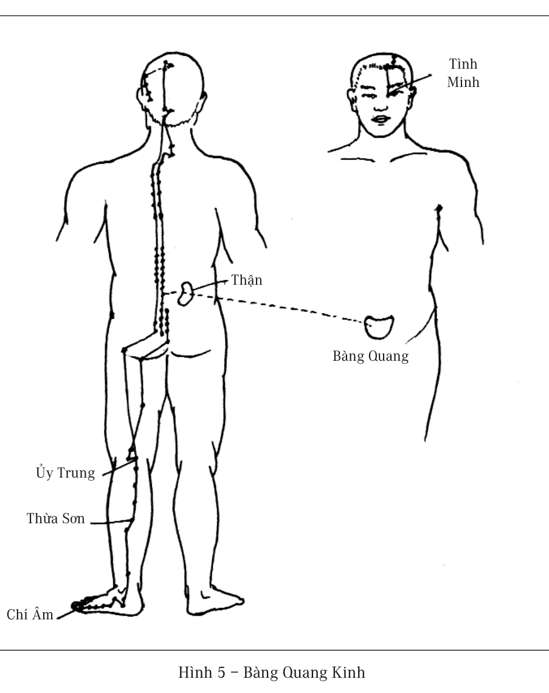
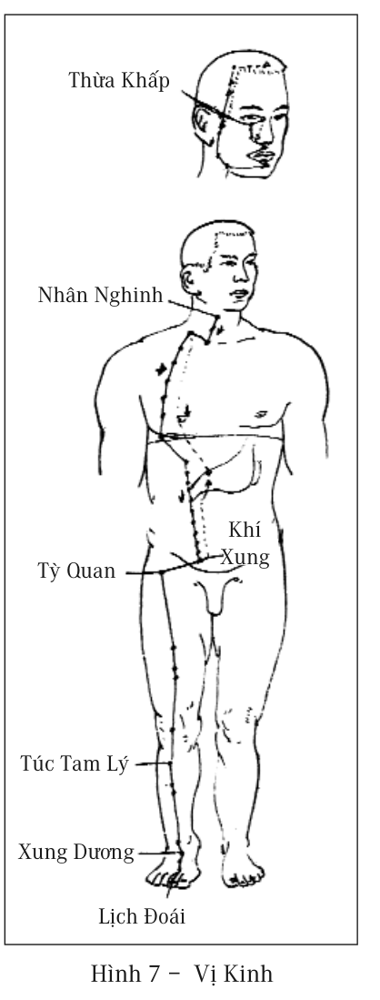
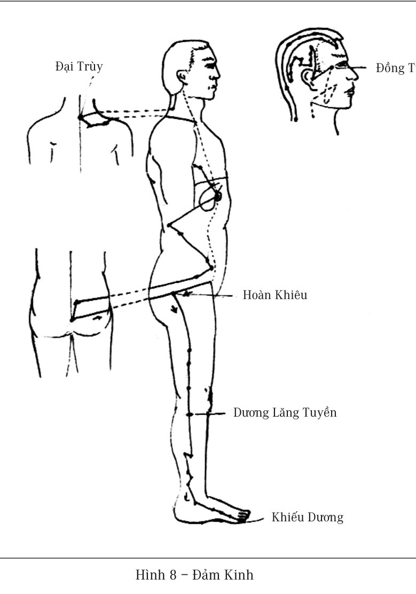

# Chương 4: HÀN KHÍ

Hàn khí là thuật ngữ hiện nay rất ít dùng, cảm mạo thì ai cũng rất quen thuộc. Cảm mạo là nói đến các loại biểu hiện triệu chứng như là hắt hơi, chảy nước mũi, ho, đau đầu, phát sốt, đau họng v.v. Hàn khí là một nguyên nhân chủ yếu của cảm mạo. Hàn khí trong Trung y không phải là một loại bệnh nghiêm trọng, nhưng lại ảnh hưởng sâu rộng, tác hại vô cùng.

Hắt hơi là một cơ năng bình thường của cơ thể, chủ yếu là dùng để loại bỏ những vật lạ xâm nhập vào khoang mũi. Mà chủng loại các vật lạ trong mũi thì rất nhiều, chỉ có vật lạ dưới hình thức nước mũi chúng ta mới xác định là “cảm mạo”. Cho nên bài trừ nước mũi mới là một nguyên nhân chủ yếu của hắt hơi, điều trị cảm mạo không nên ngăn trở hắt hơi, mà phải tìm ra nguyên nhân tạo thành nước mũi.

Do có nhiều nguyên nhân khác nhau đều tạo nên hiện tượng hắt hơi, chảy nước mũi, theo quan điểm Trung y, xác định bệnh tật không lấy biểu hiện triệu chứng của nó làm chủ yếu, mà là lấy nguyên nhân sinh bệnh của nó làm chủ yếu. Cho nên, chứng hắt hơi, chảy nước mũi do bị lạnh (hàn) gây nên, được gọi là phong hàn. Những triệu chứng do phong hàn gây nên thì vô cùng nhiều, từ cổ xưa tới nay nhiều thầy thuốc Trung y nổi tiếng đều cực kỳ coi trọng phong hàn, Cuốn sách y học nổi tiếng của Trương Trọng Cảnh - một danh y đời Hán, tuy là đề cập đến rất nhiều loại bệnh tật, nhưng lại lấy tên cho cuốn sách là Thương hàn tạp bệnh, cũng chính là nguyên nhân này.

> 
>
> *“Một đôi nam nữ ở với nhau, hễ không cẩn thận là sẽ tạo ra một con người. Cơ thể con người phức tạp và hoàn mỹ, mà chỉ dùng phương pháp giản đơn như vậy để tạo ra.”*

Dùng tri thức khoa học kỹ thuật hiện đại có thể càng dễ dàng thuyết minh quan niệm của Trung y đối với phong hàn, “phong” và “hàn” là hai loại bệnh khác nhau, “phong” chỉ “tà phong”, nội hàm chủ yếu nhất của chữ phong (风) là chữ trùng (虫), cũng chính là nguyên nhân bệnh xâm nhập từ bên ngoài vào, giống như y học hiện đại vẫn gọi là “vi khuẩn” hoặc “vi rút”. Người Trung Quốc thời cổ tuy không biết đến sự tồn tại của vi khuẩn, nhưng lại đoán được là có một thứ gì đó tương tự như trùng (虫) gây bệnh cho con người, đối với loại bệnh tật này tuy có một số phương pháp dự phòng, nhưng không có biện pháp chữa trị thực sự.

“Hàn khí” là thuật ngữ chỉ có trong Trung y. Chữ “khí” (气) nói đến trong Trung y, có nhiều loại ý nghĩa khác nhau, có không khí mà chúng ta rất quen thuộc, cũng có cương khí vô hình mà các nhà khí công luyện tập, thậm chí đến thể lỏng cũng thường dùng “khí” để biểu thị.

“Hàn khí” ở đây là muốn nói đến thứ sinh ra khi cơ thể bị lạnh. Theo quan điểm của vật lý học, nhiệt lượng sẽ truyền sang các vật thể lân cận, từ vật thể có nhiệt độ cao truyền sang vật thể có nhiệt độ thấp hơn. Bởi thế khi cơ thể người ở chỗ có nhiệt độ thấp, nhiệt lượng của thân thể sẽ không ngừng tỏa ra, cho đến khi nhiệt độ của người và nhiệt độ xung quanh ngang bằng nhau mới thôi. Nhiệt độ của cơ thể người hạ thấp xuống, trong y học gọi là mất nhiệt, là một biểu hiện nguy hiểm cho tính mạng. Do đó, khi cơ thể người ở trong môi trường nhiệt độ thấp, biện pháp phòng vệ đầu tiên là nhanh chóng hạ thấp thích đáng nhiệt độ bề mặt cơ thể, thu nhỏ sự chênh lệch nhiệt độ giữa

cơ thể và xung quanh, hạ thấp tốc độ nhiệt lượng tỏa ra, nhưng nhiệt độ mà cơ thể có thể hạ thấp được là rất có hạn.

> 
>
> *“Người mắc bệnh bao giờ cũng chỉ muốn tìm được linh đan linh dược để khỏi bệnh, mà không muốn điều chỉnh thói quen sinh hoạt của mình để loại bỏ nguồn gốc thực sự của bệnh tật.”*

Khi nhiệt lượng cơ thể vẫn tỏa ra rất nhanh, cơ thể sẽ khởi động biện pháp phòng vệ thứ hai, đó là sử dụng phương pháp hóa học, đốt cháy vật chất nào đó, làm cho nó sản sinh ra nhiệt lượng. Biện pháp này tất nhiên sẽ phải tiến hành ở bộ phận dưới da gần bề mặt của cơ thể, đề phòng các bộ phận quan trọng bên trong cơ thể mất nhiệt. Vật chất mà bị đốt cháy này, thông thường là chất nào đó trong thể lỏng lưu động trên bề mặt cơ thể. Sự đốt cháy nói đến ở đây hoàn toàn không giống với sự đốt cháy nói đến trong cuộc sống thường ngày, không hề có ngọn lửa, mà chỉ là tiến hành phản ứng hóa học giữa hai chất khác nhau, làm cho nó sinh ra nhiệt lượng.

Cơ thể người là một thầy ảo thuật hóa học cao siêu, khi bị bên ngoài làm thương tổn đến xương, xương gẫy xung quanh do mạch máu bị vỡ tạo nên chảy máu bên trong, máu chảy ra sẽ bao bọc xung quanh chỗ xương gẫy. Lúc này cơ thể sẽ tiết ra một số chất, biến số máu bao bọc này thành tế bào xương, nhanh chóng kết hợp thành một khối với xương vốn có, tự động tu sửa phục hồi xương bị gẫy. Phương pháp tu sửa phục hồi này của cơ thể là điều mà y học hiện đại biết rất rõ.

Nếu cơ thể có thể sử dụng phương pháp chuyển hóa máu thành tế bào xương để sửa chữa phục hồi xương cốt, thì tất nhiên cũng có thể sử dụng biện pháp chuyển hóa vật chất sản sinh nhiệt lượng để phòng vệ sự thất tán nhiệt lượng. Trong hóa học có rất nhiều phương pháp có thể chuyển biến vật chất sản sinh ra nhiệt lượng, ví dụ đơn giản nhất là đốt phân tử than sinh ra nhiệt lượng.

> 
>
> *“Y học hiện đại bó tay trước các bệnh mạn tính, rất có khả năng trong phương hướng và logic tư duy có vấn đề.”*

C2 +  2O2 -----> 2CO2 +  nhiệt lượng

Trong cơ thể chỗ nào cũng tràn ngập các loại hydrat carbon (CXHYOZ

- carbohydrate), thay đổi phù hợp tỷ lệ giữa carbon, hydro, oxy trong đó, hoặc cho thêm vào một chất nào đó đều có khả năng sản sinh ra nhiệt lượng. Phương pháp này làm cho chất dịch trong cơ thể vốn bình thường cải biến thành chất dịch có hàm lượng nhiệt thấp, đồng thời giải phóng ra nhiệt lượng, bù đắp vào chỗ nhiệt lượng bị thất tán ra bên ngoài có nhiệt độ thấp hơn, do đó làm giảm tốc độ mất nhiệt của cơ thể. Chất dịch được cải biến này không còn có thể cung cấp cho cơ thể sử dụng như lúc chưa cải biến được nữa, mà trở thành chất phế thải bị loại ra bên ngoài. Chất dịch biến chất này rất có khả năng là “hàn khí” mà Trung y đã nói tới mấy nghìn năm trước, có nghĩa là “hàn khí” rất có khả năng không phải là một khái niệm trừu tượng giống như khí công, mà là một vật chất cụ thể, có thể là ở trạng thái lỏng, cũng có thể là ở trạng thái rắn.

Do nhiệt lượng có thể phát ra từ các bộ phận của cơ thể, vật chất hàn khí cũng có thể xuất hiện ở các bộ phận khác nhau. Cơ thể đứng trước các phương pháp xử lý hàn khí của các bộ phận khác nhau, cho nên hình thành nên các loại biểu hiện triệu chứng cảm mạo khác nhau.

Ví dụ, hàn khí ở sau lưng cơ thể, sẽ tích tụ trực tiếp ở trong Bàng Quang Kinh (hình 5)

, tích tụ lâu ngày sẽ hình thành một lớp mỡ dầy ở sau lưng, lớp mỡ này chủ yếu là chất dịch đã biến chất được không ngừng tích tụ hết ngày này sang ngày khác mà thành.

> 
>
> *“Tiến hành cưa cưa cắt cắt trên cơ thể mà không hiểu biết được bao nhiêu thì nhất định sẽ dẫn đến rất nhiều vấn đề.”*

Hàn khí ở đỉnh đầu sẽ trực tiếp tích tụ ở đỉnh đầu, thông thường đỉnh đầu chỉ có một lớp da dầy, khi dùng tay ấn có cảm giác cưng cứng. Nhưng hàn khí tích tụ nhiều, sẽ hình thành một lớp vật chất mềm mềm, sờ vào giống như có một lớp đệm cao su xốp. Hàn khí đỉnh đầu ở mức nghiêm trọng hơn sẽ hình thành một cái bướu cưng cứng ở bên trái hoặc bên phải trước trán, khi đến bệnh viện bác sĩ sẽ chẩn đoán là hiện tượng tăng sinh chất xương, đây là vật chất tích tụ của hàn khí ở trạng thái rắn.

Hàn khí ở chính diện, phần thân trên sẽ tích tụ ở Phế Kinh và các kinh nhánh thuộc Phế Kinh (các nhánh của kinh lạc) (hình 6), nhóm kinh này nằm ở hai bên của tuyến giữa trước ngực. Hàn khí chính diện cũng có thể tích tụ ở Vị Kinh (hình 7)

, Vị Kinh từ dưới mắt kéo dài xuống tận ngón chân, phía trước của đùi là chỗ dễ dàng tích tụ hàn khí nhất. Hàn khí tích tụ ở Vị Kinh nghiêm trọng hơn sẽ làm cho phía trước đùi hình thành một lớp tổ chức cứng và dầy, khiến cho chân co duỗi khó khăn, đi lại rất trở ngại. Loại bệnh này, rất ít thầy thuốc có thể chẩn đoán ra nó có mối liên hệ với dạ dày, thường đều trở thành tạp chứng nghi ngại gây khó khăn cho việc điều trị, phải khập khiễng đến hàng chục năm, dù thế nào cũng khó có thể hình dung được nguyên nhân là do hàn khí tích tụ ở Vị Kinh gây nên.

Hàn khí ở bên cạnh tức nó tích tụ ở Đảm Kinh (hình 8)

, chỉ cần hàn khí xâm nhập vào cơ thể, bộ phận này sẽ không có cách nào tránh khỏi. Hàn khí ở bộ phận này có khi hình thành các đường vân ngang ở mé ngoài đùi, do vật chất của hàn khí làm trở ngại sự lưu thông của kinh lạc, làm cho xung quanh chỗ hàn khí tích tụ, rác thải do tế bào

sinh ra không có cách nào thải ra ngoài, hàn khí và rác thải tích tụ ngày càng nhiều lên sẽ làm cho mé ngoài của đùi phình to ra.

> 
>
> *“Vấn đề lớn nhất của y học hiện đại là: Đánh giá thấp trí tuệ tự thân của cơ thể người, đánh giá cao năng lực của tri thức nhân loại.”*

Do những chất thải này không phải là tổ chức của cơ thể, nên có thể tự do di chuyển lưu động giữa các tổ chức cơ thể, nếu người đó thích vận động, hàn khí và rác thải ở đùi sẽ chuyển dịch xuống phía dưới, và tích tụ ở bắp chân, hình thành hình chân củ cải. Thông thường nam giới vận động nhiều hơn nữ giới, cho nên ở nữ giới đa số bị tích tụ ở mé ngoài đùi, ở nam giới thì đa phần tích tụ ở bắp chân. Hiện tượng này như phần trên cuốn sách đã đề cập tới hàn khí là nguyên nhân đầu tiên gây trở ngại cho Đảm Kinh, cũng chính là hàn khí tích tụ ở Đảm Kinh đã gây trở ngại cho công năng của mật, và còn gây trở ngại cho việc hấp thụ. Vỗ Đảm Kinh một mặt có thể kích thích Đảm Kinh, cưỡng bức nó tiết dịch mật; mặt khác, chất phế thải tích tụ ở đây có thể lưu động, tiến tới đào thải ra ngoài.

Hàn khí sau khi từ ngoài da xâm nhập vào cơ thể, nếu lượng hàn khí xâm nhập vào cơ thể không nhiều, đồng thời khí huyết đầy đủ kinh lạc thông suốt, thì thân thể sẽ rất nhanh chóng chuyển hàn khí từ nơi nó xâm nhập đến nơi có thể đào thải nó ra ngoài, khoang mũi là một nơi đào thải chúng ra ngoài chủ yếu nhất, chỉ cần một hai lần hắt hơi là có thể thải được nó ra ngoài. Nếu diện tích bị lạnh (hàn) rất rộng, hoặc nhiệt độ xung quanh rất thấp, nhiệt lượng thất tán ra xung quanh rất nhiều, thân thể sẽ sản sinh ra số lượng lớn hàn khí (chất dịch biến chất), nhất thời không có cách nào thải hàn khí ra ngoài được, rất có khả năng sẽ xuất hiện triệu chứng của bệnh tật, sự sản sinh ra những triệu chứng này chủ yếu là hiện tượng khi

thân thể đào thải hàn khí. Lúc này thân thể phải tiêu hao rất nhiều năng lượng để xua đuổi hàn khí, khiến cho thân thể rơi vào trạng thái vô cùng suy yếu. Phương pháp ứng phó tốt nhất lúc này là nghỉ ngơi nhiều hơn, dành tất cả năng lượng cho thân thể dùng để xua đuổi hàn khí.

> 
>
> *“Bữa tối chén tạc chén thù, cái giá phải trả không phải chỉ là tiền bạc, mà còn phải trả cả thời gian tạo máu hết sức quý báu.”*

Khoang mũi là cửa ra thường thấy nhất của hàn khí, khi một số lượng ít hàn khí đến khoang mũi, lập tức tạo thành tắc mũi; khi số lượng tăng nhiều lên, sẽ xuất hiện triệu chứng hắt hơi; số lượng tiếp tục tăng lên nữa, sẽ xuất hiện triệu chứng chảy nước mũi, nước mũi lúc này đa số là có nhiệt độ thấp hơn nhiệt độ cơ thể, nên có cảm giác mát mát. Thông thường bắt đầu chảy nước mũi cũng chính là giai đoạn cuối của việc đào thải hàn khí, nước mũi chảy hết thì cảm mạo cũng khỏi.

Trong sách cổ Trung y đã viết, hàn khí trước tiên tích tụ ở các kinh lạc dưới da, lâu dần sẽ chuyển dịch vào các “phủ” tương ứng, ví dụ “vị hàn” (dạ dày lạnh) mà chúng ta thường thấy chính là hiện tượng này, khi có hiện tượng này, dùng tay sờ vào chỗ dạ dày, có thể trực tiếp cảm giác thấy nhiệt độ của nó rất thấp, có khi chênh lệch đến 6 - 7*0*C so với chỗ rốn.

Khi hàn khí ở trong thân thể càng lâu, hoặc càng nhiều hàn khí xâm nhập vào, sẽ dần dần di chuyển vào tạng phế, hình thành hiện tượng mà Trung y gọi là phế hư, phế hư chính là hàn khí ở phổi quá nhiều dẫn đến công năng của phổi dần dần suy giảm. Trong cơ thể người, tạng phế ngoài công năng hô hấp như ta đã biết ra, nó còn là cơ quan chủ yếu phân bố nước đến các bộ phận. Khi hàn khí xâm nhập vào tạng phế, năng lực của tạng phế lập tức hạ thấp theo, năng lực hô

hấp và xử lý nước cũng theo đó suy yếu đi. Lúc này, phần lớn lượng nước đưa vào cơ thể lập tức bị thải ra ngoài, cảm giác hễ uống nước là muốn đi tiểu, nước tiểu trong và không có mùi. Do bị trở ngại trong việc hấp thụ nước, làm cho tỷ lệ nước trong các tổ chức cơ thể càng ngày càng ít, bên ngoài càng ngày càng gầy sọp đi, đồng thời sự sáng bóng trên nước da cũng mất dần, hơn nữa da càng ngày càng tối sẫm lại. Thông thường theo vọng chẩn của Trung y, sắc mặt xạm đen không sáng bóng tức là biểu hiện của phế khí yếu kém. Cùng với sự suy nhược của phế khí, tinh thần cũng ngày càng bi quan, rất dễ có cảm giác không cầm lòng được muốn bật khóc, đó chính là hiện tượng “phế chủ bi” nói trong sách Trung y.

> 
>
> *“Sự việc giản đơn được xem xét một cách rất phức tạp, có thể phát hiện ra lĩnh vực mới; hiện tượng phức tạp được nhìn nhận một cách giản đơn, có thể phát hiện ra định luật mới”*

Nói một cách nghiêm túc, khi hàn khí xâm nhập vào cơ thể, cơ thể chỉ có bên ngoài biến đổi một cách chậm chạp, không hề có triệu chứng hay cảm giác gì khó chịu, đa số cảm giác khó chịu đến từ quá trình đào thải hàn khí. Khi đào thải hàn khí tồn tại ở các bộ phận thân thể khác nhau, thì các triệu chứng cũng biểu hiện không giống nhau, đương nhiên đối sách ứng biến cũng không giống nhau. Bởi vậy, sau khi hiểu rõ nguyên nhân của hàn khí, quan trọng nhất chính là phải học được cách xử lý chính xác các triệu chứng của việc đào thải hàn khí.

## Đào thải hàn khí

Nhiều người khi cảm mạo, thường thấy xuất hiện triệu chứng thân thể rất rét, cảm giác giá lạnh hình như phát ra từ sâu bên trong cơ thể, đắp thêm mấy cái chăn cũng không có tác dụng gì. Hiển nhiên một bộ phận nào đó của cơ thể lúc này ở trong trạng thái nhiệt độ thấp, nhưng

trạng thái này sẽ kéo dài không lâu, thông thường chỉ một lúc sau là không còn thấy rét nữa.

> 
>
> *“Người nào không dành ra được thời gian để ngủ, sớm muộn sẽ phải dành ra thời gian để sinh bệnh.”*

Ở trên đã nói đến khi thân thể đối diện với sự xâm nhập của hàn khí, sẽ sản sinh một loại phản ứng hóa học nào đó, làm cho thành phần hóa học trong chất dịch của cơ thể phát sinh biến đổi, giải phóng nhiệt lượng để ngăn chặn thân thể mất nhiệt. Những vật chất bị cải biến này cũng chính là hàn khí, nếu nó không bị đào thải ra ngoài thì sẽ tồn tại lâu dài trong cơ thể. Sau khi tình trạng cơ thể được cải thiện có năng lượng đầy đủ, thân thể lại sử dụng biện pháp hóa học ngược lại, đem vật chất có chứa hàn khí hoàn nguyên trở lại. Do lúc đầu khi cải biến vật chất đã giải phóng năng lượng, lúc này lại biến đổi vật chất trở lại, tự nhiên sẽ hấp thu một số lượng lớn nhiệt lượng ở xung quanh, làm cho nhiệt độ của các tổ chức ở xung quanh nó hoặc chất dịch cơ thể hạ thấp xuống. Thân thể lại đem chất dịch hoặc khí thải ở nhiệt độ thấp này thải ra ngoài, tức là đào thải hàn khí ra ngoài. Bởi vậy, lúc này sẽ cảm giác thấy cái lạnh đến từ bên trong cơ thể, sờ lên đầu mũi thấy lạnh ngắt, dường như một loạt các tổ chức có liên quan với đầu mũi đều có nhiệt độ rất thấp. Thể khí bật ra khi hắt hơi hoặc ho, hoặc nước mũi chảy ra khi cảm mạo đều ở trạng thái nhiệt độ thấp, không giống như khi ngáp lúc bình thường hơi thở ra đều là khí nóng.

Từ suy luận này, rõ ràng sự xuất hiện của triệu chứng cảm mạo không phải là do cơ thể trở nên suy yếu, trái lại khi thân thể từ yếu chuyển sang mạnh thì mới xuất hiện triệu chứng. Nhiều người chưa bao giờ bị cảm mạo, không có nghĩa là thân thể người đó thật sự khỏe mạnh,

ngược lại là thân thể anh ta căn bản không có năng lực đào thải bất cứ thứ hàn khí nào, mới không thể sản sinh ra bất cứ trạng thái khó chịu nào. Nhiều người sắc mặt xám và khô, hiển nhiên người đó có chứng phế hư, đều là rất nhiều năm không có kinh nghiệm của cảm mạo, loại người này từ triệu chứng bên ngoài cho thấy hàn khí trong cơ thể rất nặng, nhưng lại không có năng lực đào thải ra.

> 
>
> *“Ham muốn là gánh nặng lớn nhất của cơ thể”*

Những người không có năng lực đào thải hàn khí này, sử dụng bất cứ loại thuốc nào cũng không thể đem hàn khí tích tụ ở trong kinh lạc hoặc ẩn chứa sâu trong tạng phế đào thải ra ngoài được. Trước tiên phải điều dưỡng cho có đủ khí huyết, làm cho cơ thể có năng lượng thật đầy đủ, tự nó sẽ phát động cuộc chiến tranh truy đuổi hàn khí, khi đó hàn khí mới có thể bị đào thải ra ngoài. Trong quá trình này, kỹ thuật điều trị của nhân loại có hạn, chỉ có thể lúc cuối cùng khi cơ thể bắt đầu đào thải hàn khí, thì tác động thêm vào một sự trợ lực rất nhỏ mà thôi.

Bởi vậy, bất luận là loại hàn khí nào, phương pháp đối phó với hàn khí, đều phải quay về như trên đã nói là phải xây dựng thành thói quen sinh hoạt tốt đẹp để nâng cao khí huyết, xử lý chính xác mỗi một triệu chứng của bệnh tật, không có phương thức nào nhanh hơn, càng không có thần đơn tiên dược nào cả.

## Phương pháp xử lý chính xác hàn khí

Triệu chứng của cảm mạo có rất nhiều loại, đại thể bao gồm hắt hơi, chảy nước mũi, ho, đau đầu, toàn thân mỏi mệt hoặc đau nhức, phát sốt, đau họng. Hàn khí bị thải ra từ độ sâu hoặc bộ phận khác nhau

trong cơ thể, sẽ hình thành các trạng thái triệu chứng khác nhau. Bởi vậy, nhìn chung có thể dựa vào triệu chứng và nguyên nhân của hàn khí mà phân thành ba loại lớn là hàn khí kinh lạc sau lưng, hàn khí kinh lạc phía trước thân thể và hàn khí tạng phế (phổi).

> 
>
> *“Nhiều danh y và phương thuốc bí truyền như vậy, đòi hỏi phải có trí tuệ dồi dào, mới có thể tìm được con đường sống.”*

Kinh lạc sau lưng thân thể chủ yếu là Bàng Quang Kinh, do diện tích sau lưng nơi sở tại của Bàng Quang Kinh có diện tích rất rộng, lại là nơi thân thể rất dễ bị lạnh, cho nên nhiều người đều có lượng lớn hàn khí tồn tại ở bộ phận này. Khi hàn khí ở Bàng Quang Kinh bị đào thải ra sẽ xuất hiện toàn bộ vai lưng đau mỏi hoặc đau nhức. Do Bàng Quang Kinh quán xuyến toàn bộ phần đầu, nên sẽ xuất hiện cảm giác phần não sau căng phồng, đầu đau nhức hoặc đau nửa bên đầu, chỗ huyệt ấn đường gần đầu lông mày đau râm ran, xoa ấn huyệt Phong Trì sau tai có cảm giác đau mạnh. Họng cũng xuất hiện triệu chứng khó chịu hoặc ho, tất cả những điều này đều là triệu chứng khi hàn khí Bàng Quang Kinh bị thải ra. Khi say nắng mùa hè cũng thường có loại cảm giác tương tự, cả hai tình trạng đều là triệu chứng của Bàng Quang Kinh sau lưng bị trở ngại.

Khi xuất hiện cảm giác khó chịu do đào thải hàn khí Bàng Quang Kinh, phương pháp xử lý đơn giản nhất là đánh gió. Do lưng là nơi có các huyệt vị chủ yếu của Bàng Quang Kinh, cho nên đánh gió sau cổ, lưng và trán, làm cho kinh lạc lưu thông, đánh gió xong ngủ một giấc, cảm giác khó chịu sẽ không còn nữa.

Ngoài ra, khi bắt đầu xuất hiện đau đầu, có thể uống nhiều nước Thổ phục linh (loại nước uống chế từ cây cây Thổ phục linh, có tên khoa học là sarsaparilla), sau đó ra phơi nắng, mùa đông thì có thể

phơi trực tiếp dưới ánh nắng mặt trời, còn mùa hè nơi có nắng rát thì có thể ngồi trong bóng cây cũng được, thông thường chỉ độ nửa giờ thì triệu chứng sẽ tiêu tan hết. Ngoài ra cũng có thể uống một cốc trà táo quế, đi ngủ một giấc, cũng có thể làm triệu chứng đau đầu giảm bớt một phần.

> 
>
> *“Người gan nóng, hay nằm mơ, giấc ngủ không sâu.”*

Khi hàn khí kinh lạc phía trước thân thể bị thải ra, triệu chứng điển hình nhất là ngạt mũi, hắt hơi, chảy nước mũi, có khi còn xuất hiện tình trạng tháo dạ. Những triệu chứng này cũng giống với triệu chứng khi hàn khí trong phổi bị thải ra, phương pháp phân biệt là dùng tay sờ vào trán và đầu mũi rồi so sánh với nhiệt độ ở các chỗ khác trên mặt người đó. Nếu nhiệt độ ở trán thấp hơn, thì triệu chứng này là hàn khí trong kinh lạc phía trước thân thể bị thải ra, nếu nhiệt độ ở đầu mũi thấp hơn, thì là hàn khí trong phổi bị thải ra. Sự đào thải hàn khí trong kinh lạc sẽ không gây ho cũng không dễ xuất hiện sốt, khi hàn khí trong tạng phế bị thải ra thì rất dễ xuất hiện ho và gây sốt.

Kinh lạc tồn trữ và phóng thích hàn khí ở phía trước thân thể chủ yếu là Vị Kinh (dạ dày) và Đại Tràng Kinh. Do đó, đồng thời với việc hàn khí thải ra, dạ dày và ruột cũng thường xuất hiện những triệu chứng khó chịu. Thường xuất hiện nhất là chướng khí, có khi còn xuất hiện tình trạng rất muốn ăn vặt, nhưng đại tiện rất khó, đến khi đại tiện dễ dàng thì cảm mạo cũng sắp khỏi. Cũng giống với hiện tượng đào thải hàn khí Bàng Quang Kinh, sách lược tốt nhất lúc này là nghỉ ngơi tĩnh dưỡng, để cơ thể tập trung năng lượng đào thải hàn khí ra ngoài, có thể uống thêm trà táo quế để nâng cao năng lượng cho cơ thể, hỗ trợ thân thể đào thải hàn khí.

> 
>
> *“Linh đan linh dược ở ngay trong cơ thể, lại cứ không ngừng đi tìm kiếm ở bên ngoài.”*

Nhiệt độ ở đầu mũi thấp là triệu chứng rõ rệt nhất của hàn khí từ phổi đi ra. Thông thường nhiệt độ thấp này xuất hiện sớm hơn các loại triệu chứng có cảm giác. Phần trắng ở mắt một số người lúc này cũng sẽ xuất hiện màu xanh nhạt, đặc biệt là trẻ em rất dễ xuất hiện tình trạng này, người làm mẹ khi nhìn thấy mắt con mình có màu xanh, thì nên sờ vào chóp mũi con, nếu cũng thấy lạnh ngắt, thì trước tiên cần phải chuẩn bị tâm lý con mình sắp bị cảm mạo. Có thể trong nhà có chuẩn bị sẵn thuốc giảm sốt, khi nhiệt độ lên cao đến trên 38*0*C thì dùng thuốc giảm sốt để đề phòng thương tổn cho cơ thể. Triệu chứng chỏm mũi lạnh hoặc phần trắng mắt biến thành màu xanh xuất hiện khoảng một hai ngày thì sẽ bắt đầu xuất hiện triệu chứng cảm mạo. Nếu thời gian nhiệt độ thấp rất dài (ba ngày đến một tuần), lại xuất hiện triệu chứng, thì cảm mạo lần này nhất định sẽ rất nặng, có khả năng xuất hiện sốt rất cao không thuyên giảm. Giống như là cơ thể ủ thời gian rất dài rồi mới trục xuất hàn khí ra, cho nên đặc biệt nghiêm trọng. Thông thường người có thân thể càng khỏe mạnh thì lực trục xuất hàn khí ra cũng càng mạnh, mức độ cảm mạo cũng càng nghiêm trọng.

Không khí thở ra lúc ho khi hàn khí trú ngụ trong phổi, bao giờ cũng mát mát. Loại ho này nên xem nó là một loại hô hấp sâu, không phải là bệnh, là công năng bình thường của cơ thể, là biện pháp nhằm làm cho hàn khí nằm sâu trong tạng phế bị thải loại ra ngoài.

Phân biệt chính xác “những triệu chứng nào do bệnh tật gây nên”, “những triệu chứng nào là công năng bình thường của cơ thể đưa tới” là vô cùng quan trọng. Khi nhận định ho là công năng bình thường của cơ thể, nhằm thải loại hàn khí trong phổi, thì đối với loại

ho này, không cần vội vàng dùng thuốc để ngăn chặn nó, mà phải tìm cách nâng cao năng lực đào thải hàn khí của cơ thể, làm cho hàn khí bị thải loại triệt để ra ngoài.

> 
>
> *“Bệnh tật thực ra là sự ghi chép trung thực sinh hoạt thường ngày của chúng ta.”*

Dân gian Trung Quốc truyền thống dùng nước gừng để tăng cường nhiệt năng cho cơ thể, hoặc Trung - Tây y đều đề xướng là nên nghỉ ngơi nhiều hơn, đó đều là phương pháp tốt giúp nâng cao năng lượng cơ thể để nhanh chóng đào thải hàn khí. Những phương pháp đúng đắn này, có khi không hề làm cho triệu chứng thuyên giảm, thậm chí còn thường làm cho tình trạng càng trầm trọng hơn. Bởi vì sau khi cơ thể tăng cường năng lực, thì càng dùng nhiều sức vào việc đào thải hàn khí, thân thể đòi hỏi đào thải càng nhiều rác thải, đương nhiên sẽ càng không dễ chịu. Trạng thái này tuy sẽ xuất hiện triệu chứng nghiêm trọng tạm thời, nhưng toàn bộ thời gian sinh bệnh sẽ rút ngắn, hơn nữa hàn khí sẽ thực sự bị thải ra ngoài.

## Làm thế nào để giảm bớt sự xâm nhập của hàn khí

Hàn khí có nguy hại lớn như vậy, nhưng mỗi người lại rất khó hoàn toàn tránh khỏi sự xâm nhập của hàn khí, chỉ có xây dựng được quan niệm đúng đắn trong cuộc sống thường ngày, mới có thể giảm thiểu tối đa sự xâm nhập của nó. Dưới đây là mấy phương pháp chủ yếu phòng ngừa sự xâm nhập của hàn khí:

### Tránh dầm nước mưa

Đây là hành vi mà những thanh niên lãng mạn thích được trải nghiệm như trong tiểu thuyết hay phim ảnh, do thanh niên hiện nay đa số đi ngủ muộn dẫn đến khí huyết thường là không đủ, đối với

hàn khí xâm nhập lúc dầm nước mưa thân thể không dễ dàng ngay lập tức trục xuất nó, cho nên cũng không có bất cứ biểu hiện triệu chứng nào, đa số mọi người cũng đều nhận định một cách ngây thơ rằng thân thể mình rất khỏe, đủ sức chịu đựng một chút mưa nhỏ này. Lâu dần đối với những trận mưa nhỏ này hoàn toàn không còn để ý gì đến nữa.

> 
>
> *“Vỗ Đảm Kinh sẽ trực tiếp tác động làm cho lớp mỡ ở mông và mé ngoài hai đùi giảm bớt đi, làm như vậy độ khoảng từ một đến hai tháng sẽ cảm giác thấy ống quần rộng hẳn ra.”*

Thực ra ngấm mưa đã để lại hàn khí ở đỉnh đầu và những chỗ bị lạnh khác trên thân thể, những người thường xuyên bị ngấm nước mưa, đỉnh đầu đa phần sinh ra một lớp “mỡ” dầy dầy mềm mềm, lớp mỡ này chính là vật chất của hàn khí. Đợi đến một hôm nào đó thân thể nghỉ đủ rồi, khí huyết tăng lên sẽ bắt đầu đào thải những hàn khí này, do số lượng lớn hàn khí tích tụ lâu ngày thân thể yêu cầu sự hỗ trợ của phương thức liên tục hắt hơi, chảy nước mũi để thải chúng ra, lúc này lại hắt hơi, chảy nước mũi quá nhiều nên bị thầy thuốc cho là viêm mũi dị ứng. Rất có khả năng do tuổi trẻ ham thích lãng mạn nhất thời, mà phải mất nhiều năm thậm chí già nửa đời người để gánh chịu nỗi đau khổ của bệnh viêm mũi dị ứng, thực là không thể hiểu nổi.

### Gội đầu cần phải sấy khô ngay

Nhiều người gội đầu đều có thói quen lười sấy khô tóc, có một số người thậm chí còn dùng vải bọc lấy đầu vừa gội, những hành vi này đều làm cho đỉnh đầu thu hút nhiều hàn khí vào, kết quả có tác hại giống như dầm nước mưa.

> 
>
> *“Phần lớn cái dùng mất trong thời gian xem tivi là thời gian tạo máu.”*

### Những điều cần chú ý khi bơi lội

Bơi lội là vận động được người hiện đại rất yêu thích, nó có lợi ích thực sự cho thân thể, nhưng bơi lội cũng là một con đường chủ yếu nhất để hàn khí xâm nhập vào cơ thể. Nó giống với dầm mưa ở chỗ là những hàn khí này đa phần không có phản ứng tức thời, khiến nhiều người cho rằng bơi lội không có quan hệ gì với hàn khí cả. Đa số những người thích bơi lội thường khi từ trong nước lên, đều có cảm giác rất lạnh, đặc biệt là khi có trận gió thổi tới lập tức rùng mình một cái, loại cảm giác này chính là cảm thụ cụ thể nhất của việc hàn khí đã xâm nhập vào cơ thể.

Người thích bơi lội tốt nhất nên chọn bể bơi có nước ấm trong nhà không có gió, để giảm thiểu khả năng bị lạnh. Đồng thời trước và sau mỗi lần bơi lội nên uống một chén trà gừng, tăng cường năng lực cho cơ thể chống lại hàn khí.

Còn một số người có thói quen thích bơi lội vào mùa đông, từ quan điểm hàn khí, đó là vận động ngu xuẩn nhất. Giới tự nhiên không có loại động vật nào có kết cấu gần với người lại có hành vi như vậy. Thượng đế khi sáng tạo ra con người không hề tính đến có người lại yêu thích loại vận động này, các bạn yêu thích loại vận động này đành phải tự cầu lấy nhiều phúc thôi.

Xin cảnh báo với các bạn này rằng: nhất thời không có triệu chứng không có nghĩa là hàn khí chưa xâm nhập vào cơ thể, sức mạnh ý chí cá nhân có thể làm cho con người chịu đựng loại kích thích này, nhưng không thể nào thay đổi được sự thực hàn khí đã xâm nhập vào cơ thể.

> 
>
> *“Tam tự kinh của người già trăm tuổi: Vỗ Đảm Kinh, Đi ngủ sớm, Day tâm bao, Không tức giận, Ruột giữ sạch.”*

### Trong nhà thường xuyên có sẵn trà gừng

Trong một số bộ phim cổ trang Trung Quốc, thường thấy có người bị mưa ướt sũng, các bậc ông bà cha chú trong nhà lập tức bảo người nhà chuẩn bị một bát trà gừng cho người bị ướt nước mưa uống. Đây là thường thức vô cùng quan trọng, một người bị ướt nước mưa, hoặc bị phong hàn, bất luận là bản thân anh ta hoặc người bên cạnh đều biết anh ta đã bị lạnh (hàn), thì cần phải uống trà gừng ngay lúc đó, trục xuất hàn khí ra, không phải đợi đến khi thân thể xuất hiện triệu chứng mới tiến hành xử lý.
