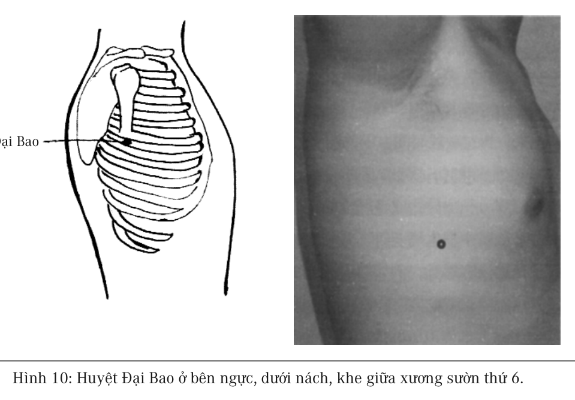

# Chương 5: BỆNH VÀ CHỨNG

Lần đầu tiên tiếp xúc thực sự với Trung y là do tôi thường xuyên bị viêm lợi, răng nổi hẳn lên, bác sĩ cho rằng bị bệnh viêm chân răng, chữa trị mãi cũng không thấy có hiệu quả gì, sau đó bảo tôi đi tìm thầy thuốc Trung y thử xem. Bạn bè giới thiệu cho tôi một thầy thuốc Trung y rất giỏi, ông vừa xem liền nói vấn đề của tôi là do đại tràng và khí huyết của tôi quá kém nên mới như vậy. Chỉ cần điều dưỡng cho khí huyết tốt lên cộng thêm với điều trị đại tràng thì có thể giải quyết được vấn đề, sau đó tôi ngoan ngoãn ngủ sớm dậy sớm để dưỡng khí huyết, sau một tháng răng tôi không còn đau nữa, lợi cũng không viêm lại nữa.

Ví dụ này cho thấy rõ mối quan hệ giữa bệnh và chứng, lợi phát viêm là chứng, khí huyết và đại tràng mới là bệnh thực sự. “Chứng hiện ra ở tứ chi và ngũ quan, bệnh tồn tại ở lục phủ ngũ tạng”, là đạo lý căn bản nhất của Trung y.

“Biện chứng luận trị” là một phương pháp cơ bản chẩn đoán bệnh của Trung y, thầy thuốc dựa vào chứng trạng của người bệnh cộng với sự lý giải và kinh nghiệm của mình, dùng phương pháp suy lý đi tìm nguyên nhân căn bản của bệnh tật, rồi từ nguyên nhân của bệnh mà định ra phương pháp điều trị. Do Trung y không giống với Tây y chỉ đơn thuần dựa vào chứng trạng để trị bệnh, cần phải suy luận truy tìm đến tận cùng nguyên nhân thực sự của bệnh tật.

Thông thường nguyên nhân của bệnh tật có mấy tầng lớp. Chúng ta hãy lấy bệnh thần kinh tọa làm ví dụ, người bệnh một chân thường

xuyên bị tê dại hoặc đau buốt, theo quan điểm của Trung y, trước tiên cần phải tìm hiểu mối quan hệ giữa kinh lạc và bộ phận đau của bệnh nhân, thông thường bộ phận đau của loại này đa phần là ở Đảm Kinh, do đó có thể phán đoán là đau Đảm Kinh, mà nguyên nhân gây đau Đảm Kinh là phế nhiệt (phổi nóng) gây ra, như vậy có nghĩa là vấn đề Đảm Kinh là nguyên nhân tầng thứ nhất, phế nhiệt là nguyên nhân tầng thứ hai. Còn sự hình thành phế nhiệt thì là do hàn khí vốn tồn tại trong thân thể, khi năng lượng thân thể đủ để đào thải hàn khí, sẽ làm cho thân thể xuất hiện trạng thái phế nhiệt. Bởi vậy hàn khí mới là nguyên nhân ở tầng càng sâu hơn. Trong ví dụ này, chân tê dại hoặc đau buốt là “chứng”, hàn khí trong phổi (phế) mới là “bệnh”. Chẩn đoán bệnh tật cần phải trải qua từng bước suy luận và phân tích như vậy, mới có thể tìm ra được phương pháp điều trị, đây chính là cái mà chúng ta thường gọi là “biện chứng luận trị”.

> 
>
> *“Khi tức giận, cơ thể sinh ra khí, cho nên gọi tức giận là sinh khí.”*

## Quan hệ giữa bệnh và chứng

Trong lý luận hàn khí ở chương trước, tuy chứng hàn khí có thể xuất hiện ở các bộ phận trong cơ thể, nhưng người thầy thuốc trong quá trình biện chứng luận trị, phải nắm rất rõ hàn khí mà cơ thể đào thải ra là hàn khí của tạng phủ nào. Người thầy thuốc giỏi phải có năng lực từ chứng ở tứ chi ngũ quan của người bệnh, đọc ra được bệnh ở lục phủ ngũ tạng, khi điều trị cho thuốc theo “chứng” sẽ không có hiệu quả bằng cho thuốc theo “bệnh”.

Loại ví dụ này nhiều vô kể, ví dụ một người bị bệnh u vòm họng, nguyên nhân của nó là do từ rất sớm bệnh nhân đã từng bị lây nhiễm nghiêm trọng đường dạ dày và ruột. Cổ là nơi Đại Tràng Kinh đi qua,

đường kinh này do vấn đề của đại tràng mà tích tụ rất nhiều chất phế thải, nửa bên cổ của bệnh nhân phình to ra, theo logic “đầu đau chữa đầu, chân đau chữa chân” của Tây y, những chất phế thải này xuất hiện ở gần họng, thì nhất định phải là u vòm họng. Do đó trước sau luôn luôn đi tìm nguyên nhân bệnh có khả năng ở gần vòm họng, thông thường đều quy bệnh là do hút thuốc lá gây nên, nếu người bệnh không hút thuốc lá, thì lại quy cho là nguy hại của việc hít phải khói thuốc lá. Kỳ thực nơi xuất hiện chứng u là kết quả của vấn đề dạ dày và ruột, nguyên nhân căn bản không phải ở họng. Nếu đem những chất phế thải của chứng u ấy cắt bỏ hoàn toàn đi, thì cũng không có tý chút ảnh hưởng gì đối với nguyên nhân của bệnh, nếu sau khi phẫu thuật người bệnh không có thay đổi thói quen sinh hoạt của mình, vấn đề dạ dày và ruột không được cải thiện, không lâu sau bệnh tật sẽ lại tái phát trở lại.

> 
>
> *“Trung y mà phân ra thành các khoa thì không thể thấy được hệ thống hoàn chỉnh của nó nữa.”*

Lây nhiễm dạ dày và ruột có khả năng diễn biến thành rất nhiều loại bệnh khác nhau, ví dụ như bệnh viêm chân răng, viêm mũi dị ứng, u vòm họng, teo cơ, hen suyễn, mụn trứng cá. Đã từng có một bệnh án, đó là một bé gái mắc bệnh phát ban, truy tìm đến tận nguồn gốc, thì rất có thể là nguyên nhân gây bệnh ban đầu của em là do đã ăn số lượng lớn ốc nê vàng sống. Đặc biệt kỳ lạ là hai bệnh nhân tâm thần, nguyên nhân gây bệnh ban đầu cũng là lây nhiễm đường tiêu hóa.

Những người này ngoài việc còn nhớ được nhiều năm trước đã từng mắc bệnh dạ dày và ruột, bình thường không có cảm giác khó chịu ở hai bộ phận đó. Có người thậm chí chưa bao giờ bị ỉa chảy, mỗi người đều cho rằng dạ dày và ruột của mình rất tốt.

> 
>
> *“Sức khỏe đã không còn, thêm những con số 0 nữa thì có ý nghĩa gì.”*

Có mấy người mắc bệnh ung thư phế quản, tiến hành chụp phim, chỗ tạng phế xuất hiện bóng đen, hiển nhiên chỗ bóng đen này đang tồn tại vật lạ, nhưng những vật lạ này lại không ở trong tạng phế, cho nên Tây y gọi nó là ung thư phế quản.

Theo quan điểm Trung y, chỗ hai bên dưới nách ngoài phổi là chỗ của huyệt Đại Bao thuộc Tỳ Kinh (hình 10)

. Theo y lý của Trung y, phán đoán đối với những dị vật này là khi trong tỳ vị có biến chứng bệnh, quá trình thay cũ đổi mới trong kinh lạc tương đối yếu, dễ dàng tích tụ rác thải, thời gian lâu dần sẽ hình thành u bướu, chính là bóng đen trong phim chụp. Những u bướu này tuy là xuất hiện ở vị trí của phổi, nhưng không phải ở trong phổi, mà là ở trên kinh lạc của tỳ, theo quan điểm của Trung y, nó là bệnh của tỳ vị. Do đó, đối sách chính xác là tiến hành điều trị thẳng vào tỳ vị, chứ không nên cứ loay hoay quanh vấn đề của phổi.

Thực ra những rác thải này tích tụ dồn đống ở khắp nơi trong cơ thể, có một số tích tụ trên thân, có một số tích tụ trên mặt. Ví dụ, người có hai bên mang tai dầy lên phình to ra, đó là sự tích tụ rác thải của Tiểu Tràng Kinh, rác thải trong ví dụ ung thư phổi nêu trên, chỉ là tích tụ dồn đống đến chỗ rất gần với cơ quan quan trọng mà thôi, nếu gặp phải nhận định sai lầm của thầy thuốc, thì sẽ trở thành trọng bệnh.

Một người bị mắc bệnh viêm da, nơi phát sinh ổ bệnh trên mặt là vị trí mà Vị Kinh và Đại Tràng Kinh đi qua, trong quá trình điều chỉnh, cánh tay và cẳng chân nơi Đại Tràng Kinh đi qua, thường xuyên xuất hiện triệu chứng nóng, đỏ và ngứa. Trước đây cũng đã từng xuất hiện triệu chứng này, các bác sĩ đều nhận định nó là viêm da dị ứng. Sau khi nguồn

gốc bệnh là ruột và dạ dày bị khống chế, biến chứng viêm da mới không xuất hiện nữa, qua một thời gian, chỗ viêm da cũ cũng biến mất luôn.

> 
>
> *“Một đôi nam nữ ở với nhau, hễ không cẩn thận là sẽ tạo ra một con người. Cơ thể con người phức tạp và hoàn mỹ, mà chỉ dùng phương pháp giản đơn như vậy để tạo ra.”*

Khi nói đến triệu chứng, đa số mọi người đều nghĩ ngay đến một số những thay đổi rõ rệt trong cơ thể như hắt hơi, chảy nước mũi, ngứa da, đau ở đâu đó, xuất hiện vật lạ hoặc nghiêm trọng hơn như thổ huyết, hôn mê bất tỉnh. Thực ra, khi trong các tạng phủ phát sinh diễn biến bệnh tật, thì các kinh lạc tương ứng của nó cũng xuất hiện các loại triệu chứng khác nhau, đa phần triệu chứng chúng ta đều không cảm giác được, ví dụ như triệu chứng ung thư phế quản và viêm da nói trên, chỉ là tích trữ dồn đống các rác thải trong cơ thể, người bệnh không hề có bất cứ cảm giác khó chịu nào.

Trên thực tế bệnh ở các tạng trong cơ thể đều tồn tại các loại triệu chứng ở bên ngoài, một người thầy thuốc giỏi phải có năng lực đọc ra tình trạng sức khỏe hoàn chỉnh từ các loại triệu chứng nhỏ nhất của người bệnh.

## Y học hiện đại đã đánh giá thấp trí tuệ của cơ thể người

Theo quan điểm Trung y, cơ thể người mà chúng ta nhìn thấy, là một cơ thể tràn đầy chất trí tuệ, từ xưa tới nay, chúng ta luôn luôn đánh giá thấp chất trí tuệ của cơ thể, đánh giá cao tri thức của bản thân chúng ta. Thường xuyên không biết rõ cơ thể đang làm gì, đã liền phán định nó không có khả năng gì cả, với tri thức hiểu biết nửa vời chúng ta tiến hành can dự tùy tiện vào công việc của nó, nhiều bệnh tật của ngày hôm nay rất có thể là hậu quả của những hành vi can dự không thỏa đáng này gây nên.

Nhờ có khoa học kỹ thuật hiện đại, những nghiên cứu y học mới nhất của Trung y dần dần đã làm cho lý luận của nó hiện rõ ra cái diện

mạo của khoa học, hóa ra di sản của tổ tiên chúng ta không phải là không khoa học, chỉ có điều năng lực khoa học kỹ thuật của chúng ta trước đây không thể chứng thực được mà thôi. Chúng tôi tin tưởng rằng cùng với sự phát triển mạnh mẽ của những nghiên cứu này, ngoài việc có cơ hội triển khai nghiên cứu gene ra, còn là một cơ hội mới mở ra con đường giải quyết nhiều bệnh mạn tính.

> 
>
> *“Người mắc bệnh bao giờ cũng chỉ muốn tìm được linh đan linh dược để khỏi bệnh, mà không muốn điều chỉnh thói quen sinh hoạt của mình để loại bỏ nguồn gốc thực sự của bệnh tật.”*

Hệ thống chẩn đoán duy tu bên trong cơ thể người, không phải chỉ là năng lực miễn dịch hạn hẹp như Tây y nói, mà là một hệ thống điều trị hoàn chỉnh bao gồm tự chẩn đoán, quản lý nguồn năng lượng cơ thể, tự phục hồi và tái sinh, điều kiện cơ bản nhất để những hệ thống này làm việc là phải có năng lượng khí huyết đầy đủ.

Do trong cơ thể đã có hệ thống tự điều trị, khi chúng ta mắc bệnh, nên cân nhắc làm sao để cho hệ thống bên trong cơ thể hoạt động bình thường, không nên từ bên ngoài trực tiếp can dự vào điều chỉnh, chúng ta cần phải nhận biết được sự tồn tại của những chức năng này, và còn cần phải nhận biết được cơ thể đang tiến hành loại biện pháp ứng phó nào, và nó cần sự hỗ trợ gì ở chúng ta.

Đối với triệu chứng của bệnh tật, nên từ triệu chứng khó chịu nghĩa hẹp mở rộng đến triệu chứng không có cảm giác. Hơn nữa, khi đi tìm tòi những triệu chứng bệnh tật gây khó chịu thì cũng không nên loại bỏ trực tiếp những triệu chứng này, mà nên thông qua nó để tìm ra nguyên nhân thực sự của bệnh tật, triệt để loại bỏ nguyên nhân của bệnh tật mới là mục đích cuối cùng của điều trị.
