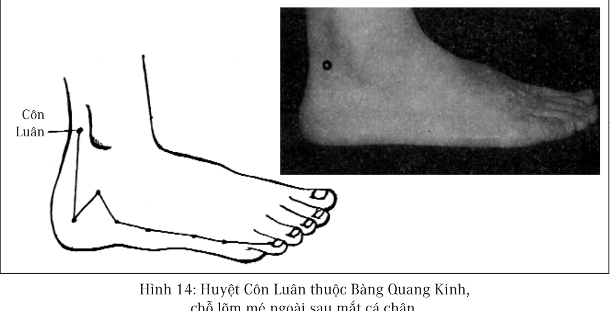
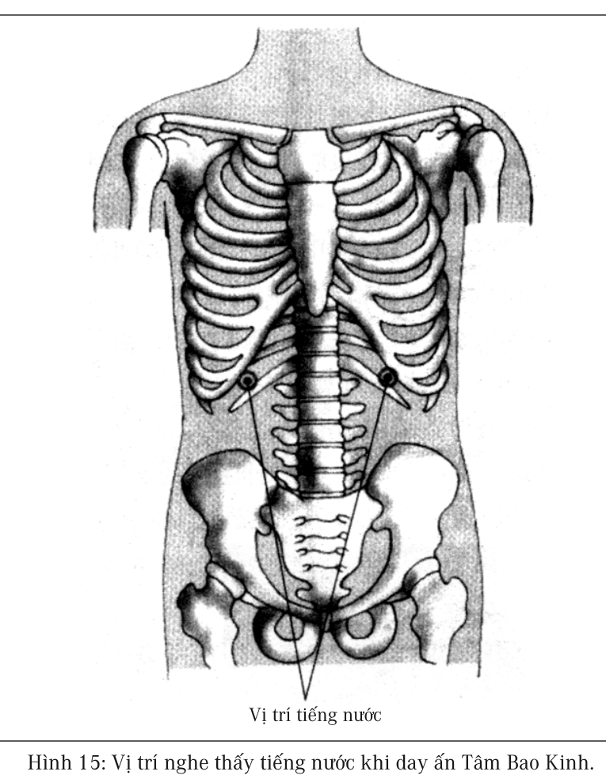

# Chương 6: DƯỠNG SINH HÀNG NGÀY

Do năng lượng khí huyết là kim chỉ nam quan trọng nhất của cơ thể, mà cơ thể người lại là sản phẩm của giới tự nhiên, vậy thì nhất định tồn tại những phương pháp rất đơn giản cũng có thể làm cho năng lượng khí huyết nâng cao lên. Chúng tôi theo y lý của Trung y, kết hợp với kinh nghiệm lâu năm của bản thân, soạn ra một bộ phương pháp dưỡng sinh giản đơn gọi là “nhất thức tam chiêu”

- Vỗ Đảm Kinh

- Ngủ sớm dậy sớm

- Xoa bóp Tâm Bao Kinh

“Nhất thức tam chiêu” này là bài luyện tập cần phải nỗ lực làm thường xuyên, ngoài ra còn có hai quan niệm quan trọng:

- Không tức giận

- Giữ gìn ruột, dạ dày sạch sẽ

“Nhất thức tam chiêu” và hai quan niệm, đều không phải là việc làm phức tạp, mỗi ngày chỉ mất không đến hai mươi phút, tương đối khó khăn hơn là vấn đề thứ hai ngủ sớm dậy sớm, thực ra đa số mọi người đều không hiểu được tầm quan trọng của giấc ngủ, chỉ cần hiểu được rồi, thì có thể dần dần điều chỉnh. Cứ làm theo “nhất thức tam chiêu” bản thân rất nhanh chóng có thể phát hiện ra sự thay đổi của cơ thể.

> 
>
> *“Y học hiện đại bó tay trước các bệnh mạn tính, rất có khả năng trong phương hướng và logic tư duy có vấn đề.”*

“Vỗ Đảm Kinh” và “xoa bóp Tâm Bao Kinh” là bài tự điều trị mỗi ngày chỉ mất mười phút; “ngủ sớm dậy sớm” tuy không có gì là khó khăn, nhưng con người hiện đại lại rất khó làm được; “không tức giận” là bài tu thân dưỡng tính; “giữ gìn ruột, dạ dày sạch sẽ” thì là một loại thói quen sinh hoạt, đây là vấn đề thuộc về quan niệm, quan niệm thay đổi đúng đắn rồi, tập quán sinh hoạt tự nhiên sẽ điều chỉnh theo.

Bộ phương pháp này chỉ cần duy trì thường xuyên, làm cho nó trở thành một bộ phận của sinh hoạt thường nhật, không cần phải kiêng khem ăn uống quá nhiều, là một loại phương pháp dưỡng sinh đơn giản nhất. Chỉ cần luôn ghi nhớ trong lòng năm điều này, năng lượng khí huyết nhất định luôn luôn ở trong xu thế tăng lên, bệnh tật sẽ mỗi ngày một lui dần, sống lâu, khỏe mạnh, mãi mãi thanh xuân sẽ là kết quả tất nhiên.

Bộ phương pháp này không đòi hỏi bất cứ sự chuẩn bị nào, có thể lập tức thực hành, chỉ cần thực hành một tháng, tức khắc sẽ phát hiện thấy sự thay đổi của thân thể, có thể tinh thần hoặc thể lực tốt hơn, cũng có thể trọng lượng tăng lên một chút, nhưng người lại chắc và nhỏ gọn hơn. Đây là một loại phương pháp thấy hiệu quả rất nhanh chóng. Có một số người trên đầu có một số chỗ tóc bị bạc, thực hành tập luyện một tháng, đã phát hiện thấy số tóc bạc không còn tăng lên nữa, sau ba tháng số tóc bạc bắt đầu giảm. Có một số người thể lực rất yếu, thường xuyên bị mệt mỏi, đến bệnh viện thì lại không tìm ra bệnh gì, sau ba đến bốn tháng thực hành bộ phương pháp này, khi kiểm tra sức khỏe thì lại thấy có triệu chứng bệnh tiểu đường, đường huyết tăng cao, những điều này đều là hiện tượng chuyển biến

tốt. Còn vấn đề của bệnh tiểu đường, trong chương điều dưỡng bệnh mạn tính, chúng tôi sẽ giới thiệu nguyên nhân gây bệnh và phương pháp điều dưỡng nó.

> 
>
> *“Tiến hành cưa cưa cắt cắt trên cơ thể mà không hiểu biết được bao nhiêu thì nhất định sẽ dẫn đến rất nhiều vấn đề.”*

Nếu như không thực hiện được nghiêm túc phương pháp sinh hoạt này, chỉ cần có thể tiếp thu quan niệm này, tập quán sinh hoạt tự nhiên sẽ dần dần thay đổi, chí ít cũng không còn tùy tiện bội chi năng lượng khí huyết. Nhiều bạn sau khi tiếp thu quan niệm này, đến giờ cần đi ngủ, đã gọi nhau “về nhà dưỡng khí huyết thôi”. Có khi không thể không làm việc quá sức (bội chi khí huyết) mấy ngày, cũng biết tìm cơ hội để bù đắp lại. Sau liên tục nhiều ngày sinh hoạt không bình thường, tự nhiên sẽ sản sinh cảm giác mệt mỏi, thân thể sẽ tự động sửa chữa phục hồi trở lại, chỉ cần đạt đến mức như vậy, sức khỏe sẽ không dễ dàng mất đi được.

## Vỗ Đảm Kinh (hình 11)

Như hình 11, tại bốn điểm ở mé ngoài đùi, mỗi lần vỗ cả bốn điểm tính là một lượt, mỗi ngày vỗ năm mươi lần vào mỗi điểm cả hai bên đùi phải đùi trái, có nghĩa là mỗi bên đùi phải và trái phải vỗ đến hai trăm lần. Do cơ và mỡ ở hai bên đùi rất dầy, nên cần phải dùng sức, kích thích vào huyệt vị mới có hiệu quả. Vỗ Đảm Kinh chủ yếu là kích thích vào Đảm Kinh, ép buộc nó tiết dịch mật, nâng cao năng lực hấp thụ của cơ thể, cung cấp đầy đủ nguyên liệu cho hệ thống tạo máu của cơ thể.

Do vỗ vào Đảm Kinh có thể làm tăng tốc hoạt động của Đảm Kinh, đem những rác thải tích tụ trên Đảm Kinh mé bên ngoài đùi thải ra

ngoài, bởi vậy vỗ Đảm Kinh sẽ trực tiếp tác động làm cho lớp mỡ ở mông và mé ngoài hai đùi giảm bớt đi, làm như vậy độ khoảng từ một đến hai tháng sẽ cảm giác thấy ống quần rộng hẳn ra.

> 
>
> *“Vấn đề lớn nhất của y học hiện đại là: Đánh giá thấp trí tuệ tự thân của cơ thể người, đánh giá cao năng lực của tri thức nhân loại.”*

Với những người bị mỡ gan và sỏi mật, đây là phương pháp giản đơn nhất mà có hiệu quả nhất cải thiện sức khỏe.

Trong chương “Hệ thống của cơ thể” đã nói rõ năng lượng của cơ thể tỷ lệ thuận với tổng lượng máu trong cơ thể. Khi giới tự nhiên sáng tạo ra cơ thể người, nhất định đã tạo ra cho cơ thể một hệ thống tạo máu tốt, trong tình hình bình thường mỗi người đều có thể tạo ra số máu đủ dùng cho mình. Khi cơ thể xuất hiện xu thế năng lượng hạ thấp, nhất định là một bộ phận nào đó của cơ thể đã bị trở ngại. Do đó, tìm ra nguyên nhân làm cho hệ thống tạo máu không sản sinh đủ số máu cần thiết, loại bỏ nó đi, làm cho cơ thể tiếp tục tạo đủ máu cho cơ thể như bình thường, thì sẽ làm cho việc cung ứng năng lượng cho cơ thể xuất hiện xu thế tăng lên.

Năng lượng khí huyết cũng giống như điện năng của các đồ dùng điện, là cơ sở quan trọng nhất của sức khỏe. Cơ thể tạo máu có hai điều kiện quan trọng, một trong hai điều kiện đó là cơ thể phải chuẩn bị đầy đủ nguyên vật liệu thì máu mới được tạo ra.

Dịch mật được tiết ra từ gan, túi mật là cơ quan tích trữ và khống chế việc tiết dịch mật. Những thức ăn con người ăn vào, có một phần là do tác dụng hóa học của dịch mật, phân giải thành các loại vật chất cần thiết cho cơ thể tạo máu. Bởi vậy, nếu dịch mật tiết ra không đủ, thì thức ăn bị phân giải thành vật chất mà cơ thể có thể hấp thụ được

cũng sẽ không đủ, đương nhiên cũng sẽ không có đủ nguyên liệu cần thiết cho cơ thể tạo máu.

> 
>
> *“Bữa tối chén tạc chén thù, cái giá phải trả không phải chỉ là tiền bạc, mà còn phải trả cả thời gian tạo máu hết sức quý báu.”*

Nguyên nhân gây nên việc tiết dịch mật không đủ, chủ yếu là do phương pháp xử lý đối với cảm mạo của người hiện đại có vấn đề. Người hiện đại do thường xuyên sử dụng Tây dược, khi bị cảm mạo, chủ yếu là chữa trị thẳng vào triệu chứng của bệnh, chọn phương pháp áp chế, mà không tìm cách trục xuất phong hàn ra ngoài. Thường xuyên dùng thuốc đặc hiệu áp chế mạnh vào triệu chứng, làm cho triệu chứng nhanh chóng biến mất, nhưng cái phong hàn gây nên cảm mạo thì vẫn còn lại trong cơ thể.

Đảm Kinh là một đường kinh lạc chạy từ đầu đến chân, trong đó mé ngoài đùi là chỗ dễ bị hàn khí xâm nhập nhất, cũng là nơi Đảm Kinh dễ tích tụ hàn khí nhất, do hàn khí tích tụ ở đây nên làm cho đường kinh lạc ở đoạn này không được thông suốt, làm cho các chất phế thải của các tổ chức ở gần đó thải ra mà không mang đi được, tích tụ lâu ngày tự nhiên sẽ làm cho toàn bộ Đảm Kinh bị tắc, các kỹ năng của Đảm Kinh cũng khó có thể vận hành bình thường được. Vỗ hay đấm vào đoạn Đảm Kinh ở mé ngoài đùi này cũng rất thuận tay, cho nên khuyến cáo các bạn hàng ngày nên vỗ hay đấm với số lượng thích đáng vào Đảm Kinh.

Vỗ vào Đảm Kinh sẽ trực tiếp kích thích việc tiết dịch mật, đây là phương pháp điều trị từ xa, không ngay lập tức giải quyết vấn để đảm (mật) hoặc phế (phổi), mà chỉ kích thích trực tiếp vào Đảm Kinh ép buộc nó tiết mật, làm cho cơ thể có thể sản sinh ra đủ nguyên liệu tạo máu, thì khí huyết sẽ dần dần nâng cao lên.

> 
>
> *“Sự việc giản đơn được xem xét một cách rất phức tạp, có thể phát hiện ra lĩnh vực mới; hiện tượng phức tạp được nhìn nhận một cách giản đơn, có thể phát hiện ra định luật mới”*

Vấn đề của đảm (mật) và phế (phổi) cần phải đợi đến khi nào khí huyết cơ thể rất cao thì mới có thể giải quyết được hoàn toàn, như vậy thì cần phải có một thời gian rất dài. Bởi vậy khuyến cáo các bạn cách tốt nhất là nên thường xuyên thực hành loại vận động này, trở thành một thói quen, mỗi ngày chỉ cần bỏ ra mười phút là có thể hoàn thành.

Những triệu chứng biểu hiện công năng của mật không tốt có rất nhiều, rõ ràng dễ thấy nhất là tóc bạc, đó là do năng lượng cơ thể không đủ gây nên, Trung y có câu nói rằng: “发乃血之末” (phát nãi huyết chi mạt - tóc là ngọn của máu), do dinh dưỡng cung cấp không đủ nên hình thành tóc bạc. Tóc dầu cũng là một loại triệu chứng, đó là do dịch mật tiết không đủ, không có cách nào phân giải được những chất dầu mỡ ăn vào, cộng thêm với nhân tố can (gan) nhiệt, nên tóc phát ra chất dầu.

### Vỗ đảm kinh là phương pháp bồi bổ tốt nhất

Buổi ban đầu khi công cụ vận chuyển của loài người chưa phát triển, đặc biệt là chưa có thiết bị làm lạnh để vận chuyển thực phẩm, đa số mọi người, suốt cả cuộc đời chỉ ăn những thực phẩm có ở trong phạm vi hai ba chục cây số nơi mình sinh sống, mỗi một người đều có một số vấn đề thiên lệch trong ăn uống hoặc ít hoặc nhiều. Bởi vậy, người thầy thuốc ở thời đại đó, quan trọng nhất là phải cho người bệnh ăn được một số thức ăn mà họ chưa được ăn, thuốc và thức ăn bổ dưỡng đó lúc ấy có khả năng phát huy công hiệu chữa bệnh rất cao. Mấy nghìn năm nay, kinh nghiệm mà con người ta tích lũy được, khiến cho nhiều người mang bệnh suốt đời đã nghĩ đến việc cần phải uống thuốc hoặc ăn những thực phẩm bổ dưỡng.

> 
>
> *“Người nào không dành ra được thời gian để ngủ, sớm muộn sẽ phải dành ra thời gian để sinh bệnh.”*

Ngày nay phương tiện vận chuyển đã phát triển, đa số người về phương diện ăn uống, dù thực phẩm có ở xa đến đâu, đều có thể trở thành món ăn thường xuyên hàng ngày của họ. Chỉ có một số ít người có thói quen thiên lệch chỉ ăn một loại thực phẩm, mới có vấn đề về dinh dưỡng, đa số người không vì thực phẩm ăn uống không đủ mà nẩy sinh vấn đề dinh dưỡng không tốt.

Tuy nhiên người hiện đại đều ăn chất bổ dưỡng, nhưng do công năng của mật (đảm) không tốt, khiến cho năng lực hấp thụ của cơ thể rất thấp, những thứ ăn vào thường vì không thể hấp thụ được mà phải trực tiếp thải ra, trong tình trạng như vậy có ăn nhiều chất bổ dưỡng như thế nào cũng là không có mấy tác dụng.

Con người ở các thời đại khác nhau, hình thái bệnh tật khác nhau, phương thức bồi bổ cũng khác nhau. Phân tích từ thực phẩm của người hiện đại, vấn đề không phải là người hiện đại thiếu thốn cái gì, mà thực phẩm người ta ăn vào có được hấp thụ hay không. Bởi vậy, sinh bệnh uống thuốc hoặc bồi bổ cũng chưa hẳn là hoàn toàn cần thiết. Với đa số người hiện đại mà nói, thường xuyên tăng cường dùng chất bổ dưỡng, không bằng mỗi ngày đều đặn vỗ vào Đảm Kinh thì có ích cho thân thể hơn.

## Ngủ sớm dậy sớm

Bài vỗ vào Đảm Kinh ở phần trước, là khiến cho cơ thể có thể sản sinh đủ số nguyên liệu để tạo máu, giấc ngủ chính xác ở phần này sẽ cung cấp đủ thời gian cho cơ thể tạo máu, hai cái đều phải có thì cơ năng tạo máu của cơ thể mới có thể hoạt động được bình thường, tổng lượng máu sẽ dần dần tăng lên, năng lượng khí huyết cũng sẽ nâng cao lên theo.

> 
>
> *“Ham muốn là gánh nặng lớn nhất của cơ thể”*

Sau khi có đủ khí huyết, không những có thể cải thiện trạng thái béo phì của cơ thể, còn có thể làm tăng nhanh tốc độ thay cũ đổi mới của lớp da ngoài, mặt lớp da sẽ ngày một sáng bóng, sắc da trông sẽ ngày một khỏe mạnh hơn. Khí huyết đầy đủ, da sẽ xuất hiện sắc hồng, sắc khí trắng hồng sẽ hiện ra trên khuôn mặt. Đồng thời môi cũng xuất hiện sắc hồng nhuận tự nhiên, sau khi khí huyết nâng cao, cung cấp máu cho não bộ cũng gia tăng, khiến cho người ta thông minh hơn, phản ứng nhanh nhẹn hơn. Dù đọc sách hay làm bất cứ việc gì đều rất thuận lợi suôn sẻ.

“Ngủ sớm dậy sớm thân thể khỏe” là tập quán sinh hoạt tốt đẹp được dạy bảo từ nhỏ rất nhiều lần, nhưng hiện nay khi đề nghị một bạn nào buổi tối tốt nhất nên đi ngủ vào lúc 10 giờ, thì 90% các bạn đều có câu trả lời rằng: “Làm sao có thể như thế được?”, chỉ có một số những bạn bị mắc bệnh khó chữa mới vượt qua mọi khó khăn, miễn cưỡng thực hiện thói quen sinh hoạt được dạy bảo từ thuở nhỏ ấy.

Thời gian tốt nhất để cơ thể tạo máu là sau lúc trời tối đến một giờ đêm, hơn nữa cần phải đạt đến trạng thái ngủ sâu. Bởi thế, kiến nghị mỗi tuần ít nhất duy trì được việc đi ngủ trước 12 giờ đêm, tổng cộng phải ngủ đủ 8 giờ.

“Mặt trời lên thì làm việc, mặt trời lặn thì nghỉ” là thói quen sinh hoạt của nhân loại từ xưa tới nay. Mấy vạn năm nay, do không có điện, ban đêm hầu như không có hoạt động gì. Thời cận đại, người ta phát minh ra đèn điện, cộng thêm với sự xuất hiện của vô tuyến và máy tính, và sinh hoạt ban đêm càng ngày càng phong phú, thời gian đi ngủ càng ngày càng muộn. Thời xưa, “nửa đêm canh ba” là nói đêm

khuya rất muộn rồi, ngoài rất ít kẻ xấu rình mò ăn trộm ra, nói chung hầu như không còn ai làm việc vào lúc này. Nhưng hiện nay, đa số mọi người hầu như đều chưa đến “nửa đêm canh ba” thì chưa lên giường.

> 
>
> *“Nhiều danh y và phương thuốc bí truyền như vậy, đòi hỏi phải có trí tuệ dồi dào, mới có thể tìm được con đường sống.”*

Xe ôtô sau một thời gian sử dụng, cần phải tiến hành tra dầu mỡ và bảo dưỡng. Cũng như vậy, cơ thể con người sau một thời gian sử dụng, khi nghỉ ngơi cũng tiến hành tra dầu mỡ và bảo dưỡng. Nhân loại buổi ban đầu chưa có đèn điện, sau khi trời tối, nhất định là đi vào trạng thái giấc ngủ, giống như động vật hoang dã hiện nay vậy. Bởi vậy, công việc tra dầu mỡ và bảo dưỡng này, tất sẽ tiến hành vào thời gian cơ thể đang trong trạng thái ngủ. Còn khống chế thời gian rất có khả năng là dùng sự thay đổi từ trường của mặt trời để khống chế về thời gian. “Mặt trời lên thì làm việc, mặt trời lặn thì nghỉ ngơi” là phương thức làm việc và nghỉ ngơi nguyên thủy nhất của nhân loại, tùy tiện thay đổi phương thức làm việc nghỉ ngơi này, nhất định sẽ ảnh hưởng lớn đến sức khỏe của con người.

Giấc ngủ đúng đắn bình thường sẽ cung cấp đủ thời gian cho cơ thể tạo máu, những chất dinh dưỡng ăn vào được chuyển hóa thành máu hoặc vật chất dưới hình thức khác để cơ thể dự trữ và sử dụng. Theo kinh nghiệm của chúng tôi, nếu mỗi ngày buổi tối cứ 11 giờ đi ngủ, cộng thêm với vỗ Đảm Kinh nói ở chương trước thì sẽ cải thiện được sự hấp thụ dinh dưỡng, khí huyết chí ít có thể giữ được ở mức cân bằng, hơn nữa sẽ có rất ít những chất dư thừa lưu lại ở các cơ quan trong cơ thể, nếu 10 giờ đi ngủ thì có thể khiến cho khí huyết của cơ thể hình thành xu thế tăng cao.

> 
>
> *“Người gan nóng, hay nằm mơ, giấc ngủ không sâu.”*

Do năng lượng khí huyết có thể tồn tại trong cơ thể dưới hình thức huyết dịch (máu), nó có thể dự trữ cũng có thể bội chi. Cho nên chúng ta có khi do công việc một hai ngày không được ngủ, thì có thể hôm khác đi ngủ sớm hơn, ngủ bù lại thời gian không ngủ đủ khi trước.

Thời gian ngủ không đúng là một nguyên nhân chủ yếu nhất của việc phát sinh bệnh tật của con người hiện nay, đối với những bệnh mà do nguyên nhân này gây nên, cũng chỉ có một con đường là ngủ bù lại sự thiếu hụt trong thời gian đúng đắn, không có bất cứ loại thuốc nào có thể thay thế được.

Sau bài vỗ Đảm Kinh và ngủ sớm dậy sớm, máu trong cơ thể sẽ nhanh chóng gia tăng, máu sẽ tràn ngập các cơ quan trong cơ thể, lúc này thể hình không nhất định béo ra, nhưng trọng lượng cơ thể nhất định tăng lên.

Những người vốn có năng lượng khí huyết rất kém, điều dưỡng theo phương pháp này, có khả năng trong một tháng tăng khoảng 1 kg (trọng lượng tăng lên chủ yếu là do máu tăng lên). Đây là một loại hiện tượng năng lượng khí huyết cơ thể tăng lên, đi đến khỏe mạnh hơn, chứ không phải vì trọng lượng tăng mà vứt bỏ phương pháp này, sự gia tăng trọng lượng ở đây và béo phì không có quan hệ gì trực tiếp với nhau.

Bởi vậy, đề nghị các bạn đọc trước khi bắt đầu sử dụng những phương pháp mà cuốn sách này nêu ra, hãy tự xác định kích thước những bộ phận của cơ thể mình (nơi mà mình lo lắng là phát phì), đợi sau khi thể trọng tăng lên, lại đo lại để so sánh. Hiểu được rốt

cục sự gia tăng trọng lượng là máu bên trong cơ thể hoặc là lớp mỡ ở bên ngoài, không nên bị lầm lẫn bởi mấy cái cân đo trọng lượng của mình.

> 
>
> *“Linh đan linh dược ở ngay trong cơ thể, lại cứ không ngừng đi tìm kiếm ở bên ngoại.”*

## Xoa bóp Tâm Bao Kinh

Tâm Bao Kinh (xem hình 12)

Tiến hành xoa bóp các huyệt của Tâm Bao Kinh, tìm các huyệt vị ở gần vị trí được biểu thị trên hình vẽ, tìm được huyệt vị, dùng sức nhẹ hơi ấn thì sẽ có cảm giác đau rõ rệt. Mỗi ngày mỗi huyệt vị day ấn khoảng hai đến ba phút.

Ngoài Tâm Bao Kinh ra, còn nên day ấn huyệt Đản Trung của mạch Nhâm (hình 13) và huyệt Côn Luân (hình 14)

, trong đó day ấn huyệt Côn Luân nên tiến hành trước khi day ấn Tâm Bao Kinh, như vậy sẽ tương đối dễ dàng thải được nhiều chất dịch dồn ứ tích tụ ở tâm bao ra ngoài.

Công hiệu chủ yếu của phương pháp này, tiêu thoát được chất dịch dồn ứ tích tụ ở màng bao phần bên ngoài quả tim, giải trừ được áp lực không cần thiết mà quả tim phải chịu đựng, khiến cho công năng chính đáng bình thường của quả tim được phát huy, có năng lực đẩy máu đến các bộ phận trong cơ thể, đem những chất phế thải đưa ra ngoài.

Loại bỏ được những chất dịch tích tụ ở tâm bao, có thể làm giảm bớt những khó chịu của cơ thể, ví dụ như tức ngực, hồi hộp, khó thở, chân tay rã rời, vai lưng đau mỏi, tim đập loạn xạ v.v. đây là phương pháp có hiệu quả nhanh nhất. Phương pháp này có thể nâng cao khả năng

miễn dịch của cơ thể, khi cảm sốt, phối hợp với day ấn các huyệt khác là phương pháp hạ sốt tốt nhất, đặc biệt là khi trẻ em bị sốt, lại không muốn dùng quá nhiều thuốc, thì đây là lựa chọn tốt nhất.

> 
>
> *“Bệnh tật thực ra là sự ghi chép trung thực sinh hoạt thường ngày của chúng ta.”*

Tâm Bao Kinh trong Trung y là một kinh lạc độc lập, nhiều bệnh chứng đều có liên quan đến kinh lạc này. Xét về giải phẫu học, tâm bao là lớp màng mỏng bao bên ngoài quả tim, có một chút chất dịch ở giữa lớp màng bao tim và quả tim, làm thành chất bôi trơn khi có sự tác động lẫn nhau giữa lớp bao bên ngoài với quả tim.

Trong một số trường hợp, sẽ làm cho chất dịch này tăng lên, khiến cho hoạt động của quả tim bị ảnh hưởng, năng lực bơm máu của tim cũng bị giảm sút. Cung cấp máu cho các cơ quan trong cơ thể cũng giảm sút theo, đó là một nguyên nhân chủ yếu hình thành hiện tượng béo phì, Bởi vậy, day ấn kinh lạc này là việc làm giảm béo quan trọng nhất.

Theo lý luận ngũ hành của Trung y, tim thuộc hỏa, tỳ thuộc thổ, hỏa sinh thổ, năng lực của tim nâng cao, cũng có thể đồng thời làm mạnh lên năng lực của tạng tỳ. Tỳ là cơ quan quan trọng nhất của hệ thống miễn dịch trong cơ thể, cho nên day ấn Tâm Bao Kinh có thể nâng cao năng lực miễn dịch của cơ thể. Đa số bệnh tật, day ấn xoa bóp đường kinh này đều có thể mang lại sự giúp đỡ rất lớn cho cơ thể.

Sự hình thành chất dịch tích tụ ở màng bao tim, chủ yếu là do trong thân thể đã xuất hiện bệnh tật, tỳ sẽ đem năng lực chủ yếu dùng vào việc chống đỡ, tạm thời ngừng việc vận chuyển nước, nước thải trong màng bao tim vì thế bị tích tụ lại. Do đa số các công việc duy tu cơ thể đều được tiến hành trong thời gian ngủ ban đêm, cho nên đa số tình

hình tích tụ chất dịch xuất hiện vào buổi sáng, thông thường vào buổi chiều thì sẽ rút đi.

> 
>
> *“Vỗ Đảm Kinh sẽ trực tiếp tác động làm cho lớp mỡ ở mông và mé ngoài hai đùi giảm bớt đi, làm như vậy độ khoảng từ một đến hai tháng sẽ cảm giác thấy ống quần rộng hẳn ra.”*

Nhưng khi bệnh tật nghiêm trọng, cơ thể phải không ngừng chống đỡ với bệnh tật, lúc này chất dịch sẽ tích tụ lại rất lâu không rút đi, làm cho công năng của màng bao quả tim giảm sút, năng lực chống chọi với bệnh tật của tỳ cũng suy giảm theo, tiến thêm một bước làm xấu hơn tình hình chất dịch tích tụ ở màng bao tim, hình thành vòng tuần hoàn diễn biến rất xấu. Hành động day ấn xoa bóp Tâm Bao Kinh lúc này có thể nhanh chóng đào thải được chất dịch trong màng bao tim, nâng cao năng lực của tim, giúp cho tỳ chiến thắng trong cuộc đấu tranh này.

Khi day ấn các huyệt vị trên đường kinh lạc này, day ấn đến bên dưới xương sườn trước ngực cơ thể (hình 15)

, có thể nghe được sự thay đổi của tiếng nước chảy. Trước khi day ấn nên nghe âm thanh của nó, khi day ấn huyệt vị lại tiếp tục theo dõi lắng nghe, thì có thể so sánh sự khác nhau của chúng. Khi kinh lạc không thông, chỗ này không có âm thanh, sau khi day ấn một lúc có thể nghe được một số âm thanh lưu động của chất dịch.

## Phương pháp day ấn xoa bóp đơn giản hóa

Tuy nhiên day ấn xoa bóp toàn bộ đường kinh lạc thì có thể thu được kết quả tốt nhất, nhưng trong cuộc sống hàng ngày, có khi không thể ngồi lại mà thực hành day ấn xoa bóp thật tốt được. Mà thân thể có khi lại đang ở trạng thái khó chịu, ví dụ như say tàu say xe, hoặc bình thường đột nhiên thấy tức ngực, thở không ra hơi, chân tay mềm

nhũn không có chút sức lực nào. Lúc này trước tiên nên day ấn huyệt Côn Luân trên Bàng Quang Kinh ở hai bên chân, sau đó tiếp tục day ấn huyệt Đản Trung trên mạch Nhâm trước ngực, thì có thể nhanh chóng thuyên giảm được những triệu chứng này.

> 
>
> *“Phần lớn cái dùng mất trong thời gian xem tivi là thời gian tạo máu.”*

## Không nên tức giận

Không biết bắt đầu từ bao giờ, người Trung Quốc nói nổi giận là “生气” (sinh khí), từ bé đến lớn đều luôn luôn dùng từ này. Sau khi học Trung y tôi mới hiểu được hóa ra là người ta hễ nổi giận, quả thực trong người ta sản sinh ra một loại “气” (khí) bốc lên, nói một cách nghiêm túc “生气” (sinh khí — tức giận) chính là một thuật ngữ của Trung y.

Không chỉ con người biết tức giận, mà đa số động vật cũng biết tức giận, động vật sau khi tức giận tiếp theo là đi đến đấu nhau, cho nên tức giận là động tác chuẩn bị của cơ thể trước khi đánh nhau. Thân thể thông qua “生气” (tức giận) điều chỉnh nội tiết trong cơ thể, làm cho cơ thể đạt đến trạng thái tốt nhất khi bước vào đánh nhau.

Tức giận của động vật có phần giống như sự chuẩn bị chiến tranh của một quốc gia, khi một quốc gia đứng trước sự uy hiếp của cuộc chiến tranh, sẽ lập tức tiến hành chuẩn bị cho cuộc chiến, đem hàng loạt nguyên vật liệu đầu tư vào việc chuẩn bị chiến tranh. Hễ khi sự uy hiếp của chiến tranh mất đi, những nguyên vật liệu đầu tư cho chiến tranh này đa số trở thành vật phế thải. Cũng giống như sau khi Liên Xô trước đây giải thể, tất phải tiêu phí rất nhiều sức lực vào việc xử lý các loại xe tăng và đạn dược vượt châu lục vậy.

> 
>
> *“Tam tự kinh của người già trăm tuổi: Vỗ Đảm Kinh, Đi ngủ sớm, Day tâm bao, Không tức giận, Ruột giữ sạch.”*

Tức giận của động vật giống như chuẩn bị chiến tranh của quốc gia vậy, thân thể sẽ điều chỉnh rất nhiều nguyên vật liệu để đưa thân thể vào trạng thái chuẩn bị chiến đấu, chuẩn bị ứng phó với cuộc chiến tiếp sau. Khi trạng thái này mất đi, những vật tư điều chỉnh này liền trở thành vật phế thải, cần phải thải loại ra ngoài, hoặc phải tiêu tốn khí lực để cải biến chúng trở lại chất cũ. Bởi vậy, tức giận giống như cuộc chiến tranh của một quốc gia, sẽ tiêu hao lượng lớn vật tư nguồn năng lượng, vô cùng lãng phí năng lượng khí huyết của cơ thể.

Trong chương “Linh cữu” cuốn Hoàng đế nội kinh có đoạn nói về nguyên nhân của bệnh như thế này: “夫 百 病 之 所 始 生 者, 必 起 于 燥 湿 寒 暑 风 雨,  阴 阳 喜 怒,  饮 食 起 居。” Phù, bách bệnh chi sở thủy sinh giả, tất khởi vu táo thấp hàn thử phong vũ, âm dương hỉ nộ, ẩm thực khởi cư - Ôi, cái đầu tiên sinh ra mọi bệnh, tất bắt đầu ở táo (khô), thấp (ẩm ướt), hàn (lạnh), thử (nóng), phong (gió), vũ (mưa); âm dương bất hòa, vui buồn tức giận; ăn uống và nơi sinh sống. Tổ tiên chúng ta từ rất sớm đã hiểu rõ tức giận là căn nguyên đầu tiên, không những lãng phí năng lượng khí huyết của cơ thể, mà càng tệ hại hơn là tạo thành một nguyên nhân vô cùng quan trọng gây nên các loại bệnh tật cho cơ thể.

Cũng giống như đa số các bệnh tật khác, tức giận lâu dài sẽ để lại vết tích trên thân thể người. Nhìn bề ngoài thường thấy một con người tính khí nóng nảy, luôn ở trạng thái giận dữ, đa số tạo thành đầu trọc. Nghiêm trọng hơn còn làm cho thay đổi hình dạng đỉnh đầu, làm cho chỏm đầu nhọn nhô cao lên. Mức độ tức giận nhẹ hơn, sẽ làm cho trán hơi hói tóc tạo thành hình chữ M nhọn, những người này tính khí nhất định hay nóng nảy.

> 
>
> *“Khi tức giận, cơ thể sinh ra khí, cho nên gọi tức giận là sinh khí.”*

Phân tích từ góc độ Trung y, khi người ta tức giận, can khí  sẽ bốc lên, xông thẳng lên đỉnh đầu, cho nên tạo thành đỉnh đầu phát nhiệt, lâu ngày sẽ tạo thành trọc đầu. Nếu cơn giận cuồng nộ mạnh mẽ, có khi gây nên xuất huyết trong gan, nghiêm trọng hơn còn có thể sinh ra thổ huyết, thổ huyết đó là máu ở trong gan, mức độ nhẹ hơn một chút thì máu sẽ lưu lại ở trong gan, một thời gian sẽ hình thành khối u máu. Những điều này nghe ra rất đáng sợ, nhưng quả thực tình hình đúng là như vậy.

Tức giận không chỉ là những tính khí nóng nảy biểu lộ ra ngoài, có một số tức giận cứ buồn bực ở trong lòng cũng sẽ gây tổn hại cho cơ thể. Buồn bực tức giận làm cho khí trong khoang ngực và bụng hình thành khí ứ trệ mà Trung y gọi là “nghịch hoành”. Hiện tượng tăng sinh và u tuyến vú ở phụ nữ rất có thể đều là kết quả của việc buồn bực tức giận cứ để ở trong lòng, hơn nữa còn sinh ra u uất đi kèm với những tính khí bất thường khác.

Ngoài ra còn có tình hình là có tức giận buồn bực mà không có chỗ nào để bộc lộ ra, những người này trông bên ngoài có tu dưỡng rất tốt, dường như không nổi nóng tức giận bao giờ, kỳ thực trong lòng họ luôn luôn ở trong trạng thái tức giận hoặc bực mình khó chịu. Những người này cũng rất dễ hình thành khí trệ nghịch hoành, gây nên viêm loét tá tràng và đau dạ dày, nghiêm trọng hơn sẽ gây nên xuất huyết dạ dày. Những người này, trán rất cao, cũng chính là phía trên trán hình thành một vùng trọc nửa hình tròn, đó là đặc trưng lớn nhất. Khi phát bệnh hai bên cánh mũi đỏ ửng, lúc hơi đỏ là viêm loét, khi rất đỏ thì có thể là đã xuất huyết rồi.

> 
>
> *“Trung y mà phân ra thành các khoa thì không thể thấy được hệ thống hoàn chỉnh của nó nữa.”*

Theo lý luận ngũ hành của Trung y, người ta cho rằng gan thuộc mộc, tỳ thuộc thổ, mộc khắc thổ. Khi can khí quá thịnh sẽ làm cho tạng tỳ cũng thịnh vượng lên theo, nếu người trẻ tuổi khí huyết rất thịnh vượng, lúc này sẽ sản sinh ra rất nhiều bạch cầu để xử lý vấn đề của ruột và dạ dày, rất có khả năng nguyên nhân thực sự của bệnh máu trắng ở một số người trẻ tuổi căn bản chính là từ sự tức giận mà ra.

Tức giận sẽ tạo thành can nhiệt (gan nóng), trái lại can nhiệt cũng rất dễ sinh ra tức giận. Theo quan điểm Trung y, tức giận làm tổn thương gan, gan bị tổn thương sẽ càng dễ sinh ra tức giận, hai cái này là nhân quả của nhau và hình thành vòng tuần hoàn diễn biến xấu. Tình trạng này nếu càng ngày càng nghiêm trọng thì rất khó thay đổi được tính khí. Cuối cùng chỉ có người này phải giác ngộ triệt để, khi nào hạ quyết tâm kiên quyết thay đổi, thì có cơ may quay đầu trở lại được.

Đây là phương thức Thượng đế thiết kế ra dùng để tu luyện con người, hầu như mỗi tính khí thói quen xấu đều có logic tương tự như vậy. Ví dụ, buồn hại phổi, phổi bị tổn thương thì càng dễ sinh buồn; ưu tư lo lắng hại tỳ, tỳ tổn hại càng dễ sinh ra lo lắng phiền muộn, rồi sẽ đi đến cái ngõ cụt của chứng bệnh ưu sầu u uất.

Khi cơ thể đã bội chi sức lực lâu ngày, làm cho khí huyết tụt xuống mức độ âm hư hỏa vượng, do năng lượng cơ thể sử dụng lúc này là “hỏa” đã bội chi, can (gan) tất nhiên sẽ tương đối nhiệt (nóng), can hỏa tất cũng sẽ khá vượng, con người sẽ rất dễ sinh tức giận. Bởi vậy, điều dưỡng khí huyết, làm cho khí huyết nâng cao lên vượt qua

mức âm hư, cũng sẽ làm cho tính khí con người ta trở nên tương đối ôn hòa hơn.

> 
>
> *“Sức khỏe đã không còn, thêm những con số 0 nữa thì có ý nghĩa gì.”*

Giận dữ điên cuồng cũng sẽ tạo thành can nhiệt, tiếp đó làm cho phổi cũng nóng lên theo, sẽ tạo thành mất ngủ nghiêm trọng, chúng tôi đã từng gặp một người năm ngày năm đêm không làm sao ngủ được, chính là do tức giận cuồng nộ gây nên.

Những bệnh nhân trong bệnh viện có thể lực suy nhược, có khi chỉ một cơn bực tức, giận dữ cũng gây nguy hiểm đến tính mạng. Ví dụ, những bệnh nhân bị đờm tương đối nhiều, một khi tức giận, sẽ làm cho đờm nổi lên, gây nên khó thở nghiêm trọng, không cẩn thận sẽ chết ngay tại chỗ.

Do tức giận gây nên cho cơ thể rất nhiều vấn đề, cho nên việc đầu tiên của bảo dưỡng hàng ngày chính là phải “không tức giận”. Nói là không tức giận không phải là nén tức giận trong lòng, mà là tu dưỡng thân tâm, mở rộng lòng mình với mọi người, hoặc là tìm một loại tín ngưỡng tôn giáo, để khi gặp phải những điều không như ý muốn trong cuộc sống, có thể có tấm lòng rộng mở hơn bao dung với những lỗi lầm của người khác, căn bản không có ý niệm tức giận trong lòng mình. Nếu môi trường sống và công tác khiến cho bạn không thể không nảy sinh tức giận, thì chỉ có cách là chuyển đi chỗ khác.

Tức giận là nhân tố phát sinh bên trong bệnh nhân gây ra, thầy thuốc dù có giỏi đến đâu cũng không ngăn chặn được bệnh nhân tức giận, do đó vấn đề này chỉ có tự thân bệnh nhân tu dưỡng thì mới có cơ hội khắc phục.

> 
>
> *“Một đôi nam nữ ở với nhau, hễ không cẩn thận là sẽ tạo ra một con người. Cơ thể con người phức tạp và hoàn mỹ, mà chỉ dùng phương pháp giản đơn như vậy để tạo ra.”*

Thầy thuốc chỉ có thể sau khi bệnh nhân tức giận, tìm mọi cách làm giảm đến mức thấp nhất những tổn hại do tức giận gây ra. Cách làm là day ấn xoa bóp hoặc dùng châm cứu Can Kinh. Cách đơn giản nhất là sau khi tức giận, lập tức day ấn huyệt Thái Xung trên mu bàn chân (hình 16), có thể làm cho can khí bốc lên được thoát xuống dưới, lúc này ở huyệt Thái Xung sẽ rất đau, cần phải day ấn nhiều lần, cho đến khi chỗ huyệt này không còn cảm thấy đau nữa mới thôi. Cũng có thể đang khi tức giận tìm một thầy thuốc châm cứu, châm vào huyệt Thái Xung, cách hai ngày lại châm một lần, cho đến khi ấn vào huyệt Thái Xung không thấy đau và đỉnh đầu không thấy nóng nữa thì mới thôi. Hoặc có thể ăn một số thực phẩm làm tiêu tan bớt can khí, như trần bì, sơn dược cũng hỗ trợ rất tốt. Biện pháp tiêu khí đơn giản nhất là ngâm chân vào nước nóng, nhiệt độ của nước khoảng 40 - 42*0*C, thời gian ngâm tùy theo từng người, tốt nhất là ngâm đến khi vai lưng ra mồ hôi (nhiệt độ trong phòng khoảng 25 - 28*0*C), có người yêu cầu ngâm nửa giờ, người có khí huyết thấp có khi phải ngâm đến hai tiếng đồng hồ.

Nếu do tức giận mà gan xuất huyết rồi tụ lại thành cục máu, thì cần phải điều dưỡng một thời gian rất dài, khi năng lượng khí huyết cơ thể rất cao, cơ thể mới bắt đầu xử lý vấn đề này.

Một số bạn đã hiểu được hậu quả nghiêm trọng do tức giận gây ra, nên đã không còn bao giờ dám tức giận nữa. Ý nghĩa thực chất của tức giận là “dùng lỗi lầm của người khác trừng phạt mình”, là một loại hành vi ngu xuẩn nhất của nhân loại. Bởi vì tức giận gây ra cho con người cái chết, người Trung Quốc gọi nó là “tức chết” (气死), thực ra cũng là người chết một cách thực sự “ngu xuẩn”.

> 
>
> *“Người mắc bệnh bao giờ cũng chỉ muốn tìm được linh đan linh dược để khỏi bệnh, mà không muốn điều chỉnh thói quen sinh hoạt của mình để loại bỏ nguồn gốc thực sự của bệnh tật.”*

Với phương pháp chẩn đoán của y học hiện nay, rất khó xác định được bệnh tật của bệnh nhân là do tức giận tạo thành, có thể tương lai có một ngày nào đó, người ta có thể làm được điều này. Đến khi đó người ta có thể sẽ phát hiện ra, tức giận rất có khả năng là một nguyên nhân gây chết người chủ yếu nhất của nhân loại.

Kinh Phật nói: “Thế nhân đa ngu muội.” Quả thực không sai một chút nào, đa số mọi người đều chết một cách ngu xuẩn.

## Giữ gìn ruột, dạ dày sạch sẽ

Vấn đề ruột, dạ dày có liên quan mật thiết với đa số bệnh mạn tính. Nhiều bệnh nghiêm trọng, truy tìm nguyên nhân đến tận cùng gốc rễ của nó, đa số đều là bắt nguồn từ vấn đề của ruột, dạ dày. Ví dụ ung thư vòm họng, u bướu, ung thư da, gút (gout) v.v.

Trong cuộc sống hàng ngày ở đâu chúng ta cũng có thể dễ dàng bắt gặp những người có vấn đề về ruột, dạ dày, ví dụ người thấp bé, người béo, người bụng phệ, người mọc trứng cá, người cằm dưới chảy sệ xuống, trẻ em luôn chảy nước dãi v.v., đều là những triệu chứng ruột, dạ dày đã bị lây nhiễm tương đối nghiêm trọng.

Những lây nhiễm này chủ yếu đến từ hai nguyên nhân một là lây truyền qua đường nước bọt, hai là ăn những thực phẩm không trong sạch.

## Phòng ngừa lây nhiễm qua nước bọt

Có một cách nói, khi đứa bé mới sinh, do còn kháng thể của người mẹ, cho nên không hay sinh bệnh, cũng không hay bị ỉa chảy, sau sáu tháng, dần dần những kháng thể này mất đi công hiệu của

nó, thì bắt đầu ngày một nhiều bệnh, cũng bắt đầu bị ỉa chảy. Trẻ em trải qua một thời gian bị bệnh tật, cũng dần dần tạo ra sức đề kháng của mình.

> 
>
> *“Y học hiện đại bó tay trước các bệnh mạn tính, rất có khả năng trong phương hướng và logic tư duy có vấn đề.”*

Từ cách nói này suy diễn ra, có một số người cho rằng trẻ em ăn uống chú trọng thái quá vấn đề vệ sinh, sẽ làm cho trẻ em không có năng lực đề kháng. “Không sạch sẽ, ăn vào cũng không có bệnh” là một câu tục ngữ của người Trung Quốc, chính là kiểu suy nghĩ này.

Thực ra trẻ em lúc sơ sinh chủ yếu là ăn sữa, thực phẩm hoàn toàn khác với người lớn, đương nhiên cũng hoàn toàn cách ly, cơ hội bị lây nhiễm là rất ít. Nhưng sau sáu tháng, bắt đầu tiếp xúc với thức ăn của người lớn, cũng có thể uống một chút canh hoặc một chút thức ăn dạng nước loãng, rất có khả năng dùng những muôi thìa mà người lớn đã dùng qua, khi đó sẽ bị lây nhiễm nước bọt của người lớn. Trong miệng của người lớn có hàng nghìn loại vi khuẩn khác nhau, là do kết quả của quá trình tích lũy dần dần từng tý từng tý một, trong cơ thể người lớn đã hình thành một trạng thái cân bằng, tuy nhiên trên thực tế vẫn đầy rẫy những vi khuẩn, nhìn bề ngoài dường như không có triệu chứng bệnh tật gì. Nhưng một đứa trẻ hầu như còn hoàn toàn sạch sẽ trong trắng mà đột nhiên tiếp xúc với vô vàn những vi khuẩn ấy, lập tức tạo thành vấn đề rất lớn.

Đứa trẻ lớn hơn một chút, răng cũng mọc thêm, những thứ mà nó ăn được sẽ càng nhiều hơn, bắt đầu cùng ngồi bàn ăn cơm với người lớn, cơ hội lây nhiễm sẽ lớn hơn. Đặc biệt là một số đứa trẻ lớn lên rất đáng yêu, chạy qua chạy lại từ nhà này sang nhà khác, người lớn đều đem những thứ ăn được đưa cho bé, thậm chí cả những thứ mình đang

ăn dở cũng đưa cho bé ăn. Đứa trẻ hoàn toàn ở trong hoàn cảnh lây nhiễm nước bọt của người lớn.

> 
>
> *“Tiến hành cưa cưa cắt cắt trên cơ thể mà không hiểu biết được bao nhiêu thì nhất định sẽ dẫn đến rất nhiều vấn đề.”*

Thời kỳ ban đầu của lây nhiễm do thân thể vẫn còn sức đề kháng tương đối mạnh, vi khuẩn xâm nhập vào cơ thể lập tức dẫn đến cuộc đại chiến giữa hệ thống bảo vệ của cơ thể với vi khuẩn, ngay theo đó là xuất hiện trạng thái ỉa chảy và phát sốt. Lúc này các triệu chứng diễn ra quá mãnh liệt, những người lớn thì cho rằng thân thể của đứa trẻ không tốt, sức đề kháng không đủ.

Cùng với số lần lây nhiễm tăng lên, khí huyết cơ thể ngày một kém, sức đề kháng của cơ thể cũng ngày một sa sút, cuối cùng mất năng lực đề kháng, mặc cho vi khuẩn thường trú lâu dài trong cơ thể, cũng từ đó không còn hiện tượng ỉa chảy nữa. Lúc này cũng không còn cảm giác thấy triệu chứng gì, bắt đầu xuất hiện những triệu chứng mà không cảm giác được như chảy nước dãi, béo ra... người lớn thì nghĩ rằng sức đề kháng của đứa trẻ đã tăng lên, có thể chống chọi được môi trường ác liệt của cái thế giới này.

Nhìn về bề ngoài, thường xuyên bị ỉa chảy, mọi người đều cho rằng đó là hiện tượng sức đề kháng không tốt, không thường xuyên bị ỉa chảy, là hiện tượng ruột, dạ dày tốt, nhưng thực ra là kết quả hoàn toàn ngược lại. Loại lây nhiễm của vi khuẩn ruột, dạ dày này, vấn đề lớn nhất là sau khi cơ thể mất đi sức đề kháng, lại bị lây nhiễm tiếp, thân thể không còn đề kháng nữa, nên không còn bất cứ triệu chứng khó chịu nào, hoàn toàn không có cảm giác, nhưng vi khuẩn thì lại không ngừng tăng lên trong cơ thể, những vi khuẩn này sẽ tiêu hao số lượng lớn năng lượng khí huyết của cơ thể. Cho đến một ngày năng

lượng khí huyết của cơ thể bị khô kiệt, nó mới xuất hiện triệu chứng bệnh tật với nhiều hình thức khác nhau, lúc này cách thời kỳ lây nhiễm đầu tiên, rất có khả năng đã là 20 - 30 năm hoặc lâu hơn nữa.

> 
>
> *“Vấn đề lớn nhất của y học hiện đại là: Đánh giá thấp trí tuệ tự thân của cơ thể người, đánh giá cao năng lực của tri thức nhân loại.”*

Trong nước bọt của người lớn chứa đựng rất nhiều vi khuẩn, không chỉ gây nên những thương tổn rất lớn đối với cơ thể đứa bé, mà cũng còn gây thương tổn cho cả người lớn. Tập quán ẩm thực của người Trung Quốc là cả nhà cùng gắp thức ăn trong một bàn ăn chung, điều này là vô cùng mất vệ sinh. Bởi vậy, công tác đầu tiên của việc giữ ruột, dạ dày sạch sẽ chính là thay đổi tập quán ẩm thực, thực hành phương thức ẩm thực dùng đũa chung muôi chung, đặc biệt những gia đình có trẻ nhỏ, đây là điều kiện cơ bản nhất bảo vệ trẻ em không bị lây nhiễm nước bọt của người lớn.

Khi trong ruột, dạ dày có lây nhiễm vi khuẩn, mỗi một loại vi khuẩn khác nhau sẽ lưu trú ở một bộ phận nhất định trong cơ thể. Khi trong ruột, dạ dày có vi khuẩn lưu trú, sẽ tạo thành những trở ngại cho các bộ phận tương ứng trên đường kinh lạc, thời gian lâu dần, sẽ hình thành nơi tích tụ rác thải. Thông thường trải qua tiếp xúc lâu dài, trên thân thể những người trong cùng một nhà đều có những loại vi khuẩn giống nhau, chúng sẽ tích tụ rác thải ở những bộ phận giống nhau trên đường kinh lạc, dần dần làm cho những người thân không có quan hệ huyết thống, mà có hình dáng tướng mạo ngày càng giống nhau.

Có một số người có thể cho rằng quan hệ huyết thống là nguyên nhân chủ yếu tạo nên hình dáng tướng mạo giống nhau, nhưng chúng ta cũng thường xuyên có thể phát hiện thấy những đứa con nuôi (trai hoặc gái) không hề có quan hệ huyết thống, cũng có hình dáng hoặc

tướng mạo giống như cha mẹ nuôi chúng. Càng thường gặp hơn cả là các cặp vợ chồng, sống với nhau lâu ngày, càng ngày càng giống nhau, người ta gọi nó là tướng phu thê. Chính là vì trong ruột, dạ dày có càng ngày càng nhiều những loại vi khuẩn giống nhau, gây nên đa số những vị trí trên kinh lạc bị trở ngại ngày càng giống nhau, tình trạng tích tụ rác thải trên khuôn mặt càng ngày càng gần nhau, khuôn mặt càng ngày càng giống nhau. Nói trắng ra, tướng phu thê là đại biểu cho tướng bệnh trong cơ thể vợ chồng có loại vi khuẩn giống nhau, không hề có một chút lãng mạn nào.

> 
>
> *“Bữa tối chén tạc chén thù, cái giá phải trả không phải chỉ là tiền bạc, mà còn phải trả cả thời gian tạo máu hết sức quý báu.”*

## Không ăn thực phẩm động vật sống

Thực phẩm động vật sống là một nguồn lây nhiễm vi khuẩn cho cơ thể, ví dụ như ăn gỏi cá, ăn thịt nửa sống nửa chín, thịt dê tái, tôm cua nhúng rượu, ốc sên, ốc đồng, ốc biển.

Cũng giống như lây nhiễm nước bọt của người, những vi khuẩn loại này thời kỳ lây nhiễm ban đầu nếu cơ thể có đủ khí huyết sẽ xuất hiện triệu chứng ỉa chảy hoặc các triệu chứng khác, nhưng sau một thời gian, cơ thể mất đi năng lực đề kháng, thì không còn bất cứ phản ứng nào với những thực phẩm này nữa. Hiện tượng này, có một số người cho rằng thân thể đã qua rèn luyện, sức đề kháng đã tăng lên, cho nên đã có thể chống chọi được với vi khuẩn này. Cũng có một số người căn bản cho rằng những thực phẩm này đã rất sạch, không có vi khuẩn nào cả. Hai loại người này đa số đều tiếp tục sử dụng những thực phẩm đó, vi khuẩn lưu trú lâu dài trong cơ thể tiếp tục sinh sôi nảy nở, cho đến khi nào cơ thể sụp đổ thì mới thôi.

> 
>
> *“Sự việc giản đơn được xem xét một cách rất phức tạp, có thể phát hiện ra lĩnh vực mới; hiện tượng phức tạp được nhìn nhận một cách giản đơn, có thể phát hiện ra định luật mới”*

Cũng giống như lây nhiễm nước bọt của người lớn, sự lây nhiễm của loại vi khuẩn này, từ bắt đầu lây nhiễm đến khi phát bệnh thông thường phải đến mười năm, đợi đến khi phát bệnh, dù thế nào cũng không thể liên tưởng tới những thực phẩm này, đa số đều cho rằng thực phẩm đã ăn mà mấy chục năm không bị làm sao, thì không thể có vấn đề gì cả.

Có người cho rằng người Nhật Bản ăn thịt cá sống, mấy trăm năm đều không có vấn đề gì, hơn nữa Nhật Bản là nước tiên tiến, người Nhật Bản lại có thói quen ưa sạch sẽ, họ ăn vào đều không bị làm sao cả. Họ không biết rằng người Nhật Bản trước đây thấp bé, rất có khả năng do thói quen ăn thịt cá sống này gây nên. Ngày nay ở Nhật Bản, tỷ lệ những người bị ung thư tá tràng, ung thư phổi, ung thư vòm họng có chiều hướng tăng lên, những chứng bệnh ung thư này đều có liên quan mật thiết với lây nhiễm của ruột, dạ dày.

Ung thư ruột đương nhiên là xuất hiện ở trong ruột, trong ung thư phổi có phần lớn u bướu hoặc tế bào ung thư xuất hiện ở bộ phận phía trước phổi, rất có khả năng cũng là do lây nhiễm đại tràng lâu ngày gây nên. Tình hình ung thư vòm họng cũng tương tự như ung thư phổi, chỗ mà xuất hiện những tế bào lạ cũng là chỗ mà Đại Tràng Kinh đi qua, những hiện tượng u bướu hay ung thư này không thể tránh khỏi có quan hệ với lây nhiễm đại tràng.

Ruột, dạ dày là tuyến cảnh giới thứ nhất của cơ thể đối với thức ăn, khi cơ thể ăn vào những thực phẩm không tinh khiết, sách lược tốt nhất chính là dùng hình thức ỉa chảy đề thải toàn bộ những thức ăn và

vi khuẩn này ra ngoài. Một người rất lâu không ỉa chảy, không phải là ruột, dạ dày của anh ta rất tốt, mà là bị tê liệt mà thôi.

> 
>
> *“Người nào không dành ra được thời gian để ngủ, sớm muộn sẽ phải dành ra thời gian để sinh bệnh.”*

## Các biện pháp điều trị của Trung y

Các biện pháp điều trị của Ttrung y truyền thống, được ghi chép trong sách cổ là bốn loại biện pháp sau: biêm (砭), châm (针), cứu (灸), dược (药 — thuốc). Biêm (砭) là chỉ phương pháp trị liệu vật lý đánh gió và xoa bóp, là phương pháp đứng đầu trong bốn phương pháp, có thể thấy là phương pháp quan trọng nhất trong bốn loại phương pháp. Ngoài cái hiệu quả đặc biệt tốt của phương pháp biêm (砭) ra, do nó hoàn toàn không cần dùng đến vật liệu và công cụ đặc biệt nào, chỉ cần một đôi bàn tay hoặc miếng đánh gió đơn giản hoặc chiếc thìa canh bằng sứ, thậm chí một hòn đá dẹt nhẵn bóng cũng được. Chỉ cần hiểu được y lý, bất kỳ ở đâu lúc nào cũng có thể chữa bệnh được, đó là phương pháp điều trị y học thuận tiện nhất, cho nên nó được cổ nhân liệt vào hạng đầu tiên của các loại phương pháp chữa bệnh. Thuốc xếp cuối cùng trong bốn phương pháp, chủ yếu có thể là do phương pháp này cần phải có các loại dược liệu khác nhau, không thể bất cứ lúc nào, bất cứ ở đâu cũng có thể có đầy đủ các dược liệu cần thiết được, cho nên bị xếp vào loại hạ sách trong các phương pháp điều trị.

Một người thầy thuốc giỏi cần phải tinh thông những phương pháp này, xem xét nhu cầu thực tế và tình hình thuốc men, tiền của mà lựa chọn phương pháp tốt nhất chữa trị cho người bệnh. Nhưng do phương pháp vật lý trị liệu biêm (砭) tiêu hao nhiều sức lực của thầy thuốc, cũng mất nhiều thời gian, không dễ dàng kiếm tiền nhất, phải động

chân động tay như là kẻ làm việc nặng nhọc ngoài đồng, hình ảnh lại cũng không được đẹp lắm. Còn ngồi kê đơn bốc thuốc, bắt mạch xem bệnh cho người không những có thể dùng ít thời gian nhất, sức lực tiêu hao ít nhất, lại vẫn có thể duy trì được hình tượng quyền uy của người thầy thuốc chuyên nghiệp. Đồng thời về mặt dược liệu lại tương đối dễ dàng nâng giá, có thể mang lại lợi ích kinh tế khá lớn cho người thầy thuốc.

> 
>
> *“Ham muốn là gánh nặng lớn nhất của cơ thể”*

Quá trình diễn biến nhiều năm nay, cuối cùng phương pháp điều trị “lấy thuốc làm chính” đã trở thành chủ lưu của Trung y, còn các loại thủ pháp như là “biêm” (砭) thì lại ẩn chìm vào liệu pháp dân gian, thầy thuốc nhà nước đào tạo chính quy không còn để ý đến nó, công hiệu của Trung y đã bị giảm sút đi nhiều. Có một số bệnh phải dùng phương pháp điều trị “biêm” (砭) là chính thì lại không dùng, nên ngày nay trở thành chứng bệnh không thể nào chữa được. Ví dụ điển hình nhất là bệnh teo cơ

Nguyên nhân ban đầu của bệnh teo cơ là do lây nhiễm vi khuẩn ruột, dạ dày, cộng thêm với khí huyết thấp kém, làm cho năng lực của tỳ giảm sút, không có cách nào thanh lọc nước thải ra ngoài cơ thể, hình thành dịch tích tụ quá lâu dài ở màng bao tim, đường kinh màng bao tim bị trở ngại lâu dài, khiến cho năng lực của quả tim luôn luôn thấp kém. Quả tim là cái bơm máu đi khắp cơ thể, năng lực cái bơm không đủ, máu lâu ngày không thể đến được các tế bào cơ. Cơ không có máu nuôi dưỡng tất nhiên sẽ không có năng lượng, không có máu cung cấp dinh dưỡng, cơ sẽ dần biến thành teo nhỏ lại, hình thành bệnh rất nghiêm trọng.

> 
>
> *“Nhiều danh y và phương thuốc bí truyền như vậy, đòi hỏi phải có trí tuệ dồi dào, mới có thể tìm được con đường sống.”*

Đa số những người bị mắc loại bệnh này, đều do màng bao tim tích tụ dịch lâu ngày, làm cho bên ngoài quả tim tích tụ quá nhiều rác thải, hình thành một lớp dầu mỡ khá dầy. Những rác thải tích tụ ấy cần phải được liên tục đào thải ra mới có thể làm cho bệnh tình dần dần thuyên giảm được.

Đào thải những rác thải này, đương nhiên trước tiên đòi hỏi thân thể chuẩn bị năng lượng khí huyết đầy đủ, do đó vỗ Đảm Kinh và ngủ sớm dậy sớm là biện pháp quan trọng nhất. Khi cơ thể nghỉ ngơi tĩnh dưỡng, có thể đồng thời xoa bóp day ấn Tâm Bao Kinh, làm cho chất dịch tích tụ ở màng bao tim nhanh chóng giảm bớt, rác thải mới không còn tích tụ nữa, đồng thời cũng có thể mang đi một phần những rác thải cũ.

Đây chính là phương pháp dưỡng sinh “nhất thức tam chiêu” trong cuốn sách này, chỉ cần liên tục lặp đi lặp lại “nhất thức tam chiêu” này, sẽ có cơ hội thanh lọc sạch sẽ rác thải bên ngoài quả tim, đương nhiên là sẽ có cơ hội khiến cho công năng của cơ bắp dần dần khôi phục lại được.
