# Chương 7: GIẢM BÉO

Quan điểm y học hiện nay, béo phì không thể xem là một loại bệnh tật, nhưng rất nhiều người lại buồn phiền về điều này. Trên thị trường có rất nhiều phương pháp giảm béo, nhưng lại không phải là có công hiệu đối với từng người. Có một số người thành công giảm được, không lâu tinh thần vui vẻ thoải mái, người lại béo trở lại.

Từ những hiện tượng này cho thấy rõ ràng y học hiện đại nghiên cứu về bệnh lý của béo phì còn chưa được thực sự sáng tỏ. Lý giải của y học hiện đại đối với béo phì là khi cơ thể dinh dưỡng quá thừa, cơ thể sẽ đem số mỡ thừa dư ấy tích trữ ở dưới da, thế là tạo thành béo phì, có nghĩa là vật chất mà béo phì làm tăng lên đó là một loại năng lượng được tích trữ.

Căn cứ của loại lý luận này, chủ yếu là do quan sát một số động vật ngủ đông mà có được. Có một số động vật có thói quen ngủ đông, trước khi mùa đông sắp đến thì ăn rất nhiều thức ăn, thân thể nó hiển nhiên là béo hẳn lên, sau đó cả mùa đông là trong trạng thái nằm ngủ, thân thể nó lúc đó chỉ dựa vào năng lượng được tích trữ dưới hình thức lớp mỡ để tồn tại.

Kỳ thực trong giới tự nhiên chỉ có một số rất ít động vật có thói quen ngủ đông, có thể thân thể chúng khi thiết kế đã chuẩn bị sẵn cái công năng này. Nhưng con người hiển nhiên là không có thói quen và khả năng ngủ đông, khi thiết kế hẳn là không chuẩn bị loại công năng này. Đồng thời trong số những người béo phì, lượng ăn của họ không phải là nhiều, trái lại rất nhiều người gầy thì lại có sức ăn rất kinh

khủng, nhưng lại không thấy có lớp mỡ tích trữ dưới da, lẽ nào cái cơ năng tích trữ năng lượng này lại ở mỗi người một khác?

> 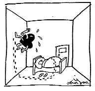
>
> *“Người gan nóng, hay nằm mơ, giấc ngủ không sâu.”*

Quan sát tỉ mỉ hơn lớp “mỡ” trên thân thể người béo, khi dùng tay véo ra hay miết vào, thì có cảm giác lớp mỡ kéo ra ấy hầu như không phải là một phần của tổ chức cơ thể. Khi chúng ta có dịp quan sát mỡ lợn mua ở chợ về, có thể phát hiện thấy một phần mỡ trong đó là không liên kết với tổ chức khác, có thể dễ dàng dùng tay tách ra được, nhưng có phần mỡ thì liên kết trực tiếp với tổ chức dưới da, hai loại mỡ này rõ ràng là không giống nhau.

Có một số u mỡ trên cơ thể người có khả năng thay đổi vị trí, hơn nữa còn có cảm giác những u mỡ này không liên kết với cơ thể. Có nghĩa là những vật chất thừa dư ra này không phải là tổ chức của cơ thể, mà chỉ là vật chất nằm ở chỗ khe hở giữa các tổ chức. Những vật chất này có khả năng là vật chất dinh dưỡng có chứa năng lượng, càng có khả năng hơn là những chất rác thải mà cơ thể không đào thải được nó.

Những vật chất ấy được người ta gọi là “mỡ”, thực ra chỉ là một chút cái lý giống như thế mà không phải thế, do ngộ nhận từ thân thể động vật ngủ đông mà thôi, chứ hoàn toàn không có căn cứ xác thực nào. Nhưng hầu như tất cả các lý luận và phương pháp giảm béo hiện nay đều phát triển ra từ luận điểm này, tất cả đều ra sức ngăn chặn sự gia tăng “mỡ” và ra sức tiêu giảm “mỡ” đi. Phương pháp chủ yếu đều là giảm bớt tiếp nhận năng lượng, hoặc là làm cho lớp mỡ tiêu biến đi.

Ví dụ, khống chế ăn uống những thức ăn dễ chuyển hóa thành mỡ; vận động tiêu hao năng lượng mỡ; thậm chí phẫu thuật trực tiếp lấy lớp mỡ đi đều là phương pháp phát triển lên từ lý luận động vật ngủ đông.

> 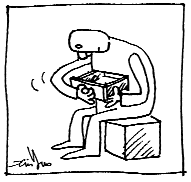
>
> *“Linh đan linh dược ở ngay trong cơ thể, lại cứ không ngừng đi tìm kiếm ở bên ngoại.”*

Hiển nhiên những phương pháp này không phải là quá linh nghiệm, nhiều người đã dùng phương pháp này cũng không làm sao loại bỏ số mỡ đi được, thậm chí đến làm giảm sự tiếp tục gia tăng của mỡ cũng không đạt được; nhưng cũng có nhiều người không sử dụng những phương pháp này cũng không béo phì. Điều trớ trêu nhất là nước Mỹ, một nước có nền y học tiến bộ nhất phương Tây, hàng năm phải tiêu tốn rất nhiều tiền của vào thị trường giảm béo, nhưng vẫn không làm sao ngăn cản được sự tiếp tục gia tăng số người béo phì, theo thống kê dự báo mới nhất, nước Mỹ mười năm sau sẽ có trên 80% số người quá béo. Sự phát triển như vậy càng chứng tỏ rằng toàn bộ lý luận giảm béo có khiếm khuyết vô cùng to lớn, rất có khả năng hoàn toàn sai.

Quan sát kỹ những dấu vết tuổi tác lưu lại trên thân thể và nét mặt, có thể phát hiện thấy chúng tăng lên cùng với năm tháng, trên mặt và thân thể dồn ứ ngày càng nhiều “các thứ”, điều này cũng giống như một ngôi nhà cũ, bao giờ cũng để lại những dấu vết không thể phai mờ được. Nếu “các thứ” đó là mỡ, phải chăng có nghĩa là tuổi tác càng cao năng lượng mà thân thể tích trữ càng nhiều? Hiển nhiên điều này hoàn toàn trái ngược với thực tế, người nào mà trên thân thể dồn ứ tích tụ càng ít “các thứ” thì cơ thể người đó hầu như càng tốt hơn.

## Béo phì không phải là ăn quá nhiều, mà là thải ra quá ít

Nguyên nhân chân chính của béo phì rất có khả năng là năng lượng khí huyết của thân thể không đủ, không có đủ năng lượng để đem những chất rác thải trong cơ thể thải ra ngoài, những chất không thải được ra này tích trữ dồn ứ ở khe hở giữa các tổ chức bên trong cơ thể, cùng với số rác tích trữ ngày một tăng lên thì người ta cũng dần dần béo ra.

> 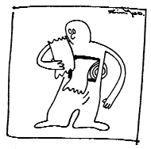
>
> *“Bệnh tật thực ra là sự ghi chép trung thực sinh hoạt thường ngày của chúng ta.”*

Từ logic này cho thấy béo phì không phải là năng lượng dư thừa, cơ thể phải đem năng lượng dư thừa tích trữ lại; mà ngược lại là năng lượng không đủ, khiến cho cơ thể không có đủ năng lượng để thải rác ra ngoài. Xét về quan điểm năng lượng, hai cách nhìn này hoàn toàn trái ngược nhau, cái trên là năng lượng quá thừa, cái dưới là năng lượng không đủ. Logic như vậy hầu như trái ngược với nhận thức truyền thống, nhưng lại có thể đưa ra cách giải thích hợp lý hơn đối với các loại hiện tượng béo phì.

Lượng ăn của nhiều người béo không hề nhiều, nhưng vẫn phát phì; chúng ta thường nghe thấy người béo ca thán là đến uống nước cũng béo lên, đây không phải là nói chơi mà tình hình thực tế là như vậy. Nhiều người có thể hình gầy gò, ăn bao nhiêu cũng không phát béo. Hai loại người béo gầy này không có quan hệ trực tiếp gì với lượng ăn vào của họ, người ăn ít phát béo phì, người ăn nhiều thì lại không béo. Dùng lý luận tích trữ năng lượng không thể giải thích được sự khác nhau của hai loại người này. Nhưng dùng lý luận không có năng lượng đào thải các rác thải trong cơ thể thì rất dễ dàng giải thích hiện tượng này.

Tế bào là tổ chức tầng thấp nhất của cơ thể, mỗi một tế bào đều có thể độc lập hấp thụ dinh dưỡng và bài tiết rác thải, rác thải mà tế bào thải ra tất nhiên là sẽ lưu động theo các chất dịch trong con người chúng ta, đi qua các mạch máu nhỏ li ti rồi về tĩnh mạch, qua gan, thận lọc rồi thải ra ngoài. Nếu ở bất cứ khâu nào trong quá trình đó phát sinh vấn đề, tất sẽ làm cho rác thải không được bài tiết một cách bình thường, cho nên dồn tích lại ở khe trống giữa các tế bào. Lúc đầu số lượng dồn ứ lại không nhiều, rác thải trôi nổi trong chất dịch của các

tổ chức, cùng với năm tháng, rác thải dồn lại cũng nhiều lên, toàn bộ trọng lượng và hình thể của chúng ta sẽ ngày một to lên. Những hạt này vốn nó ở dạng thể lỏng, dần dần những hạt trôi nổi ấy ngày càng nhiều, thể tích cũng ngày một to hơn, cuối cùng hình thành thể rắn có hình khối, sờ vào ta thấy răn rắn cứng chắc, rất nhiều người còn cho rằng cơ thể đã trở nên rắn chắc hơn.

> 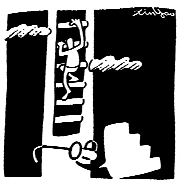
>
> *“Vỗ Đảm Kinh sẽ trực tiếp tác động làm cho lớp mỡ ở mông và mé ngoài hai đùi giảm bớt đi, làm như vậy độ khoảng từ một đến hai tháng sẽ cảm giác thấy ống quần rộng hẳn ra.”*

## Bệnh tim là nguyên nhân của béo phì

Sự lưu động của các chất dịch trong cơ thể, động lực chủ yếu chính là từ hoạt động của quả tim. Cho nên tạo thành tích tụ dồn ứ rác thải tế bào, nguyên nhân chủ yếu nhất chính là vấn đề của tạng tâm (tim). Logic béo phì rút ra từ phân tích thống kê hai điều: một là người béo phì dễ bị mắc bệnh tim; hai là cùng với kinh tế được cải thiện, ăn uống được cải thiện, dinh dưỡng thừa dư trở thành nguyên nhân chủ yếu nhất của béo phì. Đa số mọi người đều đồng ý với logic này, nhưng có đúng như vậy không?

Trước tiên hãy nói về câu chuyện người béo dễ bị bệnh tim, nhận định của Tây y và Trung y đối với bệnh tật có sự khác nhau rất lớn. Ví dụ như chất dịch tích tụ ở tâm bao (màng bao quanh quả tim), Tây y cần phải đợi chứng cứ thông qua phim chụp để xác nhận dịch tích tụ ở tâm bao vượt quá mức cho phép mới có thể xác nhận là có bệnh. Nhưng thông qua bắt mạch từ hiện tượng mạch trầm, Trung y có thể lập tức biết được dịch tích ở tâm bao quá nhiều, thông thường lúc này nếu dùng công cụ tiến bộ nhất để kiểm tra, cũng không nhận định được là tim có vấn đề. Có thể nói trong việc nhận định bệnh tật của tạng tâm Trung y mẫn cảm hơn nhiều so với Tây y.

> 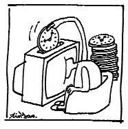
>
> *“Phần lớn cái dùng mất trong thời gian xem tivi là thời gian tạo máu.”*

Theo quan điểm của Trung y, đại đa số những người béo phì, Tâm Bao Kinh đều bị tắc, hơn nữa tình trạng tắc nghẽn này thông thường đều xuất hiện khi còn chưa có béo phì thực sự. Tình hình thực tế là do sự tắc nghẽn của Tâm Bao Kinh (màng bao tim tích dịch quá nhiều), khiến cho dịch lưu động trong tổ chức kinh lạc xuất hiện trở ngại, dẫn đến dồn ứ rác thải, rác thải dồn tích trong thời gian dài cuối cùng sẽ hình thành béo phì.

Người có Tâm Bao Kinh bị tắc, cùng với tình trạng khí huyết cơ thể ngày một thấp dần, rác thải không thải ra được ngày một nhiều, thân hình ngày một béo ra, đồng thời tâm bao tích dịch cũng ngày một nhiều, vấn đề cũng ngày càng thêm nghiêm trọng. Những bệnh tật do tâm bao tích dịch gây ra như tim đập nhanh, nhịp tim không đều cũng ngày càng nghiêm trọng, cho nên bị thầy thuốc phát hiện ra những bệnh về tim. Do vấn đề béo phì được quan sát thấy trước, còn những bệnh về tim phải qua một thời gian rất lâu sau mới được kiểm tra ra. Cộng với kết quả thống kê cho thấy ở những người béo phì có tỷ lệ mắc bệnh tim rất cao, cho nên béo phì liền được coi là nguyên nhân của những bệnh về tim, so với kết quả suy luận của lý luận Trung y “bệnh tim tạo nên béo phì” thì nhân quả hoàn toàn đảo ngược.

Còn nói về năng lực kinh tế nâng cao tạo nên tình trạng ăn uống quá dư thừa, cuối cùng hình thành nên vấn đề béo phì. Thực ra trong quá trình phát triển nâng cao năng lực kinh tế của quốc gia, ngoài việc cải thiện ăn uống ra, trong gia đình cũng còn tăng thêm các đồ dùng điện như quạt, máy điều hòa nhiệt độ, tủ lạnh.

> 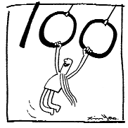
>
> *“Tam tự kinh của người già trăm tuổi: Vỗ Đảm Kinh, Đi ngủ sớm, Day tâm bao, Không tức giận, Ruột giữ sạch.”*

Còn nhớ hồi nhỏ khi gia đình vừa có quạt điện, mùa hè chơi ở ngoài mồ hôi đầm đìa đầu tóc quần áo, sướng nhất là được đứng trước quạt máy bật số thật to. Trẻ em ngày nay vào phòng điều hòa, đứng trước cửa quạt gió của điều hòa thưởng thức cái không khí mát rượi thổi ra, đồng thời đến tủ lạnh lấy ra một lon nước uống mát lạnh ồng ộc đổ vào trong bụng. Thông thường những hành vi như vậy đều bị các bậc cha mẹ trong nhà ngăn cấm, bởi vì họ cho rằng làm như thế sẽ có hại cho cơ thể.

Quả thực sau khi mồ hôi ra đầm đìa, dùng những cách làm mát như vậy là gây nên tổn hại nghiêm trọng cho cơ thể. Khi cơ thể ra nhiều mồ hôi, đang bài tiết những rác thải sản sinh ra sau khi cơ thể đốt nhiên liệu, lúc này nếu tiếp xúc trực tiếp với khí lạnh hoặc uống nước đá, sẽ làm cho cơ quan cảm giác của một bộ phận cơ thể rất nhanh chóng mát lạnh hẳn xuống, và đem tín hiệu này truyền lên đại não, báo thông tin cơ thể đã mát lạnh rồi, cơ thể lập tức ngừng công việc bài tiết rác thải đang làm trước đó. Nhưng trên thực tế tín hiệu mát lạnh này là từ bên ngoài tới, nó chỉ là mát lạnh một bộ phận, không phải là tín hiệu phát ra sau khi cơ thể thực sự hoàn thành công việc bài tiết. Sau khi cơ thể ngừng công việc bài tiết, các rác thải chưa được thải ra ấy sẽ còn lưu trữ lại trong cơ thể.

Điều tồi tệ hơn là khi mình mẩy đang đầm đìa mồ hôi, tim là cơ quan nóng nhất, đòi hỏi liên tục được tản nhiệt, khi khí lạnh hoặc nước đá bên ngoài làm rối loạn thông tin của cơ thể, sẽ làm cho công việc tản nhiệt của tim cũng đột nhiên ngừng lại, hiện tượng này rất dễ gây nên thương tổn nghiêm trọng cho tim, cơ tim do tản nhiệt không kịp nên bị thương tổn, làm cho sự vận hành của tim bị ảnh hưởng.

> 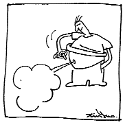
>
> *“Khi tức giận, cơ thể sinh ra khí, cho nên gọi tức giận là sinh khí.”*

Vấn đề dinh dưỡng quá thừa không nhất định là nguyên nhân thực sự của béo phì, sử dụng không hợp lý nước đá và khí lạnh rất có khả năng là nhân tố chủ yếu của béo phì. Ngày nay người Mỹ dùng hết mọi cách để giảm béo, mà tỷ lệ người béo vẫn không ngừng tăng lên, rất có khả năng có liên quan vô cùng mật thiết với việc họ thường xuyên dùng nước đá, nước lạnh làm nguồn nước chủ yếu cung cấp cho cơ thể.

Màng bao tim tích dịch quá nhiều và bệnh tật về cơ tim đều làm cho năng lực của tim giảm sút, tiến tới gây nên trở ngại cho việc lưu thông chất dịch trong cơ thể, cuối cùng tạo thành thể hình béo phì. Người không hề béo phì cũng dễ mắc bệnh ở tim, bệnh tim mới là nguyên nhân thực sự của béo phì.

## Béo phì với thể hình khác nhau, có nguyên nhân khác nhau

“Vọng chẩn” trong chẩn đoán Trung y là phương pháp vô cùng quan trọng, trong đó lại coi “vọng hình” là quan trọng nhất. Cái nhìn thấy khi “vọng hình” chính là thể hình béo phì, cũng chính là trạng thái dồn ứ tích tụ rác thải trong các kinh lạc. Ví dụ, sự xuất hiện hiện tượng mé ngoài đùi hơi phình to lên là có liên quan tới vấn đề công năng của mật đã được nói đến ở chương trước, là một ví dụ về chẩn đoán của “vọng chẩn”.

Sự béo phì xuất hiện đều khắp trên toàn thân là năng lực của tỳ thấp kém, do không thải được nước thải của các cơ quan trong cơ thể ra ngoài nên hình thành hiện tượng như vậy. Tỳ đưa nước đến đoạn giữa của thân thể, phần còn lại thận lại tiếp tục đào thải nước phế thải

đó ra ngoài. Vì thế, khi phần eo và mông của thân thể đặc biệt phình to ra thì biểu hiện rằng năng lực của thận rất thấp kém không thể thải được các nước thải ra ngoài, nước thải và các chất thải khác tích tụ ở khu vực mà thận cư trú, cuối cùng hình thành loại hình thể đặc biệt béo ở đoạn giữa này.

> 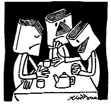
>
> *“Trung y mà phân ra thành các khoa thì không thể thấy được hệ thống hoàn chỉnh của nó nữa.”*

Ngoài ra lớp mỡ dưới da trán dầy lên, dẫn đến xuất hiện nếp nhăn, chủ yếu là do phía trên chỗ này là nơi Đại Tràng Kinh đi qua, cho nên có thể suy đoán rằng những ổ bệnh trong đại tràng của người này là khá nhiều; hai bên má dưới cằm mỡ dầy lên cũng là vấn đề của Đại Tràng Kinh. Hai bên mang tai có mỡ dầy tức là vấn đề của Tiểu Tràng Kinh; hai bên má phía trước, dưới mắt và hai bên mũi tương đối dầy, thì là vấn đề của dạ dày gây nên, tất cả đều là phương pháp chẩn đoán dựa theo lý luận kinh lạc xây dựng nên.

Không chỉ những người béo là có ứ đọng tích tụ nhiều rác thải, người gầy là khỏe mạnh và không có tích tụ ứ đọng rác thải. Trong thực tế, những người có phế khí tương đối yếu, cơ thể không làm sao hấp thụ được nước, nước uống vào không đến được các cơ quan liền bị trực tiếp thải ra ngoài. Nếu người này đồng thời có vấn đề tỳ hư, trên thân thể cũng sẽ tích tụ nhiều rác thải, nhưng thành phần nước trong rác thải rất ít, đa số rác thải đều ở trạng thái mất nước, khô cứng, nhìn thì không thấy béo, sờ tay vào thì thấy rắn chắc, đen đen gầy gầy.

Những người này một khi tiến hành điều dưỡng, khi khí huyết của cơ thể nâng cao lên đến mức dương hư, bắt đầu có năng lực thanh trừ rác thải, thì sẽ nhanh chóng đem nước tưới vào chỗ rác

thải, làm cho nó có thể lưu động được giữa các tổ chức trong cơ thể, từ đó mới có thể đưa đến chỗ đào thải nó ra ngoài. Bởi vậy, những người này trong một thời gian rất ngắn, thể trọng tăng nhanh, thể tích cũng to ra rất nhanh. Chúng tôi đã từng gặp một trường hợp này, bệnh nhân chỉ trong vài tháng, đã nặng lên mấy chục cân, cánh tay to ra rất nhiều. Từ một người đen đen gầy gầy biến thành một người béo trắng phốp pháp.

> 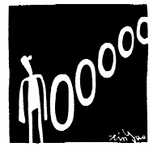
>
> *“Sức khỏe đã không còn, thêm những con số 0 nữa thì có ý nghĩa gì.”*

## Vấn đề ruột, dạ dày là một trong những nguyên nhân chủ

**yếu nhất của béo phì**

Khi năng lực tỳ không đủ, màng bao tim dễ dàng sinh ra tích nước, làm cho năng lực của tim bị sút kém, tim là cái máy bơm máu của cơ thể, khi chương trình hoạt động của máy bơm bị trở ngại, không thể đưa máu đi lưu thông khắp cơ thể được, sức sống của toàn bộ cơ thể hạ thấp, các chất dịch trong kinh lạc của cơ thể không dễ dàng lưu động, các chất rác thải cũng không được đào thải ra ngoài.

Nguyên nhân chủ yếu gây nên tỳ hư, là hệ thống duy tu sửa chữa của thân thể làm việc quá mệt mỏi, cơ thể khi bị thương hoặc bị vi khuẩn xâm nhập, sẽ xuất hiện hiện tượng này. Bộ phận của cơ thể dễ dàng bị vi khuẩn xâm nhập nhất đương nhiên là ruột và dạ dày. Do thể chất của tỳ hư phần lớn hình thành ở thời kỳ niên thiếu, căn nguyên của nhiều bệnh tật đều có quan hệ trực tiếp và mật thiết với thói quen sinh hoạt ở thời niên thiếu.

Việc lây nhiễm đường tiêu hóa nói đến ở chương trước sẽ làm cho trẻ em hình thành thể chất tỳ hư, Tâm Bao Kinh thường xuyên bị trở

ngại, dần dần ngày một béo lên, hơn nữa rất hay chảy nước dãi, những “hiện tượng” này thực ra là biểu hiện chính xác của tỳ hư. Theo lý luận Trung y, khi tỳ hư sẽ xuất hiện tình trạng “tỳ không khống chế được cơ”, cơ ở môi không còn có lực, trẻ em không giống như người lớn có ý thức tăng cường khống chế điều khiển, cho nên dễ dàng khiến cho nước dãi chảy ra.

> 
>
> *“Một đôi nam nữ ở với nhau, hễ không cẩn thận là sẽ tạo ra một con người. Cơ thể con người phức tạp và hoàn mỹ, mà chỉ dùng phương pháp giản đơn như vậy để tạo ra.”*

Những trẻ em này dễ bị lây nhiễm qua nước bọt người lớn, đa số là những trẻ em được người lớn yêu quý, mới hay được cho ăn những thức ăn mà người lớn đã tiếp xúc qua. Khi đứa trẻ dần dần béo lên, cộng thêm với chảy nước dãi, càng thể hiện ra là đứa trẻ thơ ngây đáng yêu, càng được nhiều người lớn yêu quý, đương nhiên việc bị lây nhiễm cũng sẽ càng nhiều lên.

Những đứa trẻ đáng yêu hay chạy lon ton từ nhà này sang nhà khác trong khu tập thể, đa phần lớn lên đều trở thành người béo. Hơn nữa những đứa trẻ này do từ nhỏ đã ở trong trạng thái năng lượng khí huyết không đủ, sau lớn lên thể hình cũng không cao lắm, chỉ thâm thấp beo béo. Đây là ví dụ điển hình nhất cho câu ngạn ngữ: “Yêu nhau còn quá bằng mười hại nhau”.

Vấn đề lây nhiễm đường tiêu hóa ở những đứa trẻ này có mức độ nặng nhẹ khác nhau, ở đứa tương đối nặng thì khi còn rất bé đã béo phì rồi; còn ở đứa nhẹ hơn thì cho đến khi tuổi tác tương đối lớn mới biến thành người béo; có người thậm chí đến tận trung niên mới bắt đầu phát béo.

> 
>
> *“Người mắc bệnh bao giờ cũng chỉ muốn tìm được linh đan linh dược để khỏi bệnh, mà không muốn điều chỉnh thói quen sinh hoạt của mình để loại bỏ nguồn gốc thực sự của bệnh tật.”*

## Tăng cường năng lượng của thân thể là bài đầu tiên của việc

**giảm béo**

Từ quan điểm béo là do năng lượng không đủ mà xét, khi năng lượng khí huyết của cơ thể không đủ, cơ thể để tiết kiệm năng lượng chi ra, sẽ giảm bớt một số công việc không quan trọng, đào thải rác ra ngoài là việc đầu tiên bị gác lại, bởi vì những rác thải này tạm thời chưa thanh lý, cũng không gây nên tổn hại quá lớn cho cơ thể.

Từ quan điểm “năng lượng không đủ là nguyên nhân của béo phì” phát triển ra phương pháp giảm béo, đương nhiên sẽ có sự khác biệt rất lớn với phương pháp cho rằng “năng lượng quá thừa là nguyên nhân của béo phì” mà mọi người đã quen biết. Cách làm trước đây là vận động, giảm ăn, khống chế nhiệt lượng, đa phần đều là phương pháp tiêu hao năng lượng, giảm thiểu năng lượng tổng thể của cơ thể. Còn ở quan điểm mới, rác không thải ra được chủ yếu là do năng lượng không đủ, những cách làm trên sẽ khiến cho năng lượng càng giảm thấp, quả là việc làm trái ngược hoàn toàn. Bởi vậy, giảm béo không nên giảm năng lượng của cơ thể, trái lại phải tăng cường năng lượng cho cơ thể.

Trong nghiên cứu kinh lạc, phát hiện kinh lạc là trường dịch thể lưu chuyển ngoài hệ thống huyết quản của cơ thể, trường dịch thể lưu chuyển này sẽ đem chất dinh dưỡng đến xung quanh tế bào cho tế bào hấp thụ, đồng thời mang đi những rác do tế bào thải ra. Bởi vậy, kinh lạc không thông là một nguyên nhân quan trọng khác gây nên dồn tích rác thải.

> 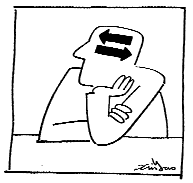
>
> *“Y học hiện đại bó tay trước các bệnh mạn tính, rất có khả năng trong phương hướng và logic tư duy có vấn đề.”*

Trong phương pháp giảm béo truyền thống, vận động có công hiệu làm khỏe tạng tâm, thông kinh lạc, nên vẫn có thể đạt được mục đích giảm béo. Vận động còn có hai ưu điểm khác: một là tiêu hao khá nhiều năng lượng của cơ thể, gây nên cảm giác mệt mỏi của cơ thể, làm cho chất lượng giấc ngủ buổi tối được cải thiện, cũng làm cho thời gian giấc ngủ tăng lên; hai là sau khi vận động tiêu hao khá nhiều năng lượng rồi, cũng sẽ làm cho ăn ngon và nhiều lên. Bởi vậy, vận động thực sự nâng cao công hiệu của năng lượng cơ thể, sau đó là làm cho ăn uống, nghỉ ngơi, giấc ngủ tăng lên, và do vận động mà kinh lạc lưu thông, cơ năng cơ thể hoạt động bình thường, sản sinh ra năng lượng khí huyết càng nhiều hơn.

Tổng hợp những điều trình bày trên, nhìn bề ngoài ta thấy có hai nguyên nhân gây béo phì, một là năng lượng không đủ, hai là kinh lạc không thông. Trong đó kinh lạc không thông và năng lượng không đủ có quan hệ mật thiết với nhau, người béo do năng lượng không đủ, trở ngại hấp thụ chủ yếu là do vấn đề phong hàn gây nên, đương nhiên còn có vấn đề thói quen đi ngủ. Dùng phương pháp dưỡng sinh “nhất thức tam chiêu” là phương pháp giảm béo đơn giản nhất, cũng là bài tập dưỡng sinh quan trọng nhất, hoàn toàn phù hợp quy luật vận hành tự nhiên của cơ thể.

Trong quá trình giảm béo, cơ thể sẽ xuất hiện nhiều sự thay đổi. Những sự thay đổi này dùng quan niệm phổ biến hiện nay mà xét, rất dễ sinh ra hiểu lầm, cho nên lựa chọn cách làm không thích hợp, những cách làm này luôn luôn hay làm ngừng quá trình giảm béo của

cơ thể. Bởi vậy, ở đây đưa ra mấy loại hiện tượng có thể xảy ra, và phương pháp xử lý chính xác những hiện tượng đó.

> 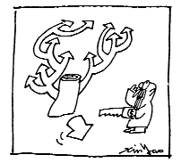
>
> *“Tiến hành cưa cưa cắt cắt trên cơ thể mà không hiểu biết được bao nhiêu thì nhất định sẽ dẫn đến rất nhiều vấn đề.”*

## Giảm béo không phải là giảm trọng lượng, mà là giảm

**thể tích**

Do trong quá trình dưỡng sinh tổng lượng máu trong cơ thể dần dần tăng lên, cũng làm cho lượng máu chứa trong tủy và nội tạng tăng lên. Trọng lượng của những bộ phận này thay đổi, song không hề làm cho người béo lên, nhưng làm cho thể trọng tăng lên, trong phương pháp lấy thể trọng để xác định mức độ béo phì hiện nay, thì rất dễ bị hiểu lầm là bị phát béo trở lại.

Có được lượng máu tăng lên cũng chính là khí huyết đã tăng lên, cơ thể mới có thể đào thải các chất rác thải ra ngoài, sự đào thải các rác thải ra ngoài này sẽ làm cho thể tích cơ thể giảm nhỏ đi, mới là mục đích thực sự đạt đến giảm béo.

Sự thay đổi thể trọng lúc này cần phải xét đến trọng lượng máu tăng lên khi khí huyết tăng lên, trọng lượng rác lại giảm đi do bị thải ra ngoài, nếu trọng lượng máu tăng lên lớn hơn trọng lượng rác thải ra, thì sẽ xuất hiện kết quả “người gầy đi, thể trọng lại tăng lên”. Do tỷ trọng máu lớn hơn 1, mà tỉ trọng rác chỉ bằng 70% của máu, tương đối nhẹ, đây là kết quả rất có khả năng xảy ra. Bởi thế, giảm béo không nên lấy thể trọng để xác định kết quả, mà cần phải xác định thực sự về mặt thể tích mới được.

> 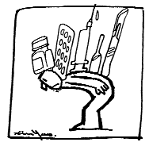
>
> *“Vấn đề lớn nhất của y học hiện đại là: Đánh giá thấp trí tuệ tự thân của cơ thể người, đánh giá cao năng lực của tri thức nhân loại.”*

## Phát béo là quá trình trung gian tất yếu của giảm béo

Rác thải trong cơ thể người chủ yếu là từ các bộ phận của cơ thể, được vận chuyển thông qua hệ thống mạng lưới kinh lạc và huyết quản, sau đó do các cơ quan tương ứng xử lý rồi thải ra ngoài. Rác trong cơ thể người, ngoài những cặn bã thức ăn trong hệ thống tiêu hóa, được thải ra ngoài bằng hình thức đại tiện ra, những rác thải khác không phải trong đường tiêu hóa tất sẽ được bài tiết ra ngoài dưới trạng thái thể lỏng như tiểu tiện hoặc mồ hôi.

Giảm béo ở người trưởng thành, vì lớp “mỡ” dồn tích quá lâu, dần dần hình thành dạng viên hạt hoặc kết thành tấm mảng, làm cho những rác thải này không thể dễ dàng lưu chuyển theo các đường vận chuyển để đưa ra ngoài cơ thể, cơ thể tất trước tiên phải đem nước đến tưới cho những mảng rác kết bánh này, làm cho nó tơi lỏng ra thành những viên hạt tương đối nhỏ, sau đó chuyển chất dịch này theo đường tiểu tiện hoặc mồ hôi thải ra ngoài.

Trong quá trình tưới nước vào những mảng rác thải, sẽ làm cho người ta trước tiên là phát béo lên, thể trọng nhanh chóng tăng lên, đến khi nào rác được thải ra hết thì người gầy lại, có người vừa mới nghỉ liền phát béo, chính là khi cơ thể nghỉ ngơi khí huyết tăng lên, lập tức bước vào quá trình tưới nước cho rác thải. Khi quá trình tưới nước bắt đầu, người ta sẽ uống rất nhiều nước, tiểu tiện thì không hề tăng lên, nhưng thể trọng thì trong thời gian rất ngắn, chỉ một hai ngày có thể tăng lên 1 - 3kg; khi đào thải rác, tuy không uống nước mà lượng nước tiểu cũng rất nhiều, và cũng chỉ trong một hai ngày thể trọng nhanh chóng giảm đi 1 - 3kg.

> 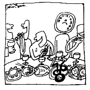
>
> *“Bữa tối chén tạc chén thù, cái giá phải trả không phải chỉ là tiền bạc, mà còn phải trả cả thời gian tạo máu hết sức quý báu.”*

Thông thường những người nước da ngăm đen, không thường xuyên vận động mà thân thể lại rất rắn chắc, thì có nghĩa tình hình mỡ dồn tích cũng rất nghiêm trọng, do thể chất của phế hư, làm cho hàm lượng nước của phần lớn rác thải rất thấp. Phần đông mọi người đều phải trải qua lặp đi lặp lại nhiều lần quá trình giống nhau như vậy, liên tục thay đổi béo béo gầy gầy, mới đạt đến được cái đích giảm béo.

Trong quá trình này có thể phát hiện được cái chỗ mà vốn rất rắn chắc đã bắt đầu trở nên mềm nhũn hơn, cuối cùng lại dần dần gầy đi.

## Người vốn đã không có cơ bắp có khả năng giảm đến mức

**quá gầy**

Khi giữ cho cơ thể luôn ở trạng thái khí huyết sung mãn, cơ thể sẽ đem tất cả những rác thải tích tụ lâu nay thải hết ra ngoài. Nếu là người vốn ít vận động, thể tích cơ bắp quá nhỏ, có khả năng hễ đã gầy là gầy đến mức không thể cứu vãn được, thậm chí đến mức da bọc xương.

## Giảm béo quá nhanh đa phần chỉ là làm thoát nước trong

**rác thải**

Trong nhiều quảng cáo giảm béo đều có thể thấy, những loại thuốc giảm béo có thể đạt đến mục đích của giảm béo trong một thời gian rất ngắn, những phương pháp ấy đa số là sử dụng phương pháp thoát nước, để nước trong rác thải nhanh chóng mất đi.

Theo lý luận Trung y, chúng ta có thể tìm được hai loại phương pháp làm cho cơ thể nhanh chóng mất nước. Một loại là tạo cho cơ thể xuất hiện chứng phế hư, sẽ làm cho cơ thể giảm việc cung cấp nước cho các tổ chức trong cơ thể; một loại khác là tạo thành chứng can nhiệt

(gan nóng), sẽ làm cho cơ thể xuất hiện hiện tượng “can bức thận thủy”. Nói một cách khác, chỉ cần làm cho gan và phổi có bệnh thì lập tức có thể xuất hiện hiệu quả giảm béo nhanh chóng. Điều này cũng giống như người mắc bệnh ung thư, chỉ trong vòng một tháng thể trọng mất đi hơn chục cân.

> 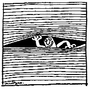
>
> *“Sự việc giản đơn được xem xét một cách rất phức tạp, có thể phát hiện ra lĩnh vực mới; hiện tượng phức tạp được nhìn nhận một cách giản đơn, có thể phát hiện ra định luật mới”*

Phương pháp thoát nước này, do rác vẫn còn trong cơ thể, vẫn là cái thứ mà cơ thể rất muốn tống khứ nó ra ngoài càng nhanh càng tốt. Cho nên sau khi thể lực được khôi phục, nhất định là sẽ thanh lý số rác thải ra ngoài. Thế là chỉ cần cơ thể có chuyển biến tốt là lập tức lấy nước tưới vào rác thải, làm cho cơ thể phát béo lên nhanh chóng. Đây cũng chính là cách lý giải tại sao cứ sau khi ngừng biện pháp giảm béo là cơ thể nhanh chóng béo trở lại. Nếu phương pháp giảm béo áp dụng mà gây nên tổn hại cho cơ thể, rác thải sẽ tích trữ càng nhiều hơn trong các tổ chức, thì sau khi béo trở lại, cơ thể sẽ càng béo hơn cả lúc trước giảm béo.

Các loại phương pháp làm thông kinh lạc trong Trung y, bao gồm châm cứu, xoa bóp và vận động thông kinh lạc, có thể làm cho cơ thể thường xuyên duy trì ở trạng thái vận hành tốt nhất, rác thải ở giữa các tổ chức sẽ càng dễ được thải loại ra ngoài, các loại chức năng của cơ thể cũng sẽ càng tốt hơn, đương nhiên là rất có ích đối với sự phát triển của toàn bộ cơ thể, đồng thời cũng có thể khiến cho cơ thể đạt đến mục đích giảm béo.

Loại phương pháp giảm béo này, thực ra là nhắm tới sức khỏe thực sự của cơ thể, cơ thể khỏe mạnh rồi, rác thải trong cơ thể tự nhiên bị thải loại đi, người cũng sẽ gầy đi. Tuy nhiên thời gian đòi hỏi phải dài

hơn một chút, nhưng từ đó xây dựng được một thói quen sinh hoạt tốt và khỏe mạnh, chỉ cần tiếp tục duy trì lối sống này, không những sẽ không béo trở lại, đồng thời cũng không bị bệnh mạn tính đe dọa.

> 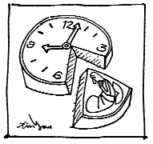
>
> *“Người nào không dành ra được thời gian để ngủ, sớm muộn sẽ phải dành ra thời gian để sinh bệnh.”*

## Ví dụ thực tế về giảm béo

Có một bệnh nhân, từ nhỏ đã có thể hình béo phì, cho nên người nhà đặt ra chế độ ăn uống rất nghiêm khắc với anh ta, càng béo thì hạn chế càng nghiêm ngặt, hơn thế còn áp dụng qua tất cả các phương pháp giảm béo có tính khả thi, nhưng vẫn không khống chế được xu thế tăng trọng của anh ta, đến năm 18 tuổi anh ta đã nặng đến gần 100 kg.

Qua chẩn đoán, thực ra anh ta không phải là không có bệnh, chỉ đơn thuần là béo phì như Tây y chẩn đoán. Mé trong hai đùi anh ta dồn tích lớp mỡ rất dầy, khi đi lại hai mé trong đùi cọ vào nhau, có lúc ma sát nhiều đã làm trầy xước cả da. Mé trong của đùi là nơi Thận Kinh đi qua, rác tích tụ nhiều ở Thận Kinh, cho thấy rằng năng lực của hai quả thận đều rất kém. Lớp mỡ ở mé ngoài hai đùi cũng rất dầy, đây là do năng lực của Đảm Kinh đã không phát huy hết. Năng lực Đảm Kinh không đủ, dịch mật tiết ra nhất định là rất thiếu. Những điều này rõ ràng là biểu hiện rất cụ thể của bệnh tật, chỉ có điều là không cảm thấy khó chịu mà thôi.

Do bị hạn chế ăn uống lâu ngày, dinh dưỡng không đủ, năng lượng khí huyết quá hư yếu, đến mức rác thải trong cơ thể cũng không làm sao thải ra ngoài được, toàn thân chỗ nào cũng dồn tích rác thải, đó cũng chính là hiện tượng béo phì mà chúng ta nhìn thấy. Cho nên,

bước thứ nhất của giảm béo chính là đòi hỏi anh ta phải cải thiện thói quen sinh hoạt, tăng cường năng lượng khí huyết.

> 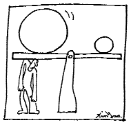
>
> *“Ham muốn là gánh nặng lớn nhất của cơ thể”*

Trước tiên là phải cải thiện thói quen sinh hoạt để nâng cao năng lượng khí huyết, trước hết mời bà mẹ anh ta cứ bố trí cho anh ta ngày ăn ba bữa bình thường, hơn nữa lúc bắt đầu cho anh ta ăn những thức ăn có chất dinh dưỡng cao, chỉ cần anh ta ăn được là cho ăn. Điểm này làm anh ta rất vui, vì từ nhỏ anh ta chưa bao giờ được ăn những món ngon như vậy. Tiếp theo đòi hỏi thay đổi thói quen đi ngủ buổi tối trước đây, hàng ngày cứ 8, 9 giờ tối là đi ngủ, chỉ cần thời gian cho phép, muốn ngủ bao nhiêu thì ngủ. Bất cứ lúc nào, chỉ cần có cơ hội, buồn ngủ thì cố gắng ngủ. Đồng thời mỗi ngày cần phải thực hành bài vỗ Đảm Kinh, cứ làm như vậy trong khoảng một tháng.

Sau một tháng, tuy không khống chế ăn uống, thể trọng không hề tăng lên, cũng không hề giảm đi. Trước đây khống chế ăn uống bằng mọi cách cũng không ngăn chặn được xu thế tăng trọng, bây giờ hàng ngày ăn ngủ thoải mái không hề hạn chế. Theo kinh nghiệm trước đây và quan niệm truyền thống của anh ta, anh ta lo lắng nhất định sẽ béo lên rất nhanh, người nhà của anh ta cũng lo lắng như vậy. Trên thực tế, những lo lắng này đã không xảy ra, thể trọng không hề thay đổi, người bệnh bước đầu tin tưởng rằng ăn, ngủ không nhất thiết có quan hệ trực tiếp với béo phì.

Tiếp theo hướng dẫn người nhà anh ta tiến hành xoa bóp kinh lạc, chủ yếu là xoa bóp Đảm Kinh và Tâm Bao Kinh của anh ta. Việc ăn uống của anh ta vẫn không có yêu cầu bất cứ sự hạn chế gì, tiếp tục tăng cường ngủ và định kỳ xoa bóp kinh lạc. Sau ba tháng người bệnh

gầy đi rõ rệt, trong điều kiện ăn, ngủ hoàn toàn tự do, thể trọng giảm được 8kg.

> 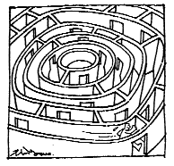
>
> *“Nhiều danh y và phương thuốc bí truyền như vậy, đòi hỏi phải có trí tuệ dồi dào, mới có thể tìm được con đường sống.”*

Người bệnh này, hồi nhỏ đã bị lây nhiễm đường tiêu hóa, hình thành thể chất tỳ hư, làm ảnh hưởng đến tạng tâm, khiến cho lớp mỡ trên tâm bao rất dầy, cộng thêm với năng lượng khí huyết luôn luôn không đủ, bà mẹ đã hạn chế ăn uống của anh ta ngay từ hồi bé, làm anh ta không hấp thụ được đủ dinh dưỡng. Năng lượng khí huyết kém, không có năng lực xử lý rác thải, rác thải ứ đọng ngày càng nhiều, người thì ngày càng phì ra. Càng phì ra thì lại càng không dám ăn, càng không dám ăn, khí huyết càng kém, rác càng không được thải ra, hình thành nên vòng tuần hoàn diễn biến ngày càng xấu.

Nếu bà mẹ không quản anh ta từ nhỏ, để anh ta muốn ăn gì thì ăn, muốn ngủ thì ngủ, có thể ngày nay anh ta đã không phát phì như vậy. Cho nên, bước thứ nhất của giảm béo, trước tiên phải nuôi dưỡng cung cấp đủ năng lượng khí huyết cho anh ta, đồng thời tiến hành xoa bóp kinh lạc, hỗ trợ thải loại lớp mỡ dầy ở bên ngoài tạng tâm, khiến cho hoạt động của tạng tâm khôi phục lại năng lực bình thường, để chất dịch trong các tổ chức dưới da có thể lưu động được thông suốt. Rác thải dần dần được thải ra ngoài, người cũng sẽ dần dần gầy lại. Phương pháp này đòi hỏi thời gian tương đối dài và có quan niệm chính xác, nhưng do đào thải ra một cách triệt để, nên đạt được giảm béo thực sự.
