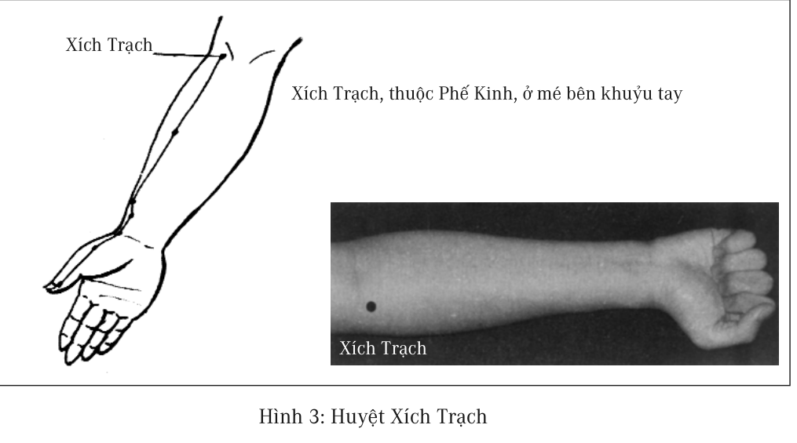
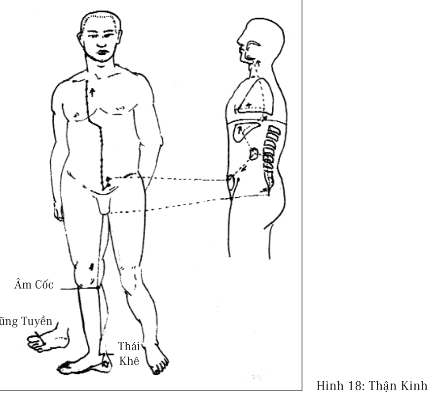
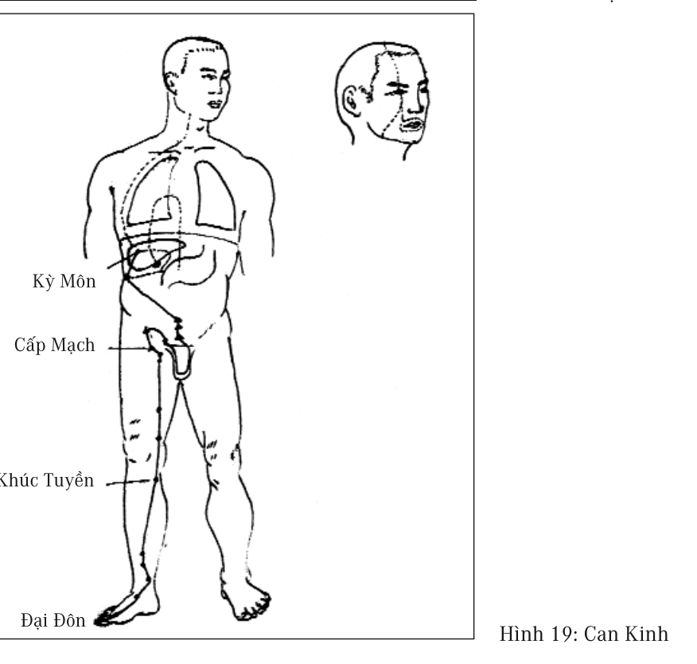

# Chương 8: ĐIỀU DƯỠNG BỆNH MẠN TÍNH

Còn nhớ hồi nhỏ, năm bố tôi 40 tuổi, ông bị mắc bệnh phong thấp, không thể đi được, khi đó ấn tượng sâu sắc nhất đối với tôi “đó là một loại bệnh đáng sợ không chữa trị được tận gốc rễ”, sau này lúc bố tôi 55 tuổi, lại mắc bệnh ung thư đại tràng. Ung thư có nghĩa là chết, đó là một tin sét đánh đối với toàn gia đình tôi, công việc của bố tôi là nguồn thu nhập duy nhất của cả nhà, căn bệnh này có thể sẽ làm thay đổi cuộc sống đang ổn định của cả gia đình. Bố tôi may mắn đã qua được kiếp nạn ung thư này, đến khi về già lại mắc bệnh tiểu đường. Từ sau khi bị mắc bệnh phong thấp, ông liên tục uống thuốc, giống như kiểu ăn tráng miệng hoa quả hay bánh kẹo sau bữa ăn của người phương Tây, cứ sau mỗi bữa ăn, bao giờ cũng thấy ông uống rất nhiều những viên thuốc có màu sắc khác nhau.

Đây là những bệnh tật bố tôi đã từng gặp phải trong cuộc đời, cũng là những bệnh mà nhiều người khác cũng đã từng đối diện. Những bệnh này đều là những bệnh mạn tính thường gặp, mỗi người đưa mắt nhìn người thân xung quanh, đều sẽ thấy có những người mắc phải những bệnh này. Điều bối rối nhất của những bệnh này là không có phương pháp điều trị tận gốc rễ, nhưng lại có rất nhiều cấm kỵ. Đã bắt đầu uống thuốc là vĩnh viễn không được ngừng, từ đó trở thành bệnh nhân lâu dài của bệnh viện. Thông thường những bệnh nhân này đều là người nam hoặc nữ chủ chốt của gia đình, vì thế không thể tránh khỏi bóng đen bao trùm lên toàn gia đình.

> 
>
> *“Người gan nóng, hay nằm mơ, giấc ngủ không sâu.”*

Người Trung Quốc có câu nói “thuốc thật chữa bệnh giả, bệnh thật không thuốc chữa”, ý nghĩa chân thực của câu nói này thực ra là chữa trị thực sự cơ thể người không phải là mấy vị thuốc ấy mà là năng lực tự thân của cơ thể. Từ một vết thương nhỏ ở bên ngoài đến bệnh tật nghiêm trọng trong các tạng phủ đều chỉ có tự bản thân cơ thể mới có khả năng chữa trị. Còn năng lực chữa bệnh của cơ thể hoàn toàn phụ thuộc vào năng lượng khí huyết của cơ thể có đủ hay không, và sự vận hành của các tạng phủ có bình thường hay không. Khi bệnh xuất hiện, cơ thể không có năng lực chống lại sự xâm nhập của vi khuẩn hoặc virus từ bên ngoài vào, không có năng lực sửa chữa khôi phục những bộ phận bị tổn hại.

Mọi người đều có chung một kinh nghiệm là lúc còn trẻ những vết thương nhỏ trên cơ thể có thể hồi phục rất dễ dàng, cùng với sự lão hóa và suy yếu, năng lực tự khỏi của vết thương càng ngày càng kém, phải mất một thời gian rất dài. Hiện tượng này cho ta thấy rằng năng lực sửa chữa phục hồi của cơ thể có liên quan mật thiết với mức độ cao thấp của khí huyết.

Cơ thể người ta ở các mức độ khí huyết khác nhau thì có các loại phản ứng khác nhau, chẳng hạn lấy việc phục hồi vết thương làm ví dụ, mọi người đều biết trong nhiều triệu chứng của bệnh tiểu đường có một triệu chứng là vết thương rất khó lành lại như cũ. Điều đó chứng tỏ khí huyết của bệnh nhân tiểu đường là vô cùng thấp.

Những chương tiếp theo là đi thẳng vào những bệnh mạn tính mà chúng tôi có kinh nghiệm thực tế, từ quan điểm năng lượng khí huyết giải thích mới lại bệnh lý của một số loại bệnh mạn tính, và từ đó phát triển ra phương án điều trị.

> 
>
> *“Linh đan linh dược ở ngay trong cơ thể, lại cứ không ngừng đi tìm kiếm ở bên ngoài.”*

Có một điểm cần phải nói rõ là những bệnh lý này là sự phân tích từ quan điểm năng lượng khí huyết, trong tương lai còn phải cần nhiều thực chứng thì mới có thể trở thành phương pháp thực sự để có thể sử dụng được, ở đây chỉ đưa ra cho bạn đọc cái mục đích, để bạn đọc khi lựa chọn liệu pháp dưỡng sinh, nếu có xuất hiện một số tình huống khó lý giải, có thể suy nghĩ đến sự thay đổi của cơ thể từ một góc nhìn khác.

Trong nhiều lĩnh vực khoa học, đều trải qua ba bước triết học, khoa học lý luận, khoa học thực chứng và phát triển phương hướng, ảnh hưởng lẫn nhau thúc đẩy cả chỉnh thể tiến bộ. Ví dụ trong vật lý học, có sự phân biệt giữa vật lý lý thuyết và vật lý thực nghiệm. Nhiều phân ngành khoa học mới đều có hiện tượng lý luận ra đời rồi nhiều năm sau mới có thể đi đến thực dụng.

Trong lĩnh vực y học do trực tiếp liên quan đến sinh mạng con người, đồng thời tiến bộ trọng đại nhất của y học cận đại đều đến từ thực chứng, cho nên y học hiện đại trên thực tế là không có bộ môn y học lý thuyết, chỉ có y học thực chứng, tất cả các lý luận và phương pháp đều phải có thực chứng mới được chấp nhận, mọi thực chứng đều phải có điều kiện mắt nhìn thấy mới là thực.

Giải phẫu học là căn cứ quan trọng nhất của y học hiện đại, mọi lý luận đều phải được chứng thực trong giải phẫu học, cũng chính là phải có mắt nhìn thấy mới là thực. Do cơ thể người có nhiều phương diện rất giống với máy tính hiện đại, cho nên cuốn sách này dùng đi dùng lại hệ thống máy tính để mô tả cơ thể người, ở đây lại dùng lại lần nữa.

> 
>
> *“Bệnh tật thực ra là sự ghi chép trung thực sinh hoạt thường ngày của chúng ta.”*

Chúng ta đều biết máy tính hiện nay là do phần cứng và phần mềm hợp thành, nếu chúng ta không biết nguyên lý thiết kế của phần mềm, trực tiếp giải phẫu phần cứng là không thể nào tìm được chân tướng của phần mềm, cũng không thể khôi phục được một hệ thống máy tính hoàn chỉnh, thậm chí không có bất cứ một chứng cứ nào có thể chứng minh được sự tồn tại của phần mềm.

Sự vận hành của cơ thể người vô cùng giống với máy tính, máy tính có ba bộ phận phần cứng, phần mềm ứng dụng và phần mềm hệ thống, cơ thể người cũng có ba bộ phận: thân, tâm và linh hồn, y học hiện đại cũng sẽ có ngày tìm được càng nhiều chứng cứ để xác nhận rằng ba thứ này có khả năng là nguyên nhân của bệnh tật. Bất luận kỹ thuật giải phẫu hiện đại hoặc tương lai có cao siêu đến đâu cũng không thể từ trong giải phẫu mà tìm ra được nguyên nhân bệnh tật do tâm thức và linh hồn gây nên. Cũng giống như giải phẫu máy tính không thể nào chứng minh được sự tồn tại của phần mềm vậy, giải phẫu cơ thể người là không thể tìm ra chứng cứ về sự tồn tại của tâm thức và linh hồn, nhưng không vì thế mà phủ định sự tồn tại của tâm thức và linh hồn.

Y học thực chứng thuần túy không thể phát triển ra những kỹ thuật làm bệnh mạn tính thuyên giảm, hệ thống y học hiện đại cần phải nhanh chóng xây dựng hệ thống y học lý thuyết, xây dựng hệ thống lý thuyết của các loại quan điểm triết học khác nhau, từ đó tiến hành hàng loạt những nghiệm chứng, sau đó mới có cơ hội tìm ra được phương pháp thực sự làm cho bệnh mạn tính thuyên giảm.

Chương tiếp theo, là nói đến mô hình lý thuyết bước đầu được xây dựng trên quan điểm này. Chúng tôi dùng mô hình này chỉ đạo người

bệnh tiến hành điều dưỡng, tuy chưa có đủ các mẫu, nhưng cơ hội thành công rất cao.

> 
>
> *“Vỗ Đảm Kinh sẽ trực tiếp tác động làm cho lớp mỡ ở mông và mé ngoài hai đùi giảm bớt đi, làm như vậy độ khoảng từ một đến hai tháng sẽ cảm giác thấy ống quần rộng hẳn ra.”*

## Bệnh Gouth

“Đại bách khoa thư y học” trên mạng Internet giải thích nguyên nhân và triệu chứng của bệnh gouth như sau: Gouth là bệnh rất phổ thông, người mắc bệnh này đa phần là nam giới.

Nguyên nhân: Trong máu có nhiều axit uric sẽ tạo nên gouth, còn nguyên nhân có thể là cơ thể sản sinh ra quá nhiều axit uric (như ác tính của loại ung thư máu), hoặc là tốc độ đào thải axit uric của cơ thể không đủ nhanh (như khi thận gặp trục trặc). Ngoài ra, sử dụng thuốc lợi tiểu cũng sẽ làm tăng axit uric trong cơ thể.

Triệu chứng: Bất luận nguyên nhân là gì, chỉ cần trong máu có quá nhiều axit uric, thể kết tinh của nó sẽ đọng lại ở chỗ khớp và làm cho khớp phát viêm, như vậy thì có đau không? Chỉ cần tưởng tượng một nắm tinh thể axit uric kết tinh có hình dạng như mũi kim rơi vào trong khớp khuỷu tay, gót chân, ngón tay, đầu gối hoặc cổ tay, sau đó thử động vào hoặc chuyển động những chỗ khớp đó, bạn sẽ biết đau đớn khó chịu biết chừng nào. Gouth không có phương pháp điều trị khỏi hẳn. Chúng ta có thể làm dịu cơn đau khi nó phát tác, cũng có thể dự phòng nó tái phát, nhưng nguyên nhân căn bản của bệnh lại vĩnh viễn tồn tại.

Dự phòng gouth tái phát như thế nào: Trọng điểm dự phòng gouth tái phát là phải thường xuyên uống thuốc để hạ thấp hàm lượng axit uric trong cơ thể.

> 
>
> *“Phần lớn cái dùng mất trong thời gian xem tivi là thời gian tạo máu.”*

Nếu axit uric trong cơ thể bạn quá nhiều là do cơ thể không thể đào thải nó, kiến nghị bạn nên uống thuốc sulfinpyrazone (anturane), mỗi ngày dùng 200 - 400mg, chia làm mấy lần uống, nó giúp tạng thận thải loại axit uric vào trong nước tiểu. Ampisilin sẽ làm cản trở công hiệu của anturane, nên tránh không uống hai thứ cùng một lúc. Nếu axit uric quá nhiều do cơ thể sản sinh vượt ngưỡng cho phép, thì kiến nghị bạn nên uống allopurinol (zyloprim) 300mg/viên để ức chế quá trình sản sinh axit uric. Mức độ tiếp nhận zyloprim và anturane của cơ thể nói chung là tốt, nhưng đôi khi nổi nốt đỏ và ngứa, zyloprim có khi còn ảnh hưởng đến chức năng của gan, cho nên trong thời gian uống thuốc tốt nhất mỗi năm đi kiểm tra máu 1, 2 lần theo định kỳ. Nếu hai loại thuốc có tính dự phòng này vẫn không ngăn cản được sự tái phát của bệnh, thì mỗi ngày nên dùng thêm 1 - 2 viên colchicine, nó có hiệu quả đặc biệt đối với viêm khớp cấp do gouth gây ra.

Thực phẩm cấm ăn: Không được uống các loại rượu, caffeine, cá đối, thịt và nội tạng các động vật, như thận, gan, óc, lá lách. Một số rau cũng làm tăng hàm lượng axit uric như măng và nấm tây... cũng không được ăn. Người nào không tuân thủ sự hạn chế về ăn uống nói trên sẽ gánh chịu hậu quả đau khổ. Song có những người rất cẩn thận trong việc ăn uống, kiêng khem rất đầy đủ, nhưng bệnh gouth vẫn tái phát, nguyên nhân không ngoài do áp lực quá lớn dẫn tới lo lắng quá độ, rất sợ phải phẫu thuật hoặc là bị cảm nhiễm hoặc là liên quan đến thuốc lợi tiểu, hoặc là căn bản không hề có lý do gì.

Một người lần đầu tiên được bác sĩ chẩn đoán là bị bệnh gouth, lên mạng đọc được đoạn giải thích như thế này, chắc chắn sẽ vô cùng chán

nản, lại cộng thêm với một nguyên nhân không rõ ràng, cũng không có thuốc chữa khỏi, tuy là không đến nỗi mất mạng, nhưng nó mà đau thì cũng hết sống nổi. Điều tồi tệ nhất là cứ nghĩ đến phải chung sống suốt đời với nó, tâm lý buồn chán biết chừng nào.

> 
>
> *“Phần lớn cái dùng mất trong thời gian xem tivi là thời gian tạo máu.”*

Giải thích như trên là cách nhìn cơ bản của y học hiện đại đối với bệnh gouth, cho rằng nguyên nhân trực tiếp của gouth là do axit uric gây nên, nhưng nguyên nhân hình thành axit uric thì lại bỏ qua không xem xét đến. Đồng thời trực tiếp tuyên bố gouth là bệnh không thể chữa khỏi được, hơn nữa nguyên nhân gây bệnh vẫn vĩnh viễn tồn tại.

Lại xem đến thuốc mà họ dùng để điều trị, hầu như toàn là thuốc hóa học, cái khó nhất để người ta tiếp nhận là cuối cùng thông báo chính xác đến công chúng rằng, tất cả những biện pháp điều trị và dự phòng này có khả năng là không có hiệu quả. Đây là cách làm điển hình của y học hiện đại đối với bệnh mạn tính, thể hiện rõ ràng sự bất lực và vô trách nhiệm trước bệnh tật, cứ làm như là người bệnh mắc bệnh là sự việc thông thường, không lấy gì làm to tát lắm, không có ai đòi hỏi phải có trách nhiệm điều trị cho họ.

Nhưng thuốc vẫn phải mua, tiền vẫn còn phải đi kiếm, hơn nữa những thuốc kê ra hàng ngày đều phải uống, mà phải uống cho đến khi sang thế giới bên kia mới thôi, logic như vậy rất phù hợp với lợi ích của nhà sản xuất thuốc.

Theo quan điểm Trung y, bệnh gouth không hề bi quan như vậy, người bị gouth đa phần có hai triệu chứng chung, tức là cơ thể thường xuyên ở trong trạng thái tâm bao tích nước quá nhiều và can nhiệt.

> 
>
> *“Tam tự kinh của người già trăm tuổi: Vỗ Đảm Kinh, Đi ngủ sớm, Day tâm bao, Không tức giận, Ruột giữ sạch.”*

Người mắc bệnh gouth đa số đều có vấn đề của ruột và dạ dày, vấn đề của ruột và dạ dày sẽ dẫn đến tâm bao tích nước quá nhiều, tâm bao tích nước quá nhiều sẽ làm cho năng lực bơm máu của tim bị giảm sút, máu không được đưa đến những khớp nằm ở đầu mút tận cùng của mạch máu, gây nên tích tụ rác thải ở bộ phận khớp, rác thải tích tụ chủ yếu là tinh thể axit uric.

Sự hình thành tinh thể axit uric có liên quan mật thiết với can nhiệt, người can nhiệt nước tiểu đặc biệt vàng và nặng mùi, tỷ lệ axit uric trong nước tiểu rất cao, những axit uric này tích tụ trong khớp tạo thành bệnh gouth, tích tụ ở tạng thận thì tạo thành sỏi thận, rất phiền toái cho con người. Bởi vậy, khi hiện tượng này xuất hiện, thì cần phải đặc biệt chú ý bảo dưỡng.

Hiểu được nguyên nhân của gouth, điều trị sẽ không khó nữa. Do gouth hễ phát bệnh là gây đau đớn rất ghê gớm, cho nên phương pháp làm giảm nhẹ cơn đau là vô cùng quan trọng. Khi cảm thấy đau đớn ở khớp là tinh thể axit uric đã nằm trong khớp rồi, muốn làm giảm đau đớn, trước tiên phải đào thải chúng ra, chí ít là làm cho chúng xa rời vị trí đang tồn tại. Lúc này xoa bóp Tâm Bao Kinh, làm cho Tâm Bao Kinh khôi phục năng lực làm việc bình thường, đưa máu đến chỗ khớp, mới có thể làm cho axit uric chuyển dịch, và thải ra ngoài, tình trạng đau lập tức sẽ dịu trở lại.

Thứ tự xoa bóp: trước tiên là ấn huyệt Côn Luân, tiếp đến huyệt Đản Trung, huyệt Nội Quan (xem hình 12,13,14), và đến các huyệt vị khác trên Tâm Bao Kinh. Do khi cơn đau gouth nổi lên, những huyệt

vị này đều không thông, cho nên khi ấn vào nhất định là cảm thấy đau. Việc xoa bóp này bệnh nhân phải làm thường xuyên hàng ngày, chỉ cần thường xuyên ấn huyệt, cơn đau đớn hầu như không phát tác nữa. Kiên trì thực hiện lâu ngày, không những tinh thể axit uric mới không tích tụ ở khớp, mà những tinh thể axit uric cũ cũng ngày một ít dần, thậm chí những khớp đã bị biến dạng cũng có khả năng dần dần khôi phục. Do đó phương pháp này có thể nói là biện pháp vừa dưỡng sinh vừa điều trị.

> 
>
> *“Khi tức giận, cơ thể sinh ra khí, cho nên gọi tức giận là sinh khí.”*

Nhưng chỉ xoa bóp Tâm Bao Kinh thì không đủ, còn phải làm sao cho những ảnh hưởng mà can nhiệt gây nên giảm đến mức thấp nhất. Đương nhiên tốt nhất là tiêu trừ triệt để sự sản sinh của can nhiệt, điều này yêu cầu phải dùng đến hai chiêu khác của “nhất thức tam chiêu” là ngủ sớm và vỗ Đảm Kinh. Khi khí huyết sung mãn, cơ thể sẽ không dễ dàng sản sinh can hỏa. Do đó thay đổi chế độ làm việc và nghỉ ngơi cũng là một biện pháp căn bản nhất điều trị gouth.

Khi bệnh gouth phát tác, còn có thể sử dụng nước nóng ngâm chân để hạ bớt can nhiệt, hoặc là như đã nói ở các chương trước, xoa bóp hay châm cứu huyệt Thái Xung cũng là một phương pháp làm giảm can nhiệt rất tốt.

Sử dụng “nhất thức tam chiêu” để điều trị gouth là phương pháp vô cùng giản đơn và rất công hiệu, có thể nhanh chóng làm tan biến những đau đớn của bệnh gouth, nếu kỹ thuật xoa bóp tốt, làm cho Tâm Bao Kinh thông suốt triệt để, một lần xoa bóp có thể đạt đến hiệu quả cả tuần không đau đớn gì nữa.

> 
>
> *“Trung y mà phân ra thành các khoa thì không thể thấy được hệ thống hoàn chỉnh của nó nữa.”*

## Bệnh viêm mũi dị ứng

Viêm mũi dị ứng là bệnh rất phổ biến ở con người hiện nay, đa số mọi người đều cho rằng do không khí hiện nay không trong sạch gây nên, đặc biệt là có một số người đã thay đổi chỗ ở, bệnh đã được cải thiện. Ví dụ, từ Đài Loan đến nước Mỹ, giai đoạn vừa mới đến, bệnh này liền khỏi luôn, nhưng có một số người qua một thời gian bệnh lại tái phát, cũng có người thì từ đó không bao giờ tái phát lại nữa.

Bệnh viêm mũi dị ứng, biểu hiện chủ yếu của nó là ngạt mũi, hắt hơi, chảy nước mũi v.v., những triệu chứng này rất giống với cảm mạo, nhưng khác với cảm mạo là không có ho, sốt, đau đầu, đồng thời do tần suất phát bệnh rất cao, cho nên gọi nó là viêm mũi có tính dị ứng, những điều này đều là những luận đoán xuất phát từ logic của y học phương Tây.

Theo quan điểm Trung y, Trung y không có tên gọi các loại bệnh có đặc tính dị ứng. Những biểu hiện này là hiện tượng hàn khí từ trong cơ thể đi ra. Trong chương thảo luận về vấn đề hàn khí ở phần trên, chúng tôi đã thuyết minh rất tường tận về những biểu hiện này, viêm mũi dị ứng chỉ là biểu hiện cơ thể tiến hành thải loại hàn khí ra ngoài hàng loạt hoặc lặp đi lặp lại nhiều lần.

Đối với hàn khí còn tồn tại trong cơ thể, hệ thống duy tu phục hồi của cơ thể sẽ đợi đến khi nào cơ thể có đầy đủ năng lượng sẽ tiến hành thải loại hàn khí ra ngoài, nhưng với phương pháp điều trị hàn khí của y học hiện đại, không hề loại bỏ hàn khí ra ngoài, mà mới chỉ tiến hành áp chế những triệu chứng xuất hiện ở cơ thể, đã coi là chữa trị khỏi rồi.

> 
>
> *“Sức khỏe đã không còn, thêm những con số 0 nữa thì có ý nghĩa gì.”*

Nhưng những hàn khí ấy vẫn tồn tại trong cơ thể, cơ thể chỉ có cách là phải đợi đến khi năng lượng khí huyết cao lên, thì lại phát động đợt tấn công mới đào thải hàn khí ra ngoài, nhưng đa số bệnh nhân lại dùng thuốc để áp chế nó đi, chính vì vậy lại quay lại điểm xuất phát ban đầu, rất có khả năng lặp đi lặp lại đối phó như vậy cũng chỉ vẫn là một loại hàn khí. Nếu tần suất của việc lặp đi lặp lại này rất cao, thời gian cách quãng rất ngắn thì sẽ hình thành viêm mũi có tính dị ứng.

Hiểu được nguyên nhân hình thành viêm mũi có tính dị ứng, thì có thể tìm ra được phương pháp điều trị tận gốc rễ. Trước tiên phải làm cho năng lượng khí huyết nhanh chóng nâng cao, khi năng lượng khí huyết nâng cao đến mức đủ khả năng trục xuất hàn khí ra ngoài, cơ thể tự nhiên sẽ bắt đầu tiến hành công tác này. Lúc này điều quan trọng nhất là không nên dùng thuốc chống dị ứng hoặc thuốc cảm mạo, vì như thế là chỉ đơn thuần làm tiêu tan những triệu chứng và vẫn giữ hàn khí ở lại trong cơ thể. Cũng còn cần phải để cho cơ thể tập trung năng lượng tiến hành công tác đào thải. Đối với những triệu chứng khi có bệnh như hắt hơi, chảy nước mũi hoặc người cảm thấy khó chịu, chỉ có cách là kiên trì chịu đựng, để hàn khí được thuận lợi thải loại ra ngoài, lúc này điều mà có thể làm được thì giống như cách làm đã nói đến trong chương đào thải hàn khí ở phần trên.

Do mức độ tích tụ hàn khí ở mỗi người là khác nhau, cho nên lộ trình điều trị cũng khác nhau, chỉ cần kiên trì và tin tưởng, nhất định có thể loại bỏ hoàn toàn căn bệnh gây bao phiền não này.

Bản thân tôi từ năm mười mấy tuổi đã mắc căn bệnh viêm mũi dị ứng, còn tiến hành phẫu thuật viêm tắc mũi ở bệnh viện. Trước sau

bệnh kéo dài đến gần ba mươi năm, trong thời gian này tôi uống không biết bao nhiêu các loại thuốc chống dị ứng, tất cả đều lúc đầu thì có hiệu quả, nhưng sau một thời gian, bệnh tình lại dần dần tăng lên, cuối cùng vẫn là hoàn toàn vô hiệu.

> 
>
> *“Một đôi nam nữ ở với nhau, hễ không cẩn thận là sẽ tạo ra một con người. Cơ thể con người phức tạp và hoàn mỹ, mà chỉ dùng phương pháp giản đơn như vậy để tạo ra.”*

Cho đến khi học được phương pháp này, bỏ ra mấy năm công sức dần dần chữa trị được tận gốc rễ. Trong thời gian điều dưỡng, một năm có đến hơn nửa năm cứ liên tục hắt hơi, hắt hơi liên tục đến mấy năm mới trục xuất được số lượng lớn hàn khí ra ngoài. Hiện nay còn một bộ phận hàn khí ở rất sâu trong cơ thể, nhưng tần suất hắt hơi đã giảm nhiều, một hai tháng mới hắt hơi một lần, mỗi lần một hai ngày là hết.

## Bệnh hàn khí ở trẻ sơ sinh, trẻ em

Phòng đẻ hiện nay, những bệnh viện càng quy mô, máy lạnh mở càng mạnh. Đây là phòng đẻ được thiết kế theo quan điểm “nhiệt độ thấp ức chế được vi khuẩn”. Đồng thời bác sĩ, y tá làm việc trong phòng đẻ, khi tiếp sinh phải có thể lực tốt, để tránh mồ hôi đầm đìa, cho nên đặt nhiệt độ ở phòng đẻ rất thấp, căn bản không xem xét đến nhu cầu của “trẻ sơ sinh” - người khách quan trọng nhất trong gian phòng này. Trẻ khi còn trong bụng mẹ, nhiệt độ xung quanh là 36 - 37*0*C, máy lạnh bên ngoài để ở mức trên dưới 20*0*c, chênh lệch về nhiệt độ rất lớn. Trẻ lọt lòng mẹ ra không có quần áo, thân thể để trần trong không khí lạnh như vậy, không những phải cắt rốn, còn phải cân trọng lượng nữa, mất ít nhất hàng chục phút hoặc có khi còn lâu hơn, thân thể khỏe mạnh cũng khó chịu nổi.

> 
>
> *“Người mắc bệnh bao giờ cũng chỉ muốn tìm được linh đan linh dược để khỏi bệnh, mà không muốn điều chỉnh thói quen sinh hoạt của mình để loại bỏ nguồn gốc thực sự của bệnh tật.”*

Nhiều bộ phim cổ trang hoặc phim truyền hình của người Trung Quốc, thường đều thấy nếu có cảnh sinh em bé, bố trí trong phòng đẻ trước tiên phải không có gió lùa, thứ đến khi xác định đã đến giờ sinh lập tức phải đun nước sôi. Trong phòng đẻ hơi nước nóng bốc lên nghi ngút, sản phụ và người đỡ đẻ, tất nhiên là mồ hôi nhễ nhại. Nhưng trong phòng đẻ như vậy trẻ sơ sinh cảm thấy dễ chịu nhất, nhiệt độ phòng gần với nhiệt độ trong bụng mẹ. Trẻ sơ sinh sinh ra trong hoàn cảnh như vậy, cơ hội bị hàn khí làm thương tổn là ít nhất, đây mới là môi trường phù hợp nhất với sức khỏe của chúng. Phòng đẻ nhiệt độ siêu thấp hiện nay được coi là có thiết bị và thầy thuốc tốt nhất, lại hoàn toàn vô trùng nữa, nhưng cũng là không vệ sinh nhất.

Ở Đài Bắc, chỉ cần nhìn những trẻ em có hàn khí rất nặng trên khuôn mặt, tôi hầu như có thể đoán ra em đã ra đời ở những bệnh viện ấy, cứ đến mấy bệnh viện nổi tiếng và có phòng đẻ siêu lạnh là thấy sự suy đoán trên là hoàn toàn chính xác. Nghe nói tỷ lệ trẻ em Đài Loan bị tắc ống mật và viêm mũi dị ứng ngày càng cao, rất có khả năng có liên quan mật thiết với nhiệt độ phòng đẻ. Theo quan điểm Trung y, trẻ em sinh ở bệnh viện có nhiệt độ phòng đẻ càng thấp, tỷ lệ mắc bệnh này sẽ càng cao.

Như mấy chương trước đã đề cập tới, đứa trẻ bị lạnh khi được đỡ đẻ làm cho công năng của mật bị suy giảm, biên độ hấp thụ dinh dưỡng của đứa trẻ bị giảm sút. Do hấp thụ dinh dưỡng không tốt, những tổn hại đối với đứa trẻ sẽ khó lường hết được. Nhẹ thì khiến cho đứa trẻ luôn luôn ở trong trạng thái thể lực suy yếu, lắm bệnh, nặng thì có thể

gây nên phát triển không đầy đủ, nếu sự phát triển không đầy đủ lại diễn ra ở não bộ thì ảnh hưởng sẽ rất lớn. Tôi thậm chí còn hoài nghi trường hợp một em bé hơi bị mắc chứng down, căn bản không phải do di truyền, mà là kết quả do sinh ở phòng đẻ quá lạnh. Đứa trẻ này lúc sinh ra vẫn được xem là bình thường, cùng với năm tháng, chứng down mới dần dần xuất hiện, triệu chứng này tương đối nhẹ so với những đứa trẻ bị chứng down di truyền.

> 
>
> *“Y học hiện đại bó tay trước các bệnh mạn tính, rất có khả năng trong phương hướng và logic tư duy có vấn đề.”*

Chỉ cần nhớ lại lúc sinh ra, nếu nhiệt độ ở phòng đẻ là rất lạnh, thì con của bạn không thể tránh khỏi bị hàn khí xâm nhập rất sâu. Đặc trưng của hàn khí chủ yếu ở màu sắc của da, đứa trẻ phế khí vốn tương đối yếu, khi bị hàn khí tấn công, sắc của da lúc này ở trạng thái hơi đen, đồng thời đứa trẻ hơi gầy, đây là trạng thái điển hình của phế hư. Những đứa trẻ trời sinh cho phế khí tương đối mạnh, thông thường có thể hình to khỏe, những đứa trẻ này dễ dàng hình thành sự đối chọi giữa hàn khí và phế khí trong cơ thể, da mặt và thân có sắc hơi trắng xanh, đây là biểu hiện bệnh trạng phế thực.

Do hai loại đều gây nên việc hấp thụ dinh dưỡng không tốt, cho nên trên khuôn mặt đều rất khó có sắc hồng của máu. Có một số ông bố bà mẹ da hơi đen, thường cho rằng màu da hơi đen của con là do di truyền, kỳ thực trên cơ thể của cha mẹ cũng tồn tại nhiều hàn khí gây nên. Da của người Trung Quốc thông thường phải là hơi vàng pha chút sắc hồng của máu, đứa trẻ khỏe mạnh đáng ra phải là sắc khí trắng hồng.

Đứa trẻ bị nhiễm lạnh lúc sơ sinh, khi điều dưỡng quan trọng nhất là trước tiên hãy khôi phục năng lực của mật, có thể dùng phương pháp

vỗ Đảm Kinh của người lớn, cũng có thể do người lớn giúp trẻ xoa bóp Đảm Kinh, làm cho năng lực hấp thụ dinh dưỡng của trẻ trở lại bình thường, đồng thời điều chỉnh thời gian ngủ của trẻ, tối đến cứ từ 8:00

> 
>
> *“Tiến hành cưa cưa cắt cắt trên cơ thể mà không hiểu biết được bao nhiêu thì nhất định sẽ dẫn đến rất nhiều vấn đề.”*

- 8:30 cho trẻ lên giường đi ngủ, cố gắng sáng tạo những điều kiện tạo máu tốt nhất, để năng lượng khí huyết cơ thể trẻ được tăng lên nhanh chóng. Do thời gian tích lũy bệnh tật của trẻ không dài, cho nên chỉ cần điều dưỡng đúng cách, tiến triển sẽ rất nhanh, đại thể chỉ hai hay ba tuần là xuất hiện chuyển biến tốt.

Thay đổi đầu tiên đa phần là bắt đầu xuất hiện triệu chứng cảm mạo, có thể sẽ ỉa chảy hoặc hắt hơi, chảy nước mũi, đây là hiện tượng cơ thể bắt đầu tống khứ hàn khí tồn tại trong cơ thể ra ngoài. Do đó, phương pháp xử lý là cần phải vứt bỏ cái phương thức xử lý trước đây lấy thuốc tây làm ngừng các triệu chứng này, thay vào dùng phương pháp Trung y, hỗ trợ cơ thể đứa trẻ trục xuất hàn khí ra ngoài.

Một mặt có thể tìm Trung y kê đơn bốc thuốc, dùng thuốc Trung y hỗ trợ việc trục xuất hàn khí ra ngoài cơ thể, mặt khác cũng có thể dùng phương pháp xoa bóp đơn giản, làm dịu những triệu chứng của đứa trẻ, quan trọng nhất là cần phải cố gắng hết mức để đứa trẻ được nghỉ ngơi nhiều, uống nhiều nước, tập trung toàn bộ thể lực để đối phó với hàn khí. Khi xoa bóp chủ yếu Phế Kinh ở trên cánh tay và trước ngực (xem hình 6). Do lớp mỡ dưới da của trẻ rất mỏng, khi xoa bóp chỉ cần đưa tay day ấn nhẹ nhàng trên đường kinh lạc của trẻ là được. Đứa trẻ có thể phải trải qua mấy lần triệu chứng cảm mạo như vậy, mới có thể trục xuất hoàn toàn hàn khí ra ngoài.

Trong quá trình này, sắc mặt của trẻ thay đổi rõ rệt, càng ngày càng trắng, dần dần xuất hiện sáng bóng, cuối cùng hiện ra sắc khí khỏe mạnh với nước da trắng hồng, khi đó điều dưỡng mới được coi là hoàn thành.

> 
>
> *“Vấn đề lớn nhất của y học hiện đại là: Đánh giá thấp trí tuệ tự thân của cơ thể người, đánh giá cao năng lực của tri thức nhân loại.”*

Phương pháp điều dưỡng này thích hợp với trẻ em ở các lứa tuổi khác nhau, duy có điều đối với các em còn quá nhỏ, khi xoa bóp cần phải rất nhẹ tay, tránh gây thương tổn đến gân cốt.

## Điều dưỡng bệnh mất ngủ

Mất ngủ là một vấn đề vô cùng phức tạp, có nhiều nguyên nhân gây nên mất ngủ, nguyên nhân khác nhau sẽ tạo nên các trạng thái mất ngủ khác nhau, do đó cũng phải dùng các phương pháp chữa trị khác nhau.

Khi cơ thể ở trạng thái phế nhiệt, môi đỏ, nhất định là sẽ mất ngủ. Loại mất ngủ này, chỉ cần uống trà gừng, để cơ thể thuận lợi trục xuất hàn khí, trạng thái phế nhiệt mất đi, thì sẽ ngủ được. Ngoài ra có thể day ấn huyệt của Phế Kinh trên cánh tay để giải tỏa phế nhiệt, cũng có thể cải thiện thích đáng. Loại mất ngủ này chỉ là thi thoảng xuất hiện, sẽ không hình thành trạng thái lâu dài.

Khi cơ thể ở trong trạng thái tâm hỏa thịnh, can hỏa thịnh, cũng sẽ xuất hiện hiện tượng phế nhiệt, lúc này trước tiên cần phải giải tỏa tâm hỏa và can hỏa.

Sự sản sinh ra tâm hỏa và can hỏa chủ yếu là tức giận hoặc công việc căng thẳng, cần phải loại bỏ những nhân tố này thì mới có thể cải thiện được lâu dài. Cải thiện trong chốc lát có thể tiến hành ngâm chân, làm giải tỏa can khí thì cũng đạt được mục đích.

> 
>
> *“Bữa tối chén tạc chén thù, cái giá phải trả không phải chỉ là tiền bạc, mà còn phải trả cả thời gian tạo máu hết sức quý báu.”*

Thời gian giấc ngủ do ý chí chúng ta thiết lập mâu thuẫn với thời gian ngủ nghỉ của cơ thể, cũng tạo thành mất ngủ, loại mất ngủ này là một loại phổ biến nhất.

Buổi trưa, cơ thể thường muốn ngủ một chút, nhưng nhiều người lại cắt mất nhu cầu này; đến chiều tối làm việc mệt rồi, chúng ta lại dùng ý chí khắc phục nó; 8 - 9 giờ tối lại buồn ngủ, chúng ta còn bận nhiều việc lặt vặt lại không có thời gian ngủ.

Mấy lần dùng ý chí đối phó với cơ thể, cơ thể chỉ còn cách đành phải sản sinh ra can hỏa, cung cấp nguồn năng lượng cho bội chi, đáp ứng nhu cầu của ý chí chúng ta. Đợi đến lúc mọi công việc hoàn thành, cuối cùng khi chúng ta có thể đi ngủ, thì cơ thể nóng như lửa đốt, cơ thể không muốn đi ngủ, thế là mất ngủ.

Cơ thể muốn ngủ, bạn không cho ngủ, đến lúc bạn muốn ngủ, cơ thể đã không muốn ngủ nữa rồi. Nói một cách nghiêm túc đây không thể gọi là bệnh, nó là kết quả do con người không biết sử dụng chính xác cơ thể gây nên mà thôi.

Phương pháp tốt nhất đối phó với loại mất ngủ này là hãy thả cho cơ thể ngủ tự nhiên, buồn ngủ thì đi ngủ, không buồn ngủ thì không cần ngủ, sau khoảng hai tuần, có thể trở lại bình thường. Chúng tôi gọi phương pháp này là liệu pháp tự nhiên điều trị mất ngủ: lắng nghe cơ thể mình.

Nhưng phương pháp lắng nghe cơ thể này không phải là dễ, ý chí chúng ta đã khống chế cơ thể rất lâu rồi, không có thói quen cũng không muốn lắng nghe cơ thể.

> 
>
> *“Sự việc giản đơn được xem xét một cách rất phức tạp, có thể phát hiện ra lĩnh vực mới; hiện tượng phức tạp được nhìn nhận một cách giản đơn, có thể phát hiện ra định luật mới”*

Cũng giống như thói quen ăn uống của chúng ta, lâu nay đều dựa vào các loại tri thức mà chúng ta biết để ăn uống. Lẽ ra cũng có thể dùng phương pháp lắng nghe cơ thể, tìm ra những thứ mà cơ thể muốn ăn. Nhưng từ xưa tới nay chúng ta chỉ biết dùng ý chí của chúng ta để ăn uống các thứ, rất ít khi lắng nghe cơ thể muốn ăn uống gì.

Trong thời đại mà sự hiểu biết của y học đối với cơ thể còn rất hạn chế, dùng tri thức của y học hiện đại để ăn uống còn ngu xuẩn hơn nhiều so với việc tin tưởng vào trí tuệ của cơ thể mình mà ăn uống.

Ngoài ra, mất ngủ do bao điều suy tư trăn trở trong lòng gây nên, chỉ có cách phải giải quyết những vấn đề trăn trở trong lòng đó, chữa trị tốt nguyên nhân, mới có thể ngăn chặn được sự sản sinh của kết quả.

## Thiếu máu do cơ quan tái sinh gặp trở ngại

Mới nghe cái tên này chúng ta nghĩ ngay đây là bệnh rất đáng sợ, theo phương pháp của y học hiện nay chỉ có một con đường là thay tủy. Thực ra những người mắc bệnh này đa phần là có thói quen sinh hoạt không tốt, hoặc lúc nhỏ bị cảm mạo dùng thuốc không đúng gây nên. Bởi vậy, trước tiên phải trực tiếp tìm hiểu tình hình của bệnh nhân để phán đoán, tìm ra nguyên nhân gây nên bệnh này.

Rất hiển nhiên, vấn đề của bệnh này xuất hiện ở hệ thống tạo máu, mà loại bệnh này đa phần không phải là trẻ em mới sinh. Cho nên có thể nhận định bệnh nhân thời kỳ đầu vẫn có năng lực tạo máu, cũng có nghĩa là không phải bẩm sinh đã không có cơ năng tạo máu. Vậy thì sau này xuất hiện trạng thái mất chức năng tạo máu, hoàn toàn không

phải là chức năng tạo máu đã bị hỏng hoặc mất, đúng ra chỉ là không cung cấp điều kiện và môi trường để cơ thể tạo máu mà thôi.

> 
>
> *“Người nào không dành ra được thời gian để ngủ, sớm muộn sẽ phải dành ra thời gian để sinh bệnh.”*

Trong cuốn sách này đã giới thiệu phương pháp nâng cao khí huyết cơ thể, chính là làm cho cơ thể tăng cường chức năng tạo máu. Một số người mắc bệnh này, không phải khi nhỏ bị phong hàn quá nặng, dẫn tới chức năng của mật không phát huy được bình thường, cơ thể không hấp thụ được dinh dưỡng cần thiết; mà là thói quen sinh hoạt của họ không bình thường, thời gian dài sinh hoạt đảo lộn ngày làm đêm, đêm làm ngày, không cung cấp hoàn cảnh môi trường cho cơ thể tạo máu.

Hai loại tình hình này, về phần giấc ngủ bệnh nhân tự mình phân tích một chút là có thể hiểu được; còn về vấn đề túi mật cần phải tìm một thầy thuốc Trung y có kinh nghiệm, là có thể chẩn đoán ra.

Nguyên nhân tìm được rồi, điều trị sẽ không còn là việc khó nữa, chỉ cần thực thi vỗ Đảm Kinh cộng với đi ngủ sớm, và có thời gian nghỉ ngơi, là có cơ hội chữa khỏi bệnh.

Ví dụ thực tế 1

Người bệnh đầu tiên khi bắt đầu điều dưỡng hồng cầu là 4,2g (bình thường là trên 10g), tiểu cầu không đến 1 vạn (người bình thường trên 10 vạn), qua bệnh viện chẩn đoán là thiếu máu do cơ quan tái sinh gặp trở ngại. Qua tìm hiểu, người bệnh không có vấn đề về giấc ngủ, vốn có thói quen ngủ sớm dậy sớm. Ở anh ta chủ yếu là năng lực hấp thụ của cơ thể phát sinh vấn đề, cũng chính là vấn đề công năng của mật. Theo lý luận Trung y suy đoán, người bệnh

có khả năng lúc nhỏ đã bị phong hàn rất nặng, xử lý khi đó không thỏa đáng, hàn khí lưu cữu lâu dài trong phổi người bệnh, hình thành trạng thái phế hư nghiêm trọng, làm cho năng lực hấp thụ của người bệnh bị suy giảm, những nguyên liệu mà công năng tạo máu của cơ thể yêu cầu không được sản sinh một cách thuận lợi, lâu dần hình thành nên chứng bệnh này.

> 
>
> *“Ham muốn là gánh nặng lớn nhất của cơ thể”*

Chúng tôi đưa ra phương pháp điều dưỡng, chính là dùng phương pháp day ấn xoa bóp, làm lưu thông kinh lạc của bệnh nhân, làm cho dịch mật của bệnh nhân được tiết ra bình thường, cải thiện năng lực hấp thụ của bệnh nhân, làm cho người bệnh có thể sản sinh ra đủ lượng albumin đáp ứng nhu cầu tạo máu. Sau khi trải qua quá trình điều dưỡng khoảng hai tháng, tình trạng người bệnh cải thiện rất lớn, hồng cầu đã đạt tới 8,6g, tiểu cầu đạt tới 10 vạn. Chức năng tạo máu khôi phục lại bình thường, người bệnh đã thoát khỏi sự đe dọa của bệnh tật này.

Ví dụ thực tế 2

Đây là một người làm công tác dạy học lớp ban đêm, cũng giống với bệnh nhân trên là có vấn đề hàn khí trong phổi, thời gian dài hấp thụ dinh dưỡng không tốt, khí huyết của người bệnh luôn ở mức rất thấp, và không ngừng hạ thấp.

Sau khi tốt nghiệp, anh ta tìm việc ở một lớp dạy học ban đêm, hàng ngày 10 giờ đêm mới xuống lớp, sau đó còn đi dạo hai, ba tiếng đồng hồ, thậm chí còn muộn hơn mới về nhà. Lối sinh hoạt không bình thường này kéo dài khoảng nửa năm thì phát bệnh, lúc phát bệnh hồng

cầu chỉ có 2,7g, tiểu cầu không đến 1 vạn, qua bệnh viện chẩn đoán là thiếu máu do cơ quan tạo máu gặp trở ngại.

> 
>
> *“Nhiều danh y và phương thuốc bí truyền như vậy, đòi hỏi phải có trí tuệ dồi dào, mới có thể tìm được con đường sống.”*

Chúng tôi kiến nghị bệnh nhân điều dưỡng sức khỏe, trước tiên yêu cầu bệnh nhân truyền máu trước, trước sau truyền hai lần, tổng cộng đã truyền 1600cc. Sau lần truyền thứ nhất, hồng cầu lập tức tăng lên 4,2g, sau lần thứ hai lại tăng lên 5,1g. Thông thường những người mắc bệnh này, truyền máu có thể lập tức cải thiện các chỉ tiêu của máu, nhưng được một thời gian, sau khi máu bên ngoài đưa vào bị chết đi, cơ thể không sản sinh được máu mới, các chỉ tiêu của máu lại hạ thấp xuống như trước.

Chúng tôi yêu cầu bệnh nhân sau khi truyền máu, phải tiến hành day ấn Đảm Kinh, cải thiện năng lực hấp thụ dinh dưỡng của người bệnh. Đồng thời yêu cầu bệnh nhân thay đổi thời gian ngủ, nghiêm túc chấp hành nếp sống ngủ sớm dậy sớm. Thông qua thủ pháp day ấn hỗ trợ người bệnh dễ dàng đi vào giấc ngủ, cải thiện giấc ngủ của người bệnh là công tác chủ yếu trong quá trình điều trị của chúng tôi. Người bệnh khó đi vào giấc ngủ, nhất định là do phế nhiệt gây nên, chỉ cần giải tỏa phế nhiệt, thì có thể ngủ được; người bệnh ngủ không sâu, nhất định là do can nhiệt gây nên, chỉ cần giải tỏa can nhiệt, bệnh nhân sẽ ngủ được rất sâu.

Sau khi người bệnh truyền máu, cùng với thời gian, các chỉ tiêu không những không hạ thấp như các bệnh nhân khác, mà lại không ngừng tăng cao, sau ba tháng hồng cầu đã đạt tới 8,6g, tiểu cầu tăng đến 1 vạn, hoàn toàn thoát khỏi nguy hiểm của bệnh tật. Điều đó nói

lên rằng sau khi cải thiện giấc ngủ, chức năng tạo máu liền được khôi phục. Kiểm tra tủy cũng thấy nước vàng trước đây đã biến thành tế bào đỏ, thầy thuốc chính thức tuyên bố chức năng tạo máu của anh ta đã khôi phục.

> 
>
> *“Người gan nóng, hay nằm mơ, giấc ngủ không sâu.”*

Dù mắc bất cứ bệnh tật gì chỉ cần người bệnh ngủ được thật ngon, sáng sau tỉnh dậy, khí huyết nhất định tốt hơn ngày hôm trước, chỉ cần hôm nay tốt hơn hôm qua, mỗi ngày tốt hơn lên một chút có nghĩa là một ngày đã cách xa sự uy hiếp của bệnh tật và chết chóc, thời gian dài hơn nữa thì tất nhiên sẽ đến một ngày bệnh biến mất. Ngược lại, nếu người bệnh vẫn luôn luôn ngủ không ngon trong những thời gian cần thiết, thì cơ hội khôi phục sức khỏe sẽ hết sức mong manh.

Bởi vì, chỉ có ngủ tốt, dinh dưỡng hấp thu tốt, cơ thể mới có thể sản sinh ra đủ năng lượng, để khởi động năng lực tự chữa trị tu sửa của mình, chỉ có năng lực tự chữa trị sửa chữa của cơ thể mới thật sự khắc phục được các loại bệnh mạn tính. Những thuốc từ bên ngoài đưa vào, nhiều nhất cũng chỉ có thể khống chế được trạng thái triệu chứng của bệnh tật, hoàn toàn không thể loại bỏ được bệnh tật, chỉ có hỗ trợ giúp đỡ người bệnh khởi động năng lực tự điều trị và tái sinh vốn có của cơ thể, mới là phương pháp chữa bệnh chính xác.

Nếu thiếu máu bởi cơ quan tái sinh gặp trở ngại do bẩm sinh, thì đứa trẻ này sau khi sinh ra một thời gian rất ngắn sẽ phát bệnh, cơ hội sống còn tất nhiên là không lớn. Đa số những người mắc loại bệnh này, đều phát triển đến một độ tuổi nhất định rồi mới mắc bệnh, có nghĩa là bẩm sinh vẫn có năng lực tạo máu, nhất định là sau này do thói

quen sinh hoạt không tốt hoặc bị ảnh hưởng của những bệnh tật khác mới làm mất đi năng lực tạo máu.

> 
>
> *“Linh đan linh dược ở ngay trong cơ thể, lại cứ không ngừng đi tìm kiếm ở bên ngoại.”*

Đối với chức năng tạo máu, quan trọng nhất chỉ có hai điều kiện: một là chuẩn bị sẵn nguyên liệu tạo máu, cũng chính là công năng của mật đòi hỏi phải bình thường; hai là phải có giấc ngủ đầy đủ vào nửa trước của đêm để chức năng tạo máu của cơ thể có thời gian vận hành, làm cho cơ thể có đủ thời gian tạo máu. Bởi vậy, người không may mắc bệnh này, nên tự kiểm điểm xem trong hai điều kiện này có thiếu sót điều kiện nào không, thì sẽ có thể tìm ra nguyên nhân của bệnh, tự nhiên cũng có thể tìm ra con đường chữa khỏi bệnh.

Một số người trong nhóm bệnh nhân này, do mệt mỏi lao lực lâu ngày dẫn đến việc tạo máu gặp biến chứng, khiến cho chức năng tạo máu xuất hiện trở ngại, tuy phương pháp dưỡng sinh này cũng có thể dần dần cải thiện được tình trạng của bệnh nhân, nhưng cơ hội khỏi bệnh là rất ít. Bởi vì, những bệnh nhân này cần phải truyền máu lâu dài để bù đắp vào sự thiếu hụt hồng cầu, truyền máu có thể xuất hiện tình trạng phẩm chất của máu không nắm được, dễ gây nên những nguy hiểm không thể khống chế, thông thường chỉ cần hai lần truyền máu có chất lượng không tốt, sẽ làm cho tình trạng của cơ thể lập tức xấu đi, công hiệu của phương pháp dưỡng sinh này coi như mất hết.

## Hen suyễn và ho kéo dài

Hen suyễn là một căn bệnh làm khốn khổ nhiều người, ngôi sao ca nhạc nổi tiếng Đài Loan Đặng Lệ Quân đã chết vì căn bệnh này. Bệnh

này sở dĩ nguy hiểm là vì khi bệnh phát tác, chỉ trong một thời gian rất ngắn là gây ra cái chết. Thực ra những người mắc bệnh này khí huyết không phải thấp, thông thường trước đó một giờ vẫn còn rất khỏe mạnh, một giờ sau đã kẻ chết người sống một trời cách biệt, gây nên cú sốc rất khó chấp nhận đối với mọi người trong gia đình.

> 
>
> *“Bệnh tật thực ra là sự ghi chép trung thực sinh hoạt thường ngày của chúng ta.”*

Trước khi thảo luận về bệnh lý của căn bệnh này, chúng tôi giới thiệu phương pháp cấp cứu điều trị triệu chứng của bệnh trước.

Khi bệnh nhân phát bệnh, nên lập tức châm cứu hoặc day ấn huyệt Thái Xung của người bệnh (xem hình 16), đồng thời dùng tay miết ngực từ trên xuống thuận theo chiều không khí đi vào.

Ngoài phương pháp cấp cứu điều trị triệu chứng nói trên, còn dựa vào phương pháp dưỡng khí huyết, tiến hành việc dưỡng sinh lâu dài, kết hợp với nghỉ ngơi thì có thể đạt được mục đích lý tưởng khỏi bệnh hoàn toàn.

Triệu chứng khi hen suyễn phát tác là chỗ cửa vào khí quản của đường hô hấp cơ thể bị rất nhiều đờm bao phủ, gây trở ngại cho việc hô hấp. Người bị nhẹ thì đờm còn ít, sinh ra hiện tượng ho; người bị nặng thì đờm rất nhiều, sinh ra hiện tượng hen suyễn. Sự hình thành hai hiện tượng này có hai điều kiện tất yếu, một là cơ quan sinh đờm, hai là can khí làm cho đờm dâng lên cao.

Trước tiên nói về cơ quan sinh ra đờm, người bình thường và đa số thầy thuốc đều cho rằng đờm khi hen suyễn phát tác là đến từ phổi. Nhưng căn cứ vào cách nói trong sách Hoàng đế nội kinh, lục phủ ngũ tạng của cơ thể đều có thể sinh đờm, đều có thể tạo nên chứng hen suyễn. Ở đây chỉ thảo luận hen suyễn do phổi, ruột, dạ dày tạo nên, hen

suyễn do các cơ quan khác gây nên, có nguyên nhân vô cùng phức tạp, tạm thời chưa bàn tới. Theo kinh nghiệm của chúng tôi, hen suyễn do phổi, ruột, dạ dày tạo nên chiếm tuyệt đại đa số trong số những bệnh nhân hen suyễn.

> 
>
> *“Vỗ Đảm Kinh sẽ trực tiếp tác động làm cho lớp mỡ ở mông và mé ngoài hai đùi giảm bớt đi, làm như vậy độ khoảng từ một đến hai tháng sẽ cảm giác thấy ống quần rộng hẳn ra.”*

Trên thực tế, có khoảng quá nửa bệnh nhân hen suyễn, đờm trong khí quản không phải đến từ phổi mà đến từ dạ dày hoặc ruột non. Từ màu sắc của đờm của người bệnh có thể phân biệt được nguồn gốc của nó. Đờm xuất phát từ phổi do có chứa những hạt bụi trong không khí, nên có màu xám, trong đó có lẫn một số những hạt bụi đất; đờm xuất phát từ dạ dày và ruột non thì có màu vàng và trắng, trong đó không có lẫn vào những hạt gì khác. Sự sản sinh của đờm ở cơ quan nào thì đa phần là cơ quan đó có bệnh, nó là những vật phế thải để lại sau khi hệ thống chẩn đoán duy tu của cơ thể tiến hành công việc tu sửa phục hồi.

Hen suyễn gây nên bởi đờm từ trong phổi, thì người bệnh chỉ cần gặp lạnh là phát bệnh (đặc biệt là vào mùa đông). Hen suyễn gây nên bởi đờm sinh ra từ dạ dày, ruột thì thường thường sau khi ăn uống thật no say một hai giờ hoặc một hai ngày bệnh mới phát. Vào mùa xuân và mùa hè khi khí hậu trở nên ấm hơn, cũng có khi do can hỏa, tâm hỏa tăng cao mà phát bệnh, tất nhiên khi tức giận làm cho can khí bốc thẳng lên, là một nguyên nhân chủ yếu dẫn đến phát bệnh.

Dù là phổi, dạ dày hoặc ruột non, vị trí của những cơ quan này đều ở thấp hơn so với khí quản, đờm sở dĩ có thể di động đến khí quản, chủ yếu là có một luồng can khí (khí gan) bốc lên, dần dần đẩy đờm lên. Sự phát sinh can khí chủ yếu là trong gan có bệnh, hoặc tình cảm bị kích động, là rất dễ dàng khiến cho bệnh nhân phát bệnh, cho nên

chúng ta thường thấy khi người bệnh tức giận, người hễ bị kích động là hen suyễn xuất hiện.

> 
>
> *“Phần lớn cái dùng mất trong thời gian xem tivi là thời gian tạo máu.”*

Theo mô hình hen suyễn như vậy, việc vạch ra phương pháp điều dưỡng sẽ rất đơn giản, phương pháp điều trị triệu chứng trước tiên là làm hiện tượng can khí bốc lên biến mất, cố gắng thật nhanh ngăn chặn chứng trạng hen suyễn, như vậy có thể làm cho trạng thái hen suyễn của người bệnh tạm thời được giảm bớt. Phương pháp là châm cứu hoặc day ấn huyệt Thái Xung, khiến cho can khí bốc lên phải hạ xuống và tan biến, đây cũng là phương pháp khi cấp cứu. Người bệnh do đã giải tỏa được can khí bốc lên, hen suyễn tạm thời không phát tác nữa. Nhưng vẫn phải tránh tức giận, những cơn tức giận nghiêm trọng sẽ luôn luôn kéo theo bệnh hen suyễn phát tác.

Thường xuyên dùng nước nóng ngâm chân cũng là một phương pháp giải tỏa can khí, nhưng phương pháp này có thể dùng để điều dưỡng lúc bình thường, lúc cấp cứu thì cứu vãn không kịp.

Điều dưỡng như vậy hầu như lập tức có thể làm giảm tình trạng của bệnh nhân, chỉ cần thực hiện liên tục trong 2 - 3 tuần, thì bệnh sẽ tạm thời không tái phát nữa. Nhưng muốn bệnh khỏi hoàn toàn thì phải mất thời gian khá dài, loại bỏ triệt để nguyên nhân gây bệnh, cũng chính là giải quyết bệnh của cơ quan sinh ra đờm.

Vấn đề gan của người bệnh, có một số do di truyền từ cha mẹ, có một số do làm việc quá sức gây mệt mỏi lao lực, hoặc uống rượu quá nhiều, hay tức giận hoặc tinh thần bị kích thích mạnh, rất nhiều nguyên nhân có thể xảy ra.

> 
>
> *“Tam tự kinh của người già trăm tuổi: Vỗ Đảm Kinh, Đi ngủ sớm, Day tâm bao, Không tức giận, Ruột giữ sạch.”*

Cho dù bất cứ nguyên nhân nào, đều có thể dùng phương pháp này để loại bỏ can khí. Can khí bốc lên ngoài việc gây nên hen suyễn ra, còn làm cho người ta khi ngủ dễ tỉnh giấc, hay mơ, tức là giấc ngủ không sâu, tỉnh giấc nửa đêm là không ngủ lại được nữa. Bởi vậy, day ấn huyệt Thái Xung là phương pháp điều dưỡng sức khỏe vô cùng quan trọng, bình thường chỉ cần sờ lên đỉnh đầu, thấy nhiệt độ cao hơn rất nhiều so với các vị trí khác trên thân thể, chứng tỏ rằng can khí quá thịnh, cần phải day ấn huyệt Thái Xung hoặc ngâm chân nước nóng.

Tuy biết rằng tức giận là có hại cho cơ thể, nhưng chúng ta rốt cục vẫn là con người, nên vẫn sẽ tức giận, phương pháp bổ cứu cho tức giận chính là châm cứu hoặc day ấn huyệt Thái Xung, làm cho can khí bốc lên phải hạ xuống, làm cho những tổn hại do tức giận gây nên cho cơ thể giảm đến mức thấp nhất.

Phương pháp điều trị triệu chứng, thì phải thông qua chẩn đoán của Trung y, xác định cơ quan sinh ra đờm, sau đó điều chỉnh thói quen sinh hoạt và ăn uống. Ví dụ bệnh nhân suyễn do dạ dày, ruột thì cần phải tránh ăn quá no, kiêng hoàn toàn ăn thực phẩm động vật sinh lạnh, đồng thời tránh vận động ngay sau khi ăn, để giảm thiểu cơ hội phát bệnh hen suyễn. Bệnh nhân suyễn do phổi, thì cố gắng tối đa tránh bị lạnh và tức giận, sau đó theo phương pháp điều dưỡng “nhất thức tam chiêu”, dưỡng đủ khí huyết để cơ thể trục xuất hàn khí ra ngoài.

Phương pháp điều dưỡng như vậy, người bệnh trong quá trình điều dưỡng, rèn luyện thành thói quen sinh hoạt lành mạnh. Đồng

thời cũng hiểu được những nguy hại do những thói quen sinh hoạt không bình thường gây nên cho cơ thể, bởi vậy biết tự giác duy trì lâu dài cuộc sống có nề nếp, quy củ của mình. Khí huyết tiếp tục nâng cao, thường xuyên ở trong trạng thái khí huyết thừa dư, thì có thể khỏi hen suyễn hoàn toàn. Từ đó, khi thân thể có một bệnh nhỏ nào, hệ thống chẩn đoán duy tu của cơ thể sẽ biết tự động xử lý, chữa khỏi hen suyễn, từ đó sẽ chấm hết mọi điều kiện sản sinh ra các căn bệnh mạn tính đáng sợ, để hưởng thụ một cuộc sống khỏe mạnh.

> 
>
> *“Khi tức giận, cơ thể sinh ra khí, cho nên gọi tức giận là sinh khí.”*

## Bệnh thần kinh tọa

Chỗ đau đớn của bệnh thần kinh tọa có rất nhiều loại, đa số đều là đau đớn hoặc đau buốt từ mé ngoài đùi đến bàn chân, vấn đề thảo luận ở đây là những đau đớn từ mé ngoài đùi đến bàn chân. Đau đớn nói chung, theo chẩn đoán của y học hiện đại thì cho rằng đó là đau thần kinh, nhưng theo chẩn đoán của Trung y thì cho rằng đó là đau kinh lạc, thần kinh chỉ là hệ thống thông tin để cơ thể cảm biết chỗ đau. Mé ngoài của đùi có một đường kinh lạc là Đảm Kinh (xem hình 8), đa số những đau đớn loại này là thuộc về đau đớn của vị trí Đảm Kinh, theo quan điểm kinh lạc thì đúng ra là đau đớn do Đảm Kinh không thông gây nên.

Khi Đảm Kinh phát sinh đau đớn, ấn vào huyệt Xích Trạch trên Phế Kinh sẽ cảm thấy rất đau, sau khi ấn vào đúng huyệt rồi giữ nguyên một phút, chỉ cần ấn vào, không cần day, có thể lập tức làm mất cơn đau. Thường xuyên day ấn huyệt Xích Trạch (hình 3)

 có thể dần dần giảm bớt được tần suất phát bệnh.

> 
>
> *“Trung y mà phân ra thành các khoa thì không thể thấy được hệ thống hoàn chỉnh của nó nữa.”*

Nguyên lý của loại điều trị triệu chứng này là một biểu hiện cụ thể khi cơ thể đào thải hàn khí. Khi phổi đào thải hàn khí, sẽ làm cho công năng của mật gặp trở ngại, khi Đảm Kinh gặp trở ngại đến mức nghiêm trọng, thì tạo thành đau đớn ở Đảm Kinh, đó chính là đau thần kinh tọa như y học hiện đại chẩn đoán. Do đau đớn là bởi phế nhiệt gây nên, bởi thế xoa bóp Phế Kinh có thể giải tỏa được phế nhiệt, phế nhiệt tiêu tan rồi, Đảm Kinh lập tức không đau đớn nữa.

Nếu đau đớn phát sinh khi thời tiết thay đổi, do mùa xuân can nhiệt phát sinh hoặc mùa hạ tâm hỏa vượng thịnh, đều vì nguyên nhân tạng phủ cân bằng mà sẽ tạo nên triệu chứng phế nhiệt, do đó khi điều dưỡng vào mùa xuân, trước tiên hãy loại bỏ can nhiệt, mùa hạ thì trước tiên loại bỏ tâm hỏa, rồi loại bỏ can nhiệt, nếu vẫn còn đau thì xoa bóp Phế Kinh để loại bỏ phế nhiệt.

Mùa thu thì trực tiếp xoa bóp Phế Kinh, hầu hết đều có thể giảm nhẹ được đau đớn. Mùa đông thận khí hạ thấp nên can khí có phần tăng cao, nên trước tiên xoa bóp Thận Kinh (hình 18)

, rồi xoa bóp Can Kinh (hình 19)

 và Phế Kinh (hình 6).

Do vấn đề của phổi và mật thông thường không thể hình thành được trong thời gian ngắn, đặc biệt là khi phát sinh triệu chứng đau Đảm Kinh, vấn đề chắc chắn là đã khá nghiêm trọng. Bởi vậy, không thể loại bỏ hoàn toàn bệnh tật trong thời gian ngắn được, trước tiên phải bồi dưỡng khí huyết, năng lực khí huyết tương đối đầy đủ, cơ thể mới có khả năng dần dần trục xuất hàn khí trong phổi ra ngoài. Hàn khí trục xuất ra rồi, công năng của mật mới dần dần khôi phục.

> 
>
> *“Sức khỏe đã không còn, thêm những con số 0 nữa thì có ý nghĩa gì.”*

Hiểu được toàn bộ nguyên nhân của bệnh tật, một mặt về tâm lý có thể hoàn toàn không phải lo lắng gì về hậu quả của bệnh tật, loại đau đớn này chỉ làm cho người ta khó chịu, nhưng sẽ không gây nên nguy hại gì quá lớn; một mặt khác lại sử dụng phương pháp trị ngọn và trị gốc, khi phát bệnh lập tức loại bỏ những giày vò của đau đớn, và làm cho tần suất phát tác của bệnh giảm đến mức thấp nhất, dùng phương pháp nâng cao năng lượng khí huyết của cơ thể để trục xuất hàn khí, thì có thể vĩnh viễn loại trừ được căn bệnh này.

## Viêm loét tá tràng, dạ dày, xuất huyết dạ dày

Viêm loét tá tràng, dạ dày, xuất huyết dạ dày v.v. ba loại bệnh này tuy nơi phát bệnh và mức độ nghiêm trọng khác nhau, nhưng theo quan điểm bệnh tật và điều dưỡng, cả ba đều là bệnh giống nhau. Đa số mọi người đều cho rằng đây là bệnh của ruột, dạ dày. Theo quan điểm Trung y thì cho là bệnh của tạng can, do tinh thần buồn chán u uất hay tức giận, hờn oán kìm nén trong lòng lâu ngày gây nên.

Phương pháp điều dưỡng đơn giản là mỗi tuần day ấn huyệt Thái Xung của Can Kinh (hình 16) tối thiểu hai lần, mỗi lần day ấn  3 - 5 phút. Nếu có hiểu biết chút ít về kinh lạc và huyệt vị, tốt nhất có thể lần theo Can Kinh day ấn tất cả các huyệt vị, mỗi một huyệt day ấn 1

- 2 phút, đồng thời cũng xoa bóp Thận Kinh, nâng cao năng lực của thận, có thể hỗ trợ cho can khí bình ổn. Khi tức giận hoặc có cảm giác khó chịu, nên lập tức tăng cường day ấn huyệt Thái Xung.

Do tức giận bị ức chế cũng chính là giận dữ hờn oán kìm nén mãi trong lòng là những thành tố chủ yếu gây nên bệnh này, cho nên cần phải điều chỉnh thân tâm hoặc môi trường công tác, và xây dựng quan

niệm “tức giận là dùng sai lầm của người khác để trừng phạt mình”, cố gắng hết mức tránh tức giận. Tránh tức giận không có nghĩa là có tức giận rồi kìm giữ không cho bộc phát ra, mà phải căn bản không có tức giận, cũng chính là phải có tinh thần khoáng đạt cởi mở, không bắt ne bắt nét đối với những sai lầm của người khác, lại càng không nên để bụng.

> 
>
> *“Một đôi nam nữ ở với nhau, hễ không cẩn thận là sẽ tạo ra một con người. Cơ thể con người phức tạp và hoàn mỹ, mà chỉ dùng phương pháp giản đơn như vậy để tạo ra.”*

Những lo lắng ưu tư trong công tác cũng sẽ tạo thành căn bệnh giống như tức giận gây nên, do đó cũng cần phải tránh, nếu quả thực không tránh được, thì chỉ có cách là chọn một trong hai cái giữa công tác và sức khỏe.

Cũng giống như các bệnh mạn tính khác, chữa trị tận gốc rễ căn bệnh này vẫn phải bắt đầu làm từ “nhất thức tam chiêu” để tăng cường khí huyết, làm cho năng lượng khí huyết cơ thể dần dần tăng lên. Cơ thể có đủ khí huyết, không còn bội chi “hỏa” nữa, vấn đề của gan tự nhiên sẽ được từ từ loại bỏ, sau đó lại tiếp tục sửa chữa phục hồi những tổn thương của ruột, dạ dày.

Có một lần bên bàn ăn tôi làm quen với một người bạn mới, thấy anh ta tóc phía trước đầu có phần bị rụng, rõ ràng là đang ở trạng thái can khí bốc lên rất mạnh, cho nên thử hỏi anh ta phải chăng tính khí không được tốt, làm việc hay cáu gắt. Anh ta chưa kịp trả lời, hai người đồng nghiệp bên cạnh đã vội nói: “Tính khí anh ta quá tốt!”. Tình hình này rõ ràng cho thấy anh ta có bệnh viêm loét. Lý lẽ rất đơn giản, tóc phía trước rụng, gan tất có vấn đề, tính khí nhất định sẽ không tốt. Nhưng những người khác đều cảm thấy tính khí anh ta rất tốt, hiển nhiên tu dưỡng của anh ta rất cao, tính khí không bộc lộ ra ngoài, chỉ có thể nuốt vào trong bụng, tự nhiên thành có bệnh của dạ dày.

> 
>
> *“Người mắc bệnh bao giờ cũng chỉ muốn tìm được linh đan linh dược để khỏi bệnh, mà không muốn điều chỉnh thói quen sinh hoạt của mình để loại bỏ nguồn gốc thực sự của bệnh tật.”*

Loại bệnh tật này giống như ví dụ vừa rồi, thông thường người mắc bệnh nhìn bề ngoài đều rất ôn hòa, nhưng nội tâm thì lại rất không ôn hòa. Trong môi trường gia đình hoặc cơ quan, sự tức giận của anh ta không có không gian để bộc lộ. Ví dụ, trong gia đình anh ta ở vị thế yếu, ở nơi làm việc chỉ là đầu sai của ông chủ; hàng ngày phải niềm nở hòa nhã tiếp khách hàng... Những người có tức giận mà không có chỗ giải thoát ra được như vậy, đều rất dễ dàng mắc căn bệnh này.

Khi căn bệnh này phát tác, rất dễ nhìn thấy trên nét mặt, đó chính là hai bên cánh mũi xuất hiện đám đỏ hồng. Nếu mức độ sắc hồng ngày càng rõ ràng và đỏ tươi, thì biểu hiện bệnh tình đang phát triển, rất có khả năng dạ dày xuất huyết sẽ nhanh chóng xảy ra.

Nếu muốn bệnh này không tái phát, trong thời gian ngắn thì chỉ có làm cách nào tiêu trừ được can hỏa do tức giận gây nên; trong thời gian lâu dài thì phải bắt đầu từ nâng cao khí huyết, rồi tăng cường tu dưỡng tâm tính, cởi mở lòng mình với mọi người. Nếu cần thiết thay đổi công tác, hoặc môi trường ăn ở của gia đình, hoặc tìm đến nơi ký thác tinh thần trong tín ngưỡng tôn giáo, dùng nhãn quang siêu thoát để nhìn nhận những tranh chấp trong cuộc sống trần tục, coi công việc loại bỏ căn bệnh này làm mục tiêu của tu dưỡng nhân sinh.

Khi gan có vấn đề sẽ khiến người ta dễ dàng sinh tức giận cáu gắt, cũng có thể do tức giận mà gây nên vấn đề của gan. Điều đáng sợ là tức giận sẽ làm cho vấn đề của gan càng nặng nề hơn, vấn đề của gan càng lớn, thì càng dễ dàng sinh tức giận, hình thành một vòng tuần hoàn diễn biến xấu, khiến cho vấn đề càng ngày càng trở nên nghiêm trọng. Bệnh tật do loại tình cảm này gây nên, thuốc và

điều trị kinh lạc chỉ đạt được không đến một nửa công hiệu, phương pháp căn bản nhất chỉ có tiến hành bắt đầu từ tu luyện tâm tính, tình cảm mà thôi.

> 
>
> *“Y học hiện đại bó tay trước các bệnh mạn tính, rất có khả năng trong phương hướng và logic tư duy có vấn đề.”*

## Tăng sinh xương (gai xương)

“Tăng sinh xương*(*)*” là một trong những căn bệnh hiện nay chưa có phương pháp điều trị, tuy nó không gây nguy hại đến sinh mạng, nhưng người bệnh phải chịu đựng cảm giác đau đớn tê dại rất lâu dài, là một loại bệnh khiến người ta vô cùng đau khổ.

Phân tích nguyên nhân bệnh tật

Xét từ kết cấu của cơ thể, bộ xương là cái giá để đỡ cơ thể, cột sống chỉ có thể chịu được sức nặng đè từ trên xuống, còn đỡ cơ thể theo chiều ngang thì phải phối hợp với các cơ thì mới phát huy toàn bộ công năng, nếu bỏ đi các cơ thì giống như tiêu bản xương trong phòng thí nghiệm, cơ thể hoàn toàn nằm dài trên đất.

Khi khí huyết của cơ thể hạ thấp xuống đến một mức độ nhất định, máu trong các cơ cung ứng không đủ, làm cho các cơ mất đi lực kéo hỗ trợ các xương, thế là một số xương sẽ có vấn đề nghiêng vẹo, lệch lạc, hệ thống tự thích ứng về cấu hình của cơ thể, để giải quyết vấn đề này, ở chỗ có liên quan, xương chủ động mọc trồi ra một đoạn để hỗ trợ chức năng giá đỡ của xương, thay thế vào cái năng lực của các cơ đã bị mất. Những đoạn xương mọc trồi ra này chính là gai xương.

(*) Tiếng Anh là Hyperostosis, là chứng tăng trưởng đột ngột của xương, gây nhiều biến đổi bất thường ở lớp bên ngoài của xương, dẫn đến u xương hay mất công năng của xương. (Theo Wikipedia, the free encyclopedia — ND)

> 
>
> *“Tiến hành cưa cưa cắt cắt trên cơ thể mà không hiểu biết được bao nhiêu thì nhất định sẽ dẫn đến rất nhiều vấn đề.”*

Ngoài ra, cơ thể bị ngoại thương cũng dễ gây tăng sinh chất xương, loại hiện tượng này chủ yếu là trong cơ thể còn lưu giữ lại những tàn tích mà không làm sao loại bỏ ra được, thì không thể dùng các phương pháp trong cuốn sách này để điều dưỡng. Cần phải tìm một thầy thuốc chỉnh xương giỏi, trước hết phải loại bỏ những tàn lưu trong cơ thể, sau đó lại dùng phương pháp điều dưỡng trong cuốn sách này thì mới khỏi hoàn toàn được.

Phương pháp điều trị tận gốc bệnh tăng sinh xương

Cũng giống như các bệnh mạn tính khác, đứng trước căn bệnh tăng sinh xương do khí huyết không đủ gây nên, phương pháp cần phải chú ý đến vẫn là nâng cao khí huyết cơ thể, tăng cường tổng lượng máu trong cơ thể, đồng thời nâng cao năng lực của tim. Khi khí huyết cơ thể nâng cao, lại có thể vận chuyển đầy đủ máu đến các cơ, khôi phục sức kéo hỗ trợ giá đỡ cơ thể của các cơ, hệ thống của cơ thể sẽ tự động hấp thụ, gai xương tăng sinh không có tác dụng gì, thế là không còn gai xương nữa, bệnh tự nhiên sẽ khỏi. Nói một cách khác, gai xương không phải là bệnh tật, chẳng qua là khi năng lượng khí huyết cơ thể thấp kém, cơ thể phải ứng biến cho nên phát sinh hiện tượng này mà thôi.

Bởi vậy, phương pháp điều trị sẽ vô cùng đơn giản, đó là thực sự chấp hành điều dưỡng khí huyết, vỗ Đảm Kinh, ngủ ngon đúng giờ, cơ thể có đủ khí huyết, để máu đến tràn ngập các cơ trong cơ thể, có đủ năng lực hỗ trợ xương làm giá đỡ cơ thể, cơ thể tự nhiên sẽ hấp thụ hoặc loại bỏ các gai xương đi.

> 
>
> *“Vấn đề lớn nhất của y học hiện đại là: Đánh giá thấp trí tuệ tự thân của cơ thể người, đánh giá cao năng lực của tri thức nhân loại.”*

## Chứng tăng urê - huyết

Chứng tăng urê - huyết*(*)* là một bệnh rất đáng sợ, những người mắc căn bệnh này, do không thể bài tiết các chất thải qua con đường tiểu tiện thông thường, cho nên cần phải dựa vào phương pháp quen gọi là “tẩy thận” (rửa thận; ở ta quen gọi là chạy thận nhân tạo - ND), đem những chất thải trong cơ thể trước đây vốn được thận lọc rồi thải ra ngoài qua đường nước tiểu, bây giờ dùng một thiết bị lọc máu để thải chất phế thải ra ngoài, thay chức năng của thận, vì thận đã yếu. Lúc bắt đầu mỗi tuần chạy một lần, không bao lâu phải nâng lên hai lần một tuần, sau đó phải đợi cơ hội thay thận, nhiều người vì không đợi được, kết quả là đã mất đi tính mạng quý báu của mình.

Thận là một chiếc máy lọc, giống như dụng cụ lọc nước trong gia đình vậy, chỉ có điều cái mà nó lọc không phải là nước mà là máu. Hiện nay các gia đình sử dụng rất nhiều loại máy lọc nước, khi dụng cụ lọc nước trong gia đình không có nước chảy ra, ý nghĩ đầu tiên của nhiều người là hết nước rồi, thông thường người ta lại mở một vòi khác xem có thực là hết nước hay không, rất ít người lập tức có phản ứng là dụng cụ lọc nước bị hỏng. Điều này chủ yếu là vì mọi người đều biết, dụng cụ lọc nước chỉ cho nước sạch và một số chất đi qua, còn giữ lại các chất bẩn và độc hại để thải ra ngoài, không có cái gì có thể dễ dàng làm hỏng linh kiện của dụng cụ lọc nước, cũng không có bất cứ linh kiện nào không hoạt động, nó là một thiết bị rất ít trục trặc. Nhưng khi tình

(*) Chứng tăng urê huyết hay còn gọi là viêm cầu thận cấp suy thận (Theo http://www.yhoc- cotruyen.htmedsoft.com/thiengia/htmdocs/bai149.htm - ND).

hình tương tự như vậy phát sinh trong cơ thể người, phản ứng của thầy thuốc lại hoàn toàn khác.

> 
>
> *“Bữa tối chén tạc chén thù, cái giá phải trả không phải chỉ là tiền bạc, mà còn phải trả cả thời gian tạo máu hết sức quý báu.”*

Khi chúng ta tiến hành xoa bóp cho người bệnh, thông thường khi cơ quan nào đó bị bệnh thì lúc chúng ta xoa bóp đến kinh lạc tương ứng của nó sẽ có cảm giác rất đau. Nhưng khi chúng ta tiến hành xoa bóp điều dưỡng tương tự đối với người bị bệnh urê huyết tăng cao, thì lại phát hiện thấy ở đường Thận Kinh của người bệnh không có cảm giác đặc biệt đau, khi tiến hành chẩn đoán theo phương pháp của Trung y, cũng không nhận thấy dấu vết của bệnh thận, trái lại các dấu hiệu của bệnh phổi thì lại càng hiện lên rõ hơn. Trải qua một thời gian tích lũy kinh nghiệm và phân tích bệnh lý, mới phát hiện thấy hóa ra gốc rễ của bệnh tăng urê huyết không phải ở thận, mà là tổng lượng máu trong cơ thể không đủ. Cái mà Tây y nói là thận suy kiệt, thực ra là một loại kết quả, không phải là nguyên nhân, chỉ là thận đã mất đi công năng của mình. Thận mất đi công năng chí ít có hai nguyên nhân, một là không đủ máu đưa vào thận để tiến hành lọc, hai là thận phát sinh sự cố.

Tuy nhiên thận cũng như dụng cụ lọc nước, chỉ có bộ phận lọc không dễ dàng hỏng, nhưng khi màu sắc nước tiểu trở nên nhạt, số lượng ít đi, hoặc khi kiểm tra thận có hiện tượng khác thường, thầy thuốc lại nhận định là thận có vấn đề, không có thầy thuốc nào cho rằng đó là kết quả gây nên bởi lượng máu vào thận không đủ để nó tiến hành lọc. Có nhận định ấy là do hiện nay xét nghiệm thiếu máu chỉ dùng nồng độ máu để thay thế con số tổng lượng máu nhiều hay ít, không thể phản ánh chính xác sự thực, làm cho nhận định của thầy

thuốc trở nên sai lầm, luôn luôn cho rằng tổng lượng máu là bình thường, thì không có khả năng xảy ra hiện tượng “không có đủ máu đưa vào thận để tiến hành lọc”.

> 
>
> *“Sự việc giản đơn được xem xét một cách rất phức tạp, có thể phát hiện ra lĩnh vực mới; hiện tượng phức tạp được nhìn nhận một cách giản đơn, có thể phát hiện ra định luật mới”*

Chính vì logic bệnh lý như vậy, làm cho mục tiêu điều trị của y học hiện nay không tập trung vào giải quyết vấn đề tổng lượng máu trong cơ thể, mà duy trì giải quyết các loại chỉ tiêu xét nghiệm, cũng có nghĩa là nhận định nguyên nhân của vấn đề không rõ ràng, cho nên chỉ có thể bắt đầu từ giải quyết kết quả, đặt trọng điểm điều trị vào tốc độ diễn biến xấu đi của bệnh tật này, mà không theo đuổi việc loại bỏ gốc rễ của căn bệnh, khiến cho người bệnh trở lại trạng thái bình thường.

Dấu hiệu chủ yếu nhất của người mắc bệnh tăng urê huyết là nước tiểu trong, nhạt hoặc rất ít, thậm chí là hoàn toàn không có, urê trong nước tiểu không thể nào đi qua bộ phận lọc để thải ra ngoài. Nhận định hiện nay của các thầy thuốc về bệnh này đều cho rằng đó là biến chứng của thận hoặc là thận đang khô cứng và teo nhỏ lại.

Xét theo lý luận Trung y, nước tiểu trong, nhạt hoặc ít, nên tiến hành phân tích từ hệ thống nước trong cơ thể. Trong lý luận Trung y, phổi là cơ quan sinh ra nước, là hệ thống nguồn nước trong cơ thể, có nghĩa là phổi đem nước sạch phân bố đến các cơ quan khác trong cơ thể. Điều này giống như nhà máy nước trong đời sống của chúng ta, nó cung cấp nước tinh khiết cho cả xã hội, gia đình, công ty, cơ quan.

Trong lý luận Trung y, tỳ chủ về vận hóa, vận ở đây tức là vận chuyển nước (nước trong cơ thể được vận chuyển thông qua hệ tuần

hoàn máu, máu là thể chuyên chở nước trong cơ thể). Tỳ đem những nước thải do các cơ quan đã dùng rồi vận chuyển đến thận (điều này cũng giống như hệ thống thải nước bẩn trong đời sống của chúng ta, mọi nước bẩn đều được chuyển dẫn về trung tâm xử lý nước bẩn của thành phố), nước phế thải lại được thận thải ra ngoài. Thận là một dụng cụ lọc, đem tất cả  máu có chứa nước nhiễm bẩn chở từ các cơ quan, tạng phủ đến tiến hành lọc, lọc nước bẩn ra, đưa vào bàng quang, lại từ bàng quang thải ra ngoài.

> 
>
> *“Người nào không dành ra được thời gian để ngủ, sớm muộn sẽ phải dành ra thời gian để sinh bệnh.”*

Trong toàn bộ quá trình tuần hoàn, máu đóng vai là kẻ vận chuyển, bất kể nước sạch hay nước dùng rồi, khi muốn chuyển đi trước tiên phải hòa nó vào trong máu, rồi máu sẽ chuyển số nước đó đến nơi cần đến. Trong toàn bộ hệ thống như vậy, khi thận cuối cùng không có nước tiểu bài tiết ra, thực tế có bốn khả năng xảy ra.

Khả năng thứ nhất là khi máu trong toàn bộ cơ thể không đủ, do ba sự kiện phổi phân bố nước, tỳ vận chuyển nước, thận bài tiết nước, mà thể chuyển vận nước đều là máu. Cho nên khi lượng máu không đủ, trước tiên phải duy trì cung ứng máu trong huyết quản, để duy trì sự vận hành bình thường của sinh mệnh. Lượng máu đi vào các cơ quan tạng phủ đều bị giảm thiểu. Chính điều này làm cho công năng của ba cơ quan nói trên đều bị suy giảm, năng lực xử lý nước của toàn bộ cơ thể vì thế cũng phải suy yếu đi, lưu lượng máu ở các cơ quan tự nhiên cũng bị ít đi. Lượng nước dùng của cả cơ thể cũng ít đi, nước tiểu đương nhiên là cũng ít đi. Bởi vậy, tổng lượng máu trong cơ thể không đủ, là vấn đề chung lớn nhất ở những người mắc bệnh này.

> 
>
> *“Ham muốn là gánh nặng lớn nhất của cơ thể”*

Ba khả năng khác là ba cơ quan (phổi, tỳ, thận) có liên quan đến việc xử lý nước nói đến ở trên, công năng riêng của từng cơ quan xuất hiện vấn đề, cũng sẽ làm cho lượng nước tiểu giảm đi.

Phổi xuất hiện vấn đề, không làm được việc đem nước mới, sạch đến các cơ quan trong cơ thể, có nghĩa là việc cung ứng nước cho toàn bộ cơ thể bị giảm thiểu. Những người này uống nước vào không bao lâu liền lập tức đi tiểu, mà nước tiểu thì không màu không mùi, có nghĩa là nước uống vào ấy căn bản không đi vào các tạng phủ, trực tiếp bị thải ra ngoài. Thời gian lâu dần cơ thể sẽ giảm bớt lượng nước uống, do đó nước tiểu cũng giảm bớt theo.

Tỳ không đưa nước phế thải đến thận. Những người kiểu này các bộ phận trong cơ thể đều có hiện tượng có những điểm tích nước, đó chính là nước phế thải tích tụ ứ đọng trong các bộ phận của cơ thể, tỳ không có năng lực vận chuyển chúng đi.

Cuối cùng một nguyên nhân có thể xảy ra đó là vấn đề của thận bài tiết nước, những người kiểu này phần eo đặc biệt béo, cũng chính là nước thải vận chuyển đến đoạn giữa cơ thể, thì tắc lại không thải ra ngoài được.

Cho dù là bất cứ loại nào trong bốn loại trên, khí huyết không đủ, cũng có nghĩa là tổng lượng máu của cơ thể không đủ, chính là nguyên nhân cơ bản. Bởi vậy, phương pháp điều dưỡng chính xác là tìm mọi cách để tăng cường năng lượng khí huyết của người bệnh và cũng chính là tăng cường tổng lượng máu của cơ thể bệnh nhân.

> 
>
> *“Nhiều danh y và phương thuốc bí truyền như vậy, đòi hỏi phải có trí tuệ dồi dào, mới có thể tìm được con đường sống.”*

Đa số phương pháp điều trị hiện nay là dùng phương pháp thẩm tách, rút phần nước trong máu ra, dùng phương pháp nhân công thay thế thận bài tiết nước ra ngoài. Kỳ thực đây không phải là điều trị, chỉ là cho rằng thận hỏng rồi, sửa chữa không được thế là dứt khoát vứt bỏ hoàn toàn, dùng máy móc thay thế nó. Song máy móc của con người làm ra trên thực tế chỉ có thể thay thế được một phần nhỏ công năng của thận trong cơ thể người, không thể thực sự thay thế được thận, người bệnh càng “chạy thận” càng suy yếu.

Phương pháp này khiến cho phần nước trong máu người bệnh bị mất đi rất nhiều, cơ thể sẽ tự điều chỉnh năng lượng cung ứng nước của phổi, thế là càng làm tăng thêm gánh nặng cho phổi. Điều này sẽ gây cho người bệnh có hiện tượng phổi nóng đúng vào hôm vừa lọc máu xong, khiến cho người bệnh khó ngủ. Lâu dần, phổi do quá mệt mỏi, tạo thành những thương tổn rất lớn, thậm chí sụp đổ. Điều này nó giải thích nguyên nhân vì sao người bệnh “chạy thận” (chạy máy lọc máu) lâu dài về sau da càng ngày càng đen và khô. Theo quan điểm của Trung y: phổi chủ quản về da, da khô đen thô và không sáng bóng, là triệu chứng chủ yếu chứng tỏ phổi đã bị tổn thương rất nặng.

Hiện nay, sức khỏe của người bệnh được cải thiện rõ rệt nếu áp dụng phương pháp của cuốn sách này, với những bệnh nhân vừa được thầy thuốc nhận định là mắc chứng tăng urê huyết, nhưng chưa bắt đầu tiến hành lọc máu, thì hầu như tất cả các bệnh nhân ấy, sau khi trải qua điều chỉnh và điều dưỡng, bệnh đều có cải thiện rất rõ rệt.

> 
>
> *“Người gan nóng, hay nằm mơ, giấc ngủ không sâu.”*

Người mắc chứng tăng urê huyết, do các cơ quan trong cơ thể mất đi sự cân bằng, dinh dưỡng khó hấp thụ, cũng khó đi vào giấc ngủ. Hơn nữa, công năng các cơ quan của người bệnh đều rất thấp, uống thuốc vào hoặc nhiều hoặc ít đều làm tăng thêm gánh nặng cho chúng. Bởi vậy, phương pháp điều dưỡng chủ yếu là chỉ đạo người bệnh phục hồi sinh hoạt theo nề nếp bình thường, cộng thêm với việc xoa bóp các kinh lạc, làm cho các cơ quan khôi phục, để người bệnh càng dễ dàng đi vào giấc ngủ, tăng thêm khả năng hấp thụ dinh dưỡng cho người bệnh.

Trong quá trình cải thiện cơ thể của người bệnh, “chỉ số creatinin” xét nghiệm chứng tăng urê huyết lúc này không hoàn toàn thể hiện được sự thay đổi của bệnh tình. Chỉ số này sẽ liên tục dao động lên xuống trong quá trình điều dưỡng của người bệnh. Ví dụ, có một bệnh nhân khi mới mắc bệnh, toàn thân rất khó động cựa, chỉ số creatinin cao quá 565 đơn vị, sau hai tuần điều trị, đã có thể xuống giường đi lại, quan sát tình trạng bên ngoài và thể lực của bệnh nhân thấy có cải thiện rất nhiều, nhưng chỉ số thì lại biến đổi lúc tốt lúc xấu, không cho thấy dấu hiệu cải thiện rõ rệt nào. Sau một thời gian dài mới dần dần tỏ ra có xu thế hạ thấp.

Sau khi phân tích, thấy rằng chỉ số này sở dĩ dao động lên xuống, chủ yếu có mấy loại nguyên nhân, một phần nguyên nhân trong đó là năng lực thải nước tiểu của bệnh nhân không tốt để urê huyết (uramia) còn lưu lại trong cơ thể; còn một phần khác là sau khi khí huyết cơ thể nâng cao lên, năng lực bài tiết chất thải của các bộ phận cơ thể cũng tăng lên, những chất thải này vẫn phải hòa vào trong máu trước, do đó làm cho

chỉ số tăng cao. Chỉ số cao lúc ban đầu và chỉ số cao sau khi điều dưỡng tuy con số giống nhau, nhưng nội hàm hoàn toàn khác nhau.

> 
>
> *“Linh đan linh dược ở ngay trong cơ thể, lại cứ không ngừng đi tìm kiếm ở bên ngoại.”*

Trong toàn bộ quá trình điều dưỡng, có thể hoàn toàn không tăng thêm bất cứ loại thuốc nào, dùng phương pháp dưỡng sinh của Trung y, dưới tiền đề không làm tăng thêm gánh nặng cho cơ thể, điều chỉnh năng lượng khí huyết của cơ thể, làm cho năng lượng khí huyết khôi phục đến mức có thể tự khởi động năng lực tự điều trị vốn có của cơ thể, dùng năng lực tự điều trị của cơ thể dần dần cải thiện tình trạng của thân thể.

Còn người bệnh dùng các thuốc khác, trừ phi thứ thuốc mà họ uống khiến họ quá hưng phấn, ban đêm khó ngủ ra, thì không cần yêu cầu họ ngừng dùng thuốc. Như vậy có thể hoàn toàn xác định nó không gây nên những nguy hiểm tất yếu hoặc tác dụng phụ nào, để cho người bệnh càng an toàn và an tâm hơn.

Phương pháp dưỡng sinh cho người mắc chứng tăng urê huyết

Do bệnh này tương đối nghiêm trọng, hơn nữa trong quá trình điều dưỡng, biện pháp “chạy thận nhân tạo” cần phải được điều chỉnh tương ứng, cho nên không kiến nghị bệnh nhân tự mình làm, cần phải có sự giúp đỡ của Tây y chủ trị mới được tiến hành. Phương pháp điều dưỡng đòi hỏi phân ra từng giai đoạn. Giai đoạn thứ nhất là lấy dưỡng khí huyết làm chính, cũng tức là thực hành vỗ Đảm Kinh và ngủ sớm dậy sớm.

Nhưng khó khăn nhất đối với người mắc chứng bệnh này chính là ngủ sớm, đặc biệt là đúng cái ngày tiến hành lọc máu, nếu khi lượng

nước thải ra hơi nhiều, rất dễ dàng làm cho cơ thể hình thành hiện tượng phế nhiệt (phổi nóng), cho nên cần phải trao đổi với thầy thuốc để lấy ra một lượng nước phù hợp. Người lọc máu đa số có tình trạng da khô và đen, đây không phải là dấu hiệu bệnh của thận, mà là dấu hiệu của phế hư, chính là do khi lọc máu, thường lấy ra một lượng nước hơi nhiều, làm tăng thêm gánh nặng cho phổi, thời gian dài luôn ở trong trạng thái phế nhiệt, ngày này qua ngày khác da sẽ trở nên khô và đen.

> 
>
> *“Bệnh tật thực ra là sự ghi chép trung thực sinh hoạt thường ngày của chúng ta.”*

Để có thể ngủ sớm hơn, cần phải hết sức tránh tiến hành lọc máu ban đêm, tốt nhất là tiến hành vào buổi sáng. Nếu khó khăn trong việc sắp xếp thì nên tận dụng những ngày không lọc máu, cố gắng ngủ sớm, có thể 7, 8 giờ tối là đi ngủ, để bù đắp vào những ngày lọc máu bị mất ngủ.

Phương pháp điều dưỡng này không hề xung đột với việc lọc máu của bệnh nhân mắc chứng tăng urê huyết, cũng không cần phải ngừng uống thuốc mà bác sĩ đã kê cho. Duy nhất một điều phải chú ý là những phương pháp điều trị này nếu làm cho người bệnh khó đi vào giấc ngủ, thì cần phải thương lượng với thầy thuốc để điều chỉnh. Ngủ vào nửa đầu đêm là bài dưỡng sinh quan trọng nhất đối với người mắc bệnh này, cũng là then chốt của bệnh tình sau này có cải thiện hay không. Bởi vậy bất cứ phương pháp điều trị nào khiến cho bệnh nhân không ngủ được thì đều phải được điều chỉnh cho thích đáng, điều này hầu như là nguyên tắc chung đối với việc điều trị các bệnh mạn tính và bệnh nghiêm trọng.

> 
>
> *“Vỗ Đảm Kinh sẽ trực tiếp tác động làm cho lớp mỡ ở mông và mé ngoài hai đùi giảm bớt đi, làm như vậy độ khoảng từ một đến hai tháng sẽ cảm giác thấy ống quần rộng hẳn ra.”*

Bệnh nhân sau khi trải qua một thời gian điều dưỡng, năng lượng khí huyết cơ thể sẽ dần dần tăng lên, tiếp theo sẽ bắt đầu thanh lý những bệnh tật mà trước đây chưa xử lý được, cũng chính là bắt đầu xuất hiện triệu chứng của bệnh tật. Do thể chất của mỗi người không giống nhau, những bệnh tật lưu giữ trong người cũng không giống nhau, cho nên các triệu chứng xuất hiện cũng hoàn toàn không giống nhau, các loại triệu chứng đều có khả năng xuất hiện.

Triệu chứng thường thấy nhất là sốt cao không rõ nguyên nhân, thực tế đa số những người mắc bệnh lâu năm đều không có hiện tượng sốt, điều này không có nghĩa là bệnh nhân có sức khỏe, mà là vì bệnh nhân hoàn toàn không có năng lực chống lại bệnh tật, cũng không có năng lực phát sốt. Phát sốt lúc này, đúng ra là cho thấy năng lượng khí huyết đã nâng cao lên đến mức đáng kể, mới có năng lực đối phó với bệnh tật, đối với người bệnh mà nói, phát sốt là một hiện tượng tốt.

Nếu cơ thể thời gian dài luôn ở xu thế khí huyết hạ thấp, khi khí huyết hạ thấp đến mức cơ thể hoàn toàn không khống chế được các cơ quan, thì cũng sẽ xuất hiện triệu chứng phát sốt, đây chính là hiện tượng không tốt. Cho nên câu nói “phát sốt là hiện tượng tốt” vừa nói ở trên, chỉ giới hạn ở bệnh nhân đã qua điều dưỡng, năng lượng khí huyết ở xu thế tăng cao. Đây chính là nhân tố then chốt nhất khi chẩn đoán bệnh tật, trước tiên phải tìm hiểu xu thế năng lượng khí huyết của bệnh nhân là tăng lên hay hạ thấp. Thường xuyên ở trong hai loại xu thế năng lượng khí huyết khác nhau, sẽ xuất hiện triệu chứng giống nhau, nhưng ý nghĩa tiêu biểu của nó lại hoàn toàn trái ngược nhau.

> 
>
> *“Phần lớn cái dùng mất trong thời gian xem tivi là thời gian tạo máu.”*

Người mắc chứng tăng urê huyết sau một thời gian điều dưỡng sẽ xuất hiện những triệu chứng phức tạp hơn, ở đây chúng tôi không trình bày một cách chi tiết, chỉ kiến nghị người bệnh lúc này cần phải liên lạc với thầy thuốc Trung y thích hợp, nhờ thầy thuốc Trung y có năng lực giúp đỡ để được tiến hành điều trị một cách thỏa đáng.

Xuất hiện triệu chứng của bất cứ bệnh tật nào, trước khi chưa tìm được thầy thuốc thích hợp, phương pháp tự mình giữ gìn sức khỏe thích hợp nhất chính là phương pháp dưỡng khí huyết, xoa bóp Tâm Bao Kinh mà cuốn sách này nêu ra. Hoặc là căn cứ theo những điều trình bày trong phần bảo vệ sức khỏe đối với hàn khí, dựa vào các tiết mùa khác nhau mà tiến hành điều dưỡng kinh lạc khác nhau. Tức là mùa xuân thì tăng cường điều dưỡng Can Kinh, mùa hạ thì tăng cường điều dưỡng Tâm Kinh, mùa thu tăng cường điều dưỡng Phế Kinh, mùa đông tăng cường điều dưỡng Thận Kinh v.v.

Trong quá trình điều dưỡng, người bệnh có thể từ cải thiện thể lực của cơ thể, đến các hiện tượng như thể trọng nặng lên (kết quả của tổng lượng máu tăng lên), rồi sắc của da trở nên trắng ra v.v., cảm nhận thấy quá trình cơ thể đang dần dần cải thiện. Đối với người mắc chứng tăng urê huyết chỉ số creatinin là cực kỳ quan trọng, trong thời gian ngắn có thể sẽ xuất hiện dao động không ổn định lúc cao lúc thấp, nhưng quan sát trong vòng một tháng, sẽ xuất hiện xu thế hạ thấp rất rõ rệt.

Mấy năm trước đây chúng tôi đã từng giúp đỡ mấy bệnh nhân lọc máu tiến hành điều dưỡng, đa số đều có kết quả rất tốt, do hạn chế của điều kiện bên ngoài, bệnh tuy chưa hoàn toàn khỏi hẳn, nhưng

mấy năm gần đây, bệnh tình đều không có diễn biến xấu đi, hơn thế lại có biểu hiện dần dần chuyển biến tốt lên.

> 
>
> *“Tam tự kinh của người già trăm tuổi: Vỗ Đảm Kinh, Đi ngủ sớm, Day tâm bao, Không tức giận, Ruột giữ sạch.”*

## Bệnh tiểu đường

Cũng giống như chứng tăng urê huyết, dưỡng sinh bảo vệ sức khỏe đối với bệnh tiểu đường cũng phải bắt đầu từ phân tích nguyên nhân của bệnh, chỉ có tìm được nguyên nhân đích thực của bệnh, thì mới có cơ hội phát triển ra phương pháp chính xác công hiệu loại bỏ bệnh tật.

Bệnh tiểu đường luôn luôn là một bệnh rất khó điều trị, giới y học hiện nay cho rằng mất khống chế đường máu là do công năng của tạng tụy nảy sinh vấn đề gây ra, mắc bệnh này chỉ có thể dùng thuốc hoặc tiêm insulin để khống chế đường huyết. Cũng giống như cách điều trị thông qua phân tích máu ở chứng tăng urê huyết, phương pháp này cũng cho rằng công năng khống chế insulin của cơ thể đã mất, và không thể khôi phục, cho nên vứt bỏ điều trị và dùng phương pháp nhân tạo thay thế. Bởi vậy không thể chữa khỏi bệnh tiểu đường là kết quả tất nhiên.

Nếu chúng ta phân tích nguyên nhân gây bệnh tiểu đường từ lý luận khí huyết của Trung y thì được biết khí huyết cơ thể trong thời gian dài luôn ở trong xu thế hạ thấp do tiêu hao lớn hơn sản sinh, cũng chính là khí huyết thời gian dài ở trong trạng thái bội chi, cơ thể tất sẽ phải lấy phần dinh dưỡng dự trữ trong cơ thể ra sử dụng. Đây chính là thể chất “âm hư” thường hay nói đến trong Trung y, tình hình sử dụng bội chi năng lượng dự trữ lúc này, được gọi là “hỏa”. Cho nên khi Trung y nói đến “âm hư” đều kèm thêm hai chữ “hỏa trọng” hoặc “hỏa vượng”, chính là vì cái lý này. Lúc này máu trong các cơ quan của cơ thể sẽ dần

dần giảm đi, tủy ở trong xương cũng sẽ ngày một suy giảm. Do năng lượng dự trữ tất sẽ đến lúc dùng hết, khi đến trạng thái mà Trung y gọi là “âm dương lưỡng hư”, chính là “hỏa” cũng đã dùng hết rồi.

> 
>
> *“Khi tức giận, cơ thể sinh ra khí, cho nên gọi tức giận là sinh khí.”*

Khi cơ thể đến trạng thái “âm dương lưỡng hư”, năng lượng cơ thể bội chi cũng đã dùng hết, chỉ còn có cách bắt đầu lấy ra năng lượng khác trong các tổ chức của cơ thể, cơ bắp là sự lựa chọn trong số đó. Lúc này cơ thể sẽ tiết ra một loại vật chất để phân giải cơ bắp nhằm sản sinh ra thành phần đường làm nguyên liệu thay thế. Do đường mới được tạo ra lập tức bị dùng hết, cho nên máu trong tĩnh mạch không bao giờ có đường dư thừa, cũng không có đường dư thừa thải ra từ nước tiểu, đường máu không phát sinh trạng thái khác. Trong giai đoạn này, tiến hành xét nghiệm đường huyết sẽ không xuất hiện triệu chứng của bệnh tiểu đường, triệu chứng chủ yếu là các cơ dần dần giảm đi, những chỗ vốn có cơ bắp trước đây, dần dần biến thành một đám thịt mềm mềm nhũn nhũn. Những hiện tượng này, người bệnh không chú ý sẽ không nhận ra, chỉ cảm thấy ngày càng không có sức lực, thông thường đều quy cho là nguyên nhân tự nhiên của hiện tượng lão hóa.

Lúc này, do “hỏa” vốn là nguồn gốc của bội chi khí huyết cũng đã dùng hết, cho nên trạng thái tinh thần hăng hái đã biến mất, thể lực không còn mạnh như trước. Tình hình rất khó đi vào giấc ngủ sẽ được cải thiện, nhưng ngược lại cơ thể trở nên rất dễ bị mệt mỏi, giấc ngủ sẽ dần dần tăng lên, người bệnh vẫn cứ tự nhiên đổ lỗi cho nguyên nhân của lão hóa, mà không có bất cứ sự cảnh giác nào về căn bệnh sắp đến.

> 
>
> *“Trung y mà phân ra thành các khoa thì không thể thấy được hệ thống hoàn chỉnh của nó nữa.”*

Sau khi ngủ tăng lên, tự nhiên khí huyết tăng lên, lượng máu tạo ra cũng tăng lên theo. Cơ thể vẫn dựa vào trạng thái bội chi thể lực, lượng đường sản sinh do phân giải cơ bắp có một bộ phận đã xuất hiện trạng thái dư thừa, lúc này tiến hành xét nghiệm máu, thì sẽ thấy trạng thái đường huyết tăng cao, cơ thể sẽ tự động đem số đường thừa dư này bài tiết ra ngoài, cho nên trong nước tiểu cũng có đường, thế là trở thành bệnh tiểu đường.

Chúng ta dùng một số chữ số có tính giả thiết để suy luận, có thể càng thuyết minh rõ ràng hơn vấn đề này. Giả thiết cơ thể người mỗi ngày tiêu hao 100 đơn vị chất anbumin (năng lượng thông thường của cơ thể giả thiết là chất anbumin), do vấn đề hấp thụ và ngủ của cơ thể làm cho cơ thể chỉ có thể sản sinh ra 50 đơn vị, để duy trì công năng vận hành bình thường cơ thể sẽ sản sinh ra một loại vật chất để phân giải cơ bắp, sản sinh ra 50 đơn vị đường nữa, để thay thế lượng anbumin còn thiếu, do tất cả số đường sản sinh ra nhanh chóng bị dùng hết, không còn có đường thừa để giải phóng qua tĩnh mạch, cho nên khi xét nghiệm sẽ không có hiện tượng đường huyết quá cao.

Khi cơ thể hạ lệnh sản xuất lượng đường thay thế, cơ thể sẽ tự động điều chỉnh các loại nội tiết, để làm cho cơ thể dễ dàng nảy sinh cảm giác mệt mỏi để tăng cường thời gian ngủ ở thời đoạn cơ thể tạo máu, đây là biện pháp tự bảo vệ của cơ thể, ngủ tăng lên, sự sản sinh chất anbumin tự nhiên cũng sẽ tăng lên. Giả thiết tổng số anbumin sản sinh ra lúc này đạt đến 80 đơn vị, chỉ cần bổ sung 20 đơn vị đường nữa là đủ. Nhưng hệ thống bổ sung thiếu hụt của cơ thể sẽ không vì con số trong thời đoạn ngắn ngủi này mà lập tức điều chỉnh ngay, nó phải quan sát một

đoạn thời gian, xác định sự sản sinh anbumin này là hiện tượng bình thường, mới bắt đầu sửa đổi chỉ lệnh sản sinh đường trước đây. Cho nên trong giai đoạn quan sát, cơ thể vẫn sản xuất ra 50 đơn vị đường, 30 đơn vị trong đó là thừa dư, cơ thể thải lượng dư ra ngoài qua đường nước tiểu.

> 
>
> *“Sức khỏe đã không còn, thêm những con số 0 nữa thì có ý nghĩa gì.”*

Nếu lúc này đến bệnh viện làm xét nghiệm, sẽ tìm ra hiện tượng đường huyết quá cao, theo tiêu chuẩn của giới y học hiện nay, bác sĩ phán đoán một cách rất tự nhiên là người bệnh mắc phải bệnh tiểu đường, lập tức yêu cầu người bệnh thay đổi thói quen ăn uống, hạn chế thức ăn của người bệnh, giảm thiểu sự tiếp nhận dinh dưỡng của người bệnh. Lúc này sự sản sinh anbumin vốn đã nâng cao lên đến 80 đơn vị, do thiếu dinh dưỡng, lại bắt đầu hạ thấp xuống, giảm một mạch đến sản lượng là 50 đơn vị. Đường huyết của cơ thể lúc này lại trở lại bình thường. Bác sĩ cho rằng người bệnh đã hồi phục sức khỏe, kỳ thực người bệnh lại từ xu thế khí huyết tăng cao trở lại xu thế khí huyết hạ thấp, thủ pháp của bác sĩ trên thực tế là đã làm ngừng giữa chừng các biện pháp ứng biến của cơ thể mà không hay biết.

Thực ra, tình trạng cơ thể lúc này đã qua giai đoạn xấu nhất, khí huyết đang dần dần tăng lên, sức khỏe đang trong quá trình cải thiện. Cho dù không dùng bất cứ loại thuốc nào, chỉ cần tiếp tục giữ cho được thói quen ngủ tốt, cải thiện năng lực hấp thụ dinh dưỡng của cơ thể, qua một thời gian, tổng lượng máu trong cơ thể sẽ tăng lên, khí huyết cũng sẽ từ xu thế hạ thấp đổi thành xu thế tăng lên, không còn tình hình bội chi khí huyết nữa, cơ thể không còn đòi hỏi phân giải cơ bắp để bổ sung năng lượng thiếu hụt, đường huyết tự nhiên sẽ dần dần hạ thấp, cuối cùng trở về trạng thái bình thường.

> 
>
> *“Một đôi nam nữ ở với nhau, hễ không cẩn thận là sẽ tạo ra một con người. Cơ thể con người phức tạp và hoàn mỹ, mà chỉ dùng phương pháp giản đơn như vậy để tạo ra.”*

Giới y học hiện nay cho rằng bệnh tiểu đường là do người bệnh ăn uống không điều độ gây nên, nhận định một cách chủ quan bệnh tiểu đường là do người bệnh thích ăn đường hoặc trong thời gian dài ăn uống quá nhiều gây nên. Bởi vậy, một khi chẩn đoán ra bệnh tiểu đường, liền bắt đầu hạn chế ăn uống của người bệnh. Vấn đề hấp thụ dinh dưỡng của người bệnh vốn chưa được giải quyết, cộng thêm với việc hạn chế ăn uống, khiến cho vấn đề dinh dưỡng không đủ càng trở nên nghiêm trọng hơn.

Trong logic “đầu đau trị đầu, chân đau trị chân” của y học hiện đại, sau khi cơ thể xuất hiện bệnh thái hay mệt mỏi, khi đến bệnh viện kiểm tra, phát hiện trong máu và nước tiểu thành phần đường quá nhiều, thì lập tức nhận định người bệnh đã ăn nhiều đường. Thực ra đường này không phải là đường ấy, đường trong máu không phải hoàn toàn là đường do ăn vào. Quan điểm này cũng hoàn toàn hạ thấp trí tuệ của cơ thể, xem cơ thể như là một ống ruột thông từ đầu đến cuối, ăn đường vào, thì bài tiết ra đường, hoàn toàn quên mất cơ thể người là một công xưởng hóa học phức tạp.

Khi cơ thể thiếu một loại dinh dưỡng nào, sẽ tự động cải biến khẩu vị của con người. Người thích ăn đường rất có khả năng là năng lượng cơ thể rất thiếu, đường là thực phẩm dễ dàng chuyển hóa thành năng lượng trong cơ thể nhất, cho nên cơ thể sẽ chuyển hóa khẩu vị của nó, làm cho thích ăn đường. Cho dù cơ thể ăn được quá nhiều, cơ thể cũng sẽ tự động thải nó ra ngoài.

Y học hiện đại dùng phương pháp khống chế ăn uống của người bệnh, hạ thấp việc tiếp nhận năng lượng, để duy trì sự ổn định đường

huyết trên vẻ bề ngoài; về thực chất cơ thể do năng lượng không đủ, vẫn đang tiếp tục phân giải cơ bắp, năng lượng khí huyết vẫn đang tiếp tục hạ thấp, tình trạng sức khỏe vẫn tiếp tục diễn biến xấu đi. Người bệnh tuy thực hiện theo chỉ thị của bác sĩ, nghiêm khắc hạn chế ăn uống, để duy trì chỉ số đường huyết ổn định bình thường, nhưng năng lượng khí huyết vẫn không ngừng hạ xuống, các loại triệu chứng sau này liên tục phát sinh. Khi máu không đủ để cung cấp cho phần chân, sẽ xuất hiện công năng của chân biến đổi khác thường, trở nên đen và cuối cùng phải cưa bỏ đi; khi máu không đủ cung cấp cho mắt, thì sẽ xuất hiện triệu chứng mù lòa; cuối cùng đi đến tử vong.

> 
>
> *“Người mắc bệnh bao giờ cũng chỉ muốn tìm được linh đan linh dược để khỏi bệnh, mà không muốn điều chỉnh thói quen sinh hoạt của mình để loại bỏ nguồn gốc thực sự của bệnh tật.”*

Giới y học đã có nhiều nhà khoa học lao vào nghiên cứu giải quyết vấn đề của bệnh tiểu đường, nhưng hầu như mọi nghiên cứu đều tập trung vào tìm ra thuốc có thể khống chế được đường huyết, nhưng do thiếu quan niệm của Trung y, không tiến hành nghiên cứu toàn bộ y lý của hiện tượng đường huyết tăng cao.

Phương pháp dưỡng sinh của người mắc bệnh tiểu đường

Từ phân tích bệnh lý trình bày trên, bệnh tiểu đường là chứng trạng khí huyết cực kỳ thấp, cho nên phương pháp điều dưỡng cũng giống như các bệnh khác, bước đầu tiên vẫn là phương pháp dưỡng khí huyết, tức là vỗ Đảm Kinh và ngủ sớm dậy sớm, làm cho khí huyết tăng lên nhanh chóng.

Trong quá trình khí huyết tăng lên, cùng với sự gia tăng năng lượng bình thường do cơ thể sản sinh ra, đường huyết cũng sẽ không ngừng tăng cao, sau khi đến một mức độ nhất định, mới bắt đầu dần dần hạ xuống, cho đến khi hồi phục bình thường thì mới thôi. Sau khi đã hiểu được quá trình

này, không cần phải quan tâm đến đường huyết tăng lên, chỉ cần cảm giác thấy thể lực không ngừng tăng lên, những chứng trạng không bình thường của cơ thể dần dần chuyển biến tốt, thì chứng tỏ rằng bệnh tật dang dần dần rút đi, cơ thể cũng đang trong quá trình khỏe mạnh trở lại.

> 
>
> *“Y học hiện đại bó tay trước các bệnh mạn tính, rất có khả năng trong phương hướng và logic tư duy có vấn đề.”*

Cũng giống như điều dưỡng của chứng tăng urê huyết, sau khi khí huyết tăng lên đến một mức độ nhất định, cơ thể bắt đầu xử lý những bệnh tật trước đây còn lưu lại, những triệu chứng có thể xuất hiện là vô cùng phức tạp, lúc này cần phải tìm thầy thuốc Trung y thích hợp để được giúp đỡ.

Khi xuất hiện triệu chứng của bất cứ bệnh tật nào, mà lại chưa tìm được thầy thuốc Trung y thích hợp, phương pháp ứng phó thích hợp nhất là tiến hành phương pháp dưỡng sinh khí huyết, xoa bóp Tâm Bao Kinh. Hoặc là dựa vào những điều trình bày trong chương II: “Cảm mạo” của cuốn sách này, tiến hành điều dưỡng kinh lạc khác nhau theo các mùa tiết khí khác nhau. Tức mùa xuân thì tăng cường điều dưỡng Can Kinh, mùa hạ thì tăng cường điều dưỡng Tâm Kinh, mùa thu thì tăng cường điều dưỡng Phế Kinh, còn mùa đông thì tăng cường điều dưỡng Thận Kinh v.v.

Từ kinh nghiệm lâm sàng chúng tôi phát hiện, người mắc bệnh tiểu đường, các cơ tỏ ra tương đối ít so với người bình thường, đồng thời sau một thời gian điều dưỡng, đường huyết lại xuất hiện triệu chứng tăng cao, phải qua một thời gian nó mới lại dần dần hạ xuống.

Trong lúc bắt tay bình thường, chúng ta có thể rất dễ dàng từ một số bàn tay mềm yếu như không có xương nhận ra được người mắc

bệnh tiểu đường, phần cơ ở bàn tay của những người này đã bị tiêu hao đi rồi. Thông thường khi kiểm tra thân thể những người này vẫn không phát hiện ra triệu chứng của bệnh tiểu đường, sau khi trải qua 2, 3 tháng điều dưỡng, mới xuất hiện triệu chứng bệnh tiểu đường với chỉ số đường huyết cao.

> 
>
> *“Tiến hành cưa cưa cắt cắt trên cơ thể mà không hiểu biết được bao nhiêu thì nhất định sẽ dẫn đến rất nhiều vấn đề.”*

Từ những kinh nghiệm này quy nạp ra logic phát sinh bệnh tiểu đường, logic này khác hoàn toàn với nhận biết truyền thống về bệnh tiểu đường, có thể nói là một loại suy tư khác hoàn toàn. Nhưng dựa vào logic này không những có thể dự đoán chuẩn xác sự phát sinh của bệnh tiểu đường, mà còn có thể dùng phương pháp điều dưỡng chính xác đã được vạch ra để khắc phục bệnh tiểu đường.

## U bướu và ung thư

Ung thư là căn bệnh người hiện đại sợ nhất, theo thống kê, Đài Loan có khoảng 1/4 số người chết vì căn bệnh ung thư, ung thư luôn luôn đứng đầu trong 10 nguyên nhân gây chết người, từ xưa tới nay chứng ung thư chính là tuyệt chứng, hầu như nó được đánh một dấu bằng với cái chết.

Nguyên nhân của chứng ung thư cực kỳ phức tạp, người mắc ung thư trẻ tuổi khác với người mắc lúc già, ung thư khác nhau nguyên nhân cũng khác nhau, khí huyết thấp kém là nguyên chung của tất cả những người mắc bệnh, ngoài ra còn phải đề cập đến nhiều vấn đề của phương diện tâm linh, phương pháp dưỡng sinh khí huyết đơn thuần không đủ để khắc phục chứng ung thư.

> 
>
> *“Vấn đề lớn nhất của y học hiện đại là: Đánh giá thấp trí tuệ tự thân của cơ thể người, đánh giá cao năng lực của tri thức nhân loại.”*

Thông thường đa số người mắc bệnh ung thư trong thói quen sinh hoạt hoặc về phương diện tình cảm nhất định là có nguyên nhân gây nên bệnh tật, cho nên khi đối diện với bệnh tật, tốt nhất là thay đổi triệt để thói quen sinh hoạt, luôn vui vẻ thoải mái, thì có thể còn có cơ hội khôi phục sức khỏe. Có một số người sau khi cắt bỏ khối ung thư hoặc khối u, thì cho rằng bệnh tật đã hết, sức khỏe đã hồi phục, thế là lại trở lại cương vị công tác trước đây, tiếp tục thói quen sinh hoạt vốn có, gánh chịu những áp lực cuộc sống, nhưng tình trạng này không qua được bao lâu, chứng ung thư nhất định sẽ phát lại.

Có một số người thì hoàn toàn trái lại, sau khi mắc bệnh mọi suy nghĩ đều một màu xám xịt, cảm thấy cuộc sống vốn có không còn ý nghĩa gì nữa, thế là vứt bỏ mọi công việc, cũng vứt luôn cả điều trị, xa rời thành phố đến vùng nông thôn xa xôi sống những ngày còn lại của cuộc đời, nhiều câu chuyện bị mắc bệnh ung thư rồi khỏe trở lại rất có khả năng đều là những loại này.

Ông Cao Hành Kiện, chủ nhân giải Nobel văn học danh giá, người đại lục Trung Quốc, đã từng được thầy thuốc chẩn đoán là ung thư phổi, trong lúc buồn chán, mọi suy nghĩ đều tối tăm, ông từ chức, rời bỏ vị trí công tác, xa thành phố đến vùng Tây Bắc bao la của Trung Quốc, sống những ngày viết văn trong trạng thái hoàn toàn thư thái thoải mái. Sau quay trở lại bệnh viện chẩn đoán, thầy thuốc đã không còn phát hiện thấy bất cứ dấu vết nào của chứng ung thư nữa, kết quả đưa ra kết luận là chẩn đoán trước đây là chẩn đoán nhầm. Thực ra rất có khả năng chẩn đoán trước đây là chính xác, rất có khả năng sau khi ông ta đối diện với căn bệnh, đã thay đổi triệt để thói quen sinh

hoạt, sau khi khí huyết tăng lên tự bản thân cơ thể đã chữa khỏi chứng ung thư, nhưng thầy thuốc cho rằng chứng ung thư không thể tự khỏi, cho nên mới đưa ra kết luận chẩn đoán trước đây là chẩn đoán nhầm.

> 
>
> *“Bữa tối chén tạc chén thù, cái giá phải trả không phải chỉ là tiền bạc, mà còn phải trả cả thời gian tạo máu hết sức quý báu.”*

Nước Mỹ có một số người sau khi bị mắc căn bệnh ung thư, họ đến điều trị ở một số trung tâm điều dưỡng theo một phương pháp khác hoàn toàn, họ được điều trị bằng phương pháp ăn uống tươi sống, tất cả các thực phẩm đều do chính tay họ trồng nên. Bệnh nhân đều phải sống ở nông thôn, sống cuộc sống nguyên thủy, mặt trời mọc thì làm việc, mặt trời lặn thì nghỉ, tất nhiên cũng có phối hợp điều trị bằng một số thảo dược, nghe nói hiệu suất chữa khỏi của cách điều trị này rất cao. Kỳ thực trong những bệnh án thành công này, rất khó phân biệt cái nào là do công hiệu của thảo dược, cái nào là do công hiệu của thay đổi triệt để thói quen sinh hoạt.

Từ góc độ quan điểm năng lượng cơ thể xem xét bệnh ung thư, chúng ta thường phân bệnh ung thư thành hai loại là u và tế bào ung thư. U là cơ thể do không đủ năng lượng để đào thải các khối rác thải ra ngoài, tạm thời tập trung chúng lại trên đường lưu thông.

Tế bào ung thư, đã gọi nó là tế bào thì là một bộ phận của tổ chức cơ thể. Tế bào thường có chết đi và tái sinh, khi năng lượng khí huyết của cơ thể quá thấp kém, tế bào tái sinh không có đủ năng lượng, rất có khả năng tạo ra những tế bào có khiếm khuyết, chính là tế bào ung thư.

Theo lý luận Trung y, lục phủ ngũ tạng của cơ thể là luôn luôn ở trong trạng thái cân bằng, cho nên khi năng lượng của một người không

đủ, làm cho cơ quan cơ thể xuất hiện tế bào ung thư, hoặc khi cơ thể dồn tích u cục ở một bộ phận nào đó, các cơ quan khác của cơ thể nhất định cũng sẽ tồn tại tế bào ung thư, các bộ phận khác cũng có thể tồn tại khối u. Rất nhiều những tế bào ung thư hoặc khối u này, lúc đầu rất có khả năng chỉ bị phát hiện một hai biến chứng của bệnh ở bộ phận đó, đến khi khí huyết cơ thể tụt xuống rất thấp, biến chứng của bệnh ở các bộ phận càng trở nên mãnh liệt hơn, cuối cùng là liên tục phát hiện ra ung thư. Thế là trở thành hiện tượng mà y học hiện đại gọi là di căn.

> 
>
> *“Sự việc giản đơn được xem xét một cách rất phức tạp, có thể phát hiện ra lĩnh vực mới; hiện tượng phức tạp được nhìn nhận một cách giản đơn, có thể phát hiện ra định luật mới”*

Tế bào ung thư là tổ chức của cơ thể, bị cố định ở một vị trí nào đó không thể di động, u bướu có thể di động, nhưng u bướu ở vị trí khác nhau, nội hàm của nó thông thường là cũng khác nhau. Tình hình di động rất có khả năng căn bản là chưa từng xảy ra, đó là kết quả y học hiện đại suy luận dựa trên kinh nghiệm thành công về vi khuẩn học.

Trong khái niệm điều trị hiện có, điều trị bệnh ung thư có độ mạo hiểm rất cao, chủ yếu là phương pháp xét nghiệm y học hiện có, thường tạo thành những phán đoán trái ngược với tình hình thực tế trước trạng thái xấu đi hoặc tốt lên của căn bệnh này.

Ví dụ, phương pháp điều trị phát triển lên từ quan điểm cho rằng u bướu là rác thải trong cơ thể, nhất định là phải điều dưỡng khí huyết của cơ thể, làm cho cơ thể có năng lực đào thải khối u. Do những u bướu này đều là rác thải ở thể rắn, mà đa phần lại nằm trên kinh lạc của cơ thể. Cơ thể chỉ có hình thức đại tiện mới có năng lực bài tiết rác thải rắn, mà rác thải dạng rắn bài tiết qua đường đại tiện chỉ có cặn bã của thực phẩm, không có rác thải ở giữa các tổ chức trong cơ thể. Rác thải rắn nằm giữa các tổ chức trong cơ thể cần phải được làm cho

nhuyễn ra thành trạng thái lỏng (thể dịch), mới có cơ hội thải ra ngoài qua đường mồ hôi hoặc nước tiểu.

> 
>
> *“Người nào không dành ra được thời gian để ngủ, sớm muộn sẽ phải dành ra thời gian để sinh bệnh.”*

Có nghĩa là, khi cơ thể có năng lực bài tiết rác thải rắn trong u bướu, tất sẽ phải đem nước tưới vào rác thải rắn trước tiên, làm cho nó biến thành dịch thể, mới có khả năng bài tiết ra ngoài. Khi tưới nước vào khối u, tất sẽ làm cho thể tích của khối u to lên, trong khái niệm chẩn đoán u bướu hiện có, lúc này tất sẽ bị thầy thuốc đoán định là bệnh tình trầm trọng hơn. Trong bệnh viện, chỉ trong lần chẩn đoán thứ nhất mới làm sinh thiết để tìm hiểu thành phần của khối u, sau khi xác nhận được tính chất của khối u, thì lấy độ to nhỏ của khối u để phán đoán mức độ trầm trọng của bệnh tật, khối u trở nên to hơn chính là chứng cứ để nhận định là bệnh diễn biến xấu đi. Do đó khi cơ thể có đủ năng lượng để thanh lý khối u, rất dễ bị thầy thuốc cho là bệnh tật đang diễn biến trầm trọng hơn.

Phương pháp điều trị tiêu chuẩn mấy loại u bướu hiện nay là dùng biện pháp hóa học hoặc chiếu tia phóng xạ, làm cho khối u nhỏ lại. Những phương pháp này sở dĩ được chấp nhận, chủ yếu căn cứ vào khái niệm “độ to nhỏ của u bướu tỷ lệ thuận với mức độ của bệnh tật” mà phát triển ra. Trên thực tế, những phương pháp này rất có khả năng chỉ là làm cho những rác thải rất khó tập trung, lại phân tán ra các tổ chức khác trong cơ thể mà thôi. Đem rác tập trung thành những u cục rất có khả năng là một con đường thanh lý rác thải của cơ thể khi năng lượng không đủ, cho dù chỉ là tập trung rác thải lại, tất cũng đã tiêu hao không ít năng lượng của cơ thể, cũng giống như khi chúng ta quét sân, chỉ quét dồn rác lại thành đống tất cũng tiêu hao không ít công sức vậy.

> 
>
> *“Ham muốn là gánh nặng lớn nhất của cơ thể”*

Thực ra loại phương pháp làm phân tán u cục này rất có khả năng chỉ là làm tổn hại cơ thể. Giống như đem rác dồn đống phân tán rải rác ra khắp mọi ngóc ngách trong sân, để không còn nhìn thấy đống rác nữa, nhưng tổng lượng rác vẫn không hề giảm bớt. Điều trị bệnh ung thư cũng giống như điều trị bệnh tiểu đường. Đều là phương pháp “phấn son thái bình” phát triển ra từ logic “nhãn kiến vi chân” (mắt nhìn thấy mới cho là thực).

Trước khi hệ thống y học chưa phát triển ra phương pháp xét nghiệm chính xác, các loại thí nghiệm điều trị bệnh ung thư đều là vô cùng nguy hiểm. Phương pháp điều trị chính xác rất có khả năng bị phán đoán thành kết quả làm cho bệnh càng trầm trọng thêm; còn phương pháp sai lầm lại có ảo tưởng bệnh được cải thiện. Trong tình hình như vậy, ngăn chặn bệnh ung thư phát sinh là sách lược tốt nhất. Do khí huyết thấp kém là nguyên nhân chung của người mắc bệnh ung thư, cho nên dùng phương pháp dưỡng sinh của cuốn sách này, thường xuyên duy trì khí huyết sung mãn là phương pháp tốt nhất phòng tránh bệnh ung thư.
